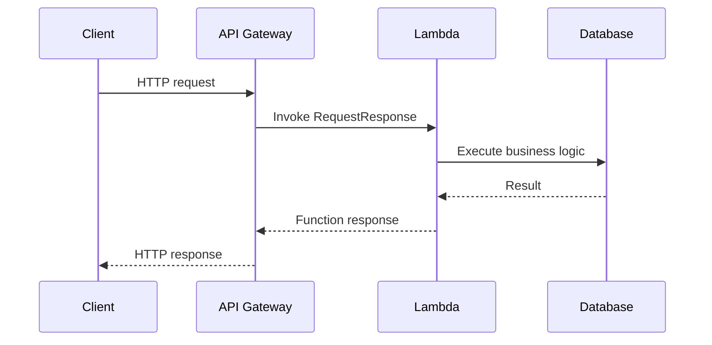
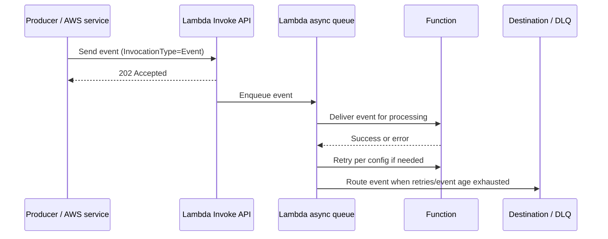
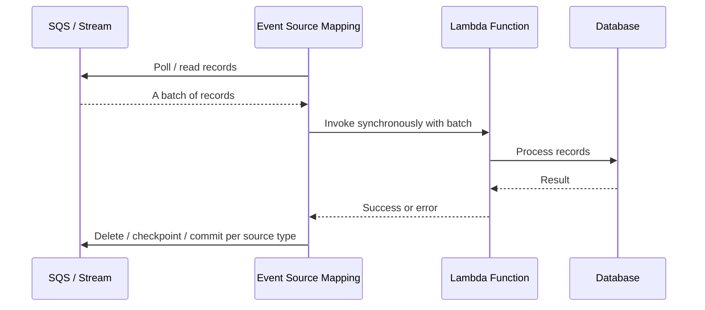
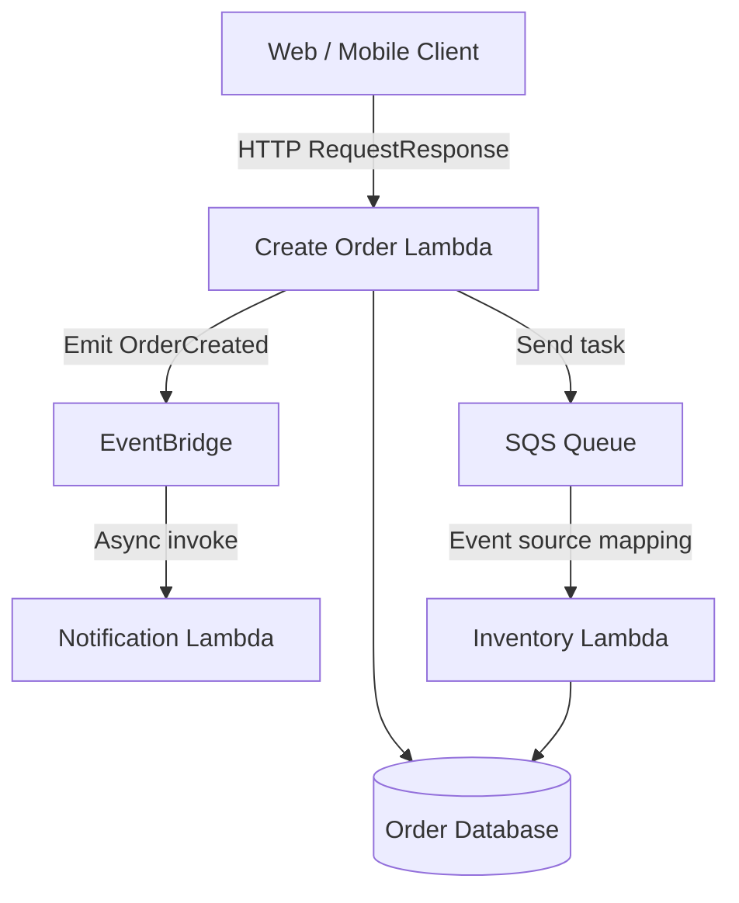

# Comparing Synchronous, Asynchronous, and Event Source Mapping Invocations

AWS Lambda has multiple ways to receive work. Sometimes the caller needs an immediate result in the same request; sometimes it only needs to send an event for Lambda to process later; and sometimes Lambda actively reads messages or records from queues and event streams. These three modes correspond to **synchronous invocation**, **asynchronous invocation**, and **event source mapping (ESM)**.

A common point of confusion is that an event source mapping also invokes Lambda synchronously at the per-batch level, even though producer and consumer are decoupled via a queue or stream. ESM is the mechanism by which Lambda polls a data source, builds batches, and invokes the function; it is not the same as a service pushing an event into Lambda's internal asynchronous queue.

## 1. Three Models Viewed from Data Flow

```mermaid
flowchart TD
    subgraph SYNC[Synchronous - RequestResponse]
        A[Client / API Gateway] -->|Call and wait| F1[Lambda Function]
        F1 -->|Response or error| A
    end
    subgraph ASYNC[Asynchronous - Event]
        B[EventBridge / S3 / SNS / SDK] -->|Send event| Q[Lambda async queue]
        Q -->|Deliver event| F2[Lambda Function]
        F2 -->|Retry / destination / DLQ when needed| Q
    end
    subgraph ESM[Event source mapping - Poll and invoke in batches]
        S[SQS / Kinesis / DynamoDB Streams / Kafka] -->|Lambda poller reads| P[Event source mapping]
        P -->|Invoke function with batch| F3[Lambda Function]
        F3 -->|Batch processing result| P
        P -->|Delete / checkpoint / commit per source| S
    end
```



| Model | Who initiates the invocation? | Does the sender wait for the function result? | How does Lambda receive data? |
|---|---|---|---|
| Synchronous | Client, API Gateway, Function URL, ALB, or SDK calling Lambda | Yes | One request and returns response to caller |
| Asynchronous | AWS service or SDK sends event | No; sender only receives acceptance confirmation | Lambda places event into internal queue for later processing |
| Event source mapping | Lambda poller reads configured queue/stream | Producer does not wait; poller invokes function and waits for batch result | Function receives one or more records in a batch |

Choosing the model determines who is responsible for retries, how success is determined, how messages are acknowledged, and where to monitor when errors occur.

## 2. Synchronous Invocation: RequestResponse

With synchronous invocation, the caller sends a request and waits for Lambda to finish. AWS Lambda calls this type `RequestResponse`. The caller receives the returned payload if the function succeeds; if the function throws an exception or times out, the caller receives error details per the integration protocol.

Common cases:

- Client calls API Gateway; API Gateway forwards the HTTP request to Lambda and converts the result into an HTTP response.
- Client calls a Lambda Function URL and waits for a response.
- One Lambda function calls another using the AWS SDK with `InvocationType.RequestResponse`.
- A backend application invokes Lambda directly with the `lambda:InvokeFunction` permission.



### 2.1. Characteristics and Error Handling

The caller holds the request open while the function runs. Consequently, latency of the function and any services it calls sits directly on the response path. If the function is slow, the client or gateway may time out before receiving a result. Set sensible timeouts at each layer, keep the processing path short, and do not use a single HTTP request to wait on long-running background workflows.

With the direct Invoke API, the caller must check both the API status and the `FunctionError` field in the response. A Lambda call may be accepted successfully at the Invoke API layer while function execution itself returned an error. With API Gateway, the final HTTP response also depends on the integration type and configured error mappings.

Lambda does not automatically retry a synchronous invocation just because the function returns an error. The caller decides whether to retry. If a client retries after a timeout, the previous run may have already completed business logic while the response was lost on the way back. Therefore, write APIs should support an idempotency key or a stable operation identifier so repeated requests do not cause duplicate side effects.

### 2.2. Responses in Java

With HTTP API Gateway payload format 2.0, a Java handler can receive events and return corresponding responses. Illustrative example using AWS Lambda Java Events:

```java
import com.amazonaws.services.lambda.runtime.Context;
import com.amazonaws.services.lambda.runtime.RequestHandler;
import com.amazonaws.services.lambda.runtime.events.APIGatewayV2HTTPEvent;
import com.amazonaws.services.lambda.runtime.events.APIGatewayV2HTTPResponse;
import java.util.Map;

public final class HealthHandler implements
        RequestHandler<APIGatewayV2HTTPEvent, APIGatewayV2HTTPResponse> {

    @Override
    public APIGatewayV2HTTPResponse handleRequest(
            APIGatewayV2HTTPEvent request,
            Context context) {

        return APIGatewayV2HTTPResponse.builder()
                .withStatusCode(200)
                .withHeaders(Map.of("content-type", "application/json"))
                .withBody("{\"status\":\"ok\"}")
                .build();
    }
}
```

This is a condensed example; import `java.util.Map` and use a compatible `aws-lambda-java-events` version. Event/response structures must match the payload format chosen in API Gateway. If using a different REST API payload format, event types and response mappings may differ.

## 3. Asynchronous Invocation: Event

With asynchronous invocation, the sender asks Lambda to accept an event and continues its work without waiting for the function to complete. AWS Lambda accepts the event, places it in an internal queue, and processes it later. With the Invoke API, this mode is selected via `InvocationType.Event`; integrations such as EventBridge, S3, and SNS also typically trigger Lambda asynchronously.



The `202 Accepted` status only indicates that Lambda accepted the event for asynchronous processing. It does not prove the function ran successfully or that business work finished. The producer typically does not receive the handler's `return` value. If results need to be published, the function must persist status, emit a result event, or invoke a designed callback/API.

### 3.1. Retries and Duplicate Delivery

If the function errors, Lambda can retry according to the async invocation policy. For function errors, Lambda performs additional attempts by default; throttling or system errors may be retried with backoff while the event remains valid. Retry attempts, maximum event age, and expiration behavior are configurable. Verify actual configurations rather than relying on defaults.

Lambda's asynchronous queue provides at-least-once delivery semantics. Thus, an event may be processed multiple times, including cases where the function already succeeded but the system could not reliably record delivery confirmation. Consumers must be idempotent. Use an event ID or stable business operation ID; record processing status within the same transaction as business updates whenever possible.

### 3.2. Destinations and Dead-Letter Queues

For async invocations, Lambda supports configuring destinations for success or failure outcomes. A destination receives an invocation record with metadata and relevant request/response details. A dead-letter queue (DLQ) is a way to retain unprocessable events for investigation or replay; DLQs are commonly used for failure flows.

Destinations and DLQs serve different purposes:

- **On-success destination:** records successful invocations for downstream continuation or audit storage.
- **On-failure destination:** receives failed invocation details after retry policies or event age expire.
- **DLQ:** retains the original unprocessable event; metadata visibility and redrive workflows differ from destinations.

Access permissions, retention, encryption, and replay procedures must be designed for both destinations and DLQs. Do not assume events are retained indefinitely in Lambda's internal queue.

### 3.3. When to Use Async Invocation?

Async fits when the caller only needs confirmation that the request was accepted while the work can finish later. Examples: sending notifications, processing images, recording business events, generating background reports, or triggering a downstream step that does not need to return immediate results to the user.

If the caller needs to track progress, generate a `jobId` and store states such as `PENDING`, `RUNNING`, `SUCCEEDED`, or `FAILED`. The intake API can return `202 Accepted` with the `jobId`; the client queries a separate status endpoint. Do not treat a `202` response as proof that work has completed.

## 4. Event Source Mapping: Lambda Polls a Queue or Stream

An event source mapping is a configuration resource connecting an event source to a Lambda function. Lambda manages a poller to read data from the source, groups records into batches, and invokes the function. This model is often called *pull-based integration* because Lambda actively pulls data from the source.

Common sources include:

- Amazon SQS queues.
- Kinesis Data Streams.
- DynamoDB Streams.
- Amazon MSK or self-managed Kafka clusters.
- Amazon MQ and other Lambda-supported data sources.



ESM invokes the function synchronously per batch: the poller waits for the function result to decide the next step. However, the producer neither invokes Lambda directly nor waits for the function response. This is a key distinction from `InvocationType.Event`.

### 4.1. Event Source Mapping Configuration

An ESM can include settings such as:

- **Event source ARN and function:** specifies the queue/stream and target function.
- **Starting position:** where reading begins for streams, such as `TRIM_HORIZON` or `LATEST` depending on source.
- **Batch size:** maximum number of records passed in a single invocation.
- **Maximum batching window:** how long the poller waits to gather additional records before invoking the function, if supported by the source.
- **Enabled:** enables or pauses the mapping.
- **Filter criteria:** forwards only matching records to the function if supported by the source and format.
- **Concurrency controls:** limits parallel processing or concurrent batches depending on source type.
- **Failure handling:** retries, maximum record age, attempt limits, and failure destination depending on source.

Large batches can increase throughput and reduce invocation counts, but increase batching wait time, memory usage, and the blast radius of records retried on failure. Measure with actual payload sizes and processing durations.

### 4.2. SQS Event Source Mapping

With SQS, Lambda polls messages from the queue and invokes the function with a batch. When the function succeeds, Lambda deletes messages from the queue. If the function errors or times out, messages are not deleted and may reappear after the visibility timeout. This is an at-least-once mechanism; messages can be delivered multiple times.

If one message in a batch fails, by default the entire batch may be treated as failed and even successfully processed messages may be redelivered. You can enable **partial batch response** via `ReportBatchItemFailures` so the function returns the list of failed messages; Lambda retries only those messages.

Illustrative Java example using AWS Lambda Java Events:

```java
import com.amazonaws.services.lambda.runtime.Context;
import com.amazonaws.services.lambda.runtime.RequestHandler;
import com.amazonaws.services.lambda.runtime.events.SQSEvent;
import com.amazonaws.services.lambda.runtime.events.SQSBatchResponse;
import java.util.ArrayList;
import java.util.List;

public final class SqsOrderHandler
        implements RequestHandler<SQSEvent, SQSBatchResponse> {

    @Override
    public SQSBatchResponse handleRequest(SQSEvent event, Context context) {
        List<SQSBatchResponse.BatchItemFailure> failures = new ArrayList<>();

        for (SQSEvent.SQSMessage message : event.getRecords()) {
            try {
                processIdempotently(message.getBody());
            } catch (RetryableProcessingException ex) {
                failures.add(new SQSBatchResponse.BatchItemFailure(
                        message.getMessageId()));
            }
        }

        return new SQSBatchResponse(failures);
    }

    private void processIdempotently(String body) {
        // Parse, validate, then update business state using a stable event ID.
    }
}
```

This snippet is an illustrative example; `RetryableProcessingException` is an application exception. Add a compatible `aws-lambda-java-events` dependency, enable `ReportBatchItemFailures` in the event source mapping, and handle non-retryable errors according to your own policy. Do not catch all exceptions and return an empty failure list, as failed messages could be deleted from the queue. For FIFO queues, preserve ordering: when a message fails, stop processing subsequent messages in the corresponding group and report unprocessed messages as failures following partial batch response rules.

The SQS queue also needs a visibility timeout long enough relative to function execution time and batching window; if too short, messages may be redelivered while the prior invocation is still running. Configure a redrive policy on the queue to move messages exceeding maximum receive counts to a DLQ.

### 4.3. Kinesis and DynamoDB Streams

With Kinesis Data Streams and DynamoDB Streams, ESM reads records per shard and invokes the function in batches. Lambda advances the checkpoint only after the batch is processed successfully per the source's mechanism. If a batch fails, Lambda may retry that batch by default; this can block subsequent records in the shard until the error is resolved or discarded according to configuration.

Important options include:

- `BisectBatchOnFunctionError`: splits a failing batch into smaller parts to isolate the offending record.
- `MaximumRetryAttempts`: limits the number of retries.
- `MaximumRecordAgeInSeconds`: limits the age of records processed.
- `DestinationConfig`: configures a destination to store failed records when error conditions expire, depending on source.
- `ReportBatchItemFailures`: allows the function to report partial batch failures; for streams, return the exact sequence number in the format AWS requires.
- `ParallelizationFactor`: increases the number of batches processed concurrently per shard within supported limits.

Increasing parallelism can boost throughput, but you must understand record ordering by shard and partition key. If business logic requires sequential processing, do not increase concurrency or skip failed records in ways that corrupt state ordering.

### 4.4. Kafka and Other Pull Sources

With Amazon MSK or self-managed Kafka clusters, ESM manages consumer pollers, reads records per topic/partition, and invokes Lambda in batches. Offset advancement, retries, and failed-record storage depend on event source mapping configuration and cluster type. Provide appropriate network access, authentication credentials, and topic read permissions; if using secrets for authentication, manage them via Secrets Manager or a supported mechanism.

Do not copy SQS ACK rules directly onto Kinesis or Kafka. SQS deletes messages upon successful processing; streams retain records for their retention period and use checkpoints/offsets to track read positions. Each source has distinct error, ordering, and replay semantics.

## 5. Detailed Comparison of the Three Trigger Modes

| Criterion | Synchronous | Asynchronous | Event source mapping |
|---|---|---|---|
| API/invocation type | `RequestResponse` | `Event` | Poller invokes function in batches |
| Sender waits for function result | Yes | No | Producer does not wait; poller waits for batch result |
| How data enters | One request/event | One event into Lambda's async queue | One batch of records from queue/stream |
| Success outcome | Response returned to caller | Event processed; caller receives no return value | Batch acknowledged/deleted/checkpointed per source |
| Primary retries | Caller decides | Lambda async retry policy | ESM and source service per source type |
| Duplicates | Possible via caller retry after timeout | Possible due to at-least-once | Possible due to visibility timeout, batch retry, or uncommitted offset |
| Primary monitoring | Latency, timeouts, HTTP/function errors | Async event age, retries, dropped events, destination/DLQ | Queue age/depth, iterator age/lag, retries, batch failures, DLQ |
| Example | Read/write API needing immediate response | EventBridge triggering background processing | SQS triggering order processing worker |

## 6. Access Permissions and Security Configuration

Access permissions differ by model:

- **Synchronous:** the caller's identity needs `lambda:InvokeFunction` when calling directly. With API Gateway, ALB, or integrated services, Lambda needs a resource-based permission allowing that service to invoke the function.
- **Asynchronous:** push services like S3, SNS, or EventBridge must be permitted to invoke Lambda via a resource-based policy. Callers using the SDK directly need appropriate invoke permissions.
- **Event source mapping:** Lambda needs permission to read the data source. With SQS, permissions to read/delete messages typically live in the function's execution role; with streams, the role needs shard/record read permissions and supporting actions. Kafka may require network access and secret access permissions.

Apply least privilege: allow only the right function to read the right queue/topic, grant publish permissions only to the right event bus, and restrict permissions to view or replay DLQs. Do not embed access keys in events or artifacts; use execution roles and a secret manager.

## 7. Observability and Troubleshooting

Each model requires specific metrics to detect failures:

| Model | Metrics to monitor | Operational question |
|---|---|---|
| Synchronous | `Duration`, `Errors`, `Throttles`, `ConcurrentExecutions`, API latency and timeouts | Are requests slow or failing before the caller receives a response? |
| Asynchronous | `AsyncEventsReceived`, `AsyncEventAge`, `AsyncEventsDropped`, retries, and events sent to destination/DLQ | Are events waiting too long, expiring, or being dropped? |
| SQS ESM | `ApproximateAgeOfOldestMessage`, queue depth, DLQ message count, Lambda errors/throttles | Is the queue backing up or are messages being redelivered repeatedly? |
| Kinesis/DynamoDB Streams | `IteratorAge`, batch failures, retries, and shard/consumer lag | Is the consumer falling behind the producer or blocked by a poison record? |
| Kafka ESM | Consumer lag, batch processing duration, poll/auth/network errors | Can the poller read partitions and keep up with the write rate? |

Logs should include the Lambda request ID, event ID or message ID, correlation ID, and standardized error codes. Do not log full payloads if they contain sensitive data. With batches, log failed records individually so investigation and controlled replay are possible.

## 8. Choosing a Model by Business Requirements

Start by asking what the caller needs:

1. **Need an immediate response to display or decide the next step?** Use synchronous. Keep processing short, set timeouts, and design idempotency for write requests.
2. **Only need to accept the work and process it later?** Use asynchronous. Return an accepted status, configure retries/age/destinations, and track outcomes via state or another event.
3. **Data is already in a queue or stream and Lambda must consume continuously in batches?** Use event source mapping. Choose batch size, batching window, concurrency, checkpoint/ACK, and error policy matching the source.

For example, an ordering system might use all three models:



The order creation API uses synchronous invocation to return the order ID. EventBridge triggers notification asynchronously because sending emails does not belong on the response path. SQS and an event source mapping trigger the inventory worker in batches, using retries and idempotency to handle duplicate deliveries. This is an architectural example; broker choices and event emission must ensure consistency with the order creation transaction.

## 9. Pre-Deployment Checklist

- Have you confirmed whether the trigger is direct synchronous invoke, asynchronous invoke, or event source mapping?
- If synchronous, how does the caller handle timeouts and retries? Does the write API have an idempotency key?
- If asynchronous, are retry attempts, maximum event age, destinations, or a DLQ configured?
- If using ESM, is the source SQS, a stream, or Kafka? Who polls, who acknowledges, and when is the checkpoint updated?
- Are batch size, batching window, visibility timeout, function timeout, and concurrency compatible?
- Is partial batch response enabled when needed and returning the exact format required by the source?
- Is the consumer idempotent when messages or records are redelivered?
- Do invoke permissions, source read permissions, publish permissions, and replay permissions follow least privilege?
- Are latency, async event age, queue age, iterator age/consumer lag, retries, and DLQs monitored?
- Have failures been tested at every point: before processing, during processing, and after business commit but before ACK/offset commit?

## Conclusion

Synchronous invocation fits when the caller needs an immediate response and controls retries itself. Asynchronous invocation fits when Lambda just needs to accept an event and process it later, with retries and destinations managed by Lambda. Event source mapping fits when Lambda polls a queue or stream, groups records into batches, and invokes the function synchronously to obtain the batch outcome. Choosing the right model requires understanding who waits on whom, who owns retries, when messages are acknowledged, and how consumers guard against duplicate processing.
