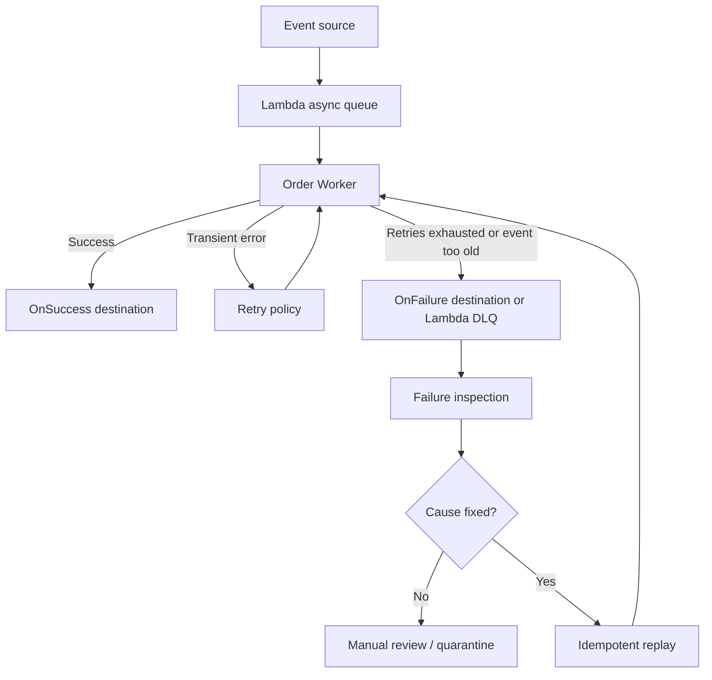

# Configuring Lambda Destinations and Dead-Letter Queues

## 1. Why Do We Need a Place to Store Failed Events?

AWS Lambda is commonly used to process events from S3, SNS, EventBridge, SQS, Kinesis, or DynamoDB Streams. When a function fails, some triggers retry; some hold messages in a queue and redeliver them later; and streams can hold a shard at the failing position to preserve ordering. If processing still fails after the permitted time or attempts, the system needs to retain information for investigation and recovery.

Without a configured place to store failed events, events can be discarded from the pipeline once retries or retention expire. Operations teams then struggle to tell which events were dropped, why the function failed, and what data needs to be replayed. Dead-letter queues (DLQs) and destinations establish a landing zone for incomplete events or invocations.

In AWS Lambda, distinguish three mechanisms:

1. **Asynchronous invocation destination:** receives an invocation record when an asynchronous invocation succeeds or fails. The record contains request and response details.
2. **Lambda dead-letter queue:** receives the event payload discarded from Lambda's internal asynchronous queue after exhausting retries or age limits. A DLQ is typically SQS Standard or SNS Standard.
3. **Event source mapping on-failure destination or source DLQ:** handles failed batches when Lambda polls SQS/streams. Configuration depends on source type; for SQS, the redrive policy and DLQ belong on the source queue itself.

These three mechanisms are not interchangeable. Configuring the wrong one can cause events not to be retained as expected or store records lacking enough data to replay. <https://docs.aws.amazon.com/lambda/latest/dg/invocation-async-retain-records.html>

## 2. Identify the Invocation Type Before Configuring

Lambda has multiple ways to receive invocations. Retry policies and error storage locations depend on how the function is invoked.

| Invocation type | Examples | Who owns retries? | Appropriate error storage |
|---|---|---|---|
| Synchronous | API Gateway calling Lambda, SDK using `RequestResponse` | Caller or invoking service | Caller logs errors; separate workflow/queue can be used if retries are needed |
| Asynchronous | S3, SNS, EventBridge, or SDK using `Event` | Lambda manages the asynchronous event queue | Async destination or Lambda DLQ |
| Event source mapping reading queue | Lambda polling SQS | Event source mapping and SQS visibility timeout | DLQ on the source queue, partial batch response |
| Event source mapping reading stream | Kinesis, DynamoDB Streams, Kafka | Event source mapping per batch/shard/partition | Mapping's on-failure destination and retry policy |

With synchronous invocations, the caller waits for the result and receives an error response. Lambda function-level DLQs and asynchronous destinations do not automatically apply to this call type. If an API client needs retries, the client or API orchestration must implement appropriate retry policies and idempotency.

With asynchronous invocations, Lambda places the event in an internal queue and processes it later. The caller only knows the event was accepted; it does not receive the function's final result. Lambda manages retries and can send a record to a destination or DLQ when an event is discarded.

With event source mappings, Lambda creates a poller to read a queue or stream and passes batches of records to the function. This mechanism has its own checkpoints, visibility timeouts, batch retries, and partial batch responses. Do not configure a Lambda async DLQ on an SQS source mapping expecting it to replace SQS's redrive policy.

## 3. How Does Lambda Asynchronous Invocation Work?

When a service invokes Lambda asynchronously, Lambda stores the event in an internal queue. The function runs when processing capacity is available. If the function returns an error or times out, Lambda may retry according to policy. When an event exceeds maximum age or exhausts retry attempts, Lambda discards it from the queue and sends it to the configured on-failure destination or DLQ.

### Default Retries

For function or runtime errors, Lambda retries up to two additional times by default:

- First attempt after the event is accepted.
- First retry typically after roughly one minute.
- Subsequent retry typically after roughly two minutes.

Throttling errors (HTTP 429) and 5xx system errors are handled differently: Lambda returns the event to the queue and may keep retrying for up to six hours by default. Backoff grows exponentially, from roughly one second up to five minutes maximum. When the queue grows long, Lambda may increase backoff and slow down reading to reduce pressure on the function.

Even when a function returns success, an event can still be delivered multiple times because the asynchronous queue is eventually consistent. Thus, handlers must be idempotent, and "async invocation" must never be treated as an exactly-once guarantee.

### Two Error-Control Parameters

| Parameter | Meaning | Configuration range |
|---|---|---|
| `MaximumRetryAttempts` | Number of times Lambda retries when the function returns an error | 0 to 2 retries for async invocations |
| `MaximumEventAgeInSeconds` | Maximum age Lambda keeps an event in the async queue before discarding | 60 seconds to 21,600 seconds (6 hours) |

Default values are typically two retries and a maximum age of six hours. The maximum age parameter also bounds how long an event waits when the queue backs up. Setting it too low risks dropping events when the function is only temporarily slow. Setting it too high risks processing stale events after business state has changed.

`MaximumRetryAttempts` controls retries for function/runtime errors. Throttling and system errors have separate retry handling; `MaximumEventAgeInSeconds` still limits how long Lambda holds the event in the queue. Hence, setting `MaximumRetryAttempts=0` does not mean every system error is discarded immediately.

Choose retry attempts and event age based on SLA. For example, a status-update notification can tolerate a few minutes of delay; a payment event requires strict age limits and reconciliation so expired requests are never processed.

## 4. What Is an Async Destination?

A destination receives an **invocation record** when Lambda finishes processing an async invocation under configured conditions. Two separate conditions can be configured:

- `OnSuccess`: the function processed the event successfully.
- `OnFailure`: the event exhausted retries or exceeded maximum age without succeeding.

A destination stores more than just the original event. The invocation record also includes function metadata, request ID, invocation count, response status, and result payload. This aids auditing, failure investigation, and orchestrating downstream steps.

Supported destination types for async invocations:

| Destination | Condition | Execution role permissions | Received content |
|---|---|---|---|
| SQS Standard | Success or failure | `sqs:SendMessage` | Invocation record in message body |
| SNS Standard | Success or failure | `sns:Publish` | Invocation record in message body |
| Lambda function | Success or failure | `lambda:InvokeFunction` | Invocation record as payload |
| EventBridge event bus | Success or failure | `events:PutEvents` | Invocation record inside `detail` |
| S3 bucket | Failure only | `s3:PutObject`, `s3:ListBucket` | Invocation record saved as JSON object |

SQS FIFO and SNS FIFO are not valid targets for async Lambda destinations. If FIFO ordering is needed, design an intermediate step rather than choosing a FIFO queue directly as a destination.

### What Is the Structure of an Invocation Record?

A record typically contains these fields:

- `version`: record format version.
- `timestamp`: time Lambda generated the record.
- `requestContext`: request ID, function ARN, trigger condition, and approximate invocation count.
- `requestPayload`: original event sent to the function.
- `responseContext`: status code, executed version, and error type if any.
- `responsePayload`: returned result or error details.

Condensed example:

```json
{
  "version": "1.0",
  "timestamp": "2026-11-17T10:15:30.000Z",
  "requestContext": {
    "requestId": "req-8f21",
    "functionArn": "arn:aws:lambda:ap-southeast-1:123456789012:function:order-worker:prod",
    "condition": "RetriesExhausted",
    "approximateInvokeCount": 3
  },
  "requestPayload": {
    "eventId": "evt-2048",
    "orderId": "ORD-2048",
    "type": "OrderCreated"
  },
  "responseContext": {
    "statusCode": 200,
    "executedVersion": "12",
    "functionError": "Unhandled"
  },
  "responsePayload": {
    "errorMessage": "Database temporarily unavailable"
  }
}
```

Values in this example are illustrative only. Exact contents depend on the invocation and error type. When processing the record, use `requestContext.condition` and metadata fields to classify failures while keeping `requestPayload` as the original invocation input.

## 5. How Does a Lambda DLQ Differ from an Async Destination?

A Lambda DLQ is an alternative to an async on-failure destination. It receives events discarded from the async queue after exhausting retries or maximum age. A function-level DLQ supports only:

- Amazon SQS Standard queue.
- Amazon SNS Standard topic.

SQS FIFO queues and SNS FIFO topics are not supported as Lambda function-level DLQs.

The critical difference lies in what gets sent:

| Criterion | Async on-failure destination | Lambda DLQ |
|---|---|---|
| Primary data | Invocation record | Original event |
| Response/error details | Includes `responseContext`, `responsePayload`, and metadata | No full response payload; includes error message attributes |
| Target types | SQS, SNS, Lambda, EventBridge; S3 on failure only | SQS Standard or SNS Standard |
| Configuration scope | Per function, version, or alias | Function-level |
| Purpose | Detailed troubleshooting, auditing, routing, or chaining | Retain discarded events for recovery or investigation |

With a DLQ, Lambda sends the original event plus several message attributes:

- `RequestID`: invocation ID.
- `ErrorCode`: HTTP code representing the error.
- `ErrorMessage`: beginning of the error message, up to roughly 1 KB.

Because a DLQ holds only the original event and limited metadata, it lacks the full response provided by destinations. If you need to see what the function returned or deeply analyze why it failed, an on-failure destination is usually better suited.

AWS documents DLQs as an alternative to on-failure destinations. Do not configure both expecting an event to be delivered automatically to both places simultaneously. If fan-out is needed, use a destination like SNS or EventBridge and route to multiple consumers.

## 6. Choosing SQS or SNS for DLQs and Destinations

### Choose SQS Standard When

- A worker or worker pool needs to receive and process failed events.
- You want to rate-limit recovery speed and control backlog depth.
- Messages must stay retained until a consumer processes and deletes them successfully.
- You want to use redrive tasks or controlled replay workflows.

### Choose SNS Standard When

- Multiple systems need notification of the same failed invocation.
- You want to fan out to another Lambda, SQS, HTTP endpoints, or email subscriptions.
- An orchestration service is responsible for distributing follow-up events.

### Choose EventBridge When

- You need to route invocation records by attributes, error types, or function.
- You want to connect multiple rules/targets while preserving an event-driven model.
- You need to decouple record emission from downstream consumers.

### Choose S3 When

- Long-term archival, auditing, or batch analytics on failed invocations are required.
- Payloads exceed sizes suitable for SNS.
- You want invocation records stored as objects for later processing.

S3 is an async destination only on failure. With an S3 destination, protect the bucket, write permissions, and encryption. Never delete a bucket configured as a destination without first removing the Lambda configuration; if someone else recreates that bucket name in another account, records could be sent there and leak data.

## 7. Configuring Async Invocation Destinations with the AWS CLI

Before configuring, create the destination and grant permissions to the function's execution role. The example below sends failed invocation records to SQS Standard and successful records to EventBridge:

```bash
aws lambda update-function-event-invoke-config \
  --function-name order-worker:prod \
  --maximum-event-age-in-seconds 3600 \
  --maximum-retry-attempts 1 \
  --destination-config '{"OnFailure":{"Destination":"arn:aws:sqs:ap-southeast-1:123456789012:order-worker-failures"},"OnSuccess":{"Destination":"arn:aws:events:ap-southeast-1:123456789012:event-bus/order-audit"}}'
```

Explanation:

- `order-worker:prod` targets the function's `prod` alias.
- `MaximumEventAgeInSeconds=3600` limits event age to one hour.
- `MaximumRetryAttempts=1` permits one retry after the initial attempt.
- `OnFailure` sends failed invocation records to SQS.
- `OnSuccess` sends successful invocation records to EventBridge.

`update-function-event-invoke-config` updates only specified fields. Note that `put-function-event-invoke-config` replaces the existing async invocation configuration; omitted fields may revert to defaults. When modifying part of a live configuration, prefer `update` and verify with `get-function-event-invoke-config`.

Read back the configuration:

```bash
aws lambda get-function-event-invoke-config \
  --function-name order-worker:prod
```

### Configuring a Lambda DLQ with the AWS CLI

If choosing a Lambda function-level DLQ, create the SQS Standard queue or SNS Standard topic first, then update the function configuration:

```bash
aws lambda update-function-configuration \
  --function-name order-worker \
  --dead-letter-config TargetArn=arn:aws:sqs:ap-southeast-1:123456789012:order-worker-dlq
```

Verify the configuration:

```bash
aws lambda get-function-configuration \
  --function-name order-worker
```

`DeadLetterConfig.TargetArn` must point to the right queue or topic. Do not confuse `DeadLetterConfig` with `DestinationConfig`: they are two separate mechanisms with different message formats.

## 8. Configuring IAM Permissions for Destinations

Lambda uses the function's execution role to deliver records to destinations. Least-privilege permissions depend on the target type:

| Destination | Required IAM actions |
|---|---|
| SQS | `sqs:SendMessage` |
| SNS | `sns:Publish` |
| Lambda | `lambda:InvokeFunction` |
| EventBridge | `events:PutEvents` |
| S3 | `s3:PutObject`, `s3:ListBucket` |
| S3 encrypted with customer-managed KMS key | Also `kms:GenerateDataKey` and matching key policy permissions |

Example least-privilege policy to send invocation records to an SQS queue:

```json
{
  "Version": "2012-10-17",
  "Statement": [
    {
      "Sid": "SendFailureRecords",
      "Effect": "Allow",
      "Action": "sqs:SendMessage",
      "Resource": "arn:aws:sqs:ap-southeast-1:123456789012:order-worker-failures"
    }
  ]
}
```

Attach the policy to the execution role used by the function. If the destination lives in a different AWS account, you also need a resource policy on the queue/topic/bucket or equivalent cross-account permissions. If the destination uses a customer-managed KMS key, verify both role permissions and the key policy; granting SQS/SNS permissions alone is insufficient.

Do not grant `sqs:*`, `sns:*`, or `s3:*` across all resources just to make destinations work. Scope permissions to the exact ARN, action, and account. For S3, use the `s3:ResourceAccount` condition to ensure the target bucket belongs to a trusted account.

## 9. Event Source Mapping Destinations Differ from Async Destinations

An event source mapping (ESM) is a Lambda resource that polls a queue or stream and invokes a function in batches. Common sources include:

- Amazon SQS.
- Amazon Kinesis Data Streams.
- DynamoDB Streams.
- Amazon MSK and self-managed Kafka.
- Amazon MQ and Amazon DocumentDB.

When a function fails to process a batch, ESM applies its own policy. For streams, Lambda can retry batches, cap record age, limit attempt counts, bisect batches to isolate failing records, and send invocation records to an on-failure destination.

Do not use async invocation's `MaximumRetryAttempts` or `MaximumEventAgeInSeconds` to reason about ESM retries. ESM uses its own properties—such as `MaximumRetryAttempts`, `MaximumRecordAgeInSeconds`, `BisectBatchOnFunctionError`, and `DestinationConfig.OnFailure`—on the event source mapping resource.

### Kinesis and DynamoDB Streams

With streams, a single failing record can stall a shard until it succeeds or expires. Common settings include:

| ESM parameter | Meaning |
|---|---|
| `MaximumRetryAttempts` | Number of times to retry a failing batch; `-1` typically indicates unlimited retries for supported streams |
| `MaximumRecordAgeInSeconds` | Maximum record age; `-1` uses the stream's retention limit |
| `BisectBatchOnFunctionError` | Splits failing batches into smaller batches to isolate offending records |
| `DestinationConfig.OnFailure` | Target receiving an invocation record when Lambda discards a batch after exhausting policies |
| `FunctionResponseTypes=ReportBatchItemFailures` | Lets the function report the first failing record for more precise checkpointing/retries |

Limits and capabilities depend on source type. DynamoDB Streams retain records for 24 hours. Kinesis Data Streams retain records for 24 hours by default and can extend retention up to 365 days; retention beyond 24 hours may incur extra charges. Increasing retention after a record expires does not recover old records. Once records expire past retention, destination metadata alone may not suffice to restore original payloads.

Example mapping configuration for Kinesis:

```bash
aws lambda create-event-source-mapping \
  --function-name order-stream-worker \
  --event-source-arn arn:aws:kinesis:ap-southeast-1:123456789012:stream/orders \
  --starting-position TRIM_HORIZON \
  --maximum-retry-attempts 3 \
  --maximum-record-age-in-seconds 3600 \
  --bisect-batch-on-function-error \
  --destination-config '{"OnFailure":{"Destination":"arn:aws:sqs:ap-southeast-1:123456789012:order-stream-failures"}}'
```

Mappings are created or updated asynchronously. Use `get-event-source-mapping` to verify status and configuration once AWS completes the update.

### Contents of Stream On-Failure Destinations

For Kinesis and DynamoDB Streams, invocation records sent to SQS or SNS typically contain metadata such as:

- Shard ID.
- Start and end sequence numbers of the batch.
- Approximate arrival timestamps of first/last records.
- Batch size and stream ARN.
- Function info, request ID, condition, and approximate invoke count.

For SQS/SNS destinations, record metadata does not necessarily include the full original record payloads. Consumers must use the shard and sequence numbers to re-read records from the stream before retention expires. With S3 destinations, Lambda also stores the full invocation record along with original payloads in the format described by AWS documentation.

This is a critical distinction when designing recovery pipelines. If you need to keep payloads long-term independently of stream retention, choose an S3 destination or proactively archive data before expiration.

## 10. SQS Event Source Mapping: The DLQ Lives on the Source Queue

When Lambda polls an SQS queue, messages remain in the queue but become temporarily hidden for the `VisibilityTimeout`. If the function processes the batch successfully, Lambda deletes the messages. If the invocation fails, messages become visible again after the visibility timeout expires and are redelivered.

For SQS event source mappings, configure the DLQ on the **source queue** using an SQS redrive policy. Do not configure a Lambda function-level `DeadLetterConfig` expecting it to replace the redrive policy.

Example redrive policy:

```bash
aws sqs set-queue-attributes \
  --queue-url https://sqs.ap-southeast-1.amazonaws.com/123456789012/orders \
  --attributes '{"RedrivePolicy":"{\"deadLetterTargetArn\":\"arn:aws:sqs:ap-southeast-1:123456789012:orders-dlq\",\"maxReceiveCount\":\"5\"}"}'
```

`maxReceiveCount` determines how many times a message is received before SQS moves it to the DLQ. AWS recommends setting at least around five so Lambda has room to retry before messages are moved; the exact value should align with application latency and error patterns.

Source queue and DLQ types must also match: FIFO queues use FIFO DLQs; Standard queues use Standard DLQs. This rule applies to SQS redrive, unlike Lambda function-level DLQs which only support SQS Standard or SNS Standard.

The source queue's visibility timeout must be long enough for batch processing and retries. AWS guidance recommends setting visibility timeout to at least six times the function timeout to allow buffer for throttling and retries. Function timeout must also be less than or equal to visibility timeout. Also account for any configured batching window.

### Partial Batch Response for SQS

By default, if one message in a batch fails and the function throws an exception, the entire batch may be redelivered—including messages already processed successfully. This causes duplicates and wastes invocations.

Enable `ReportBatchItemFailures` on the event source mapping so the function returns a list of failed messages:

```bash
aws lambda update-event-source-mapping \
  --uuid 11111111-2222-3333-4444-555555555555 \
  --function-response-types ReportBatchItemFailures
```

Response format:

```json
{
  "batchItemFailures": [
    { "itemIdentifier": "sqs-message-id-2" }
  ]
}
```

Lambda makes only the failed messages visible again per the partial batch response. If the function throws an uncaught exception instead of returning a valid response, the entire batch can still be treated as failed. For FIFO queues, stop processing after the first failure and return both the failed message and all subsequent unprocessed messages to preserve ordering.

Java example using AWS Lambda Java Events:

```java
import com.amazonaws.services.lambda.runtime.Context;
import com.amazonaws.services.lambda.runtime.RequestHandler;
import com.amazonaws.services.lambda.runtime.events.SQSEvent;
import com.amazonaws.services.lambda.runtime.events.SQSBatchResponse;

import java.util.ArrayList;
import java.util.List;

public final class OrdersQueueHandler
        implements RequestHandler<SQSEvent, SQSBatchResponse> {

    private final OrderProcessor processor = new OrderProcessor();

    @Override
    public SQSBatchResponse handleRequest(SQSEvent event, Context context) {
        List<SQSBatchResponse.BatchItemFailure> failures = new ArrayList<>();

        for (SQSEvent.SQSMessage message : event.getRecords()) {
            try {
                // Extract business eventId from body as the idempotency key;
                // SQS message ID should only identify items in the partial response.
                processor.processOnce(message.getBody());
            } catch (RetryableProcessingException ex) {
                failures.add(new SQSBatchResponse.BatchItemFailure(
                        message.getMessageId()));
            } catch (PermanentDataException ex) {
                // Treat as handled only if quarantine storage succeeds.
                processor.storeInQuarantine(message.getMessageId(), message.getBody(), ex);
            }
        }

        return new SQSBatchResponse(failures);
    }
}
```

This is an illustrative example; add the `aws-lambda-java-events` dependency and define `OrderProcessor` and exceptions for your application. If `storeInQuarantine` fails, let the invocation fail or add the message to the retry list; never acknowledge a message before isolation succeeds. With FIFO, stop on the first failing message and mark all subsequent messages as failures/unprocessed.

## 11. Partial Batch Response for Kinesis and DynamoDB Streams

With streams, record ordering within a shard matters. When a function processes a batch, by default Lambda advances the checkpoint to the end of the batch only if the entire batch succeeds. Enabling `ReportBatchItemFailures` lets the function return the first failing sequence number. Lambda retries from that position onward.

Example response:

```json
{
  "batchItemFailures": [
    { "itemIdentifier": "800000000003126276362" }
  ]
}
```

With streams, `itemIdentifier` is a sequence number per the event source contract; it is not an SQS message ID. If multiple failures are reported, Lambda uses the lowest sequence number as the checkpoint and retries from there. Therefore, parallel processing inside a shard requires care not to mark later records successful while earlier records are incomplete.

`BisectBatchOnFunctionError` can split a failing batch in half and retry to isolate poison records. It can be combined with partial batch response; when both are enabled, Lambda splits the batch at the reported failure position and retries the remainder per stream semantics.

## 12. Java Handlers Must Be Idempotent

Both async invocations and event source mappings can deliver events or messages more than once. A record sent to a DLQ can also be redriven and re-executed after a code fix. Consequently, every critical business side effect must be idempotent.

For example, a consumer records `eventId` in the same transaction as updating the order:

```java
public void processOnce(String eventId, OrderEvent event) {
    transactionTemplate.executeWithoutResult(status -> {
        boolean firstTime = processedEventRepository.insertIfAbsent(eventId);
        if (!firstTime) {
            return;
        }

        orderRepository.apply(event);
    });
}
```

`insertIfAbsent` must be guarded by a unique constraint or atomic database operation. Do not merely check if the event ID exists and then insert, as two concurrent Lambda invocations could both pass the check. If the data update fails, the transaction must roll back the processed marker too so retries can process it again.

With external APIs like payment providers, use a stable idempotency key for the same operation. If the function times out after the provider executed the transaction, query status using that key before resending. Never generate a new idempotency key on redrive if it represents the same business operation.

## 13. Recovering and Redriving Events from DLQs/Destinations

Sending an event to a DLQ is only retention. You need a process to identify root causes, fix issues, and reprocess safely.

Recommended workflow:

1. **Detect:** alert when the DLQ receives new messages, queue depth climbs, or oldest message age breaches thresholds.
2. **Investigate:** inspect event ID, request ID, function version, condition, error type, and invoke count.
3. **Classify:** bad data, code bug, permission error, transient dependency outage, or expired event.
4. **Fix root cause:** deploy fixed code/config, grant correct permissions, or repair business data.
5. **Verify idempotency:** confirm re-execution will not create duplicate transactions or side effects.
6. **Choose redrive method:** SQS redrive task, a DLQ consumer, or a dedicated recovery step for invocation records.
7. **Rate-limit:** replay in small batches to avoid causing a fresh load spike.
8. **Reconcile:** compare processed record counts, remaining failures, and final business state.

### Redriving from a Lambda DLQ

A Lambda DLQ holds the original event. You can attach the DLQ as an event source for a recovery function or pull messages via a consumer and re-invoke the appropriate handler. When replaying, preserve the original event ID and idempotency key.

### Redriving from an Async On-Failure Destination

An SQS destination holds an invocation record, not the raw original event directly in the message body. The recovery consumer must extract `requestPayload` to obtain the original event while retaining metadata such as `requestContext.requestId`, `condition`, and `approximateInvokeCount` for troubleshooting. Do not feed the raw invocation record into a business handler expecting the original event payload.

If the destination is EventBridge, use a rule/target or dedicated consumer to unwrap `detail` and feed `requestPayload` into recovery. If the destination is S3, read the JSON object and parse the invocation record before replaying.

### Redriving from a Stream Event Source Mapping

With Kinesis or DynamoDB Streams, SQS/SNS on-failure records may contain only shard/sequence metadata. Consumers must re-read the record from the stream before retention expires. If the record has aged out of the stream, an archive or canonical data source is needed to reconstruct it. Do not assume every failure destination stores the raw payload.

## 14. Monitoring Destinations and DLQs

A system may run functions successfully yet fail when delivering invocation records to destinations. Monitor both the function and its failure targets.

Useful metrics:

| Metric | Meaning | What to do when it rises |
|---|---|---|
| `Errors` | Invocations ending in errors | Check logs, exceptions, and executed version |
| `Throttles` | Lambda lacks sufficient concurrency | Adjust concurrency or incoming load |
| `AsyncEventAge` | Age of events in the async queue | Check backlog and processing rate |
| `AsyncEventsDropped` | Events dropped from the async queue | Check retry/age settings and destination/DLQ |
| `DestinationDeliveryFailures` | Lambda failed to send invocation record to destination | Check IAM, target type, payload size, and resource policy |
| `DeadLetterErrors` | Lambda failed to send event to DLQ | Check permissions, message size, and KMS |
| `DroppedEventCount` | Stream ESM discarded records due to retries or max record age | Check retry limits, age limits, and backlog |
| `OnFailureDestinationDeliveredEventCount` | Stream ESM successfully sent records to on-failure destination | Cross-check against dropped counts and trigger recovery |
| `ApproximateNumberOfMessagesVisible` | Messages waiting in SQS | Investigate backlog or stalled consumers |
| `ApproximateAgeOfOldestMessage` | Age of oldest message in SQS | Check retries, visibility timeout, and consumer capacity |
| `IteratorAge` | Processing lag for stream records | Check shard lag, batch failures, and throughput |

Metric names and dimensions can vary by trigger type and source service. Some detailed event source mapping metrics require enabling the `EventCount` group in `MetricsConfig`; not every metric is available for all source types. Check CloudWatch namespaces for Lambda, SQS, Kinesis, or DynamoDB to configure dashboards properly.

If Lambda cannot deliver records to a destination due to an invalid ARN, missing permissions, unsupported FIFO type, or oversized payload, `DestinationDeliveryFailures` increments. If Lambda cannot send a message to a function-level DLQ, `DeadLetterErrors` increments and the event may be lost. Therefore, test destinations/DLQs with a deliberate failing invocation before going to production.

## 15. Security and Retention of Failed Event Data

DLQs and invocation records often hold original payloads, customer IDs, order numbers, or error details. This remains business data and may include personal information.

Be sure to:

- Encrypt SQS, SNS, or S3 destinations where appropriate; manage KMS key policies.
- Grant DLQ read permissions only to teams or functions responsible for recovery.
- Set retention matching investigation SLAs and compliance storage policies.
- Configure S3 lifecycle rules on S3 destinations and delete data upon expiration.
- Never log full payloads or secrets when inspecting DLQs.
- Do not send invocation records containing sensitive data to unprotected email addresses or HTTP endpoints.
- Restrict destination buckets to trusted accounts and prevent uncontrolled bucket name reuse.
- Check resource policies if destinations live in a different account.

For SNS destinations, SNS has a 256 KB message size limit. Since invocation records add metadata and response payloads, they can exceed the original event size. If payloads approach this limit, prefer SQS or S3 over SNS. Verify actual SQS queue message limits and account settings before deploying.

## 16. Common Configuration Mistakes

| Mistake | Consequence | Fix |
|---|---|---|
| Using Lambda function DLQ for an SQS source mapping | Failing messages still follow the queue's redrive policy | Configure the DLQ on the source queue |
| Using async destination for synchronous invocations | No invocation records are delivered as expected | Callers/workflows must handle sync errors |
| Choosing SQS FIFO or SNS FIFO as async destination | Destination delivery fails | Use SQS/SNS Standard or a supported target |
| Missing `sqs:SendMessage`/`sns:Publish` | Records never reach destination | Grant permissions for the exact ARN on the execution role |
| Deleting S3 bucket while keeping destination config | Risk of bucket name takeover and data leakage | Delete destination config first, then delete bucket |
| Treating invocation record as original event | Consumer fails schema parsing or feeds nested payloads | Extract `requestPayload` when replaying |
| Assuming stream failure records always contain payloads | Cannot reconstruct records | Fetch via shard/sequence or use S3 destination/archive |
| Not enabling partial batch response | Entire batch retries even for one bad record | Enable `ReportBatchItemFailures` and return exact item IDs/sequences |
| Missing idempotency | Redrive causes duplicate side effects | Persist event IDs/idempotency keys durably |
| Not monitoring destination delivery failures | Events can be silently lost when delivery fails | Alert on `DestinationDeliveryFailures`/`DeadLetterErrors` |
| Redriving entire backlog at once | Creates a retry storm and overloads dependencies | Replay with rate limiting and small batches |

## 17. Example Error-Handling Flow

An asynchronous order processing flow might operate as follows:



This flow follows several rules:

1. The event source emits events to Lambda asynchronously.
2. Lambda retains events and invokes the function per retry/age policy.
3. On success, `OnSuccess` can forward invocation records to EventBridge for auditing.
4. When retries are exhausted or events grow too old, `OnFailure` routes invocation records to SQS.
5. A failure queue consumer reads records, analyzes errors, and extracts `requestPayload`.
6. Once the root cause is fixed, the consumer replays original payloads through a rate-limited path.
7. The function uses event IDs/idempotency keys to avoid repeating side effects that already occurred before timeout.

If `OnFailure` is replaced with a Lambda DLQ, the consumer receives the original event plus a few message attributes instead of the full invocation record. Choose one mechanism based on recovery and investigation needs.

## 18. Design and Deployment Process

When configuring a new Lambda function, follow these steps:

1. **Identify invocation mode:** synchronous, asynchronous, or event source mapping.
2. **Identify potential failures:** code bugs, timeouts, throttling, dependency failures, invalid data, or business rejections.
3. **Select retry policy:** attempt counts, event age, visibility timeout, max record age, and poison-message handling.
4. **Select failure storage:** async destination, Lambda DLQ, SQS source queue DLQ, or stream ESM on-failure destination.
5. **Decide what to retain:** original event, full invocation record, or metadata pointing back to stream records.
6. **Create destinations first:** queues/topics/buckets/event buses with retention and encryption.
7. **Grant IAM:** send permissions on exact resource ARNs; verify KMS and resource policies.
8. **Configure Lambda/ESM:** use APIs matching the invocation mode; do not mix async and ESM parameters.
9. **Test failures:** intentionally inject function errors, timeouts, throttling, or poison records to verify retries and destinations.
10. **Test recovery:** read records, fix causes, redrive with rate limits, and verify idempotency.
11. **Set up alerts:** monitor function errors, age/lag, queue depth, destination delivery failures, and DLQ age.
12. **Review security:** inspect sensitive payloads, DLQ read permissions, bucket ownership, KMS, and retention.

## 19. Pre-Production Checklist

- [ ] Correctly identified synchronous, asynchronous, or event source mapping.
- [ ] Not using Lambda function-level DLQ in place of an SQS source queue redrive policy.
- [ ] Async retry attempts and maximum event age match SLAs.
- [ ] Async destination or DLQ chosen based on required stored data.
- [ ] Team understands the difference between invocation records and original events.
- [ ] Destination type is supported; no SQS FIFO/SNS FIFO used for async destinations.
- [ ] Execution role has send permissions for exact ARNs; KMS/resource policies verified.
- [ ] For SQS sources, visibility timeout is long enough and redrive policy has a sensible `maxReceiveCount`.
- [ ] For stream sources, retries, max record age, bisect, and on-failure destination are configured per source type.
- [ ] Partial batch response is enabled and the handler returns exact message IDs/sequence numbers.
- [ ] Handler is idempotent with reconciliation mechanisms for ambiguous timeouts.
- [ ] Investigation, quarantine, and rate-limited redrive procedures exist.
- [ ] Alerts exist for `DestinationDeliveryFailures`, `DeadLetterErrors`, queue age/depth, and stream lag.
- [ ] DLQs/destinations are encrypted, access-restricted, and covered by retention/lifecycle policies.
- [ ] Real failures have been tested and records verified to arrive at the expected target.

## 20. AWS Reference Documentation

- [Invoking a Lambda function asynchronously](https://docs.aws.amazon.com/lambda/latest/dg/invocation-async.html)
- [Configuring error handling for asynchronous invocations](https://docs.aws.amazon.com/lambda/latest/dg/invocation-async-configuring.html)
- [Capturing records of asynchronous invocations](https://docs.aws.amazon.com/lambda/latest/dg/invocation-async-retain-records.html)
- [How Lambda handles errors and retries with asynchronous invocation](https://docs.aws.amazon.com/lambda/latest/dg/invocation-async-error-handling.html)
- [How Lambda processes records from stream and queue-based event sources](https://docs.aws.amazon.com/lambda/latest/dg/invocation-eventsourcemapping.html)
- [Handling errors for an SQS event source](https://docs.aws.amazon.com/lambda/latest/dg/services-sqs-errorhandling.html)
- [Retain discarded records for a DynamoDB event source](https://docs.aws.amazon.com/lambda/latest/dg/services-dynamodb-errors.html)
- [Partial batch response for Kinesis Data Streams](https://docs.aws.amazon.com/lambda/latest/dg/services-kinesis-batchfailurereporting.html)
- [Change the data retention period for Kinesis Data Streams](https://docs.aws.amazon.com/streams/latest/dev/kinesis-extended-retention.html)
- [Types of metrics for Lambda Event Functions](https://docs.aws.amazon.com/lambda/latest/dg/monitoring-metrics-types.html)

## Conclusion

Lambda destinations and DLQs preserve crucial diagnostic data when invocations fail to complete, provided you choose the mechanism matching your invocation type. For async invocations, on-failure destinations supply rich invocation records, while Lambda DLQs hold the original event as a simpler alternative. For SQS event source mappings, DLQs belong on the source queue's redrive policy; for Kinesis and DynamoDB Streams, use mapping retries/checkpoints and on-failure destinations. In all cases, configure proper IAM permissions, monitor destination delivery errors, protect payloads, and build idempotency alongside safe redrive workflows. A DLQ only adds value when an organization can detect, investigate, fix root causes, and replay events safely.
