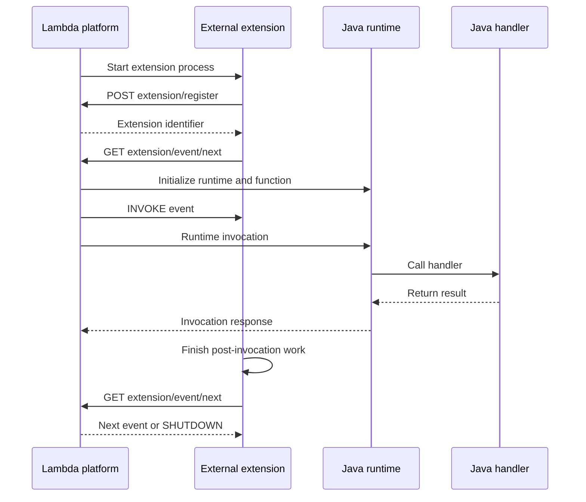

# Using Lambda Extensions and Custom Runtimes

## 1. Two Distinct Extensibility Capabilities of AWS Lambda

AWS Lambda provides managed runtimes for popular languages. For most Java functions, you can use the Java managed runtime, implement a handler, and let Lambda manage the JVM, execution environment lifecycle, and invocation protocol. When you need to integrate additional operational tooling or customize how the runtime boots, Lambda offers two notable mechanisms: **Lambda extensions** and **custom runtimes**.

A **Lambda extension** is a process or component that runs inside the same execution environment as the function. Extensions are commonly used for monitoring, log/metric collection, security, configuration management, or secret caching. They can receive invocation lifecycle notifications and ship telemetry externally.

A **custom runtime** is a runtime supplied by the development team. The runtime is responsible for starting the program, receiving invocations from the Lambda Runtime API, dispatching events to the handler, and returning responses or errors to the platform. Custom runtimes allow deeper control over execution, but the team takes responsibility for packaging, updating, and operating that runtime.

> Extensions and custom runtimes solve two different needs. You can use extensions with the Java managed runtime without writing a custom runtime. Build your own custom runtime only when a managed runtime cannot meet requirements or special control over the runtime/launcher is required.

In the CLOUD_SERVERLESS module, both mechanisms must be evaluated alongside cold starts, memory, access permissions, concurrency, reliability, and cost. Adding a process or replacing the runtime can unlock new operational capabilities while increasing testing and maintenance scope.

## 2. Lambda Execution Environment and Extension Lifecycle

### 2.1. Main Phases

A Lambda execution environment typically goes through three logical phases:

1. **Init:** Lambda prepares the execution environment, starts extensions, initializes the runtime, and runs required application initialization.
2. **Invoke:** the runtime receives an invocation and calls the handler. Extensions also receive invocation lifecycle notifications to perform supporting tasks.
3. **Shutdown:** when the environment is being terminated, extensions receive a shutdown event to release resources within the platform-allocated deadline. The runtime/process must also shut down cleanly when requested.

An environment may be reused across multiple invocations. Thus, extensions and runtimes can hold caches or shared clients in-process, but must never treat that memory as durable business state storage. Lambda can terminate an environment at any time and spin up a fresh one for another invocation.

### 2.2. Extensions Start Alongside the Function

With an external extension, Lambda launches the extension executable inside the execution environment. The extension registers with the Extensions API to declare which lifecycle events it wants to receive. The runtime and function are then initialized according to the Lambda lifecycle.

An extension typically must finish registering and setting up its services before invocations are handled. If an extension starts slowly, it can delay when the environment becomes ready. Init duration should therefore be measured alongside runtime and function initialization times.

### 2.3. Extensions Receiving INVOKE and SHUTDOWN Events

After registration, the extension waits for events from the Extensions API. Key events include:

| Event | Meaning | What the extension can do |
| --- | --- | --- |
| `INVOKE` | An invocation is about to be or is being processed in the environment | Prepare context, record metadata, start collecting or performing auxiliary work |
| `SHUTDOWN` | The execution environment is about to terminate | Flush buffers, close clients, record final state, and release resources |

The extension typically long-polls the next-event endpoint. After finishing an event, it waits for the next event. For `SHUTDOWN`, the payload can include a reason and termination deadline; the extension must finish within that deadline.

Do not rely on shutdown hooks as the sole place to persist critical data. An environment can be terminated abruptly or shutdown time can be bounded. Data needing durability must be persisted during normal processing.

## 3. External Extensions and Internal Extensions

### 3.1. External Extension

An external extension runs as a separate process within the same execution environment. It communicates with Lambda via the Extensions API and can subscribe to lifecycle events. This is the common model for monitoring agents, security scanners, telemetry collectors, or local proxies.

For ZIP deployments, extensions are commonly provided via a Lambda layer with executables placed under `/opt/extensions/`. When using a container image, the extension is placed in the image where Lambda discovers it. Executables must match Lambda's OS and architecture, carry execute permissions, and be able to start in that environment.

The advantage of an external extension is decoupling operational tooling lifecycles from handler code. An extension can be written in a different language from the function and updated via layers or images. In exchange, it consumes memory/CPU, needs its own configuration and permissions, and can impact init and invocation durations.

### 3.2. Internal Extension

An internal extension is a library or component running inside the function's runtime process. It integrates via framework or runtime APIs, such as an instrumentation agent, hook, or telemetry library. An internal extension is not an independent process and does not typically register lifecycle hooks via the Extensions API the way external extensions do.

Internal extensions can access application context directly and incur minimal inter-process communication overhead. However, they are tightly coupled to the function's runtime, framework, or language. A bug in an instrumentation library can directly affect the handler process.

### 3.3. Comparison

| Criterion | External extension | Internal extension |
| --- | --- | --- |
| Process | Separate process inside the execution environment | Same process as the runtime/function |
| Communication | Extensions API, Telemetry API, or local IPC/network | In-runtime APIs, hooks, or instrumentation |
| Language | Can differ from the function's language | Usually tied to the function's language/runtime |
| Fault isolation | Process boundary exists, though environment and resources remain shared | Errors can directly impact the handler process |
| Use cases | Security agents, collectors, proxies, shared tooling | APM agents, tracing instrumentation, metrics libraries |

A process boundary is not a security boundary. Extensions still run inside the same execution environment and generally have access to the function's resources, environment variables, and execution role credentials.

## 4. Extensions API

### 4.1. Registering an Extension

External extensions use the Extensions API to register their name and desired lifecycle events. The API is exposed via the runtime API address in the `AWS_LAMBDA_RUNTIME_API` environment variable.

Example registration HTTP request:

```http
POST /2020-01-01/extension/register HTTP/1.1
Host: ${AWS_LAMBDA_RUNTIME_API}
Lambda-Extension-Name: sample-observer
Content-Type: application/json

{"events":["INVOKE","SHUTDOWN"]}
```

Lambda returns the extension identifier in the `Lambda-Extension-Identifier` response header. The extension must retain this identifier and send it on subsequent requests.

### 4.2. Waiting for Lifecycle Events

The extension calls the `event/next` endpoint with its extension identifier:

```http
GET /2020-01-01/extension/event/next HTTP/1.1
Host: ${AWS_LAMBDA_RUNTIME_API}
Lambda-Extension-Identifier: <extension-id>
```

This request blocks until an event arrives. Upon receiving `INVOKE` or `SHUTDOWN`, the extension acts on the event type and then resumes polling if still active.

An extension should:

- Subscribe only to needed events, avoiding unused ones.
- Implement timeouts and proper network error handling when calling external services.
- Never allow the polling loop to die silently after an unhandled exception.
- Handle `SHUTDOWN` quickly within the deadline and close resources.
- Log enough for troubleshooting without logging tokens or sensitive payloads.

### 4.3. Execution Sequence



The diagram shows general relationships. Exact timing and process synchronization depend on lifecycle API semantics; extensions should not assume the function always waits for all telemetry work to finish before the handler starts.

## 5. Telemetry API and Log/Metric Collection

### 5.1. Purpose

The Telemetry API lets extensions subscribe to telemetry from the Lambda execution environment. Data types can include platform, function, and extension logs, along with supported platform events/metrics. Extensions can forward this data to collectors or observability backends.

The Telemetry API fits when you need control over the log pipeline, aggregate data across functions, enrich metadata, or ship data to a custom monitoring system. For distributed tracing, combine it with OpenTelemetry or appropriate instrumentation; do not assume the Telemetry API automatically replaces all tracing components.

### 5.2. Registering a Subscription

Extensions register a subscription via the Telemetry API using their extension identifier. The subscription endpoint is:

```http
PUT /2022-07-01/telemetry HTTP/1.1
Host: ${AWS_LAMBDA_RUNTIME_API}
Lambda-Extension-Identifier: <extension-id>
Content-Type: application/json
```

The body declares telemetry types, destination, and buffering settings. Conceptual example:

```json
{
  "schemaVersion": "2022-07-01",
  "types": ["platform", "function", "extension"],
  "buffering": {
    "timeoutMs": 1000,
    "maxBytes": 262144,
    "maxItems": 1000
  },
  "destination": {
    "protocol": "HTTP",
    "URI": "http://sandbox.localdomain:4243"
  }
}
```

This is an illustrative structure. Verify the exact schema and buffering limits of the Telemetry API version in use before deploying. With an HTTP destination, the extension must run a listener reachable inside the execution environment; with other protocols, satisfy the corresponding endpoint requirements.

### 5.3. Buffering and Data Loss

Telemetry is buffered to balance send frequency and latency. Overly large buffers raise memory usage; overly small buffers generate excessive requests and overhead. If the destination is slow or unreachable, the extension needs a retry strategy, queue caps, and overflow handling.

Never buffer logs unboundedly in memory. Explicitly define:

- Maximum buffer size.
- Maximum wait time before flushing.
- Retry counts and backoff.
- Behavior when the destination is unavailable.
- How dropped event counts are recorded.
- Policies to scrub or redact sensitive data.

Telemetry should not cause the function to fail simply because a logging backend is temporarily unavailable, unless that is an explicit mandatory compliance control. Usually, prioritize keeping the business path unblocked while emitting alert metrics when telemetry is dropped.

## 6. Minimal Extension Example

External extensions can be written in Java, Go, Rust, or shell scripts. In Java, an extension process can use `HttpClient` to call the Extensions API. The pseudocode below shows the lifecycle without tying to a specific HTTP library:

```java
public final class ExtensionMain {
    public static void main(String[] args) throws Exception {
        String runtimeApi = System.getenv("AWS_LAMBDA_RUNTIME_API");
        if (runtimeApi == null || runtimeApi.isBlank()) {
            throw new IllegalStateException("Missing AWS_LAMBDA_RUNTIME_API");
        }

        // 1. POST /2020-01-01/extension/register
        //    Lambda-Extension-Name header; body declares INVOKE, SHUTDOWN.
        String extensionId = register(runtimeApi);

        // 2. Optionally PUT /2022-07-01/telemetry to subscribe to telemetry.
        subscribeTelemetry(runtimeApi, extensionId);

        // 3. Long-poll lifecycle events until SHUTDOWN is received.
        while (true) {
            ExtensionEvent event = nextEvent(runtimeApi, extensionId);

            if ("INVOKE".equals(event.type())) {
                onInvoke(event);
            } else if ("SHUTDOWN".equals(event.type())) {
                flushWithDeadline(event.deadlineMs());
                break;
            }
        }
    }

    // register, subscribeTelemetry, nextEvent, onInvoke, and flushWithDeadline
    // must be implemented with an HTTP client, JSON parser, and appropriate timeouts.
}
```

This is an illustrative skeleton, not a standalone compilable program. In a real implementation, read the extension identifier from the response header, pass it on every subsequent request, and handle status codes, timeouts, JSON schemas, and shutdown deadlines. Do not run long blocking work inside the lifecycle event handler if it causes the extension to miss subsequent events.

## 7. What Is a Custom Runtime?

### 7.1. Managed Runtimes vs. Custom Runtimes

With a managed runtime, Lambda provides the runtime and calls the handler according to the runtime's contract. Developers mainly package code and configure the handler.

With a custom runtime, developers supply an executable named `bootstrap`. Bootstrap starts the runtime, which communicates with the Lambda Runtime API and orchestrates invocations itself. The runtime can be written in any language capable of running in the deployment environment and implementing the required protocol.

Custom runtimes are useful when:

- The desired language or runtime version lacks a suitable managed runtime.
- A custom runtime/JRE or specialized launcher is needed.
- Deep control over receiving invocations, initialization, or error handling is required.
- Specific compatibility requirements cannot be met by managed runtimes.

A custom runtime does not automatically make a function faster. If the goal is simply using Quarkus, Micronaut, or a native image, evaluate managed runtimes, container images, and existing integrations first. Writing your own runtime adds responsibility for protocol updates, security patching, and lifecycle handling.

### 7.2. Bootstrap

For ZIP-based custom runtimes, Lambda looks for an executable named `bootstrap` at the root of the deployment package. The file must have Linux execute permissions. Bootstrap typically starts the runtime process and keeps it alive to receive invocations.

Example shell bootstrap for Java using the Java Runtime Interface Client (RIC):

```bash
#!/bin/sh
set -eu

cd /var/task
exec /opt/java/bin/java \
  -cp "/var/task/app.jar:/var/task/lib/*" \
  com.amazonaws.services.lambda.runtime.api.client.AWSLambda
```

This is a structural example. Java paths, classpath, handler configuration, and entry point must match your actual packaging and RIC version. RIC is the library implementing the runtime protocol for Java applications; do not confuse it with the Runtime Interface Emulator used for local testing.

With OS-only runtimes such as `provided.al2023`, the base environment does not provide a Java JRE for the function. If using a Java custom runtime this way, bundle the Java runtime into the package, layer, or image according to compatibility requirements. Container images must also include an appropriate bootstrap/entrypoint and runtime interface client.

### 7.3. Runtime Interface Client (RIC)

The Runtime Interface Client is a library or component that enables a runtime to communicate with the Lambda Runtime API. For Java, AWS provides the Java Runtime Interface Client so applications can run on custom runtimes or container images following the Lambda contract.

RIC handles repetitive protocol mechanics such as fetching invocations, forwarding requests to the handler, and posting responses/errors. This saves teams from implementing the raw HTTP protocol themselves. Choose a RIC version compatible with your Java version, handler model, and packaging format.

### 7.4. Runtime Interface Emulator (RIE)

The Runtime Interface Emulator partially simulates the Lambda environment for testing containers/custom runtimes locally. RIE helps verify bootstrap, Runtime API flows, and handler integration prior to deployment.

RIE does not replace testing on real Lambda. Differences in IAM, event source mappings, concurrency, extension lifecycles, networking, timeouts, and quotas still need verification inside an AWS environment.

## 8. Lambda Runtime API

### 8.1. Invocation Loop

A custom runtime uses the address from the `AWS_LAMBDA_RUNTIME_API` environment variable. The runtime loops through these steps:

1. Send `GET /2018-06-01/runtime/invocation/next` to wait for the next invocation.
2. Read the event body and metadata headers, especially `Lambda-Runtime-Aws-Request-Id` and `Lambda-Runtime-Deadline-Ms`.
3. Dispatch the event to the handler and produce a result.
4. Post the result to the invocation's response endpoint.
5. If the handler fails, post error details to the error endpoint.
6. Continue polling for the next invocation.

### 8.2. Key Endpoints

| Purpose | HTTP request | Meaning |
| --- | --- | --- |
| Receive invocation | `GET /2018-06-01/runtime/invocation/next` | Wait for an event and receive request ID and deadline |
| Return result | `POST /2018-06-01/runtime/invocation/{requestId}/response` | Send response body for the current invocation |
| Report invocation error | `POST /2018-06-01/runtime/invocation/{requestId}/error` | Send handler/runtime error for the current invocation |
| Report init error | `POST /2018-06-01/runtime/init/error` | Report an error occurring during runtime initialization |

The runtime must retain the request ID from each invocation's headers and use that exact ID when posting the response or error. Never reuse a request ID from a previous invocation. The response body must match the handler contract format; for HTTP APIs, proxy responses typically require status code, headers, and body per the integration schema.

### 8.3. Deadlines and Timeouts

The `Lambda-Runtime-Deadline-Ms` header indicates the invocation deadline in epoch milliseconds. The runtime can use this value to set timeouts for internal steps, avoiding further work once the invocation is nearly out of time.

HTTP client, database, function, and workflow timeouts must align. If the runtime posts a response after the deadline or fails to post a response/error, the invocation may time out. Logs and metrics should distinguish handler errors, Runtime API errors, and downstream dependency failures.

### 8.4. Error Handling

The runtime should distinguish:

- **Init errors:** runtime fails to start, dependencies are missing, or handler fails to load. Report an init error if possible so the platform records an initialization failure.
- **Handler errors:** valid event, but business logic fails; post an invocation error per protocol.
- **Runtime API communication errors:** failure to receive invocations or send responses; handle according to platform retry and lifecycle rules.
- **Fatal process errors:** JVM or runtime cannot continue; let the process exit cleanly with sufficient diagnostic logs.

Do not catch every exception and return a success response. That signals to Lambda and event sources that the invocation succeeded even though business logic failed, breaking retries and DLQ handling.

## 9. Java Custom Runtime: Use RIC or Implement the Runtime API Yourself?

| Approach | Characteristics | When appropriate |
| --- | --- | --- |
| Java managed runtime | Lambda supplies runtime; function only provides a Java-contract handler | Default choice for most Java functions |
| Java custom runtime + RIC | Bootstrap launches Java and RIC implements Runtime API | Need custom base/runtime while keeping the Java handler model |
| Java runtime implementing Runtime API directly | Custom polling, handler dispatch, and response/error posting | Only with special requirements and capacity to maintain the protocol |

Implementing the Runtime API yourself expands the surface area for bugs. The runtime must manage request IDs, deadlines, encoding, error bodies, init errors, HTTP status codes, retries, interruptions, and lifecycle signals. Unless specific requirements force a custom implementation, RIC substantially lowers risk and maintenance cost.

A conceptual self-implemented runtime loop:

```text
while process is running:
    invocation = GET /runtime/invocation/next
    requestId = invocation.header[Lambda-Runtime-Aws-Request-Id]

    try:
        result = handler(invocation.body)
        POST /runtime/invocation/{requestId}/response with result
    catch handlerError:
        POST /runtime/invocation/{requestId}/error with error details
```

This pseudocode describes the protocol, not a complete implementation. A production runtime must also handle HTTP failures, deadline bounds, serialization, signals, logging, memory pressure, and graceful process exit.

## 10. Extensions and Custom Runtimes in Container Images

Lambda supports container images conforming to the Lambda container runtime contract. The image must include a runtime interface client or custom runtime to receive invocations. External extensions can be embedded in the image as executables placed where Lambda discovers extensions.

Items to verify:

- Base image is compatible with Lambda and the target CPU architecture.
- Java runtime/JRE is present in the image if using a Java custom runtime.
- Bootstrap or entrypoint runs properly and has execute permissions.
- Handler configuration is passed properly to RIC/runtime.
- Extension executables sit in a location recognized by Lambda.
- Image contains no unnecessary build toolchains, secrets, or development files.
- Image has been scanned and tagged with an immutable tag or digest for reproducible releases.

Container images give control over the environment and OS libraries, but image size, pull time, build time, and scanning must be factored into your pipeline. Do not assume container images eliminate cold starts.

## 11. Extension and Runtime Security

Extensions run inside the same execution environment and must be treated as part of application code. A third-party extension can read environment variables, access files readable by the process, and use the function's AWS execution role credentials. Therefore:

- Use extensions only from trusted sources and verify versions.
- Grant the execution role least-privilege permissions; never widen a role just to satisfy an extension.
- Never place secrets in logs, command lines, or unprotected temporary files.
- Restrict extension endpoints and network access where supported by the platform.
- Audit whether extensions exfiltrate data outside your account/region or to vendor endpoints.
- Update extensions and runtimes to apply security patches.
- Monitor temporary files and caches so sensitive data is not retained longer than necessary.

A custom runtime is also software your team owns. Keep Java/JRE, OS packages, RIC, and HTTP/JSON libraries updated; track CVEs and rebuild artifacts when patches arrive. Runtimes should never embed static access keys or environment secrets.

## 12. Impact on Cold Starts, Memory, and Cost

### 12.1. Cold Start

External extensions must launch and register before the environment becomes ready. Heavy extensions or ones doing synchronous I/O during init increase cold starts. Custom runtimes also need to launch bootstrap, the JVM or native binary, load libraries, and initialize the handler.

To reduce init time:

- Install only truly necessary extensions.
- Keep extension binaries and dependencies lean.
- Avoid unnecessary external service calls during init.
- Use short timeouts and bounded retries for telemetry/config connections.
- Measure extension init, runtime init, and function init durations separately.
- Compare managed runtimes against custom runtimes on identical workloads.

### 12.2. Memory and CPU

Extensions share execution environment resources with the function. Collector processes can consume significant memory when buffering logs or queuing data. Since a function has a fixed memory allocation, extension usage takes away from that budget and can increase memory/GC pressure or reduce compute headroom.

Monitor total environment peak memory, CPU time, queue depth, and dropped telemetry events. Do not measure only JVM heap when an extension runs as a separate process; observe total environment consumption.

### 12.3. Duration and Billing

Extensions can continue running after the handler returns a response, for example flushing logs or shipping telemetry. Extension activity time can add to billed invocation duration. Adding an extension may also force higher configured memory, increasing cost.

Custom runtimes do not automatically lower cost. Even if a native runtime cuts memory and startup time, evaluate overall impact if build/maintenance overhead or warm duration rises. Compare total costs across function, extensions, logs/telemetry, layers/images, storage, and downstream targets.

## 13. Testing Locally and on AWS

### 13.1. Testing Extensions

Extension testing should cover:

- Successful registration and extension identifier handling.
- Receiving multiple `INVOKE` events within the same environment.
- Receiving `SHUTDOWN` and flushing within the deadline.
- Slow, disconnected, or erroring telemetry destinations.
- Full-buffer behavior and event-dropping semantics.
- Ensuring the extension does not leak sensitive data.
- Memory/CPU behavior under telemetry spikes.

You can test extensions locally or in containers to catch process and protocol bugs, though real lifecycle behavior, permissions, and quotas must be validated on Lambda.

### 13.2. Testing Custom Runtimes

For custom runtimes, test:

- Bootstrap exists at the expected location and is executable.
- Runtime reads `AWS_LAMBDA_RUNTIME_API` properly.
- Invocations are received and request IDs preserved accurately.
- Responses and errors reach the right endpoints.
- Handler timeouts and deadlines are respected.
- Consecutive invocations succeed within the same process.
- Init errors are reported properly with informative logs.
- Runtime exits cleanly when the environment shuts down.
- Artifact matches the OS/architecture of the deployment target.

The Runtime Interface Emulator is useful for local container/custom runtime testing. Nonetheless, deploy a test function on AWS with realistic events to verify IAM, event source mappings, extension lifecycles, and telemetry.

### 13.3. Post-Upgrade Compatibility Testing

Whenever updating an extension, RIC, Java runtime, or base image, re-run smoke tests for every trigger the function supports. Verify log/metric schemas, timeouts, memory, cold starts, and response contracts. If an extension changes how telemetry is shipped, check compatibility with the observability backend as well.

## 14. When to Use an Extension or Custom Runtime?

| Need | Appropriate option to evaluate |
| --- | --- |
| Collecting logs, metrics, telemetry, or APM across multiple functions | External extension or internal instrumentation |
| Adding a security agent or secret/config cache | External extension from a trusted source, with least privilege |
| Deep instrumentation inside Java code | Internal extension/agent or framework library |
| Using Java with standard handlers | Managed Java runtime |
| Using a custom Java distribution or launcher | Custom runtime with RIC or container image |
| Controlling the invocation protocol directly | Custom runtime implementing Runtime API, only with strong justification |
| Simply reducing cold starts | Measure and optimize managed runtime first; benchmark native/custom when needed |

An extension should never replace a queue, workflow, or business service. Extensions suit environment-coupled concerns like telemetry and agents; business processing belongs in handlers/functions or explicitly orchestrated services.

## 15. Design and Deployment Checklist

| Item | Question to verify |
| --- | --- |
| Purpose | What concrete problem does the extension/custom runtime solve? |
| Managed runtime | Confirmed that the managed Java runtime cannot meet requirements? |
| Lifecycle | Does the extension subscribe to the right events and handle deadline-bound shutdown? |
| Extensions API | Is the extension identifier preserved and are polling errors handled? |
| Telemetry | Are destination, buffering, retries, overflow, and sensitive data controlled? |
| Runtime API | Does the custom runtime receive invocations, track request IDs, and post responses/errors accurately? |
| Bootstrap | Are executable, Java path, classpath, and handler config correct? |
| RIC/RIE | Is a compatible RIC chosen and RIE used for local tests? |
| Security | Do extension/runtime use least privilege and come from trusted sources? |
| Resources | Does extension memory/CPU usage impact the function? |
| Cost | Have init time, duration, memory, telemetry, and storage costs been accounted for? |
| Observability | Are init metrics, extension errors, telemetry drops, and runtime errors tracked? |
| Rollback | Can you roll back to the previous extension/runtime version? |

## 16. Common Mistakes

| Mistake | Consequence | Fix |
| --- | --- | --- |
| Adding an extension without measuring init | Cold starts increase without clear visibility | Measure extension startup and registration duration separately |
| Extension buffering telemetry indefinitely in memory | Exhausts memory or loses data on shutdown | Cap buffers, flush periodically, and track drops |
| Treating an extension as a security boundary | Extension code can exercise the function's permissions | Audit source, IAM role, env vars, and accessed data |
| Doing lengthy work during `SHUTDOWN` | Fails to finish before deadline | Flush with tight bounds and persist critical data earlier |
| Using a custom runtime just for a different framework | Adds unnecessary operational burden | Evaluate managed runtimes and adapters first |
| Bootstrap non-executable or in wrong path | Lambda fails to start the runtime | Verify root layout and Linux file permissions in the artifact |
| Using `provided.al2023` without bundling Java | No Java executable available for bootstrap | Include JRE in layer/package/image or use managed runtime |
| Runtime posting response with wrong request ID | Invocation fails to complete properly | Read ID from each invocation's header and match the endpoint |
| Testing runtime only locally | Misses AWS IAM, lifecycle, and quota differences | Run smoke/integration tests on real Lambda |

## 17. Conclusion

Lambda extensions add operational capabilities to the execution environment via companion processes or in-process instrumentation. The Extensions API provides lifecycle events; the Telemetry API lets extensions subscribe to and forward logs/metrics as configured. Extensions can increase cold starts, memory, CPU, and billed duration, and because they share extensive access within the same environment, they must be managed as part of application security.

Custom runtimes let teams supply their own bootstrap and runtime to speak the Lambda Runtime API. For Java, prefer the managed runtime whenever suitable; if a custom runtime is needed, using the Java Runtime Interface Client eliminates most protocol boilerplate. Write your own Runtime API loop only when special requirements demand it and you can test, patch, secure, and maintain it long-term.

Decisions to adopt extensions or custom runtimes should rest on measurements of cold starts, memory, latency, reliability, and total cost. Start from a concrete need, keep components minimal, test real lifecycles and artifacts, and deploy with observability and rollback plans.
