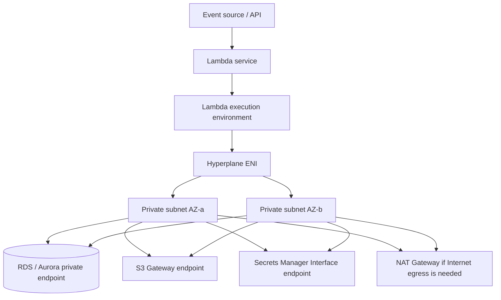

# Private Access from Lambda with VPC and VPC Endpoints

AWS Lambda may need to connect to resources exposed only on a private network, such as Amazon RDS, ElastiCache, internal services, or a server inside a VPC. A function may also need to call S3, DynamoDB, Secrets Manager, SQS, or another AWS service without traversing the public Internet. To meet these needs, you must understand how Lambda attaches to an Amazon VPC, how traffic is routed, and how VPC endpoints work.

A common misconception is that **placing Lambda into a VPC automatically grants Internet access or automatically makes every AWS API call private**. Lambda uses network interfaces in the selected subnets; route tables, security groups, network ACLs, DNS, and endpoints determine what the function can reach. With Java functions, the AWS SDK typically continues using regional service hostnames; when endpoints are configured properly, VPC DNS and routing direct requests over private paths.

## 1. When Does Lambda Need a VPC?

Lambda running outside a customer-managed VPC can still call many AWS services over Lambda's managed network environment. You generally need to configure a VPC for a function when it must access resources with private IP addresses inside your VPC or in a network connected to that VPC.

Common scenarios:

- A Java function querying an RDS or Aurora instance with only a private endpoint.
- A function calling Redis/ElastiCache, an internal service, or an EC2 instance without a public IP.
- A function reaching systems in another VPC via VPC peering, Transit Gateway, or VPN/Direct Connect.
- A function calling AWS services through VPC endpoints so traffic avoids NAT or an Internet Gateway.
- Organizational policies requiring centralized control over egress, routing, DNS, and security groups in a VPC.

Do not attach a function to a VPC merely because the application uses S3 or DynamoDB. If the function does not need access to VPC resources and network policy does not mandate it, the default non-VPC configuration is usually simpler. Once attached to a VPC, the function inherits the network paths provided by its subnets and route tables; you must add NAT or endpoints for every destination it needs to call.

## 2. Lambda Networking Model When Attached to a VPC

When configuring a VPC for Lambda, you choose a VPC, one or more subnets, and one or more security groups. Lambda creates and manages network interfaces to connect execution environments to the VPC network. Traffic from the function flows through those interfaces and is governed by VPC routing, security groups, NACLs, and DNS.

A common architecture places Lambda in private subnets across at least two Availability Zones, connecting to databases and VPC endpoints:



In practice, each endpoint and NAT Gateway is deployed according to subnet/AZ configuration. The diagram shows logical connectivity paths only; it does not imply a single endpoint or NAT Gateway is always high-availability for every AZ.

### Private Subnets vs. Public Subnets

A subnet is considered public when its route table has a route to an Internet Gateway (IGW). A private subnet typically has no direct route to an IGW; it can route IPv4 egress to a NAT Gateway or route to VPC endpoints, internal networks, and other private targets.

Lambda is not assigned a public IPv4 address just because you select a public subnet. Therefore, placing Lambda in a subnet with a route to an IGW does not give the function Internet access. If a function needs public Internet access over IPv4, you usually place Lambda in a private subnet with a default route to a NAT Gateway located in a public subnet. The NAT Gateway has a route to the IGW.

Illustrative path:

```text
Lambda ENI in private subnet
       |
       | route 0.0.0.0/0
       v
NAT Gateway in public subnet
       |
       | route 0.0.0.0/0
       v
Internet Gateway
       |
       v
Public Internet
```

A NAT Gateway supports outbound connections; it does not turn Lambda into an endpoint accepting public inbound connections. If clients need to call Lambda, use an appropriate invoke mechanism such as API Gateway, Function URL, the AWS SDK Invoke API, or a properly designed internal endpoint.

## 3. Lambda Hyperplane ENIs and Subnet IP Addresses

Lambda uses Hyperplane to provide network connectivity from execution environments into a VPC. Execution environments can share network interfaces based on matching subnet and security group configurations; do not assume under the current model that every invocation consumes its own dedicated ENI.

Points to watch:

- Lambda needs permissions to manage network interfaces during VPC configuration and lifecycle operations.
- A new subnet/security group combination may require creating a new ENI. Subnets must have enough available IP addresses and the account must stay within ENI/related quotas.
- Changing VPC configuration can take time while Lambda provisions or cleans up network resources.
- Security groups attached to the Lambda configuration control traffic permitted in/out over the ENI.
- Multiple functions can share a security group, though separating by role limits access and simplifies troubleshooting.

Do not calculate IP needs using "one invocation equals one IP". Monitor actual subnet IP capacity, unique subnet/security group combinations, ENIs, and quotas. Avoid overly tiny subnets or unnecessary network combinations.

The execution role generally needs EC2 permissions so Lambda can create, describe, and delete network interfaces during VPC configuration. AWS provides the managed policy `AWSLambdaVPCAccessExecutionRole` as a starting point. These permissions manage network connectivity; they do not grant access to read DynamoDB tables, S3 objects, or secrets. Data permissions must still be granted separately via appropriate IAM policies. When tightening policies, ensure ENI creation/update/deletion lifecycles continue to work per AWS guidelines.

## 4. What Problems Do VPC Endpoints Solve?

A VPC endpoint lets resources in a VPC connect to an AWS service or endpoint service over a private AWS-managed network path. With appropriate endpoints, traffic does not need to traverse a NAT Gateway or Internet Gateway to reach public service endpoints.

The two endpoint types commonly used when Lambda accesses AWS services are **Gateway endpoints** and **Interface endpoints**.

| Characteristic | Gateway endpoint | Interface endpoint |
| --- | --- | --- |
| Technology | Route tables and prefix lists | AWS PrivateLink, network interfaces inside subnets |
| Common services | Amazon S3, DynamoDB | Secrets Manager, SQS, SNS, KMS, STS, CloudWatch Logs, Lambda API, and many others |
| Network setup | Attach endpoint to target route tables | Choose subnets/AZs, security groups, and optional private DNS |
| Endpoint security group | No security group attached | Has a security group controlling inbound traffic to endpoint ENIs |
| DNS | SDK typically uses service hostname; route table sends matching traffic to endpoint | Private DNS can map standard service hostname to endpoint private IPs |
| Scope | By associated route tables | By subnets/AZs and DNS/routing able to reach endpoint ENIs |
| Cost | Gateway endpoint pricing model; typically no hourly endpoint charge | Typically billed per AZ-hour and data processed; check regional/service pricing |

Gateway endpoints do not create ENIs in subnets. Interface endpoints create ENIs with private IPs in the selected subnets. Some services have specific endpoint types or limitations; always verify supported service names and endpoint types in the target deployment region.

## 5. Gateway Endpoints for S3 and DynamoDB

Gateway endpoints fit when Lambda accesses S3 or DynamoDB from subnets attached to corresponding route tables. When creating the endpoint, you select the VPC and route tables. AWS adds routes to the service's prefix list via the gateway endpoint.

Example for S3:

1. Create an S3 Gateway endpoint in the same VPC as Lambda.
2. Associate the endpoint with the route tables of all private subnets where Lambda may run.
3. Use an endpoint policy to restrict buckets or actions if enforcement at the endpoint is desired.
4. Grant IAM policies on the execution role for the exact S3 actions on the target buckets/prefixes.
5. Use a bucket policy if requests must be restricted to traverse a specific VPC endpoint.

For DynamoDB, the workflow is analogous: create a Gateway endpoint, associate route tables, and configure endpoint/IAM policies. You do not need a NAT Gateway solely to call S3 or DynamoDB if a gateway endpoint meets requirements and there are no other Internet destinations.

For example, a route table will show a logical route targeting the S3 prefix list via the endpoint ID. You do not need to manage S3 public IPs manually or hard-code service IPs into routes.

### Endpoint Policy for S3

An endpoint policy controls which principals and actions are permitted through the endpoint. A policy restricting access to a specific bucket might look like:

```json
{
  "Version": "2012-10-17",
  "Statement": [
    {
      "Sid": "AllowReadSpecificBucket",
      "Effect": "Allow",
      "Principal": "*",
      "Action": ["s3:GetObject"],
      "Resource": "arn:aws:s3:::private-reports/*"
    }
  ]
}
```

This is a minimal illustrative endpoint policy showing scope. It does not grant permissions to the Lambda role on its own. The execution role still needs an identity policy for `s3:GetObject`; bucket policies and any related policies must also allow the request. If the endpoint policy denies or omits it, the request can be blocked even when the IAM identity policy allows it.

## 6. Interface Endpoints for Secrets Manager, SQS, and Other Services

Interface endpoints use AWS PrivateLink. When creating one, you pick the service name, VPC, subnets in the needed AZs, and security groups. AWS creates endpoint network interfaces with private IPs in those subnets. If private DNS is enabled and the VPC has appropriate DNS support, the standard regional service hostname resolves to the endpoint's private IPs.

For example, the Java SDK calls `secretsmanager.<region>.amazonaws.com`. When private DNS is enabled on the Secrets Manager interface endpoint and VPC DNS works properly, the application typically needs no code changes or hard-coded endpoint URLs; requests resolve to the private endpoint.

Common interface endpoints:

| Service | When Lambda needs the endpoint |
| --- | --- |
| Secrets Manager | Reading secrets such as database credentials or API keys |
| Systems Manager Parameter Store | Reading configuration parameters via the corresponding API |
| SQS | Sending/receiving messages via the SQS API from a private subnet |
| SNS | Publishing notifications via the SNS API |
| KMS | Calling encrypt/decrypt APIs or permitted key operations |
| CloudWatch Logs | Sending logs via API if the application's network path/runtime needs this endpoint |
| STS | Obtaining credentials/sessions via STS when auth flows call the STS API |
| Lambda | Clients inside a VPC calling the Lambda Invoke API over PrivateLink for private access to Lambda APIs |

Supported services and service names depend on the region. Having an endpoint for a service's control-plane API also does not automatically mean every data plane or secondary hostname of that service routes through that endpoint.

### Interface Endpoint Security Group

The security group attached to the endpoint ENI must allow inbound TCP 443 from the security group or CIDR range of clients calling the endpoint. Lambda's security group must allow outbound TCP 443 to the endpoint. When referencing security groups, verify that security group referencing rules are supported within your VPC/connectivity topology.

Example:

| Security group | Direction | Protocol/port | Source/destination |
| --- | --- | --- | --- |
| `sg-lambda-app` | Egress | TCP 443 | `sg-vpce-secrets` or matching endpoint CIDR |
| `sg-vpce-secrets` | Ingress | TCP 443 | `sg-lambda-app` |
| `sg-lambda-app` | Egress | TCP 5432 | `sg-db` or database CIDR |
| `sg-db` | Ingress | TCP 5432 | `sg-lambda-app` |

These rules illustrate PostgreSQL and Secrets Manager. Adjust ports for your actual database/service. Security groups are stateful, so return traffic for allowed connections is tracked automatically; NACLs are stateless and must permit both outbound and return traffic.

## 7. Private DNS and How the AWS SDK Resolves Endpoints

With interface endpoints, private DNS lets applications use familiar AWS service hostnames without configuring custom endpoint URLs. For this to work, the VPC must have DNS resolution and DNS hostnames enabled as required by the service, and the endpoint-managed private hosted zone must be resolved by an appropriate resolver.

When private DNS is enabled on an endpoint, DNS queries for the standard regional service hostname return private IPs of the endpoint ENIs. Then:

- Lambda calls the SDK with the region as usual.
- The SDK sends the request to the standard service hostname.
- VPC DNS returns the private endpoint IP address.
- Routes and security groups allow traffic to the endpoint ENI.

Gateway endpoints work differently: they do not create private DNS ENIs for S3/DynamoDB using the interface endpoint mechanism; route tables forward traffic for prefix lists through the gateway endpoint. Therefore, do not apply interface endpoint private DNS instructions to gateway endpoints.

If using custom DNS servers, Route 53 Resolver inbound/outbound endpoints, or DNS forwarders, ensure queries for service hostnames forward properly to a resolver that can see private DNS. Also check for private hosted zone conflicts, DNS firewalls, and split-horizon DNS setups.

## 8. Connecting Lambda to a Database in a VPC

To connect Lambda to an RDS/Aurora private endpoint:

1. Place Lambda in private subnets with internal routes to the database subnets.
2. Attach a dedicated security group to Lambda.
3. Configure the database security group to allow inbound traffic on the database port from Lambda's security group.
4. Check NACLs, route tables, DNS, and the database subnet group.
5. Set appropriate connection timeouts, query timeouts, and pool sizes.
6. Consider Amazon RDS Proxy when Lambda concurrency could open excessive database connections.

Traffic between subnets in the same VPC normally uses the local route. Neither NAT nor a VPC endpoint is needed to reach RDS private IPs in the same VPC. If the database resides in another VPC, configure peering/Transit Gateway/VPN/Direct Connect and verify bidirectional routes, non-overlapping CIDRs, security groups, and DNS.

### Security Group Referencing

A clean configuration is:

- `sg-lambda-orders`: egress TCP 5432 to `sg-rds-orders`.
- `sg-rds-orders`: ingress TCP 5432 from `sg-lambda-orders`.

Never open database ports to `0.0.0.0/0`. If Lambda also needs Redis or an internal API, create separate rules for those exact ports and targets. Security groups only govern network traffic; database users, password/IAM authentication, and SQL privileges must still be configured independently.

### Connections and Concurrency

Lambda can scale concurrency faster than a database can accept new connections. Each invocation does not necessarily open a new connection, yet if the application opens many parallel connections, the database can hit its limit. Use small pools, safely reuse clients within the runtime, close connections when appropriate, and consider RDS Proxy to pool/manage connections. RDS Proxy does not replace query tuning, timeouts, and short transactions.

## 9. When Is a NAT Gateway Still Needed?

VPC endpoints provide private paths only to supported services. If a function must call public Internet APIs without a dedicated endpoint—such as a SaaS partner or arbitrary public API—an egress path is required. For IPv4, the standard pattern is a NAT Gateway in a public subnet with routes from private subnets to the NAT Gateway.

| Need | Common connectivity pattern |
| --- | --- |
| Private RDS in the same VPC | Local VPC route + security group |
| S3 or DynamoDB | Gateway endpoint |
| Secrets Manager or SQS | Interface endpoint |
| Partner public API without PrivateLink | NAT Gateway or managed egress proxy |
| Private service in another VPC | Peering/Transit Gateway/VPN/Direct Connect per topology |
| Lambda Invoke API from VPC clients | Interface endpoint for Lambda API if PrivateLink is required |

NAT Gateways incur hourly and data-processing charges; cross-AZ traffic and data transfer can add extra costs depending on architecture. If functions only call AWS services that offer endpoints, VPC endpoints reduce NAT dependency and keep traffic inside the AWS network. However, interface endpoints also carry per-AZ hourly and data-processing fees; compare based on traffic volume and AZ count.

For high availability, deploy a NAT Gateway per AZ and route each AZ's private subnets to the NAT Gateway in the same AZ. Using a single NAT Gateway cuts resource count but creates a single-AZ dependency and can incur cross-AZ data transfer charges. Choose based on availability requirements, cost, and topology.

## 10. Distinguishing Lambda Calling Services vs. Clients Calling Lambda

There are two opposite traffic directions:

**Lambda calling AWS services:** a function inside a VPC calls S3, Secrets Manager, SQS, or another service. When a private path is needed, configure the corresponding gateway/interface endpoints in the function's VPC.

**Clients in a VPC calling the Lambda API:** an application on EC2/ECS/on-premises via VPN/Direct Connect needs to call Lambda APIs such as `Invoke`. In that case, create an interface VPC endpoint for the Lambda service (PrivateLink) in the client's VPC. The endpoint security group allows TCP 443 from clients; IAM and the function's resource-based policy still govern who may invoke.

An endpoint for the Lambda API does not turn an HTTP function into a server sitting inside your VPC accepting arbitrary TCP connections. If you want private HTTP for internal users, place an API Gateway private API or an appropriate ingress layer in front of Lambda; configure resource policies, VPC endpoint policies, and authorization as required.

## 11. IAM, Endpoint Policies, and Resource Policies Are Distinct Layers

Successful private connectivity requires both a network path and access authorization. VPC endpoints do not automatically grant IAM permissions. Distinguish these layers:

| Layer | Question this layer answers |
| --- | --- |
| Route table / DNS | Which IP address and network path does the request take? |
| Security group / NACL | Is the TCP/IP connection permitted to pass? |
| Endpoint policy | Which requests are permitted to traverse this endpoint? |
| IAM identity policy | Is the execution role allowed to call the action on the resource? |
| Resource policy | Does the resource accept this principal/request? |
| KMS key policy | Is the principal permitted to use the key for encryption/decryption? |

For example, a Lambda reading a secret needs:

- Routes and DNS to the Secrets Manager interface endpoint.
- Lambda security group allowing outbound 443 and endpoint SG allowing inbound 443.
- Endpoint policy allowing the required action if the endpoint policy is restricted.
- Execution role holding `secretsmanager:GetSecretValue` on that specific secret.
- If the secret uses a customer-managed KMS key, both the role and key policy must allow the corresponding KMS permissions.

Do not use `Principal: "*"` and `Action: "*"` as a default production configuration. Scope permissions to the roles, services, resources, and actions actually required.

### Restricting Bucket Policies by VPC Endpoint

An S3 bucket policy can use the `aws:SourceVpce` condition to require requests to arrive via a specific endpoint ID. Illustrative example:

```json
{
  "Version": "2012-10-17",
  "Statement": [
    {
      "Sid": "DenyRequestsOutsideApprovedEndpoint",
      "Effect": "Deny",
      "Principal": "*",
      "Action": "s3:GetObject",
      "Resource": "arn:aws:s3:::private-reports/*",
      "Condition": {
        "StringNotEquals": {
          "aws:SourceVpce": "vpce-0123456789abcdef0"
        }
      }
    }
  ]
}
```

This is an illustrative example; replace the endpoint ID and verify every legitimate access path before applying. An explicit `Deny` can block the AWS Console, CI/CD pipelines, other services, or valid applications if they access the bucket outside that endpoint. Maintain a governance/recovery plan so you do not lock yourself out of your data.

## 12. Java AWS SDK v2 Example Calling S3 via a Gateway Endpoint

Once an S3 Gateway endpoint is attached to the private subnet's route table, the Java SDK v2 typically continues using the standard regional S3 endpoint. You do not need to set `endpointOverride` solely to use a gateway endpoint.

```java
import software.amazon.awssdk.regions.Region;
import software.amazon.awssdk.services.s3.S3Client;
import software.amazon.awssdk.services.s3.model.GetObjectRequest;
import software.amazon.awssdk.core.ResponseInputStream;
import software.amazon.awssdk.services.s3.model.GetObjectResponse;

public final class PrivateS3Reader {
    private final S3Client s3 = S3Client.builder()
            .region(Region.AP_SOUTHEAST_1)
            .build();

    public String readText(String bucket, String key) throws Exception {
        GetObjectRequest request = GetObjectRequest.builder()
                .bucket(bucket)
                .key(key)
                .build();

        try (ResponseInputStream<GetObjectResponse> input =
                     s3.getObject(request)) {
            return new String(input.readAllBytes(),
                    java.nio.charset.StandardCharsets.UTF_8);
        }
    }
}
```

Using `readAllBytes()` fits only small objects. For large files, stream in chunks or write to appropriate temporary storage to avoid loading entire objects into the heap. The region must match the bucket and deployment environment. The SDK uses the default credential provider chain; Lambda's execution role supplies permissions without embedding access keys in source code.

When DNS, route tables, and endpoint policies are right, requests traverse the S3 Gateway endpoint. If the endpoint does not exist or the route table is not associated, the SDK might still connect via another path if a NAT route exists; succeeding does not prove the private endpoint is in use. You can enforce the endpoint with an `aws:SourceVpce` bucket policy when security requirements demand it.

## 13. Java AWS SDK v2 Example Calling Secrets Manager via an Interface Endpoint

With private DNS enabled on a Secrets Manager interface endpoint, the Java SDK calls the regional hostname as usual:

```java
import software.amazon.awssdk.regions.Region;
import software.amazon.awssdk.services.secretsmanager.SecretsManagerClient;
import software.amazon.awssdk.services.secretsmanager.model.GetSecretValueRequest;

public final class DatabaseSecretProvider {
    private final SecretsManagerClient secrets =
            SecretsManagerClient.builder()
                    .region(Region.AP_SOUTHEAST_1)
                    .build();

    public String load(String secretArn) {
        var response = secrets.getSecretValue(
                GetSecretValueRequest.builder()
                        .secretId(secretArn)
                        .build());
        return response.secretString();
    }
}
```

Do not hard-code endpoint ENI private IPs or set `endpointOverride` when using standard private DNS. Endpoint ENIs can change if the endpoint is replaced or reconfigured; applications should use the service hostname and let DNS handle resolution. Use endpoint overrides only when explicitly required and you understand TLS hostname verification, signing region, and endpoint lifecycle implications.

Secrets containing passwords or tokens must never be logged. You can cache secrets in-runtime for an appropriate window to reduce API calls, factoring in secret lifetime, rotation, and environments lasting longer than expected. Caching does not replace IAM authorization or refresh logic.

## 14. Configuring VPC Endpoints with CloudFormation

The CloudFormation snippet below illustrates two endpoint resources: an S3 Gateway endpoint and a Secrets Manager Interface endpoint. Subnet, route table, and security group IDs are passed via parameters or references to resources defined in the stack.

```yaml
Resources:
  S3GatewayEndpoint:
    Type: AWS::EC2::VPCEndpoint
    Properties:
      VpcId: !Ref VpcId
      VpcEndpointType: Gateway
      ServiceName: !Sub com.amazonaws.${AWS::Region}.s3
      RouteTableIds:
        - !Ref PrivateRouteTableA
        - !Ref PrivateRouteTableB
      PolicyDocument:
        Version: "2012-10-17"
        Statement:
          - Effect: Allow
            Principal: "*"
            Action:
              - s3:GetObject
            Resource:
              - arn:aws:s3:::private-reports/*

  SecretsManagerEndpoint:
    Type: AWS::EC2::VPCEndpoint
    Properties:
      VpcId: !Ref VpcId
      VpcEndpointType: Interface
      ServiceName: !Sub com.amazonaws.${AWS::Region}.secretsmanager
      PrivateDnsEnabled: true
      SubnetIds:
        - !Ref PrivateSubnetA
        - !Ref PrivateSubnetB
      SecurityGroupIds:
        - !Ref VpcEndpointSecurityGroup
```

This is an illustrative fragment, not a standalone template: you must declare all referenced parameters/resources, the Lambda IAM role, Lambda `VpcConfig`, security group rules, route tables, and complete application policies. The S3 endpoint policy permits only `GetObject` on the specified prefix; if the function needs `ListBucket`, `PutObject`, or other actions, add the corresponding actions/resources. An endpoint policy does not replace an IAM identity policy.

The Lambda function can be attached to subnets and security groups as follows:

```yaml
  OrderFunction:
    Type: AWS::Lambda::Function
    Properties:
      Runtime: java21
      Handler: com.example.orders.PlaceOrderLambdaHandler
      Role: !GetAtt OrderFunctionRole.Arn
      Code:
        S3Bucket: !Ref ArtifactBucket
        S3Key: !Ref ArtifactKey
      VpcConfig:
        SubnetIds:
          - !Ref PrivateSubnetA
          - !Ref PrivateSubnetB
        SecurityGroupIds:
          - !Ref LambdaSecurityGroup
```

Runtime, handler, artifact, and logical IDs are examples only. Choose a Java runtime supported by Lambda at deployment time and configure the exact entry point and package for your application.

## 15. DNS, Route Tables, Security Groups, and NACLs: Checking in Order

A request to an endpoint can still fail even after the endpoint is created. Check sequentially:

1. **DNS:** Does the VPC have proper DNS support/hostnames enabled? Does the service hostname resolve to the endpoint's private IP when expected? Are custom DNS servers or private hosted zones overriding it?
2. **Subnets:** Can Lambda run in all selected subnets? Are endpoint ENIs placed in reachable subnets/AZs?
3. **Route tables:** Do private subnets have local routes, gateway endpoint routes, or routes to NAT/targets? Is the gateway endpoint associated with the right route tables?
4. **Lambda security group:** Does egress allow the required TCP/port to the database or endpoint?
5. **Endpoint security group:** Does the interface endpoint allow inbound TCP 443 from Lambda's security group?
6. **Database security group:** Does inbound allow the database port from Lambda's security group?
7. **NACLs:** Do subnet NACLs permit both outbound requests and return traffic, including required ephemeral ports?
8. **Policies:** Do IAM identity policy, endpoint policy, resource policy, and KMS key policy all permit the request?
9. **Service/region:** Is the SDK using the right region, hostname, and endpoint type supported by the service?

Security groups are stateful, so return packets for permitted connections are allowed automatically. NACLs are stateless and require rules for both request and response directions. An overly restrictive NACL can cause timeouts even when security groups are right.

## 16. Diagnosing Common Connection Errors

| Symptom | Possible cause | Investigation approach |
| --- | --- | --- |
| Lambda times out calling RDS | Database SG missing inbound, wrong port, route/DNS, overloaded database, or exhausted connection pool | Check hostname resolution, both SGs, NACLs, query latency, and connection counts |
| SDK times out calling Secrets Manager | Endpoint SG missing port 443, broken private DNS, endpoint in unreachable subnet | Check VPC DNS, endpoint ENIs, routes, and SGs |
| S3 AccessDenied despite valid endpoint route | Blocked by IAM role, endpoint policy, or bucket policy | Inspect CloudTrail data events if enabled, IAM simulator, and all relevant policies |
| S3 traffic goes via NAT instead of endpoint | Lambda subnet route table lacks gateway endpoint association or hits another route | Check route table associations and prefix-list routes |
| Lambda in public subnet cannot reach Internet | Lambda gets no public IP merely from being in a public subnet | Use private subnet + NAT or an appropriate endpoint |
| Function cannot reach an AWS API | No endpoint created for that service and private subnet has no NAT route | Identify service API hostname and add endpoint or egress path |
| Some invocations connect, others time out | Cross-subnet/AZ difference, endpoint in only one AZ, DNS/caching, quota, or overloaded downstream | Check all subnets/AZs, endpoint coverage, ENIs, and metrics |
| Connection succeeds but returns AccessDenied | Network works, but IAM/resource/KMS permissions are insufficient | Separate network failures from auth failures; read error code and policy evaluation |

Useful tools include VPC Flow Logs, CloudWatch Logs/Metrics, CloudTrail, Route 53 Resolver query logging, Reachability Analyzer, and `describe-vpc-endpoints`/`describe-network-interfaces` via the AWS CLI. Flow Logs reveal accepted/rejected traffic at the ENI level; they do not explain IAM decisions. CloudTrail logs API calls according to event types and logging setup; S3 object-level data events must be enabled to audit individual object accesses.

### Practical Debugging Workflow

1. Record the exact invocation ID, timestamp, hostname, port, and error message.
2. Identify which subnet/AZ and security group the function used.
3. Resolve the hostname from an environment sharing the same DNS/VPC path (e.g., an EC2 debug host in that subnet or an appropriate network diagnostic tool).
4. Check endpoint state, subnet associations, private DNS, and route tables.
5. Check security groups and NACLs in both directions.
6. If TCP connects but the API returns AccessDenied, inspect IAM, endpoint policy, resource policy, and KMS.
7. Cross-reference VPC Flow Logs and CloudTrail to distinguish network drops from authorization denials.
8. Check quotas, subnet IP capacity, database connections, and concurrency if errors appear only under load.

Do not conclude "the VPC endpoint is broken" merely from an AccessDenied error; the endpoint may be functioning properly while a policy rejects the request. Likewise, DNS resolving to a private IP does not prove security groups and policies allow the connection.

## 17. Security and High-Availability Design

Private network paths shrink Internet exposure but do not replace identity and data controls. Apply these practices:

- Place Lambdas accessing internal resources in private subnets.
- Separate Lambda security groups by role and open only necessary ports/targets.
- Enforce least privilege in both endpoint policies and IAM policies.
- Use resource policies (e.g., bucket policies) to lock down access sources after accounting for every legitimate client.
- Require TLS encryption in transit and encryption at rest as needed.
- Avoid logging secrets, tokens, sensitive internal endpoint URLs, or payloads containing personal data.
- Deploy interface endpoints across all AZs matching Lambda's subnets; avoid single-AZ dependencies where high availability is required.
- Associate gateway endpoints with every route table Lambda might use.
- Reserve subnet IP headroom, monitor ENI/quotas, and limit distinct subnet/security group combinations.
- For NAT, consider per-AZ NAT Gateways to reduce cross-AZ dependencies and improve resilience.
- Enable VPC Flow Logs, CloudTrail, and alerts for connection errors, AccessDenied, throttling, and connection exhaustion.

If using IPv6 or dual-stack, design IPv6 routes, egress-only Internet Gateways, IPv6 security groups, and verify IPv6 support for each endpoint/service. Do not assume an IPv4 NAT Gateway handles IPv6 egress; routing paths and service support differ.

## 18. Cost and Choosing Between Endpoints and NAT

Costs depend on region, endpoint type, AZ count, data transferred, NAT Gateways, cross-AZ traffic, and invoked services. No single configuration is cheapest for every workload.

| Option | Benefits | Cost/trade-offs to weigh |
| --- | --- | --- |
| S3/DynamoDB Gateway endpoint | Private path via route table, eliminates NAT for these two services | Applies only to supported services and requires proper route table attachment |
| Interface endpoint | PrivateLink, private DNS, and endpoint SG/policy control | Billed per endpoint/AZ and data processed; requires managing ENIs/SGs/DNS |
| NAT Gateway | Lets private subnets reach many public IPv4 destinations | Hourly and data charges; can incur cross-AZ/data transfer fees |
| Egress proxy/firewall | Centralized control, domain filtering, and egress auditing | Adds operational components, scaling needs, and complexity |

Inventory the exact hostnames/services your function calls. If it only calls S3 and Secrets Manager, an S3 gateway endpoint plus a Secrets Manager interface endpoint can handle both flows without NAT. If the function also calls public partner APIs, NAT or an egress proxy is still needed for those targets. Evaluate total cost, private connectivity requirements, availability, and security policies together.

## 19. Lambda Private Access Deployment Checklist

- [ ] Clearly identified which private resources and AWS services Lambda must reach.
- [ ] Attached Lambda to a VPC only when required by private access or network policy.
- [ ] Selected private subnets across multiple AZs with sufficient available IP addresses.
- [ ] Attached a dedicated security group to Lambda, restricting egress by destination/port.
- [ ] For databases, allowed inbound from Lambda's security group to the exact port; verified routes and DNS.
- [ ] Created S3/DynamoDB Gateway endpoints and attached them to the right route tables.
- [ ] Created Interface endpoints for Secrets Manager/SQS/KMS/STS or needed services; enabled private DNS where appropriate.
- [ ] Opened TCP 443 from Lambda SG to Interface endpoint SGs and checked NACLs.
- [ ] Configured matching endpoint policies, IAM identity policies, resource policies, and KMS key policies.
- [ ] Used NAT Gateways/egress proxies for public Internet egress rather than merely picking public subnets for Lambda.
- [ ] Verified DNS support, private DNS, custom resolvers, and route tables.
- [ ] Used the Java SDK with regional/default credential providers; no hard-coded keys or endpoint IPs.
- [ ] Bounded connection pools, timeouts, and concurrency; considered RDS Proxy for databases.
- [ ] Enabled appropriate logging/flow logs and established a workflow to separate network vs. authorization issues.
- [ ] Reviewed endpoint/NAT costs, multi-AZ coverage, and failover resilience.

Private access from Lambda results from multiple coordinated layers: VPC configuration connects the function; subnets and route tables define paths; security groups/NACLs filter traffic; VPC endpoints route AWS service calls privately; and IAM and resource policies enforce business permissions. When each layer is designed cleanly, Java functions can securely access databases and AWS services while preserving scalability, observability, and cost control.
