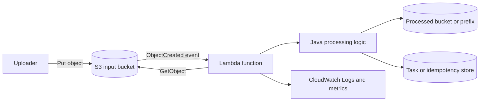
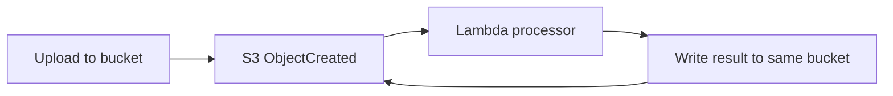

# Handling S3 Events and Managing Permissions Between Buckets and Lambda

Amazon S3 can emit notifications when objects are created, deleted, or modified according to supported event types. AWS Lambda can receive these notifications to process files as soon as they are uploaded—for example, generating thumbnails, validating formats, extracting CSV data, indexing documents, or starting a business workflow.

To integrate securely, two independent permissions must be distinguished. **S3 must be allowed by Lambda to invoke the function** via Lambda's resource-based policy. Once invoked, **the function needs an execution role with permissions to access the object** if it reads or writes data in the bucket. Configuring one correctly does not substitute for the other.

Within the scope of **CLOUD_SERVERLESS**, this lesson focuses on Java functions triggered by HTTP, messages, or events, along with how to handle triggers, access permissions, retries, idempotency, scaling, and cost. The S3 and Lambda example illustrates how to configure an event source, process payloads, grant least-privilege permissions, and protect the system when events are delivered redundantly or out of order.

## 1. S3-to-Lambda Integration Flow

A typical file-processing flow includes the following steps:

1. A user or system uploads an object to a bucket, typically under a prefix such as `incoming/`.
2. S3 emits an `ObjectCreated` event matching the notification configuration.
3. S3 invokes Lambda if the function's resource policy allows the `s3.amazonaws.com` service principal to invoke the function from the specified bucket.
4. Lambda receives the event, reads the bucket/key/version, and checks the event type.
5. The Java handler invokes the file-processing use case; the execution role provides `s3:GetObject` or other required permissions.
6. The function saves the result to a target prefix or bucket, records processing status, and emits metrics/logs.



S3 serves as the event source and object store. Lambda is the compute layer that executes the code. The Java handler only exists for the duration of the invocation; if processing state needs to persist across invocations, use a database, object metadata, or an appropriate state store instead of in-memory variables.

## 2. How Does S3 Event Notification Work?

A bucket notification configuration tells S3 which event types to emit, which prefix/suffix to filter by, and which destination to send to. For direct integration, the destination can be a Lambda function, an SNS topic, or an SQS queue. S3 can also send events to Amazon EventBridge when EventBridge integration is enabled for the bucket.

Common events:

| Event type | Meaning | Example use case |
|---|---|---|
| `s3:ObjectCreated:Put` | Object created via PutObject | Processing directly uploaded files |
| `s3:ObjectCreated:Post` | Object created via POST | Processing uploads from forms/browsers |
| `s3:ObjectCreated:Copy` | Object created via a copy operation | Syncing or classifying new objects |
| `s3:ObjectCreated:CompleteMultipartUpload` | Multipart upload completed | Processing large files after upload finishes |
| `s3:ObjectCreated:*` | Group of object creation events | Handling all supported object creation types |
| `s3:ObjectRemoved:Delete` | Object deleted | Updating indexes or reference status |
| `s3:ObjectRemoved:DeleteMarkerCreated` | Delete marker created in a versioned bucket | Updating logical deletion status |

Do not subscribe to all events if the business logic only needs one type of change. The broader the event type, the more likely the function is to receive irrelevant cases and incur unnecessary invocations and costs.

For direct notifications to Lambda, the bucket and function must be in the same AWS Region. Check the limits and characteristics of the destination in the documentation for the service you are using.

## 3. Filtering Events by Prefix and Suffix

Prefix/suffix filters help trigger the function only for matching objects. For example, process only CSV files uploaded to `incoming/`:

```yaml
NotificationConfiguration:
  LambdaConfigurations:
    - Event: s3:ObjectCreated:*
      Function: arn:aws:lambda:ap-southeast-1:111122223333:function:csv-processor
      Filter:
        S3Key:
          Rules:
            - Name: prefix
              Value: incoming/
            - Name: suffix
              Value: .csv
```

This is an illustrative snippet for a bucket notification configuration; ARNs and Region must be replaced with actual resources. Prefix and suffix are filter strings, not general wildcard expressions. They are case-sensitive. Check S3 filtering rules when multiple notifications share the same event type because some overlapping filter combinations are not accepted.

Filters can reduce invocations but do not replace validation in code. The function must still verify the event type, bucket, key, and file type before executing business logic. Do not trust the client-supplied `Content-Type` as sole proof of file format; inspect the actual content if necessary.

## 4. Two Distinct Permission Layers: Invoke and Object Access

This is the easiest part to misconfigure in an S3-Lambda integration.

**1. Lambda resource-based policy:** allows S3 to invoke Lambda. The principal is `s3.amazonaws.com`; the policy restricts the source by bucket ARN and source account.

**2. Lambda execution role:** allows code running inside Lambda to call AWS services, such as `s3:GetObject`, `s3:PutObject`, `kms:Decrypt`, and writing logs.

The two policies have different purposes and principals:

| Question | Policy to configure | Principal/identity |
|---|---|---|
| Is S3 allowed to invoke the function? | Lambda resource-based policy | `s3.amazonaws.com` |
| Is the function allowed to read the object? | IAM policy attached to the execution role | The role Lambda assumes when running |
| Is the function allowed to write output objects? | IAM policy attached to the execution role | The role Lambda assumes when running |
| Is the function allowed to decrypt SSE-KMS objects? | Appropriate IAM policy and KMS key policy | Execution role and key policy |

A bucket policy does not automatically grant permission to invoke Lambda. Conversely, granting `lambda:InvokeFunction` to S3 does not grant the Java code permission to read objects. Configure each layer for its exact actions.

## 5. Allowing S3 to Invoke Lambda via Resource-Based Policy

Lambda needs a resource policy allowing the S3 service principal to invoke the function. Example AWS CLI command:

```bash
aws lambda add-permission \
  --function-name csv-processor \
  --statement-id allow-upload-bucket-invoke \
  --action lambda:InvokeFunction \
  --principal s3.amazonaws.com \
  --source-arn arn:aws:s3:::example-upload-bucket \
  --source-account 111122223333
```

In this example:

- `--principal s3.amazonaws.com` specifies the S3 service as the permitted caller.
- `--source-arn` restricts the source to a specific bucket. This is the bucket ARN, not an object ARN ending with `/*`.
- `--source-account` restricts the bucket-owning account, helping mitigate confused deputy risks.
- `--statement-id` is the unique statement identifier within the policy.

Avoid broad wildcard principals or source ARNs unless specifically required. In real deployments, use the ARN of the function/alias matching the destination configured in the bucket notification.

The invoke permission must be added before applying the bucket notification configuration so S3 can validate the destination. When updating infrastructure with CloudFormation or another IaC tool, watch dependency relationships: the bucket notification references the Lambda ARN, while the Lambda permission references the bucket ARN. Bidirectional references can create a circular dependency if placed in the same resource graph. You can separate bucket creation and notification configuration into separate deployment steps, use separate stacks/modules, or use an appropriate custom resource.

## 6. Execution Role for Lambda to Read Objects

Lambda assumes the execution role at runtime. The role's trust policy must allow the Lambda service to assume the role, typically with the `lambda.amazonaws.com` principal.

Example trust policy:

```json
{
  "Version": "2012-10-17",
  "Statement": [
    {
      "Effect": "Allow",
      "Principal": {
        "Service": "lambda.amazonaws.com"
      },
      "Action": "sts:AssumeRole"
    }
  ]
}
```

Role policy allowing object reads under a specific prefix:

```json
{
  "Version": "2012-10-17",
  "Statement": [
    {
      "Sid": "ReadIncomingObjects",
      "Effect": "Allow",
      "Action": [
        "s3:GetObject"
      ],
      "Resource": "arn:aws:s3:::example-upload-bucket/incoming/*"
    }
  ]
}
```

If the function reads a specific object version, `s3:GetObjectVersion` may be needed. If it only receives the bucket/key from the event and reads that exact object, `s3:ListBucket` is usually not needed; only grant list permission when the code actually calls listing operations. If the function writes output files, grant `s3:PutObject` separately for the target prefix, such as `arn:aws:s3:::example-output-bucket/processed/*`.

Lambda also typically needs permission to write logs to CloudWatch Logs. You can attach a managed policy such as `AWSLambdaBasicExecutionRole` or an equivalent organization-approved policy. Do not grant `s3:*` on `*` just to make an example run quickly.

## 7. Permissions When Objects Are Encrypted with SSE-KMS

If the bucket uses SSE-S3, S3 manages the encryption keys. If objects are encrypted with SSE-KMS using a customer managed key, Lambda must be permitted to decrypt the object when calling `GetObject`.

Typically required:

- The execution role has `kms:Decrypt` permission on the exact KMS key.
- The KMS key policy allows that role to use the key, directly or through an IAM policy trusted by the key policy.
- If there are conditions in the key policy, check encryption context and corresponding service conditions.
- If the bucket and key belong to different accounts, coordinate the IAM policy, key policy, and bucket policy for cross-account access.

Example additional statement for the execution role:

```json
{
  "Sid": "DecryptUploadedObjects",
  "Effect": "Allow",
  "Action": "kms:Decrypt",
  "Resource": "arn:aws:kms:ap-southeast-1:111122223333:key/12345678-1234-1234-1234-123456789012"
}
```

Only add KMS permissions if objects actually use that key. Do not use `Resource: "*"` when you can scope to a specific key. When troubleshooting `AccessDenied` errors, check both S3 permissions and the KMS key policy; having `s3:GetObject` without `kms:Decrypt` can still prevent reading the object content.

## 8. S3 Event Structure and Data to Read

An S3 event notification typically contains a `Records` array. Each record describes an event, including source, event name, timestamp, bucket, and object.

Illustrative abbreviated payload:

```json
{
  "Records": [
    {
      "eventVersion": "2.1",
      "eventSource": "aws:s3",
      "eventName": "ObjectCreated:Put",
      "awsRegion": "ap-southeast-1",
      "eventTime": "2026-11-17T08:30:00.000Z",
      "s3": {
        "bucket": {
          "name": "example-upload-bucket",
          "arn": "arn:aws:s3:::example-upload-bucket"
        },
        "object": {
          "key": "incoming/report%20nov.csv",
          "size": 2048,
          "versionId": "3HL4kqtJlcpXroDTDmjVBH40Nrjfkd",
          "sequencer": "00673A1B2C3D4E5F"
        }
      }
    }
  ]
}
```

This is an illustrative payload, not a complete schema for every event version. Some fields may be absent depending on the event type and bucket configuration. The handler should read required fields with null checks, skip optional fields when absent, and have a strategy for new event versions.

`eventName` usually omits the `s3:` prefix inside the record, for example `ObjectCreated:Put`. `eventVersion` consists of major/minor numbers; the application should verify that the major version is supported and not assume the payload contains only known fields. New minor versions can be accepted if the contract and parser are compatible with extensions.

## 9. Decoding the Object Key Properly

In S3 event notifications, the object key is encoded using `application/x-www-form-urlencoded`. For example, spaces may appear as `+` or `%20`; a literal plus sign is encoded as `%2B`. If you use the undecoded key to call `GetObject`, the function may look up the wrong object and receive `NoSuchKey`.

If using the AWS Lambda Java Events library, the object notification provides the `getUrlDecodedKey()` helper in supported versions. When parsing the payload manually, you can use:

```java
String key = URLDecoder.decode(encodedKey, StandardCharsets.UTF_8);
```

Do not decode twice. If the library already returns a URL-decoded key, do not call `URLDecoder` again because valid `%` characters in the object name could be misinterpreted.

An S3 key is an object name, not a filesystem path. Do not concatenate the key directly onto a local directory without validation; if writing a temporary file is needed, generate a safe filename and keep the object key as a separate identifier.

## 10. Java Handler Receiving S3 Events

AWS Lambda Java Events provides the `S3Event` type to map the notification payload. The example below illustrates an adapter using the `aws-lambda-java-events` library together with AWS SDK for Java 2.x. Signatures and dependencies must match the library versions declared in your project.

```java
import com.amazonaws.services.lambda.runtime.Context;
import com.amazonaws.services.lambda.runtime.RequestHandler;
import com.amazonaws.services.lambda.runtime.events.S3Event;
import software.amazon.awssdk.services.s3.S3Client;

public final class S3ObjectCreatedHandler
        implements RequestHandler<S3Event, Void> {

    private final ObjectProcessor processor;

    public S3ObjectCreatedHandler() {
        this(S3Client.builder().build());
    }

    S3ObjectCreatedHandler(S3Client s3Client) {
        this.processor = new ObjectProcessor(s3Client);
    }

    @Override
    public Void handleRequest(S3Event event, Context context) {
        if (event == null || event.getRecords() == null) {
            throw new IllegalArgumentException("Missing S3 event records");
        }

        for (var record : event.getRecords()) {
            String eventName = record.getEventName();
            if (eventName == null || !eventName.startsWith("ObjectCreated:")) {
                continue;
            }

            String bucket = record.getS3().getBucket().getName();
            String key = record.getS3().getObject().getUrlDecodedKey();
            String versionId = record.getS3().getObject().getVersionId();
            String sequencer = record.getS3().getObject().getSequencer();

            processor.process(new UploadedObject(
                    bucket, key, versionId, sequencer, eventName));
        }

        return null;
    }
}
```

`ObjectProcessor` and `UploadedObject` are illustrative application components. The default constructor here supports Lambda's handler initialization mechanism; in projects using DI, wire dependencies at the composition root according to what your framework supports. `S3Client` in AWS SDK v2 can be reused across invocations within the same execution environment; do not create a new client for each record without a good reason.

A production handler must also handle test events, invalid records, and out-of-scope event names. If an invocation contains multiple records and one record fails, understand how Lambda asynchronous retry works: the invocation may be retried, causing previously succeeded records to appear again. Design idempotency per object event.

## 11. Reading Objects with AWS SDK for Java 2.x

After obtaining the bucket, key, and version ID, the application adapter can call the S3 SDK to read the content. Example:

```java
public final class ObjectProcessor {
    private final S3Client s3;

    public ObjectProcessor(S3Client s3) {
        this.s3 = s3;
    }

    public void process(UploadedObject uploaded) {
        var request = GetObjectRequest.builder()
                .bucket(uploaded.bucket())
                .key(uploaded.key());

        if (uploaded.versionId() != null) {
            request.versionId(uploaded.versionId());
        }

        try (ResponseInputStream<GetObjectResponse> input =
                     s3.getObject(request.build())) {
            // Stream the content and process incrementally.
            // Do not read an entire large file into byte[] unnecessarily.
            processStream(input, uploaded);
        } catch (IOException exception) {
            throw new ObjectProcessingException(
                    "Cannot read uploaded object", exception);
        }
    }

    private void processStream(
            InputStream input, UploadedObject uploaded) throws IOException {
        // Parse CSV, validate format, or transform data per business logic.
    }
}
```

The illustrative snippet requires imports and the types `UploadedObject`, `GetObjectRequest`, `GetObjectResponse`, and `ResponseInputStream` from AWS SDK v2. In production, enforce limits on size, processing time, record/line count, and memory resources; stream large files instead of loading the entire payload into the heap.

If the bucket has versioning enabled, reading the exact `versionId` from the event ensures you process the exact version that generated the event. If you only read by the current bucket/key, an object may have been overwritten before Lambda processes the older event; the function would then read the newer content instead of the content corresponding to the original event.

## 12. Duplicate Events, Ordering, and Idempotency

S3 Event Notifications are designed with an *at-least-once* delivery model. An event may be delivered multiple times and event ordering is not strictly guaranteed. Therefore, handlers must be safe under repeated processing.

Identifiers that can be used:

- Bucket + key + version ID when the bucket has versioning enabled.
- Bucket + key + sequencer for events on the same object when update ordering needs to be distinguished.
- A stable business key derived from object details and operation type.

Do not use bucket/key alone as an idempotency key if an object can be overwritten multiple times; doing so can cause a new upload to be treated as a duplicate of an older one.

S3 provides `sequencer` to compare event ordering for the same object key. The sequencer is hexadecimal and can vary in length. When comparing, normalize length or parse as a hex number; only compare sequencers for the same bucket/key, and do not use it to establish a global order across objects.

Example comparison using `BigInteger`:

```java
public static int compareSequencer(String left, String right) {
    return new BigInteger(left, 16).compareTo(new BigInteger(right, 16));
}
```

When updating object state in a database, you can store the latest sequencer and use conditional updates so older events do not overwrite newer state. If the bucket has versioning enabled, the version ID helps read the right object version; the sequencer remains useful when ordering events for the same key.

## 13. Retries, Processing Errors, and Dead-Letter Handling

S3 invokes Lambda using asynchronous invocation. Lambda can retry invocations when the function fails according to the configured asynchronous invocation policy. Events may continue to be redelivered, so side effects must be idempotent.

Errors should be categorized:

| Error | Handling approach |
|---|---|
| Network errors, throttling, or temporarily unavailable services | Retry with limits/backoff according to an appropriate policy |
| Object not yet readable due to transient error | Retry and monitor failure count |
| Malformed file or unsupported schema | Mark business error, quarantine the object, or route metadata to an error-handling flow |
| Missing S3/KMS permissions | Fix IAM/resource policy; repeated retries will not resolve configuration errors |
| Object too large or exceeds processing limits | Switch to streaming/chunked processing or a dedicated workflow |

You can configure Lambda asynchronous invocation with maximum event age, retry attempts, and an on-failure destination or dead-letter queue as needed. Distinguish an asynchronous invocation destination from an SQS event source mapping DLQ; these are two different mechanisms.

If an invocation contains multiple S3 records, Lambda retries the entire invocation when the handler throws an error. Consequently, already succeeded records may be reprocessed. You can use an idempotency store per record and record outcomes per object; if per-message error isolation and partial batch responses are needed, consider placing SQS between S3 and Lambda instead of invoking directly.

Do not swallow exceptions and return success if the object has not been processed and has not been saved to a durable error flow. If the handler decides to quarantine a record and return success, ensure error details have been durably recorded for investigation or replay.

## 14. Avoiding S3-Lambda Event Loops

A common bug occurs when a function is triggered by object creation in a bucket, and then the function writes its output object back into the same bucket. The output object triggers the function again, creating an invocation loop and rapidly escalating costs.

Example of a dangerous flow:



Prevention measures:

- Use separate input and output buckets.
- Use an input prefix such as `incoming/` and an output prefix such as `processed/`; filter notifications only on `incoming/`.
- Check the prefix/key in the handler before processing.
- Do not write temporary files or metadata into the area monitored by the trigger filter.
- Configure metrics/alarms when invocations spike abnormally or the same object is processed repeatedly.

S3-side filters are an event-reduction layer; checking in code is still necessary to protect against notification configuration changes.

## 15. Controlling Objects and Input Data

Object keys and metadata may be controlled by the uploader. Do not treat them as trusted data.

- Verify the bucket is on an allowlist or matches the expected business source.
- Process only expected prefixes and event types.
- Check object size before reading; enforce resource limits.
- Inspect the actual format rather than trusting only the file extension or `Content-Type`.
- Validate the data schema and limit the number of records/lines.
- When processing archives, limit the number of extracted files, total extracted size, and directory depth to prevent archive bombs.
- Do not concatenate keys directly into local paths without filename sanitization.
- Do not log sensitive content or credentials.

For critical data, you can use a quarantine prefix/bucket for unverified files, then move them to the next processing zone only after validation succeeds.

## 16. Choosing Direct Notifications vs. EventBridge/SQS

Direct S3 notifications to Lambda work well for simple flows: one group of events, one function, and no separate buffer needed. When complex routing, multiple consumers, or load smoothing are needed, an intermediary can be chosen.

| Pattern | Suitable when | Considerations |
|---|---|---|
| S3 → Lambda directly | One function processes events immediately, simple setup | Lambda receives asynchronous invocations; requires idempotency and async failure handling |
| S3 → SQS → Lambda | Need buffering, backpressure, concurrency control, and producer/consumer decoupling | Adds queue, visibility timeout, retention, and DLQ; handler processes batches |
| S3 → SNS → multiple subscribers | One event needs fan-out to multiple systems | Each subscriber has its own retries and permissions; requires subscription management |
| S3 → EventBridge → rules/targets | Need filtering/routing across many event types, multiple targets, archive/replay | Requires configuring event bus/rules and permissions per target |

EventBridge must be enabled for the bucket and rules configured to select events. When EventBridge invokes Lambda, Lambda's resource policy typically allows the `events.amazonaws.com` principal with the rule's source ARN; this is a different permission from allowing `s3.amazonaws.com` to invoke directly.

S3 direct notifications support SQS standard queues as destinations; if a FIFO queue is needed, consider EventBridge as a routing layer to a FIFO target based on integration capabilities. Choose the pattern based on ordering, throughput, buffering, and replay requirements—not just component count.

## 17. Configuring Notifications via Infrastructure as Code

In CloudFormation, Lambda permissions and bucket notifications are typically configured separately. Example resource permission:

```yaml
AllowS3Invoke:
  Type: AWS::Lambda::Permission
  Properties:
    FunctionName: !GetAtt ObjectProcessorFunction.Arn
    Action: lambda:InvokeFunction
    Principal: s3.amazonaws.com
    SourceArn: !GetAtt UploadBucket.Arn
    SourceAccount: !Ref AWS::AccountId
```

The bucket notification can be declared as:

```yaml
NotificationConfiguration:
  LambdaConfigurations:
    - Event: s3:ObjectCreated:*
      Function: !GetAtt ObjectProcessorFunction.Arn
      Filter:
        S3Key:
          Rules:
            - Name: prefix
              Value: incoming/
            - Name: suffix
              Value: .csv
```

These are standalone illustrative snippets; they must be assembled into a complete template and handle dependency relationships between the bucket, function, and permission. When using AWS SAM or another IaC framework, check whether the abstraction automatically creates the permission and notification to avoid duplicate declarations.

A controlled deployment process:

1. Create the bucket and Lambda function.
2. Attach the execution role with read access to the input prefix, write access to the output prefix, and required KMS permissions.
3. Add the Lambda resource permission for the specific bucket.
4. Configure the bucket notification after the permission exists.
5. Verify the configuration is applied and upload a test object to the filtered prefix.
6. Verify the invocation, logs, object read access, and output results.

## 18. Observability, Scaling, and Cost

S3 can emit many events in a short period when a large batch of uploads finishes. Lambda can scale up concurrency to process the invocations. This helps throughput but can overload databases, external services, or API quotas.

Metrics to monitor:

- Number of objects/events emitted and number of Lambda invocations.
- Lambda concurrent executions, throttles, duration, and error count.
- Retry count, event age at processing time, and record count in DLQ/on-failure destination.
- Object read time, object size, processed record count, and failed file rate.
- Number of output objects and events triggered from unexpected prefixes.
- Costs for S3 requests/storage, Lambda requests/duration, CloudWatch Logs, SQS/EventBridge, and KMS requests.

To protect dependencies:

- Set appropriate reserved concurrency to limit concurrent function executions.
- If buffering is needed, use SQS and tune event source mapping concurrency/batch size.
- Set timeouts, memory, and object size limits based on benchmarks.
- Stream large files and avoid holding all data in the heap.
- Use backoff for dependent services and avoid aggressive retries.
- Reduce logging of large payloads; log metadata needed for tracing.

Reserved concurrency can protect a database but also causes invocations to be throttled; combine it with an appropriate retry/destination mechanism and buffering. Test end-to-end behavior under load instead of simply raising Lambda concurrency.

## 19. Production Checklist for S3 and Lambda

| Question | Required evidence or configuration |
|---|---|
| Which events trigger the function? | Specific event types and prefix/suffix filters |
| Is S3 allowed to invoke Lambda? | Lambda resource policy with `s3.amazonaws.com`, SourceArn, and SourceAccount |
| Does Lambda have permission to read objects? | Execution role with `s3:GetObject` on the required prefix |
| Are specific versions read? | `s3:GetObjectVersion` when needed and version ID from the event |
| Are objects using SSE-KMS? | `kms:Decrypt` and appropriate KMS key policy |
| Do permissions follow least privilege? | No `s3:*` or `*` resource unless necessary |
| Is the key decoded properly? | Use `getUrlDecodedKey()` or decode exactly once |
| What about duplicate/out-of-order events? | Idempotency per object version/event and sequencer handling per key |
| What if an object is overwritten before processing? | Versioning or version-aware processing strategy |
| What if the handler fails? | Retry policy, on-failure destination/DLQ, and replay procedure |
| Could a notification loop occur? | Output bucket/prefix is outside the input filter |
| Are objects untrusted? | Validate size, format, schema, and processing limits |
| Are databases protected under high load? | Reserved concurrency or SQS buffering/backpressure |
| Can infrastructure be redeployed safely? | IaC manages permissions and notifications in the right order |
| Can incidents be investigated? | Logs, metrics, event ID/key, request ID, and DLQ |

## 20. When Should You Use S3 Events with Lambda?

S3 event notifications are suitable when object creation or deletion signals the start of an independent job that can be processed asynchronously. Typical examples include image processing, validating uploaded files, generating previews, analyzing data, and syncing metadata.

Before choosing, consider file size, processing time, event ordering, duplicate delivery possibility, concurrency levels, and replay needs. For fast processing, direct S3-to-Lambda is simple. For high volume or rate control, a queue decouples upload speed from processing speed. For multiple consumers or complex routing, EventBridge may fit better.

For a secure integration, always verify both permission directions: the resource policy allows S3 to invoke Lambda; the execution role allows the function to perform the exact operations on S3 and KMS. Combining least privilege, accurate filters, idempotency, retry/DLQ handling, and recursion prevention keeps the S3-Lambda pipeline reliable as objects and invocations scale.
