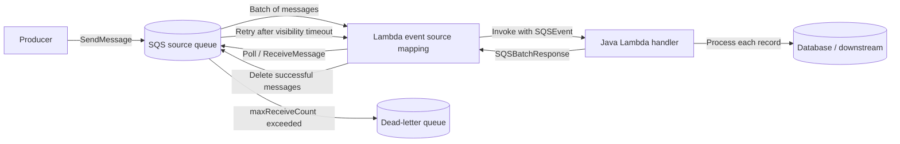

# Connecting SQS with Lambda and Reporting Per-Message Failures

Amazon SQS is commonly used to decouple producers from background worker processors. Producers send messages to a queue, while AWS Lambda receives messages via an *event source mapping* (ESM), processes them in batches, and acknowledges successful messages. This integration helps absorb traffic spikes, regulate consumption speed, and reduce synchronous dependencies between services.

A common issue occurs when a batch has multiple messages and only one message fails. If the handler fails the entire invocation, messages that were already processed successfully may also be redelivered. Reprocessing increases load, latency, and the risk of duplicate side effects. Lambda supports **partial batch responses** so the handler can indicate exactly which messages need to be retried. In Java, the handler returns an `SQSBatchResponse` containing a list of `BatchItemFailure` entries.

This lesson covers how to connect SQS with Lambda, configure an event source mapping, implement partial batch responses, handle differences between Standard and FIFO queues, and coordinate visibility timeouts, retries, DLQs, and idempotency for reliable processing flows.

## 1. SQS and Lambda Architecture

With an SQS event source mapping, Lambda manages a poller that reads messages from the queue. When a batch is available, Lambda invokes the function and passes the list of records in the event. The handler processes the batch and returns the result. If processing succeeds, Lambda deletes the corresponding messages from the queue; if it fails, messages may reappear after the visibility timeout according to SQS delivery mechanics.



The producer does not invoke Lambda directly. The event source mapping connects the queue to the function and handles polling, batching, delivery retries, and deleting successful messages. The Lambda execution role needs permissions to read/delete messages and read queue attributes. For queues encrypted with a customer-managed KMS key, the role also needs appropriate decryption permissions.

### Core Components

| Component | Responsibility |
|---|---|
| Producer | Creates messages, identifies business events, and sends them to the queue |
| SQS source queue | Persists messages durably during the retention period and handles delivery |
| Event source mapping | Polls the queue, builds batches, invokes Lambda, and deletes successful messages |
| Lambda function | Validates, processes each message, and reports results |
| Processing state store | Stores idempotency keys and processing status if business logic requires it |
| Dead-letter queue (DLQ) | Holds messages exceeding the allowed receive count for investigation or redrive |

SQS is a message delivery service. It does not guarantee on its own that consumer side effects happen only once. Messages can be redelivered, so the handler must be safe under duplicate delivery.

## 2. Standard Queues vs. FIFO Queues

Choose a queue type based on your business ordering and throughput requirements.

| Characteristic | Standard queue | FIFO queue |
|---|---|---|
| Ordering | May deliver messages out of send order | Preserves order within the same `MessageGroupId` |
| Delivery | At-least-once; duplicates may occur | Has deduplication on send within the supported window, but consumers still need idempotency |
| Parallelism | Can process many messages concurrently | Parallel across message groups; order must be preserved within a group |
| Best suited for | Independent jobs requiring throughput and tolerating out-of-order processing | Operations on the same order/account requiring strict sequence |

With a Standard queue, the handler can continue processing other messages in the batch after one message fails, as long as each record is reported accurately. With a FIFO queue, if one message in a group fails, processing of subsequent messages in the same batch/group must stop to avoid applying later changes before earlier ones.

For example, `OrderCreated`, `PaymentAuthorized`, and `OrderShipped` events for the same order should share `MessageGroupId = orderId` if the business logic requires ordering. Different orders can be processed in parallel.

## 3. Event Source Mapping and Batching

An event source mapping is a configuration that attaches an SQS queue to a Lambda function. Lambda polls the queue and groups messages into a batch before invoking the handler. Important properties include:

- **Batch size:** maximum number of messages sent in a single invocation.
- **Maximum batching window:** maximum time to wait to gather additional messages before sending a batch, if configured.
- **Function response types:** enable `ReportBatchItemFailures` so Lambda interprets per-message failure results.
- **Concurrency:** limits parallelism to protect the function and downstream services.
- **Queue visibility timeout:** duration a message stays hidden after being received, preventing multiple consumers from processing the message during a normal delivery attempt.

Large batches can reduce invocation count and handler invocation overhead, but increase batching wait time, required memory, and blast radius if the handler fails the whole batch. Small batches reduce the amount of work retried, but increase invocation count. Choose based on per-message processing time, payload size, and downstream capacity.

### Enabling Partial Batch Responses

Simply returning `SQSBatchResponse` in code is not enough. The event source mapping must enable the `ReportBatchItemFailures` response type. If not enabled, Lambda will not interpret the per-message failure list as expected and the invocation may be treated as a full-batch failure.

Example CloudFormation configuration for an event source mapping:

```yaml
OrderQueueMapping:
  Type: AWS::Lambda::EventSourceMapping
  Properties:
    EventSourceArn: !GetAtt OrderQueue.Arn
    FunctionName: !GetAtt OrderWorker.Arn
    Enabled: true
    BatchSize: 10
    MaximumBatchingWindowInSeconds: 5
    FunctionResponseTypes:
      - ReportBatchItemFailures
```

This is a conceptual configuration example; resource names and ARN references must match your project's template. With AWS SAM, the corresponding property can be declared in the function's SQS event. When deploying, inspect the actual event source mapping configuration, not only the template file.

## 4. How Partial Batch Responses Work

When `ReportBatchItemFailures` is enabled, the handler returns a structure like:

```json
{
  "batchItemFailures": [
    { "itemIdentifier": "message-id-that-failed" }
  ]
}
```

`itemIdentifier` must be the `messageId` of the failed SQS record. Lambda uses this list to determine which messages have not been processed successfully. Records not in the list are considered successfully processed and deleted from the queue; reported failures will be redelivered according to the visibility timeout and retry policy.

Cases to keep in mind:

- An empty failure list means every record in the batch succeeded.
- A list with one or more `messageId` values means only those records need to be retried.
- If the function throws an exception, times out, is terminated, or returns an invalid response, Lambda does not receive a valid partial result; the entire batch may be redelivered.
- If the response type is not enabled properly or the response format is invalid, partial failure behavior will not work as expected.

Partial batch responses reduce reprocessing of successful records. They do not replace idempotency, because a message can still be redelivered after a timeout or in other delivery scenarios.

## 5. Java Handler Using SQSBatchResponse

With the AWS Lambda Java runtime, you can use `SQSEvent` and `SQSBatchResponse` from the `aws-lambda-java-events` library. Gradle example:

```kotlin
dependencies {
    implementation("com.amazonaws:aws-lambda-java-core:<compatible-version>")
    implementation("com.amazonaws:aws-lambda-java-events:<compatible-version>")
}
```

Replace placeholders with versions compatible with your Java runtime and project dependency policy. The following handler illustrates a Standard queue: each message is processed independently, and failed records are added to the partial failure list.

```java
import com.amazonaws.services.lambda.runtime.Context;
import com.amazonaws.services.lambda.runtime.RequestHandler;
import com.amazonaws.services.lambda.runtime.events.SQSEvent;
import com.amazonaws.services.lambda.runtime.events.SQSBatchResponse;

import java.util.ArrayList;
import java.util.List;

public final class OrderQueueHandler
        implements RequestHandler<SQSEvent, SQSBatchResponse> {

    private final OrderProcessor processor = new OrderProcessor();

    @Override
    public SQSBatchResponse handleRequest(SQSEvent event, Context context) {
        List<SQSBatchResponse.BatchItemFailure> failures = new ArrayList<>();

        for (SQSEvent.SQSMessage message : event.getRecords()) {
            try {
                processor.process(message.getBody(), message.getMessageId());
            } catch (Exception exception) {
                context.getLogger().log(
                        "Message processing failed; messageId="
                                + message.getMessageId()
                                + ", errorType=" + exception.getClass().getSimpleName()
                );
                failures.add(new SQSBatchResponse.BatchItemFailure(
                        message.getMessageId()
                ));
            }
        }

        return new SQSBatchResponse(failures);
    }
}
```

`OrderProcessor` represents the business logic and should be implemented with appropriate dependencies. The example logs only the error class, not the full body, since messages may contain personal data or secrets. In production code, classify retryable vs. permanent errors instead of endlessly retrying every exception.

### Handling Permanent Errors

Not every error can be recovered by retrying. For example, malformed JSON or an unsupported event type will keep failing on every attempt. Two common handling patterns are:

1. Let the message fail so that after the maximum receive count, SQS redrives the message to a DLQ for investigation.
2. If business rules allow discarding the message, persist the message and failure reason to a durable quarantine store first; only return success after quarantine persistence is confirmed.

Do not catch an exception and skip the message without recording a trace or persisting it. Doing so removes the message from the queue without completing business processing and leaves no way to recover.

## 6. FIFO Queues: Stopping After the First Failure

With a FIFO queue, continuing to process messages after a failed message can invert business order. For example, message version 3 fails while version 4 is applied; when version 3 is retried later, the state may no longer be valid.

One implementation pattern is that on the first failure, add that message and all remaining unprocessed records to the failure list, then exit the loop:

```java
import com.amazonaws.services.lambda.runtime.events.SQSEvent;
import com.amazonaws.services.lambda.runtime.events.SQSBatchResponse;
import java.util.ArrayList;
import java.util.List;

List<SQSBatchResponse.BatchItemFailure> failures = new ArrayList<>();
List<SQSEvent.SQSMessage> records = event.getRecords();

for (int index = 0; index < records.size(); index++) {
    SQSEvent.SQSMessage message = records.get(index);
    try {
        processor.process(message.getBody(), message.getMessageId());
    } catch (Exception exception) {
        // Preserve ordering: report the current message and remaining unprocessed messages as failures.
        for (int remaining = index; remaining < records.size(); remaining++) {
            failures.add(new SQSBatchResponse.BatchItemFailure(
                    records.get(remaining).getMessageId()
            ));
        }
        break;
    }
}

return new SQSBatchResponse(failures);
```

The illustrative snippet assumes the batch is processed in the record order provided by Lambda. With FIFO, order within each message group must be preserved and event source mapping semantics respected. If a batch contains multiple groups, whether to continue or stop other groups must be designed according to the application's ordering requirements; the simplest and safest approach is to stop the batch after the first error.

DLQs on FIFO queues require careful consideration: when a failed message moves to the DLQ and subsequent messages are processed, the business sequence can break. If strict ordering is required, implement a group blocking/quarantine policy and an appropriate fix/replay workflow rather than moving the failed message away and continuing by default.

## 7. Visibility Timeout and Retries

When Lambda receives a message, SQS marks the message invisible for the visibility timeout duration. If Lambda succeeds and the event source mapping deletes the message, the message completes its lifecycle in the queue. If the function does not confirm success, the message becomes visible again after the timeout and can be received again.

The visibility timeout must be long enough for both batch processing and function-level retries. AWS recommends setting the queue visibility timeout to at least **six times the Lambda function timeout**, plus the maximum batching window if configured. This configuration guideline reduces the likelihood of a message reappearing while an invocation is still running; check current AWS documentation and your workload's actual processing times.

For example, if the function timeout is 30 seconds and the batching window is 5 seconds, the visibility timeout should be set to at least the corresponding recommended level (6 × 30 + 5 seconds), then tuned based on system characteristics. Do not set the timeout too short, as that can cause concurrent duplicate processing. Also avoid setting it arbitrarily long if fast recovery after a consumer failure is needed.

### Retries at Two Layers

In an SQS-Lambda integration, two mechanisms are often confused:

- **SDK retries or in-handler logic:** repeating a service call within the same invocation.
- **SQS redelivery:** an unacknowledged message becomes visible again after the visibility timeout and Lambda can receive it in a new invocation.

If both layers retry many times, total downstream calls can multiply significantly. Set bounded timeouts and retry budgets, classify errors, use backoff when calling dependent services, and rely on queue redelivery for subsequent attempts when appropriate.

### Partial Failures Reduce Unnecessary Retries

Suppose a batch has 10 messages: 9 succeed and 1 fails transiently. If the handler throws an exception for the whole invocation, all 10 messages may be redelivered. If the handler returns `BatchItemFailure` for only the failed message, the 9 succeeded messages are acknowledged and only the failed message needs retrying. This reduces database/API load and avoids re-executing side effects for the 9 completed records.

If the function times out before returning a response, Lambda does not know which records completed. Therefore, even when using partial batch responses, business operations must remain idempotent.

## 8. DLQs and Redrive Policies

A DLQ is a dedicated queue that holds messages received more than the allowed number of times while still failing. With SQS, the source queue's redrive policy typically configures:

- `deadLetterTargetArn`: ARN of the DLQ.
- `maxReceiveCount`: maximum number of receives before moving the message to the DLQ.

Conceptual configuration example:

```yaml
OrderQueue:
  Type: AWS::SQS::Queue
  Properties:
    VisibilityTimeout: 185
    RedrivePolicy:
      deadLetterTargetArn: !GetAtt OrderDlq.Arn
      maxReceiveCount: 5

OrderDlq:
  Type: AWS::SQS::Queue
  Properties:
    MessageRetentionPeriod: 1209600
```

The numbers are examples only. For a FIFO source queue, the DLQ must also be FIFO. Ensure queue policies, KMS policies, and retention match. A `maxReceiveCount` that is too low can push transient failures to the DLQ prematurely; too high can let poison messages consume resources for too long.

A DLQ does not fix messages automatically. You need an operational procedure to inspect root causes, decide whether to fix data or code, and perform a controlled redrive back to the source queue or a reprocessing queue. Before redriving, verify that consumers are idempotent and earlier side effects will not be duplicated. For FIFO, assess the impact on message group ordering.

## 9. Idempotency and Business State

SQS Standard provides at-least-once delivery; the same message can be delivered multiple times. Even when a handler returns a partial response, the function may time out after writing to the database but before Lambda receives the response. In that case, the message will be redelivered.

Idempotency allows a message to be processed repeatedly without creating additional side effects. One implementation approach is storing the event ID or business key in a database with a unique constraint.

Example processing flow:

1. The producer includes a stable `eventId` in the business payload.
2. The consumer checks the `processed_events` table to see if the event has already completed.
3. The consumer claims the event via conditional insert or unique constraint.
4. The consumer performs business updates in the same transaction if possible.
5. The consumer records completion status and commits.
6. The handler returns success for the record.

If side effects occur in an external system outside the database, use an idempotency token supported by that system. If none exists, use an outbox, reconciliation, or appropriate compensating action.

### Choosing an Idempotency Key

`messageId` is the SQS message identifier and helps prevent redelivery of the same SQS message. However, if a producer sends the same business event as two separate messages, the two `messageId` values may differ. Therefore:

- Use `messageId` to identify a specific SQS message instance.
- Use a stable producer-generated `eventId` or business key to prevent business-level duplicates.
- If the business entity is versioned, store `aggregateId` and sequence/version to detect stale or out-of-order events.

Do not use static variables inside Lambda to store processed message lists. Execution environments can be reclaimed, and multiple environments can process concurrently.

## 10. IAM and Security When Connecting SQS to Lambda

With an SQS event source mapping, Lambda polls the queue using the function's execution role. The role requires the necessary permissions, typically including:

- `sqs:ReceiveMessage` to receive messages.
- `sqs:DeleteMessage` to delete processed messages.
- `sqs:GetQueueAttributes` to read queue attributes.
- `kms:Decrypt` if the queue uses a customer-managed KMS key and the policy requires this permission.

Do not grant `sqs:*` across all queues if the function only reads one queue. Resource ARNs should be scoped to the assigned queue. If the function needs to send messages to another queue, grant only `sqs:SendMessage` for the target queue.

Do not confuse the execution role with resource-based policies used for certain direct invoke models. With an SQS event source mapping, polling permissions are primarily granted to Lambda's execution role; queue policies/KMS policies still must be aligned for cross-account access or encryption.

Message bodies may contain sensitive data. Do not log the full body to CloudWatch Logs during debugging. Logging `messageId`, `eventId`, correlation ID, and categorized error codes is usually enough for tracing. Ensure the DLQ has access controls and retention commensurate with the sensitivity of the data.

## 11. Controlling Concurrency and Backpressure

Lambda can scale up invocations when the queue builds a backlog. This speeds up consumption but can overload downstream databases or APIs. Control concurrency on the event source mapping or function, and size connection pools and downstream limits accordingly.

Key considerations:

- `MaximumConcurrency` on the event source mapping can cap concurrent invocations from the queue (depending on mapping type and configuration).
- Function reserved concurrency caps total concurrency for the function, which can affect other triggers if the function is shared.
- With FIFO, the number of active message groups limits useful parallelism; a single group cannot be processed concurrently in a way that breaks ordering.
- Large batch sizes increase the number of messages per invocation and the memory needed.
- Queue depth and age of oldest message show whether the consumer is keeping up with the producer.

If the function calls a database, calculate potential total connections across environments and pool sizes. Do not raise concurrency solely to drain the queue faster if downstream begins throttling or failing.

## 12. Observability and Alerting

To operate an SQS-Lambda integration effectively, monitor the queue, the event source mapping, and the function.

| Metric | Meaning |
|---|---|
| `ApproximateNumberOfMessagesVisible` | Number of messages waiting to be received |
| `ApproximateAgeOfOldestMessage` | How long the oldest message has been waiting |
| `NumberOfMessagesReceived` | Number of messages received |
| `NumberOfMessagesDeleted` | Number of messages deleted after processing |
| `NumberOfMessagesSent` | Number of messages sent by producers |
| Lambda `Invocations` | Number of times the function was invoked |
| Lambda `Errors` and `Throttles` | Handler errors and concurrency limits |
| DLQ visible messages | Messages needing investigation or redrive |
| Partial batch failures | Rate of failed records relative to total processed records |

You can emit custom metrics for succeeded messages, retryable failures, permanent failures, skipped duplicates, and processing duration per business type. Use correlation ID/event ID to connect producer, Lambda, and downstream logs. Do not include sensitive content in logs or high-cardinality values in metric dimensions.

### Signals to Investigate

- Queue depth continuously rising: producer is outpacing consumer or downstream is slow.
- Age of oldest message increasing: backlog may violate processing SLAs.
- Lambda errors rising while deleted message count stays low: handler failures or misconfigured partial responses.
- DLQ growing rapidly: poison messages, schema errors, IAM issues, or prolonged downstream outage.
- Throttles increasing: concurrency cap, reserved concurrency, or downstream quota mismatch.
- A FIFO message group is stuck: one failing message is blocking subsequent messages in the group.

## 13. Common Mistakes

| Mistake | Consequence | Fix |
|---|---|---|
| Not enabling `ReportBatchItemFailures` | Lambda treats failures as full-batch failures | Configure `FunctionResponseTypes` on the event source mapping |
| Returning wrong `itemIdentifier` | Lambda cannot identify which record to retry | Use the exact `messageId` of the SQS record |
| Catching exceptions and returning an empty list | Failed messages are treated as succeeded and deleted | Only return success after processing or durable quarantine |
| Throwing an exception for one record in a Standard batch | Succeeded records may be redelivered | Catch errors per record and return a partial response |
| Continuing to process messages after an error in a FIFO group | Can violate business ordering | Stop at the first error and report remaining unprocessed records as failures |
| Visibility timeout too short | Messages reappear while invocation is still running | Adjust based on function timeout and batching window |
| No DLQ/redrive policy | Poison messages loop repeatedly and sustain backlog | Configure a DLQ, maxReceiveCount, and runbook |
| Not idempotent | Redelivery causes duplicate side effects | Use event ID/business key and conditional writes |
| Concurrency too high | Overloads downstream databases/APIs | Limit concurrency and regulate queue consumption |
| Logging the full message body | Risk of exposing sensitive data | Log IDs, correlation IDs, and classified error codes |

## 14. Implementation and Testing Workflow

When building an SQS-Lambda integration, you can follow this sequence:

1. **Choose queue type.** Decide Standard or FIFO based on ordering, throughput, and deduplication requirements.
2. **Design the message contract.** Include event ID, schema version, correlation ID, and enough data to process; avoid unnecessary sensitive payloads.
3. **Create the Lambda event source mapping.** Choose batch size, batching window, concurrency, and enable `ReportBatchItemFailures`.
4. **Implement the Java handler.** Use `SQSEvent`, process each record, and return `SQSBatchResponse` with the exact failed `messageId` values.
5. **Design idempotency.** Persist business event IDs or business keys durably; ensure side effects are safe on retry.
6. **Configure visibility and DLQ.** Set appropriate timeout, maxReceiveCount, and retention; design a redrive procedure.
7. **Grant least privilege.** Grant the execution role permissions to receive/delete messages and decrypt KMS if needed.
8. **Set up observability.** Monitor queue age, backlog, Lambda errors/throttles, partial failures, and DLQ.
9. **Test failure modes.** Test single-message failure, full-batch timeout, duplicate delivery, poison messages, and downstream unavailability.

### Minimum Test Matrix

| Scenario | Expected outcome |
|---|---|
| Batch with all valid messages | Handler returns an empty failure list; messages are deleted |
| One transient message failure in a Standard batch | Only that message is reported as failed and retried |
| Multiple failed messages in a batch | All failed `messageId` values are returned |
| Handler times out before returning response | Entire batch may be redelivered; idempotency prevents duplicate side effects |
| Permanently failing message | Moved to DLQ per redrive policy or durably quarantined per policy |
| Same message redelivered | Consumer detects duplicate and skips repeating side effects |
| First message in a FIFO batch fails | Failed message and trailing unprocessed messages are reported as failures to preserve order |
| Downstream throttling | Bounded retries, queue absorbs backlog, and concurrency avoids further overload |
| Missing KMS permission | Error is surfaced via metrics/logs and role/policy is fixed with proper scope |

## Conclusion

SQS event source mappings allow Lambda to process asynchronous messages in batches. To prevent a single failed message from forcing the entire batch to rerun, enable `ReportBatchItemFailures` and return an `SQSBatchResponse` containing the exact `messageId` of failed records. With Standard queues, independent records can continue processing; with FIFO queues, ordering within a message group must be preserved by stopping after the first error according to an appropriate policy. Visibility timeouts, retries, DLQs, idempotency, IAM, and concurrency must be designed together. Partial batch responses reduce redundant reprocessing, while idempotency protects business state when messages are still delivered multiple times.
