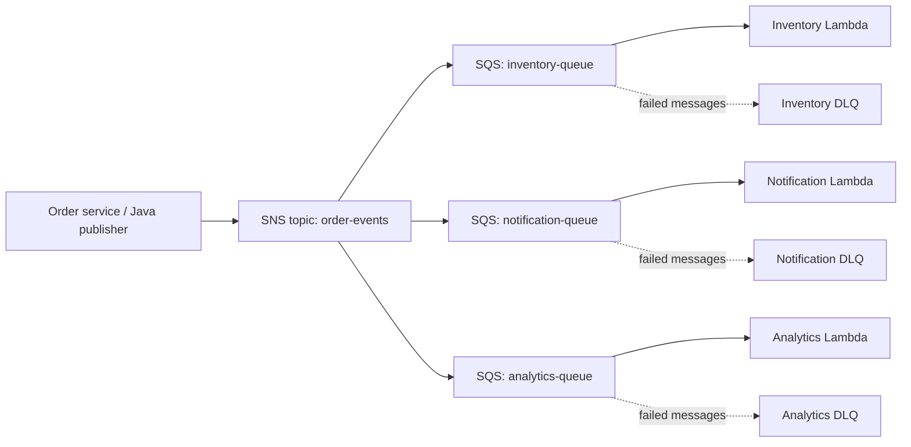
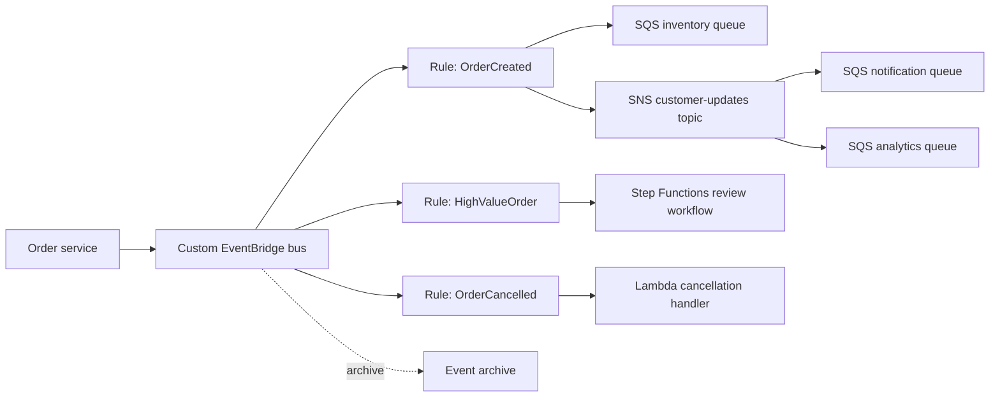

# Fan-out with SNS and Event Routing with EventBridge

In serverless architectures on AWS, a single business event often needs to be sent to multiple independent components. When an order is created, the system may need to update inventory, send an email, update a search index, write analytics data, and start a workflow. If the producer calls each consumer directly, it must know the address, status, and protocol of every consumer. Every time a new consumer is added, the producer has to change, tightly coupling services together.

Amazon Simple Notification Service (SNS) and Amazon EventBridge solve two related but distinct needs. **SNS** is a publish-subscribe service suited for fanning out a notification to multiple subscriptions. **EventBridge** is an event bus capable of filtering and routing events by rules to multiple targets. Both can trigger AWS Lambda, send to SQS, and connect other services; choosing between them depends on how producers and consumers need to coordinate.

Within Cloud Serverless, these services allow Java functions to receive HTTP requests, messages, or events without producers calling the functions directly. However, deliveries can be retried or duplicated, asynchronous steps can finish at different times, and functions can run concurrently across multiple instances. Therefore, the design must include event contracts, idempotency, access permissions, DLQs, observability, and load limits.

## 1. What Problems Do SNS and EventBridge Solve?

### SNS: Publish Once, Distribute to Many Subscriptions

SNS provides a topic as a publish point. Producers send a message to the topic; SNS distributes the message to registered subscriptions. A subscription can be an SQS queue, Lambda function, HTTP/S endpoint, email, SMS, or other protocols supported by SNS.

Each subscription receives its own delivery according to its endpoint protocol. If a topic has three SQS queues, each queue has an independent backlog and consumer. A slow notification consumer does not force the analytics consumer to process at the same speed. The producer only needs to know the topic ARN, not the specific workers.

SNS fits when the primary intent is: “This notification needs to be delivered to interested subscribers.” For example, `OrderCreated` is sent to an inventory queue, an analytics queue, and a notification-sending Lambda.

### EventBridge: Receive Events and Route by Rules

EventBridge provides an event bus to receive events from applications, AWS services, or SaaS partners. Producers send events to the bus; rules match `source`, `detail-type`, and `detail` contents, then route events to one or more targets such as Lambda, SQS, SNS, Step Functions, Kinesis, or API Destinations.

EventBridge fits when the primary intent is: “This is an event that occurred; route it to destinations whose rules match.” Producers do not need to know consumers. Operations teams can add rules to extend integration flows without modifying the producer, provided the event contract carries enough data for filtering.

### Quick Comparison

| Criterion | SNS | EventBridge |
|---|---|---|
| Primary model | Topic and subscriptions | Event bus, rules, and targets |
| Purpose | Notification fan-out | Event filtering and routing |
| Message filtering | Subscription filter policy on attributes or body | Event pattern on source, detail-type, and detail |
| Event sources | Producers publishing to a topic | Applications, AWS services, and partner event sources |
| Common targets | SQS, Lambda, HTTP/S, email, SMS | Lambda, SQS, SNS, Step Functions, Kinesis, API Destinations |
| History storage & replay | Not a primary log/replay feature | Supports archive and replay if configured |
| Ordering | Standard best-effort; FIFO by message group | Does not provide global ordering |
| Use when | One message needs many subscribers | Many event types need conditional routing |

The two services are not mutually exclusive. An EventBridge rule can send an event to an SNS topic; SNS then fans out to subscriptions. Conversely, SNS can deliver notifications to a queue that a consumer further processes via Lambda.

## 2. SNS Fan-out Architecture with SQS and Lambda

A common pattern is creating a separate queue per consumer. SNS delivers the same message to each queue; a Lambda event source mapping polls each queue and invokes the corresponding function.



Each queue has its own visibility timeout, retention, redrive policy, batch size, and concurrency limit. If the notification service slows down, the notification queue builds a backlog while the inventory consumer can keep processing. This is a key benefit of placing queues between SNS and Lambda: subscribers are isolated in terms of speed and processing failures.

### When Should You Subscribe Lambda Directly?

SNS can also subscribe Lambda directly. This is a simple approach when a message only needs to trigger a single function and no separate subscriber backlog is needed. SNS sends an asynchronous invocation to Lambda; once Lambda accepts the invocation, execution and function error retries follow Lambda's asynchronous invocation mechanics.

Choose SNS → Lambda directly when:

- Processing is short and does not need rate smoothing via a separate queue.
- Lambda async invocation's retry mechanism and event retention age are acceptable.
- Multiple workers do not need to share a controlled backlog.

Choose SNS → SQS → Lambda when:

- You want to decouple delivery from business processing time.
- You need a durable backlog, consumer rate control, and visibility into the oldest message.
- Each subscriber needs its own retries, retention, DLQ, and concurrency.
- You want to actively redrive messages after fixing consumer bugs.

The SQS event source mapping polls the queue and groups messages into batches for Lambda. The function should only let messages be acknowledged after side effects are durable. If one record in a batch fails, configure partial batch responses when appropriate so only the failed record is retried instead of reprocessing the entire batch.

## 3. SNS Topics, Subscriptions, and Filter Policies

### Creating Topics and Registering Subscriptions

Producers publish to a topic ARN. Subscribers register endpoints on the topic. For SQS, the queue policy must allow the corresponding SNS topic to send messages. For Lambda, the function's resource-based policy must allow the `sns.amazonaws.com` principal to invoke the function, restricted by the topic's `SourceArn`. For HTTP/S endpoints, the subscription usually requires confirmation before SNS delivers messages.

A topic can have many types of subscriptions. Example:

| Subscription | Purpose |
|---|---|
| `inventory-queue` | Process reservations |
| `notification-queue` | Send asynchronous email/SMS |
| `analytics-queue` | Feed events into the analytics pipeline |
| `order-webhook` | Send webhooks to partner systems |

Each subscription should have a clear name and owner. Avoid sharing a single queue across consumers with different SLAs or access permissions if doing so couples them to the same backlog and retry policy.

### Filtering by Message Attributes

Subscription filter policies help SNS deliver only matching messages to a subscriber. By default, filter policies evaluate message attributes. For example, a producer attaches `eventType=OrderCreated` and `region=ap-southeast-1`; a subscription receives only events of the desired type and region.

Example filter policy:

```json
{
  "eventType": ["OrderCreated", "OrderPaid"],
  "region": ["ap-southeast-1"],
  "priority": [
    { "numeric": [">=", 5] }
  ]
}
```

The policy above illustrates the condition: event type is `OrderCreated` or `OrderPaid`, region is `ap-southeast-1`, and priority is 5 or higher. The `priority` attribute must be published with data type `Number` for the numeric operator to work properly. A subscription without a filter policy generally receives every message distributed by the topic.

### Filtering by Message Body

SNS supports selecting body-based filtering scope in subscription configuration. When using body scope, the filter policy evaluates the JSON structure of the message body instead of message attributes. Ensure the message body is valid JSON and that the schema is consistent between producer and subscriber.

A filter policy is part of the integration contract. If a producer renames an attribute or moves a field from attributes into the body, a subscriber may stop receiving messages with no compile-time error. Version schemas, test policies with sample messages, and monitor message delivery counts per subscription.

### Raw Message Delivery with SQS

When SNS sends to SQS, by default the queue message body contains an SNS notification envelope, where the original payload sits in the `Message` field. If raw message delivery is enabled on the subscription, SNS puts the original payload directly into the SQS message body and selected message attributes are passed as SQS attributes subject to service limits.

Choose one clear format and keep it consistent with the consumer. With the default envelope, Lambda reads the SQS record and parses the SNS envelope before parsing the domain event. With raw delivery enabled, the consumer parses the domain payload directly. Changing the raw delivery setting without updating the consumer can cause widespread parsing failures.

## 4. SNS Standard vs. SNS FIFO

SNS has two main topic types:

| Characteristic | Standard topic | FIFO topic |
|---|---|---|
| Throughput | High, scales flexibly | Has dedicated throughput limits and configuration |
| Ordering | Best-effort, ordering not guaranteed | Preserved per message group |
| Duplicates | Duplicates may be delivered | Has deduplication within the supported window |
| Subscriptions | Supports many protocols such as SQS, Lambda, HTTP/S, email | Used with SQS FIFO subscriptions |
| Use cases | General fan-out, no strict ordering needed | Message sequences requiring per-group ordering |

With FIFO, the publisher provides `MessageGroupId` to identify the ordering group and `MessageDeduplicationId` or uses content-based deduplication per configuration. Messages within the same group are kept in order; different groups can be processed in parallel. Subscribers must use compatible SQS FIFO queues.

Do not interpret broker-level deduplication as end-to-end exactly-once processing. A consumer can still perform side effects and then lose its acknowledgment or encounter a downstream failure. Use an idempotency key in the application service and persist processing markers within the business transaction.

## 5. Event Format and Message Contracts

A message should describe an event that has occurred, not contain ambiguous instructions that force each consumer to infer intent. For example, `OrderCreated` indicates an order has been created; a `CreateOrder` command is a request to perform an action.

Payloads can use a uniform envelope:

```json
{
  "eventId": "evt-01J9Q7M2",
  "eventType": "OrderCreated",
  "schemaVersion": 1,
  "occurredAt": "2026-11-17T12:00:00Z",
  "correlationId": "flow-77",
  "aggregateId": "order-1052",
  "data": {
    "orderId": "order-1052",
    "customerId": "customer-42",
    "total": 125000,
    "region": "ap-southeast-1"
  }
}
```

`eventId` identifies the business event; `correlationId` groups steps of the same workflow; `aggregateId` identifies the changing entity. When a message is retried or redelivered, keep the same event ID. When generating a new event for a new business occurrence, generate a new event ID.

Do not use the SNS `MessageId` or EventBridge envelope `id` as the unique business key if the publisher might re-emit the same change via a new publish request. It is better to carry a stable `eventId` inside the domain envelope and use it for inbox/idempotency checks. SNS `MessageId` and EventBridge `id` remain useful for investigating a specific publish attempt.

For schema evolution, add optional fields in a backward-compatible way, maintain `schemaVersion`, and plan consumer migrations. Do not change the meaning of an existing field without versioning the contract. Payloads should contain only the data consumers need; avoid putting tokens, secrets, or unnecessary personal data in messages.

## 6. EventBridge Event Buses, Rules, and Targets

### Event Bus Types

EventBridge provides bus types for different event sources:

- **Default event bus:** receives many events emitted by AWS services in the account.
- **Custom event bus:** dedicated to events emitted by your own applications or services.
- **Partner event bus:** receives events from SaaS partners integrated with EventBridge.

Creating custom buses by business domain or integration boundary helps manage publish permissions, rules, and ownership clearly. You do not need one bus per event type; choose boundaries based on ownership and operational needs.

### EventBridge Event Envelope

An event sent to a bus typically has envelope fields such as `version`, `id`, `source`, `account`, `time`, `region`, `resources`, `detail-type`, and `detail`.

```json
{
  "version": "0",
  "id": "b7e2c8d0-8e18-4e5c-9a5a-123456789abc",
  "source": "com.example.orders",
  "account": "123456789012",
  "time": "2026-11-17T12:00:00Z",
  "region": "ap-southeast-1",
  "detail-type": "OrderCreated",
  "resources": [],
  "detail": {
    "eventId": "evt-01J9Q7M2",
    "schemaVersion": 1,
    "correlationId": "flow-77",
    "orderId": "order-1052",
    "total": 125000,
    "region": "ap-southeast-1"
  }
}
```

`source` identifies the producer or emitting domain; `detail-type` classifies the event; `detail` contains the business payload. Do not confuse `region` in the envelope (the AWS Region where the event was emitted/routed) with a business region attribute inside `detail`.

### Rules and Event Patterns

A rule describes which events should be routed to targets. An event pattern can match `source`, `detail-type`, and fields inside `detail`.

Example rule selecting only newly created orders with a total of 100,000 or more:

```json
{
  "source": ["com.example.orders"],
  "detail-type": ["OrderCreated"],
  "detail": {
    "total": [
      { "numeric": [">=", 100000] }
    ],
    "region": ["ap-southeast-1"]
  }
}
```

A rule can have multiple targets. One event can match multiple rules; each rule can forward the event to one or more targets. EventBridge supports input transformers/input paths to select or transform the portion of data sent to a target. Avoid producing target payloads incompatible with the running handler.

### Routing Architecture Example



EventBridge routes events by rules. The SNS topic then fans out `OrderCreated` notifications to customer and analytics subscriptions. Each queue lets its consumer process at its own speed and retry policy.

## 7. Combining EventBridge and SNS

A common option is using EventBridge as the entry point for domain events, then having a rule forward matching events to an SNS topic for fan-out. This pattern is useful when many services emit events onto a bus while a group of consumers needs to receive the same notification.

Example:

1. Order Service emits `OrderCreated` onto the custom event bus.
2. The `OrderCreated` rule matches the event and sends it to the `customer-updates` SNS topic.
3. SNS fans out to the notification queue, analytics queue, and partner endpoint.
4. Another EventBridge rule sends high-value events to a risk review workflow.

Combining both services adds an extra hop, an access permission boundary, and corresponding publish/delivery costs. Use it only when you need both rule-based routing and subscription fan-out. If you just need multiple subscribers to receive the same notification, SNS alone may suffice. If you need content-based routing from many producers, EventBridge is usually more suitable.

## 8. Java Publisher: Sending Events to EventBridge

A Java service can use AWS SDK for Java 2.x to call `PutEvents`. The business layer creates the event envelope; the adapter serializes it to `detail` JSON and sets the event bus, source, and detail type.

```java
import com.fasterxml.jackson.core.JsonProcessingException;
import com.fasterxml.jackson.databind.ObjectMapper;
import software.amazon.awssdk.services.eventbridge.EventBridgeClient;
import software.amazon.awssdk.services.eventbridge.model.PutEventsRequest;
import software.amazon.awssdk.services.eventbridge.model.PutEventsRequestEntry;
import software.amazon.awssdk.services.eventbridge.model.PutEventsResponse;

public final class OrderEventPublisher {
    private final EventBridgeClient eventBridge;
    private final ObjectMapper objectMapper;
    private final String eventBusName;

    public OrderEventPublisher(
            EventBridgeClient eventBridge,
            ObjectMapper objectMapper,
            String eventBusName) {
        this.eventBridge = eventBridge;
        this.objectMapper = objectMapper;
        this.eventBusName = eventBusName;
    }

    public void publish(OrderCreatedDetail detail) {
        try {
            String json = objectMapper.writeValueAsString(detail);
            PutEventsRequestEntry entry = PutEventsRequestEntry.builder()
                    .eventBusName(eventBusName)
                    .source("com.example.orders")
                    .detailType("OrderCreated")
                    .detail(json)
                    .build();

            PutEventsResponse response = eventBridge.putEvents(
                    PutEventsRequest.builder().entries(entry).build());

            if (response.failedEntryCount() != null
                    && response.failedEntryCount() > 0) {
                var failure = response.entries().get(0);
                throw new IllegalStateException(
                        "EventBridge publish failed: " + failure.errorCode());
            }
        } catch (JsonProcessingException ex) {
            throw new IllegalArgumentException("Cannot serialize order event", ex);
        }
    }
}
```

This simplified example sends a single entry. When sending batches, check every response entry because `PutEvents` can return partial success and partial failure. Retry only the failed entries, keep the same domain `eventId` in `detail`, and avoid republishing entries that already succeeded. `EventBridgeClient` should be created and safely reused across the application instance lifecycle rather than instantiated per message.

If database updates and event publishing must be consistent, do not simply write to the database and then call `PutEvents` as two unrelated operations. Use a transactional outbox: write the business change and the event record in the same transaction; a relay reads the outbox and publishes. The relay might republish if it stops before marking the record sent, so consumers still need to be idempotent.

## 9. Java Publisher: Publishing Messages to SNS

AWS SDK for Java 2.x provides `SnsClient` to publish to a topic. Message attributes can be evaluated by subscription filter policies.

```java
import com.fasterxml.jackson.core.JsonProcessingException;
import com.fasterxml.jackson.databind.ObjectMapper;
import software.amazon.awssdk.services.sns.SnsClient;
import software.amazon.awssdk.services.sns.model.MessageAttributeValue;
import software.amazon.awssdk.services.sns.model.PublishRequest;
import java.util.Map;

public final class SnsOrderPublisher {
    private final SnsClient sns;
    private final ObjectMapper objectMapper;
    private final String topicArn;

    public SnsOrderPublisher(
            SnsClient sns, ObjectMapper objectMapper, String topicArn) {
        this.sns = sns;
        this.objectMapper = objectMapper;
        this.topicArn = topicArn;
    }

    public void publish(OrderEvent event) {
        try {
            sns.publish(PublishRequest.builder()
                    .topicArn(topicArn)
                    .message(objectMapper.writeValueAsString(event))
                    .messageAttributes(Map.of(
                            "eventType", MessageAttributeValue.builder()
                                    .dataType("String")
                                    .stringValue(event.eventType())
                                    .build(),
                            "region", MessageAttributeValue.builder()
                                    .dataType("String")
                                    .stringValue(event.region())
                                    .build()))
                    .build());
        } catch (JsonProcessingException ex) {
            throw new IllegalArgumentException("Cannot serialize order event", ex);
        }
    }
}
```

The snippet also requires importing `java.util.Map` and the application-defined `OrderEvent` types. For SNS FIFO, the request also needs `messageGroupId` and `messageDeduplicationId` or content-based deduplication configured. Message attributes used for filtering must be published with the exact data type expected by the filter policy.

## 10. Java Lambda Handler for SNS

When SNS subscribes Lambda directly, Lambda receives the event in the SNS structure. With the AWS Java Events library, the handler can use `SNSEvent` to access each record.

```java
import com.amazonaws.services.lambda.runtime.Context;
import com.amazonaws.services.lambda.runtime.RequestHandler;
import com.amazonaws.services.lambda.runtime.events.SNSEvent;
import com.fasterxml.jackson.databind.ObjectMapper;

public final class SnsOrderHandler implements RequestHandler<SNSEvent, Void> {
    private final ObjectMapper mapper = new ObjectMapper();
    private final OrderApplicationService service = ApplicationServices.orders();

    @Override
    public Void handleRequest(SNSEvent event, Context context) {
        for (SNSEvent.SNSRecord record : event.getRecords()) {
            String message = record.getSNS().getMessage();
            try {
                OrderEvent orderEvent = mapper.readValue(message, OrderEvent.class);
                service.handle(orderEvent);
            } catch (Exception ex) {
                // Throw so the asynchronous invocation is reported as failed.
                throw new IllegalStateException("Cannot process SNS record", ex);
            }
        }
        return null;
    }
}
```

`ApplicationServices.orders()` represents the application's dependency initialization mechanism; do not recreate database clients or HTTP clients per record. If one record in an invocation fails after earlier records already created side effects, a retry may re-run the entire event batch. Consumers must be idempotent by domain event ID.

For SNS → SQS → Lambda, the handler receives `SQSEvent`, not `SNSEvent`. If raw message delivery is disabled, `record.getBody()` contains the SNS notification envelope and you must parse the `Message` field. If raw delivery is enabled, the body contains the original payload. Subscription configuration and handler expectations must match.

## 11. Java Lambda Handler for EventBridge

An EventBridge target Lambda receives an event envelope containing `id`, `source`, `detail-type`, and `detail`. You can use `Map` or a dedicated event type to deserialize it.

```java
import com.amazonaws.services.lambda.runtime.Context;
import com.amazonaws.services.lambda.runtime.RequestHandler;
import com.fasterxml.jackson.databind.ObjectMapper;
import java.util.Map;

public final class OrderCreatedHandler
        implements RequestHandler<Map<String, Object>, Void> {

    private final ObjectMapper mapper = new ObjectMapper();
    private final OrderApplicationService service = ApplicationServices.orders();

    @Override
    @SuppressWarnings("unchecked")
    public Void handleRequest(Map<String, Object> event, Context context) {
        String source = (String) event.get("source");
        String detailType = (String) event.get("detail-type");
        String eventBridgeId = (String) event.get("id");
        Map<String, Object> detail = (Map<String, Object>) event.get("detail");

        if (!"com.example.orders".equals(source)
                || !"OrderCreated".equals(detailType)) {
            throw new IllegalArgumentException("Unexpected EventBridge event");
        }

        OrderCreatedDetail payload = mapper.convertValue(
                detail, OrderCreatedDetail.class);
        service.handle(payload, eventBridgeId);
        return null;
    }
}
```

In a real application, validate the schema and `detail` types explicitly rather than relying only on casts. `eventBridgeId` is helpful for logging and delivery investigation; business idempotency should use a stable event ID inside `detail` in case the producer republishes the same change with a new event envelope.

## 12. Retries and DLQs: Distinguishing Delivery from Execution

An integration chain can have multiple retry layers. Identify which layer failed and who is responsible for retrying.

### SNS Delivery and Lambda Execution

When SNS sends to an endpoint, SNS applies a delivery retry policy depending on the endpoint type. For Lambda subscriptions, SNS invokes Lambda asynchronously. Once Lambda accepts the invocation, execution errors are handled by Lambda's asynchronous invocation mechanism. Therefore, distinguish between SNS failing to deliver the invocation and function failures after Lambda has accepted the invocation.

With Lambda async invocation, you can configure retries, maximum event age, an on-failure destination, or a DLQ according to Lambda capabilities. For other subscription endpoints, review the delivery policy and subscription redrive/DLQ supported by SNS for that protocol. Do not assume a single DLQ automatically captures every type of error across the entire chain.

### SNS → SQS → Lambda

You can configure a redrive policy on each SQS queue to move messages to a DLQ after a maximum number of receives. The Lambda event source mapping polls the queue; if processing fails, the message is not deleted and becomes available again after the visibility timeout. Per Lambda-with-SQS guidance, the visibility timeout should be at least six times the function timeout plus the maximum batching window (if configured), leaving headroom for retries and throttling.

Queue DLQs retain unprocessable messages for investigation and redrive. Each consumer can have its own DLQ. Monitor queue depth, age of oldest message, receive count, and message count in the DLQ.

### EventBridge Target Retries

EventBridge has a retry policy for delivering events to targets. Configuration can limit retry attempts and maximum event age; by default the service retries up to AWS's default maximum age and attempt count. When a target still cannot receive the event after retries, an SQS standard queue can be configured as a dead-letter queue for the rule target.

When the target is Lambda, EventBridge delivers the invocation asynchronously. If Lambda accepts the invocation and internal code subsequently fails, that is a Lambda execution failure; handle it using Lambda async invocation retries/destinations/DLQ. The EventBridge retry policy governs delivery to the target, not execution retries inside Lambda.

### Bounded Retries and Backoff

Retries are appropriate for transient errors such as throttling, timeouts, or 5xx service errors. Do not endlessly retry data errors or business errors that cannot self-heal. Use exponential backoff and jitter where the application retries itself; cap concurrency so retries do not pile additional load onto a struggling dependency.

When redriving, keep the original domain event ID if reprocessing the same event. Record who redrove it, when, and why in an audit log. Before replaying an event with side effects such as sending emails or charging payments, determine whether the consumer can safely rerun or whether a projection-rebuild mode must be used.

## 13. Idempotency and Duplicate Delivery

SNS Standard, EventBridge, and many asynchronous integration paths can lead to duplicate processing. A message may be redelivered when an endpoint times out, a consumer stops after writing to the database but before acknowledgment, or an outbox relay publishes successfully and fails before marking the outbox row.

Consumers should use an inbox table or idempotency store with a unique key such as `(consumerName, eventId)`. Recording the processed event marker and updating business data should happen in the same database transaction. If the processed marker is written before the side effect, a crash can cause retries to be skipped even though business work never finished.

If the consumer calls an API outside the database, use that API's idempotency key when supported. If the API does not support one, implement an appropriate reconciliation or compensation workflow. A correlation ID only groups events in a workflow; do not use it as an idempotency key because a single workflow can legitimately emit multiple distinct events.

With SNS FIFO, the deduplication ID removes duplicate publishes within the service's deduplication window. This is transport-layer protection; the consumer must still guard side effects because retries, timeouts, or downstream failures can still cause application logic to run multiple times.

## 14. Ordering and Concurrency

SNS Standard and EventBridge do not provide global event ordering. If business logic requires ordering per aggregate, use SNS FIFO with SQS FIFO using a `MessageGroupId` based on `orderId`, or route events into an appropriate stream/partition. Within the same message group, messages are processed in order; different groups can run in parallel.

An EventBridge rule can send the same event to multiple independent targets; do not assume target A finishes before target B. If step B depends on step A's outcome, use workflow orchestration, a follow-up event emitted after A commits, or a state machine rather than relying on event delivery order.

Lambda can scale concurrency with message/event volume. If downstream databases or partner APIs have low limits, set reserved concurrency or maximum concurrency on the event source mapping, use SQS as a buffer, and tune batch size. Scaling concurrency too high can exhaust connection pools, database capacity, or partner quotas faster than they can recover.

## 15. Archiving and Replaying with EventBridge

EventBridge supports archiving events matching an archive pattern and replaying them back onto the event bus. Archiving must be configured; do not assume every event bus retains history indefinitely by default.

Replaying is useful when:

- A new consumer needs to rebuild projections from event history.
- A rule or target was misconfigured and events from the archive window need to be reprocessed.
- A downstream service recovers from an outage and needs to receive archived events again.

Replaying can trigger additional target deliveries and repeat side effects. Before replaying, identify which rules will match, which targets will receive events, whether consumers are idempotent, and whether external side effects must be disabled during a rebuild. If you only want to rebuild a read model, use an appropriate consumer/projection mode instead of resending emails or re-running payments.

EventBridge archive/replay is an operational tool, not a replacement for a business event store if the application requires long-term audit history, complex queries, or regulatory retention. Define retention, encryption, and access permissions separately for archives.

## 16. Security and Access Permissions

Every boundary across SNS, EventBridge, SQS, and Lambda needs explicit permissions:

1. **Publisher:** IAM role with only `sns:Publish` to the required topic ARN or `events:PutEvents` to the required event bus.
2. **SNS → SQS:** queue resource policy allowing SNS to send messages, restricted by `aws:SourceArn` and, where appropriate, `aws:SourceAccount`.
3. **SNS → Lambda:** Lambda resource-based policy allowing SNS to invoke the function, restricted to the topic ARN.
4. **EventBridge → target:** rule/target permissions to invoke or send messages to targets; Lambda resource policies or IAM roles restricted to the appropriate rule/bus.
5. **Consumer:** execution role with only permissions to read the queue, write to the database, publish events, or read required secrets.
6. **Encryption:** enable encryption at rest for topics/queues/archives when required; configure KMS key policies for the relevant principals.
7. **Cross-account:** use resource policies and subscription/permission confirmation per account boundaries; do not grant public publish access without an explicit requirement.

Do not trust a payload merely because it came from an internal bus. Consumers must validate event type, schema, tenant, and business conditions. Do not put secrets, access tokens, or unnecessary personal data in events. Logs should mask sensitive information and restrict read access.

## 17. Observability and Operations

Key metrics should be monitored at every layer:

| Component | Metrics to monitor |
|---|---|
| SNS topic | NumberOfMessagesPublished, NumberOfNotificationsDelivered, delivery failures, and filtered message counts per subscription where available |
| SNS subscription | Per-endpoint delivery status, filter policies, subscription DLQs, and endpoint confirmation errors |
| SQS queue | ApproximateNumberOfMessagesVisible, age of oldest message, in-flight messages, receive count, and DLQ depth |
| EventBridge | Matched events, invocations, failed invocations, throttling, retries, and DLQ |
| Lambda | Invocations, Errors, Duration, Throttles, ConcurrentExecutions, and async event age/destination failures |
| Business consumer | Succeeded events, skipped duplicates, completion latency, and errors by event type |

Exact metric names and visibility depend on the service, endpoint, and configuration. Use CloudWatch Logs, Metrics, and tracing to link steps together. Logs should include domain `eventId`, correlation ID, SNS MessageId or EventBridge envelope ID, queue message ID, Lambda request ID, and consumer name when available.

Do not use event IDs or order IDs as high-cardinality metric dimensions. Those IDs belong in logs/traces; metrics should use low-cardinality labels such as `eventType`, `consumer`, `outcome`, and `region`.

Set up alarms for rising DLQ depth, age of oldest message exceeding thresholds, increasing EventBridge failed invocations, sustained Lambda errors/throttles, and business processing latency. A queue with low message depth can still be failing if consumers acknowledge improperly or drop messages; combine backlog metrics with completion rates and business metrics.

## 18. Cost and Architecture Choices

SNS cost depends on publish requests, deliveries to subscriptions, and endpoint types. Fanning out to many subscribers increases delivery counts. EventBridge bills by event ingestion and features/targets used; archiving and replaying carry corresponding storage or processing costs. There are also SQS request/storage, Lambda invocation/duration, CloudWatch logs/metrics, KMS, and data transfer costs.

Ways to control costs:

- Publish only necessary events and keep payloads small.
- Use filter policies or event patterns to reduce unnecessary deliveries.
- Use dedicated queues for subscribers needing buffering; avoid adding hops that do not provide meaningful isolation.
- Set retention and archive policies based on actual requirements.
- Limit retries and handle poison messages to avoid prolonged repeated invocations.
- Tune Lambda batch size/concurrency to throughput and downstream capacity.
- Measure cost per business unit, such as one completed order.

### Selection Matrix

| Requirement | Option to consider | Reason |
|---|---|---|
| One message must reach many subscribers | SNS topic | Simple pub/sub fan-out |
| Subscribers need separate backlogs and retries | SNS → separate SQS queues → Lambda | Isolates load and failures per consumer |
| Only need to invoke one Lambda asynchronously | SNS → Lambda directly | Fewer intermediate components |
| Events from many sources need content filtering | EventBridge bus + rules | Routing by source, detail type, and detail |
| Need a workflow when an event meets conditions | EventBridge → Step Functions | Orchestrates long-running steps and state |
| Filtered events need to reach a group of subscribers | EventBridge rule → SNS topic | Combines rule routing with pub/sub fan-out |
| Need per-group ordering | SNS FIFO → SQS FIFO | Ordering by message group |
| Need to replay event history within retention | EventBridge archive/replay or appropriate event store | Consumer recovery and rebuilding |

## 19. Implementation Checklist

- [ ] Identified whether messages are fan-out notifications or domain events needing routing.
- [ ] Chose SNS when topic/subscription is the focus; chose EventBridge when rule-based routing is needed.
- [ ] Each critical consumer has its own queue if backlog and retry isolation are required.
- [ ] SNS subscription filter policies and EventBridge event patterns tested with sample payloads.
- [ ] Raw message delivery aligned with the body format parsed by the consumer.
- [ ] Standard/FIFO chosen according to ordering requirements and subscription limits.
- [ ] Domain events include a stable event ID, event type, schema version, and correlation ID.
- [ ] Consumers are idempotent; processed markers and side effects committed in the same transaction where possible.
- [ ] Distinguished SNS delivery retries, EventBridge target retries, and Lambda async execution retries.
- [ ] Appropriate DLQs configured at each layer with an investigation/redrive runbook.
- [ ] Visibility timeout, Lambda timeout, batch size, and concurrency configured compatibly.
- [ ] EventBridge archive/replay enabled only when needed, with a plan to control side effects.
- [ ] IAM, resource policies, KMS, and cross-account permissions follow least privilege.
- [ ] CloudWatch metrics, logs, tracing, and backlog/DLQ/failure alarms are in place.
- [ ] Estimated costs for fan-out, event routing, queues, Lambda, archiving, and observability.

SNS and EventBridge both decouple producers from consumers, but they serve two distinct coordination styles. SNS broadcasts a message to multiple subscriptions; EventBridge receives events and routes them by rules. Combining dedicated queues, idempotent Lambdas, bounded retries, DLQs, and end-to-end observability enables serverless flows on AWS to tolerate failures and variable loads while keeping state, access permissions, and costs under control.
