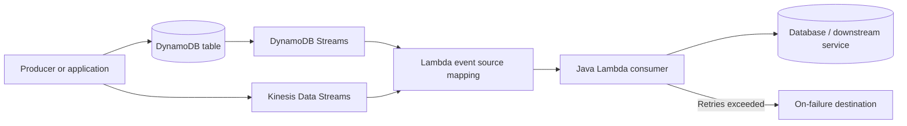

# Reading DynamoDB Streams and Kinesis with Lambda Consumers

AWS Lambda can react to data changes and event streams without running an always-on server application to poll. With **DynamoDB Streams** and **Amazon Kinesis Data Streams**, Lambda uses a component called an **event source mapping** to read records from the stream, group them into batches, and invoke the processing function.

Both data sources suit event-driven architectures, though their purposes differ. DynamoDB Streams captures item-level changes in a DynamoDB table. Kinesis Data Streams is a general-purpose streaming service where multiple producers emit records by partition key. When designing a consumer, you need to understand shards, record ordering, batching, checkpointing, retries, idempotency, and data retention limits.

This lesson explains how to choose a stream source, configure a Lambda event source mapping, read events in Java, and handle errors so that a failing record neither drops nor duplicates business side effects.

## 1. Lambda Consumer Architecture for Streams

With these two stream sources, Lambda is not invoked directly per record like an HTTP request. Instead, a Lambda-managed event source mapping polls the stream:

1. A producer writes data to a DynamoDB table or a Kinesis Data Stream.
2. The stream service persists records according to its structure and ordering.
3. The Lambda event source mapping reads records from shards or stream iterators.
4. The mapping groups records into batches based on batch size and batching window.
5. Lambda invokes the function with an event containing the records.
6. The function processes the batch and returns a result or reports failed records using a supported mechanism.
7. The event source mapping updates the read position/checkpoint and continues fetching the next batch.



The event source mapping is responsible for polling and invoking Lambda. Developers configure the source, starting position, batching, retries, and IAM permissions; there is no need to write a polling loop inside the handler.

This differs from a scheduled Lambda function calling stream-reading APIs periodically. Using an event source mapping lets the platform manage shard reading, checkpointing, and consumer scaling alongside the data source.

## 2. How Do DynamoDB Streams and Kinesis Data Streams Differ?

| Criterion | DynamoDB Streams | Kinesis Data Streams |
|---|---|---|
| Purpose | Captures item changes on a DynamoDB table | General-purpose record stream for events from multiple producers |
| Record source | Item INSERT, MODIFY, REMOVE | Records written to the stream by producers |
| Data | Keys and item images per StreamViewType | Partition key, sequence number, and payload bytes |
| Partitioning | Service-managed shards for the table's stream | Shards managed via provisioned/on-demand capacity |
| Ordering | Change order guaranteed per item | Record order within a shard; same partition key goes to the same shard |
| Retention | 24 hours | Per the stream's configured retention |
| Use when | Syncing table changes, auditing, updating search indexes, post-change processing | Event ingestion, telemetry, clickstreams, IoT, logs, and multiple producers |
| Consumers | Lambda event source mapping, KCL, and other supported consumers | Lambda, KCL, enhanced fan-out, and other consumers |

### When to Choose DynamoDB Streams?

Use DynamoDB Streams when events should reflect changes to a DynamoDB table. Examples:

- When an order changes status, update a projection or search index.
- When a user profile changes, sync data to another system.
- When an item is inserted, updated, or deleted, emit notifications or update a cache.
- When processing requires before-and-after item images.

DynamoDB Streams provides change data capture (CDC) for DynamoDB. The application does not have to manually emit an event on every item write; the stream is generated from table mutations.

### When to Choose Kinesis Data Streams?

Use Kinesis when you need a record stream independent of a specific database. Examples:

- Multiple applications emitting telemetry or clickstreams.
- IoT systems continuously sending device data.
- Multiple producers emitting events that must be processed by partition key.
- Needing to retain records for a configurable retention period so multiple consumers can read independently.

Kinesis fits when the stream is a central data component with dedicated producers and consumers. A DynamoDB table can emit DynamoDB Streams for its mutations, whereas Kinesis receives records actively published by applications.

## 3. Shards, Partition Keys, and Record Ordering

Both DynamoDB Streams and Kinesis Data Streams divide the stream into shards. A shard is the unit of partitioning and data reading in a stream.

### Kinesis Partition Keys

Producers send records with a partition key. Kinesis uses the partition key to map each record to a shard. Consequently, records with the same partition key land in the same shard and maintain order within that shard.

Examples:

- `partition key = order-123` for events belonging to one order.
- `partition key = customer-42` for events belonging to one customer.
- `partition key = device-900` for telemetry from one device.

Partition key selection affects load distribution. If all records share the same key, one shard can become a hot shard while other shards sit idle. If keys are overly random, records for the same entity may scatter across shards and lose per-entity ordering.

Choose keys based on the ordering boundary you need and how evenly load distributes.

### DynamoDB Streams Shards

DynamoDB Streams creates shards and manages shard lineage across the table's lifecycle. Changes to the same item are ordered in the stream. Consumers should not assume global ordering across all items or all shards.

### Ordering Does Not Mean Exactly-Once Processing

Record ordering in a stream helps consumers process changes in the required sequence. However, Lambda may re-invoke a batch when a function fails, times out, or fails to acknowledge a checkpoint. Thus, the same record can be processed again.

Systems must combine ordering with idempotency. Do not treat a sequence number or event ID as proof that side effects executed exactly once.

## 4. DynamoDB Streams: Configuration and Record Structure

To use DynamoDB Streams, enable streams on the table and select a `StreamViewType`. Common options:

| StreamViewType | Record data |
|---|---|
| KEYS_ONLY | Only the keys of the modified item |
| NEW_IMAGE | The entire item as it appears after modification |
| OLD_IMAGE | The entire item as it appeared before modification |
| NEW_AND_OLD_IMAGES | Both the before and after item images |

Choose the view based on what the consumer truly needs. `NEW_AND_OLD_IMAGES` is useful when comparing changes, but produces larger records that may include more sensitive fields.

A DynamoDB Streams record typically includes:

- `eventName`: INSERT, MODIFY, or REMOVE.
- `eventID`: record identifier.
- `eventSource`: `aws:dynamodb`.
- `awsRegion` and `eventSourceARN`.
- `dynamodb.Keys`: item keys.
- `dynamodb.NewImage`: new item image if provided by the view type.
- `dynamodb.OldImage`: old item image if provided by the view type.
- `dynamodb.SequenceNumber`: sequence number of the record in the shard.
- `dynamodb.ApproximateCreationDateTime`: approximate timestamp when the record was created.

Abbreviated payload example:

```json
{
  "eventName": "MODIFY",
  "eventSource": "aws:dynamodb",
  "eventID": "1a2b3c",
  "awsRegion": "ap-southeast-1",
  "dynamodb": {
    "Keys": {
      "orderId": { "S": "ord-123" }
    },
    "OldImage": {
      "status": { "S": "PENDING" }
    },
    "NewImage": {
      "status": { "S": "PAID" }
    },
    "SequenceNumber": "800000000000000000001"
  }
}
```

Actual payloads include additional metadata and depend on `StreamViewType`. Do not assume `OldImage` or `NewImage` is always present.

## 5. Reading DynamoDB Streams with Java Lambda

The AWS Lambda Java Events library provides models for receiving DynamoDB events. The following example processes records for order status changes.

```java
import com.amazonaws.services.lambda.runtime.Context;
import com.amazonaws.services.lambda.runtime.RequestHandler;
import com.amazonaws.services.lambda.runtime.events.DynamodbEvent;
import com.amazonaws.services.lambda.runtime.events.models.dynamodb.AttributeValue;
import com.amazonaws.services.lambda.runtime.events.models.dynamodb.StreamRecord;
import java.util.Map;

public class OrderStreamHandler
        implements RequestHandler<DynamodbEvent, Void> {

    @Override
    public Void handleRequest(
            DynamodbEvent event,
            Context context) {

        for (DynamodbEvent.DynamodbStreamRecord record
                : event.getRecords()) {

            String eventName = record.getEventName();
            StreamRecord change = record.getDynamodb();

            Map<String, AttributeValue> keys = change.getKeys();
            Map<String, AttributeValue> newImage = change.getNewImage();
            Map<String, AttributeValue> oldImage = change.getOldImage();

            AttributeValue orderIdValue =
                    keys == null ? null : keys.get("orderId");

            String orderId = orderIdValue == null
                    ? null : orderIdValue.getS();

            String newStatus = readString(newImage, "status");
            String oldStatus = readString(oldImage, "status");

            context.getLogger().log(
                    "event=" + eventName
                    + ", orderId=" + orderId
                    + ", oldStatus=" + oldStatus
                    + ", newStatus=" + newStatus);

            processChange(record, orderId, oldStatus, newStatus);
        }

        return null;
    }

    private static String readString(
            Map<String, AttributeValue> image,
            String name) {
        if (image == null || image.get(name) == null) {
            return null;
        }
        return image.get(name).getS();
    }

    private void processChange(
            DynamodbEvent.DynamodbStreamRecord record,
            String orderId,
            String oldStatus,
            String newStatus) {
        // Check event type and execute idempotent business logic.
    }
}
```

This is an illustrative skeleton. Add a runtime-compatible `aws-lambda-java-events` dependency and verify `AttributeValue` data types against your table schema. A DynamoDB `AttributeValue` can be `S`, `N`, `BOOL`, `M`, `L`, `SS`, `NS`, `B`, and other types; do not call `getS()` on every attribute.

Notes:

- For INSERT, `NewImage` may have data while `OldImage` is absent.
- For REMOVE, `OldImage` may have data while `NewImage` is absent.
- For MODIFY, both images are present only if `StreamViewType` provides them.
- `eventName` must be handled explicitly; do not assume every record is MODIFY.
- When reading a specific field, check for null and data type before extracting its value.

## 6. Kinesis Data Streams: Record Structure

A Kinesis record contains several key fields:

- `partitionKey`: key used by the producer for partitioning.
- `sequenceNumber`: record sequence number within the shard.
- `data`: payload bytes sent by the producer.
- `approximateArrivalTimestamp`: approximate arrival timestamp.
- `eventSourceARN`: ARN of the stream.
- `eventID`: typically contains the shard ID and sequence number.

Illustrative payload example:

```json
{
  "eventSource": "aws:kinesis",
  "eventSourceARN": "arn:aws:kinesis:ap-southeast-1:123456789012:stream/order-events",
  "records": [
    {
      "eventID": "shardId-000000000000:49590338271490256608559692538361571095921575989136588898",
      "kinesis": {
        "partitionKey": "order-123",
        "sequenceNumber": "49590338271490256608559692538361571095921575989136588898",
        "data": "eyJ0eXBlIjoib3JkZXIucGFpZCIsIm9yZGVySWQiOiJvcmRlci0xMjMifQ=="
      }
    }
  ]
}
```

In the raw JSON event, `data` is represented in Base64. When using the AWS Lambda Java Events model, the `data` field is typically provided as a `ByteBuffer` already decoded from the event JSON by the library. Do not Base64-decode it a second time when reading from the decoded model.

## 7. Reading Kinesis with Java Lambda

The following example receives a `KinesisEvent`, extracts the payload bytes, and converts them to a UTF-8 JSON string.

```java
import com.amazonaws.services.lambda.runtime.Context;
import com.amazonaws.services.lambda.runtime.RequestHandler;
import com.amazonaws.services.lambda.runtime.events.KinesisEvent;
import java.nio.ByteBuffer;
import java.nio.charset.StandardCharsets;

public class KinesisConsumer
        implements RequestHandler<KinesisEvent, Void> {

    @Override
    public Void handleRequest(
            KinesisEvent event,
            Context context) {

        for (KinesisEvent.KinesisEventRecord record
                : event.getRecords()) {

            ByteBuffer data =
                    record.getKinesis().getData().asReadOnlyBuffer();

            byte[] payload = new byte[data.remaining()];
            data.get(payload);

            String json = new String(
                    payload, StandardCharsets.UTF_8);

            String partitionKey =
                    record.getKinesis().getPartitionKey();

            String sequenceNumber =
                    record.getKinesis().getSequenceNumber();

            context.getLogger().log(
                    "partitionKey=" + partitionKey
                    + ", sequenceNumber=" + sequenceNumber);

            processRecord(json, partitionKey, sequenceNumber);
        }

        return null;
    }

    private void processRecord(
            String json,
            String partitionKey,
            String sequenceNumber) {
        // Parse schema, validate payload, and process idempotently.
    }
}
```

Use `asReadOnlyBuffer()` to read a separate view without mutating the original `ByteBuffer`'s position. If the payload is JSON, parse it with Jackson or your chosen parser and validate the schema before applying business logic.

Kinesis only guarantees ordering within a shard. If per-order processing is required, producers should use `orderId` as the partition key. If producers use random keys, records for the same order may land in different shards and be processed in parallel.

## 8. Lambda Event Source Mapping and Batching

The event source mapping determines how Lambda reads the stream. Key settings include:

| Setting | Meaning |
|---|---|
| Event source ARN | DynamoDB Stream ARN or Kinesis Stream ARN |
| Starting position | Where to begin reading |
| Batch size | Maximum number of records in a batch |
| Maximum batching window | Maximum time to gather records before invoking the function |
| Parallelization factor | Number of batches that can be processed concurrently per shard |
| Maximum retry attempts | Maximum retry attempts when a batch fails |
| Maximum record age | Maximum age a record is still allowed to be processed |
| Bisect batch on function error | Splits a batch in half on function error to isolate the failing record |
| Function response types | Enables partial batch responses such as `ReportBatchItemFailures` |
| On-failure destination | Where metadata about discarded records is sent after retries are exhausted, if supported by the source |

Larger batches reduce invocation count but can increase processing time, memory usage, and the scope of records retried on error. Smaller batches isolate errors better but increase function invocation counts.

Beyond batch size, event source mappings are also subject to Lambda's invocation payload limit. Actual event size includes metadata and envelopes, not just the raw payload. Verify current service limits and test with large records.

### Starting Position

Common options:

- **TRIM_HORIZON:** starts from the oldest record still within retention.
- **LATEST:** starts from new records added after the current read position.
- **AT_TIMESTAMP:** starts from a specific timestamp, if supported by the source.

`LATEST` is suitable when you only care about new data after the consumer starts operating. However, while an event source mapping is being created or updated, the poller needs time to begin reading; if no records may be missed during transitions, consider `TRIM_HORIZON` or an explicit bootstrap/reconciliation process.

`TRIM_HORIZON` can only read records still within retention. It cannot recover data whose retention period has expired.

### Batch Size and Batching Window

Batch size determines the maximum number of records an invocation can receive. Batching window lets Lambda wait for more records to form a larger batch before invoking the function.

Exact limits depend on the stream type and current AWS quotas. DynamoDB Streams and Kinesis have different batch size limits. Additionally, total event payload must stay within the invocation size limit. Do not simply pick the largest batch size without measuring latency, memory, and throughput.

## 9. Shard Concurrency and ParallelizationFactor

By default, Lambda processes one batch at a time per shard in a stream mapping. This helps preserve record order within the shard, but can bottleneck throughput when the function processes slowly.

`ParallelizationFactor` allows processing multiple batches concurrently on a single shard, within service limits. For Kinesis and DynamoDB Streams, it can be configured up to 10. Lambda still preserves processing order by partition key for Kinesis and by item for DynamoDB Streams when using this feature.

Do not increase the parallelization factor without checking:

- Is the function safe for concurrent execution?
- Do concurrent batches update the same item or aggregate?
- Can the target database handle the extra connections and transactions?
- Are all side effects idempotent?
- Is there any global ordering requirement across keys?

Increasing concurrency can boost throughput, but also increases downstream load. If a downstream service has low quotas, cap concurrency or use a queue to smooth load.

### Hot Shards and Partition Keys

Uneven Kinesis partition key distribution can create hot shards. A shard receiving too many records can become a bottleneck even while other shards have spare capacity.

Monitor `IncomingRecords`, `IncomingBytes`, `ReadProvisionedThroughputExceeded`, `IteratorAgeMilliseconds`, and related metrics. In Kinesis on-demand vs. provisioned modes, shard scaling mechanics differ; select the capacity mode and partition keys based on expected throughput.

For DynamoDB Streams, monitor `IteratorAge` and processing errors. Do not assume adding Lambda concurrency fixes every bottleneck at the source or downstream.

## 10. Retries, Checkpoints, and Batch Failures

The Lambda event source mapping tracks stream reading progress via checkpoints/sequence numbers. When the function fails to process a batch, the mapping can retry the batch per configuration. With streams, errors can block subsequent records because ordering must be preserved.

Without appropriate retry limits or record age bounds, a permanently failing record (poison pill) can block a shard for a long time. For example, a schema-invalid payload causes the handler to throw every time; the batch containing it may be redelivered repeatedly.

Settings that help control this:

- Maximum retry attempts: caps retry count.
- Maximum record age: skips records older than the configured policy threshold.
- Bisect batch on function error: splits failing batches into smaller batches to pinpoint the failing record.
- On-failure destination: captures metadata of discarded records for investigation or replay.
- Partial batch response: reports only the failing record in the supported format.

Do not simply raise retries to infinity. Distinguish recoverable errors from unrecoverable data errors, and maintain a workflow to handle discarded records.

### Retries Do Not Mean Exactly-Once

A record might be processed successfully downstream, yet the function times out before the mapping records the checkpoint. In that case, Lambda can resend the record. Consumers must assume duplicate record delivery is possible.

How to handle it:

1. Identify a stable idempotency key for the record.
2. Record the key and processing outcome in a database using a unique constraint or transaction.
3. Perform business updates atomically where possible.
4. When calling external services, pass an idempotency key if the API supports it.
5. When receiving an already processed record, return success without repeating side effects.

For Kinesis, stream ARN + sequence number can serve as a technical key. For DynamoDB Streams, `eventID` or stream ARN + `eventID` can be used. Business keys such as `orderId` + event version may be better when deduplicating at the business level.

## 11. Partial Batch Responses

If only one record in a batch fails, by default the function may have to fail the entire batch. Partial batch responses let the function report which record failed so Lambda can checkpoint preceding records.

For Kinesis and DynamoDB Streams, the event source mapping must enable `ReportBatchItemFailures`. The function returns a batch item failure list containing sequence numbers. Lambda uses the earliest failed sequence number to determine where to retry within the shard.

Kinesis handler example:

```java
import com.amazonaws.services.lambda.runtime.Context;
import com.amazonaws.services.lambda.runtime.RequestHandler;
import com.amazonaws.services.lambda.runtime.events.KinesisEvent;
import com.amazonaws.services.lambda.runtime.events.StreamsEventResponse;
import java.util.ArrayList;
import java.util.List;

public class PartialKinesisConsumer
        implements RequestHandler<KinesisEvent, StreamsEventResponse> {

    @Override
    public StreamsEventResponse handleRequest(
            KinesisEvent event,
            Context context) {

        List<StreamsEventResponse.BatchItemFailure> failures =
                new ArrayList<>();

        for (KinesisEvent.KinesisEventRecord record
                : event.getRecords()) {
            try {
                process(record);
            } catch (RetryableRecordException ex) {
                String sequenceNumber =
                        record.getKinesis().getSequenceNumber();

                failures.add(
                        new StreamsEventResponse.BatchItemFailure(
                                sequenceNumber));

                // Stop at the first error so we do not bypass the record
                // blocking processing order within the shard.
                break;
            }
        }

        return new StreamsEventResponse(failures);
    }

    private void process(KinesisEvent.KinesisEventRecord record) {
        // Parse, validate, and process idempotently.
    }
}
```

The example illustrates returning failures by sequence number; use an `aws-lambda-java-events` version compatible with your runtime. If the exception is unrecoverable, the application must apply an explicit policy such as writing the record to a quarantine store and acknowledging it, or letting the event source mapping retry and send it to an on-failure destination as configured.

For in-shard ordering, stopping at the first failing record is usually the clearest and safest approach. Trailing records will be reprocessed when Lambda resumes from the failed sequence number. If continuing to process trailing records and only failing an earlier record, ensure out-of-order processing does not violate business rules.

Partial batch responses reduce the number of succeeded records reprocessed, but do not eliminate the requirement for idempotency.

## 12. Tumbling Windows and Windowed Processing

Kinesis event source mappings support tumbling windows to aggregate records over time windows and pass state between invocations within a window. This is useful for time-interval aggregations such as orders per minute or telemetry totals per device.

Tumbling windows include a state-transfer mechanism between invocations and specific limits on duration, payload, and state size. They are not a database replacement for long-lived business state.

Before using them, define:

- Window duration and how late-arriving records are handled.
- Aggregated state size.
- Retry behavior when an invocation inside the window fails.
- Potential duplicates or reruns when checkpoints are not yet committed.
- How final results are written idempotently to a data store.

DynamoDB Streams can also use corresponding event source mapping features depending on configuration and Lambda limits; check current documentation before adopting them.

## 13. IAM and Security for Lambda Consumers

Lambda needs permissions to read the stream and write logs. Use a dedicated execution role for the function, scoped to the exact stream ARN and required actions.

For DynamoDB Streams, read permissions typically include:

- `dynamodb:DescribeStream`
- `dynamodb:GetRecords`
- `dynamodb:GetShardIterator`
- `dynamodb:ListStreams`

For Kinesis Data Streams, permissions typically include:

- `kinesis:DescribeStream`
- `kinesis:DescribeStreamSummary`
- `kinesis:GetRecords`
- `kinesis:GetShardIterator`
- `kinesis:ListShards`

The function also needs appropriate CloudWatch Logs permissions to write logs. Depending on encryption settings, KMS permissions may be needed to read streams encrypted with a customer managed key. Exact permissions depend on how the event source mapping and encryption are configured.

Security principles:

- Do not grant read permissions across all streams if the function only needs one stream.
- Do not log full payloads containing personal data or secrets.
- Use KMS and encryption at rest when data requires protection.
- Restrict the function's permissions to downstream databases and services.
- Control who can create, modify, or delete event source mappings.
- Validate schema and record size before deep processing.
- Monitor changes to `StreamViewType`, shards, and access permissions.

## 14. Retention, Iterator Age, and Keeping Up with the Stream

Streams retain records only for a limited window. DynamoDB Streams retains records for 24 hours. Kinesis Data Streams has configurable retention; defaults and maximums depend on configuration and service tier.

If a consumer stops running longer than the retention period, older records may expire from the stream before Lambda reads them. Therefore, monitor consumer lag.

A key metric is `IteratorAgeMilliseconds`: the age of the record when Lambda processes it. If this metric rises steadily, the consumer is falling behind the producer.

Possible causes include:

- Function processing is too slow.
- Batch size or parallelization factor is poorly tuned.
- Shards lack sufficient throughput.
- Hot partition keys concentrate load onto a single shard.
- Downstream databases or APIs are slow.
- Continuous retries caused by poison records.
- Function concurrency is capped.

Remedies can include optimizing the handler, increasing batch size appropriately, tuning parallelization factor, improving partition key distribution, adding Kinesis shards/capacity, or reducing downstream load. Do not simply raise concurrency if downstream is already the bottleneck.

## 15. Example: Creating an Event Source Mapping

Mappings can be created via the AWS Console, AWS CLI, CloudFormation, CDK, or Terraform. Conceptual CLI example for Kinesis:

```bash
aws lambda create-event-source-mapping --function-name OrderStreamConsumer --event-source-arn arn:aws:kinesis:ap-southeast-1:123456789012:stream/order-events --starting-position TRIM_HORIZON --batch-size 100 --maximum-batching-window-in-seconds 1 --function-response-types ReportBatchItemFailures --maximum-retry-attempts 5 --maximum-record-age-in-seconds 3600 --bisect-batch-on-function-error
```

This is a configuration example; replace the function name, ARN, and limits for your workload. Options for retries, record age, batching window, and response types may have different limits depending on stream source and API version. Verify commands against the current AWS CLI/API before deploying.

For DynamoDB Streams, the event-source ARN is the table's stream ARN, not the table ARN. Enable streams on the table first and obtain the stream ARN. When a table gets a new stream due to configuration changes, the stream ARN may change; the event source mapping must point to the active ARN.

After creating the mapping, check its `Enabled` status and `State`, the iterator age metric, invocation counts, and function errors. A mapping may take some time to transition to active state.

## 16. Testing the Consumer

Before going to production, test valid data, error paths, and retry behavior:

| Scenario | Expected outcome |
|---|---|
| DynamoDB INSERT | Handler reads Keys and NewImage |
| DynamoDB MODIFY | Handler processes changes from OldImage/NewImage if view type provides them |
| DynamoDB REMOVE | Handler does not assume NewImage exists |
| Valid Kinesis record | Decodes bytes and parses payload |
| Invalid schema record | Classified as a data error, not retried endlessly |
| Downstream timeout | Bounded retries and idempotency protect side effects |
| Same record redelivered | Does not create side effects a second time |
| One record in a batch fails | Partial batch response indicates the failed sequence number |
| Large batch | Handler stays within timeout and memory limits |
| Shard count increase or resharding | Mapping continues processing new shards per service mechanics |
| Slow consumer | IteratorAge triggers alarms before exceeding retention |
| Missing IAM permissions | Mapping/function reports clear errors surfaced through monitoring |

Use representative test events for both DynamoDB and Kinesis. Tests should not invoke the handler with only a single record; test multi-record batches, a failing record in the middle of a batch, and redelivering the same record.

## 17. Common Implementation Pitfalls

- **Confusing DynamoDB Streams with Kinesis:** one is table CDC, the other is a general-purpose stream written by producers.
- **Assuming global ordering:** ordering is guaranteed only within an item or partition/shard per source semantics.
- **Treating Lambda event source mappings as exactly-once:** batches can be redelivered; handlers must be idempotent.
- **Using LATEST when historical backfill is needed:** LATEST does not read records stored prior to the starting position.
- **Ignoring retention:** a consumer paused too long can lose the ability to read old records.
- **Oversized batches:** invocations may hit timeouts or memory limits, widening retry scope.
- **Not configuring partial batch responses:** one bad record can cause succeeded records in the batch to be reprocessed.
- **Retrying poison records infinitely:** shards can stall and iterator age climbs.
- **Skewed partition keys:** creates hot shards and caps throughput.
- **Not handling duplicate records:** downstream systems may receive repeated side effects.
- **Logging full images or payloads:** risks exposing sensitive data and inflates log costs.
- **Overly broad IAM permissions:** widens blast radius if the function is compromised.

## 18. Process for Designing a Lambda Stream Consumer

When building a Java consumer for DynamoDB Streams or Kinesis, you can follow this sequence:

1. Identify the event source: DynamoDB item mutations or general stream records.
2. Choose partition keys or `StreamViewType` based on required data and ordering.
3. Define retention, starting position, and bootstrap/reconciliation strategy.
4. Create the Lambda execution role with read access to the exact stream.
5. Create the event source mapping and configure batch size and batching window.
6. Set parallelization factor based on throughput and downstream capacity.
7. Write the Java handler to parse the right event model and validate schemas.
8. Design idempotency for each record and all side effects.
9. Enable partial batch responses if the handler can pinpoint failed records.
10. Set retry attempts, record age, bisect, and on-failure destination.
11. Monitor `IteratorAge`, invocations, errors, throttling, and DLQs.
12. Test duplicates, poison records, failing batches, resharding, and high load.

## 19. Takeaways

DynamoDB Streams fits when reacting to item changes in a DynamoDB table. Kinesis Data Streams fits general-purpose record streams from multiple producers. Lambda event source mappings poll shards, build batches, and invoke the Java consumer.

Designing a consumer requires understanding partition keys, shards, ordering, retention, batching, checkpoints, and retries. Records can be reprocessed, so idempotency is essential; partial batch responses help isolate record failures without providing exactly-once processing. Monitor `IteratorAge` and downstream capacity so the consumer keeps up with the stream as load increases.
