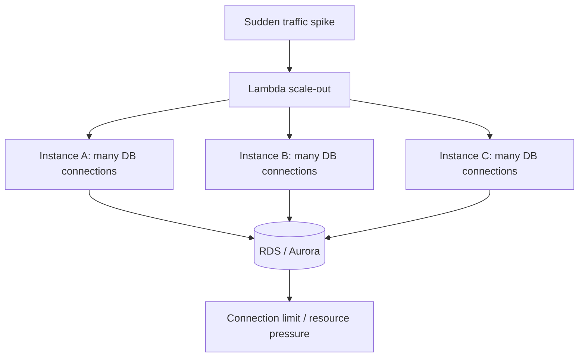
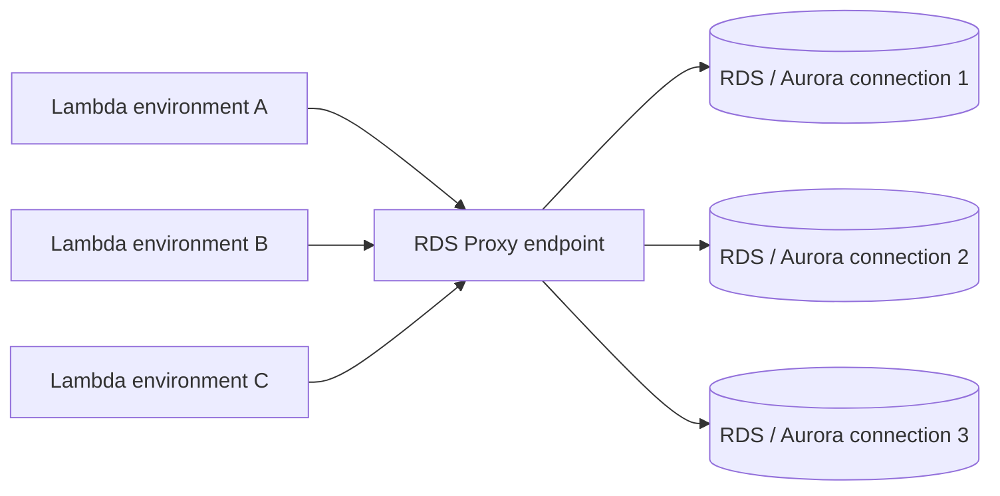
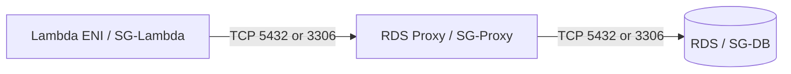
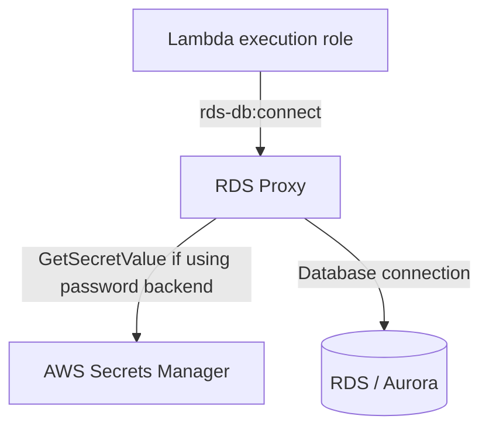

# Accessing RDS via RDS Proxy from Lambda

AWS Lambda can scale up execution environments very rapidly when requests or events surge. If every invocation opens its own direct connection to Amazon RDS or Aurora, the database can receive a burst of concurrent connections exceeding its limit, even if each function performs only a small operation. RDS Proxy manages a connection pool on the database side, sharing backend connections across many clients and easing pressure when Lambda scales out.

RDS Proxy does not replace the database and does not automatically make every query faster. Lambda still opens a connection to the proxy endpoint; the proxy maintains connections to the database. Its primary benefits are connection management, multiplexing where session state permits, and connection recovery assistance during database failover. To use it effectively, you must properly configure VPC networking, security groups, authentication, IAM permissions, transactions, and concurrency.

## 1. Why Does Lambda Need RDS Proxy?

### 1.1. The Problem with Direct Connections

A function instance typically creates a database connection when processing requires it. When Lambda handles many concurrent invocations, many execution environments may create connections simultaneously. If each invocation opens multiple connections or each environment keeps its own pool, the connection count can climb very quickly.

For example, a function might scale to 300 execution environments. If each environment opens a pool of 5 connections, the database could have to serve up to 1,500 connections from this workload. The actual number depends on concurrent invocations per environment, connection lifecycles, and how the application manages its pool.

Databases have connection limits, and each connection consumes resources such as memory, processes/threads, or management slots. When the limit is reached, new connections may be rejected, queries may slow down, or applications may time out before business logic even begins.



Raising the database's `max_connections` is not always the solution. Increasing the limit can make the database consume more memory and leave fewer resources for queries. First, eliminate unnecessary connections and control concurrency.

### 1.2. What Does RDS Proxy Solve?

RDS Proxy is a managed database proxy service. Lambda connects to the proxy endpoint; the proxy maintains a backend connection pool to RDS/Aurora. When clients perform compatible work, the proxy can let multiple clients take turns sharing a single backend database connection instead of holding a dedicated backend connection for each client across its entire lifetime.



The proxy manages borrowing and returning backend connections, caps database connections per configuration, and helps reroute connections during database failover. Client connections to the proxy can still be high; what needs controlling is the number of backend connections the database bears and how long clients wait to borrow a connection.

### 1.3. RDS Proxy Does Not Solve Everything

RDS Proxy does not replace SQL tuning, indexing, transaction design, or data modeling. Nor does it guarantee that every client connection can be multiplexed onto different backend connections at all times.

The following issues must still be handled in the application:

- slow queries or lock contention;
- long-running transactions;
- connections pinned to a backend session;
- invocation volume exceeding database capacity;
- unsafe retries after a transaction has already created side effects;
- misconfigured networking, IAM, or secrets.

RDS Proxy fits workloads with many short-lived client connections, variable load, or Lambda scale-out where the database needs protection from connection storms.

## 2. Connection Flow: Lambda → RDS Proxy → RDS

A request passes through these steps:

1. API Gateway, SQS, EventBridge, or a caller invokes Lambda.
2. The Java handler validates the request/event and starts a transaction if needed.
3. Lambda opens a JDBC connection to the RDS Proxy endpoint inside the VPC.
4. The client authenticates to the proxy using IAM database authentication or username/password per configuration.
5. The proxy borrows a backend connection to the database; the proxy authenticates to the database per its own configuration.
6. The handler executes queries and commits/rolls back the transaction.
7. When the client closes the connection, the proxy can return the backend connection to the pool if the session is unpinned and no transaction remains open.

Two authentication hops must be distinguished:

- **Lambda client → RDS Proxy:** authenticates via IAM or database credentials depending on proxy configuration.
- **RDS Proxy → RDS/Aurora:** the proxy uses credentials configured for the target database; the common pattern is a secret in AWS Secrets Manager, though IAM authentication between the proxy and database can be used if the engine/configuration supports it.

IAM auth on the client-to-proxy hop does not automatically mean the proxy uses IAM auth on the proxy-to-database hop. Configure and test each hop separately.

## 3. Preparing RDS Proxy and the Database

### 3.1. Checking Engine and Support Requirements

RDS Proxy supports specific engines and versions of Amazon RDS/Aurora. Before deploying, verify the list of supported engines/versions, regions, IAM authentication capabilities, TLS, and corresponding limits in current AWS documentation.

Clarify:

- database engine and version;
- database instance vs. Aurora cluster;
- writer/reader endpoints needed;
- maximum connections and current load;
- authentication method from proxy to database;
- TLS, CA certificate, and encryption requirements;
- whether fast failover or many short-lived clients are needed.

Do not assume all RDS Proxy features behave identically across MySQL, PostgreSQL, MariaDB, and supported Aurora engines. Parameters, session pinning behavior, and IAM requirements can differ; check the support matrix for your current engine/version.

### 3.2. Creating an Appropriate Database User

Create a dedicated database user for the Lambda workload, granting permissions only on required schemas/tables. Do not use the database master account inside functions.

Business-level permission examples:

- An order-reading function needs only `SELECT` on the relevant tables or views.
- An order-status update function needs write permissions on the relevant tables.
- A migration-running function should use a separate role, not share the runtime role.

Separating users by service or workload limits blast radius if credentials leak and supports auditing. If using IAM database authentication, the database user must be configured per the engine's instructions to accept IAM authentication.

### 3.3. Creating RDS Proxy

General configuration sequence:

1. Select the VPC and subnets with connectivity to the database.
2. Select a security group for the proxy.
3. Select the secret or authentication mechanism the proxy uses to connect to the database.
4. Configure the proxy's IAM role to read the secret if using Secrets Manager.
5. Select the engine family and target database/cluster.
6. Configure TLS, IAM authentication, connection pool, and timeouts for your workload.
7. Create the proxy endpoint and wait for proxy/target status to become available.
8. Verify target health and test connectivity from an environment on the same network.

RDS Proxy typically requires subnets across at least two Availability Zones for high availability. Choose subnets based on deployment topology and actual database reachability. Do not place the proxy endpoint in public subnets assuming it becomes a public endpoint; the proxy is accessed over the VPC network per configuration.

### 3.4. Proxy Endpoint

Once created, RDS Proxy provides a DNS endpoint. Applications use this hostname instead of the direct database endpoint. Do not hardcode IP addresses because underlying IPs can change during service operations or failover.

Keep the endpoint in environment-specific configuration, such as an environment variable `DB_PROXY_HOST`. Do not put usernames/passwords or tokens in unprotected configuration variables alongside it.

## 4. VPC and Security Groups

### 4.1. Lambda Must Have Network Connectivity to the Proxy

RDS Proxy lives inside a VPC. Lambda must be configured with access to the corresponding VPC to open connections to the proxy endpoint. When configuring Lambda VPC access, choose subnets with routes to the proxy and an appropriate security group.

Attaching Lambda to private subnets does not automatically grant internet access. If the function also calls public APIs, design appropriate NAT or VPC endpoints. Traffic to RDS Proxy is internal VPC traffic.

### 4.2. Security Group Rules per Hop

Assuming PostgreSQL uses port 5432 or MySQL uses port 3306, security groups can be modeled as follows:

| Component | Inbound | Outbound |
| --- | --- | --- |
| Lambda security group | Usually no inbound needed for JDBC connections initiated by Lambda | Allow to proxy security group on the database port |
| Proxy security group | Allow from Lambda security group on the database port | Allow to database security group on the database port |
| Database security group | Allow from proxy security group on the database port | Per required database network policy |



Prefer referencing security groups as sources/destinations rather than opening ports to `0.0.0.0/0` or the entire VPC CIDR. Actual rules must account for outbound policies, network ACLs, and route tables. If using a custom port, configure it consistently across the database, proxy, security groups, and JDBC URL.

### 4.3. DNS and TLS

Lambda must be able to resolve the proxy hostname. When encountering timeouts or connection refused errors, check DNS resolution, routes, subnets, network ACLs, and security groups before concluding the database is unavailable.

Enable TLS for connections to the proxy and verify the server certificate per driver settings. With PostgreSQL JDBC, you can use `sslmode=verify-full` with a trust store containing the appropriate CA; with MySQL Connector/J, use a server identity verification mode such as `sslMode=VERIFY_IDENTITY`. Encrypting without verifying server identity may not adequately protect against spoofed endpoints.

Do not disable certificate verification as a “quick fix” for TLS errors in production. Verify the CA bundle, hostname, system clock, and driver configuration.

## 5. Authentication: IAM and Secrets Manager

### 5.1. Two Credential Layers

RDS Proxy can use a secret to connect to the backend database. Lambda can use IAM authentication to connect to the proxy without reading the database password. This pattern is often beneficial for serverless:



The exact authentication model depends on engine and RDS Proxy configuration. If the client uses username/password, Lambda must securely fetch the secret and connect with those credentials. If the client uses IAM authentication, Lambda generates a short-lived token and needs `rds-db:connect` on the exact resource. Do not grant Lambda secret-read permissions if the function does not read secrets.

### 5.2. Permissions of the Role Used by RDS Proxy

When the proxy uses Secrets Manager to fetch database credentials, the role attached to the proxy needs `secretsmanager:GetSecretValue` on the corresponding secret. If the secret is encrypted with a customer-managed KMS key, the role may also need `kms:Decrypt` per key policy and encryption context.

This role is for the proxy to access secrets; it is distinct from the Lambda execution role. Do not grant read access to all secrets in the account if the proxy only needs a few specific secrets.

The proxy role needs a trust relationship for the RDS service, typically the `rds.amazonaws.com` principal. Illustrative abbreviated trust policy:

```json
{
  "Version": "2012-10-17",
  "Statement": [
    {
      "Effect": "Allow",
      "Principal": { "Service": "rds.amazonaws.com" },
      "Action": "sts:AssumeRole"
    }
  ]
}
```

Attach a permissions policy scoping `secretsmanager:GetSecretValue` to the exact secret ARN. If the secret uses a customer-managed KMS key, add `kms:Decrypt` on that specific key and verify the key policy allows this role to use the key.

### 5.3. IAM Authentication from Lambda to Proxy

With IAM database authentication, Lambda generates a token based on hostname, port, username, and active AWS credentials. The token is used as the password during connection handshake. Tokens have a short lifetime (15 minutes for authentication); an already established connection does not need a password change mid-query solely because the token expires. When opening a new connection, generate a new token.

The execution role needs `rds-db:connect` on the RDS Proxy resource ID and permitted database user. The ARN has the form:

```text
arn:aws:rds-db:<region>:<account-id>:dbuser:<proxy-resource-id>/<db-user>
```

In the proxy ARN, the resource ID starts with `prx-`. This is the proxy's resource ID, not the DNS endpoint name and not the secret ARN. Illustrative policy example:

```json
{
  "Version": "2012-10-17",
  "Statement": [
    {
      "Sid": "ConnectToOrdersProxyAsAppUser",
      "Effect": "Allow",
      "Action": "rds-db:connect",
      "Resource": "arn:aws:rds-db:ap-southeast-1:123456789012:dbuser:prx-ABCDEFGHIJKL01234/orders_app"
    }
  ]
}
```

Replace region, account ID, proxy resource ID, and username with real values. Do not use wildcard resources broader than necessary. Beyond the IAM policy, the database user must also be configured to support IAM authentication per the engine.

### 5.4. Client Password Authentication

If using username/password from Lambda to the proxy, the function must fetch the secret from Secrets Manager or Parameter Store SecureString. The execution role then needs permission to read that specific secret; if encrypted with a customer-managed KMS key, decryption permission is required per configuration.

Do not place database passwords in source code, JAR files, images, event payloads, or logs. If caching secrets in the execution environment, set an appropriate TTL and implement a refresh strategy when secret rotation occurs. A reused Lambda environment does not mean credentials in memory remain valid forever.

### 5.5. IAM Authentication on the Proxy-to-Database Hop

Client-to-proxy authentication and proxy-to-database authentication are two separate configurations. Some engines/configurations support the proxy using IAM authentication to the database; other cases use credentials retrieved from Secrets Manager. Check engine/version, IAM auth status on the database, user mapping, and proxy role permissions in the corresponding AWS documentation. Do not infer that enabling IAM on one hop automatically enables it on the other.

## 6. Java JDBC Connections to RDS Proxy

### 6.1. Connection Configuration

Non-secret values can be passed via environment variables:

| Variable | Example | Purpose |
| --- | --- | --- |
| `DB_PROXY_HOST` | `orders.proxy-abc123.ap-southeast-1.rds.amazonaws.com` | Proxy DNS endpoint |
| `DB_PORT` | `5432` or `3306` | Database port |
| `DB_NAME` | `orders` | Database/schema to connect to |
| `DB_USER` | `orders_app` | Database user |
| Lambda runtime region | `ap-southeast-1` | Lambda provides the system variable `AWS_REGION`; the default SDK can also use the region provider chain |

Do not manually override Lambda's system `AWS_REGION` variable. Do not put passwords or static IAM tokens in environment variables. IAM tokens should be generated right before opening a connection; secret passwords should be fetched from a secret store when needed.

### 6.2. PostgreSQL Example with IAM Authentication

The example below uses AWS SDK for Java 2.x to generate an IAM authentication token, the PostgreSQL JDBC driver to connect, and `try-with-resources` to close the connection afterward. Lambda's execution role supplies temporary AWS credentials to the SDK.

```java
package com.example.orders;

import java.sql.Connection;
import java.sql.DriverManager;
import java.sql.ResultSet;
import java.sql.SQLException;
import java.sql.Statement;
import java.util.Properties;

import software.amazon.awssdk.auth.credentials.DefaultCredentialsProvider;
import software.amazon.awssdk.regions.Region;
import software.amazon.awssdk.services.rds.RdsUtilities;

public final class OrdersRepository {
    private final String host;
    private final int port;
    private final String database;
    private final String username;
    private final RdsUtilities rdsUtilities;

    public OrdersRepository(
            String host,
            int port,
            String database,
            String username,
            Region region) {
        this.host = host;
        this.port = port;
        this.database = database;
        this.username = username;
        this.rdsUtilities = RdsUtilities.builder()
                .region(region)
                .credentialsProvider(DefaultCredentialsProvider.create())
                .build();
    }

    public long countOrders() throws SQLException {
        String token = rdsUtilities.generateAuthenticationToken(builder -> builder
                .hostname(host)
                .port(port)
                .username(username));

        String jdbcUrl = "jdbc:postgresql://" + host + ":" + port + "/" + database
                + "?sslmode=verify-full";

        Properties properties = new Properties();
        properties.setProperty("user", username);
        properties.setProperty("password", token);

        try (Connection connection = DriverManager.getConnection(jdbcUrl, properties);
             Statement statement = connection.createStatement();
             ResultSet resultSet = statement.executeQuery("SELECT COUNT(*) FROM orders")) {

            if (!resultSet.next()) {
                throw new SQLException("Count query returned no row");
            }
            return resultSet.getLong(1);
        }
    }
}
```

This is a skeleton example; add dependencies for AWS SDK RDS utilities, AWS credentials provider, the PostgreSQL JDBC driver, and configure a trust store containing the proper CA so `sslmode=verify-full` can verify the certificate. The database user must be configured for IAM authentication per RDS PostgreSQL instructions. The endpoint passed in must be the RDS Proxy endpoint, not the direct database endpoint.

Maven dependency example (version-managed via the AWS SDK BOM in the project):

```xml
<dependency>
    <groupId>software.amazon.awssdk</groupId>
    <artifactId>rds</artifactId>
</dependency>
<dependency>
    <groupId>org.postgresql</groupId>
    <artifactId>postgresql</artifactId>
    <version>${postgresql.jdbc.version}</version>
</dependency>
```

The `rds` SDK module provides `RdsUtilities`; the PostgreSQL driver provides the JDBC implementation. Choose compatible versions and package the dependencies into the Lambda artifact.

The token is generated from the execution role's AWS credentials and has a short validity window for authentication. Do not log the token. Once the connection is closed, the proxy can reuse the backend connection if the session is unpinned and the transaction has ended.

### 6.3. MySQL Example: What Changes

For MySQL, the JDBC driver and TLS parameters differ from PostgreSQL. The general URL format is:

```text
jdbc:mysql://<proxy-endpoint>:3306/<database>?sslMode=VERIFY_IDENTITY
```

When using IAM database authentication, generate a token for the exact endpoint, port, and database user, then pass the token as the password in `Properties`. The driver must be configured to trust the appropriate CA and verify the hostname. The database user must be configured with the engine's IAM authentication mechanism. Do not copy PostgreSQL's `sslmode` configuration verbatim into MySQL Connector/J.

### 6.4. Closing Connections Properly

In Lambda, a simple pattern is opening a JDBC connection to the proxy during an invocation, running a short transaction, and closing the connection in `finally`/try-with-resources. Closing the client connection tells the proxy the session has ended so it can return the backend connection to the pool when eligible.

Do not leave connections or transactions open across invocations. If using a connection pool per execution environment, keep the pool size very small and calculate total client connections across concurrency. RDS Proxy manages the backend pool; it does not make a large HikariCP pool on every Lambda instance free.

### 6.5. Short Transactions and Prepared Statements

```java
try (Connection connection = dataSource.getConnection()) {
    connection.setAutoCommit(false);
    try {
        updateOrder(connection, orderId);
        insertOutboxEvent(connection, eventId, orderId);
        connection.commit();
    } catch (SQLException error) {
        connection.rollback();
        throw error;
    }
}
```

Transactions should wrap a small unit of data change, committing or rolling back before the handler exits. Do not call external APIs or wait on user input while a database transaction is open. If combining database writes with a queue, consider a transactional outbox to persist business changes and events in the same transaction.

## 7. Connection Pooling, Multiplexing, and Session Pinning

### 7.1. How Does Pooling Work?

RDS Proxy maintains a set of backend connections to the database. When a client needs to run a query, the proxy borrows an appropriate connection. When the transaction ends and the session is in a shareable state, the proxy can return the backend connection to the pool to serve another client.

This is especially helpful when client connections outlive transactions or when Lambda creates many short-lived client connections. However, the proxy still needs enough backend connections for actual concurrency and active usage time.

### 7.2. Multiplexing

Multiplexing lets the proxy switch a backend connection between client sessions at safe boundaries, typically after a transaction finishes. Many clients can be served using fewer backend connections than total client connections.

For example, 200 Lambda environments might maintain client connections to the proxy while only a fraction are actively running transactions at the same instant. The proxy can use a backend pool smaller than 200 connections if sessions do not hold dedicated state and the database has enough capacity for the load.

### 7.3. Session Pinning

Certain operations bind a session to a single backend connection for a longer period. When a session is pinned, the proxy cannot freely share that backend connection with other clients until the session ends or the pinning condition clears.

Behaviors that can cause pinning depending on engine and version include:

- altering session state or session variables;
- creating temporary tables;
- keeping transactions open;
- certain prepared statements or session-specific operations;
- setting connection state that the proxy cannot safely reset.

The exact list depends on the engine. Consult RDS Proxy's session pinning documentation for your engine and monitor the `DatabaseConnectionsCurrentlySessionPinned` metric.

To reduce pinning:

- keep transactions short;
- avoid changing session variables when database/schema-level configuration can be used;
- avoid temporary tables when unnecessary;
- close statements, result sets, and connections properly;
- avoid holding connections open across independent tasks;
- inspect driver and framework behavior when using prepared statements or connection initialization queries.

Do not try to disable every session feature solely to maximize multiplexing. If business logic genuinely requires session state, accept connection pinning and size the database accordingly.

### 7.4. Is an Application-Side Connection Pool Needed?

RDS Proxy already manages the backend connection pool, though Lambda still opens client connections to the proxy. Three common patterns exist:

1. **Open/close connection per invocation:** simple, suits short functions with moderate queries; the proxy manages backend pooling.
2. **Reuse a single connection per execution environment:** can reduce handshakes, but must detect stale connections, timeouts, and avoid leaking unintended transaction/session state.
3. **Small pool per execution environment:** useful for functions performing many DB operations in one invocation or longer-running runtimes, but total pool size multiplied by concurrency must be accounted for.

Do not create large pools per Lambda environment. For instance, a 10-connection pool across 100 environments can open 1,000 client connections to the proxy even when the proxy only needs a fraction of backend connections. Benchmark how the driver, proxy, and real workload behave.

## 8. Connection Pool Configuration and Load Limits

### 8.1. Parameters to Pay Attention To

RDS Proxy provides settings to manage the backend pool; field names may appear differently across the console, API, and IaC:

| Parameter | Meaning |
| --- | --- |
| `MaxConnectionsPercent` | Percentage cap of backend connections used by the proxy relative to the database's connection limit |
| `MaxIdleConnectionsPercent` | Maximum percentage of backend connections kept idle in the pool |
| `ConnectionBorrowTimeout` | How long a client waits for the proxy to allocate a backend connection before failing |
| `IdleClientTimeout` | How long a client connection sits idle before the proxy closes it per policy |
| `InitQuery` | Session initialization statement if configured; may affect session state/pinning depending on engine |

Do not raise `MaxConnectionsPercent` to 100% by default. The database still needs connections for administration, migrations, monitoring, and other workloads. Reserve headroom so the proxy does not consume the entire connection budget.

### 8.2. Calculating Concurrency and Connection Budgets

Suppose the database sustains 500 connections under target load. If 60% is allocated to the proxy, the proxy's nominal backend limit is about 300 connections. The remainder is reserved for administration, monitoring, and other applications. This is purely a calculation example; check the actual instance/cluster limit and reserve headroom.

On the Lambda side, estimate:

```text
Approximate max client connections
  = Max Lambda concurrency
    x concurrent client connections per invocation/environment
```

Required backend connections depend on concurrent transaction ratio, transaction duration, pinning, and pool utilization. You cannot deduce backend connections solely from Lambda invocation count.

Reserved concurrency can cap simultaneous invocations. With queue triggers, capping maximum concurrency and tuning batch size also helps regulate throughput. Set limits based on database load and borrow latency metrics, not solely on Lambda's scaling capacity.

### 8.3. Choosing Compatible Timeouts

`ConnectionBorrowTimeout` must be long enough for the proxy to allocate a connection, yet shorter than the remaining invocation time. JDBC connect timeout, socket timeout, and query timeout must be configured so the function still has time to roll back, log, and return a response.

Example timeout relationship:

| Component | Illustrative timeout |
| --- | ---: |
| Borrow backend connection from proxy | 3 seconds |
| Open JDBC connection | 4 seconds |
| Single SQL query | 5 seconds |
| Total Lambda invocation | 10 seconds |

These numbers are not fixed recommendations. Account for TLS handshake, query planning, lock waits, retries, and post-query code. Avoid setting query timeouts equal to or greater than the function timeout.

## 9. Error Handling, Retries, and Failover

### 9.1. Connection Errors

Common errors:

- `AccessDenied` when the IAM role lacks `rds-db:connect` or secret access;
- database authentication errors due to wrong username, password, or user mapping;
- timeouts due to security groups, routes, DNS, or the proxy failing to borrow a connection;
- TLS handshake failures due to CA/hostname/driver configuration;
- connection resets during proxy or database failover;
- query timeouts due to locks, slow SQL, or database overload.

Distinguish errors on the Lambda-to-proxy hop from the proxy-to-database hop. If Lambda cannot resolve the endpoint or complete a TCP handshake, check VPC/networking. If TCP connects but authentication fails, check IAM tokens, secrets, users, and IAM auth configuration. If the proxy accepts the client but cannot borrow a backend connection, inspect the connection pool and database health.

### 9.2. Failover and Availability

RDS Proxy can help reduce application recovery time during database failover by managing connections and redirecting backend connections appropriately. However, in-flight transactions may still fail. Client connections may need to be re-established and in-progress operations retried.

Applications should:

- handle connection exceptions and open a new connection when appropriate;
- retry transactions at safe boundaries rather than retrying a single write statement when commit status is unknown;
- use idempotency keys for business side effects;
- reconcile state when commit outcome is indeterminate;
- enforce bounded retries and backoff to avoid creating a connection storm after failover.

Do not assume RDS Proxy turns a database into a zero-interruption service. It reduces certain connection and failover disruptions, but does not replace backups, Multi-AZ, transaction design, or application-level recovery.

### 9.3. Safe Retries

For connection errors before a transaction begins, retrying connection establishment can be safe. For errors after sending `COMMIT` but before receiving the response, commit status may be unknown. Query business state using an idempotency key or transaction ID before rerunning.

Do not infinitely retry `AccessDenied`, schema errors, or invalid passwords. Those errors require fixing policies, configurations, or secrets. For throttling or borrow timeouts, reduce concurrency and increase backoff rather than letting every Lambda invocation hammer the database.

## 10. Observing RDS Proxy and Lambda

Monitor metrics across Lambda, RDS Proxy, and the database to isolate bottlenecks.

### 10.1. Proxy Metrics

Useful CloudWatch metrics may include:

| Metric | What to watch |
| --- | --- |
| `ClientConnections` | Number of client connections to the proxy |
| `DatabaseConnections` | Number of backend connections to the database |
| `DatabaseConnectionsCurrentlyBorrowed` | Number of backend connections currently borrowed by clients |
| `DatabaseConnectionsCurrentlySessionPinned` | Number of backend connections currently pinned to sessions |
| `DatabaseConnectionsBorrowLatency` | Time clients wait for the proxy to provide a backend connection |
| `MaxDatabaseConnectionsAllowed` | Maximum backend connections the proxy may use per configuration |

Exact metric names and availability may differ by engine/region or service version. Verify in CloudWatch metrics for the proxy you are running.

### 10.2. Lambda and Database Metrics

On Lambda, monitor `ConcurrentExecutions`, `Duration`, `Errors`, `Throttles`, timeouts, and init duration. On the database, monitor CPU, memory, database connections, query latency, lock waits, deadlocks, and storage I/O.

Diagnostic patterns:

- `ClientConnections` climbs sharply while `DatabaseConnections` stays steady: the proxy is absorbing many client connections; check borrow latency as well.
- `DatabaseConnectionsCurrentlyBorrowed` nears the limit and borrow latency rises: the backend pool may be undersized for load or transactions are running too long.
- `DatabaseConnectionsCurrentlySessionPinned` is high: inspect session state, transactions, and how the application uses connections.
- Lambda concurrency rises alongside DB CPU and query latency: consider capping concurrency or optimizing queries.
- Borrow latency is high while database CPU is low: check pool configuration, connection pinning, target health, and connection limits.

### 10.3. Logging and Tracing

Emit structured logs with `awsRequestId`, `correlationId`, function version, database operation, duration, and error code. Never log passwords, IAM tokens, JDBC URLs containing credentials, or full SQL parameters containing sensitive data.

If enabling verbose RDS Proxy logging for investigation, evaluate log contents, access controls, and cost. Disable or lower log verbosity after investigation if continuous detailed logging is unnecessary.

## 11. Security and Operations

### 11.1. Least Privilege

Separate IAM roles:

- **Lambda execution role:** `rds-db:connect` if using IAM auth to the proxy, CloudWatch Logs permissions, and AWS permissions the handler genuinely needs.
- **RDS Proxy role:** permission to read secrets in Secrets Manager and decrypt KMS keys if backend authentication configuration requires it.
- **Deployment role:** permissions to create/update Lambda, proxy, IAM policies, secrets, and network configuration; do not use the deployment role as a runtime role.

Do not grant `rds:*`, `secretsmanager:*`, or `kms:*` on `*` when only a specific database user, secret, or key is needed.

### 11.2. Secret Rotation

If the proxy uses Secrets Manager, configure rotation per RDS/Secrets Manager guidelines and verify the secret is bound to the right database user. After rotation, verify the proxy can open new backend connections and Lambda can continue connecting.

If Lambda reads a secret itself for client-to-proxy password connections, handle caching/refreshing to avoid holding stale passwords after rotation. IAM authentication reduces password distribution to Lambda, though it does not eliminate credential management on the proxy-to-database hop if that hop uses a secret.

### 11.3. Encryption

Enable TLS for Lambda-to-proxy connections and configure appropriate database encryption. Secrets are encrypted with KMS; restrict decryption permissions. Do not store IAM tokens or passwords in logs, exception messages, or metric labels.

### 11.4. Do Not Share Connection State Across Invocations

Do not hold transactions open across invocations, do not store a `Connection` in a static field assuming it always remains valid, and do not let session variables from one invocation leak into the next. If reusing a connection within an execution environment, validate connection state, handle stale connections, and ensure no session data leaks across requests.

For most Lambda handlers, a short-lived connection within a single invocation that is explicitly closed is an easy-to-control starting point. Optimize reuse after measuring, and check the impact on pinning and multiplexing.

## 12. Troubleshooting

| Symptom | Possible cause | Where to check |
| --- | --- | --- |
| Lambda cannot reach proxy endpoint | Lambda not in appropriate VPC, wrong DNS/routes/SG | Check VPC config, subnets, SG, routes, and DNS |
| TCP timeout or connection refused | Wrong SG/NACL, unhealthy proxy, or wrong port | Check both Lambda→Proxy and Proxy→DB hops |
| IAM authentication fails | Missing `rds-db:connect`, wrong proxy resource ID/user/region, or DB user lacks IAM auth | Check token host/port/user, policy ARN, and engine configuration |
| Proxy cannot read secret | Proxy role lacks `secretsmanager:GetSecretValue` or KMS decrypt | Check role attached to proxy, secret resource policy, and KMS key policy |
| `Access denied for user` | Wrong credentials, secret mismatches DB user, or missing DB grants | Check secret, user mapping, and database grants |
| High borrow latency | Undersized backend pool, connection pinning, or long transactions | Inspect borrowed/pinned connections, max connections, and transaction duration |
| Database still hits connection limit | Proxy max connections too high or direct clients remain | Inspect DB connections, proxy targets, and other workloads |
| Failover causes write errors | Transaction interrupted or commit outcome uncertain | Reconcile by idempotency key, then retry transaction safely |
| TLS handshake fails | Wrong CA/trust store/hostname or driver SSL mode | Update CA bundle and enable hostname verification |
| Lambda load spike overloads DB | Concurrency and connections/transactions exceed DB capacity | Cap reserved concurrency, batch size, and optimize SQL |

## 13. Reference Implementation Workflow

1. Choose an RDS or Aurora engine/version supported by RDS Proxy.
2. Create a dedicated database user for the application with least-privilege permissions.
3. Create a secret in Secrets Manager if the proxy uses password auth to connect to the backend.
4. Create a role for the proxy with permission to read the exact secret/KMS key.
5. Create the RDS Proxy in the VPC, selecting subnets across appropriate AZs, security groups, and target database.
6. Configure IAM auth or password auth for client-to-proxy; verify backend authentication separately.
7. Configure security groups across both Lambda→Proxy and Proxy→Database hops.
8. Configure Lambda in the VPC, with its execution role and non-sensitive environment variables.
9. If using IAM auth, grant `rds-db:connect` on the proxy resource ID and DB user; configure the user inside the database.
10. Add the JDBC driver, AWS SDK RDS utilities, or secret client as appropriate; enable TLS and CA verification.
11. Test connectivity, transactions, connection closing, and timeout/failover handling in a test environment.
12. Set concurrency, pool parameters, and timeouts based on measured load.
13. Enable metrics/alerts for borrow latency, connection counts, pinning, Lambda throttles, and DB health.
14. Deploy via IaC, versions/aliases, and a rollback plan.

## 14. Pre-Production Checklist

- [ ] Engine/version and region support RDS Proxy and all required features.
- [ ] Proxy targets are healthy and DNS endpoint is configured properly.
- [ ] Lambda runs in VPC/subnets with network connectivity to the proxy.
- [ ] Security groups strictly scope both Lambda→Proxy and Proxy→Database hops.
- [ ] TLS is enabled and server certificates/hostnames are verified.
- [ ] Client-to-proxy auth is explicitly configured: IAM or password.
- [ ] Proxy-to-database auth is separately configured and tested.
- [ ] Proxy role reads only the required secret/KMS key when needed.
- [ ] Lambda execution role has only `rds-db:connect` for the exact proxy/user if using IAM auth.
- [ ] Database user has least privilege and is configured for IAM auth if used.
- [ ] Secret rotation and caching/refreshing have been tested.
- [ ] JDBC connections/statements/result sets are closed properly.
- [ ] Transactions are short; unnecessary session state is not retained.
- [ ] Connection pool per Lambda environment is small and sized for concurrency.
- [ ] `MaxConnectionsPercent`, `MaxIdleConnectionsPercent`, and borrow timeout leave proper headroom.
- [ ] Reserved concurrency/event source concurrency protects the database.
- [ ] Bounded retries, idempotency, and reconciliation handle indeterminate commit outcomes.
- [ ] Client/backend connections, borrow latency, pinning, DB health, and Lambda errors are monitored.
- [ ] Failover, connection resets, secret rotation, and database overload have been tested.

## Conclusion

RDS Proxy helps Lambda connect to RDS/Aurora more reliably as execution environment counts fluctuate, by managing a backend pool, multiplexing where conditions permit, and assisting with connection recovery. The application still connects to the proxy endpoint over JDBC; the proxy manages backend connections to the database.

For a secure deployment, design Lambda-to-proxy and proxy-to-database authentication separately, distinguish the Lambda execution role from the proxy's secret-reading role, configure VPC/security groups/TLS per hop, and cap concurrency to database capacity. Keeping transactions short, avoiding unnecessary session pinning, closing connections properly, and applying idempotency on retries allow you to benefit from connection pooling while preserving business correctness.

Measure client connections, backend connections, borrow latency, session pinning, Lambda concurrency, and database health under realistic load. RDS Proxy is one piece of a connection management strategy; overall effectiveness still depends on how the application uses JDBC, how transactions are designed, and the database's resource limits.
