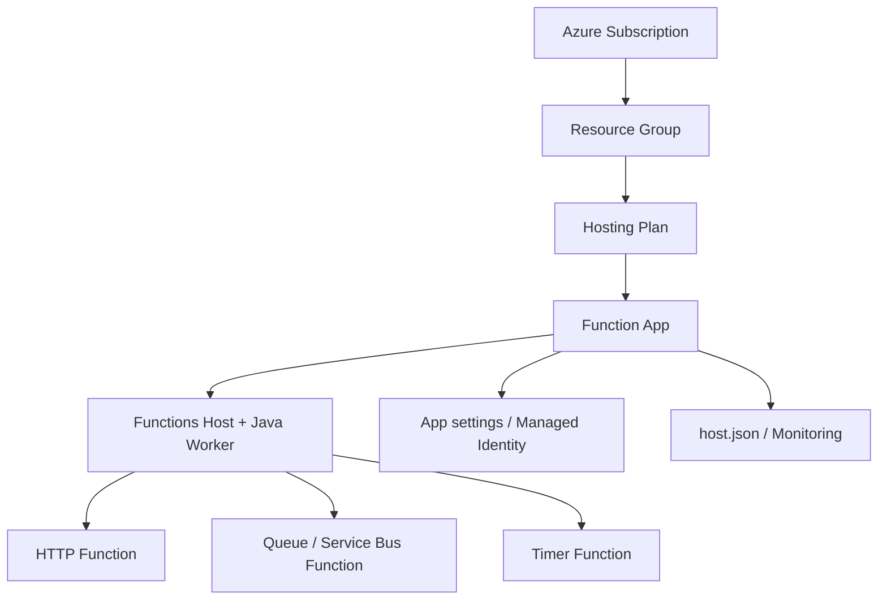
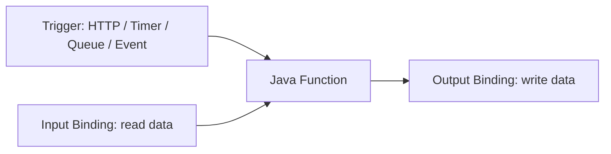
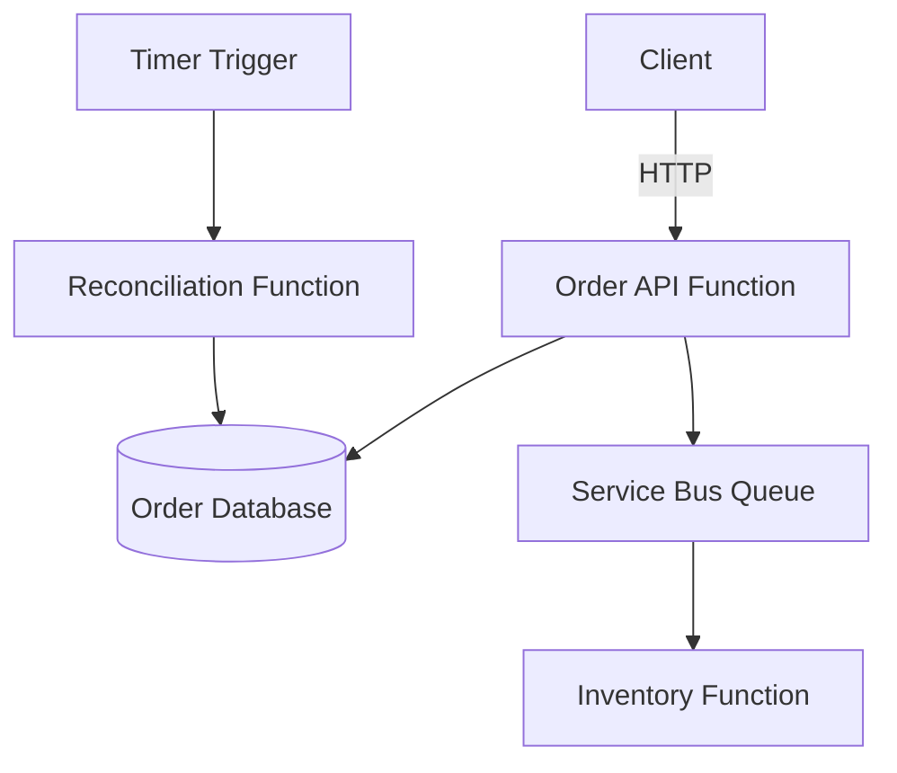

# Function App, functions, and Azure Functions hosting options

Azure Functions is Azure's FaaS service. Applications are organized into one or more **Function Apps**; inside each Function App are individual **functions** triggered by HTTP requests, timers, messages, or events from Azure services. When creating a Function App, developers also choose a hosting environment that determines how the application is provisioned with compute resources, scaled, networked, and billed.

In Java, a function is typically a `public` method annotated with `@FunctionName`. A trigger defines when the method is invoked; bindings help pass data in or send results out to other services. Choosing the right Function App boundary and hosting plan ensures that functions have appropriate deployment lifecycles, configurations, security, and load characteristics.

## 1. Distinguishing Function App and function

### 1.1. A function is the unit of execution

A **function** performs a specific business task. It has a single trigger that defines how it is invoked and may have additional input/output bindings. For example:

- `CreateOrder`: receives an HTTP request to create an order.
- `ProcessOrderMessage`: receives a message from Azure Service Bus or Queue Storage.
- `ResizeImage`: processes a newly uploaded blob.
- `DailyCleanup`: runs on a schedule to clean up expired data.

In Java, a function's entry point is a `public` method annotated with `@FunctionName`. The function name must be unique within the deployed package. A project can contain multiple classes and multiple `@FunctionName` methods.

```java
package com.example.functions;

import com.microsoft.azure.functions.ExecutionContext;
import com.microsoft.azure.functions.HttpMethod;
import com.microsoft.azure.functions.HttpRequestMessage;
import com.microsoft.azure.functions.HttpResponseMessage;
import com.microsoft.azure.functions.HttpStatus;
import com.microsoft.azure.functions.annotation.AuthorizationLevel;
import com.microsoft.azure.functions.annotation.FunctionName;
import com.microsoft.azure.functions.annotation.HttpTrigger;

import java.util.Optional;

public class GreetingFunctions {

    @FunctionName("hello")
    public HttpResponseMessage hello(
            @HttpTrigger(
                    name = "request",
                    methods = {HttpMethod.GET},
                    authLevel = AuthorizationLevel.FUNCTION)
            HttpRequestMessage<Optional<String>> request,
            ExecutionContext context) {

        String name = request.getQueryParameters()
                .getOrDefault("name", "Azure");

        context.getLogger().info("Handling greeting request");
        return request.createResponseBuilder(HttpStatus.OK)
                .body("Hello, " + name + "!")
                .build();
    }
}
```

In this example, `@FunctionName("hello")` sets the function name; `@HttpTrigger` declares HTTP GET as the trigger; `AuthorizationLevel.FUNCTION` requires a function key when calling the endpoint. `ExecutionContext` provides a logger and invocation metadata. When deploying a public API, configure appropriate authentication and authorization; do not choose `ANONYMOUS` just for convenient testing and forget to restrict access.

### 1.2. Function App is the unit of deployment and management

A **Function App** is the Azure environment that hosts a group of functions. With Java, multiple functions in the same project/package are deployed together as a single application package; Azure Functions Java does not support deploying multiple independent JARs as separate applications into the same Function App.

Functions in the same Function App also share the app's language selection. A Java Function App is not a place to mix Java, C#, and JavaScript functions as independent worker runtimes.

A Function App provides a shared context for deploying, running, and managing functions. Components typically shared at the app level include:

- A single deployment package and release schedule.
- The Functions host version and language worker/runtime stack.
- App settings, environment variables, connection configurations, and managed identity.
- The `host.json` file with host and binding settings applied to the app.
- Networking configuration, monitoring, and hosting plan.

Each function still has its own name, trigger, bindings, and logic. In a Java project, the Maven plugin generates `function.json` metadata for each function from annotations in the source code; `host.json` holds the shared configuration of the Function App.



Do not lump every function in an organization into one Function App just because they are all written in Java. If functions have different deployment requirements, access permissions, networking, load levels, or reliability targets, consider splitting them into separate Function Apps. This reduces the blast radius when an app needs configuration changes or a release. Conversely, functions that share the same lifecycle and need to share configuration can live in the same app to simplify operations.

Scaling note: on many hosting plans, the Function App is the primary boundary for scaling, and functions within the app can share instances. Flex Consumption supports per-function scaling for supported triggers, so each function can scale independently based on its own load. Verify scaling behavior for your specific plan and triggers before grouping functions.

## 2. Triggers and bindings in Azure Functions

Triggers and bindings are two foundational concepts of the Azure Functions programming model.

- **Trigger** starts an invocation and defines the event source. Each function has exactly one trigger.
- **Input binding** declares additional data the function needs to read from a service.
- **Output binding** declares where the function writes results after processing.

For example, a function can be triggered by HTTP, read a record via an input binding, and send a message via an output binding. Bindings reduce service connection boilerplate in common scenarios; when complex queries, transactions, specific SDK APIs, or fine-grained control are needed, the application can use the Azure SDK directly.



Some common triggers/bindings:

| Service | Trigger | Input binding | Output binding | Example use case |
|---|---:|---:|---:|---|
| HTTP | Yes | — | Yes | APIs, webhooks |
| Timer | Yes | — | — | Scheduled reporting or data cleanup |
| Azure Blob Storage | Yes | Yes | Yes | Processing uploaded files, reading/writing blobs |
| Azure Queue Storage | Yes | — | Yes | Background task worker |
| Azure Service Bus | Yes | — | Yes | Business message processing |
| Event Hubs | Yes | — | Yes | Collecting and processing telemetry/event streams |
| Event Grid | Yes | — | Yes | Reacting to resource events |
| Azure Cosmos DB | Yes | Yes | Yes | Reacting to data changes, reading/writing documents |
| Azure SQL | Yes | Yes | Yes | Triggering on or accessing SQL data via supported extensions |

The support list and capabilities of each binding depend on the extension, runtime, language, and hosting plan. Some triggers are not available on certain plans. Check the documentation for the specific binding before designing.

### 2.1. Configuring bindings in Java

In Java, annotations from `com.microsoft.azure.functions.annotation` declare triggers and bindings on methods or parameters. For example, an HTTP trigger can return a response via the method's return type; a queue output can use `@QueueOutput` and `OutputBinding<T>`.

```java
import com.microsoft.azure.functions.ExecutionContext;
import com.microsoft.azure.functions.HttpMethod;
import com.microsoft.azure.functions.HttpRequestMessage;
import com.microsoft.azure.functions.HttpResponseMessage;
import com.microsoft.azure.functions.HttpStatus;
import com.microsoft.azure.functions.OutputBinding;
import com.microsoft.azure.functions.annotation.AuthorizationLevel;
import com.microsoft.azure.functions.annotation.FunctionName;
import com.microsoft.azure.functions.annotation.HttpTrigger;
import com.microsoft.azure.functions.annotation.QueueOutput;

import java.util.Optional;

@FunctionName("enqueueWork")
public HttpResponseMessage enqueueWork(
        @HttpTrigger(
                name = "request",
                methods = {HttpMethod.POST},
                authLevel = AuthorizationLevel.FUNCTION)
        HttpRequestMessage<Optional<String>> request,
        @QueueOutput(
                name = "message",
                queueName = "work-items",
                connection = "StorageConnection")
        OutputBinding<String> output,
        ExecutionContext context) {

    String body = request.getBody().orElse("");
    if (body.isBlank()) {
        return request.createResponseBuilder(HttpStatus.BAD_REQUEST)
                .body("Request body is required")
                .build();
    }

    output.setValue(body);
    return request.createResponseBuilder(HttpStatus.ACCEPTED)
            .body("Work item accepted")
            .build();
}
```

`StorageConnection` is the name of the app setting containing the connection configuration or credentials according to the mechanism supported by the binding; do not hardcode connection strings directly in source code. If using managed identity, configure the binding and Azure RBAC permissions according to the corresponding extension's guide.

Output bindings make sending data more concise, but do not assume that writing to a database and sending a message through two different bindings form an atomic distributed transaction. If consistency between business state changes and event emission is required, consider the transactional outbox pattern or a workflow with a compensation mechanism.

## 3. Java project structure and Function App configuration

A Java Functions project is typically created using a Maven archetype or Azure Functions tooling in an IDE. The following structure is typical after building:

```text
functions-project/
├── pom.xml
├── host.json
├── local.settings.json       # local configuration; do not commit secrets
└── src/
    └── main/
        └── java/
            └── com/example/functions/
                ├── GreetingFunctions.java
                ├── QueueFunctions.java
                └── TimerFunctions.java

target/
└── azure-functions/
    └── <function-app-name>/
        ├── host.json
        ├── FunctionApp.jar
        ├── lib/
        ├── bin/
        ├── hello/
        │   └── function.json
        ├── enqueueWork/
        │   └── function.json
        └── dailyCleanup/
            └── function.json
```

Key components:

- `pom.xml`: declares the Java version, `azure-functions-java-library`, application dependencies, and the Maven plugin used for packaging/deploying.
- `host.json`: configures the Functions host and extensions; settings here usually apply to the entire Function App.
- `local.settings.json`: app settings used when running locally. This file may contain secrets and must be excluded from source control.
- `function.json`: trigger/binding metadata generated by the Maven plugin for each function from Java annotations.
- `target/azure-functions/<app-name>`: the staging/package directory created by the plugin for deployment.

A Function App can contain multiple functions in the same package. Do not split functions of the same app into multiple separately deployed JARs. Java libraries in `pom.xml` are usually packaged alongside the application when running Maven package; inspect the build output to verify that runtime dependencies are included.

### 3.1. Runtime and Java version

Azure Functions currently uses Functions runtime v4 for supported applications. The Java version must be consistent across the build JDK, `pom.xml` configuration, the Function App's runtime stack, and the test environment.

According to Microsoft's current Java runtime support table, Java 25, 21, 17, 11, and 8 are listed at GA with corresponding end-of-support dates; version availability also depends on the operating system and hosting plan. Notably, Java 21 is the latest version supported for the legacy Linux Consumption plan; this plan does not receive newer Java versions. For new applications, choose an LTS runtime supported on your target plan and double-check the support matrix before deploying.

## 4. Azure Functions hosting options

The hosting plan determines how compute is provisioned, scaling, cold start, execution duration, networking, container support, and the billing model. Current options include Flex Consumption, Premium, Dedicated (App Service), and Azure Container Apps. The traditional Consumption plan still exists for older applications but is a legacy option.

### 4.1. Flex Consumption

Flex Consumption is Microsoft's recommended serverless option for new Function Apps needing a usage-based billing model. This plan runs on Linux and provides:

- Scale-to-zero when idle, along with event-driven scale-out.
- Selectable instance memory sizes and concurrency configuration.
- Per-function scaling for supported triggers.
- Virtual network integration to access resources in private networks.
- Optional always-ready instances to reduce cold starts.
- Billing based on execution time/resources consumed and always-ready instances if enabled.

Flex Consumption fits variable workloads that can range from zero load to rapid spikes, while still needing VNet connectivity or finer concurrency control than legacy Consumption. This plan is Linux code deployment; container images are not supported. If you need to package a custom Linux image, look at Premium or Container Apps.

### 4.2. Premium

Premium provides pre-warmed workers and can keep instances always ready, helping reduce cold starts. The plan scales automatically with load, supports VNet, and offers an optional custom Linux container.

Premium is suitable when:

- The application requires low startup latency or runs continuously/nearly continuously.
- There are many small invocations with high throughput.
- Higher CPU/memory or longer execution duration is needed beyond legacy Consumption limits.
- Access to resources over VNet is required.
- A custom Linux image is needed while retaining the Functions host model and event-driven scaling.

In return, Premium charges for provisioned compute and pre-warmed workers; estimate load, minimum instance count, and usage hours to avoid paying for idle capacity.

### 4.3. Dedicated (App Service plan)

Dedicated hosting runs the Function App on resources of an App Service plan. Compute is provisioned by SKU and can be shared with web apps or other function apps in the same plan.

Dedicated is suitable when you need:

- Predictable resources and billing based on the App Service plan configuration.
- Manual scaling or App Service scaling capabilities.
- Sharing already-provisioned compute with other App Service applications.
- Long-running tasks or high compute requirements, within plan limits and Always On configuration.
- Network integration and isolation at the App Service Environment level when needed.

This is not a per-execution scale-to-zero model. Always On must be enabled for scenarios where the Function App host needs to run continuously, and billing is based on the provisioned App Service resources.

### 4.4. Azure Container Apps

Azure Container Apps can host applications built with the Azure Functions programming model as containers. This option fits when a team needs control over the container image, wants to package system libraries/native dependencies, or wants to run functions alongside microservices, APIs, and other workflows in the same Container Apps environment.

Container Apps supports event-driven scaling and can scale to zero if minimum replicas are set to zero. Setting minimum replicas greater than zero keeps the host running continuously and reduces startup latency, though it changes costs. This is a container-only model on Linux; the team must manage images, registries, base image updates, and build/scan pipelines.

### 4.5. Traditional Consumption plan (legacy)

The older Consumption plan automatically adds/removes instances based on events and bills based on execution count, execution duration, and memory. However, Microsoft marks this plan as legacy and recommends Flex Consumption for new serverless Function Apps.

Linux Consumption will stop receiving new features and new language versions; the retirement date announced by Microsoft is September 30, 2028. Existing apps on Windows Consumption are not currently affected by this Linux retirement milestone, but you should still evaluate migration paths and runtime support. Do not choose Linux Consumption for a new deployment.

## 5. Comparing hosting plans

| Criterion | Flex Consumption | Premium | Dedicated | Container Apps | Consumption legacy |
|---|---|---|---|---|---|
| Model | Usage-based serverless | Event-driven with pre-warmed workers | Provisioned App Service compute | Container Apps environment | Usage-based serverless |
| Scale-to-zero | Yes | No, per minimum pre-warmed config | No | Yes if min replicas = 0 | Yes |
| Cold start | Optimized; optional always-ready | Greatly reduced via pre-warmed | Host runs continuously if Always On | Depends on minimum replicas | Can occur when scaling from zero |
| VNet integration | Yes | Yes | Yes, depending on SKU/ASE | Yes via Container Apps environment | No |
| Container image | No | Linux | Linux | Yes, container-only | Linux containers not supported |
| Operating system | Linux | Linux/Windows per config | Linux/Windows per config | Linux | Windows legacy; Linux retiring |
| Billing model | Execution/resource usage + always-ready | Worker cores/memory and pre-warmed capacity | App Service plan pricing | Per Container Apps plan | Execution count/time/memory |
| Best suited for | Variable load, new serverless, VNet | Consistent latency, high load, VNet, custom image | Predictable billing, shared App Service | Custom containers and microservice systems | Legacy apps requiring maintenance |

Limits such as instance count, timeouts, memory, slots, networking, and trigger availability vary by region, OS, SKU, and configuration. The table above is for architectural direction; consult the official limits table before finalizing your design.

## 6. Scaling, cold starts, and execution duration

### 6.1. Scaling by trigger and hosting plan

Azure Functions can increase the number of instances when there are many requests or events. The scaling mechanism depends on the trigger and plan. With Flex Consumption, functions can scale independently when the trigger supports per-function scaling. On other plans, multiple functions in the same Function App typically share resources and the scale boundary.

Scaling out does not automatically scale every dependency. If a Function App adds many instances simultaneously, databases, connection pools, downstream APIs, or brokers can become overloaded. Set concurrency limits, reuse connections safely, use queues to buffer load, and monitor throttling at dependent services.

### 6.2. Cold start

A cold start occurs when the platform needs to provision or start a worker/host to handle an invocation after an idle period or during scale-out. Java also incurs JVM startup, class loading, and framework/dependency initialization time.

Options to reduce cold starts include:

- Choosing Flex Consumption with always-ready instances or Premium with pre-warmed instances when latency matters.
- Using Dedicated with Always On or Container Apps with minimum replicas greater than zero when the host needs to stay running continuously.
- Reducing unnecessary dependencies and initialization work; deferring connections or queries until actually needed.
- Measuring initialization time and processing time separately to pinpoint the cause.

Keeping instances always ready increases cost. Only pay for warm compute if the latency improvement satisfies business requirements.

### 6.3. Timeouts and HTTP responses

Function timeouts are configured in `host.json` or overridden via app settings. Each hosting plan has its own default/max timeout; legacy Consumption has a lower maximum limit than the other plans. Even if you increase the function timeout, HTTP-triggered functions still have a ~230-second response time limit imposed by Azure Load Balancer.

For long-running HTTP tasks, do not hold the connection open until processing completes. You can return `202 Accepted` along with a `jobId`, persist job status, and process in the background via a queue or Durable Functions. The client polls a status endpoint or receives a callback/event upon completion.

## 7. Storage, configuration, and identity

A Function App typically requires a Storage account for Functions host operations and certain triggers/bindings. Some triggers such as Blob, Queue, and Table Storage also require connections to their respective services. When creating an app, clearly understand which storage is used for host state and which storage holds business data.

### 7.1. App settings and host.json

- `host.json` contains shared configuration for the Functions host and extensions; changes can affect multiple functions in the same app.
- App settings store environment configuration such as queue names, endpoints, feature flags, and secret references. Application settings can be used to override certain `host.json` values per environment.
- `local.settings.json` is for local development only; do not commit secrets and do not assume this file is deployed automatically to Azure.

Do not store business state in static variables or the instance's temporary filesystem. Functions may run across multiple instances, restart, or scale in. Persist durable data in a database, Storage, or an appropriate service.

### 7.2. Managed identity and access permissions

Prefer managed identity so the Function App can access Storage, Key Vault, Service Bus, Event Hubs, or other Azure services without embedding connection secrets in source code. Grant Azure RBAC at the narrowest scope possible: the exact resource, exact data actions, and exact Function App.

For bindings, configure the connection via the app setting name or identity mechanism supported by the extension. Not every binding/extension supports the exact same authentication style; check the specific extension's documentation. When using the Azure SDK directly, you can use `DefaultAzureCredential`/managed identity and control access via RBAC.

## 8. Deployment and operations

### 8.1. Building and deploying a Java Function App

The Maven archetype `com.microsoft.azure:azure-functions-archetype` helps scaffold a Java project with the right structure and plugin. A typical workflow includes:

1. Choose Functions runtime v4, Java version, and hosting plan.
2. Generate the project using the Maven archetype or an IDE.
3. Write function methods with `@FunctionName`, trigger, and binding annotations.
4. Declare dependencies and plugins in `pom.xml`.
5. Run tests and build the package; inspect the `target/azure-functions` directory.
6. Create the Function App along with its Storage account and configure identity/networking.
7. Deploy the package to the Function App, configure app settings, and verify triggers are synced.
8. Run smoke tests for each trigger and verify logs/metrics.

A single Java package can contain multiple functions. When deploying a new package, all functions in the same Function App are released together; test the trigger/binding contracts across the entire app before releasing.

### 8.2. Observability

Application Insights and Azure Monitor help track invocations, exceptions, dependencies, and traces. Key metrics to watch include:

- Invocation count, success/failure, execution duration, and timeouts.
- Initialization time, cold starts, and instance count/concurrency.
- Queue length, message age, retries, dead-letter messages, and trigger lag.
- Dependency duration, connection errors, and throttling at Storage/Service Bus/Database.
- Cost by plan, compute consumed, always-ready capacity, and supporting resources.

Log a correlation ID or operation ID to link requests with downstream functions. Do not log tokens, connection strings, or sensitive payloads. For messages/events, design for idempotency because triggers may retry or redeliver depending on the service.

## 9. Example: choosing Function App and hosting for an order system

Suppose a system has three responsibilities: an order creation API, an inventory message worker, and a daily reconciliation job.



If the three functions share the same release lifecycle, access permissions, and load characteristics, they can be placed in a single Function App. If the API needs different networking/identity, the worker needs high concurrency, or the reconciliation job needs dedicated resources, split them into separate Function Apps to isolate configuration and scaling scope.

With variable load and VNet requirements, Flex Consumption is a solid starting point for a new Function App. If the API requires low cold starts and steady load, consider always-ready on Flex or Premium. If the worker requires a custom Linux image, Premium or Container Apps may be more suitable. If the organization already has a provisioned App Service plan and wants fixed billing, Dedicated can be a reasonable choice.

## 10. Quick decision table

| Primary need | Initial choice | What to verify |
|---|---|---|
| New function, variable load, pay-per-use, needs VNet | Flex Consumption | Linux-only, code-only, supported triggers and regions |
| Need reduced cold start, high CPU/memory, VNet, or custom Linux image | Premium | Minimum pre-warmed level and compute cost |
| Steady load, want to share App Service plan or predictable billing | Dedicated | Always On, SKU, App Service limits, and manual scaling |
| Need custom container, native libraries, running alongside microservices | Azure Container Apps | Image/registry, min/max replicas, ingress, and ACA cost |
| Maintaining an older app currently on Consumption | Evaluate migration to Flex | OS, Java version, storage, deployment method, and network config |

## 11. Checklist before creating a Function App

1. Do the functions share the same release lifecycle, runtime, configuration, identity, and networking requirements?
2. Should they be grouped into one Function App or split into separate apps to isolate scaling and access permissions?
3. Which triggers and bindings are used? Are they fully supported by the extension/runtime/plan?
4. Is the Java version supported on the exact OS and hosting plan?
5. Is Flex Consumption, Premium, Dedicated, or Container Apps right for load, cold starts, VNet, containers, and cost?
6. Which Storage account serves the Functions host and which storage holds business data?
7. Are app settings, host.json, local.settings.json, and secrets managed properly?
8. Does the managed identity have least-privilege permissions to the exact resources?
9. Have timeouts, concurrency, retries, idempotency, and downstream limits been accounted for?
10. Are Application Insights, alerts, smoke tests, and a deploy/rollback process in place?

## Conclusion

A function is the unit of execution activated by a single trigger; a Function App is the unit for deploying, running, and managing a group of functions. Triggers initiate invocations, while bindings connect functions to input/output data. The hosting plan determines compute provisioning, scaling, cold starts, networking, containers, and billing. For new Java Function Apps, start by grouping functions that share operational requirements and lifecycles, then choose hosting based on load, latency, networking, runtime, and cost. Flex Consumption is the default serverless option worth considering for new apps; Premium, Dedicated, and Container Apps address different compute control or container needs.

## Official documentation

- [Azure Functions Java developer guide](https://learn.microsoft.com/en-us/azure/azure-functions/functions-reference-java)
- [Azure Functions hosting options](https://learn.microsoft.com/en-us/azure/azure-functions/functions-scale)
- [Flex Consumption plan](https://learn.microsoft.com/en-us/azure/azure-functions/flex-consumption-plan)
- [Azure Functions runtime versions and language support](https://learn.microsoft.com/en-us/azure/azure-functions/functions-versions)
- [Triggers and bindings](https://learn.microsoft.com/en-us/azure/azure-functions/functions-triggers-bindings)
- [host.json reference](https://learn.microsoft.com/en-us/azure/azure-functions/functions-host-json)
- [Application settings reference](https://learn.microsoft.com/en-us/azure/azure-functions/functions-app-settings)
