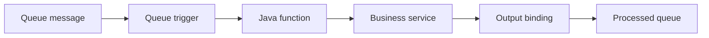

# Programming Java functions with triggers and bindings

Azure Functions allows a Java method to be triggered by an HTTP request, a message in a queue, an event from another service, or a schedule. Instead of writing a polling loop or running an always-on server, developers declare a **trigger** so the runtime knows when to invoke the function and use **bindings** to connect the function to service inputs and outputs.

In Java, a function is typically declared with `@FunctionName` and annotations such as `@HttpTrigger`, `@QueueTrigger`, `@TimerTrigger`, or `@BlobTrigger`. The Azure Functions runtime calls the method, passes trigger data into parameters, and processes output bindings after the method finishes. Business logic can still be organized into regular Java services for independent testing.

This lesson focuses on how to write Java functions with triggers and bindings, how to choose between bindings and the SDK, how to handle errors and retries per trigger type, local/deployment configuration, and operational concerns when functions scale.

## 1. What are triggers and bindings?

A **trigger** defines the event that causes a function to run. Every function has exactly one trigger. The trigger provides input data and metadata about the invocation, such as the HTTP method, queue message, blob name, or schedule information.

A **binding** declares how a function connects to a service. An input binding reads data from a service and passes it into a method parameter. An output binding writes data produced by the function to a destination service. Bindings can be used alongside the trigger or connect to additional services.

For example, an order-processing function:

- `@QueueTrigger` fires when a new message arrives in a queue.
- The `String message` parameter receives the message payload.
- `@QueueOutput` declares where to write the result message.
- The function parses the input, calls a business service, and sets the value on the output binding.



Triggers and bindings form a contract between the application and the Functions host. The host is responsible for listening to the trigger, converting data, managing part of delivery/acknowledgement, and executing bindings. As a result, the function does not need to connect and poll the queue itself when a binding already handles that operation.

## 2. The Java Functions programming model

A Java class can contain one or more function methods. Each method is marked with `@FunctionName`; the name in the annotation is the function name recognized by the host. Method parameters are annotated with trigger or binding annotations, and `ExecutionContext` can be added to log messages or read invocation metadata.

Minimal structure example:

```java
import com.microsoft.azure.functions.ExecutionContext;
import com.microsoft.azure.functions.annotation.FunctionName;
import com.microsoft.azure.functions.annotation.QueueTrigger;

public class OrderFunctions {
    @FunctionName("processOrder")
    public void processOrder(
            @QueueTrigger(
                    name = "message",
                    queueName = "orders",
                    connection = "AzureWebJobsStorage")
            String message,
            ExecutionContext context) {

        context.getLogger().info("Received order message");
        // Parse the message and call the business service.
    }
}
```

The annotation imports belong to `azure-functions-java-library`. When building the Java project, the Azure Functions plugin generates the metadata required for the host to discover functions and triggers. The runtime requires `host.json`, the Java artifact, and appropriate application configuration.

### Key components

| Component | Role |
| --- | --- |
| `@FunctionName` | Registers a method as an Azure Function and sets the function name |
| Trigger annotation | Declares the event source and input parameter |
| Input/output binding annotation | Declares data read from or written to another service |
| `ExecutionContext` | Provides a logger and invocation metadata |
| `@BindingName` | Reads metadata or binding data by name |
| `OutputBinding<T>` | Sets the value for an output binding inside the method |
| `HttpRequestMessage<T>` / `HttpResponseMessage<T>` | Request/response model for HTTP triggers |

Exact annotation names and attributes depend on the trigger extension. Use a Java Functions library and extension versions compatible with your application's Functions runtime.

## 3. Creating a Java project and running locally

A Java Functions project typically uses Maven or Gradle, the `azure-functions-java-library` dependency, and the packaging plugin for Azure Functions. The plugin creates a deployment directory containing the JAR/dependencies, `host.json`, and function metadata.

A typical Maven layout:

```text
orders-functions/
├── pom.xml
├── host.json
├── local.settings.json       # local config, do not commit secrets
└── src/
    ├── main/java/com/example/orders/
    │   ├── OrderFunctions.java
    │   ├── OrderService.java
    │   └── OrderRepository.java
    └── test/java/com/example/orders/
        └── OrderServiceTest.java
```

Common elements in `pom.xml` include:

- The `com.microsoft.azure:azure-functions-java-library` dependency for Java Functions annotations and types.
- `azure-functions-maven-plugin` for packaging and deploying the Function App.
- Java compiler target matching the chosen Java runtime version.
- Trigger extension or SDK dependencies required by your binding types and project setup.

Do not copy a fixed plugin or JDK version from an old example. Choose a Java version supported by the Functions runtime and hosting plan at deployment time, and keep plugin, extension, and SDK versions compatible.

### Local configuration

Azure Functions Core Tools uses `host.json` to configure the host and `local.settings.json` to supply app settings when running on a developer machine. Example:

```json
{
  "IsEncrypted": false,
  "Values": {
    "AzureWebJobsStorage": "UseDevelopmentStorage=true",
    "FUNCTIONS_WORKER_RUNTIME": "java",
    "ServiceBusConnection": "<local-service-bus-connection-string>"
  }
}
```

This is an illustrative example; only add settings for services your functions actually use. `local.settings.json` is for local use and does not automatically become the deployed Function App's configuration. Never commit real connection strings, passwords, or keys to Git. In the cloud environment, corresponding configuration is placed in Function App settings or provided via identity-based connections when supported by the extension.

Typically you can build with Maven, then run the Functions host locally with Core Tools. Inspect startup logs to confirm the host loaded the expected functions, trigger extensions, and settings. When local tests depend on Storage Emulator/Azurite or external services, start those components first.

## 4. HTTP trigger: receiving requests and returning responses

An HTTP trigger is suitable for API endpoints, webhooks, or callbacks. The Java method typically accepts `HttpRequestMessage<T>` and returns `HttpResponseMessage<T>`. The annotation allows configuring the binding name, HTTP methods, authorization level, and route.

Order creation endpoint example:

```java
import com.microsoft.azure.functions.HttpMethod;
import com.microsoft.azure.functions.HttpRequestMessage;
import com.microsoft.azure.functions.HttpResponseMessage;
import com.microsoft.azure.functions.HttpStatus;
import com.microsoft.azure.functions.ExecutionContext;
import com.microsoft.azure.functions.annotation.AuthorizationLevel;
import com.microsoft.azure.functions.annotation.FunctionName;
import com.microsoft.azure.functions.annotation.HttpTrigger;
import java.util.Optional;

public class OrderHttpFunction {
    private final OrderService orders = new OrderService();

    @FunctionName("createOrder")
    public HttpResponseMessage<String> createOrder(
            @HttpTrigger(
                    name = "request",
                    methods = {HttpMethod.POST},
                    route = "orders",
                    authLevel = AuthorizationLevel.FUNCTION)
            HttpRequestMessage<Optional<String>> request,
            ExecutionContext context) {

        String body = request.getBody().orElse("");
        if (body.isBlank()) {
            return request.createResponseBuilder(HttpStatus.BAD_REQUEST)
                    .body("Request body is required")
                    .build();
        }

        String orderId = orders.createFromJson(body);
        context.getLogger().info("Created order " + orderId);

        return request.createResponseBuilder(HttpStatus.CREATED)
                .header("Content-Type", "application/json")
                .body("{\"orderId\":\"" + orderId + "\"}")
                .build();
    }
}
```

This example is simplified to demonstrate the trigger and response; production code should use a JSON serializer such as Jackson instead of concatenating JSON strings, validate schemas, enforce body size limits, and map errors according to the API contract.

### Authorization levels do not replace business authorization

`ANONYMOUS`, `FUNCTION`, and `ADMIN` are HTTP trigger authorization levels. `FUNCTION` requires a function key; `ADMIN` uses the master key with broader privileges; `ANONYMOUS` requires no key at the trigger layer. This is not a per-user or per-tenant authorization model. For production APIs, you typically need identity authentication via Microsoft Entra ID, API Management, or an appropriate auth layer, followed by resource-level business permission checks.

Do not place function keys or master keys in source code, public query strings, or logs. If an endpoint receives webhooks, verify the provider's signature or authentication mechanism, check timestamps/replay protection, and use an idempotency key.

### Routes, queries, and headers

Routes can contain parameters, such as `route = "orders/{orderId}"`. Route values and binding metadata can be read via a parameter annotated with `@BindingName("orderId")`. Query strings and headers can be read from `HttpRequestMessage`. Validate all inputs and never trust `tenantId`, `role`, or `userId` merely because they appear in a header or body.

HTTP triggers are best suited for short requests. For long-running work, return `202 Accepted` with a status URL or job ID, enqueue the work into a queue/workflow, and finish the invocation. Do not hold an HTTP connection open waiting on a long task if the client or host may time out.

## 5. Queue Storage trigger and output binding

The Queue Storage trigger invokes a function when a message arrives in Azure Storage Queue. It is a straightforward option for asynchronous processing, decoupling producers from consumers, and absorbing traffic spikes.

```java
import com.microsoft.azure.functions.ExecutionContext;
import com.microsoft.azure.functions.OutputBinding;
import com.microsoft.azure.functions.annotation.FunctionName;
import com.microsoft.azure.functions.annotation.QueueOutput;
import com.microsoft.azure.functions.annotation.QueueTrigger;

public class OrderQueueFunction {
    @FunctionName("processOrderQueue")
    public void run(
            @QueueTrigger(
                    name = "orderMessage",
                    queueName = "orders",
                    connection = "AzureWebJobsStorage")
            String orderMessage,
            @QueueOutput(
                    name = "processedMessage",
                    queueName = "processed-orders",
                    connection = "AzureWebJobsStorage")
            OutputBinding<String> processed,
            ExecutionContext context) {

        context.getLogger().info("Processing order message");
        String result = process(orderMessage);
        processed.setValue(result);
    }

    private String process(String message) {
        // Validate, process and return a compact result message.
        return "processed:" + message;
    }
}
```

`@QueueTrigger` is the input trigger; `@QueueOutput` is the output binding. The host executes the output write after the method runs according to the binding contract. If you need fine-grained control over send results, transactions, batching, or custom retries, use the Azure Storage SDK directly.

### Retries and poison messages

Queue triggers can redeliver a message when a function fails or the host does not confirm successful processing. Storage Queue tracks the number of deliveries via dequeue count; once a configured threshold is exceeded, the message can be moved to a poison queue per trigger convention. Host configuration, extension settings, and visibility timeout timing affect the exact behavior.

Consumers must be idempotent because the same message can be reprocessed after a timeout or error. Use a message ID or stable business key, persist processing results, and avoid duplicate side effects. Do not catch an exception and return normally if the business work is incomplete; the host may treat the invocation as successful and skip retrying.

## 6. Timer trigger: running on a schedule

The Timer trigger activates a function according to an Azure Functions NCRONTAB expression. The expression typically has six fields: seconds, minutes, hours, day, month, and day of week. The example below runs every five minutes:

```java
import com.microsoft.azure.functions.ExecutionContext;
import com.microsoft.azure.functions.annotation.FunctionName;
import com.microsoft.azure.functions.annotation.TimerTrigger;

public class CleanupTimerFunction {
    @FunctionName("cleanupExpiredJobs")
    public void run(
            @TimerTrigger(name = "timerInfo", schedule = "0 */5 * * * *")
            String timerInfo,
            ExecutionContext context) {

        context.getLogger().info("Cleanup schedule fired: " + timerInfo);
        cleanupExpiredJobs();
    }

    private void cleanupExpiredJobs() {
        // Delete or mark expired data in bounded batches.
    }
}
```

Timer triggers fit cleanup, reconciliation, periodic synchronization, or report generation. They are not a millisecond-precise scheduler. Execution timing is influenced by the host, timezone, and schedule configuration; use UTC if business logic requires consistent schedules across environments.

Timer triggers use state/schedule tracking to prevent multiple hosts from running the same schedule concurrently within the same Function App per runtime configuration. However, do not assume every side effect happens strictly once. A run can be interrupted and resumed or re-executed depending on operational conditions; cleanup/reconciliation tasks should still be idempotent.

## 7. Blob trigger: processing files on creation or update

A Blob trigger invokes a function when a blob in a container matches the configured path. Binding metadata such as the blob name can identify the file, and its contents can be read via a method parameter.

```java
import com.microsoft.azure.functions.ExecutionContext;
import com.microsoft.azure.functions.annotation.BindingName;
import com.microsoft.azure.functions.annotation.BlobTrigger;
import com.microsoft.azure.functions.annotation.FunctionName;

public class DocumentBlobFunction {
    @FunctionName("processUploadedDocument")
    public void run(
            @BlobTrigger(
                    name = "content",
                    path = "incoming-documents/{name}",
                    dataType = "binary",
                    connection = "AzureWebJobsStorage")
            byte[] content,
            @BindingName("name") String blobName,
            ExecutionContext context) {

        context.getLogger().info("Received blob: " + blobName);
        processDocument(blobName, content);
    }

    private void processDocument(String name, byte[] content) {
        // Validate format, size, checksum, and process the file.
    }
}
```

This example uses `byte[]`, which is suitable for small or medium files. For large files, avoid holding the entire payload in heap memory; use streams or the SDK to read in buffered chunks and enforce size limits. Inspect the actual file format rather than relying solely on the extension or client-supplied Content-Type.

A Blob trigger can fire again when content changes or when the host has not recorded successful completion. Use the blob name together with its version/ETag or checksum to identify content, since the same blob name can be overwritten with a new version. If tighter event latency and scaling control are needed, consider an Event Grid trigger for Blob Storage instead of Blob trigger polling depending on requirements.

## 8. Service Bus trigger and Event Hubs trigger

Azure Service Bus fits queue/topic messaging that requires delivery semantics, dead-letter queues, message locks, sessions, or scheduling. A Java function can use `@ServiceBusQueueTrigger` to receive messages:

```java
import com.microsoft.azure.functions.ExecutionContext;
import com.microsoft.azure.functions.annotation.ServiceBusQueueTrigger;
import com.microsoft.azure.functions.annotation.FunctionName;

public class ServiceBusOrderFunction {
    @FunctionName("handleServiceBusOrder")
    public void run(
            @ServiceBusQueueTrigger(
                    name = "message",
                    queueName = "orders",
                    connection = "ServiceBusConnection")
            String message,
            ExecutionContext context) {

        context.getLogger().info("Received Service Bus message");
        handleOrder(message);
    }

    private void handleOrder(String message) {
        // Execute business logic according to the message contract.
    }
}
```

The Service Bus trigger manages receiving and completing messages per extension/runtime behavior. If the function does not complete, the message can be redelivered after the lock expires or according to the delivery policy. After the maximum delivery count, the message can move to the dead-letter queue. Handle duplicates, lock renewal, max delivery count, and DLQ according to your actual configuration.

Event Hubs fits high-throughput event streams with partition-based consumers. A function can receive a batch of events in a single invocation:

```java
import com.microsoft.azure.functions.ExecutionContext;
import com.microsoft.azure.functions.annotation.EventHubTrigger;
import com.microsoft.azure.functions.annotation.FunctionName;

public class TelemetryEventFunction {
    @FunctionName("processTelemetry")
    public void run(
            @EventHubTrigger(
                    name = "events",
                    eventHubName = "telemetry",
                    connection = "EventHubConnection")
            String[] events,
            ExecutionContext context) {

        context.getLogger().info("Received event count: " + events.length);
        for (String event : events) {
            processTelemetryEvent(event);
        }
    }

    private void processTelemetryEvent(String event) {
        // Parse schema, validate event ID and persist idempotently.
    }
}
```

Event Hubs uses partitions and checkpoints to track consumer position. If a batch fails before the checkpoint advances, a subset of events may be re-read. Do not assume each event arrives only once. Use event IDs or stable business keys for deduplication and monitor partition lag, checkpoint age, and throughput.

## 9. Input bindings, output bindings, and binding expressions

Bindings can read or write data without writing connection boilerplate inside the function. For example, an input binding reads a blob, while an output binding writes a queue message or saves a new blob.

Binding annotations commonly have these attributes:

| Attribute | Meaning |
| --- | --- |
| `name` | Binding name referenced in the function method |
| `connection` | Name of the app setting containing the connection or identity-based connection config |
| `queueName`, `path`, `containerName`... | Target/source service identifier depending on binding type |
| `dataType` | Hint for how the runtime converts data, e.g., text or binary |
| `route`, `methods`, `authLevel` | HTTP trigger-specific options |
| `direction` | Expressed via the corresponding input/output annotation |

There are two common expression forms:

- `%SettingName%` references an app setting, e.g., `%OrdersQueueName%`.
- `{name}` references binding data/metadata from the trigger, e.g., blob path `incoming/{name}`.

Example:

```java
@QueueTrigger(
        name = "message",
        queueName = "%OrdersQueueName%",
        connection = "StorageConnection")
String message
```

Queue names are configured per environment instead of hardcoded. Never put secrets directly inside annotations. `connection` is typically the setting name or setting prefix that the extension uses to locate credentials/endpoints.

## 10. Output binding or calling the SDK directly?

Output bindings work well when operations are straightforward: writing a message, saving a blob, or returning an HTTP response. The host performs the binding operation per configuration and manages service communication.

Consider calling the SDK directly when you need:

- Transactions or coordinating multiple operations atomically.
- Exact control over retries, timeouts, batching, partition keys, or message properties.
- Reading/writing large streams with fine-grained resource management.
- Advanced APIs that the binding does not expose.
- Immediate send results or service errors inline in code to make business decisions.
- Reusing clients, connections, or pipelines across the application lifecycle.

An output binding simplifies code, but it does not turn a database write and a queue publish into a single transaction. If you need to save an order and emit an event without losing the event on process crash, use a transactional outbox or an equivalent guarantee. Do not rely on two output bindings assuming atomicity across two services.

## 11. Connection settings and managed identity

The `connection` attribute typically points to an app setting, not a place to write a connection string directly. With connection-string configuration, the app setting holds the connection details; with extensions supporting identity-based connections, a prefix-based group of settings can specify the namespace/endpoint so the Function App uses managed identity.

Managed identity avoids storing long-lived credentials in configuration. However, you must:

1. Enable system-assigned or user-assigned managed identity on the Function App.
2. Assign appropriate roles on Storage, Service Bus, Event Hubs, or the corresponding service.
3. Configure app settings/prefixes per the documentation for the extension version in use.
4. Ensure the network path to the service works, especially when the service uses private endpoints.
5. Verify role scope and least privilege; never assign broad administrative roles just to make a trigger work.

Managed identity solves authentication, not network routing. If a Storage Account or Service Bus only permits private networks, the Function App needs networking configured compatibly with its hosting plan and the target service.

## 12. Binding data and trigger metadata

Triggers often supply additional metadata beyond the payload body. For example, HTTP has method, URL, and headers; Blob has blob name and container; Queue has message ID and dequeue count; Event Hubs has partition/sequence metadata depending on the binding.

`@BindingName` can be used to read named metadata values in binding expressions. Verify the exact metadata names exposed by the specific extension; do not assume every trigger provides the same fields.

Blob name example:

```java
@FunctionName("inspectBlob")
public void run(
        @BlobTrigger(
                name = "content",
                path = "incoming/{fileName}",
                dataType = "binary",
                connection = "AzureWebJobsStorage")
        byte[] content,
        @BindingName("fileName") String fileName,
        ExecutionContext context) {

    context.getLogger().info("File name: " + fileName);
}
```

Metadata helps functions route and log. However, a file name or queue message is not proof of ownership authorization. Before reading or modifying tenant data, cross-check against business records and an authenticated identity.

## 13. Errors, retries, and dead-letter handling by trigger type

There is no single retry semantics across all triggers. The host and extension govern how messages/events are acknowledged, redelivered, or checkpointed.

| Trigger | When the function fails | Design considerations |
| --- | --- | --- |
| HTTP | Caller receives an error or timeout; client may retry | Idempotency keys, timeout budgets, clear error responses |
| Azure Storage Queue | Message may be dequeued again; exceeding threshold can route to poison queue | Idempotent handler, dequeue count, poison queue, and alerts |
| Service Bus | Message may be abandoned/redelivered on lock expiration or failure; may move to DLQ | Message lock, max delivery count, duplicate detection, DLQ processing |
| Event Hubs | Batch/partition may be re-read if checkpoint has not advanced | Event IDs, idempotent writes, checkpoints, and partition lag |
| Blob | Event/blob may be detected or reprocessed | Blob version/ETag, idempotency, and handling modified files |
| Timer | Schedule may be delayed or re-evaluated per host state | Idempotent work, UTC schedules, run tracking, and missed schedules |

Distinguish non-retryable errors from transient errors. Malformed payloads, unsupported schemas, or missing permissions typically require quarantine/DLQ and investigation. Network errors, throttling, or temporarily unavailable downstreams can be retried with limits and backoff.

Never retry indefinitely. Multi-layer retries can multiply invocation counts—for instance, client retries, function retries, and SDK retries stacking simultaneously. Calculate total attempts and elapsed time budget. For poison messages, establish a controlled process to inspect, classify, fix data, and redrive.

## 14. Idempotency and side effects

Azure Functions can redeliver messages/events when a function times out, the host restarts, or an ACK/checkpoint has not been recorded. Therefore, functions should assume the same work unit may be invoked multiple times.

An idempotent handler can use an event ID or business key to check whether the result was already processed:

```java
public void handleOrderEvent(OrderCreated event) {
    boolean claimed = processedEventRepository
            .claimIfAbsent(event.eventId());
    if (!claimed) {
        return; // Event has already been processed or is being claimed.
    }

    orderProjectionRepository.apply(event);
}
```

This snippet is illustrative; claiming and updating the projection should happen within a transaction or via an appropriate inbox/outbox pattern. If the claim succeeds but the projection update fails, the record could be marked as processed even though the work did not finish. A state model such as `PROCESSING`, `SUCCEEDED`, `FAILED` with a lease/version may be necessary for complex workflows.

For HTTP webhooks, store the webhook ID or idempotency key. For Storage Queue, use the message ID/business ID. For Event Hubs, use the event ID or a stable source key. For Blob, use the blob path combined with version/ETag. Never generate a brand-new ID on each retry for the same side effect.

## 15. Sharing business logic across multiple functions

An application might have an HTTP function to create an order and a queue function to process the order afterward. Neither should duplicate business rules. Place the logic in a Java service and inject it via a constructor or factory.

```java
public final class OrderService {
    public String createFromJson(String json) {
        // Deserialize, validate, and save the order via the repository.
        return "order-1001";
    }

    public void processMessage(String message) {
        // Execute asynchronous business logic.
    }
}
```

The function method should act strictly as an adapter: read inputs, extract metadata, invoke the service, and map outputs. Avoid storing per-request mutable state in shared fields. The runtime may reuse class instances or processes depending on the host; data that must survive across invocations must be stored in a database, storage, or workflow state.

If using a DI framework, verify bean initialization and thread safety. Shared clients must be thread-safe; connections/transactions must be opened and closed within the proper scope; do not spawn background threads assuming the host will keep the function alive after the method returns.

## 16. host.json and runtime configuration

`host.json` configures the behavior of the Functions host and several extensions. Depending on the runtime/extension, the file can tune logging, queue batching, retries, concurrency, timeouts, or related limits.

Configuration skeleton example:

```json
{
  "version": "2.0",
  "logging": {
    "applicationInsights": {
      "samplingSettings": {
        "isEnabled": true
      }
    }
  },
  "extensions": {
    "queues": {
      "batchSize": 16,
      "newBatchThreshold": 8,
      "maxDequeueCount": 5
    }
  }
}
```

This is an illustrative configuration for the Queue Storage extension, not a universal optimal preset. Verify the schema and defaults for your Functions runtime/extension version. Increasing `batchSize` or concurrency can boost throughput, but also increases memory usage, database load, and the batch blast radius on retries.

Do not place secrets in `host.json`. Environment-specific values should use app settings; sensitive data should use Key Vault references or managed identity where appropriate. Local settings and cloud app settings must be managed separately.

## 17. Scaling, concurrency, and downstream limits

Azure Functions can scale host instances based on triggers and hosting plans. Scaling behavior, instance limits, and concurrency differ across Consumption, Flex Consumption, Premium, and Dedicated/App Service plans as well as across extensions.

During scale-out, many invocations may concurrently access databases, Storage, Service Bus, or partner APIs. Set limits aligned with downstream capacity:

- Choose a batch size aligned with processing time and memory.
- Use small connection pools and bound total connections.
- Set concurrency/scale limits if supported by the trigger or plan.
- Use backpressure, queues, and retries with backoff when downstreams throttle.
- Monitor queue age, Service Bus active/dead-letter counts, Event Hubs lag, and function duration.
- Avoid logging full payloads under high throughput.

A function processing a batch of 100 messages can reduce invocation overhead, but if one record fails, trigger-dependent retry behavior can cause many records to be re-executed. Make handlers idempotent and verify the extension's support for partial batch/partial failure handling.

## 18. Securing triggers and bindings

Bindings reduce connection code but do not replace authorization. Protect the trigger source, the Function App's identity, and target resources.

- Use managed identity when supported by the extension and service; assign least-privilege roles to only the required queue, topic, container, or storage account.
- For HTTP, authenticate callers and enforce tenant/resource authorization; function keys are only one endpoint protection layer.
- For Service Bus/Event Hubs, scope listen/send permissions to the required namespace or entity.
- For Storage, scope permissions to the appropriate container/prefix; do not grant account-wide permissions if the function only needs one container.
- Validate message/event/file schemas, sizes, and encodings.
- Never log secrets, connection strings, access tokens, or unnecessary personal data.
- Use private endpoints/network integration when private networking is required; identity alone does not create a network path.

If a binding uses a connection string, protect the setting using the platform's secret mechanisms and rotate credentials. Never keep connection strings in annotations or source code.

## 19. Observability and diagnostics

`ExecutionContext` provides a per-invocation logger. Emit structured logs containing fields such as function name, invocation ID, message/event ID, business key, attempt, and correlation ID. Avoid logging full payloads if they contain sensitive data.

Key metrics:

| Category | Metrics |
| --- | --- |
| HTTP | Request rate, status codes, p50/p95/p99 latency, timeouts, and throttling |
| Queue Storage | Queue length, dequeue count, poison queue depth, message age |
| Service Bus | Active messages, delivery count, lock lost, DLQ count, processing latency |
| Event Hubs | Incoming/outgoing events, partition lag, checkpoint age, throttling |
| Blob | Trigger delay, processing duration, failure count, file size |
| Function | Invocation count, execution duration, memory, exception rate, scale-out |
| Downstream | Database connections, query latency, dependency failures, and retries |

Application Insights and Azure Monitor correlate logs, traces, dependencies, and metrics. When investigating, use the invocation ID to find the specific run, then cross-reference the message/event ID and business state to confirm whether side effects occurred.

## 20. Testing Java functions

Separating business logic from annotations enables unit testing without the Functions host. You can test Java services with JUnit and fake/mock repositories, then test adapters and bindings at the integration level.

Recommended test layers:

1. **Unit tests:** verify business rules, validation, idempotency, and error handling.
2. **Adapter tests:** verify HTTP request/response handling, JSON parsing, routes, metadata, and exception mapping.
3. **Local host tests:** run Functions Core Tools with local settings and Azurite/emulated queues/services as appropriate.
4. **Cloud integration tests:** verify managed identity, RBAC, trigger delivery, retries, poison/DLQ, private networking, and scaling.

Do not test only that a function returns the right result on a single run. Simulate duplicate messages, timeouts after side effects, malformed payloads, slow downstreams, queue backlogs, and function restarts.

## 21. Common pitfalls

| Issue | Common cause | Resolution |
| --- | --- | --- |
| Host cannot find function | Incorrect `@FunctionName`, build metadata, or artifact | Inspect Maven plugin, output package, and host startup logs |
| Trigger receives no messages | Wrong connection setting, queue name, permissions, or extension | Verify app settings, identity/RBAC, and extension version |
| Works locally but fails in cloud | `local.settings.json` is not deployed; cloud lacks app settings/roles | Configure cloud app settings and managed identity separately |
| Function runs repeatedly | At-least-once delivery, lock expiration, or host restart | Design for idempotency and persist processing state |
| Messages go to poison/DLQ | Data error, recurring exception, or retry limit reached | Check attempts, logs, fix data, and redrive in a controlled manner |
| HTTP returns 401/403 | Function key, Entra auth, or business authorization mismatch | Identify the rejecting layer and verify identity/policy |
| Blob processing hits OOM on large files | Binding loads all bytes into heap | Use streams/SDK and enforce size limits |
| Database runs out of connections on scale-out | Many hosts/instances open large pools | Reduce pool size/concurrency, use a proxy, and optimize queries |
| Output does not appear | Wrong output binding setting or host write failure | Check binding metadata, connection, and host logs |

## 22. Workflow for choosing triggers and bindings

| Need | Typically suitable trigger/binding |
| --- | --- |
| API or webhook receiving requests | HTTP trigger |
| Background job processing from a simple queue | Queue Storage trigger |
| Messaging with locks, topics/subscriptions, DLQ, or sessions | Service Bus trigger |
| High-volume telemetry/event stream | Event Hubs trigger |
| File processing upon upload | Blob trigger or Event Grid trigger depending on requirements |
| Scheduled recurring task | Timer trigger |
| Simple message/blob writes | Output binding |
| Need transactions, advanced APIs, or send-result control | Azure SDK directly |

Do not choose a trigger solely because its annotation is shortest. Consider delivery semantics, retries, ordering, batching, throughput, latency, dead-lettering, and the scaling behavior of the source service.

## 23. Pre-deployment checklist

- [ ] Each function has one trigger and a unique function name.
- [ ] Input/output bindings use the correct data types, paths, queues/topics, and connection settings.
- [ ] Business logic is decoupled from adapter methods and covered by unit tests.
- [ ] HTTP triggers have clear authentication, authorization, validation, and response contracts.
- [ ] Queue/event handlers are idempotent and handle duplicates/redelivery safely.
- [ ] Retries, poison queues/DLQ, locks, checkpoints, and batch failures are configured.
- [ ] Large files/messages are streamed or chunked; payload limits are enforced.
- [ ] Connections use managed identity where appropriate with least-privilege roles.
- [ ] `host.json`, app settings, and local settings are managed per environment.
- [ ] JDK, Functions runtime, Java library, extensions, and Maven/Gradle plugins are compatible.
- [ ] Local, integration, and cloud tests cover actual triggers/bindings.
- [ ] Logs, metrics, and alerts exist for failed invocations, backlogs, poison/DLQ, and downstreams.
- [ ] Concurrency and batch size do not exceed database or dependent service capacity.

Azure Functions Java uses triggers to determine when a function runs and bindings to declare data to read and write. HTTP, queues, timers, blobs, Service Bus, and Event Hubs have distinct delivery semantics and error handling. When adapters focus solely on protocol translation, business logic is tested independently, connections are managed securely, and handlers are idempotent, Java applications can leverage Azure Functions' event-driven execution and scaling while maintaining control over state, access permissions, and cost.
