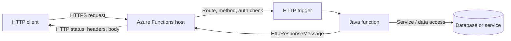
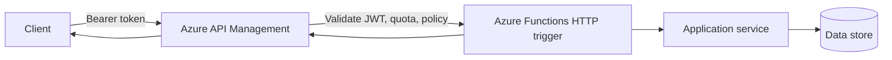
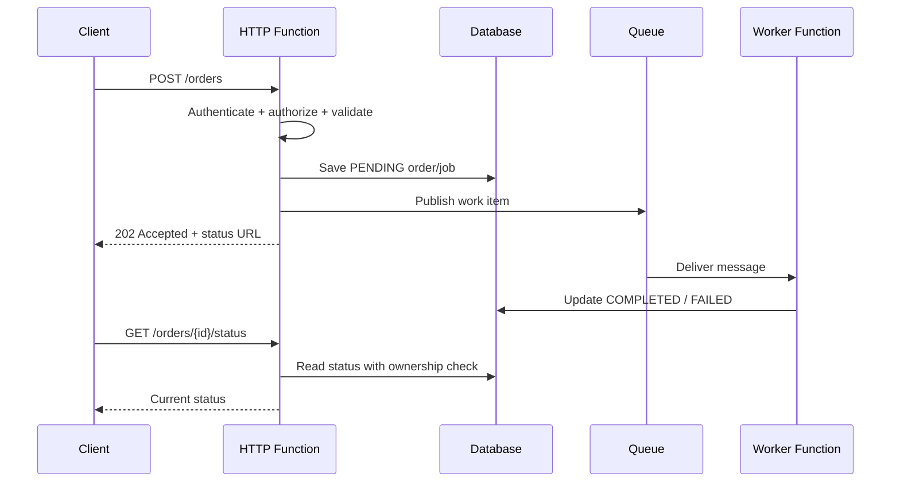

# Configuring HTTP triggers and access control

Azure Functions allows deploying a Java function triggered when an HTTP request arrives. An HTTP trigger is well suited for building webhooks, small APIs, command endpoints, or an ingestion layer for an asynchronous workflow. When configuring the trigger, the team must define the route, HTTP methods, request/response data types, and authentication level. These choices directly affect how clients invoke the function, how the endpoint is protected, and how the application operates.

A common point of confusion is the HTTP trigger's `authLevel`. The `FUNCTION` level requires a function key, but a key is only a shared secret permitting endpoint calls; it does not establish user identity and does not replace role-based or resource-ownership authorization. For APIs that need identity-based authentication for users or applications, combine Microsoft Entra ID, App Service Authentication, API Management, or an appropriate OAuth 2.0/OIDC mechanism.

This lesson explains how to declare an HTTP trigger in Java, design routes and responses, choose an `AuthorizationLevel`, protect endpoints using function keys or Entra ID identities, combine network controls, CORS, and managed identity, and follow security testing principles.

## 1. HTTP triggers in Azure Functions

An HTTP trigger is an input binding. When Azure Functions receives a request matching the declared route and method, the runtime invokes the Java function and passes request details into the parameter annotated with `@HttpTrigger`. The function can read the query string, headers, route parameters, and body, then return an `HttpResponseMessage`.



A Java function is typically identified by `@FunctionName`. The request parameter uses `@HttpTrigger` to declare the binding name, methods, route, and authorization level. For endpoints returning custom payloads, return `HttpResponseMessage` to control the status code, headers, and body.

### Components of an HTTP trigger

| Attribute | Role |
|---|---|
| `name` | Binding name used by the runtime in the function signature |
| `methods` | HTTP methods accepted by the endpoint, e.g., GET, POST, PUT, or DELETE |
| `route` | Route template of the function; may contain route parameters |
| `authLevel` | Key check level: `ANONYMOUS`, `FUNCTION`, or `ADMIN` |
| `HttpRequestMessage<T>` | The request, including query parameters, headers, URI, and body |
| `HttpResponseMessage` | The response with status, headers, and body |

If no route is specified, the function is typically invoked by function name under the default route prefix `api`. The route prefix can be changed in `host.json`, but this should be coordinated with gateways, API Management, and clients using the endpoint.

## 2. Creating an HTTP trigger in Java

In the Java annotation-based model, a function is declared with `@FunctionName` and the trigger parameter with `@HttpTrigger`. The example below creates a POST endpoint accepting JSON to receive an order creation request.

With Maven, the project needs the Azure Functions Java API library along with the libraries used by the application:

```xml
<dependency>
    <groupId>com.microsoft.azure</groupId>
    <artifactId>azure-functions-java-library</artifactId>
    <version>${azure.functions.java.library.version}</version>
</dependency>
```

Set the version in a Maven property or dependency management according to your template/tooling; never copy an old version without checking runtime compatibility.

```java
import com.fasterxml.jackson.core.JsonProcessingException;
import com.fasterxml.jackson.databind.JsonNode;
import com.fasterxml.jackson.databind.ObjectMapper;
import com.microsoft.azure.functions.AuthorizationLevel;
import com.microsoft.azure.functions.HttpMethod;
import com.microsoft.azure.functions.HttpRequestMessage;
import com.microsoft.azure.functions.HttpResponseMessage;
import com.microsoft.azure.functions.HttpStatus;
import com.microsoft.azure.functions.annotation.FunctionName;
import com.microsoft.azure.functions.annotation.HttpTrigger;

import java.util.Collections;
import java.util.Optional;

public class OrderHttpFunction {
    // Once configured, ObjectMapper can be used concurrently.
    private static final ObjectMapper JSON = new ObjectMapper();

    @FunctionName("CreateOrder")
    public HttpResponseMessage createOrder(
            @HttpTrigger(
                    name = "request",
                    methods = {HttpMethod.POST},
                    route = "orders",
                    authLevel = AuthorizationLevel.FUNCTION
            ) HttpRequestMessage<Optional<String>> request) {

        String body = request.getBody().orElse("");
        if (body.trim().isEmpty()) {
            return request.createResponseBuilder(HttpStatus.BAD_REQUEST)
                    .body("Request body is required")
                    .build();
        }

        try {
            JsonNode payload = JSON.readTree(body);
            if (payload == null || !payload.isObject()) {
                return request.createResponseBuilder(HttpStatus.BAD_REQUEST)
                        .body("Request body must be a JSON object")
                        .build();
            }
            JsonNode customerId = payload.get("customerId");
            if (customerId == null || customerId.isNull()
                    || customerId.asText().trim().isEmpty()) {
                return request.createResponseBuilder(HttpStatus.BAD_REQUEST)
                        .body("customerId is required")
                        .build();
            }

            // Replace with the application service and actual business operations.
            String responseBody = JSON.writeValueAsString(
                    Collections.singletonMap("valid", true)
            );

            return request.createResponseBuilder(HttpStatus.OK)
                    .header("Content-Type", "application/json; charset=utf-8")
                    .body(responseBody)
                    .build();
        } catch (JsonProcessingException exception) {
            return request.createResponseBuilder(HttpStatus.BAD_REQUEST)
                    .body("Request body must be valid JSON")
                    .build();
        }
    }
}
```

This example illustrates the HTTP contract and JSON validation. Actual order creation should live in a separate application service so it can be tested independently. Do not return stack traces or internal details in error responses. `ObjectMapper` is configured before use and not mutated afterward; request data stays in local invocation variables.

### Reading route parameters

A route can include parameters such as `orders/{orderId}`. Use `@BindingName` to receive the value extracted by route binding:

```java
import com.microsoft.azure.functions.AuthorizationLevel;
import com.microsoft.azure.functions.HttpMethod;
import com.microsoft.azure.functions.HttpRequestMessage;
import com.microsoft.azure.functions.HttpResponseMessage;
import com.microsoft.azure.functions.HttpStatus;
import com.microsoft.azure.functions.annotation.BindingName;
import com.microsoft.azure.functions.annotation.FunctionName;
import com.microsoft.azure.functions.annotation.HttpTrigger;
import java.util.Optional;

public class OrderLookupFunction {
    @FunctionName("GetOrder")
    public HttpResponseMessage getOrder(
            @HttpTrigger(
                    name = "request",
                    methods = {HttpMethod.GET},
                    route = "orders/{orderId}",
                    authLevel = AuthorizationLevel.FUNCTION
            ) HttpRequestMessage<Optional<String>> request,
            @BindingName("orderId") String orderId) {

        if (orderId == null || orderId.trim().isEmpty()) {
            return request.createResponseBuilder(HttpStatus.BAD_REQUEST)
                    .body("orderId is required")
                    .build();
        }

        // Check permission to view orderId in the application service before returning data.
        return request.createResponseBuilder(HttpStatus.OK)
                .body("Order lookup accepted")
                .build();
    }
}
```

A route parameter only supplies the routing value. It does not prove the caller has permission to access the resource with that ID.

### Choosing HTTP methods and status codes

Use methods according to the semantics of the operation:

| Method | Common purpose | Example |
|---|---|---|
| GET | Read a resource without business side effects | `GET /api/orders/{id}` |
| POST | Create a resource or submit a command | `POST /api/orders` |
| PUT | Replace the entire representation of a resource | `PUT /api/orders/{id}` |
| PATCH | Partial update | `PATCH /api/orders/{id}` |
| DELETE | Request deletion of a resource | `DELETE /api/orders/{id}` |

Common status codes:

- `200 OK`: processed successfully with a response body.
- `201 Created`: a new resource was created; can return a `Location` header.
- `202 Accepted`: asynchronous work was accepted but not yet completed.
- `204 No Content`: succeeded with no body needed.
- `400 Bad Request`: malformed request or missing required data.
- `401 Unauthorized`: caller is unauthenticated or credentials are invalid.
- `403 Forbidden`: caller is authenticated but not permitted to perform the action.
- `404 Not Found`: resource does not exist or its existence must not be disclosed.
- `409 Conflict`: current state conflicts with the requested operation.
- `429 Too Many Requests`: rate limit or quota exceeded.
- `500 Internal Server Error`: unexpected server-side error.

Do not return `200 OK` for every outcome. Clear status codes help clients decide whether to retry, re-authenticate, or fix the request.

## 3. Routes, route prefix, and API versioning

Routes are part of the API contract. Use resource nouns and a consistent structure, for example:

```text
GET    /api/v1/orders/{orderId}
POST   /api/v1/orders
PATCH  /api/v1/orders/{orderId}
DELETE /api/v1/orders/{orderId}
```

You can set the route directly in `@HttpTrigger`, or configure the route prefix in `host.json`. For example:

```json
{
  "version": "2.0",
  "extensions": {
    "http": {
      "routePrefix": "api"
    }
  }
}
```

With this configuration, the route `orders/{orderId}` is exposed under the prefix `api`. If you change the prefix, update clients, API Management policies, health checks, and API documentation. Never alter a published route without a compatibility or versioning plan.

### API versioning

When making incompatible request/response changes, you can introduce a new versioned route like `/api/v2/orders`. Some systems version via headers or an API gateway. Pick one approach consistently and define a support window for older versions.

Prefer backward-compatible changes such as adding optional fields, preserving existing field semantics, and not breaking older clients. If a field must be removed or its type changed, roll out compatible consumers/servers first and migrate clients in phases.

## 4. AuthorizationLevel and function keys

HTTP triggers have three commonly used `AuthorizationLevel` values:

| Level | How it works | Use case |
|---|---|---|
| `ANONYMOUS` | No function key required | Public endpoints or endpoints protected by another auth layer |
| `FUNCTION` | Requires a function key authorized to call the function | Simple integrations between trusted systems, often via a gateway or backend |
| `ADMIN` | Requires the Function App's master key | Special administrative tasks; not for regular application endpoints |

A function key can be sent via the `x-functions-key` header or the `code` query parameter. In production systems, prefer the header because URLs frequently appear in access logs, browser history, proxy logs, or telemetry. Never embed keys in browser-side JavaScript or mobile apps.

Azure Functions supports function-level keys and host-level keys. A function key is scoped to its corresponding function; a host key can invoke functions across the Function App. The master key grants administrative access to runtime APIs and must be protected at the highest level. Do not share host/master keys with external clients merely for convenience.

### A function key is not a user identity

A function key is a shared secret. If multiple users or systems share one key, the platform cannot automatically tell which user made a request. Nor does a key describe roles, tenants, permission to read a specific order, or permission to execute a business action.

Therefore:

- Use `FUNCTION` to add a key-based protection layer for simple integration endpoints.
- Use identity-based authentication when you need to know who the caller is.
- Enforce authorization in the application service for each resource and action.
- Never treat the presence of a valid function key as proof that a user owns the data referenced in the route.

### Key management and rotation

Do not store keys in source code, committed config files, or logs. Use Azure Functions' key management mechanism and distribute keys through an appropriate secret store. When rotating:

1. Create a new key.
2. Update clients/gateways to use the new key.
3. Verify traffic has shifted to the new key.
4. Revoke the old key.
5. Monitor for authentication errors after revocation.

If a key is compromised, revoke it immediately via the incident response process rather than waiting for the regular rotation cycle. Minimize the number of places where keys are stored and the number of people with read access.

## 5. Authentication with Microsoft Entra ID

For user-facing or service-to-service APIs, Microsoft Entra ID is usually more suitable than shared function keys. The client acquires an OAuth 2.0/OpenID Connect access token and sends it as a bearer token:

```http
Authorization: Bearer <access-token>
```

The token must have the correct API audience, a trusted issuer, a valid lifetime, and appropriate claims. After authentication, the system must check scopes, roles, or policies to decide whether the caller is allowed to perform the operation.

### App Service Authentication (Easy Auth)

Azure Functions can integrate authentication at the platform layer through App Service Authentication, commonly known as Easy Auth. The platform can validate tokens before requests reach the function and provide the authenticated principal to the application through supported mechanisms.

Benefits:

- Centralizes identity provider configuration and access policies.
- Reduces repetitive token-validation code in individual functions.
- Can require authentication before requests are forwarded to handlers.
- Supports Microsoft Entra ID and other platform-supported providers.

The application still needs to check business permissions. A valid token only proves the identity/application according to verified claims; it does not automatically authorize reading every resource. When retrieving the principal from platform-supplied headers or context, trust only data validated by the platform and ensure clients cannot spoof that path directly. Never read an arbitrary caller-supplied header and treat it as a verified identity.

### API Management as an API protection layer

Azure API Management (APIM) can sit in front of a Function App to provide a unified entry point. APIM can validate JWTs, verify subscriptions, enforce rate limits/quotas, normalize headers, record telemetry, and route traffic to the backend.



If APIM performs authentication, protect the backend so callers cannot bypass the gateway and hit the Function App directly over another public route. You can use private endpoints, access restrictions, or network configurations suited to your plan and architecture. The backend should also verify identity assumptions and headers from the gateway across a clear trust boundary.

## 6. Business-layer authorization

Authentication answers "who is the caller?". Authorization answers "what is the caller allowed to do on which resource?". These two steps must remain separate.

For example, a valid access token may represent user `user-17`, but that user may only view orders belonging to their own account. If the endpoint receives `GET /orders/order-99`, the service must verify ownership or granted permissions before returning data.

A typical authorization flow includes:

1. Validate the token or principal at the platform/gateway layer.
2. Extract subject, tenant, scopes, or roles from the verified principal.
3. Load the resource by its ID from the route.
4. Check permissions on that specific resource, not just a generic role.
5. Execute the operation and emit an audit event if required by business rules.

Do not trust `userId`, `tenantId`, or `role` sent by the client in JSON if those fields can be derived from the token. If the payload contains owner information, compare it against the verified principal and reject mismatches.

### 401 and 403

- Return `401 Unauthorized` when credentials are missing or cannot be verified per the API's authentication scheme.
- Return `403 Forbidden` when the caller is authenticated but lacks permission to perform the action.
- You may return `404 Not Found` instead of `403` if security policy requires not revealing whether a resource exists.

Responses should not expose internal details about users, tokens, or security rules. Log sufficient details for server-side auditing, but never log raw tokens.

## 7. Network security, CORS, and access restrictions

Application-layer authentication should be paired with network controls when security requirements demand restricting traffic sources.

### Access restrictions and private endpoints

Azure Functions provides options to restrict inbound network access, access restrictions, and private endpoints depending on hosting plan and configuration. Private endpoints enable access over a private network in supported architectures; VNet integration primarily serves outbound connections from the Function App to resources inside a virtual network. These two concepts address opposite traffic directions.

Before deploying, verify which networking features are available for your hosting plan/region. If APIM or an internal service is the sole caller, consider restricting the backend to accept traffic only from a controlled network boundary. Do not leave endpoints broadly public if unnecessary.

### CORS is not authentication

Cross-Origin Resource Sharing (CORS) is a browser mechanism controlling which JavaScript origins are allowed to read responses. CORS does not stop a server-side program, curl, or other clients from sending requests directly. Nor does CORS verify identity or replace function keys, JWTs, or authorization.

Add only required origins, preferring explicit origins over wildcards. When using cookies or credentials in the browser, CORS configuration must follow browser rules regarding credentials and origins. Never enable `Access-Control-Allow-Origin: *` alongside credentials.

### TLS, rate limiting, and WAF

Use HTTPS for public endpoints. For APIs at risk of abuse, configure rate limits, quotas, or a WAF in APIM/Front Door as appropriate. Rate limiting should key on caller, subscription, IP, or another trusted identifier; avoid relying solely on arbitrary client headers.

## 8. Managed identity and backend service access

Managed identity allows a Function App to authenticate when calling Azure resources such as Key Vault, Storage, Service Bus, or other services supporting Microsoft Entra authentication. This is the **Function App's outbound identity**, distinct from the identity of the client calling the HTTP trigger.

For example:

- A client calls the endpoint with an Entra ID access token.
- The function authenticates the caller and checks business permissions.
- The function uses its own managed identity to read a secret or send a message to Service Bus.

Never use the Function App's managed identity to infer an authenticated HTTP user. The two identities serve different purposes and carry different permission scopes.

### Least-privilege permissions

Prefer appropriate roles scoped to the exact resource. For example, if a function only needs to send messages to one Service Bus queue, grant send permissions only to the required namespace/entity; do not grant subscription-wide admin roles. Separate identities across dev, staging, and production environments to reduce the risk of credential misuse.

Secrets can be retrieved from Key Vault via managed identity or through Key Vault references in application settings. Avoid putting secrets directly into a committed `local.settings.json`, `host.json`, or source code. Protect both the deployment pipeline and who can edit app settings.

## 9. Request validation, errors, and abuse prevention

An HTTP endpoint is an untrusted boundary. All client-supplied data must be validated and checked before reaching domain logic.

### Request validation

- Check the HTTP method and content type.
- Limit body size according to business needs and platform constraints.
- Parse JSON safely and reject malformed payloads.
- Validate required fields, string lengths, value ranges, and formats.
- Validate route parameters and query parameters.
- Never concatenate client data directly into SQL, commands, or storage paths.
- Check resource permissions before reading or modifying data.
- Use idempotency keys for create/update operations that clients might retry.

For large files, avoid sending the entire payload through an HTTP trigger if request size, timeouts, or memory are unsuitable. You can issue a time-limited upload URL to object storage, then receive a small request containing the object reference to begin processing.

### Errors and responses

Return concise error messages without leaking stack traces, SQL, connection strings, or internal names. Log technical details server-side with a correlation ID. Distinguish validation, authentication, authorization, conflict, throttling, and transient dependency errors so clients can apply the right retry strategy.

If an endpoint performs non-idempotent operations, design a deduplication key. For example, the client sends an `Idempotency-Key`; the server stores the key alongside the outcome and returns the prior result when the request is retried within the policy window. Do not trust client-supplied keys without binding them to the verified principal and appropriate business scope.

## 10. Handling long-running work over HTTP

HTTP triggers suit short request/response interactions. If work takes significant time, spans multiple services, or needs independent retries, separate ingestion from execution.

A common pattern:

1. The client sends `POST /api/orders`.
2. The function authenticates the caller, validates the request, and records a job/order in `PENDING` state.
3. The function enqueues a message or starts a workflow.
4. The function returns `202 Accepted` with an ID and status polling URL.
5. A worker processes asynchronously and updates the status to `COMPLETED` or `FAILED`.
6. The client polls the status endpoint or receives a callback/webhook per design.



Database writes and queue publishing must be designed so work is not lost if one step succeeds while the other fails. A transactional outbox or suitable workflow can be used. The status endpoint must also verify that the caller is authorized to view that job.

Do not hold an HTTP request open waiting for a long background process if the platform/gateway imposes response timeouts. `202 Accepted` accurately communicates that the request has been accepted without claiming the work is finished.

## 11. Configuration and deployment

A Function App usually hosts multiple functions and shares host, identity, network, and runtime settings. `host.json` contains host configuration; application settings hold environment-specific settings. `local.settings.json` is for local development and should not have secrets committed.

Example application settings:

```text
FUNCTIONS_WORKER_RUNTIME=java
FUNCTIONS_EXTENSION_VERSION=~4
ORDERS_TABLE_NAME=orders
SERVICEBUS_NAMESPACE=orders-prod.servicebus.windows.net
```

These are sample setting names, not a complete configuration set for every project. Connection strings/secrets should come from Key Vault or managed identity when supported by the service. Never place secrets in `host.json` or the repository.

A release workflow should include:

1. Build the Java package with Maven/Gradle and verify dependency/runtime compatibility.
2. Deploy to the target environment's Function App.
3. Configure app settings, identity, role assignments, and networking.
4. Verify routes, methods, auth levels, and gateway policies.
5. Test the endpoint with both valid and invalid callers.
6. Check logs, metrics, tracing, and alerts.
7. Use deployment slots or an appropriate rollout strategy if supported by the hosting plan.
8. Verify rollback procedures and key/secret rotation.

Do not treat a successful deployment as proof that the endpoint is properly secured. Directly test authentication and authorization behavior after deployment.

## 12. Testing HTTP triggers and access control

A minimum test matrix:

| Scenario | Expected outcome |
|---|---|
| Request with right method, route, and valid key/token | Function accepts request and returns response per contract |
| Missing function key with `FUNCTION` | Request is rejected before reaching business logic |
| Wrong or revoked key | Request is rejected |
| `ANONYMOUS` endpoint with Easy Auth requiring login | Request without valid token is blocked at the auth layer |
| Expired token, wrong issuer, or wrong audience | Rejected during authentication |
| Valid token lacking required scope/role | Rejected during authorization |
| Valid user accessing another user's order | Application service denies or returns 404 per policy |
| Request body is not valid JSON | Returns 400, writes no business data |
| Body exceeds limit | Rejected per application/platform limits |
| Duplicate request with same idempotency key | Produces no duplicate side effects |
| Origin not in CORS allowlist | Browser is prevented from reading response per policy; server must still protect the endpoint itself |
| Direct call to backend bypassing APIM | Blocked by network/auth policy or still independently authenticated by backend |

### Testing function keys

For `FUNCTION` endpoints, test all three cases: no key, valid key, and revoked key. Send keys via the `x-functions-key` header in tests. Do not store keys in public collections or CI logs. When using APIM, verify clients cannot extract backend keys from responses or telemetry.

### Testing Entra ID

Test tokens with varying issuers, audiences, expirations, and scopes/roles. Include cases where the token is valid but the principal lacks permission on the specific resource. Test both the path through the gateway and direct calls to the Function App if the backend remains reachable.

## 13. Observability and auditing

For HTTP triggers, emit structured logs including:

- Function name and operation.
- Correlation ID or trace ID.
- HTTP method and route template, without necessarily logging the full URL/query.
- Status code and duration.
- Authentication/authorization outcomes as classification codes, without logging tokens.
- Business resource identifiers if permitted and non-sensitive.
- Dependency error codes when downstream failures occur.

Monitor request counts, p50/p95/p99 latency, 4xx/5xx, 401/403, 429, throttling, dependency failures, and cold starts. When using APIM, correlate gateway telemetry with Function App logs to see which layer rejected a request.

Audit logs should capture who performed which action on which resource and the outcome per business requirements. Never log access tokens, function keys, secrets, passwords, or full request bodies containing personal data. Define appropriate retention and log read permissions.

## 14. Common misconfigurations

| Mistake | Consequence | Fix |
|---|---|---|
| Leaving `ANONYMOUS` without another auth layer | Endpoint can be called publicly | Enable appropriate auth or place a gateway/auth platform in front |
| Assuming a function key identifies a user | Cannot authorize per user/tenant | Use Entra ID and enforce business-level permissions |
| Using host/master keys for every client | Huge blast radius if a key leaks | Use scoped function keys or per-caller identity |
| Putting keys in query strings or frontend code | Keys can leak in logs, history, or bundles | Use headers and backend secret management |
| Trusting `userId`/`tenantId` from request body | Cross-tenant/user data access risk | Extract identity from verified tokens and check ownership |
| Treating CORS as API security | Non-browser clients can still call the endpoint | Use authentication, authorization, and network controls |
| Securing only APIM while leaving backend public | Callers can bypass the gateway | Restrict inbound access or authenticate independently at backend |
| Using managed identity to authenticate HTTP callers | Confuses outbound identity with inbound identity | Separate Entra ID caller auth from Function managed identity |
| Returning errors with stack traces | Leaks internal details | Return generic responses; log details server-side |
| Holding HTTP requests for very long tasks | Timeouts at client/gateway/platform | Return 202 and process via queue/workflow |

## 15. Endpoint design workflow

When creating a new HTTP trigger, follow this sequence:

1. **Identify the caller.** End user, service-to-service, public webhook, or internal gateway?
2. **Choose authentication.** Function key for simple integrations; Entra ID/OAuth for identity; APIM/Easy Auth when centralized management is needed.
3. **Choose authorization.** Define roles/scopes and permissions on each business resource.
4. **Design routes and methods.** Keep contracts stable; version on incompatible changes.
5. **Define request/response.** Data types, validation, status codes, error format, and idempotency.
6. **Secure the network.** HTTPS, access restrictions/private endpoints where appropriate, exact CORS origins, and rate limits.
7. **Grant outbound access.** Use managed identity and least-privilege roles for downstream services.
8. **Design long-running work.** Use 202, queues/workflows, and a status endpoint when work exceeds short request/response limits.
9. **Set up observability.** Correlation IDs, auditing, latency, auth failures, and dependency metrics.
10. **Test both allowed and denied paths.** Verify not only that the function works, but also that access controls enforce properly.

## Conclusion

HTTP triggers allow Azure Functions Java to expose endpoints for other applications and services. The `@HttpTrigger` annotation defines methods, routes, and `authLevel`; `HttpRequestMessage` reads requests while `HttpResponseMessage` controls responses. Function keys suit certain simple integrations but are shared secrets, not replacements for identity and per-user authorization. For APIs requiring identity, use Microsoft Entra ID, Easy Auth, or API Management, then enforce resource-level permissions in the application layer. Combine HTTPS, network restrictions, proper CORS, managed identity for outbound access, validation, rate limiting, and asynchronous processing to keep endpoints secure and operable.
