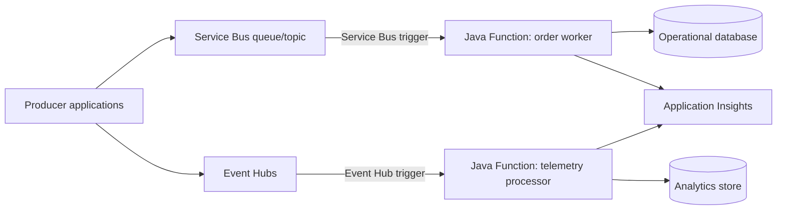
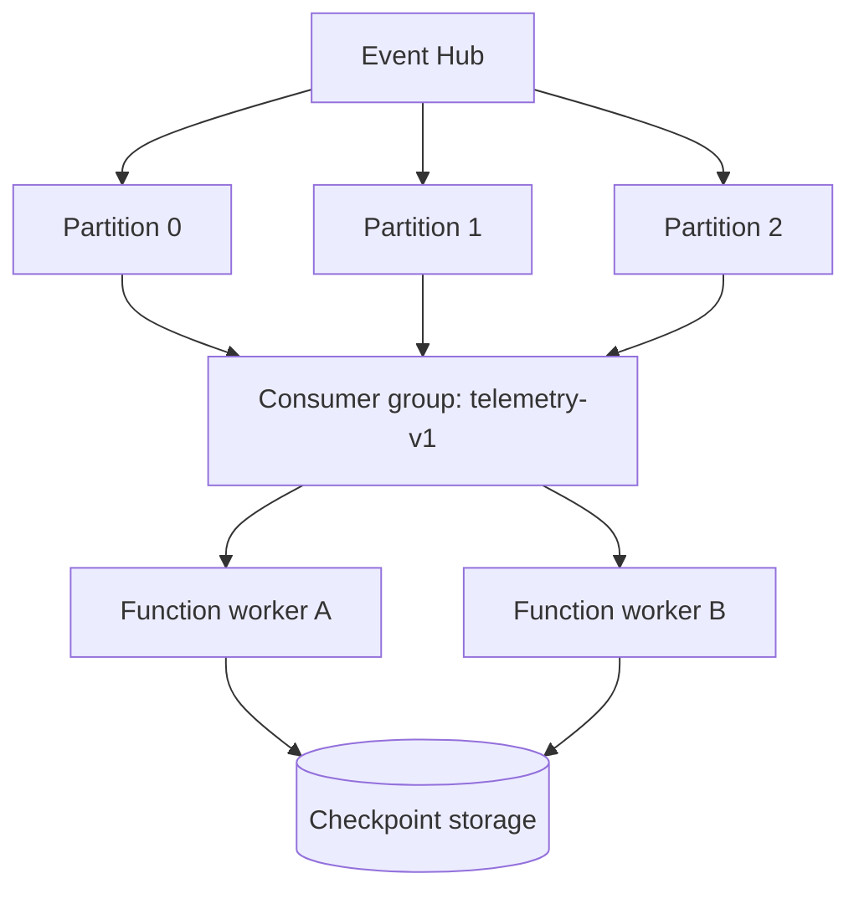
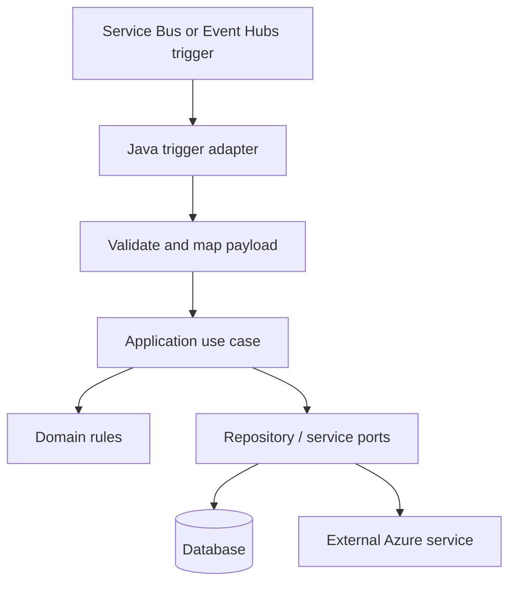

# Integrating Service Bus and Event Hubs in Azure Functions

Azure Functions can process messages and events from multiple Azure services without maintaining an always-running worker server. Two common sources are **Azure Service Bus** and **Azure Event Hubs**. Both trigger functions when new data arrives, but serve two distinct communication patterns: Service Bus fits queues and business messages; Event Hubs fits large, continuous event streams that can be re-read by offset.

In Java, Azure Functions provides annotations to declare triggers on methods. The runtime and binding extensions receive messages/events, pass data into function parameters, and manage part of the delivery mechanism. Developers still must design schemas, error handling, idempotency, access permissions, concurrency, and system observability.

Within the scope of **CLOUD_SERVERLESS**, this lesson focuses on Java functions triggered by HTTP, messages, or events, along with triggers, state, access permissions, retries, idempotency, scaling, and cost. Service Bus and Event Hubs are two important examples for choosing the right asynchronous processing model on Azure.

## 1. Choosing Service Bus or Event Hubs?

Both services can receive data from producers and trigger consumers, yet their storage and delivery models differ.

| Criterion | Azure Service Bus | Azure Event Hubs |
|---|---|---|
| Model | Message broker | Distributed event streaming platform |
| Primary primitives | Queue, topic, and subscription | Event hub, partition, and consumer group |
| Goal | Deliver business commands/messages to consumers | Ingest and stream high-throughput events |
| Reading pattern | Consumers receive and settle messages | Consumers read events by partition and offset |
| Processing completion | Complete, abandon, defer, or dead-letter per settlement model | Save checkpoints to record processed offsets |
| Redelivery | Can redeliver when lock expires or processing fails | Can re-read if checkpoint has not advanced or consumer restarts |
| Ordering | Can use message sessions to preserve per-session order | Ordering within a partition; no global ordering across partitions |
| Best suited for | Orders, payments, workflow processing, background commands | Telemetry, clickstreams, logs, IoT data, and event ingestion |

Choose based on the semantics of the data. If a producer is asking a consumer to perform work and needs acknowledgements, retries, dead-lettering, or sessions, Service Bus is usually suitable. If a producer emits a continuous event stream for multiple independent consumers reading by position and processing in parallel, Event Hubs is usually better suited.

Do not use Event Hubs as a queue with per-message settlement; nor should you choose Service Bus just to store a massive telemetry stream when the primary requirements are throughput, partitioning, and replay.

## 2. Overall architecture with Azure Functions

A Function App can host multiple functions. Each function can be activated by its own trigger, while bindings connect functions to service inputs/outputs.



A trigger is what initiates an invocation. Input bindings can supply data or clients to the function; output bindings can send results to a target service. Bindings reduce connection boilerplate, though for logic needing fine-grained control over transactions, settlement, or client lifecycles, the Azure SDK can be used directly inside an application adapter.

In Java, a method carries `@FunctionName` and one or more binding parameters. Setting names are referenced via the `connection` attribute in the trigger annotation; actual values are configured in Function App settings or `local.settings.json` during local development.

## 3. Integrating Azure Service Bus queues

A queue stores messages until a consumer processes and acknowledges them. Multiple consumers can compete to receive messages from the same queue; a message is typically processed by one consumer at a time, though it can be redelivered if processing does not complete.

A Java function can use `@ServiceBusQueueTrigger`:

```java
import com.microsoft.azure.functions.ExecutionContext;
import com.microsoft.azure.functions.annotation.FunctionName;
import com.microsoft.azure.functions.annotation.ServiceBusQueueTrigger;

public class OrderFunctions {

    @FunctionName("processOrder")
    public void processOrder(
            @ServiceBusQueueTrigger(
                    name = "message",
                    queueName = "orders",
                    connection = "ServiceBusConnection") String message,
            ExecutionContext context) {

        context.getLogger().info("Received an order message");
        // Parse message, validate contract, then call an application use case.
    }
}
```

This example uses a `String` body to focus on the trigger boundary. In real applications, you can bind to types supported by the extension or deserialize to a DTO using a JSON codec. Do not log full messages if payloads contain personal information or sensitive data.

The `connection` attribute points to a connection configuration named `ServiceBusConnection`. With a connection string, this is typically an app setting with that exact name. With managed identity, prefix-based settings such as `ServiceBusConnection__fullyQualifiedNamespace` can be used.

## 4. Integrating Service Bus topics and subscriptions

A topic lets one producer publish messages to multiple subscriptions. Each subscription acts like a separate logical queue and can apply filters/rules to select which messages to receive.

Example of a function receiving messages from the `billing` subscription of the `orders` topic:

```java
import com.microsoft.azure.functions.ExecutionContext;
import com.microsoft.azure.functions.annotation.FunctionName;
import com.microsoft.azure.functions.annotation.ServiceBusTopicTrigger;

public class BillingFunctions {

    @FunctionName("processBillingOrder")
    public void process(
            @ServiceBusTopicTrigger(
                    name = "message",
                    topicName = "orders",
                    subscriptionName = "billing",
                    connection = "ServiceBusConnection") String message,
            ExecutionContext context) {

        // Map message to a command and invoke billing use case.
    }
}
```

Topics fit when a business event needs independent processing by multiple systems—for example, `OrderPlaced` sent to billing, inventory, and notification. Each subscription can have its own state, retries, and dead-letter queue. Manage subscription filters carefully to avoid delivering every message to every consumer unnecessarily.

## 5. Message settlement: complete, abandon, and dead-letter

Service Bus typically uses the *Peek-Lock* model. A consumer receives a message with a time-limited lock. While holding the lock, the consumer processes the message; upon success, the message is completed to remove it from the queue/subscription. If processing fails, the message can be abandoned or the lock allowed to expire so it can be redelivered.

Common settlement actions:

| Action | Meaning | When to use |
|---|---|---|
| Complete | Confirms processing finished and removes the message from the queue/subscription | Business work has durably completed |
| Abandon | Releases the lock so the message can be redelivered | Transient error or retry needed |
| Defer | Defers the message for later retrieval by sequence number | Ordered processing or waiting on another condition |
| Dead-letter | Moves the message to the dead-letter subqueue | Invalid payload, permanent error, or delivery count exceeded |

With trigger bindings, the Azure Functions host and Service Bus extension typically handle settlement based on invocation outcome and auto-completion configuration. If the function completes normally, the host may complete the message; if the function throws an exception, the message may be redelivered per lock/retry mechanics. Exact details depend on the extension version and configuration. Do not assume a method `return` means the message was durably processed if the use case only wrote data in memory.

If you need manual settlement control or advanced operations such as defer, sessions, transactions, or custom batch receiving, verify whether your Java extension version supports the corresponding parameter/action types; otherwise, use the Azure Service Bus SDK in a dedicated adapter.

## 6. Delivery count, lock duration, and dead-letter queues

An uncompleted message can be redelivered. Service Bus increments the delivery count on delivery attempts; once `MaxDeliveryCount` is exceeded, the message is typically moved to the dead-letter queue. Defaults and configuration depend on the entity/namespace and should be verified in the Azure portal or IaC.

The function must finish processing within the lock duration or rely on extension-supported lock renewal. If processing takes longer than the lock duration, the message can be delivered to another consumer while the first invocation is still running. This causes concurrent processing and duplicate side effects.

Mitigations:

- Keep each invocation short; offload long work to a workflow or split into smaller messages.
- Set an appropriate `maxAutoLockRenewalDuration` if the extension supports automatic lock renewal.
- Tune concurrency to match database and dependent service capacity.
- Use idempotency keys to handle message redelivery safely.
- Monitor active messages, dead-letter messages, delivery counts, and lost locks.
- Establish a controlled process to investigate, fix data, and replay dead-letter messages.

Do not increase lock duration or max delivery count merely to mask hung handlers or data errors. Identify the root cause before changing policies.

## 7. Sessions and message ordering in Service Bus

If business logic requires ordered processing for a group of messages, Service Bus sessions can group messages by `SessionId`. A consumer acquires a session and processes messages within that session in broker-provided order.

For example, update commands for a single order can use `SessionId = orderId`. That way, messages for the same order are processed sequentially per session while different orders still process in parallel.

Sessions do not create global ordering across the entire queue. Define clearly:

- Which messages belong to the same session.
- Whether session state is needed.
- One session is processed by one consumer at a time under a session lock.
- How to handle lost session locks or consumer restarts.
- Per-session concurrency and its impact on throughput.

When using a session-enabled queue/subscription, the trigger and extension configuration must enable session support accordingly. Verify the Java binding in your version; if you need a session receiver or detailed state operations, use the SDK directly.

## 8. Integrating Azure Event Hubs

Event Hubs ingests event streams and distributes them across partitions. Producers can send events with a partition key; Event Hubs maps the key to a partition to preserve ordering within that partition.

An event hub can have multiple consumer groups. Each consumer group tracks its own offsets/checkpoints, allowing independent applications to read the same data stream without affecting each other's read position.

A Java function can use `@EventHubTrigger`:

```java
import com.microsoft.azure.functions.ExecutionContext;
import com.microsoft.azure.functions.annotation.EventHubTrigger;
import com.microsoft.azure.functions.annotation.FunctionName;

public class TelemetryFunctions {

    @FunctionName("processTelemetry")
    public void process(
            @EventHubTrigger(
                    name = "event",
                    eventHubName = "%EVENT_HUB_NAME%",
                    consumerGroup = "%EVENT_HUB_CONSUMER_GROUP%",
                    connection = "EventHubConnection") String event,
            ExecutionContext context) {

        // Validate event schema and call telemetry processing use case.
    }
}
```

The `%EVENT_HUB_NAME%` and `%EVENT_HUB_CONSUMER_GROUP%` placeholders resolve from Function App settings. If the extension supports batch cardinality, you can configure the trigger to receive multiple events per invocation and use the appropriate parameter type such as an array or collection per your Java binding version. Check extension documentation instead of assuming batch parameter types are identical across all versions.

The Event Hubs trigger typically uses Azure Storage to store checkpoints and coordinate partition ownership. Storage configuration is part of operating the trigger; if storage is inaccessible, the function may fail to advance checkpoints as expected.

## 9. Partitions, consumer groups, and checkpoints

Three core concepts of Event Hubs:

- **Partition:** an ordered log segment. Events are appended to a partition and assigned an offset/sequence number.
- **Consumer group:** an independent view of the event stream. Multiple applications can use dedicated consumer groups to read the same event hub.
- **Checkpoint:** the processed position within a partition. The Function host/processor persists checkpoints to resume from the right position after restarts or scaling.



Within a single consumer group, the Event Hubs processor distributes partitions among active instances. Partition count governs the maximum useful parallelism for a consumer group. Adding more function instances does not cause a single partition to be processed concurrently by multiple consumers in the same group arbitrarily.

Checkpoints are typically written per batch or per extension configuration. If a function processes a batch and fails before the checkpoint updates, the batch or a subset of events can be re-read. Therefore, a checkpoint is not proof that each business side effect occurred strictly once.

## 10. Batch processing with Event Hubs

Event Hubs is often used to process multiple events per invocation to boost throughput and reduce overhead. Batch size, prefetch, and batch wait time must balance latency against processing efficiency.

Illustrative `host.json` configuration example:

```json
{
  "version": "2.0",
  "extensions": {
    "eventHubs": {
      "maxEventBatchSize": 100,
      "prefetchCount": 300,
      "batchCheckpointFrequency": 1
    }
  }
}
```

Supported setting names and values depend on the Event Hubs extension version. Verify the `host.json` schema for your installed extension. `maxEventBatchSize` is an upper bound; actual batches may be smaller due to event volume, wait times, and service limits.

When receiving a batch, the handler should:

1. Validate each event and its schema version.
2. Process each event with its own idempotency key.
3. Record outcomes or failed events for investigation.
4. Complete the invocation only when the batch reaches the processing level required by logic.
5. Avoid keeping huge payloads in memory when streaming or incremental processing is possible.

Do not advance checkpoints after merely buffering events in memory. Checkpoints must reflect a processing point from which the application can safely recover; understand host/extension checkpoint behavior and design side effects for at-least-once delivery.

## 11. Event Hubs lacks per-message settlement like Service Bus

This difference directly shapes error handling.

With Service Bus, a consumer can complete, abandon, or dead-letter an individual message. With Event Hubs, consumers read events from a log and record checkpoints per partition. Events are not deleted from the Event Hub when processed; they remain until retention expires.

Therefore, a failing event in Event Hubs usually requires application-level handling:

- Record the event ID, partition, offset, sequence number, and failure reason into a quarantine store or error queue.
- Decide whether to continue processing other events in the batch or halt the batch.
- Do not checkpoint past a failing event if business rules require reprocessing that event before moving on.
- If quarantining the event and continuing, ensure error data is durably persisted before the checkpoint advances past that position.
- Establish a replay process from an appropriate offset/timestamp within the retention window.

Do not apply Service Bus dead-letter queue assumptions directly to Event Hubs. You can build a dead-letter/quarantine pipeline yourself, but it is an application-designed secondary flow.

## 12. Retries and idempotency across both services

Service Bus can redeliver messages on lock expiration, abandon, or function failure. Event Hubs can re-read events when checkpoints have not advanced, partitions move to another instance, or the function host restarts. In both cases, side effects can repeat.

An idempotent design requires:

- A stable identifier for each message/event, such as `messageId`, `eventId`, or a business key.
- A shared idempotency store, never relying on static variables inside a function instance.
- Conditional insert/update or transaction so only one invocation claims the key.
- Storing enough status and outcome data so a retry invocation knows whether work completed or is still in flight.
- Retention period for idempotency records aligned with retry, retention, and replay windows.

Java pseudo-code example:

```java
public void handle(OrderSubmitted event) {
    String key = "order-submitted:" + event.eventId();

    idempotency.executeOnce(key, () -> {
        orderService.submit(event.orderId());
        return null;
    });
}
```

`executeOnce` is an illustrative port; the implementation must use a database or store supporting conditional/transactional writes. If the operation calls an external service, pass that service's idempotency key or design an outbox/saga to handle partial failures.

Retries should be bounded with backoff. Permanent data errors will not disappear on retry; quarantine or dead-letter them using the mechanism appropriate to each service.

## 13. Managing connections with managed identity

Azure Functions can use managed identity to access Service Bus, Event Hubs, and Azure Storage without storing key-based connection strings in application configuration.

Example setting for Service Bus:

```text
ServiceBusConnection__fullyQualifiedNamespace = my-namespace.servicebus.windows.net
```

Example setting for Event Hubs:

```text
EventHubConnection__fullyQualifiedNamespace = my-eventhub-namespace.servicebus.windows.net
```

In annotations, the `connection` attribute references the prefix name, e.g., `ServiceBusConnection` or `EventHubConnection`. With identity-based configuration, the Functions host uses child settings to establish connections via the configured identity. Exact setting names may vary by extension and runtime version; check the documentation for your binding.

Common roles:

| Source | Permission for receiving triggers | Permission for sending data |
|---|---|---|
| Service Bus | `Azure Service Bus Data Receiver` | `Azure Service Bus Data Sender` |
| Event Hubs | `Azure Event Hubs Data Receiver` | `Azure Event Hubs Data Sender` |
| Storage used for checkpoints | Appropriate blob read/write role, typically `Storage Blob Data Contributor` at required scope | Depends on data storage workload |

Assign roles at the narrowest appropriate scope: namespace, queue, topic/subscription, or event hub where supported by the service and RBAC model. A receive-only function does not need sender permissions. If an Event Hubs trigger uses Storage checkpoints, the managed identity must also have permissions on the checkpoint storage account/container.

## 14. Connection strings and local configuration

During development, connection strings can be placed in `local.settings.json`. Because this file contains secrets, it must not be committed to the repository.

Condensed structure example:

```json
{
  "IsEncrypted": false,
  "Values": {
    "AzureWebJobsStorage": "UseDevelopmentStorage=true",
    "FUNCTIONS_WORKER_RUNTIME": "java",
    "ServiceBusConnection": "<service-bus-connection-string>",
    "EventHubConnection": "<event-hubs-connection-string>",
    "EVENT_HUB_NAME": "telemetry",
    "EVENT_HUB_CONSUMER_GROUP": "function-app"
  }
}
```

This is an example for local development; replace placeholders with your test environment configuration and keep local settings out of source control. In Azure, configure app settings or managed identity in the Function App; never bake secrets into JARs or container images.

`AzureWebJobsStorage` is used by the Functions host for runtime and extension storage needs. Event Hubs triggers also require checkpoint storage. Identity-managed storage configurations can be used where supported by the runtime; grant proper permissions to both host and extensions.

## 15. Configuring concurrency and scaling

Azure Functions can scale with trigger load. However, scale-out must be balanced against the capacity of databases and downstream services.

For Service Bus, key factors include:

- Pending message count and arrival/processing rates.
- `maxConcurrentCalls` and extension prefetch.
- Maximum instance count or plan scaling limits.
- Lock duration, auto lock renewal, and processing time.
- Sessions and how many sessions can process concurrently.

For Event Hubs, key factors include:

- Partition count and consumer group count.
- Number of partitions assigned per instance.
- Batch size, prefetch, and checkpoint frequency.
- Ingest rate, consumer lag, and retention.
- Downstream capacity to process batched data.

Simple `host.json` configuration example:

```json
{
  "version": "2.0",
  "extensions": {
    "serviceBus": {
      "prefetchCount": 0,
      "maxConcurrentCalls": 8,
      "maxAutoLockRenewalDuration": "00:05:00"
    },
    "eventHubs": {
      "maxEventBatchSize": 100,
      "prefetchCount": 300,
      "batchCheckpointFrequency": 1
    }
  }
}
```

These settings are initial examples only. Exact configuration depends on extension version and plan. `maxConcurrentCalls` is not the total concurrency of the entire Function App; it governs how the extension processes in parallel per host/instance. Measure under realistic load and inspect other limits such as maximum scale-out, downstream connection pools, and memory.

If a database can sustain only a fixed number of connections, cap concurrency or use queues/batches for throttling. Scaling rapidly helps nothing if downstreams overload and messages retry continuously.

## 16. Monitoring errors and latency

For Service Bus, monitor:

- Active message count, dead-letter message count, and scheduled message count.
- Delivery count, lost locks, message age, and processing duration.
- Function invocations, failures, retries, duration, and throttling.
- Queue/topic/subscription throughput and active consumer count.

For Event Hubs, monitor:

- Incoming/outgoing messages and per-partition throughput.
- Consumer lag: the gap between the latest event and the processed checkpoint/offset.
- Partition count, ownership, and checkpoint updates.
- Batch size, processing duration, error count, and restarts.
- Checkpoint storage latency or checkpoint permission errors.

In Java, use the `ExecutionContext` logger or an appropriately integrated logging framework. Log correlation IDs, message/event IDs, partition/offset or sequence numbers, function names, and processing outcomes. Avoid logging secrets, connection strings, or full sensitive payloads.

Application Insights can provide distributed tracing, invocation telemetry, and dependency tracking. Propagate correlation/trace context via message properties or application properties when supported by producers/consumers to link a business flow across multiple functions.

## 17. Dead-lettering and replay

With Service Bus, the dead-letter queue holds messages that could not be processed per policy or were explicitly dead-lettered by the application. Operational procedures should include:

1. Monitoring the DLQ and alerting when message counts rise.
2. Reading the dead-letter reason/description and message metadata.
3. Determining whether the error stems from data, permissions, dependencies, or a bug.
4. Fixing the root cause and validating the payload.
5. Replaying messages with a controlled tool or worker, preserving message ID/trace metadata where appropriate.
6. Ensuring consumers are idempotent since message replay can repeat side effects.

With Event Hubs, data is retained for the retention period and consumers can start from a chosen offset/timestamp per configuration. Replay must be planned explicitly: use a separate consumer group to reprocess data, or reset checkpoints via a controlled procedure. Never reset checkpoints on a live production consumer without understanding the impact, as it may reprocess massive volumes of data.

If Event Hubs must quarantine a failing event, persist the original event alongside its partition, offset, sequence number, and error to a dedicated store/queue before allowing the checkpoint to advance past that event.

## 18. Java application design and separating business code

Do not cram JSON parsing, database queries, service calls, and business rules into a function method. Keep the trigger method as a thin adapter:



Example use case independent of the Azure SDK:

```java
public record TelemetryEvent(
        String eventId,
        String deviceId,
        Instant occurredAt,
        double temperature) {}

public interface TelemetryRepository {
    void save(TelemetryEvent event);
}

public final class StoreTelemetryUseCase {
    private final TelemetryRepository repository;

    public StoreTelemetryUseCase(TelemetryRepository repository) {
        this.repository = repository;
    }

    public void execute(TelemetryEvent event) {
        if (event.temperature() < -100 || event.temperature() > 200) {
            throw new InvalidTelemetryException("Temperature out of range");
        }
        repository.save(event);
    }
}
```

A Service Bus adapter can translate a message into a command for an order-processing use case; an Event Hubs adapter translates an event into a `TelemetryEvent`. The application layer does not need to know whether an event came from a queue, topic, or partition unless that metadata is genuinely needed for business rules or idempotency.

## 19. Integration testing

Test across multiple layers:

| Test type | Objective |
|---|---|
| Unit tests | Verify domain rules, validation, and use cases using fake repositories |
| Trigger adapter tests | Verify deserialization, event types, schema versions, and command mapping |
| Contract tests | Confirm producers and consumers agree on schemas and metadata |
| Integration tests | Connect to test Service Bus/Event Hubs namespaces, RBAC, and checkpoint storage |
| Failure tests | Simulate duplicates, lock expiry, poison messages, checkpoint retries, and dependency timeouts |
| Load tests | Measure batch sizes, concurrency, partition throughput, and downstream capacity |
| Deployment smoke tests | Verify Function App, triggers, managed identity, app settings, and logs in Azure |

Local tests can use Azure Functions Core Tools and `local.settings.json`, though not every scaling, lock, checkpoint, or managed identity behavior is fully emulated on a developer machine. Run integration tests in an Azure test environment with permissions and configuration close to production.

## 20. Deploying a Java Function App

A Java Functions project typically needs:

- A Java version supported by the Azure Functions runtime and extensions.
- The Azure Functions Java library and trigger/binding annotations.
- Maven/Gradle build configured with the appropriate Azure Functions plugin.
- `host.json` for host and extension configuration.
- Function App settings for connections, entity names, consumer groups, and storage.
- Managed identity and role assignments for Service Bus/Event Hubs/Storage.

General deployment workflow:

1. Provision the Service Bus namespace/queue or topic/subscription, or Event Hubs namespace/event hub/consumer group.
2. Provision the Storage Account/container needed for the Azure Functions host and Event Hubs checkpoints if used.
3. Build the Java artifact and inspect the function metadata generated by the plugin.
4. Deploy the Function App to a plan matching scale, cold start, and networking needs.
5. Enable managed identity and grant least-privilege roles for triggers and checkpoint storage.
6. Configure app settings, extension versions, and `host.json`.
7. Send test messages/events and verify logs, checkpoints/settlement, and business outcomes.

Never commit `local.settings.json` or connection strings containing SAS keys. For production, prefer managed identity and private endpoints/network rules when security requirements dictate.

## 21. Cost and hosting plan selection

Cost depends on both the Function App and the messaging service:

- Azure Functions plan: executions, memory/duration, instances, or provisioned resources depending on plan.
- Service Bus: tier, operation count, throughput, and features like sessions/transactions per pricing model.
- Event Hubs: throughput units or processing units/capacity depending on tier, retention, and partition count.
- Storage: checkpoints, host storage, logs, and quarantine data.
- Application Insights: telemetry ingestion, retention, and queries.
- Networking: private endpoints, egress, and inter-service connectivity per pricing model.

When evaluating plans, consider cold starts, continuous execution, scale-out, concurrency, VNet integration, and quota limits. Consumption-style plans suit variable workloads; Premium or Dedicated fit when pre-warmed instances, networking, or different control levels are needed. Plan names, features, and limits vary by Azure Functions version and region; verify current documentation before choosing.

Do not optimize function cost in isolation. If reducing concurrency causes queue backlogs to grow or Event Hubs consumer lag to exceed retention, operational costs and business risk can outweigh compute savings.

## 22. Common issues and troubleshooting

| Symptom | Possible cause | Investigation steps |
|---|---|---|
| Function does not receive Service Bus messages | Wrong queue/topic/subscription, connection, or RBAC | Check trigger metadata, setting prefix, entity, and Data Receiver role |
| `Unauthorized` when receiving messages | Wrong connection string or managed identity lacks role | Verify active identity and role assignment scope |
| Messages continuously redelivered | Function throws exception, lock expires, or processing exceeds duration | Check delivery count, duration, lock renewal, and downstream latency |
| Messages go to DLQ | Max delivery count exceeded or explicitly dead-lettered | Read dead-letter reason, fix root cause, and replay in a controlled manner |
| Event Hubs trigger does not advance checkpoints | Storage error/missing permission or invocation failures | Check checkpoint storage, identity, host logs, and consumer lag |
| Consumer reprocesses events | Checkpoint not persisted or partition ownership changed | Design for idempotency and track offsets/sequences |
| Low throughput despite adding instances | Limited partition count, small batches, or slow downstreams | Check partition count, batch size, prefetch, and processing time |
| Database overloaded on scale-out | Concurrency exceeds connection budget | Cap concurrency, adjust batching, or throttle via queues |
| Poison event halts entire stream | Missing quarantine policy | Durably save failing events, decide checkpointing, and replay |
| Works locally but fails in Azure | App settings, managed identity, or networking differ | Compare config, roles, firewalls, and checkpoint storage |

## 23. Checklist before going to production

| Question | Required evidence or configuration |
|---|---|
| Is the data a command/message or an event stream? | Justification for choosing Service Bus or Event Hubs |
| Does the trigger target the right entity? | Verified queue/topic/subscription or event hub/consumer group |
| Does the identity have least privilege? | Appropriate Data Receiver/Sender and Storage checkpoint roles |
| Are connections secure? | Managed identity or managed secrets; no committed keys |
| Is the Service Bus lock sufficient? | Measured lock duration/renewal, timeouts, and max delivery count |
| Are Event Hubs partitions sufficient? | Defined partition strategy, consumer groups, and parallelism |
| Are checkpoints reliable? | Storage access, checkpoint frequency, and replay procedure |
| What happens on duplicate messages/events? | Idempotency keys and durable store |
| What happens on malformed payloads? | Service Bus DLQ or Event Hubs quarantine policy |
| Does concurrency protect downstreams? | `host.json`, plan limits, database connection budget |
| Can backlogs/lag be observed? | Queue metrics, consumer lag, function errors, and alerts |
| Is there a replay procedure? | DLQ replay or Event Hubs offset/checkpoint recovery |
| Have load and failure scenarios been tested? | Integration, duplicate, failure, and load tests |
| Are costs controlled? | Budgets/alerts for Functions, messaging, storage, and telemetry |

## 24. When to use each service with Azure Functions?

Choose **Service Bus** when applications exchange business commands or messages requiring queueing, competing consumers, topic subscriptions, sessions, settlement, and dead-lettering. Examples: order processing, payment requests, sending notifications, or coordinating workflow steps.

Choose **Event Hubs** when applications ingest large, continuous event streams requiring parallel per-partition processing, independent consumer groups, or replay within retention. Examples: device telemetry, clickstreams, logs, and behavioral events.

With either service, Java functions should treat triggers as boundary adapters, keep business logic in independent use cases, handle redelivery via idempotency, and grant permissions via least-privilege managed identities. Service Bus uses settlement and DLQs; Event Hubs uses checkpoints, offsets, and application-designed quarantine/replay. Understanding these differences ensures choosing the right messaging model and operating Azure Functions reliably under growing load.
