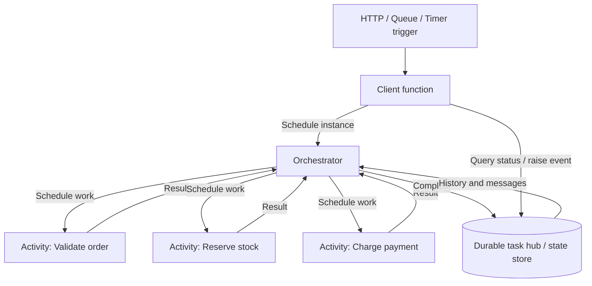
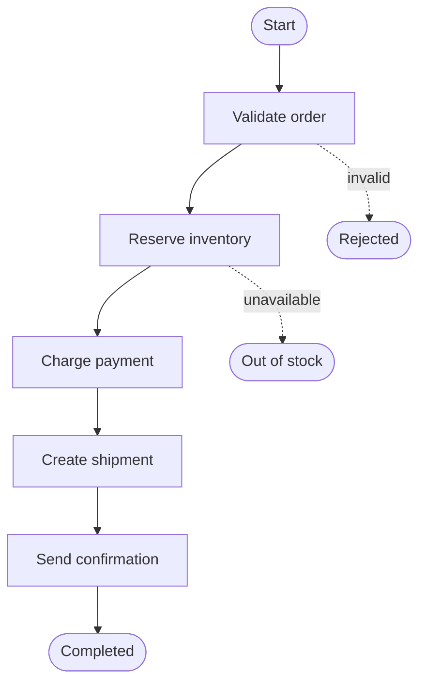
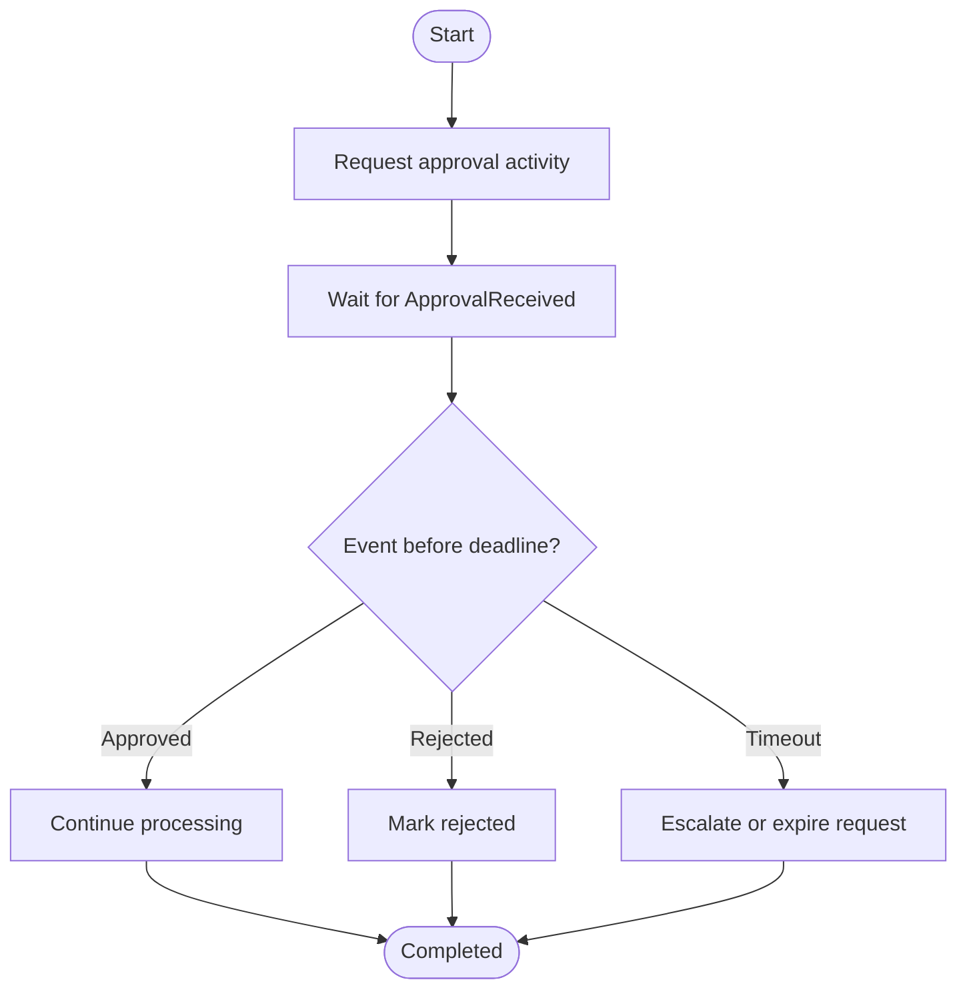

# Orchestrating workflows with Durable Functions

## 1. What problem does Durable Functions solve?

A regular function typically handles a single invocation and exits. This model works well for short APIs, webhooks, or consumers processing a single message. However, many business processes span multiple steps, last from minutes to days, wait for responses from users or external systems, and must resume after a process stops or infrastructure is updated.

For example, an order-processing workflow might validate details, reserve inventory, collect payment, create a shipment, wait for carrier confirmation, and send notifications. If each function simply triggers the next function, orchestration logic becomes fragmented. When a step fails, the team has to track state manually, determine which steps completed, and decide where to resume. An in-memory variable cannot guarantee state survives after the execution environment is reclaimed.

**Azure Durable Functions** is an extension to Azure Functions that adds stateful workflow orchestration. The Durable runtime persists execution history and orchestration messages in a durable backend. As a result, workflows can pause, wait for events or timers, recover after host restarts, and resume from recorded state.

With Java, Durable Functions can be built using Java annotations and APIs for Azure Functions. A basic application involves three roles: **Client** starts or manages workflows, **Orchestrator** describes the order and conditions of the workflow, and **Activity** performs the actual work. These roles run as Azure Functions activated by their corresponding triggers.

Durable Functions fits workflows requiring durable state and reliable orchestration. It does not replace business databases, message brokers, or every type of workflow engine. Choose the right tool based on execution duration, interaction needs, throughput, and workflow complexity.

## 2. Components of a Durable Functions app

### 2.1. Client function

The Client is the entry point for starting or managing orchestrations. A Client can be triggered by HTTP, a queue, a timer, or another function. Common responsibilities:

- Start a new orchestration instance and pass input.
- Choose an instance ID to correlate with a business entity, if needed.
- Query status, output, and custom status.
- Send external events to a waiting orchestration.
- Terminate an instance or purge history when conditions and retention policies are met.

The Client does not execute the entire workflow inline inside the request. Typically, it schedules the orchestration and returns the instance ID and status-checking URLs. The Client can respond with HTTP `202 Accepted` because the work has been accepted but is not necessarily finished.

### 2.2. Orchestrator function

The Orchestrator defines the control flow: which activities to call, in what order, when to branch, how long to wait, and how to handle errors. Logic can be written using familiar Java constructs such as `if`, `switch`, loops, and `try/catch`.

An Orchestrator must not directly call databases, HTTP APIs, or perform side effects. It schedules operations via the context, awaits results, and decides the next step. The runtime may re-run orchestrator code multiple times to reconstruct state from history; therefore, this code must be deterministic. This is the single most important rule when programming Durable Functions.

### 2.3. Activity function

An Activity is the unit that performs work. Examples:

- Calling a payment gateway API.
- Writing data to a database.
- Checking inventory.
- Creating a shipment.
- Sending emails or messages.
- Performing computations or processing files.

An Activity receives input, performs work, and returns output. It is not subject to the same determinism constraints as an orchestrator because activities are not replayed in the same way to rebuild control flow. However, an activity can be re-executed if the host fails after a side effect occurred but before the result was recorded. Therefore, activities should be idempotent whenever possible.

### 2.4. Sub-orchestration

A Sub-orchestration is a child workflow invoked from another orchestrator. It has its own instance/history and returns a result to the parent workflow. It can be used to break a large workflow into parts with clear business meaning, such as `VerifyCustomer`, `ProcessPayment`, or `ArrangeShipment`.

Sub-orchestrations help reuse logic and bound the complexity of a single orchestrator. Avoid splitting a workflow into too many tiny pieces if they lack distinct business boundaries or operational needs, as orchestration and observability become harder.

### 2.5. Durable entities and Java notes

A Durable entity models a small stateful object with durable state and a set of operations, such as a counter, shopping cart, or distributed semaphore. Entities fit when multiple workflows send commands to the same stateful object and want operations on that object processed sequentially.

Durable Functions documentation lists entity functions in some languages and hosting models. However, the Java Durable Task SDK currently does not provide an equivalent entity API in the standalone SDK model. When developing in Java, verify the exact capabilities of the Java package and hosting model in use before designing around entities. For this lesson, the focus is on orchestrators, activities, and clients.

### 2.6. Overview diagram



The diagram illustrates logical roles. The actual Durable runtime and storage provider are responsible for persisting history, instance state, and orchestration messages; the orchestrator does not need to keep a Java process running continuously throughout the workflow.

## 3. Durable execution: task hub, history, and replay

### 3.1. Task hub and durable state

A Task hub is the logical storage and coordination boundary for orchestration instances. It holds state, event history, control messages, and work items awaiting execution. Multiple applications can use distinct task hubs to isolate environments or workflow groups.

The storage provider stores data and distributes work. Current Durable Functions options include:

| Provider | Storage mechanism | Considerations |
| --- | --- | --- |
| Durable Task Scheduler | Managed Azure backend | Recommended for new apps; reduces self-managed storage, includes a dashboard, and supports managed identity |
| Azure Storage | Queues, Tables, and Blobs | Long-standing option, easy local dev with Azurite; requires managing storage account and permissions |
| Microsoft SQL Server (MSSQL) | SQL Server or Azure SQL database | Fits when leveraging existing SQL infrastructure or requiring data portability |
| Netherite | Event Hubs and Azure Page Blobs | Provider currently scheduled to end Durable Functions support on 2028-03-31; evaluate migration path |

Microsoft documentation currently recommends Durable Task Scheduler for managed deployments. Azure Storage remains a solid option for existing workloads or when self-managing storage. Capabilities and limits vary by provider; review the comparison matrix before choosing.

Do not treat the provider as something you can swap arbitrarily once production data exists. Currently, provider documentation notes that direct migration of orchestration data from one backend storage to another is not supported. Decide early and plan a separate migration if a change is ever needed.

Provider and extension bundle capabilities may vary by language, version, and feature. With Java, verify the specific provider supported by the current extension bundle and inspect provider limits before production deployment. Durable Task Scheduler is the recommended option; Azure Storage is a widely supported BYO backend with good local integration.

### 3.2. Event sourcing and execution history

The Durable runtime records events describing progress, such as:

- Orchestration instance created.
- Orchestrator scheduled an activity.
- Activity completed and returned a result.
- Orchestrator created a timer or waited for an external event.
- Timer expired or external event arrived.
- Instance completed, failed, or was terminated.

This history is the basis for the runtime to rebuild workflow state. Local variables in an orchestrator are not preserved like a normal Java process; they are reconstructed when the orchestrator re-runs based on input and results recorded in history.

### 3.3. How does replay work?

Suppose an orchestrator calls `ValidateOrder`, then `ReserveInventory`. When the first activity finishes, the runtime writes the result to history. If the host stops before the next step finishes, the runtime can reload the orchestration and re-run the orchestrator code from the beginning.

During replay:

1. The orchestrator re-runs from the first line.
2. When the code calls `ValidateOrder`, the runtime finds the existing result in history and returns it without re-executing the succeeded activity.
3. Execution continues to `ReserveInventory`.
4. If this activity has not finished yet, the runtime schedules or continues processing the work item.
5. When the new result arrives, the runtime writes it to history and continues replaying until the next wait point.

Replay lets workflows recover without holding all state in RAM. In exchange, orchestrator code must be deterministic and must not produce side effects directly.

### 3.4. What is guaranteed and what is not?

The Durable runtime persists progress and re-dispatches tasks after interruptions. However, that does not mean every activity runs strictly once. An activity can be executed at least once and occasionally re-executed if its outcome was not yet recorded. Never rely on an "exactly once" assumption for charging payments, sending emails, or provisioning resources.

A safe design combines:

- Durable workflow history.
- Idempotent activities or idempotency keys.
- Bounded retries and error classification.
- Reconciliation when uncertain whether a side effect occurred.
- Compensation for distributed steps that may need business rollback.

## 4. Determinism rules for Java orchestrators

### 4.1. Only use APIs with stable results on replay

Given the same input and history, an orchestrator must produce the exact same sequence of orchestration commands. Avoid calling these APIs directly inside an orchestrator:

- `Instant.now()`, `LocalDateTime.now()`, or `System.currentTimeMillis()`.
- `UUID.randomUUID()` or `new Random()`.
- `Thread.sleep()` or spawning custom threads/executors.
- Calling HTTP APIs, databases, filesystems, or cloud services.
- Reading environment variables or configuration that can change over time.
- Fetching data dependent on external state without going through an activity.

Instead:

- Use `ctx.getCurrentInstant()` to get the orchestration's logical timestamp.
- Use context deterministic ID generation APIs if provided by the SDK, or call an activity to generate random IDs.
- Use `ctx.createTimer(...)` instead of `Thread.sleep()`.
- Move I/O and side effects into activities.
- Pass required configuration via orchestration input or retrieve it through an activity.

### 4.2. Incorrect and correct examples

Avoid writing:

```java
public void run(TaskOrchestrationContext ctx) {
    // Non-deterministic: each replay may observe a different timestamp.
    Instant now = Instant.now();

    // Do not call external services directly inside the orchestrator.
    paymentClient.charge("order-42");

    // Do not use sleep to wait inside a workflow.
    Thread.sleep(5000);
}
```

Move those operations into activities and use a durable timer:

```java
public void run(TaskOrchestrationContext ctx) {
    Instant orchestrationTime = ctx.getCurrentInstant();

    ctx.callActivity("ChargePayment", "order-42", Void.class).await();
    ctx.createTimer(Duration.ofSeconds(5)).await();

    ctx.callActivity("RecordCheckpoint", orchestrationTime.toString(), Void.class).await();
}
```

This snippet illustrates the Durable Task SDK Java API. In Azure Functions, the orchestrator function is annotated with `@DurableOrchestrationTrigger` as shown in the next section.

### 4.3. Replay-safe logging

If you log directly inside an orchestrator, every replay can re-emit the same log and create duplicate entries. Check `ctx.getIsReplaying()` before logging, or use a replay-safe logger if provided by your integration.

```java
if (!ctx.getIsReplaying()) {
    logger.info("Starting orchestration " + ctx.getInstanceId());
}
```

Important business logs should be placed inside activities or linked using correlation/instance IDs. Never use orchestrator logs as proof that a side effect occurred only once.

## 5. Building Durable Functions in Java

### 5.1. Dependencies and development environment

Current Java quickstart documentation specifies JDK 11 or higher, Apache Maven, Azure Functions Core Tools v4, and the Java Durable Functions SDK. Main dependency in the quickstart example:

```xml
<dependency>
    <groupId>com.microsoft</groupId>
    <artifactId>durabletask-azure-functions</artifactId>
    <version>1.0.0</version>
</dependency>
```

The version above reflects the quickstart documentation referenced at the time of writing. When creating a new project, check the latest version, Java requirements, and Azure Functions runtime compatibility in Microsoft Learn documentation.

Common imports in a Java Functions Durable app:

```java
import com.microsoft.azure.functions.*;
import com.microsoft.azure.functions.annotation.*;
import com.microsoft.durabletask.*;
import com.microsoft.durabletask.azurefunctions.DurableActivityTrigger;
import com.microsoft.durabletask.azurefunctions.DurableClientContext;
import com.microsoft.durabletask.azurefunctions.DurableClientInput;
import com.microsoft.durabletask.azurefunctions.DurableOrchestrationTrigger;
import java.time.Duration;
import java.util.ArrayList;
import java.util.List;
import java.util.Map;
```

#### Distinguishing Java Durable Functions and the standalone Durable Task SDK

Both models share the Durable Task foundation but differ in how they are hosted:

| Model | Package/API | Who manages triggers and workers? |
| --- | --- | --- |
| Durable Functions on Azure Functions | `durabletask-azure-functions`, annotations such as `@DurableOrchestrationTrigger`, `@DurableActivityTrigger`, `@DurableClientInput` | Azure Functions host manages triggers, bindings, and function lifecycle |
| Standalone Durable Task SDK | `durabletask-client`, `DurableTaskClient`, `DurableTaskGrpcWorker`, `TaskOrchestration` | The application registers workers itself and integrates HTTP/message consumers directly; backend is configured separately |

This lesson uses the first model. Do not take self-hosted `DurableTaskGrpcWorker` examples and mix them into a Function App using triggers/bindings. The standalone Java SDK currently uses Durable Task Scheduler as its backend; Durable Functions offers additional storage provider choices depending on extension bundle capabilities.

### 5.2. Activity function

The `SayHello` activity accepts a city name and returns a string:

```java
public class DurableFunctionsSample {

    @FunctionName("SayHello")
    public String sayHello(
            @DurableActivityTrigger(name = "city") String city) {
        return "Hello " + city + "!";
    }
}
```

`@FunctionName` registers the function name with Azure Functions. `@DurableActivityTrigger` indicates the function is invoked as an activity by an orchestrator. Activities can call external services, write to databases, or perform computations.

### 5.3. Sequential orchestrator

The orchestrator calls activities sequentially. Each call returns a `Task`; `await()` receives the result once the activity finishes. If the result is not yet available, the Durable runtime can persist state and suspend the orchestrator.

```java
@FunctionName("ChainingOrchestration")
public String chainingOrchestration(
        @DurableOrchestrationTrigger(name = "ctx") TaskOrchestrationContext ctx) {

    String result = "";
    result += ctx.callActivity("SayHello", "Tokyo", String.class).await() + " ";
    result += ctx.callActivity("SayHello", "Seattle", String.class).await() + " ";
    result += ctx.callActivity("SayHello", "London", String.class).await();

    return result;
}
```

The final result is `Hello Tokyo! Hello Seattle! Hello London!`. This is function chaining: each subsequent step is only scheduled after the previous step returns its result.

### 5.4. Client function starting an orchestration

The Client can be an HTTP-triggered function. The example below starts `ChainingOrchestration` and returns a response containing status-checking URLs:

```java
@FunctionName("StartChaining")
public HttpResponseMessage startChaining(
        @HttpTrigger(
            name = "req",
            methods = {HttpMethod.POST},
            authLevel = AuthorizationLevel.FUNCTION)
            HttpRequestMessage<Void> request,
        @DurableClientInput(name = "durableContext") DurableClientContext durableContext) {

    DurableTaskClient client = durableContext.getClient();
    String instanceId = client.scheduleNewOrchestrationInstance("ChainingOrchestration");
    return durableContext.createCheckStatusResponse(request, instanceId);
}
```

`createCheckStatusResponse` creates a standard response so the client can query status, send events, or terminate the instance via URLs supplied by the Durable client. The example uses `AuthorizationLevel.FUNCTION`; in production, choose an appropriate authentication mechanism and avoid exposing workflow control endpoints publicly by accident.

### 5.5. Organizing a complete class

In real projects, functions can reside in a single class or be split across classes by responsibility. What matters is that the orchestrator/activity name in calls matches the name registered via `@FunctionName`.

```java
public class OrderWorkflowFunctions {

    @FunctionName("ValidateOrder")
    public OrderValidation validateOrder(
            @DurableActivityTrigger(name = "order") OrderRequest order) {
        // Validate data and business rules.
        return new OrderValidation(order.orderId(), true, "VALID");
    }

    @FunctionName("ReserveInventory")
    public Reservation reserveInventory(
            @DurableActivityTrigger(name = "order") OrderRequest order) {
        // Call inventory service; this operation requires idempotency.
        return inventoryService.reserve(order.orderId(), order.items());
    }

    @FunctionName("CreateOrderWorkflow")
    public OrderWorkflowResult createOrderWorkflow(
            @DurableOrchestrationTrigger(name = "ctx") TaskOrchestrationContext ctx) {

        OrderRequest order = ctx.getInput(OrderRequest.class);
        OrderValidation validation = ctx.callActivity(
                "ValidateOrder", order, OrderValidation.class).await();

        if (!validation.valid()) {
            return new OrderWorkflowResult(order.orderId(), "REJECTED");
        }

        Reservation reservation = ctx.callActivity(
                "ReserveInventory", order, Reservation.class).await();

        if (!reservation.successful()) {
            return new OrderWorkflowResult(order.orderId(), "OUT_OF_STOCK");
        }

        return new OrderWorkflowResult(order.orderId(), "READY_FOR_PAYMENT");
    }
}
```

This is a structural example demonstrating how functions connect; `OrderRequest`, `OrderValidation`, `Reservation`, `OrderWorkflowResult`, and `inventoryService` are application types defined in the project. Do not place the `inventoryService` call directly inside the orchestrator; it belongs only in the activity.

## 6. Common orchestration patterns

### 6.1. Function chaining: sequential steps

Chaining fits when the output of one step determines the next step. Order-processing example:



The advantage is clear ordering and recoverability between steps. However, error handling and compensation must be designed. If payment fails after inventory is reserved, the workflow may need an activity to release the reservation.

### 6.2. Conditional branching: branching

An orchestrator can use `if` or `switch` to select branches based on input or activity results. Example:

```java
@FunctionName("PaymentOrchestration")
public PaymentResult paymentOrchestration(
        @DurableOrchestrationTrigger(name = "ctx") TaskOrchestrationContext ctx) {

    PaymentRequest request = ctx.getInput(PaymentRequest.class);

    if ("CARD".equals(request.method())) {
        return ctx.callActivity("ChargeCard", request, PaymentResult.class).await();
    }

    if ("BANK_TRANSFER".equals(request.method())) {
        return ctx.callActivity("CreateBankTransfer", request, PaymentResult.class).await();
    }

    return new PaymentResult("UNSUPPORTED_METHOD", false);
}
```

Conditions must be deterministic. If you need to call a service to evaluate risk or read external data, create an activity like `EvaluateRisk`, receive its result, and then branch. Never call APIs directly inside the orchestrator.

### 6.3. Fan-out/fan-in: parallel execution and aggregation

Fan-out/fan-in is used when multiple independent tasks can run concurrently. The orchestrator schedules multiple activities first, then waits for all to finish and aggregates the results.

```java
@FunctionName("FanOutFanInOrchestration")
public List<String> fanOutFanInOrchestration(
        @DurableOrchestrationTrigger(name = "ctx") TaskOrchestrationContext ctx) {

    String[] cities = {"Tokyo", "Seattle", "London", "Paris", "Berlin"};
    List<Task<String>> tasks = new ArrayList<>();

    for (String city : cities) {
        tasks.add(ctx.callActivity("SayHello", city, String.class));
    }

    List<String> results = new ArrayList<>();
    for (Task<String> task : tasks) {
        results.add(task.await());
    }

    return results;
}
```

You can use `ctx.allOf(tasks).await()` to wait for all tasks and collect results in input-list order:

```java
List<String> results = ctx.allOf(tasks).await();
```

Do not fan out millions of activities simultaneously in one orchestrator. History size and fan-in can become bottlenecks; batch items, use sub-orchestrations, or limit concurrency. For large workloads, fan-in can concentrate on a single worker for one orchestration instance, so measure aggregation capacity.

### 6.4. Sub-orchestration: child workflows

A parent workflow can call a child workflow using `ctx.callSubOrchestrator(...)`. The child workflow has its own instance/history, making it suitable for extracting reusable steps or complex sub-flows.

For example, each order can invoke a `ProcessPayment` sub-orchestration while the top-level workflow handles inventory reservation, shipping, and notifications. If the sub-orchestration fails, the error propagates to the parent workflow for handling.

### 6.5. Durable timer: waiting over time

Durable timers let a workflow wait without keeping a thread or process running continuously. For example, waiting 30 minutes for payment completion or setting a partner response deadline:

```java
ctx.createTimer(Duration.ofMinutes(30)).await();
```

The current time must come from `ctx.getCurrentInstant()` when computing deadlines inside an orchestrator. Never use `Instant.now()` because its value may differ during replay.

Durable timers can also model timeouts by racing an activity and a timer in parallel, then using `ctx.anyOf(...)` to see which finishes first. In Java, follow the exact semantics of the `anyOf` and timer APIs in your SDK version. If the timer wins, the orchestrator stops waiting on the activity; this does not cancel the running activity.

### 6.6. External events: waiting for external signals

External events allow a workflow to wait for a signal from a client or external system. For example, after sending an approval request, the workflow waits for an `ApprovalReceived` event.

```java
ApprovalDecision decision = ctx.waitForExternalEvent(
        "ApprovalReceived", Duration.ofHours(72), ApprovalDecision.class).await();
```

Clients send events using the instance ID and event name via the Durable client API. If an event arrives before the orchestrator starts waiting, the runtime can buffer the event and deliver it when the workflow calls `waitForExternalEvent`.

When combining external events with timeouts, handle events arriving late, duplicated, or targeting the wrong workflow instance. Verify the sender, correlation ID, and business state before accepting a decision.

### 6.7. Long-running approval workflow

An approval workflow might operate as follows:



The workflow can wait for hours or days without keeping a function process running continuously. Wait state is persisted in the task hub and woken up when the event or timer arrives.

## 7. Retries, timeouts, and error handling

### 7.1. Retrying activities

Activities can fail due to network glitches, throttling, or temporary dependency outages. The Durable Task SDK supports retry policies for activities and sub-orchestrations. Java example:

```java
RetryPolicy retryPolicy = new RetryPolicy(
        3,                       // maxNumberOfAttempts
        Duration.ofSeconds(5),   // firstRetryInterval
        2.0,                     // backoffCoefficient
        Duration.ofMinutes(1),   // maxRetryInterval
        Duration.ofMinutes(5)    // retryTimeout
);

TaskOptions options = new TaskOptions(retryPolicy);

String result = ctx.callActivity(
        "UnreliableActivity", input, options, String.class).await();
```

Attempt count, initial wait, backoff multiplier, maximum interval, and retry timeout should align with SLAs. Retries cannot fix permanent errors such as invalid schemas or missing permissions.

### 7.2. Activities must be idempotent

The runtime may re-run an activity if its result was not yet recorded in history. For instance, an activity calling a payment gateway may receive a successful response, then the host crashes before recording the outcome. When the workflow recovers, the activity can be invoked again.

To prevent charging twice:

- Generate a stable idempotency key from the business ID and step name, e.g., `order-42:charge-payment`.
- Pass the same key to the payment gateway across every retry if supported by the provider.
- Persist processing state in a database using a unique constraint or conditional write.
- Before re-executing, check whether the transaction was already created.
- Establish a reconciliation process if the external system's outcome is ambiguous.

Never generate a new key on each retry. If the key changes, the provider may treat it as a brand-new transaction.

### 7.3. Try/catch and compensation

An orchestrator can catch activity errors and select an appropriate branch. For multi-service workflows, use the Saga pattern: each forward step can have a corresponding compensating action.

| Forward step | Effect | Possible compensation |
| --- | --- | --- |
| Reserve inventory | Holds stock | Release inventory |
| Charge payment | Collects funds | Refund payment |
| Create shipment | Creates shipping label | Cancel shipment if carrier supports |
| Apply loyalty points | Credits points | Reverse points |

Compensation is not always a clean reversal. Sent emails cannot be reliably recalled; handed-over parcels may require separate cancellation flows. Before compensating after a timeout, reconcile the true state of the forward step to avoid refunding a charge that never succeeded.

### 7.4. Activity timeouts

Timeouts can be modeled with a durable timer and `anyOf`:

```java
Task<String> activityTask = ctx.callActivity("CallPartner", input, String.class);
Task<Void> timeoutTask = ctx.createTimer(Duration.ofMinutes(2));

Task<?> winner = ctx.anyOf(activityTask, timeoutTask).await();
if (winner == activityTask) {
    String result = activityTask.await();
    // Handle successful result.
} else {
    // Handle timeout according to business rules.
}
```

This pattern illustrates stopping waiting once a deadline expires. A timeout does not cancel an already-dispatched activity; the activity can keep running and produce side effects after the orchestrator takes the timeout branch. Therefore, enforce timeouts on HTTP clients/databases inside activities, design for idempotency, and include reconciliation/compensation when outcomes are uncertain. Terminating an orchestration likewise does not necessarily halt in-flight activities.

## 8. Managing instances and workflow state

### 8.1. Instance ID

Every orchestration instance has a unique ID. Clients can let the runtime generate an ID or supply a business-derived ID. If using a business ID as the instance ID, define how to handle cases where an instance with the same ID already exists, is running, or has finished.

Do not reuse one generic ID for multiple independent runs. Define idempotency when clients send duplicate start requests: check existing instances, use a request ID, or construct a business-appropriate unique key.

### 8.2. Common statuses

Common instance statuses include:

| Status | Meaning |
| --- | --- |
| `Pending` | Scheduled but execution has not started yet |
| `Running` | Workflow is executing or waiting on a task/event/timer |
| `Completed` | Workflow finished successfully |
| `Failed` | Workflow ended due to an unhandled error |
| `Terminated` | Instance was requested to terminate |
| `Suspended` | Instance is paused if supported by backend/API |

An instance in `Running` status does not mean CPU is continuously busy. It may simply be waiting on a timer, external event, or activity.

### 8.3. Custom status

An orchestrator can update custom status to report progress to clients or dashboards:

```java
ctx.setCustomStatus(Map.of(
        "step", "PAYMENT",
        "completed", 2,
        "total", 5
));
```

Custom status must be serializable and kept compact. Do not use it to replace a business database or store large payloads. Clients can query instance metadata to display appropriate progress.

### 8.4. Terminating and purging history

Clients can terminate an instance if business rules require canceling the workflow. However, terminating does not guarantee halting an in-flight activity; the activity's result may simply be ignored afterward. Side effects already produced must be addressed via compensation or reconciliation.

Once an instance reaches a terminal state, history can be purged per retention policy. Purging deletes historical records and stored inputs/outputs, so satisfy audit, legal, and investigative requirements before deleting.

## 9. Storage providers and task hub configuration

### 9.1. Durable Task Scheduler

Durable Task Scheduler is a managed Azure backend and is currently recommended for Durable Functions. It provides storage for state, history, and orchestration messages, reducing manual queue/table/blob management. The scheduler includes an observability dashboard and supports managed identity.

Example `host.json` using the `azureManaged` provider:

```json
{
  "version": "2.0",
  "extensions": {
    "durableTask": {
      "hubName": "default",
      "storageProvider": {
        "type": "azureManaged",
        "connectionStringName": "DURABLE_TASK_SCHEDULER_CONNECTION_STRING"
      }
    }
  }
}
```

Example `local.settings.json` when running the emulator:

```json
{
  "IsEncrypted": false,
  "Values": {
    "AzureWebJobsStorage": "UseDevelopmentStorage=true",
    "FUNCTIONS_WORKER_RUNTIME": "java",
    "DURABLE_TASK_SCHEDULER_CONNECTION_STRING": "Endpoint=http://localhost:8080;TaskHub=default;Authentication=None"
  }
}
```

This is a local configuration per the quickstart. In Azure, never put secrets in source control; use application settings/secret stores and managed identity when supported by the provider.

### 9.2. Azure Storage provider

The Azure Storage provider uses:

- Azure Queues to dispatch activity and control messages.
- Azure Tables to store orchestration history and instance state.
- Azure Blobs and blob leases to support partitions, locks, and large payloads.

This provider suits applications that prefer managing their own storage account or already rely on Azure Storage. For throughput-sensitive workloads, evaluate using a dedicated storage account to avoid competing with internal Azure Functions host operations.

### 9.3. Storage access permissions

The Durable runtime needs read/write permissions to task hub data. Prefer managed identity over storing connection strings with access keys when supported by the provider. With Azure Storage, required data roles typically include Storage Blob Data Contributor, Storage Queue Data Contributor, and Storage Table Data Contributor at the appropriate resource scope.

Never grant subscription-wide Owner or Contributor just to let a workflow run. Separate infrastructure deployment permissions from runtime permissions and grant only the data permissions needed by the function app.

## 10. Serialization and payload management

Activity inputs, outputs, sub-orchestration results, and event payloads may be serialized and stored in history/the task hub. Therefore:

- Pass only the data needed for the next step.
- Use DTOs with explicit schemas and version compatibility.
- Do not pass secrets, tokens, passwords, or unnecessary personal data.
- Do not pass large files or multi-megabyte payloads across multiple steps when they can be stored in Blob Storage.
- Pass a URI or object key with access control instead of passing entire contents.
- Plan appropriate history retention and purging.

Changing DTO structures can affect running instances and older history. When upgrading the application, maintain backward compatibility with older data or version workflows and payloads intentionally. Never rename activities/orchestrators or make breaking type changes while instances are still running without a migration plan.

## 11. Scaling and performance

### 11.1. Activity scale-out

Activities perform the actual work and can generally scale horizontally with work item volume. The orchestrator primarily coordinates and should remain lightweight: evaluating small conditions, scheduling tasks, awaiting results, and aggregating status.

Do not place heavy CPU processing, large payload parsing, or synchronous I/O inside an orchestrator. Move that work into activities so the backend can distribute and scale it across compute capacity.

### 11.2. Bounded fan-out/fan-in

Fan-out can boost throughput, but fan-in and history also have limits. If a single orchestration spawns too many tasks at once:

- History grows rapidly and replays take longer.
- The backend must store and dispatch many messages.
- The orchestrator can become a bottleneck when aggregating results.
- Activities can overload databases or dependent APIs.

Solutions include batching, capping concurrent tasks, splitting into sub-orchestrations, and storing aggregated results in a dedicated data store. If there are hundreds of thousands of items, avoid holding every result in a single list variable of one orchestrator.

### 11.3. Long histories and continue-as-new

Long-running or continuously looping orchestrations can accumulate massive histories. Java `TaskOrchestrationContext` supports `continueAsNew(...)` to restart the orchestration with new input and clear prior history per API semantics. This pattern is useful for long-lived recurring workflows, such as monitoring device state or scheduled polling.

Only use continue-as-new when you understand how in-flight tasks and unprocessed external events are handled. It is not an arbitrary reset; design the new input and carried-over state carefully.

### 11.4. Cost

Durable Functions costs go beyond function execution duration. Account for:

- Compute for clients, orchestrators, and activities.
- Durable Task Scheduler or Azure Storage/MSSQL/Event Hubs depending on provider.
- Message volume, history events, transactions, and retries.
- Logs, metrics, tracing, and dashboards.
- Large payload storage, archive data, and retention duration.
- Network egress and dependent services.

A workflow waiting for several days on a durable timer typically does not keep a function process running continuously, but still incurs state storage and backend service costs. Infinite retries, oversized fan-out, and unpurged history can drive costs up rapidly.

## 12. Observability and operations

### 12.1. Monitoring instances

Clients can query orchestration status via the API/URLs returned at startup. Monitor:

- Instance counts by status: `Pending`, `Running`, `Completed`, `Failed`, and `Terminated`.
- End-to-end time from request ingestion to workflow completion.
- Activity duration and retry counts.
- Workflows waiting on external events or timers.
- History event counts and payload sizes.
- Compensation success/failure rates.
- Queue/backlog depth or provider throttling.

### 12.2. Correlation and logging

Include instance ID, business ID, and correlation ID in activity logs. This links an initial HTTP request across multiple activities and external systems. Inside orchestrators, use replay-safe logging or log only when `ctx.getIsReplaying()` returns false.

Avoid logging full inputs/outputs if they contain sensitive data. Redact personal data and tokens. Durable history may store inputs/outputs, so dashboard and status API access must also be protected.

### 12.3. Dashboards and alerting

Durable Task Scheduler includes a dashboard for viewing execution history and status. With the Azure Storage provider, Azure Functions and Storage tools can inspect the task hub. Set up alerts for:

- Abnormal spikes in `Failed` instances.
- Workflows staying `Running` longer than SLA.
- Activity retries exceeding thresholds.
- Growing queue backlogs or provider throttling.
- Storage/backend connectivity loss.
- Overdue external events or callbacks.

## 13. Local development and testing

### 13.1. Required tooling

Current Java quickstarts specify JDK 11+, Maven, Azure Functions Core Tools v4, and Docker. With the Durable Task Scheduler emulator, run the emulator alongside Azurite for the Azure Functions host's local storage.

Example launching both containers:

```bash
docker run -d --name dtsemulator -p 8080:8080 -p 8082:8082 \
  mcr.microsoft.com/dts/dts-emulator:latest

docker run -d --name azurite -p 10000:10000 -p 10001:10001 -p 10002:10002 \
  mcr.microsoft.com/azure-storage/azurite
```

The emulator dashboard is typically accessed at `http://localhost:8082`.

### 13.2. Building and running the Function App

With a Maven project:

```bash
mvn clean package
mvn azure-functions:run
```

After the host starts, call the HTTP starter endpoint, for example:

```powershell
$response = Invoke-RestMethod -Method POST -Uri http://localhost:7071/api/StartChaining
$response
Invoke-RestMethod -Uri $response.statusQueryGetUri
```

The starter response typically contains `id`, `statusQueryGetUri`, `sendEventPostUri`, `terminatePostUri`, and `purgeHistoryDeleteUri`. If `runtimeStatus` is still `Pending` or `Running`, poll again after a short interval. When `Completed`, the workflow output appears in the `output` field.

### 13.3. Testing execution paths

Do not test only the happy path. Test:

- Valid and invalid inputs.
- An activity failing transiently then succeeding.
- An activity exhausting all retries.
- Duplicate activity invocations and idempotency.
- Orchestration restarting while waiting on an activity.
- Timer expiration and external events arriving on time/late.
- Fan-out across many activities where one activity fails.
- Terminating an instance while an activity is running.
- Payloads missing fields or undergoing schema changes.
- Temporary storage/backend unavailability.

Local emulators help verify logic and orchestration flows. Before production, still test in real Azure to verify IAM, networking, scaling, quotas, provider behavior, and billing.

## 14. Security and data management

Durable workflows store inputs, outputs, and history in the backend. Never pass access tokens, passwords, private keys, or sensitive data into orchestration inputs unnecessarily. If an activity needs a secret, retrieve it inside the activity from Key Vault or a secret manager using a least-privilege identity.

HTTP starters, status endpoints, event endpoints, and terminate endpoints can modify or expose workflow state. Protect them with proper authentication, verify instance ownership, and restrict who can send external events. Never allow arbitrary clients to send `ApprovalReceived` simply by guessing an instance ID.

Use managed identity to connect to storage/backends when supported by the provider. Scope permissions to the smallest resource boundary. Control history read access since stored data may contain business information.

## 15. When should you use Durable Functions?

| Scenario | Durable Functions fits when |
| --- | --- |
| Multi-step processes | Each step's result must be recorded and resumed after failures |
| Long waits | Timers or external events are needed without keeping a process running |
| Fan-out/fan-in | Many independent activities must run and aggregate results |
| Human approval | The workflow must wait for a user or staff approval |
| Saga | Multiple services have side effects requiring compensation |
| Long-running workflows | Durable state is needed across restarts/scaling |

Durable Functions is unnecessary if a simple function finishes quickly, needs no progress persistence, or only passes messages between services. For complex declarative pipelines, SaaS integrations, or low-code flows, consider Azure Logic Apps. For pure messaging, Azure Service Bus or Event Grid may suffice; Durable Functions helps when stateful orchestration over those messages/events is required.

## 16. Common design mistakes

| Mistake | Consequence | Fix |
| --- | --- | --- |
| Calling HTTP/database directly in orchestrator | Replay causes duplicate side effects or determinism errors | Move I/O into activities |
| Using `Instant.now()` or random UUIDs in orchestrator | Results diverge across replays | Use context APIs or activities |
| Using `Thread.sleep()` to wait | Blocks threads and fails to persist durable timers | Use durable timers |
| Assuming an activity runs only once | Double charges or duplicate resource creation | Design idempotency keys and reconciliation |
| Passing large payloads across many states | Increases storage, serialization, and replay time | Store data in Blob Storage and pass references |
| Excessive fan-out in a single instance | Large histories and fan-in bottlenecks | Batch work, cap concurrency, use sub-orchestrations |
| Omitting compensation handling | Workflow fails while reserved resources/charges remain | Design Sagas and compensating actions |
| Ignoring orchestration versioning | Older instances replay against incompatible logic | Maintain compatibility and version workflows intentionally |
| Never purging history | Storage and sensitive data accumulate long-term | Set retention and purge policies |
| Treating terminate as immediate activity cancellation | Activity side effects can still occur | Design business-layer cancellation/compensation |

## 17. Workflow design process

1. **Model business states:** define states, steps, and transition conditions.
2. **Split activities:** each activity performs a clearly bounded task with serializable input/output.
3. **Write a deterministic orchestrator:** coordinate only; no direct I/O, clocks, randomness, or threads.
4. **Choose triggers/clients:** HTTP, queue, or timer depending on how the workflow starts.
5. **Select a storage provider:** evaluate Durable Task Scheduler, Azure Storage, or a suitable backend; define task hubs and environments.
6. **Design retries/timeouts:** classify errors, configure backoff, time bounds, and error branches.
7. **Ensure idempotency:** define business-based keys and handle repeatable side effects.
8. **Design timers/events:** specify deadlines, event names, valid senders, and late-event behavior.
9. **Add observability:** instance IDs, correlation IDs, custom status, metrics, dashboards, and alerts.
10. **Manage data:** limit payloads, protect secrets, configure retention, and purge history.
11. **Test recovery:** host restarts, duplicate activities, provider outages, retries, and compensation.
12. **Deploy with control:** manage versions, configure identities, test in real Azure, and prepare rollbacks.

## 18. Conclusion

Durable Functions turns individual functions into stateful, resilient workflows. Clients start and manage instances, orchestrators describe control flow, activities execute side effects, and sub-orchestrations modularize workflows. Durable timers and external events support long waits; fan-out/fan-in executes independent tasks in parallel.

Resilience relies on history and replay, so orchestrators must be deterministic. Because activities can re-run, they must be idempotent. Storage providers, task hubs, payloads, retention, access permissions, and observability are integral parts of the design rather than afterthoughts. When these elements are clearly defined, Java Durable Functions can orchestrate long, multi-step workflows with external interactions without keeping a process running continuously across the business lifecycle.

## References

- [Quickstart: Create a Java Durable Functions app](https://learn.microsoft.com/en-us/azure/durable-task/durable-functions/quickstart-java)
- [Durable orchestrations](https://learn.microsoft.com/en-us/azure/durable-task/common/durable-task-orchestrations)
- [Programming model: orchestrators, activities, and entities](https://learn.microsoft.com/en-us/azure/durable-task/common/durable-task-programming-model-overview)
- [Orchestrator code constraints](https://learn.microsoft.com/en-us/azure/durable-task/common/durable-task-code-constraints)
- [Storage providers for Durable Task](https://learn.microsoft.com/en-us/azure/durable-task/common/durable-task-storage-providers)
- [Durable timers: delays and timeouts](https://learn.microsoft.com/en-us/azure/durable-task/common/durable-task-timers)
- [Durable Functions packages, extensions, and SDKs](https://learn.microsoft.com/en-us/azure/durable-task/durable-functions/durable-functions-packages)
- [TaskOrchestrationContext Java API](https://learn.microsoft.com/en-us/java/api/com.microsoft.durabletask.taskorchestrationcontext?view=durabletask-java-1.x)
- [Handle errors and retries](https://learn.microsoft.com/en-us/azure/durable-task/common/durable-task-error-handling)
