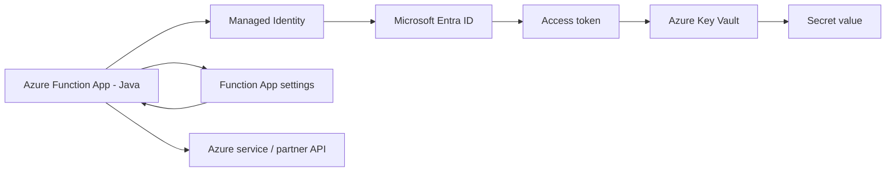

# Managed Identity, Key Vault, and Function App configuration

Azure Functions often needs to access external resources such as Azure Storage, Service Bus, Cosmos DB, Azure SQL, or partner APIs. Functions also need environment-specific configuration: endpoints, queue names, feature flags, business timeouts, and authentication secrets. Embedding credentials in source code, config files, or deployment packages risks leaking secrets through repositories, logs, artifacts, or anyone with package read access.

Azure provides **Managed Identity** so a Function App can obtain Microsoft Entra ID tokens without storing client secrets or certificates itself. **Azure Key Vault** stores and governs access to secrets. **Function App settings** provide environment-specific configuration and inject values into the process as environment variables. Combining these three mechanisms properly helps Java functions retrieve configuration, authenticate to Azure services, and manage secret lifecycles more securely.

In a serverless model, each function invocation may run on a different instance, scale out, or restart. Therefore, credentials and configuration must be managed at the application/service level, while business state is stored in durable storage. Managed Identity solves workload identity; it does not automatically grant data access permissions, replace network configuration, or replace business authorization checks.

## 1. Roles of the three components

| Component | Problem solved | Example |
|---|---|---|
| Managed Identity | Provides an identity for the Function App when calling services supporting Microsoft Entra ID | Acquiring a token to read a Key Vault secret or receive Service Bus messages |
| Azure Key Vault | Stores secrets, keys, and certificates; manages access permissions and lifecycle | API keys, connection credentials, certificates |
| Function App settings | Provides environment-specific deployment configuration | `ORDERS_QUEUE_NAME`, `KEY_VAULT_URI`, `PAYMENT_API_KEY` |

A typical flow:



The Function App obtains an identity from the platform, requests an Entra ID token for the target resource, and uses that token to call Key Vault or an Entra ID-supported service. With Key Vault references, the platform can resolve secrets into app settings before the application reads environment variables.

## 2. What is Managed Identity?

Managed Identity is an Azure-managed identity for a resource. Azure handles creating and operating the identity's credentials; the application requests an access token when needed. Developers do not need to create client secrets, store certificates, or manually rotate service principal credentials.

Managed Identity is backed by Microsoft Entra ID. When a Function App needs to access a resource, the SDK or platform acquires a token for the corresponding resource/audience. The target resource still validates the token and the data-plane permissions assigned to the identity.

Managed Identity is not a default access grant. Enabling an identity only creates the identity itself. To read a secret, the identity must be granted appropriate permissions on Key Vault; to receive messages from Service Bus, the identity must have receive permissions on the corresponding namespace or entity.

### System-assigned identity

A system-assigned identity is created directly on the Function App. The identity lifecycle is tied to the resource:

- When enabled, Azure creates a service principal in Microsoft Entra ID.
- The Function App uses that identity to acquire tokens.
- When the Function App is deleted, its system-assigned identity is also deleted.
- Each Function App has its own unique system-assigned identity.

This is usually the simplest option when a Function App needs a dedicated identity and permissions scoped solely to that application's lifecycle.

### User-assigned identity

A user-assigned identity is a standalone Azure resource. It can be created and granted permissions beforehand, then attached to one or more Function Apps.

- The identity lifecycle is independent of the Function App.
- Can be reused across multiple resources requiring the same permissions.
- Permissions can be granted prior to deploying the Function App.
- A Function App can have multiple user-assigned identities attached and select the right identity per integration.

Reusing identities simplifies administration, but if multiple applications share an identity, the blast radius of overly broad permissions is also larger. Only share an identity when workloads genuinely share the same trust boundary and permissions.

### Comparison

| Criterion | System-assigned | User-assigned |
|---|---|---|
| Creation | Enabled directly on the Function App | Created as a separate identity resource |
| Lifecycle | Tied to the Function App | Independent of the Function App |
| Multi-app attachment | Cannot share one system-assigned identity across multiple apps | Can be attached to multiple apps |
| Granting permissions before app deployment | Usually must create app and enable identity first | Can create identity and assign permissions upfront |
| Best suited for | One app, one dedicated identity | Multiple resources intentionally sharing a governed identity |

## 3. Enabling Managed Identity for a Function App

Identities can be enabled in the Azure Portal under the Function App's Identity blade or via Azure CLI/ARM/Bicep/Terraform. For a system-assigned identity, enabling it creates the identity bound to the Function App. For a user-assigned identity, create the identity resource first and add it to the app's assigned identities.

After enabling, record the identifiers needed for administration and IaC:

- **Principal ID / Object ID:** the service principal identifier in Entra ID, commonly used when assigning roles.
- **Client ID:** the client identifier of a user-assigned identity; used to select the identity in certain SDKs/configurations.
- **Resource ID:** the Azure Resource Manager path of a user-assigned identity; used when attaching the identity to a Function App or configuring platform identity selection.

Do not confuse Client ID with Principal ID. When creating a role assignment, Azure typically requires the principal/object ID. When an SDK selects a user-assigned identity, configuration usually uses the client ID. When attaching an identity to a resource or setting `keyVaultReferenceIdentity`, configuration uses the resource ID.

After enabling an identity, role assignments and directory changes may take time to propagate. An immediate call might temporarily receive an authorization error even though configuration was created; re-check after propagation completes.

## 4. Granting permissions with Azure RBAC

Managed Identity provides the identity; Azure RBAC decides what the identity is allowed to do on a resource. Assign the least-privilege data-plane role at the narrowest scope needed.

Common role examples:

| Resource | Common data-plane role | Purpose |
|---|---|---|
| Key Vault | `Key Vault Secrets User` | Read secret contents |
| Azure Storage Blob | `Storage Blob Data Reader` or `Storage Blob Data Contributor` | Read or read/write blobs |
| Azure Service Bus | `Azure Service Bus Data Receiver`, `Azure Service Bus Data Sender`, or `Azure Service Bus Data Owner` | Receive, send, or manage messaging data per role scope |
| Azure Cosmos DB for NoSQL | Corresponding data-plane role such as `Cosmos DB Built-in Data Reader` or `Cosmos DB Built-in Data Contributor` | Read or write Cosmos DB data |

Exact role names and permissions depend on the service type and configuration. Control-plane management roles, such as permission to manage resources in a subscription, do not automatically grant permission to read data inside Key Vault, Storage, or Service Bus. Always distinguish control-plane RBAC from data-plane RBAC.

### Key Vault RBAC and access policies

Key Vault supports either Azure RBAC or access policies depending on vault configuration. Under the RBAC model, assign `Key Vault Secrets User` at the vault or a narrower scope where appropriate. For vaults using access policies, grant the exact secret permission, typically `Get` for reading secrets; only grant `List` if the application genuinely needs to enumerate secrets.

Do not assign `Key Vault Administrator` or vault management permissions to a Function App just to read a secret. Do not assign roles at subscription scope if only one vault needs access. Verify the vault's current authorization model before creating role assignments; an RBAC role assignment will not take effect as expected if the vault uses the access policy model.

## 5. Key Vault references in Function App settings

The App Service platform, which underlies Azure Functions, supports Key Vault references in application settings. Instead of storing a secret directly in an app setting, you can set a reference value:

```text
PAYMENT_API_KEY=@Microsoft.KeyVault(SecretUri=https://<vault-name>.vault.azure.net/secrets/payment-api-key/)
```

The platform uses the configured identity to access Key Vault, fetch the secret, and supply the resolved value to the application as an application setting. A Java function reads `PAYMENT_API_KEY` via `System.getenv("PAYMENT_API_KEY")` like a normal environment variable.

### Versioned and versionless Secret URIs

A reference can specify a versioned URI:

```text
@Microsoft.KeyVault(SecretUri=https://<vault-name>.vault.azure.net/secrets/payment-api-key/<secret-version>)
```

Or a versionless URI:

```text
@Microsoft.KeyVault(SecretUri=https://<vault-name>.vault.azure.net/secrets/payment-api-key/)
```

A versioned URI pins the application to a specific secret version until configuration is updated. A versionless URI allows the platform to pick up the current version according to the Key Vault reference refresh mechanism. The platform caches resolved values; secret updates do not necessarily appear instantaneously in running processes. You can trigger a refresh via platform-supported mechanisms or update configuration/restart the app when needed. Plan rotation around cache intervals and never assume every invocation calls Key Vault.

### Selecting a user-assigned identity for Key Vault references

By default, Key Vault references use the system-assigned identity if the Function App has one. To use a user-assigned identity, set the platform property `keyVaultReferenceIdentity` to that identity's resource ID. Then ensure the identity is attached to the app and has permission to read secrets in the vault.

Do not confuse the platform's `keyVaultReferenceIdentity` setting with the SDK's `AZURE_CLIENT_ID` in code. One selects the identity for Key Vault references; the other typically tells the Azure Identity SDK which user-assigned identity to use when the application calls services directly.

### When to use Key Vault references?

Suitable when:

- The application simply needs a secret as an app setting.
- You want code to read configuration via environment variables without knowing the Key Vault SDK.
- You want the platform to handle reference resolution and caching.
- The secret's lifecycle fits the platform's refresh mechanism.

Unsuitable or insufficient when:

- The application needs to list, create, update, or delete secrets.
- Secrets must be selected dynamically per tenant or per request.
- Custom rotation/caching logic or multi-version access is required.
- Key Vault cryptographic APIs for keys/certificates are needed rather than just retrieving a secret value.

In those cases, consider using the Azure SDK directly with Managed Identity.

## 6. Reading secrets directly with the Azure SDK for Java

Java applications can use the Azure Identity and Azure Security Key Vault Secrets SDKs. `DefaultAzureCredential` selects the appropriate credential for the environment: during local development, it can use Azure CLI or IDE credentials; when running in Azure, it can use the Managed Identity enabled on the Function App.

Required Maven dependencies:

```xml
<dependency>
  <groupId>com.azure</groupId>
  <artifactId>azure-identity</artifactId>
</dependency>
<dependency>
  <groupId>com.azure</groupId>
  <artifactId>azure-security-keyvault-secrets</artifactId>
</dependency>
```

Example creating a SecretClient:

```java
import com.azure.identity.DefaultAzureCredential;
import com.azure.identity.DefaultAzureCredentialBuilder;
import com.azure.security.keyvault.secrets.SecretClient;
import com.azure.security.keyvault.secrets.SecretClientBuilder;

public final class KeyVaultClients {
    private KeyVaultClients() {}

    public static SecretClient create(String vaultUrl) {
        DefaultAzureCredential credential =
                new DefaultAzureCredentialBuilder().build();

        return new SecretClientBuilder()
                .vaultUrl(vaultUrl)
                .credential(credential)
                .buildClient();
    }
}
```

In Azure, the SDK uses the configured Managed Identity. Locally, developers sign in via supported tools like Azure CLI and must have secret read permissions on the vault. Never put a client secret in code just for local development convenience.

If a Function App has multiple user-assigned identities attached, select the identity via `AZURE_CLIENT_ID` per Azure Identity SDK configuration or configure `ManagedIdentityCredentialBuilder` with the client ID. Example selecting Managed Identity directly:

```java
import com.azure.identity.ManagedIdentityCredential;
import com.azure.identity.ManagedIdentityCredentialBuilder;

String clientId = System.getenv("AZURE_CLIENT_ID");
ManagedIdentityCredential credential =
        new ManagedIdentityCredentialBuilder()
                .clientId(clientId)
                .build();
```

This example targets an Azure environment with the corresponding user-assigned identity. `ManagedIdentityCredential` does not automatically fall back to Azure CLI when running locally; to share code across local and Azure, `DefaultAzureCredential` is usually more convenient.

### Retrieving secrets and managing caches

```java
import com.azure.security.keyvault.secrets.SecretClient;
import com.azure.security.keyvault.secrets.models.KeyVaultSecret;

public final class PaymentConfiguration {
    private final SecretClient secretClient;

    public PaymentConfiguration(SecretClient secretClient) {
        this.secretClient = secretClient;
    }

    public String paymentApiKey() {
        KeyVaultSecret secret = secretClient.getSecret("payment-api-key");
        return secret.getValue();
    }
}
```

Avoid calling `getSecret` on every request unnecessarily. Key Vault has latency, quotas, and per-request costs; each call adds a network dependency to the execution path. Safely reuse `SecretClient` at the instance level and cache secrets under a policy matching rotation requirements. When caching, enforce expiration, a refresh mechanism, refresh error handling, and avoid logging secret values. Do not store secrets indefinitely in global variables if the app has no way to update when secrets rotate.

## 7. Configuring Function App settings

Function App settings are key/value pairs configured at the Function App level. The platform exposes them to the process as environment variables. In Java, they can be read with `System.getenv`; frameworks like Spring Boot can bind environment variables into `@ConfigurationProperties` or `@Value`.

Sample app setting names:

| Setting | Meaning | Secret? |
|---|---|---|
| `ORDERS_QUEUE_NAME` | Queue name to process | No |
| `KEY_VAULT_URI` | Vault URI | Not necessarily |
| `PAYMENT_API_KEY` | API key; should be a Key Vault reference | Yes |
| `PAYMENT_API_BASE_URL` | Payment API endpoint | Usually no |
| `FEATURE_NEW_CHECKOUT` | Feature toggle | No |
| `APPLICATIONINSIGHTS_CONNECTION_STRING` | Telemetry configuration | May contain connection info; protect per policy |

App settings are typically shared across functions within the same Function App. If two functions require different permissions or secrets, consider splitting Function Apps or using appropriately scoped identities/secret access rather than granting one broad set of permissions to the entire application.

### Reading configuration in Java

```java
public final class AppConfig {
    private final String ordersQueueName;
    private final String paymentApiKey;

    public AppConfig() {
        this.ordersQueueName = required("ORDERS_QUEUE_NAME");
        this.paymentApiKey = required("PAYMENT_API_KEY");
    }

    private static String required(String name) {
        String value = System.getenv(name);
        if (value == null || value.isBlank()) {
            throw new IllegalStateException(
                    "Missing required application setting: " + name);
        }
        return value;
    }

    public String ordersQueueName() {
        return ordersQueueName;
    }

    public String paymentApiKey() {
        return paymentApiKey;
    }
}
```

Missing configuration errors should be caught early during application initialization or when the function needs that setting. Never print secret values to logs for diagnostics; log only the setting name and sanitized status information.

### Hierarchical configuration

Azure App Settings support keys with `__` to represent hierarchical configuration in a manner compatible with many .NET and cross-platform frameworks. For example, `Payments__TimeoutSeconds` maps to `Payments:TimeoutSeconds` in .NET. In Java/Spring, binding rules depend on the framework; follow your application's naming conventions and verify on both Linux and Windows if supporting both.

Do not assume every `:` is preserved identically across all OSes and deployment tools. Use `__` when cross-platform environment variable names are needed, and map them in your framework/configuration layer.

## 8. local.settings.json and local development

Azure Functions Core Tools uses `local.settings.json` to supply configuration for local runs. The `Values` section is loaded into the local runtime environment; this file is not a secret store and is typically listed in `.gitignore`.

Example structure:

```json
{
  "IsEncrypted": false,
  "Values": {
    "AzureWebJobsStorage": "UseDevelopmentStorage=true",
    "FUNCTIONS_WORKER_RUNTIME": "java",
    "KEY_VAULT_URI": "https://example-vault.vault.azure.net/",
    "ORDERS_QUEUE_NAME": "orders-local"
  }
}
```

Never commit real secrets in `local.settings.json`. To test Key Vault locally, developers sign into Azure CLI with a least-privilege account and use `DefaultAzureCredential`. For unit tests, inject fake interfaces/configs instead of calling a real vault.

`local.settings.json` is for the local runtime. When publishing, app settings on the Function App are configured separately via Portal, CLI, or IaC; do not assume local contents automatically sync to Azure. Never publish local settings to production without inspecting every value and stripping test credentials.

## 9. Key Vault references vs. SDK: which model to choose?

| Criterion | Key Vault reference | Azure SDK directly |
|---|---|---|
| Who reads the secret? | App Service platform | Function App code |
| How code receives it | Environment variable/app setting | `SecretClient.getSecret()` |
| Access permissions | Identity used by platform reference | Identity selected by SDK credential |
| Caching/refresh | Managed by platform per reference mechanism | Managed by application cache and refresh logic |
| Per-request secret selection | Not suitable | Possible; requires permission and cache control |
| Other Key Vault APIs | No, references only inject secret values into settings | Can use appropriate SDKs for secrets/keys/certificates |
| Code complexity | Low | Higher; adds SDK and error handling |

If the entire Function App just needs one API key, a Key Vault reference is usually simpler. If secrets must be accessed dynamically by tenant, version, or business logic, the SDK may be more suitable. Avoid using both approaches for the same secret without a clear reason; two access paths can use different identities and complicate permission troubleshooting.

## 10. Connecting to Azure services using Managed Identity

Managed Identity is not limited to Key Vault. Many Azure services support Microsoft Entra ID for data-plane authentication. For example:

- Azure Storage: uses tokens to read/write blobs or queues when supported by the SDK and service.
- Azure Service Bus: uses tokens to send or receive messages.
- Azure Cosmos DB: uses tokens and corresponding data-plane roles.
- Azure SQL: uses Microsoft Entra authentication per driver/database configuration.
- Azure App Configuration: uses identity to read authorized key-values.

For Azure Functions triggers or bindings, several extensions support identity-based connections. Exact configuration depends on the binding type, extension version, and service type. Never assume every connection string can be replaced by a single `ManagedIdentity=true` setting; use the exact setting names and credential modes supported by the extension.

For example, with an Azure SDK client, applications typically use `DefaultAzureCredential` and configure the endpoint/resource URI. The SDK fetches a token for the target resource. The identity must have the corresponding data-plane role on that exact resource.

### Java: accessing Blob Storage with Managed Identity

```java
import com.azure.identity.DefaultAzureCredentialBuilder;
import com.azure.storage.blob.BlobServiceClient;
import com.azure.storage.blob.BlobServiceClientBuilder;

public final class StorageClients {
    public static BlobServiceClient blobService(String accountUrl) {
        return new BlobServiceClientBuilder()
                .endpoint(accountUrl)
                .credential(new DefaultAzureCredentialBuilder().build())
                .buildClient();
    }
}
```

The Function App identity needs an appropriate data-plane role, such as `Storage Blob Data Reader` for reading blobs or `Storage Blob Data Contributor` if writing is needed. The Azure resource `Reader` role does not automatically grant permission to read blob contents.

## 11. Host and application configuration

Azure Functions has settings for the host/runtime and settings defined by the application. Distinguish them:

- `FUNCTIONS_WORKER_RUNTIME`: specifies the worker runtime; for Java this is typically `java`.
- `FUNCTIONS_EXTENSION_VERSION`: selects the major version of the Azure Functions runtime supported in the deployment environment.
- `AzureWebJobsStorage`: storage configuration needed by the Functions host for certain runtime features/behaviors; whether to use a connection string or identity-based connection depends on the host/extension and deployment configuration.
- Application settings such as `ORDERS_QUEUE_NAME`, `KEY_VAULT_URI`: used by the application.

Do not delete or alter host settings merely because your application code does not read them directly. Modifying `AzureWebJobsStorage` can affect host state, timers, scaling, or extensions depending on configuration. When migrating host storage or bindings to identity-based connections, follow documentation for the exact runtime/extension version and grant sufficient permissions to the host.

## 12. Deployment slots and environment-specific configuration

When using deployment slots, each slot can have its own app settings. Settings that must remain pinned to a slot—such as database endpoints, Key Vault references, or staging queue names—should be marked as deployment slot settings (sticky) where appropriate. During a swap, sticky settings stay with their slot instead of traveling with the code package.

Example:

| Setting | Development | Staging | Production |
|---|---|---|---|
| `ORDERS_QUEUE_NAME` | `orders-dev` | `orders-staging` | `orders-prod` |
| `KEY_VAULT_URI` | Dev vault | Staging vault | Prod vault |
| `PAYMENT_API_BASE_URL` | Sandbox | Sandbox/staging | Production endpoint |
| `FEATURE_NEW_CHECKOUT` | `true` | `true` | Per rollout |

Never share production secrets with staging just to simplify configuration. Each environment should have its own vault, identity, and access permissions, or an explicitly approved isolation model.

## 13. Network access: Managed Identity does not bypass firewalls

Managed Identity solves authentication and identity. It does not open a network path to Key Vault or target services. If Key Vault enables a firewall, private endpoint, or network access restrictions, the Function App must have an appropriate network path.

With private endpoints, verify:

- Whether the Function App has suitable VNet integration to reach private networks.
- That DNS resolves the Key Vault hostname to the private IP via the corresponding private DNS zone.
- Whether outbound routing and network security rules permit the connection.
- That other dependent endpoints (Entra ID token endpoint, Storage, logging) have working connectivity paths.

A `403` error can stem from either a missing data-plane role or a network ACL/firewall. Never try to fix every error by granting broader permissions. Inspect the identity, role assignments, tokens, and network path.

## 14. Rotation, caching, and secret lifecycle

Secrets must be rotated according to organizational and provider policies. A rotation process should:

1. Create a new secret version or credential in the target system.
2. Update Key Vault with the new value.
3. Ensure the Function App can pick up the new version via reference refresh or SDK refresh.
4. Verify the function calls the target system successfully using the new credential.
5. Only revoke the old credential after all instances and consumers have transitioned.
6. Record the timestamp, owner, and rotation outcome in the audit log.

If the application caches secrets in memory, establish a TTL and refresh strategy. When a refresh fails, decide explicitly whether to continue using the prior secret for a safe grace window or fail closed. For compromised or urgently revoked credentials, stale caches can cause ongoing failures; ensure a mechanism for cache invalidation/restart or proactive refresh.

Never write secrets into logs, exception messages, metric labels, or trace attributes. When debugging, log the secret name/version and access status, never the secret value.

## 15. Troubleshooting

| Symptom | Possible cause | Verification steps |
|---|---|---|
| `401` when calling Key Vault | Missing token, wrong audience, or credential chain picked wrong identity | Check enabled identities, credential mode, and SDK configuration |
| `403 Forbidden` | Missing data-plane role, wrong scope, wrong access policy, or network ACL block | Check authorization model, role assignments, propagation, and networking |
| `404 SecretNotFound` | Wrong vault URI, secret name, or deleted/non-existent version | Verify URI and secret/version status |
| Unresolved Key Vault reference | Identity not selected/authorized, invalid reference, or vault unreachable | Check reference status, identity, roles, and networking |
| Works locally, fails in Azure | Developer credential has permissions while Managed Identity lacks role | Check app principal ID and resource role assignments |
| Wrong user-assigned identity used | Incorrect Client ID or `keyVaultReferenceIdentity` | Distinguish client ID from resource ID and verify attached identities |
| New secret not taking effect | Platform reference cache or custom application cache | Check refresh policy, TTL, and restart/config refresh |
| Fails only when running inside VNet | Misconfigured Private DNS, routes, or firewall | Verify DNS resolution and outbound network path |

When investigating, identify exactly which identity the request is using, which resource it is calling, via which credential path, and whether the failure occurs at the token, authorization, or network layer. Never log access tokens for diagnostics.

## 16. Securing Function Apps and configuration

- Use Managed Identity instead of client secrets whenever the target service supports Entra ID.
- Grant least-privilege data-plane roles at the narrowest appropriate scope.
- Split Function Apps when functions need distinct permissions or security boundaries.
- Store secrets in Key Vault; use Key Vault references or the SDK depending on requirements.
- Never commit `local.settings.json` containing secrets or `.env` files with credentials.
- Never log secrets, tokens, sensitive connection strings, or payloads containing personal data.
- Use private endpoints/VNet when network isolation is required; authentication and networking are two independent layers.
- Protect permissions to edit app settings, identity assignments, and role assignments, as anyone who can configure the app can alter configuration sources or workload behavior.
- Use IaC to manage identities, role assignments, vault references, and app settings reproducibly.
- Enforce tenant/resource access permissions inside the application service; the Function App's identity does not replace business authorization.

## 17. Example HTTP Function reading configuration and calling a service

A Java HTTP-triggered function can read an app setting resolved by a Key Vault reference, then invoke an application service. The example below uses Azure Functions Java library annotations; DTO and service details are defined by the application.

```java
import com.microsoft.azure.functions.*;
import com.microsoft.azure.functions.annotation.*;
import java.util.Optional;

public class PaymentFunction {

    @FunctionName("createPayment")
    public HttpResponseMessage run(
            @HttpTrigger(
                    name = "request",
                    methods = {HttpMethod.POST},
                    authLevel = AuthorizationLevel.FUNCTION)
            HttpRequestMessage<Optional<PaymentRequest>> request,
            ExecutionContext context) {

        String apiKey = System.getenv("PAYMENT_API_KEY");
        if (apiKey == null || apiKey.isBlank()) {
            context.getLogger().severe("PAYMENT_API_KEY is not configured");
            return request.createResponseBuilder(HttpStatus.INTERNAL_SERVER_ERROR)
                    .body("Payment configuration is unavailable")
                    .build();
        }

        PaymentRequest payload = request.getBody().orElse(null);
        if (payload == null) {
            return request.createResponseBuilder(HttpStatus.BAD_REQUEST)
                    .body("Request body is required")
                    .build();
        }

        // Inject a payment client configured with the secret in real code.
        context.getLogger().info("Processing payment request");
        return request.createResponseBuilder(HttpStatus.ACCEPTED)
                .body("Payment request accepted")
                .build();
    }
}
```

In production, avoid instantiating a new HTTP client or reading a Key Vault secret on every request when safe client reuse/caching is possible. Never log `apiKey`. The example uses `AuthorizationLevel.FUNCTION` to illustrate trigger authorization; for public APIs or those requiring user identity, integrate appropriate authentication such as Microsoft Entra ID/Easy Auth and enforce business permissions.

## 18. Deployment checklist

- [ ] Chosen system-assigned or user-assigned identity based on lifecycle and trust boundaries.
- [ ] Distinguished Client ID, Principal/Object ID, and Resource ID.
- [ ] Function App identity enabled and properly selected in SDK/platform references.
- [ ] Key Vault uses a known authorization model; identity holds least-privilege data-plane roles.
- [ ] Key Vault references have valid URIs, version policies, and a clear refresh plan.
- [ ] If using a user-assigned identity for references, `keyVaultReferenceIdentity` points to the exact resource ID.
- [ ] App settings hold non-secret configuration; secrets reside in Key Vault.
- [ ] `local.settings.json` contains no production credentials and is not committed.
- [ ] Java uses `DefaultAzureCredential` or an environment-appropriate specific credential.
- [ ] SecretClient/SDK clients are safely reused; caches have TTL/refresh strategies.
- [ ] Trigger/binding identity-based connections are configured per the exact extension version.
- [ ] Host settings such as `AzureWebJobsStorage` meet runtime requirements.
- [ ] Slot settings and Key Vault references are isolated across staging/production.
- [ ] Network paths, private endpoints, DNS, and firewalls are verified.
- [ ] Rotation, auditing, logging, and alerts exist for authorization/secret refresh failures.
- [ ] IAM/RBAC and permissions to modify Function App settings are restricted.

Managed Identity provides an identity for a Function App without embedding credentials in code. Key Vault stores secrets and governs read access; Function App settings inject environment-specific configuration into the process. By clearly distinguishing identity from authorization, platform references from SDK retrieval, and authentication from network access, Java Azure Functions can connect to services more securely, support rotation, and deploy consistently across environments.
