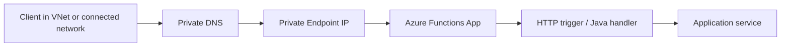
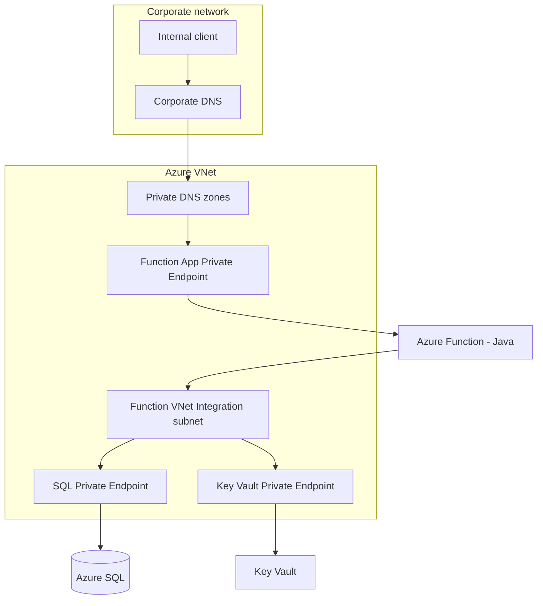

# Private connectivity and networking options for Azure Functions

## 1. Why does Azure Functions need dedicated network design?

Azure Functions typically runs in an Azure-managed environment, yet functions still need to communicate with other systems: internal APIs, Azure SQL, Storage, Key Vault, Service Bus, Event Hubs, Cosmos DB, or on-premises servers. Some systems only permit connections from private networks or approved subnets. Meanwhile, organizations may require that function endpoints not be reachable from the public Internet.

Network design must answer two independent questions:

- **Inbound:** how do clients, API gateways, internal systems, or users invoke the function?
- **Outbound:** how does the function connect to databases, storage, internal services, or the Internet?

A Function App may need both directions. For example, an internal API calls an HTTP trigger over a Private Endpoint; the function then accesses Azure SQL and Key Vault via private endpoints in the same VNet. A Function App Private Endpoint solves the inbound path; VNet Integration solves the outbound path. Neither feature automatically replaces the other.

In the CLOUD_SERVERLESS module, networking is part of designing triggers, access control, scaling, and reliability. A function can run fine on a developer laptop yet time out in Azure due to DNS, routes, NSGs, or firewalls. Verify network paths for the runtime, triggers, host storage, and deployment pipeline.

## 2. Distinguishing the core networking components

| Component | Traffic direction | Purpose | Creates a dedicated IP for the Function App? |
|---|---|---|---|
| Access restrictions | Inbound | Allow/deny by IP, service tag, or subnet | No |
| Service Endpoint | Inbound or outbound to supported Azure services | Binds access permissions to a selected subnet | Does not create a private IP for the Function App |
| Private Endpoint | Inbound to Function App or outbound to other services | Brings a service endpoint into a VNet with a private IP | Has a private IP on the Private Endpoint's NIC |
| VNet Integration | Outbound from Function App | Lets the function reach resources in a VNet, peered VNet, or hybrid network | No; this is an outbound integration |
| NAT Gateway | Outbound | Provides a stable public source IP for Internet-bound traffic from a subnet | No |
| VPN Gateway / ExpressRoute | Hybrid network connectivity | Connects a VNet to on-premises or other networks | No |
| App Service Environment (ASE) | Inbound and outbound in an isolated environment | Runs App Service/Functions in a dedicated VNet environment | Can use an internal load balancer and private IP addresses |

Two rules to remember:

1. VNet Integration does not create a private inbound endpoint for the Function App. It only routes outbound connections from the app.
2. A Function App's Private Endpoint does not automatically allow the function to call a private database. To reach that database, the function needs an outbound path such as VNet Integration and proper DNS.

## 3. Choose the hosting plan before choosing the network architecture

Networking capabilities vary by hosting plan. Never design around Private Endpoints or VNet Integration and then pick a plan afterward, as some plans do not support those features.

| Hosting option | Inbound access restrictions | Private Endpoint for Function App | Outbound VNet Integration | Notes |
|---|---:|---:|---:|---|
| Flex Consumption | Yes | Yes | Yes | Modern serverless option; supports virtual network triggers |
| Consumption (legacy) | Yes | No | No | Older plan; unsuitable if private networking or network-locked storage is required |
| Elastic Premium | Yes | Yes | Yes | Suitable when VNet, prewarmed instances, and finer scale control are needed |
| Dedicated / App Service plan | Yes | Yes | Yes | Used when App Service resources, scaling config, or existing integrations are needed |
| App Service Environment | Yes, per environment config | Includes ASE network isolation options | Yes | Suitable for deep isolation and dedicated private addressing |
| Azure Container Apps hosting | Per ingress and Container Apps environment | No direct Function App Private Endpoint under Functions plan model | Managed by Container Apps environment | Follow Container Apps networking documentation |

Microsoft currently treats Consumption as a legacy hosting plan and recommends Flex Consumption for new serverless Function Apps. Legacy Consumption does not support Private Endpoints or outbound VNet Integration. If an application must use network-restricted storage, reach private endpoints, or use virtual network triggers, choose Flex Consumption, Elastic Premium, or another suitable plan.

Flex Consumption supports Private Endpoints and VNet Integration. With Flex, VNet Integration uses a subnet in the same region delegated to `Microsoft.App/environments`. With Elastic Premium and Dedicated (App Service), the VNet Integration subnet uses delegation `Microsoft.Web/serverFarms`. Subnet sizes also differ; see the subnet section below before creating networks.

## 4. Controlling inbound traffic with Access Restrictions

Access restrictions are a prioritized list of rules that allow or deny requests to the Function App endpoint. Rules can be based on:

- IPv4 or IPv6 addresses.
- CIDR ranges for offices, VPNs, or NAT Gateways.
- Azure service tags.
- Virtual Network subnets using a Service Endpoint.

When one or more rules exist, an implicit deny sits at the bottom of the list. This means only explicitly allowed sources can access the app; verify rule priority order so you do not accidentally block health probes or deployment systems.

Access restrictions fit when you want to keep the public hostname while allowing only specific addresses or subnets. For example, a public webhook might accept requests only from a partner's IP range. However, the endpoint remains a public endpoint; access restrictions merely filter traffic sources.

For VNet rules, Azure uses the `Microsoft.Web` Service Endpoint on the subnet to identify traffic originating from the selected subnet. A Service Endpoint does not assign a private IP to the Function App and does not replace Private Link. It is a way to restrict sources reaching the public App Service/Functions endpoint by subnet.

Inbound Service Endpoints for Function Apps also depend on the hosting plan: Flex Consumption, Elastic Premium, and Dedicated support them; legacy Consumption does not. If using legacy Consumption, use only the access restrictions supported by that plan, such as IP rules, or migrate to a plan with the needed networking features.

Access restrictions do not replace application-level authentication or authorization. A request coming from an allowed subnet must still carry a valid identity, token, or access key and pass permission checks inside the function.

## 5. Private Endpoint for an HTTP Function App

Azure Private Endpoint creates a network interface in a VNet subnet and assigns a private IP address. Clients inside the VNet can call the Function App via this private address while continuing to use the app's standard HTTPS hostname.

A Function App Private Endpoint uses the `sites` subresource of `Microsoft.Web/sites`. Private Endpoints are supported on Flex Consumption, Elastic Premium, and Dedicated (App Service); they are not supported on the legacy Consumption plan.

### Request flow



Clients still call the standard hostname, e.g., `https://orders-func.azurewebsites.net/api/orders`. DNS inside the private network resolves that hostname to the Private Endpoint's private IP. TLS still uses the app's hostname; do not call the private IP directly in the URL.

### Private Endpoint does not automatically disable the public endpoint

Creating a Private Endpoint does not automatically turn off public access. If the requirement is private-only access, set `Public network access` to `Disabled` after verifying the private path works. If both selected public clients and private clients are needed, keep public access enabled and configure appropriate Access Restrictions.

Before disabling public access, verify:

- Clients in the VNet or hybrid network resolve the hostname to the private IP.
- NSGs, routes, and firewalls permit TCP 443.
- The DNS zone is linked to every VNet that needs access.
- Deployment pipelines and the SCM/Kudu endpoint have a private access path.
- Health checks, API gateways, webhooks, or external systems have switched to the new network path.

## 6. DNS for Azure Functions Private Endpoints

DNS is the most common source of failure when deploying Private Endpoints. A Function App retains a public hostname of the form `app-name.azurewebsites.net`; DNS must direct private-network clients to the Private Endpoint address.

In the Azure public cloud, the standard private DNS zone for App Service and Azure Functions is:

```text
privatelink.azurewebsites.net
```

The Private DNS zone typically contains two A records:

| Record name | Value | Used for |
|---|---|---|
| `orders-func` | Private Endpoint's private IP | Function App endpoint |
| `orders-func.scm` | Same Private Endpoint's private IP | SCM/Kudu deployment endpoint |

The corresponding full names are `orders-func.privatelink.azurewebsites.net` and `orders-func.scm.privatelink.azurewebsites.net`. When using a Private DNS Zone Group with the recommended zone, Azure can manage these records automatically.

### DNS steps

1. Create the Private Endpoint in a subnet dedicated to Private Endpoints.
2. Create or select the `privatelink.azurewebsites.net` Private DNS zone.
3. Link the zone to the VNets containing clients that need access.
4. Create a DNS Zone Group on the Private Endpoint to associate the zone.
5. Verify both the app hostname and the SCM hostname resolve to the private IP.
6. If using custom DNS servers, configure forwarding to Azure DNS Private Resolver or an appropriate forwarder to query the private zone.

If clients are on-premises, the on-premises DNS server must also be able to resolve the private zone. You can use Azure DNS Private Resolver with VPN or ExpressRoute to forward DNS queries from on-premises into Azure. Linking a private DNS zone to a VNet alone is insufficient if the client's DNS resolver cannot query that zone.

DNS resolution and access permissions are two independent concerns. A hostname resolving successfully does not prove the client has a route, firewall rule, or application permission to connect. Conversely, if DNS returns a public IP instead of a private IP, requests may take the wrong path even though the Private Endpoint was created properly.

## 7. SCM/Kudu and deployment when a Function App uses a Private Endpoint

A Function App has a dedicated SCM endpoint used for Kudu, deployment APIs, Zip Deploy, and certain deployment operations. When using a Private Endpoint, never test only the app hostname and assume deployment will work.

The SCM hostname takes the form:

```text
orders-func.scm.azurewebsites.net
```

Private DNS must include the SCM record pointing to the Private Endpoint. Deployment agents (Azure DevOps self-hosted agents, GitHub Actions self-hosted runners, or internal deploy machines) must sit inside the VNet or have a route over VPN/ExpressRoute to the Private Endpoint subnet. Public hosted agents may fail to reach SCM once public access is disabled.

The Portal can still manage the resource, but features that call directly into the network-restricted app—such as Code + Test or Kudu—require a client with a valid network path. Separate Azure Resource Manager control-plane permissions from data-plane access to the Function App.

## 8. Outbound VNet Integration

VNet Integration enables outbound traffic from a Function App to reach resources inside a VNet. Common targets include:

- Private Endpoints for Azure SQL, Storage, Key Vault, Service Bus, Event Hubs, or Cosmos DB.
- Servers in another subnet or a peered VNet.
- On-premises networks via VPN Gateway or ExpressRoute.
- Central firewalls or gateways via User Defined Routes (UDRs).

VNet Integration does not place the Function App into the subnet like a VM with a static NIC. The platform manages execution infrastructure and uses a dedicated subnet for outbound paths. This is why inbound NSG rules on the Integration subnet do not filter incoming requests to the Function App; inbound traffic must be controlled via Access Restrictions or Private Endpoints.

### Regional VNet Integration

Regional VNet Integration is the recommended approach. The Function App and VNet must reside in the same region. That VNet can connect to other VNets via peering, ExpressRoute, or VPN if routes and DNS are configured correctly.

The Integration subnet must be dedicated solely to this purpose and delegated according to the hosting plan. Do not share that subnet with Private Endpoint NICs or other workloads. Private Endpoints should reside in a separate subnet.

### Route All

With Elastic Premium and Dedicated/App Service, VNet Integration enables reaching private resources inside the VNet. Traffic to private addresses is typically routed through the VNet; traffic to public IPs may still exit via App Service's default outbound path unless Route All is enabled.

When Route All is enabled, all outbound traffic enters the VNet and becomes subject to NSGs, UDRs, firewalls, and NAT Gateways configured along the path. This is useful when an organization needs to govern all egress or send Internet traffic through a centralized firewall.

With Flex Consumption, outbound traffic is already routed through VNet Integration; Route All does not need to be toggled in the same manner as Premium/Dedicated. Follow plan-specific guidance to avoid misconfigured routing.

### NSGs and UDRs

- NSGs on the Integration subnet can control outbound traffic from the app.
- Inbound rules on the Integration subnet's NSG do not govern requests arriving at the Function App.
- UDRs can steer traffic to a firewall, NVA, or VPN/ExpressRoute gateway.
- When routing to on-premises, the external network must have a corresponding return route.
- With Route All, public traffic is also governed by routes and NSGs; ensure DNS, HTTPS, and required dependencies are permitted.

## 9. Subnet sizing and delegation

The subnet needs enough IP addresses for instances and scaling operations. Azure reserves the first five addresses in every subnet. With Elastic Premium and Dedicated, each running instance typically consumes one IP from the Integration subnet; during scale-up/scale-down, demand can temporarily nearly double to accommodate transitions.

| Hosting plan | Minimum Integration subnet | Common recommendation | Delegation |
|---|---:|---:|---|
| Flex Consumption | `/27` | `/27` for one app, `/26` for multiple apps | `Microsoft.App/environments` |
| Elastic Premium Windows | `/28` | `/24` | `Microsoft.Web/serverFarms` |
| Elastic Premium Linux | `/28` | `/26` | `Microsoft.Web/serverFarms` |
| Dedicated / App Service | `/28` | `/26` or larger | `Microsoft.Web/serverFarms` |
| Consumption legacy | Not supported | N/A | N/A |

For Flex Consumption, a `/27` subnet is recommended for a single Function App; `/26` is better when multiple apps share it or extra outbound network capacity is needed. Flex uses shared gateways attached to the subnet; an undersized subnet or heavy I/O workload can increase network latency/timeouts even while function scale-out continues working.

With Premium/Dedicated, do not size IPs solely for steady-state instance counts. Account for other apps in the same plan, apps sharing the subnet, and temporary scale-out IPs. You cannot arbitrarily resize a subnet once bound to certain integration configs; plan CIDR ranges upfront.

## 10. Connecting to Azure services using Private Endpoints or Service Endpoints

### Private Endpoint to a target service

Example of a Function App calling Azure SQL over a private endpoint:

1. Create a Private Endpoint for Azure SQL in the VNet.
2. Configure Azure SQL's private DNS zone and link it to the VNet.
3. Enable VNet Integration on the Function App.
4. Allow outbound TCP 1433 on NSG/firewall if needed.
5. Use the standard SQL hostname in the connection string; VNet DNS resolves it to the private IP.
6. Authenticate using Microsoft Entra ID/managed identity or a securely managed credential mechanism.

The function should not hardcode the private IP. The IP can change if the endpoint is recreated; use the hostname so DNS and TLS work properly.

### Service Endpoint to an Azure service

A Service Endpoint lets an Azure service recognize traffic from a selected subnet and enforce subnet-based firewall/network rules. When a Function App needs to call a service protected by a Service Endpoint, the app still requires VNet Integration so its outbound traffic exits through the subnet with the Service Endpoint.

Service Endpoints are often simpler than Private Endpoints, but do not assign a private IP to the service. If the requirement is connecting over a private IP and restricting public network paths, choose Private Endpoint.

## 11. Securing Function App storage and host dependencies

Every Function App needs a Storage Account to operate. `AzureWebJobsStorage` is used by the host for state, locks, coordination, and runtime functions. Some triggers/bindings also use Storage for checkpoints, queues, or auxiliary data. If the Storage Account is network-locked and the Function App lacks a path to it, the function may fail to start, fail to scale, or triggers may stop firing.

When securing storage with a firewall, Service Endpoint, or Private Endpoint:

- Choose a hosting plan supporting the needed networking. Legacy Consumption does not support VNet Integration and cannot use a storage account network-secured in this way.
- Ensure the Function App has an outbound route to all needed subresources: Blob, Queue, Table, and File depending on plan/features.
- Create corresponding private DNS zones, such as `privatelink.blob.core.windows.net`, `privatelink.queue.core.windows.net`, `privatelink.table.core.windows.net`, and `privatelink.file.core.windows.net` when using those endpoints.
- Use managed identity for `AzureWebJobsStorage` if supported by features and extensions/runtime; grant appropriate data-plane roles.
- If the plan uses an Azure Files content share, verify content share routing configuration separately. On some Premium setups, `vnetContentShareEnabled` must be enabled and apps/slots sharing storage must align consistently.
- Test deployment, startup, scale-out, and triggers after disabling storage public network access.

Never assume a function only needs connectivity to its business database. Host storage is a platform dependency and must be designed into the network alongside the application.

## 12. Virtual network triggers (non-HTTP)

Some triggers require the runtime to read metadata or poll event sources inside a VNet, such as network-restricted Service Bus, Event Hubs, Cosmos DB, or Storage. The Function App needs a network path to the trigger source; otherwise, it may not receive events or scale on backlog.

Flex Consumption supports virtual network triggers natively, requiring no additional Runtime Scale Monitoring configuration to scale from supported private network sources.

Elastic Premium supports virtual network triggers. However, by default these triggers do not necessarily scale beyond prewarmed instances. Several extensions support dynamic scale monitoring; enable `functionsRuntimeScaleMonitoringEnabled` and use a supporting extension version. Not every trigger extension can dynamically scale an app when the source sits inside a VNet.

With an App Service plan or ASE, a function can receive triggers from a VNet-protected resource if the app is integrated into a VNet with access to the source. Verify scaling behavior separately, not just connectivity.

Before deploying private triggers, verify:

- The namespace/endpoint DNS hostname resolves to the right private IP.
- The Function App has VNet Integration and routes to the target subnet.
- NSGs/firewalls allow the exact trigger ports and protocols.
- Managed identity or connection settings have data-plane permissions.
- The runtime/extension supports the trigger type and desired scaling mode.
- Host storage remains reachable for the runtime to persist checkpoints and state.

## 13. Hybrid network connectivity: VPN, ExpressRoute, and Hybrid Connections

### VPN Gateway or ExpressRoute

VNet Integration can give functions access to on-premises networks via VPN Gateway or ExpressRoute. For reliable connectivity, configure:

- Routes from the Integration subnet to on-premises IP ranges.
- Return routes from on-premises back to the relevant Azure network ranges.
- DNS forwarding so functions resolve internal hostnames.
- Bidirectional firewalls opening only required ports.
- NSGs and UDRs not blocking traffic.
- Non-overlapping CIDRs between the VNet and on-premises networks.

If a function can reach VNet resources but cannot reach an on-premises server, check return routes and DNS before touching code.

### Hybrid Connections

Azure Relay Hybrid Connections provides an outbound connection path from an app to a specific TCP endpoint (host and port) in another network. It does not provide an inbound path for clients to call back into the Function App. In Azure Functions, Hybrid Connections supports Windows apps only; Linux is not supported.

Hybrid Connections can fit when you only need to reach a single TCP service without routing an entire subnet. If multiple internal systems, multiple ports, or broad network topologies are needed, VNet Integration paired with VPN/ExpressRoute is usually easier to manage.

## 14. Stable public outbound IP and NAT Gateway

Some partner systems only permit allowlisted source IPs. A Function App's default outbound IP may come from a pool of outbound IPs published in app properties and can change with configuration, scaling, or plan changes.

With plans supporting VNet Integration, outbound traffic can be routed through a NAT Gateway attached to the Integration subnet to use organization-managed static public IPs. With Premium/Dedicated, enable Route All to route public traffic into the VNet before NAT. Flex has a different VNet outbound routing model; follow plan-specific guidance and test to confirm the actual source IP.

If environment-level static inbound and outbound IPs are required, App Service Environment is a more isolated option. NAT Gateway only addresses outbound source IPs; it does not create a private inbound endpoint for the Function App.

Never treat the current outbound IP list as an immutable contract without an IP-pinning setup. When external dependencies rely on allowlists, plan to update and verify IPs after plan changes, scaling, or networking changes.

## 15. Reference architecture: private HTTP API and private database

Suppose a Java Azure Function receives order creation requests. Clients run inside the corporate network, and the Function App must call Azure SQL and retrieve secrets from Key Vault.



Components to configure:

1. Function App running on Flex Consumption or Elastic Premium to support Private Endpoint and VNet Integration.
2. A dedicated subnet for the Function App's Private Endpoint.
3. A dedicated Integration subnet, delegated appropriately for the plan.
4. Private DNS zone `privatelink.azurewebsites.net` for the Function App and SCM.
5. Corresponding Private DNS zones for SQL and Key Vault.
6. DNS forwarding from the corporate network via Azure DNS Private Resolver or DNS forwarders.
7. NSGs/UDRs permitting only required ports for clients and the function.
8. Public network access on the Function App, SQL, and Key Vault disabled or restricted as required.
9. Function uses managed identity to access Key Vault/SQL where supported by services.
10. Deployment agents have private connectivity to the SCM endpoint.

## 16. Example configuring VNet Integration via Azure CLI

The example below assumes the Function App and VNet already exist in the same region, and the Integration subnet is created and delegated properly for the hosting plan.

```bash
az functionapp vnet-integration add \
  --resource-group rg-app \
  --name orders-func \
  --vnet vnet-app \
  --subnet snet-functions-integration
```

Verify configuration:

```bash
az functionapp vnet-integration list \
  --resource-group rg-app \
  --name orders-func
```

The integration operation may restart the Function App. Execute it during an appropriate deployment window and test the function afterward.

## 17. Example creating a Private Endpoint and DNS via Azure CLI

The example below uses Azure public cloud, the `sites` subresource, and the `privatelink.azurewebsites.net` Private DNS zone. Create a dedicated subnet for Private Endpoints beforehand. Replace resource group, VNet, and app names for your environment.

```bash
FUNCTION_APP_ID=$(az functionapp show \
  --resource-group rg-app \
  --name orders-func \
  --query id \
  --output tsv)

az network private-endpoint create \
  --name pe-orders-func \
  --resource-group rg-network \
  --vnet-name vnet-app \
  --subnet snet-private-endpoints \
  --private-connection-resource-id "$FUNCTION_APP_ID" \
  --group-id sites \
  --connection-name pe-orders-func-connection

az network private-dns zone create \
  --resource-group rg-network \
  --name privatelink.azurewebsites.net

az network private-dns link vnet create \
  --resource-group rg-network \
  --zone-name privatelink.azurewebsites.net \
  --name link-vnet-app \
  --virtual-network vnet-app \
  --registration-enabled false

az network private-endpoint dns-zone-group create \
  --resource-group rg-network \
  --endpoint-name pe-orders-func \
  --name default \
  --private-dns-zone privatelink.azurewebsites.net \
  --zone-name sites
```

Once DNS records are created, verify from a machine inside the VNet or a hybrid network with configured DNS:

```bash
nslookup orders-func.azurewebsites.net
nslookup orders-func.scm.azurewebsites.net
```

Both hostnames must resolve through CNAME/A chains to the Private Endpoint's private IP on the internal network. If they return a public IP or fail to find a record, check zone links, DNS forwarders, and the `scm` record.

Do not disable public network access before confirming clients, deployment agents, and operations tools can connect over the private path. Once confirmed, disable public access in Networking settings or the corresponding ARM/Bicep configuration.

## 18. Java Function connecting to an internal service

Once VNet, routes, and DNS are correct, Java code should use the internal service's hostname rather than hardcoding private IPs. The example below uses `java.net.http.HttpClient` to call an internal API over a private endpoint:

```java
import java.net.URI;
import java.net.http.HttpClient;
import java.net.http.HttpRequest;
import java.net.http.HttpResponse;
import java.time.Duration;

public final class InternalCatalogClient {
    private final HttpClient httpClient;
    private final URI baseUri;

    public InternalCatalogClient(String baseUrl) {
        this.httpClient = HttpClient.newBuilder()
                .connectTimeout(Duration.ofSeconds(3))
                .build();
        this.baseUri = URI.create(baseUrl);
    }

    public String findProduct(String sku) throws Exception {
        HttpRequest request = HttpRequest.newBuilder()
                .uri(baseUri.resolve("/api/products/" + sku))
                .timeout(Duration.ofSeconds(5))
                .GET()
                .build();

        HttpResponse<String> response = httpClient.send(
                request,
                HttpResponse.BodyHandlers.ofString());

        if (response.statusCode() != 200) {
            throw new IllegalStateException(
                    "Catalog returned HTTP " + response.statusCode());
        }
        return response.body();
    }
}
```

In production, add authentication (such as Microsoft Entra ID/managed identity), validate the SKU before inserting it into the URL, handle categorized errors, and log a correlation ID. A Private Endpoint only establishes a private network path; it does not grant API call authorization. Never disable TLS or substitute a private IP for the hostname to bypass certificate errors.

If using Spring `WebClient`, `RestClient`, or the Azure SDK, the same principles apply: configure timeouts, authentication, and retries on the client; DNS/routes/NSGs are governed by the platform and VNet.

## 19. Network security and the principle of least privilege

Private networking is one layer of defense, not the entire security model. A function inside a VNet still needs authentication, authorization, and data validation.

- Disable public network access if the app is strictly internal.
- If a public endpoint is still needed, use Access Restrictions allowlists and authenticate callers.
- Use managed identity to access Azure resources, granting properly scoped data-plane roles.
- Open only necessary outbound ports; avoid granting a function access to an entire subnet.
- Use NSGs and UDRs to restrict egress, while verifying DNS and required platform endpoints.
- Encrypt connections with TLS; use private DNS while preserving standard hostnames.
- Never log connection strings, access tokens, secrets, or sensitive payloads.
- Separate Private Endpoint subnets, Integration subnets, and workload subnets by purpose.
- Track changes to DNS, NSGs, routes, firewalls, and access permissions via IaC/change management.

Avoid using `0.0.0.0/0` or opening all ports just to resolve a timeout. Pinpoint the exact hostname, destination IP, port, DNS server, and traffic direction being blocked.

## 20. Deploying and operating under network restrictions

When a Function App has private inbound or outbound integration, pipelines must be designed alongside the network architecture:

1. Self-hosted build/deployment agents need a network path to SCM/Kudu if deploying through that endpoint.
2. Agents must resolve the SCM hostname to the private IP and have a route to the Private Endpoint subnet.
3. When deploying via Azure Resource Manager, control-plane permissions do not automatically permit reaching the SCM endpoint.
4. Packages, container images, or extensions pulled from registries may require separate outbound routes.
5. Host storage, content shares, Key Vault, and monitoring endpoints must remain reachable per plan.
6. When changing DNS or private endpoints, verify both production and deployment slots if they carry separate network configs.
7. Test cold starts/scale-out because new instances can expose DNS, subnet capacity, or connection limit issues.

If the app uses deployment slots, check VNet Integration and Private Endpoint behavior per slot/plan. Never assume every slot shares identical network settings or SCM hostnames.

## 21. Troubleshooting DNS and connectivity errors

When a function fails to connect to a dependency, analyze in order from DNS up to the application:

### Step 1: Check DNS

- Does the hostname resolve?
- Is the result the expected private IP?
- Is the Private DNS zone linked to the right VNet?
- Does custom DNS forward queries to Azure DNS Private Resolver?
- Does the dedicated SCM record exist?
- Are there conflicting zones or stale A records?

### Step 2: Check routes and subnets

- Does the Function App have VNet Integration on the right subnet?
- Does the subnet have the right delegation and enough remaining IPs?
- Do VNet peering, VPN, or ExpressRoute have bidirectional routes?
- Do UDRs send traffic to a firewall/gateway?
- Is there a valid return route?

### Step 3: Check NSGs and firewalls

- Is the required outbound TCP port allowed?
- Does the firewall allow the target hostname/FQDN or IP?
- Is an NSG blocking DNS UDP/TCP 53 to the resolver?
- Is a network virtual appliance dropping traffic or lacking a return route?

### Step 4: Check the target service

- Is the Private Endpoint connection in Approved state?
- Do the target service's public network access or firewall match policy?
- Does the managed identity have data-plane permissions?
- Are the TLS certificate, hostname, and SNI valid?
- Is the database hitting connection limits or rejecting logins?

### Diagnostic tools

From the app's console (Kudu or portal console), use OS-appropriate tools to test DNS and TCP. On some Windows App Service environments, `nameresolver.exe` tests DNS and `tcpping.exe` tests TCP connectivity to a hostname/port. On Linux/containers, use built-in tools like `nslookup`, `getent hosts`, `curl`, or `nc` if installed in the image.

Example checks from a Linux environment:

```bash
getent hosts sql-prod.database.windows.net
nc -vz sql-prod.database.windows.net 1433
curl -I --connect-timeout 3 https://orders-func.azurewebsites.net/health
```

Run checks from the exact network location. Testing from a personal laptop does not prove the function runtime shares the same DNS, routes, or NSGs. For Private Endpoints, run tests from a VM or agent inside the corresponding VNet/hybrid path.

Common causes:

| Symptom | Possible cause | Investigation steps |
|---|---|---|
| DNS returns public IP | Private DNS zone unlinked or custom DNS not forwarding | Check A records, zone links, and resolver |
| DNS timeout | NSG/firewall blocking DNS or resolver error | Check UDP/TCP 53 and VNet DNS servers |
| TCP timeout | Blocked by NSG, UDR, or firewall | Check routes, egress rules, and firewall logs |
| Private endpoint connection refused | Endpoint not Approved or service not listening | Check PE status and target port |
| Fails only on scale-out | Subnet out of IPs, network capacity, or connection pool exhausted | Check subnet size, instance count, and connection metrics |
| App reaches SQL but not Key Vault | Missing private DNS zone/role or different endpoint | Check DNS zone, routes, and managed identity |
| Deploy fails after disabling public access | Agent cannot reach SCM or missing SCM DNS | Run agent inside VNet and check `app.scm.azurewebsites.net` |
| Trigger receives no events | Runtime cannot reach source or unsupported scale monitor | Check VNet triggers, extension, and runtime scale monitoring |

## 22. Workflow for choosing a network architecture

When starting a new Function App, follow this sequence:

1. **List traffic flows:** who calls the function, what services the function calls, and where trigger sources live.
2. **Mark public/private:** decide which endpoints are Internet-reachable and which are internal-only.
3. **Choose hosting plan:** ensure the plan supports Private Endpoints, VNet Integration, private storage, and required triggers.
4. **Design VNet/subnets:** separate Integration, Private Endpoint, and workload subnets; pick CIDRs with enough IPs for scaling.
5. **Design DNS:** create private zones, link VNets, configure custom DNS/hybrid forwarding, and SCM records.
6. **Design routes and policies:** NSGs, UDRs, firewalls, NAT Gateways, VPN/ExpressRoute, and return routes.
7. **Secure host storage:** check `AzureWebJobsStorage`, Azure Files content shares, and trigger storage.
8. **Assign identities:** managed identity, RBAC, and data-plane roles for each service.
9. **Configure inbound:** Private Endpoints or Access Restrictions; disable public network access after verifying the private path.
10. **Configure outbound:** VNet Integration, Route All if needed, and dependency access permissions.
11. **Configure deployment:** ensure agents can reach SCM, package registries, and control plane.
12. **Test end-to-end:** DNS, TCP, TLS, auth, triggers, scale-out, cold starts, and failover.
13. **Monitor:** connection logs, DNS failures, timeouts, dependency latency, subnet capacity, and trigger lag.

## 23. Pre-production checklist

- [ ] Inbound and outbound networking clearly separated.
- [ ] Hosting plan supports required networking features; not using legacy Consumption if VNet/Private Endpoint is needed.
- [ ] Function App Private Endpoint uses the `sites` subresource and connection status is Approved.
- [ ] Public network access enabled/disabled per requirements and actual access paths verified.
- [ ] Private DNS zone `privatelink.azurewebsites.net` linked to required VNets.
- [ ] DNS contains records for app and SCM; deployment agents can reach SCM.
- [ ] VNet Integration uses a dedicated subnet in the right region with proper delegation and enough IPs.
- [ ] Private Endpoint subnet is separate from the Integration subnet.
- [ ] Route All configured appropriately for the hosting plan; not applied mechanically across Flex vs. Premium/Dedicated.
- [ ] NSGs, UDRs, firewalls, and return routes permit exact required traffic.
- [ ] Private endpoints for SQL, Storage, Key Vault, or Service Bus have matching DNS zones and routes.
- [ ] `AzureWebJobsStorage` and content shares have valid network paths.
- [ ] Virtual network triggers work and scaling behavior is verified for the extension/plan.
- [ ] Managed identity has least-privilege data-plane permissions; Private Endpoint is not treated as access authorization.
- [ ] NAT Gateway or ASE used where stable IP requirements exist.
- [ ] Tested from the exact VNet/hybrid path, including DNS, TCP, TLS, and authentication.
- [ ] Tested deployment, scale-out, cold starts, and dependency failures.
- [ ] Dashboards/alerts exist for DNS failures, timeouts, connection counts, and trigger lag.

## 24. Microsoft Learn references

- [Azure Functions networking options](https://learn.microsoft.com/azure/azure-functions/functions-networking-options)
- [Azure Functions hosting options and scale](https://learn.microsoft.com/azure/azure-functions/functions-scale)
- [Frequently asked questions about networking in Azure Functions](https://learn.microsoft.com/azure/azure-functions/functions-networking-faq)
- [Use private endpoints to integrate Azure Functions with a virtual network](https://learn.microsoft.com/azure/azure-functions/functions-create-vnet)
- [Azure Private Endpoint DNS configuration](https://learn.microsoft.com/azure/private-link/private-endpoint-dns)
- [Storage considerations for Azure Functions](https://learn.microsoft.com/azure/azure-functions/storage-considerations)
- [Control Azure Functions outbound IP with a NAT Gateway](https://learn.microsoft.com/azure/azure-functions/functions-how-to-use-nat-gateway)
- [Azure CLI: Function App VNet Integration](https://learn.microsoft.com/cli/azure/functionapp/vnet-integration)

## Conclusion

Network design for Azure Functions starts by separating inbound from outbound traffic. Access Restrictions filter sources reaching the public endpoint; Service Endpoints bind services to subnets; Private Endpoints bring endpoints into a VNet with private IPs; VNet Integration provides an outbound path for functions. The hosting plan dictates which features are available, while DNS, routes, NSGs, storage, and deployment agents determine whether connectivity actually works in practice. When you choose the right plan, size subnets appropriately, configure private DNS, and verify both triggers and host storage, Java Functions can access internal services securely while retaining serverless scalability.
