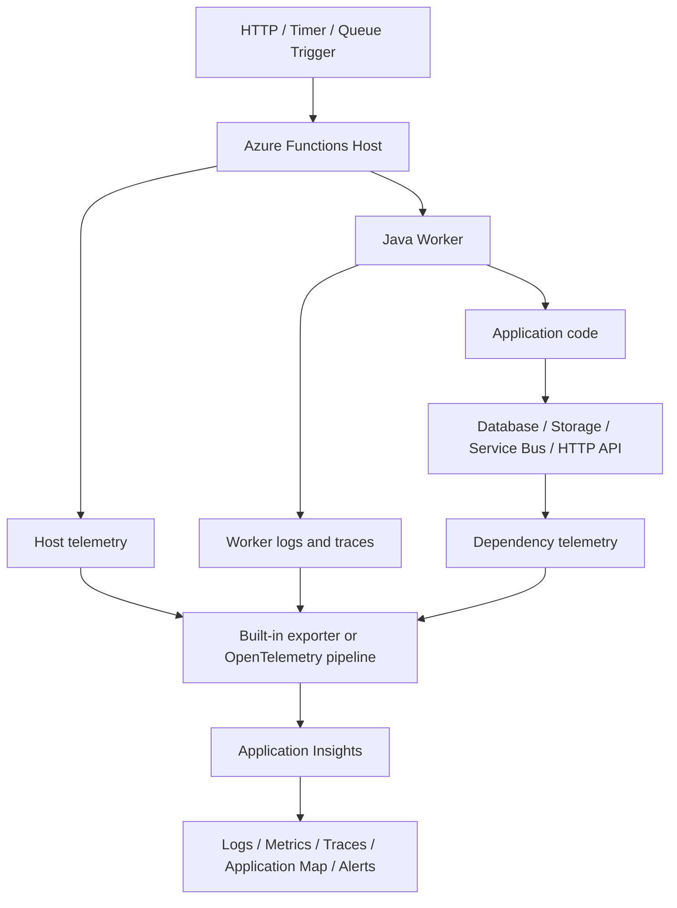

# Observability and diagnostics with Application Insights

Azure Functions can generate thousands of invocations per minute, run across multiple workers, and call services such as Storage, Service Bus, databases, or HTTP APIs. When a function is slow or fails, reading a single isolated log line is usually insufficient to find the root cause. You need to correlate requests, invocations, logs, exceptions, and dependencies across the same execution flow.

**Application Insights** is the Application Performance Monitoring (APM) service within Azure Monitor. It collects telemetry from the Functions host and function code, stores data for querying, renders charts, tracks dependencies, and raises alerts. For new Java applications, Microsoft recommends OpenTelemetry with the Azure Monitor exporter for open-standard telemetry and the ability to export to other OTLP endpoints.

## 1. What does observing a Function App involve?

Observability answers three core questions:

- **Metrics:** How healthy is the system? For example, invocation counts, failure rates, processing duration, concurrency, and queue age.
- **Logs:** What happened inside an invocation? For example, starting order processing, authentication failure, or a dependent service returning an error.
- **Traces:** Which functions and dependencies did a request traverse? Which step consumed the most time or failed?

Azure Functions emits telemetry from at least two processes: the Functions host managing triggers and invocations, and the language worker running the application's Java code. Application Insights can collect data from both processes and correlate records by invocation and operation.



For example, an HTTP function receives an order creation request, writes to a database, and publishes a message to Service Bus. If the request takes 4 seconds, traces can show 100 ms in the function, 3.5 seconds in the database, and 400 ms in Service Bus. That breakdown pinpoints which dependency caused the slowdown instead of blindly raising the function timeout.

## 2. Connecting a Function App to Application Insights

When creating a Function App via the Azure Portal, Azure CLI, Azure Functions Core Tools, or developer tooling, Application Insights is often enabled and linked automatically. If the app lacks a connection setting, create or select an Application Insights resource and add the application setting:

```text
APPLICATIONINSIGHTS_CONNECTION_STRING=<connection-string>
```

The connection string identifies the resource receiving telemetry. Retrieve this value from the Application Insights Overview page in the Azure Portal and store it as an application setting or securely managed configuration. Never place connection strings in source code, logs, or files committed to Git.

`APPINSIGHTS_INSTRUMENTATIONKEY` is the legacy setting. For new deployments, prefer `APPLICATIONINSIGHTS_CONNECTION_STRING`; some specialized cloud environments require connection strings. Avoid configuring both values without a specific compatibility reason.

After configuring, trigger a few test invocations and open Application Insights to confirm telemetry arrives. Data typically does not appear instantaneously because telemetry clients batch data before sending. Live Metrics can display near-real-time telemetry.

## 3. Choosing how to export telemetry for Java Functions

There are two main approaches for sending telemetry from Azure Functions:

1. **Built-in Application Insights integration:** The Functions host collects default telemetry, including invocations, exceptions, host and worker-forwarded logs, and certain dependencies. This is a straightforward starting point for basic monitoring.
2. **OpenTelemetry with the Azure Monitor exporter:** standardizes logs, traces, and metrics under OpenTelemetry, supports correlation between host and worker, and can export to Application Insights or compatible OTLP endpoints.

Microsoft recommends OpenTelemetry for new applications and existing apps needing expanded telemetry. Classic Application Insights SDKs used for manual custom telemetry are in legacy status and no longer receive new features; plan a migration to OpenTelemetry.

### 3.1. Enabling OpenTelemetry on the Functions host

Add `telemetryMode` to `host.json`:

```json
{
  "version": "2.0",
  "telemetryMode": "OpenTelemetry"
}
```

Add the following application settings to the Function App:

```text
APPLICATIONINSIGHTS_CONNECTION_STRING=<connection-string>
JAVA_APPLICATIONINSIGHTS_ENABLE_TELEMETRY=true
```

`APPLICATIONINSIGHTS_CONNECTION_STRING` routes host telemetry to Application Insights. `JAVA_APPLICATIONINSIGHTS_ENABLE_TELEMETRY=true` enables the Java worker to emit OpenTelemetry logs directly via the Azure Functions-supported mechanism, preventing the host from re-emitting worker records at the host layer and creating duplicates.

OpenTelemetry must be enabled on both the host and the worker for stronger correlation between runtime telemetry and application code. The Java worker auto-detects Functions invocation middleware; follow Microsoft's current Java guidance for dependencies and exporters matching your runtime.

When `telemetryMode: OpenTelemetry` is enabled, the `logging.applicationInsights` section in `host.json` no longer governs the OpenTelemetry pipeline. The Azure Portal also does not support certain experiences like log streaming and Recent function invocation traces in all scenarios; queries and dashboards in Application Insights remain the primary way to analyze exported telemetry.

### 3.2. Logging in Java code

In Java Functions, `ExecutionContext` provides a logger. Example:

```java
import com.microsoft.azure.functions.ExecutionContext;
import com.microsoft.azure.functions.annotation.FunctionName;
import com.microsoft.azure.functions.annotation.QueueTrigger;

public class OrderFunctions {

    @FunctionName("processOrder")
    public void processOrder(
            @QueueTrigger(
                    name = "message",
                    queueName = "orders",
                    connection = "StorageConnection")
            String orderId,
            ExecutionContext context) {

        String invocationId = context.getInvocationId();
        context.getLogger().info(
                "Processing orderId=" + orderId
                + ", invocationId=" + invocationId);

        // Call the application service to execute business logic.
        context.getLogger().info(
                "Order processing completed, invocationId=" + invocationId);
    }
}
```

This example demonstrates logging and attaching the invocation ID. In production systems, log only permitted non-sensitive identifiers; if `orderId` can expose customer data, consider using a reference code or correlation ID. Never log full message bodies, access tokens, connection strings, payment details, or personal data.

Choose log levels intentionally:

| Log level | When to use | Example |
|---|---|---|
| `Trace` | Very deep diagnostic detail in test environments | Non-sensitive intermediate values |
| `Debug` | Developer troubleshooting details | Execution branch or mapping decisions |
| `Information` | Key business milestones | Processing start/finish, successful outcomes |
| `Warning` | Abnormal condition where flow can still continue | Retries, message moved to poison queue |
| `Error` | An operation failed | Failed data write, dependency timeout |
| `Critical` | Severe outage requiring intervention | Core component unable to continue |

Do not enable `Trace` globally in production. Overly verbose logging increases ingestion costs and heightens data exposure risks. Use structured logs and stable identifier fields for querying rather than concatenating entire payloads into one string.

## 4. Understanding telemetry types and tables

Application Insights stores different telemetry types in separate tables. In the Application Insights Logs view, commonly used tables include:

| Table | Contents | Questions it answers |
|---|---|---|
| `requests` | One record per function invocation | Which functions run frequently, slowly, or fail? |
| `traces` | Logs from the Functions host, scale controller, and function code | What was logged during an invocation? |
| `exceptions` | Exceptions recorded by the runtime or application code | Which error types occur most often? |
| `dependencies` | HTTP, SQL, and automatically tracked service calls | Which external service is the function waiting on? |
| `customMetrics` | Aggregated metrics such as invocation count, success rate, and duration | How are performance trends changing? |
| `customEvents` | Event telemetry emitted by runtime or application | Did a specific business milestone occur? |

Certain Functions-specific fields live in `customDimensions`, such as `InvocationId`, `Category`, and `LogLevel`. `operation_Id` correlates telemetry from multiple components within the same logical operation. Table names may differ when querying directly in a Log Analytics workspace using the newer Azure Monitor schema; select the schema matching the query interface you are using.

### 4.1. Viewing invocations and failures

In the Azure Portal, open the Function App and select Application Insights or Monitor. The invocations view displays recent runs, success/failure status, and associated logs. Select an invocation to inspect its logs; from there you can open the corresponding query in Application Insights Logs.

Useful blades in Application Insights:

- **Failures:** inspect failure rates, exceptions, and failed operations.
- **Performance:** compare execution durations, throughput, and instances.
- **Metrics:** build charts and alerts for invocation count, execution time, and success rate.
- **Live Metrics:** observe near-real-time telemetry during testing or incident response.
- **Application Map:** visualize components and dependencies observed in the execution flow.

Live Metrics is valuable when you need immediate visibility during load spikes. Logs queries suit historical investigation, time-based comparisons, and identifying recurring error patterns.

## 5. Querying telemetry with KQL

Kusto Query Language (KQL) lets you filter, group, and aggregate telemetry. The queries below use table names from Application Insights Logs.

### 5.1. Failure rate and latency by function

```kusto
requests
| where timestamp > ago(1h)
| summarize
    invocations = count(),
    failures = countif(success == false),
    p95Duration = percentile(duration, 95)
  by name
| extend failureRate = round(100.0 * failures / invocations, 2)
| order by failures desc
```

This query shows invocation count, failure count, failure rate, and p95 duration per function name. A high p95 typically indicates the slowest 5% of invocations significantly lag behind most requests—a signal to investigate dependencies or cold starts.

### 5.2. Finding common exceptions

```kusto
exceptions
| where timestamp > ago(24h)
| summarize occurrences = count() by type, outerMessage
| order by occurrences desc
| take 20
```

Grouping by `type` and `outerMessage` surfaces recurring errors. Never place raw exception messages containing sensitive data into logs; sanitize errors and keep sensitive details restricted to authorized stores.

### 5.3. Viewing logs for a single invocation

```kusto
traces
| where timestamp > ago(1h)
| extend invocationId = tostring(customDimensions["InvocationId"])
| where invocationId == "<INVOCATION_ID>"
| project timestamp, severityLevel, message, customDimensions
| order by timestamp asc
```

Replace `<INVOCATION_ID>` with the invocation ID under investigation. Logs sharing the same ID reconstruct the chronological sequence of events within a single function run.

### 5.4. Correlating multiple functions in one operation

```kusto
traces
| where timestamp > ago(1h)
| where operation_Id == "<OPERATION_ID>"
| project timestamp, operation_Id,
          invocationId = tostring(customDimensions["InvocationId"]),
          message
| order by timestamp asc
```

An operation may traverse an API function, a queue-triggered function, and a dependency. Use `operation_Id` to find logs sharing the same trace context. When manually publishing messages or calling HTTP services, propagate W3C trace context (`traceparent` and `tracestate` where appropriate) so downstream systems can continue the trace.

### 5.5. Finding slow or failing dependencies

```kusto
dependencies
| where timestamp > ago(1h)
| summarize
    calls = count(),
    failures = countif(success == false),
    p95Duration = percentile(duration, 95)
  by target, name
| order by p95Duration desc
```

This query identifies which service or dependency exhibits high latency. If a dependency is not automatically instrumented, add appropriate OpenTelemetry instrumentation or log call durations with a correlation ID. Never enable SQL command text collection without evaluating data exposure risks and security requirements.

## 6. Configuring log levels and sampling in host.json

The Functions host can emit substantial telemetry under load. `host.json` allows controlling log levels by category and sampling to balance diagnostic visibility against storage costs.

Example built-in Application Insights integration configuration:

```json
{
  "version": "2.0",
  "logging": {
    "logLevel": {
      "default": "Warning",
      "Host.Aggregator": "Information",
      "Host.Results": "Information",
      "Function": "Information"
    },
    "applicationInsights": {
      "samplingSettings": {
        "isEnabled": true,
        "maxTelemetryItemsPerSecond": 20,
        "excludedTypes": "Request;Exception"
      }
    }
  }
}
```

In this example:

- `default: Warning` limits logs from unspecified categories.
- `Host.Results: Information` preserves invocation result telemetry.
- `Function: Information` preserves runtime logs needed for functions.
- Sampling caps the telemetry volume retained during high load.
- `excludedTypes` exempts requests and exceptions from sampling in this illustrative config.

Do not arbitrarily set `Host.Results` or `Function` to `Warning` or higher. These categories can govern invocation records, dependencies, and aggregated metrics; overly aggressive filtering can drop success data or cause Function Monitor and Application Insights to show incomplete data. `Host.Aggregator` also needs an appropriate level to preserve aggregated metrics.

Sampling intentionally drops a portion of telemetry. If queries show only a fraction of requests or traces, check `itemCount` and sampling settings before concluding a function stopped logging. When using manually instrumented SDKs or exporters, align sampling policies to avoid skewed statistics or broken correlation.

Note: the `logging.applicationInsights` configuration above applies to built-in integration. When `telemetryMode` is set to `OpenTelemetry`, this configuration does not control the OpenTelemetry pipeline; configure sampling and exporters per corresponding OpenTelemetry guidance.

## 7. Diagnosing common issues

### 7.1. Missing logs or invocations

Check in order:

1. Does the Function App have a valid `APPLICATIONINSIGHTS_CONNECTION_STRING`?
2. Is the Application Insights resource in the expected subscription, workspace, and region?
3. Does `host.json` set log levels too high, filtering out `Host.Results`, `Function`, or `Host.Aggregator`?
4. Is sampling dropping the telemetry you are looking for?
5. Does the Function App have outbound network access and permissions to send telemetry to Azure Monitor? With VNets/firewalls, check outbound HTTPS 443 and required Azure Monitor endpoints.
6. Was a daily cap or ingestion limit hit, halting ingestion of new telemetry?
7. Are you inspecting the right resource, time range, timezone, and table?

Telemetry can take a few minutes to appear in standard queries. Use Live Metrics to distinguish data not being sent from data being sent but filtered out by a query.

### 7.2. Invocation failed without a clear exception

Open the record in `requests`, find `operation_Id` and `InvocationId`, then query `traces` and `exceptions`. Inspect logs from both the Functions host and the Java worker. If a handler catches an exception, logs a warning, and returns normally, the runtime may treat the invocation as successful; define clearly which errors must be thrown for trigger retry handling and which are expected business outcomes.

### 7.3. Slow function

Compare p50/p95/p99 durations by function and by instance. Open the dependency timeline to see time spent in databases, Storage, Service Bus, or HTTP APIs. If initialization time increases, check cold starts, JVM startup, class loading, and dependency initialization. If only one instance is slow, check resources, networking, or that specific worker's state.

Avoid blindly increasing memory or timeouts without measuring. For batch functions, inspect batch size, per-record processing time, and concurrency. For HTTP functions, separate time inside the function from gateway and client time.

### 7.4. Unexplained scale-out or scale-in

The Azure Functions scale controller decides worker counts based on triggers and load conditions. You can enable scale controller logs to investigate why instance counts changed. This feature is in preview; enable it only for the collection window needed, as verbose logs increase costs.

Example enabling verbose logs to Application Insights:

```bash
az functionapp config appsettings set \
  --name <FUNCTION_APP_NAME> \
  --resource-group <RESOURCE_GROUP_NAME> \
  --settings SCALE_CONTROLLER_LOGGING_ENABLED=AppInsights:Verbose
```

Once sufficient data is collected, disable logging to avoid unnecessary telemetry:

```bash
az functionapp config appsettings set \
  --name <FUNCTION_APP_NAME> \
  --resource-group <RESOURCE_GROUP_NAME> \
  --settings SCALE_CONTROLLER_LOGGING_ENABLED=AppInsights:None
```

Scale controller logs typically appear in `traces` with category `ScaleControllerLogs`. You can query:

```kusto
traces
| extend dimensions = todynamic(tostring(customDimensions))
| where tostring(dimensions.Category) == "ScaleControllerLogs"
| project timestamp, message, dimensions
| order by timestamp desc
```

Do not confuse scale controller logs with business logs from the Java function. They explain scaling decisions at the host/trigger layer.

## 8. Alerting and proactive operations

Dashboards show current state; alerts detect issues before users report failures. Base alerts on SLOs and business behavior rather than alerting on every single exception.

Useful signals include:

| Signal | Alert suggestion | Meaning |
|---|---|---|
| Failure rate | Invocation failure rate exceeds threshold over a time window | Function may be hitting system or dependency errors |
| p95/p99 duration | Latency exceeds SLO across consecutive windows | Users or consumers may be experiencing slowdowns |
| Throttles / concurrency | Increasing throttling or concurrency hitting limits | Demand exceeds configuration or downstreams cannot handle load |
| Queue age / trigger lag | Oldest message or iterator age rising continuously | Consumers are falling behind producers |
| Dependency failures | Database/HTTP/Service Bus error rates rising | Root cause may lie outside the function |
| Dropped async events / DLQ | Events dropped or DLQ growing | Background work is at risk of not completing |
| Telemetry ingestion | Sudden ingestion spike or hitting daily cap | Cost and telemetry retention are impacted |

When creating alerts, tune aggregation windows, thresholds, and evaluation frequency to avoid noisy alerts. For critical systems, also monitor user-visible SLIs such as request success rate and response time, not solely function invocation status.

## 9. Cost, sampling, and data protection

Application Insights typically bills by data ingested and retained, depending on workspace and configuration. A function logging every record in a batch, combined with dependency tracking and exception stack traces, can generate far more telemetry than expected.

To control costs:

- Choose appropriate log levels; do not leave Trace/Debug enabled continuously in production.
- Use sampling intentionally and verify retention ratios using `itemCount`.
- Log at meaningful business milestones; avoid logging inside tight loops or dumping full payloads.
- Use aggregated metrics for high-volume counts instead of emitting custom events for every minor detail.
- Configure retention and daily caps per operational requirements; understand that hitting a cap stops new data from appearing.
- Enable scale controller verbose logs or SQL command text collection only during active investigations with a security review.

Telemetry is also data that must be protected. Never log passwords, API keys, connection strings, access tokens, card data, or payloads containing personal data. Restrict Application Insights and Log Analytics access by role; configure appropriate retention and sanitize data before sharing queries or dashboards outside the team.

## 10. Incident investigation workflow

When a function errors or slows down, follow this sequence:

1. Identify the timeframe, function, trigger, and scope of affected users.
2. Open Failures or query `requests` to inspect failure rates, durations, and instances.
3. Grab the `operation_Id` or `InvocationId` from a representative run.
4. Query `traces` to reconstruct chronological logs and `exceptions` for stack traces.
5. Open `dependencies` or Application Map to pinpoint slow or failing external services.
6. Check retries, queue age, DLQs, and scale controller logs if the trigger is a message/stream.
7. Check sampling, log levels, ingestion caps, and network access if telemetry is missing.
8. Document the root cause, remediation actions, and alerts to add.

A consistent workflow separates Java code bugs, runtime issues, network failures, and dependent service outages. Avoid changing multiple settings simultaneously before gathering evidence from telemetry.

## 11. Application Insights configuration checklist for Java Functions

- Is the Function App linked to an Application Insights resource?
- Is `APPLICATIONINSIGHTS_CONNECTION_STRING` configured securely?
- Does the project use built-in integration or OpenTelemetry? Are duplicate pipelines avoided?
- If using OpenTelemetry, does `host.json` set `telemetryMode: OpenTelemetry` and is the Java worker setting configured properly?
- Do log levels keep `Host.Results`, `Function`, and required categories at appropriate levels?
- Does sampling balance cost against diagnostic capability?
- Do Java logs include invocation IDs/correlation IDs while omitting sensitive data?
- Can KQL queries join requests, traces, exceptions, and dependencies for the same operation?
- Do dashboards and alerts track failure rates, p95/p99, dependencies, queue age, and throttling?
- Are retention, access permissions, daily caps, and ingestion costs controlled?

## Conclusion

Application Insights enables observability for Azure Functions by correlating invocations, logs, exceptions, dependencies, and metrics. In Java, you can start with built-in integration and the logger from `ExecutionContext`; for new applications or standardized distributed tracing, consider OpenTelemetry with the Azure Monitor exporter. Configure log levels, sampling, and retention carefully so data suffices for diagnostics without creating excessive cost or data exposure risks. When incidents happen, use invocation IDs and operation IDs to connect logs, exceptions, and dependencies, pinpointing the exact component causing failures or latency.

## Official documentation

- [Monitor executions in Azure Functions](https://learn.microsoft.com/en-us/azure/azure-functions/functions-monitoring)
- [Configure monitoring for Azure Functions](https://learn.microsoft.com/en-us/azure/azure-functions/configure-monitoring)
- [Analyze Azure Functions telemetry in Application Insights](https://learn.microsoft.com/en-us/azure/azure-functions/analyze-telemetry-data)
- [Use OpenTelemetry with Azure Functions](https://learn.microsoft.com/en-us/azure/azure-functions/opentelemetry-howto)
- [Configure OpenTelemetry in Application Insights](https://learn.microsoft.com/en-us/azure/azure-monitor/app/opentelemetry-configuration)
- [Java developer reference for Azure Functions](https://learn.microsoft.com/en-us/azure/azure-functions/functions-reference-java)
- [ExecutionContext interface for Azure Functions Java](https://learn.microsoft.com/en-us/java/api/com.microsoft.azure.functions.executioncontext)
