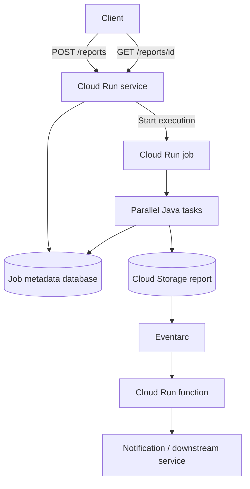
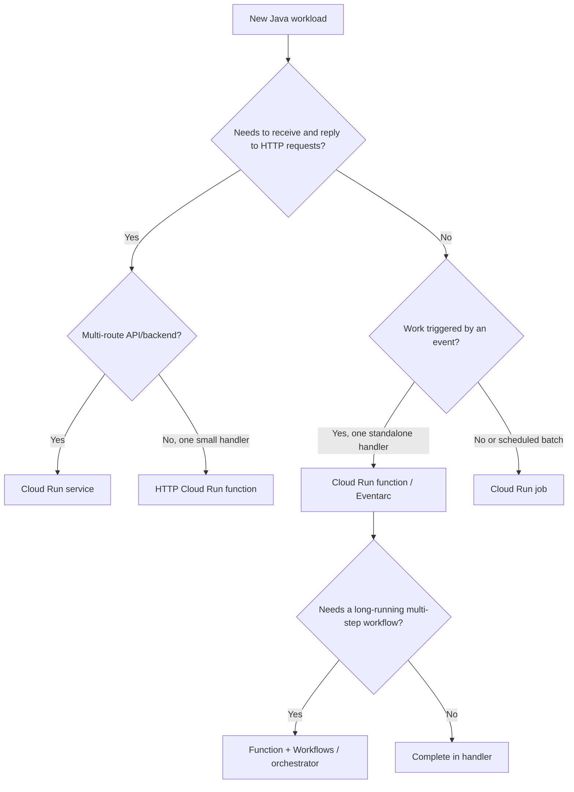

# Distinguishing Cloud Run services, jobs, and Cloud Run functions

Google Cloud offers multiple ways to run applications using a serverless model. Three common options are **Cloud Run services**, **Cloud Run jobs**, and **Cloud Run functions**. All three can run Java code without self-managing servers, but they solve three different types of workloads:

- Cloud Run services serve requests over HTTP or a supported protocol, typically running as an API or web service.
- Cloud Run jobs run a task until completion and then exit, and can be split into multiple parallel tasks.
- Cloud Run functions run a function handler triggered by HTTP or an event, suited for event-driven processing and Functions Framework/Eventarc integration.

Choosing the right model helps determine how to package Java, the program entry point, scaling, retries, timeouts, state, and cost. Do not choose based on the name alone: start from how the work is triggered, whether it needs to answer a request immediately, and whether it finishes per request or according to the progress of a task.

## 1. Quick overview of the three models

| Criterion | Cloud Run services | Cloud Run jobs | Cloud Run functions |
| --- | --- | --- | --- |
| Goal | Serve an application or API | Run a task until completion | Handle an HTTP request or event with a function handler |
| Java entry point | Application/container starts an HTTP server | Java program with `main` or command | Class/method implementing Functions Framework |
| How triggered | HTTP request, gRPC, WebSocket, or a service calling the endpoint | User, CLI/API, Cloud Scheduler, Workflows, or an orchestration system | HTTP trigger or event trigger, typically via Eventarc and Functions Framework |
| Lifecycle | Instance serves multiple requests; can scale to 0 depending on configuration | Execution consists of one or more tasks; finishes when tasks exit | Each handler invocation processes one request/event; the runtime manages instances |
| Output | HTTP response or stream response | Exit code, logs, and durably stored data | HTTP response or completed event processing |
| Concurrency / parallelism | Multiple requests across instances and per-instance concurrency | Multiple tasks in an execution and multiple executions | Multiple invocations/instances according to platform scaling capabilities |
| Best suited for | REST APIs, backends, webhook receivers, internal services | Large imports/exports, batch processing, reports, migrations, scheduled processing | Event handlers, small webhooks, independent message/event processing |

A helpful mnemonic: a service **waits for requests**, a job **runs until done**, and a function **runs when triggered**. This distinguishes them by design goal; at the infrastructure level, Cloud Run functions also use the Cloud Run platform and can be deployed as a managed workload similar to a service.

## 2. Cloud Run services: request-serving applications

A Cloud Run service deploys a container with an HTTP server. When a request arrives, the platform routes it to an active instance or creates a new instance if needed. A single instance can handle multiple concurrent requests depending on the configured concurrency. When load decreases, Cloud Run can scale down instances; configuring min instances can keep a certain number of instances warm to reduce startup latency.

Suitable use cases:

- REST APIs for web or mobile applications.
- Java backends using Spring Boot, Quarkus, Micronaut, Jakarta REST, or a lightweight HTTP server.
- Webhook receivers that need to return an HTTP status/response to the sender.
- Internal services communicating over HTTP/gRPC.
- Applications that need streaming responses or to hold connections over a Cloud Run-supported protocol.

### Container contract

The container must start a server and listen on the port provided by the environment via the `PORT` variable (typically 8080 by default). The server needs to bind on an interface that can receive traffic from the runtime, typically `0.0.0.0`, not only `localhost`.

Example Spring Boot configuration:

```properties
server.port=${PORT:8080}
server.address=0.0.0.0
```

A simple Java controller:

```java
import org.springframework.boot.SpringApplication;
import org.springframework.boot.autoconfigure.SpringBootApplication;
import org.springframework.web.bind.annotation.GetMapping;
import org.springframework.web.bind.annotation.RestController;

@SpringBootApplication
public class OrdersApplication {
    public static void main(String[] args) {
        SpringApplication.run(OrdersApplication.class, args);
    }
}

@RestController
class HealthController {
    @GetMapping("/health")
    public String health() {
        return "ok";
    }
}
```

The example assumes the project already has the Spring Boot Web dependency and the configuration above. Cloud Run does not require Spring Boot; any HTTP server that satisfies the container contract can be used.

### Request timeout and concurrency

A Cloud Run service fits work that returns a result within an HTTP budget. If a request takes too long to process, the request timeout, client timeout, or proxy timeout may stop waiting while the server-side task has already performed partial side effects. For long-running work, the service should accept the request, persist the job, and return `202 Accepted` with a job ID; a worker or job execution processes the remaining work.

Concurrency determines the number of requests that can be processed simultaneously on one instance. Increasing concurrency can better utilize CPU/memory for I/O-bound workloads, but can also cause contention on threads, connection pools, or memory. Decreasing concurrency can increase the number of required instances. Measure p95/p99 latency, CPU, memory, and downstream load under a representative workload.

A Cloud Run service creates revisions when deploying new versions. You can split or shift traffic between revisions for gradual rollouts, testing, or rollbacks. This is an advantage when deploying APIs that require change control and the ability to revert to a previous version.

## 3. Cloud Run jobs: running tasks to completion

A Cloud Run job runs a container according to a command or entry point and finishes when the program exits. A job does not need to open an HTTP server to wait for requests. One execution can consist of multiple tasks; each task runs the same image but can read its task index to process a separate slice of data.

Suitable use cases:

- Importing or exporting millions of records.
- Generating large reports, compressing files, or batch media processing.
- Data synchronization, migrations, and periodic cleanup.
- Batch computations or partitioned data processing.
- Administrative tasks run once or on a schedule.

### Task, execution, and parallelism

Distinguish these concepts:

- **Job definition:** configuration of the image, command/args, environment, service account, CPU/memory, timeout, retries, and task count.
- **Execution:** a specific run of a job.
- **Task:** a unit within an execution. A job can run one task or multiple tasks.
- **Task index:** a sequence number that helps a task identify the data slice it is responsible for.
- **Parallelism:** the number of tasks allowed to run concurrently within an execution.

For example, a job processing 12 partitions can create 12 tasks and limit parallelism to 4. At most 4 tasks run at a time; when one task finishes, the next task is scheduled. Total duration depends on per-partition volume, resource limits, and downstream services.

### Java job reading task metadata

Cloud Run Jobs provides environment variables so a task knows its execution and position. For example:

```java
public final class ImportJob {
    public static void main(String[] args) {
        int taskIndex = Integer.parseInt(
                System.getenv().getOrDefault("CLOUD_RUN_TASK_INDEX", "0"));
        int taskCount = Integer.parseInt(
                System.getenv().getOrDefault("CLOUD_RUN_TASK_COUNT", "1"));
        String execution = System.getenv("CLOUD_RUN_EXECUTION");
        String attempt = System.getenv("CLOUD_RUN_TASK_ATTEMPT");

        System.out.printf(
                "execution=%s task=%d/%d attempt=%s%n",
                execution, taskIndex, taskCount, attempt);

        processPartition(taskIndex, taskCount);
    }

    private static void processPartition(int index, int count) {
        // Only process data belonging to this partition.
        // Persist results/checkpoints durably before exiting.
    }
}
```

The environment variables above help a task identify the execution, task index, total task count, and attempt. Partitioning logic must be designed so that nothing is missed or duplicated when the task count changes. Do not use the index as the sole idempotency key if an execution might be rerun; combine the execution ID, partition/business key, and data version.

### Retries and exit codes

A task is considered successful when the program finishes with a success exit code; errors may cause the task to be retried according to the configured retry limit. Therefore:

- Exit with code 0 only when the work has been durably saved and completed.
- Return a non-zero exit code when signaling an error so the platform retries according to policy.
- Do not infinitely retry invalid data errors or permanent permission errors.
- Save checkpoints and make operations idempotent so rerunning a task does not duplicate results.
- Set a timeout sufficient for the partition but bounded so stuck tasks can be detected.

If a task has written output but the process crashes before exiting successfully, a retry attempt may run again. Cloud Run Jobs does not automatically create a transaction spanning databases, object storage, and external side effects. Use unique keys, conditional writes, staged outputs, or manifests to safely publish completed results.

## 4. Cloud Run functions: trigger-based function handlers

Cloud Run functions is the model for deploying event-driven or HTTP functions using Functions Framework and Cloud Run infrastructure. This is the continuation of next-generation Cloud Functions (2nd gen) in the Google Cloud ecosystem. Developers focus on a single entry point that processes a request or event instead of building an entire HTTP server themselves.

Suitable use cases:

- Processing a CloudEvent emitted when an object is created in Cloud Storage.
- Reacting to messages or events from Pub/Sub via Eventarc.
- Handling webhooks or small HTTP endpoints.
- Running standalone logic when an event occurs from a Google Cloud service.
- Quickly connecting a trigger to a small Java handler with a clear input/output contract.

### Functions Framework

For Java, Functions Framework provides interfaces for the runtime to invoke the function. Two common forms are:

- `HttpFunction`: receives an HTTP request and writes an HTTP response.
- `CloudEventsFunction`: receives an event in the CloudEvents format.

HTTP function example:

```java
import com.google.cloud.functions.HttpFunction;
import com.google.cloud.functions.HttpRequest;
import com.google.cloud.functions.HttpResponse;
import java.io.IOException;

public class HelloHttp implements HttpFunction {
    @Override
    public void service(HttpRequest request, HttpResponse response)
            throws IOException {
        response.setStatusCode(200);
        response.setContentType("text/plain; charset=utf-8");
        response.getWriter().write("Hello from a Java function");
    }
}
```

CloudEvent function example:

```java
import com.google.cloud.functions.CloudEventsFunction;
import io.cloudevents.CloudEvent;
import java.nio.charset.StandardCharsets;

public class StorageObjectCreated implements CloudEventsFunction {
    @Override
    public void accept(CloudEvent event) throws Exception {
        String eventId = event.getId();
        String eventType = event.getType();
        String source = event.getSource().toString();
        String payload = event.getData() == null
                ? ""
                : new String(event.getData().toBytes(), StandardCharsets.UTF_8);

        System.out.printf("eventId=%s type=%s source=%s%n",
                eventId, eventType, source);
        processObjectEvent(payload, eventId);
    }

    private static void processObjectEvent(String payload, String eventId) {
        // Validate event schema and process idempotently by eventId.
    }
}
```

The code snippet illustrates the handler contract; the project must declare the appropriate Functions Framework Java API version and entry point when building/deploying. For real events, parse data according to the event type's schema rather than treating all payloads as the same JSON structure. Check `id`, `source`, `type`, subject, and version; events can be redelivered so the handler must be idempotent.

### Eventarc and event sources

Eventarc routes events from Google Cloud or integrated sources to targets such as a Cloud Run service or Cloud Run function. Events are typically represented as CloudEvents, which standardize metadata such as ID, source, type, time, and data.

A Cloud Run service can also receive a CloudEvent via an HTTP endpoint if the application handles CloudEvents itself. The difference with Cloud Run functions is the handler model and how the function entry point is deployed; Eventarc is the event routing layer. Therefore, "having events" does not force you to choose functions: you can use a service when you need full control over the HTTP server or need to handle multiple routes within the same container.

## 5. Cloud Run service vs. function: where do they differ?

These two models can both process HTTP or CloudEvents, but their abstraction and code organization differ:

| Question | Cloud Run service | Cloud Run function |
| --- | --- | --- |
| Who provides the HTTP server? | The application/container provides it | Functions Framework/runtime provides the adapter for the handler |
| Entry point | `main` starts the server; the framework manages routes | Entry point implements `HttpFunction` or `CloudEventsFunction` |
| Multiple routes/endpoints | Freely organized via the web framework | Usually focused on a single function entry point; multiple separate functions can be deployed |
| Event integration | Can receive CloudEvents over HTTP or Eventarc | Provides the function handler model and convenient event trigger integration |
| Container control | Direct control over Dockerfile, process, and server | Can deploy from source via Functions Framework/buildpack or as a container in supported ways |
| Best suited for | APIs/backends with a broad application structure | Small handlers focused on a single event or endpoint |

There is no rule that a function is always lighter than a service or that a service always has more features. Image size, startup time, dependencies, and resource usage depend on how the Java code is written, the framework, and deployment configuration.

## 6. Comparing Java entry points and deployment methods

| Model | Java entry point | Common deployment approach |
| --- | --- | --- |
| Cloud Run service | `public static void main`, starts an HTTP server | Build container image, then `gcloud run deploy` |
| Cloud Run job | `public static void main`, runs task then exits | Build image, then `gcloud run jobs deploy`, then execute |
| Cloud Run function | Class/method implementing a Functions Framework interface | Deploy function source/entry point with Cloud Run functions tooling, commonly via `gcloud functions deploy` for the current generation |

CLI command names and Java runtimes may vary by Google Cloud CLI version and region. Check current documentation before using them in a pipeline. The key point is that a service/job typically deploys a container image; a function deploys according to the Functions Framework contract and trigger/entry point.

### Minimal Dockerfile for a service or job

A service and a job can share the same image if the command/entry point is configured differently. Example Dockerfile packaging a JAR:

```dockerfile
FROM eclipse-temurin:21-jre
WORKDIR /app
COPY target/application.jar /app/application.jar
ENV PORT=8080
ENTRYPOINT ["java", "-jar", "/app/application.jar"]
```

For a service, the JAR starts an HTTP server and listens on `PORT`. For a job, the JAR runs the task and exits; you can use a different command/args or build a dedicated artifact. Do not use this Dockerfile for a function source deploy if the function's Functions Framework/buildpack already manages the entry point and image in its own way.

## 7. Example of the same business workflow under all three models

Suppose a system needs to generate revenue reports:

**Cloud Run service:** the client calls `POST /reports`; the service authenticates, creates a job record, and returns `202 Accepted` with a status URL. The `GET /reports/{id}` endpoint allows querying progress. A service fits the API that manages and tracks jobs.

**Cloud Run job:** the job reads revenue partitions, computes them in parallel, writes a CSV file to Cloud Storage, and updates the completion status. There is no need to keep an HTTP request open during the entire computation.

**Cloud Run function:** when the job completes or the report object is created, Eventarc sends an event to a function to send a notification or update another system. The function processes a single independent event and finishes.



In this architecture, the service manages the HTTP contract, the job handles batch processing, and the function reacts to events. You can replace the function with a Cloud Run service receiving CloudEvents if you need complex endpoints or want to share a server across multiple routes.

## 8. State, retries, and idempotency

No model guarantees that a business side effect happens exactly once in all situations. Requests can be retried by clients, events can be redelivered, and job tasks can be retried after a process crash.

| Model | How failures surface | Safe design approach |
| --- | --- | --- |
| Service | HTTP status, request timeout, instance restart | Idempotency key for POST, downstream timeouts, durable job state persistence |
| Job | Task exit code, retry attempt, execution/task timeout | Checkpoints, partitioned outputs, unique keys, and retry limits |
| Function | Handler error/HTTP response or event delivery retry | Event ID, deduplication, schema validation, DLQ/quarantine, or trigger retry policy |

### Service: request retry

If a service writes an order but the client times out before receiving the response, the client may retry. Store an idempotency key scoped by caller/tenant and request hash; the same key with the same payload returns the previous result, while the same key with a different payload returns a conflict.

### Job: task retry

If a job task finishes writing partition 3 but the process is terminated before reporting success, the task may run again. Write results under a stable key such as `(executionId, partitionId, dataVersion)` and use upserts/conditional writes. Mark a partition complete only after the output has been durably written.

### Function: event redelivery

Eventarc and event sources typically have their own delivery/retry semantics; assume duplicates can occur if the source supports redelivery. Store processed event IDs or business keys, and coordinate recording that marker with side effects via transactions/inbox/outbox or downstream idempotency. Do not mark an event as completed before the business side effect is durably persisted.

## 9. Scaling, concurrency, and cold starts

All three models can scale independently, but their limits are configured differently:

- **Service:** scales by requests and configured concurrency, min/max instances, and CPU/memory. A single instance can handle multiple concurrent requests.
- **Job:** scales by task count and execution parallelism. Limit concurrent tasks to protect databases, partner APIs, and quotas.
- **Function:** scales by HTTP/event invocations and the instance/concurrency limits supported in the function/runtime configuration.

Cold starts can occur when the platform needs to create a new instance. With Java, startup time depends on the JVM, class loading, framework, dependencies, DI configuration, and initial connections. Min instances or keeping instances warm can reduce cold starts, but increases cost during low traffic.

For batch jobs, startup overhead is usually amortized over a larger amount of work; however, tasks that are too small can trigger many startups and increase overhead. Choose the number of tasks/partitions based on processing duration, data size, and scheduling overhead.

Do not set maximum concurrency based solely on CPU. An I/O-bound function can handle more invocations, but database connections, file descriptors, memory, and downstream limits are the actual constraints. Measure under representative load and set appropriate limits.

## 10. Networking and access permissions

Each workload runs with a runtime service account. Grant least-privilege permissions tailored to the task:

- An API service may need to read configuration, write to a database, and call downstream services.
- An import job may need to read an input bucket and write to a results bucket.
- An event-receiving function may need to read the event payload, update metadata, and publish the next event.

Do not use a default service account with broad permissions if a workload only needs a few resources. Separating service accounts across services, jobs, and functions reduces the blast radius if credentials or configurations are exposed.

Cloud Run supports configuring ingress and egress/network paths as required. If accessing private IPs inside a VPC, configure Direct VPC egress or a Serverless VPC Access connector according to current workload/region capabilities and recommendations. If calling Google APIs over a private path, consider Private Google Access or Private Service Connect depending on the service and architecture. Identity/IAM does not automatically create network routes; networking and authorization must be configured separately.

For event-driven functions, Eventarc needs permission to invoke the target. The trigger configuration, trigger service account, invoke role, and event source permissions must align. If a function does not need public access, require IAM authentication or restrict ingress appropriately.

## 11. Cost: calculated by how the workload runs

Cloud Run costs depend on CPU/memory configuration, usage duration, requests, warm instances, networking, and supporting services. Billing modes and pricing details vary by region, workload type, and over time.

| Model | Factors to estimate |
| --- | --- |
| Service | Request/compute duration per billing mode, CPU/memory, min instances, network egress, logging, and database |
| Job | Task count, task duration, CPU/memory, retries, data read/written, Cloud Storage, and orchestration |
| Function | Invocations, processing/compute duration under Cloud Run billing, triggers/Eventarc, retries, and downstream services |

To compare accurately, measure **cost per successful business outcome**. For example, a completed report may include the cost of the intake service, job tasks, Cloud Storage, Eventarc function, database, and logs. Looking only at the job or function bill misses the rest.

Ways to control costs:

1. Choose sufficient CPU/memory for the workload, but benchmark a few configurations before finalizing.
2. Set max instances/concurrency or job parallelism to avoid overwhelming downstream capacity.
3. Use min instances only when the latency benefit justifies paying for idle warm compute.
4. Avoid infinite retries; fix poison-input errors and cap attempts.
5. Put large files in Cloud Storage and pass references instead of copying payloads across multiple services.
6. Reduce repetitive payload logging and set appropriate retention and sampling.
7. Use services for short requests, jobs for long batches, and functions for concise event handlers to avoid holding resources under the wrong lifecycle.

## 12. Observability and operations

The three models expose different operational signals:

| Model | What to monitor |
| --- | --- |
| Service | Request rate, p50/p95/p99 latency, HTTP 4xx/5xx, instance count, concurrency, CPU/memory, startup, and dependency latency |
| Job | Execution status, task success/failure, retry count, task duration, parallelism, logs by task index, execution age |
| Function | Invocation count, event age/lag, handler duration, errors/retries, event ID, source/type, instance count, and downstream failures |

Attach `requestId`, `jobExecutionId`, `taskIndex`, `eventId`, and `correlationId` to logs/traces depending on the model. Do not use high-cardinality IDs as metric labels if the observability system charges by cardinality or limits the number of series.

For services, check health/startup behavior and readiness to receive traffic when a new revision starts. For jobs, check for stuck tasks, incomplete partitions, and missing outputs. For functions, check for delayed events, duplicates, invalid schemas, and Eventarc invoke permissions.

## 13. Testing and deploying Java

### Testing a service

- Unit test service/domain logic.
- Integration test HTTP routes, authentication, request validation, and responses.
- Container test to verify the process listens on `PORT` and binds the correct interface.
- Load test concurrency, timeouts, memory, and downstream connections.

### Testing a job

- Run the main program with sample task index/count values.
- Test partition boundaries, empty input, partial failures, and retries.
- Verify idempotent output/checkpoints when a task reruns.
- Test timeouts, max retries, and malformed data handling.

### Testing a function

- Unit test the handler with simulated HTTP requests or CloudEvents.
- Validate event schemas, source/type, and duplicate event IDs.
- Test retry/redelivery and Eventarc invoke permissions.
- Run Functions Framework locally when needed to verify the handler contract.

### Conceptual deployment commands

A Cloud Run service typically deploys a container image:

```bash
gcloud run deploy orders-api \
  --image REGION-docker.pkg.dev/PROJECT/REPOSITORY/orders-api:TAG \
  --region REGION
```

A Cloud Run job deploys an image and then creates an execution:

```bash
gcloud run jobs deploy monthly-report \
  --image REGION-docker.pkg.dev/PROJECT/REPOSITORY/monthly-report:TAG \
  --region REGION

gcloud run jobs execute monthly-report --region REGION
```

Cloud Run functions are deployed by Functions Framework entry point and trigger using Cloud Run functions tooling (in many CLI workflows, the command remains `gcloud functions deploy` with the appropriate generation):

```bash
gcloud functions deploy process-storage-event \
  --gen2 \
  --runtime JAVA_RUNTIME \
  --region REGION \
  --source . \
  --entry-point StorageObjectCreated \
  --trigger-event-filters="type=google.cloud.storage.object.v1.finalized" \
  --trigger-event-filters="bucket=BUCKET_NAME"
```

The commands above are templates illustrating differences in the deployment flow. Replace project, region, image, runtime, trigger, and entry point with real values; verify the `gcloud` version and supported runtimes before putting them into a pipeline. Event triggers may require enabling APIs, granting permissions to the Eventarc service agent, and configuring a dedicated service account.

## 14. Choosing a model by scenario

| Scenario | Initial choice | Why |
| --- | --- | --- |
| Java API receiving requests and returning fast results | Cloud Run service | Provides HTTP server, routing, and revision/traffic management |
| Backend with multiple endpoints and middleware | Cloud Run service | Web application framework controls the entire HTTP contract |
| Processing a small Storage event and updating metadata | Cloud Run function | Handler focuses on a single event and Eventarc trigger |
| Receiving a simple webhook and enqueuing long work | Service or HTTP function | Choose a service if a multi-route API is needed; a function if the handler is small and standalone |
| Running a 30-minute report across multiple partitions | Cloud Run job | Run-to-completion, task parallelism, and retries |
| One-time database migration or cleanup | Cloud Run job | No HTTP server needed; provides execution status and exit codes |
| Waiting for an event then triggering multiple business steps | Function + Workflows or orchestrating service | Separates the event handler from long-running orchestration |
| Event requiring complex HTTP server logic | Cloud Run service receiving CloudEvents | Can organize multiple routes and middleware inside one application |

### Quick decision tree



This is an initial selection guide. A real-world architecture can combine all three: a service accepts and tracks requests, a job processes batches, and a function reacts to events emitted by the job or storage.

## 15. Common selection mistakes

1. **Using a service for long-running batches just because an HTTP API already exists.** Requests can time out and instances are held while processing. Return a job ID and offload the batch work to a Cloud Run job.
2. **Using a job to serve interactive APIs.** Jobs are not designed to return HTTP responses directly for each client request. Use a service or function as the intake layer.
3. **Using a function for complex orchestration workflows.** A single function does not provide a long-lived state machine on its own. Use Workflows or an orchestrator and persist state durably.
4. **Assuming functions and services run on completely different infrastructure.** Cloud Run functions use the Cloud Run platform; the key differences are the abstraction, entry point, and trigger contract.
5. **Assuming local filesystem or heap is durable state storage.** Instances/tasks can be terminated or rerun. Persist state and outputs in a database/object storage.
6. **Not limiting concurrency/parallelism.** Rapid scaling can exhaust database connections or downstream quotas.
7. **Assuming events/tasks run exactly once.** Retries and redeliveries can repeat execution. Design for idempotency and checkpoints.
8. **Measuring the cost of only one component.** Account for triggers, orchestration, storage, networking, logs, and downstream services.

## 16. Pre-deployment checklist

- [ ] Have you determined whether the workload serves requests, runs a batch to completion, or reacts to events?
- [ ] Does the service have an HTTP server listening on `PORT` and binding the right interface?
- [ ] Does the job have a command/entry point that exits with the right exit code and splits tasks/partitions clearly?
- [ ] Does the function implement the right Functions Framework interface and entry point?
- [ ] Do the trigger/Eventarc settings have the right event type, source, filters, and invoke permissions?
- [ ] Are large inputs/outputs stored in Cloud Storage and passed by reference?
- [ ] Are state, checkpoints, and results persisted durably outside the container?
- [ ] Have retries, timeouts, idempotency, and duplicate events/tasks been designed for?
- [ ] Does the service account have least-privilege permissions for the specific workload?
- [ ] Do ingress, egress, VPC, and private access settings meet network requirements?
- [ ] Are concurrency, max instances, task parallelism, and connection pools bounded appropriately?
- [ ] Are logs/metrics/traces and alerts in place by request, execution, task, or event ID?
- [ ] Have cold starts, latency, throughput, memory, and cost been benchmarked on a representative workload?
- [ ] Have the CLI, runtime, region, trigger, and APIs been verified against the current deployment version?

Cloud Run services, jobs, and functions all let you run Java without managing servers, but their entry points and lifecycles differ. Services suit request-serving applications; jobs suit run-to-completion tasks that can be split across tasks; functions suit handlers triggered by HTTP or events. When you choose based on the trigger, response model, duration, orchestration needs, and retry semantics, you can combine them into a serverless architecture that is easy to scale, operate, and keep cost-controlled.
