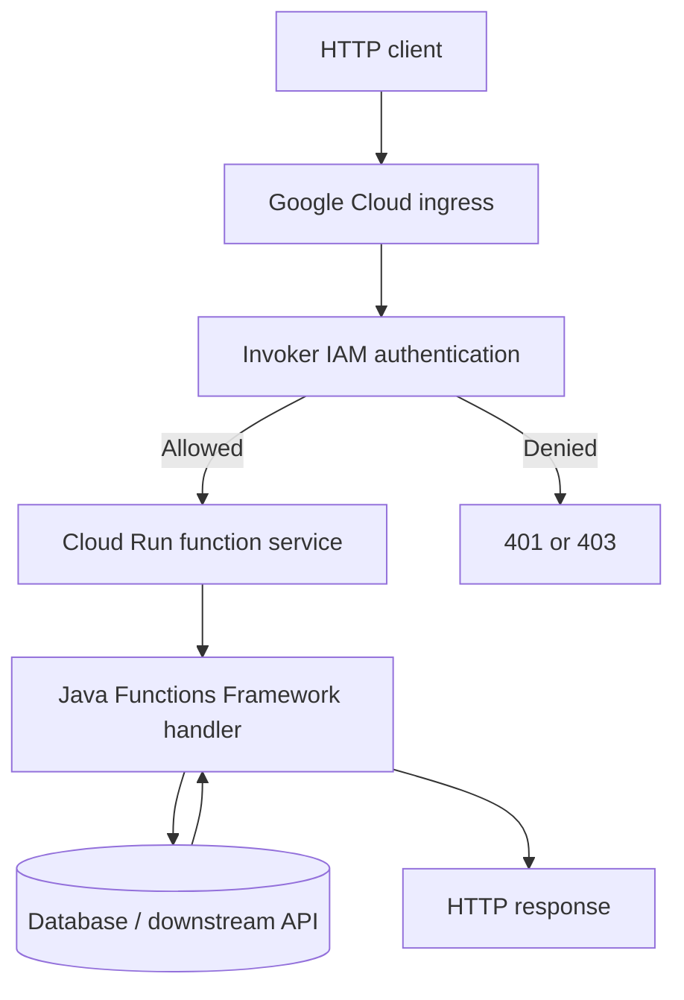
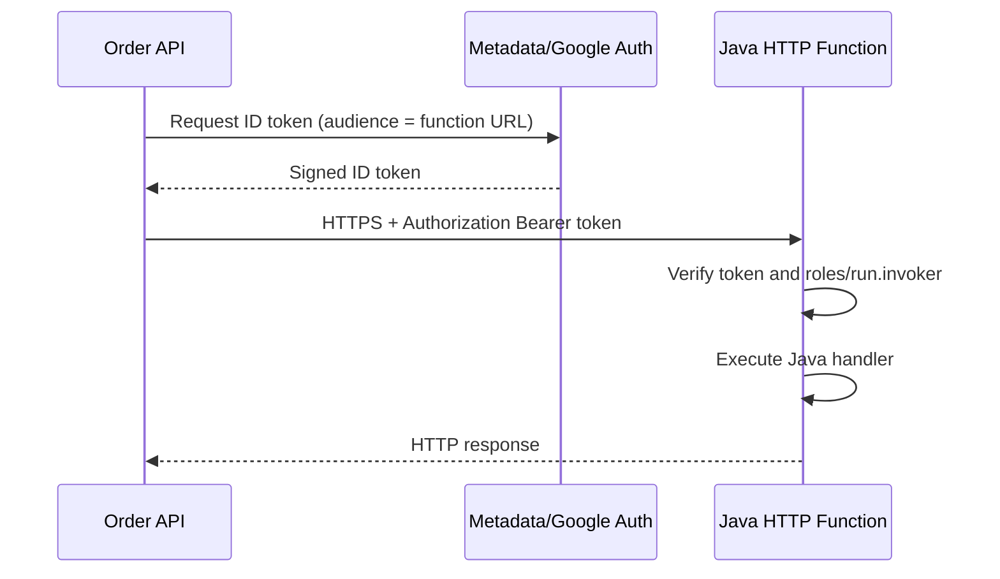

# Deploying an HTTP function and controlling invocation permissions

An HTTP function is a way to bring Java logic onto a serverless platform so other systems can call it over HTTP. On Google Cloud, Cloud Run functions (formerly Cloud Functions 2nd gen) enables deploying Java functions in this model. The platform manages running containers, routing requests, and scaling instances; the development team focuses on the handler, runtime configuration, access control, and error handling.

Deploying an endpoint does not automatically mean it is properly secured. You need to define who is allowed to invoke it, which network paths requests can enter from, which identity the function runs under, and how the application enforces business authorization. This lesson covers writing an HTTP function with Java Functions Framework, deploying it to Google Cloud, and controlling invocation access using IAM, ID tokens, and ingress.

## 1. How do HTTP functions work on Google Cloud?

Cloud Run functions provides an execution environment for request-driven or event-driven functions. With an HTTP trigger, the platform receives an HTTP request and forwards it to the Java handler. In 2nd gen, functions run on the Cloud Run platform and are managed using Cloud Run components.

Basic HTTP flow:

1. A client sends a request to the function URL.
2. The platform layer checks ingress and performs IAM authentication if the endpoint requires authentication.
3. A valid request is routed to a running instance, or the platform spins up a new instance.
4. The Java handler reads the method, path, headers, and body.
5. The handler executes business logic, calls dependent services if needed, and builds an HTTP response.
6. The platform returns the response to the client.



The diagram shows the conceptual path. A request can be blocked at ingress or IAM before the Java code is ever invoked. Therefore, do not rely on handler logs as the sole evidence to determine whether all requests reached the endpoint.

### 1st gen and 2nd gen

Google Cloud has two generations of Cloud Functions. 2nd gen is built on Cloud Run, supporting more configuration and integration capabilities. Current documentation and tooling also refer to this product as Cloud Run functions.

This lesson focuses on 2nd gen HTTP functions:

- Use Functions Framework to write handlers.
- Deploy via Cloud Functions API/`gcloud` with the `gen2` option.
- The function runs on the Cloud Run platform.
- HTTP invocation permission is controlled via the Cloud Run Invoker IAM role (`roles/run.invoker`).

For 1st gen, the IAM invoker model differs; do not mechanically apply 2nd gen roles to legacy functions. When working with an existing function, verify its generation and underlying resource before modifying IAM.

## 2. Writing an HTTP function with Java Functions Framework

Functions Framework provides an interface for writing functions without having to build a full web server application yourself. For an HTTP function, a Java class implements the `HttpFunction` interface and its `service` method.

Simple handler example:

```java
package com.example;

import com.google.cloud.functions.HttpFunction;
import com.google.cloud.functions.HttpRequest;
import com.google.cloud.functions.HttpResponse;
import java.io.Writer;

public class HelloHttp implements HttpFunction {

    @Override
    public void service(
            HttpRequest request,
            HttpResponse response) throws Exception {

        if (!"GET".equals(request.getMethod())) {
            response.setStatusCode(405);
            response.appendHeader("Allow", "GET");
            response.appendHeader("Content-Type", "text/plain; charset=utf-8");
            response.getWriter().write("Method not allowed");
            return;
        }

        response.setStatusCode(200);
        response.appendHeader("Content-Type", "text/plain; charset=utf-8");

        Writer writer = response.getWriter();
        writer.write("Hello from a Java HTTP function");
    }
}
```

This class handles GET and returns 405 for other methods. Functions Framework manages invoking the handler and provides the request/response abstraction. The function does not need to open a port or manage a servlet container itself.

### Maven dependency

A minimal Maven project needs the Functions Framework API dependency. Example dependency section in `pom.xml`:

```xml
<dependency>
    <groupId>com.google.cloud.functions</groupId>
    <artifactId>functions-framework-api</artifactId>
    <version>1.1.0</version>
    <scope>provided</scope>
</dependency>
```

Dependency scope `provided` is appropriate because the API is provided by the Functions Framework environment when the function runs. The project must also declare a Java version compatible with the selected runtime. The deployment examples below use Java 21; confirm that runtime is still supported in your target region at deployment time.

In production handlers, separate the HTTP adapter layer from business logic. The handler is responsible for reading the request, performing basic input validation, calling the service, and translating the result into a status code. Business logic can be tested independently with unit tests.

## 3. Deploying a 2nd gen HTTP function

Before deploying, prepare:

- A Google Cloud project with appropriate billing enabled.
- Google Cloud CLI installed and pointing to the right project.
- Required APIs enabled for Cloud Functions, Cloud Run, Cloud Build, and Artifact Registry per the deployment flow.
- Source directory containing `pom.xml` and the entry point class.
- A deploying identity with permissions to build/deploy functions and `actAs` permission on the chosen runtime service account.

Example deploy command from the source directory:

```bash
gcloud functions deploy helloHttp --gen2 --runtime=java21 --region=asia-southeast1 --source=. --entry-point=com.example.HelloHttp --trigger-http --no-allow-unauthenticated
```

Meaning of the flags:

| Flag | Meaning |
|---|---|
| `functions deploy helloHttp` | Create or update a function named `helloHttp` |
| `gen2` | Use 2nd gen, running on the Cloud Run platform |
| `runtime=java21` | Select the Java runtime |
| `region=asia-southeast1` | Select the deployment region |
| `source=.` | Use source code in the current directory |
| `entry-point=com.example.HelloHttp` | Java class implementing `HttpFunction` |
| `trigger-http` | Create an HTTP trigger |
| `no-allow-unauthenticated` | Do not grant public invocation permission to `allUsers` |

This command is an example. Replace project, region, runtime, and class with values for your actual environment. If using another runtime, check the runtime names supported by Google Cloud at deployment time.

### Selecting a runtime service account

A function runs under a runtime service account. This identity is used when Java code calls Google Cloud services such as Secret Manager, Pub/Sub, or IAM-integrated databases.

You can specify the service account using the `--service-account` flag in the deploy command:

```bash
gcloud functions deploy helloHttp --gen2 --runtime=java21 --region=asia-southeast1 --source=. --entry-point=com.example.HelloHttp --trigger-http --no-allow-unauthenticated --service-account=hello-http-runtime@PROJECT_ID.iam.gserviceaccount.com
```

The runtime service account is distinct from the identity of the person or pipeline executing the deploy. Do not grant deployment permissions to the runtime service account just because the function needs to read a secret. Nor should you grant Owner or Editor to the runtime if the function only needs a few specific permissions.

For example, if the function only reads one secret, grant Secret Manager Secret Accessor on that specific secret to the runtime service account, instead of granting read access to all secrets in the project.

## 4. Controlling who can invoke the function with IAM

For 2nd gen HTTP functions, the endpoint runs on Cloud Run. Authenticated callers need the Cloud Run Invoker permission, role:

```text
roles/run.invoker
```

Grant this role at the specific service scope to restrict invocation to the exact endpoint required. Granting the role at the project level may allow the principal to invoke more Cloud Run services in the project than intended.

Example granting a service account permission to invoke the function:

```bash
gcloud run services add-iam-policy-binding helloHttp --region=asia-southeast1 --project=PROJECT_ID --member=serviceAccount:caller@PROJECT_ID.iam.gserviceaccount.com --role=roles/run.invoker
```

Where:

- `helloHttp` is the Cloud Run service corresponding to the 2nd gen function.
- `caller@PROJECT_ID.iam.gserviceaccount.com` is the identity of the workload calling the function.
- `roles/run.invoker` allows the principal to invoke the service over HTTP.
- `project` and `region` must match where the function is deployed.

The person running the command needs permission to read and update the Cloud Run service's IAM policy. Do not grant this role to the runtime service account itself if the function does not need to call itself.

### Inspecting the IAM policy

You can view the service's policy:

```bash
gcloud run services get-iam-policy helloHttp --region=asia-southeast1 --project=PROJECT_ID
```

In the policy, check the members assigned `roles/run.invoker`. Common members include:

- `serviceAccount:...` for a specific workload or service account.
- `user:...` for a specific user.
- `group:...` for a Google Workspace/Cloud Identity group.
- `allUsers` for everyone, including requests without an authenticated Google identity.

Avoid `allUsers` unless the endpoint truly needs to be public. If a principal was granted access by mistake, you can remove the binding on that specific service:

```bash
gcloud run services remove-iam-policy-binding helloHttp --region=asia-southeast1 --project=PROJECT_ID --member=serviceAccount:caller@PROJECT_ID.iam.gserviceaccount.com --role=roles/run.invoker
```

After changing IAM, test with both an authorized caller and an unauthorized caller. Do not rely solely on a successful deploy to conclude that invocation permissions are correct.

## 5. Invoking the function with an ID token

When the service requires IAM authentication, the client must send a Google-signed ID token in the `Authorization` header:

```http
Authorization: Bearer ID_TOKEN
```

The token must have an audience matching the service URL or a configured custom audience. The principal in the token must also have `roles/run.invoker` on the service.

To test manually from an environment logged in to the Google Cloud CLI, you can obtain an identity token and call the function URL:

```bash
TOKEN=$(gcloud auth print-identity-token)
curl -H "Authorization: Bearer $TOKEN" FUNCTION_URL
```

This is an example for a development environment. For service-to-service communication in production, the calling workload should use a dedicated service account and obtain an ID token through Google Cloud's authentication environment or the Google Auth library. Do not store long-lived tokens in source code or configuration files; tokens expire and must be refreshed.

If a workload running on Cloud Run calls the function, the service account attached to that workload needs `roles/run.invoker` on the function. The workload can fetch an ID token from the metadata server with the target URL as the audience. If using service account impersonation from outside Google Cloud, the identity requesting impersonation also needs permission to mint tokens under the appropriate IAM mechanism.

### OAuth access tokens and ID tokens are not the same

An ID token represents the caller's identity and is used to authenticate requests to a Cloud Run service. An OAuth access token is typically used to call Google APIs according to OAuth scopes. Do not interchangeably substitute one token type for the other.

When calling an HTTP function protected by IAM authentication, use an ID token with the matching audience. When the handler calls another Google API, the runtime service account typically uses a credential provider or access token appropriate for that API.

## 6. Distinguishing IAM invoker, ingress, and business authorization

These three layers answer different questions:

| Layer | Question | Example |
|---|---|---|
| Ingress | Is the request allowed to enter the service from this network/source? | Accept only internal traffic or traffic through an external Application Load Balancer |
| IAM invoker | Which Google Cloud identity is allowed to invoke the service? | Only the `order-api` service account has `roles/run.invoker` |
| Business authentication/authorization | Is the end user allowed to perform this action? | User A may only read orders belonging to account A |

IAM invoker does not replace authorization inside the application. For instance, a backend service authorized to invoke the function may handle requests on behalf of many users. The function must still validate user context, tenant, resource access rights, and business rules if the endpoint acts on behalf of end users.

Similarly, internal ingress does not automatically prove the caller has business authorization. It only restricts which network paths can reach the service. A request arriving over an internal network still needs authentication and authorization as designed.

### Ingress configuration

Cloud Run supports ingress modes to restrict traffic sources, such as:

- `all`: accepts requests from any network source permitted by the endpoint.
- `internal`: accepts only sources classified by Google Cloud as internal according to ingress rules.
- `internal-and-cloud-load-balancing`: accepts internal traffic and traffic routed through a matching Cloud Load Balancing setup.

For 2nd gen Cloud Run functions, ingress configuration can be set at deploy time or through the corresponding service configuration. Choose the right value for your integration type; for example, an endpoint called only from internal workloads can use `internal` ingress together with IAM invoker.

Ingress and IAM must be designed together. If an endpoint needs to receive webhooks from an external provider, `internal` mode may block requests before they reach the handler. In that case, configure appropriate ingress and enforce webhook verification at the application layer if the provider cannot send a Google IAM ID token.

## 7. Should a public HTTP function allow unauthenticated access?

Some endpoints genuinely need to be public, such as webhooks from partners that do not support Google identities or public read-only APIs. In those cases, unauthenticated invocation can be allowed, but it must be an intentional decision.

When public access is enabled, the IAM policy typically includes a binding for `allUsers` with `roles/run.invoker`. Requests can reach the handler without a Google ID token. Therefore, the application must implement appropriate protections:

- Verify webhook signatures against the raw request body when receiving callbacks from a provider.
- Use API keys or application tokens only when appropriate for the threat model; an API key does not replace user identity.
- Validate partner JWT/OIDC tokens for issuer, audience, signature, and expiration.
- Validate input, enforce body size limits, and apply rate limiting.
- Protect against replay attacks and handle requests idempotently.
- Never allow a public endpoint to access internal data based solely on a client-supplied ID.

If a function does not need to be public, keep `--no-allow-unauthenticated` and grant access only to specific callers. If it must be public, document the rationale, restrict its behavior, and monitor for anomalous traffic.

Some organizations enforce an Organization Policy prohibiting `allUsers` bindings. In that case, deploying with public access may be rejected even if the deployer has standard IAM permissions.

## 8. Calling a function from another service in Google Cloud

A common architecture is another Cloud Run service or function invoking an internal HTTP function.

Example flow:

1. `order-api` receives a request from a client.
2. `order-api` authenticates the user and handles its own business logic.
3. `order-api` uses its runtime service account to obtain an ID token with the function URL as audience.
4. `order-api` calls the function over HTTPS and sends `Authorization: Bearer ID_TOKEN`.
5. Google Cloud verifies the token and the IAM invoker role.
6. The Java function executes the task and returns a response.



Do not write tokens to logs or pass tokens in query strings. Use the `Authorization` header and HTTPS. If the function calls another service, each service needs its own invocation permissions following the principle of least privilege.

## 9. Distinguishing deployer identity and runtime identity

During deployment there are at least two key identities:

- **Deployer identity:** the person or pipeline running the deploy command and updating configuration and IAM.
- **Runtime service account:** the identity the Java code uses while the function is running.

A deployer may need permissions to create functions, create or update Cloud Run services, use the build service, and attach the runtime service account. The runtime service account only needs permissions to access the resources that the code actually uses.

Do not grant overly broad permissions to the runtime just to make the deploy command succeed. If deployment reports a missing `actAs` permission, inspect the deployer's permissions on the runtime service account. If the function runs but cannot read a secret or publish a message, inspect the runtime service account's permissions on the target resource.

Separating these two identities narrows the blast radius if either the pipeline or the application code is compromised.

## 10. HTTP contract and request handling

An HTTP function should have a clear contract:

- Supported methods.
- Path and query parameters.
- Required headers.
- Content-Type and body schema.
- Status codes and response structure.
- Timeouts and payload limits.
- Authentication and authorization requirements.

For example, a health check endpoint might simply return 200 without touching dependencies. An order-creation endpoint should validate JSON, verify permissions, and use an idempotency key if clients can retry.

Common status codes:

| Status | Meaning |
|---|---|
| 200 OK | Request succeeded with a response |
| 201 Created | Resource created |
| 202 Accepted | Asynchronous work accepted |
| 400 Bad Request | Malformed syntax or invalid request data |
| 401 Unauthorized | Missing or invalid authentication at the application layer |
| 403 Forbidden | Caller is authenticated but lacks business permission |
| 404 Not Found | Route or resource does not exist |
| 405 Method Not Allowed | Method is not supported by the endpoint |
| 409 Conflict | State or idempotency conflict |
| 429 Too Many Requests | Caller exceeded rate/quota limits |
| 500 Internal Server Error | Unexpected error inside the function |
| 503 Service Unavailable | Function or dependency is temporarily unavailable |

When IAM blocks a request before the handler runs, the authentication response is returned by the platform; do not confuse that response with a 401/403 generated by your Java code after receiving the request.

Do not return stack traces, secrets, or internal details in HTTP responses. Write structured logs with a request ID and error code for investigation.

## 11. Timeouts, concurrency, and scaling

2nd gen Cloud Run functions run on the Cloud Run platform. Instance count can scale up with traffic and configuration. A single instance can process multiple concurrent requests depending on the concurrency setting.

Key considerations:

- **Request timeout:** set high enough for business processing, yet within service limits and caller timeouts.
- **Concurrency:** concurrent requests per instance; Java application code must be safe when multiple requests run concurrently.
- **Min/max instances:** control minimum and maximum instance bounds based on latency needs and quotas.
- **CPU/memory:** size appropriately for the framework and load.
- **Dependency capacity:** scaling out can increase connections to backend databases or APIs.
- **Cold starts:** new instances require time to initialize the runtime and application.

Do not raise max instances indefinitely if the database can handle only a fixed number of connections. Combine limits on concurrency, connection pools, quotas, and backpressure. For long requests or background work, consider returning 202 after durably recording the job, then processing via a queue/worker.

## 12. Secrets, configuration, and service access permissions

HTTP functions often need secrets or configuration such as partner API keys, database passwords, or signing keys.

Principles:

- Store secrets in Secret Manager or an appropriate secret management mechanism.
- Grant Secret Manager Secret Accessor to the runtime service account on the exact secret needed.
- Never place secrets in source code, container images, query strings, or logs.
- Separate ordinary configuration environment variables from secrets.
- Use a dedicated service account per function or workload group with matching privilege requirements.
- Enforce least privilege for database and downstream API access.

If a function only needs to read a single secret, do not grant Secret Manager admin permissions. If secrets are rotated, the application needs a refresh strategy and must not cache old credentials indefinitely in a static field.

## 13. Observability and operations

Cloud Run functions integrates with Cloud Logging, Cloud Monitoring, and Error Reporting. Monitor:

- Request count and error rate by status code.
- Request latency p50/p95/p99.
- Instance count and concurrency.
- Container startup/cold start latency.
- CPU and memory utilization.
- Timeouts, throttling, and requests rejected by IAM.
- Dependency errors, connection pools, and retries.
- Cost across requests, CPU, memory, networking, and supporting services.

Logs should include request/correlation IDs, route template, method, processing duration, and error codes. Avoid logging `Authorization` headers, cookies, ID tokens, or full bodies containing sensitive data.

If a request is rejected before the handler due to IAM, use audit logs and platform logs to investigate; the handler cannot log a request it never received.

## 14. Testing deployment and invocation permissions

Before promoting an endpoint to production, test across multiple identities:

| Test case | Expected result |
|---|---|
| Caller has `roles/run.invoker` and a valid ID token | Request reaches handler |
| Caller lacks the invoker role | Rejected by platform |
| Token has wrong audience | Authentication rejected |
| Token is expired or has invalid signature | Authentication rejected |
| Endpoint blocked by ingress | Request does not reach handler |
| Unsupported method | Handler returns 405 |
| Invalid JSON schema | Handler returns client error per contract |
| Caller can invoke service but lacks access to order | Business logic returns 403 |
| Runtime service account lacks permission to read secret | Function records dependency error without leaking secret |
| Dependency timeout | Function handles according to timeout/retry policy |

In addition to manual testing, include post-deploy integration or smoke tests. Verify the URL, generation, region, runtime, service account, ingress, and IAM policy. Test both authorized and unauthorized principals; testing only the happy path misses public-access misconfigurations.

## 15. Common deployment mistakes

- **Assuming an HTTP trigger protects the endpoint by default:** check unauthenticated settings and IAM policy explicitly.
- **Using `roles/cloudfunctions.invoker` for 2nd gen:** 2nd gen functions run on Cloud Run; service invocation permission uses `roles/run.invoker`.
- **Granting `roles/run.invoker` at project scope unnecessarily:** may allow invoking many services; prefer service-level bindings.
- **Confusing runtime service account with caller:** the runtime identity is used by code to access resources; the caller identity needs the invoker role.
- **Confusing ingress with IAM:** ingress restricts network paths, while IAM defines which principals may invoke.
- **Confusing IAM invoker with end-user permissions:** the handler still needs to check owner, tenant, and business permissions.
- **Leaving `allUsers` enabled on sensitive endpoints:** public access requires application-level authentication, rate limiting, and abuse protection.
- **Putting ID tokens in URLs or logs:** tokens can be leaked; send via the `Authorization` header.
- **Using an access token instead of an ID token:** token type and audience must match the Cloud Run contract.
- **Raising max instances without checking the database:** scaling out can exhaust connections or downstream quotas.
- **Returning 200 before persisting work:** for asynchronous processing, persist durably before acknowledging.

## 16. Practical deployment workflow

When building a Java HTTP function on Google Cloud, follow this sequence:

1. Select Cloud Run functions 2nd gen and a supported Java runtime.
2. Write the handler with Functions Framework and define the HTTP contract.
3. Prepare Maven source, entry point, and dependencies.
4. Create a dedicated runtime service account with least-privilege permissions.
5. Enable APIs and prepare deploy/build permissions for the deployer.
6. Deploy the function with an HTTP trigger and disable unauthenticated invocation by default.
7. Grant `roles/run.invoker` at service scope to the required callers.
8. Configure ingress according to request sources.
9. Test ID tokens, audience, and IAM policy.
10. Add user authentication and business authorization if the endpoint operates on behalf of users.
11. Set timeouts, concurrency, min/max instances, and resource limits.
12. Set up logging, monitoring, and alerts, and test both allowed and denied callers.

## 17. Key takeaways

Cloud Run functions lets you deploy Java HTTP handlers without managing servers yourself. In 2nd gen, functions run on Cloud Run and use Functions Framework to receive requests and return responses.

To control invocation access, grant `roles/run.invoker` to specific callers, send ID tokens with the matching audience, and configure ingress per network requirements. Clearly separate deployer identity, runtime service account, and caller identity. IAM protects service invocation; the handler must still authenticate end users and enforce business authorization when needed.

Keep endpoints private unless public access is required, scope permissions at the service level, test with multiple identities, and monitor timeouts, concurrency, and access failures. Configuring both deployment and invocation permissions properly keeps HTTP functions secure and reliable as load changes.
