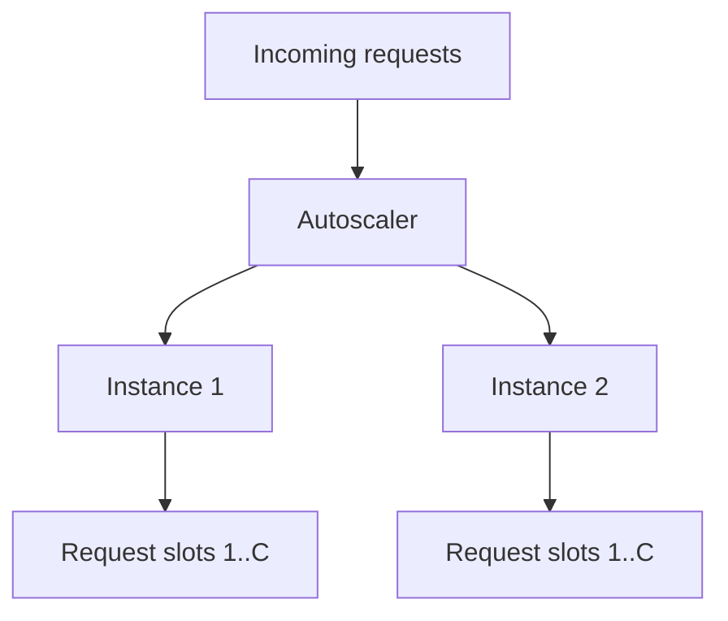

# Configuring concurrency, min instances, and max instances

A Java function on Google Cloud can receive many requests or events in a short period. The serverless platform automatically creates additional instances to handle load, yet scaling must be bounded according to the actual capacity of the application and its dependent services. Three critical configuration settings are **concurrency**, **minimum instances**, and **maximum instances**.

Concurrency determines how many concurrent requests one instance can handle. Min instances keep a number of instances warm to reduce startup wait time. Max instances set a scaling ceiling to protect budgets and databases. These three settings interact with one another: higher concurrency can reduce the number of instances required; higher min instances increase readiness at higher cost; lower max instances protect downstream systems but can cause requests to queue or fail when load exceeds the limit.

Within the scope of **CLOUD_SERVERLESS**, this lesson focuses on developing and deploying Java functions triggered by HTTP, messages, or events, while handling cold starts, scaling, state, access control, retries, and cost. The examples use Cloud Run functions 2nd gen and Cloud Run services; distinguish the configuration of these two resource types and do not apply defaults from one to the other.

## 1. Distinguishing Cloud Run functions and Cloud Run services

Google Cloud provides multiple ways to deploy serverless workloads. Cloud Run functions (formerly commonly known as Cloud Functions 2nd gen) lets you deploy functions from source code with HTTP triggers or event triggers. Cloud Run services run application-provided HTTP containers. Cloud Run functions 2nd gen is deployed on Cloud Run infrastructure, so they share many scaling concepts, though their configuration interfaces and certain defaults differ.

| Concept | Cloud Run functions 1st gen | Cloud Run functions 2nd gen | Cloud Run services |
|---|---|---|---|
| Deployment unit | Function | Function deployed as a Cloud Run service/revision | Service consisting of one or more revisions |
| Concurrency | Does not configure multi-request concurrency like 2nd gen | Configurable; API default is 1 request/instance | Configurable max requests/instance; default depends on deployment method |
| Min instances | Has generation- and trigger-specific settings | Has min instance setting for the function | Configurable at service or revision level |
| Max instances | Has generation- and trigger-specific limits | Has max instance setting for the function | Has service-level and revision-level max |
| Suitable for | Legacy workloads already using gen 1 | Event/HTTP functions needing Cloud Run gen 2 capabilities | Java web/API containers or frameworks managing their own HTTP server |

When reading documentation, identify whether you are working with Cloud Run functions or a Cloud Run service. For instance, `gcloud functions deploy` uses `--min-instances`, `--max-instances`, and `--concurrency`; `gcloud run deploy` has `--min`, `--max` at service level and `--min-instances`, `--max-instances` at revision level.

## 2. What is concurrency?

Concurrency is the maximum number of requests a single instance can process simultaneously. If an instance has concurrency equal to 1, it handles one request at a time. If concurrency equals 8, the platform can send up to 8 concurrent requests to that instance, provided the application and resources can keep up.



Concurrency is an upper bound, not a guarantee that an instance will always receive that exact number of requests. If CPU is already busy, memory is near its limit, or the application cannot handle additional requests, the autoscaler may spin up another instance instead of pushing more requests onto the existing instance.

Concurrency affects:

- The number of instances required to handle the same volume of in-flight requests.
- CPU and memory usage per instance.
- The number of threads, connections, and shared resources inside the Java application.
- Latency when requests must wait in internal queues or wait for connection pools.
- Cost, as instance count and active instance duration change.

## 3. Concurrency defaults vary by deployment type

Do not assume every Google Cloud workload has the same default concurrency value.

- Cloud Run functions 2nd gen has the `maxInstanceRequestConcurrency` field; current API documentation describes the default as `1`.
- Cloud Run services support up to `1,000` concurrent requests per instance. The default is commonly `80` when deploying via the Console; with `gcloud` CLI or Terraform, the default for a new service may be `80` times the number of vCPUs.
- Cloud Run functions 1st gen does not support configuring multiple concurrent requests per instance like 2nd gen.

Defaults can change by tool, API version, and runtime configuration. For critical workloads, set an explicit value and inspect the revision/function after deployment.

## 4. How does concurrency affect Java?

Java can process multiple concurrent requests across multiple threads. However, high concurrency only helps if the application is designed to be thread-safe and has sufficient resources for simultaneous requests.

Areas to review:

- **Thread safety:** controllers, handlers, singleton services, and shared libraries must not hold mutable per-request state without proper synchronization.
- **Database connection pool:** if 20 concurrent requests need the database simultaneously but the pool has only 5 connections, the remaining 15 requests may have to wait.
- **CPU:** CPU-bound tasks such as image compression, encryption, or heavy computation can contend for CPU when concurrency is too high.
- **Memory:** each request may hold payloads, object graphs, buffers, or intermediate results; more concurrent requests increase memory usage.
- **HTTP clients:** connection pool limits, timeouts, and client reuse must match request concurrency.
- **Dependency rate limits:** raising concurrency can exceed external API quotas or overload databases.

A stateless Java service using thread-safe clients and bounded connection pools can usually take advantage of concurrency. If a handler keeps mutable state in fields or shares a single JDBC connection, fix the design before increasing concurrency.

Example of a handler that does not store request data in fields:

```java
public final class ReportService {
    private final ReportRepository repository;

    public ReportService(ReportRepository repository) {
        this.repository = repository;
    }

    public Report create(CreateReportCommand command) {
        // Local variable scoped to the current invocation.
        var filters = command.filters();
        return repository.create(command.ownerId(), filters);
    }
}
```

The `ReportService` object can be shared if its dependencies are safe for concurrent calls. Do not add fields like `currentUser`, `currentRequest`, or `currentReport` to hold per-invocation data.

## 5. Choosing low or high concurrency?

Low concurrency typically fits when each request uses heavy CPU, significant memory, holds long transactions, or requires strong isolation. High concurrency can fit lightweight requests that are primarily I/O-bound and share resources efficiently.

| Workload characteristic | Starting direction |
|---|---|
| CPU-bound, heavy processing | Low concurrency; increase gradually after benchmarking |
| I/O-bound, waiting on database or HTTP | Can try higher concurrency, bounded by pools and downstream quotas |
| Uses non-thread-safe libraries | Set low concurrency or replace/adapt library usage |
| Requests hold large data in memory | Lower concurrency to avoid memory pressure |
| Simple, stateless, short-lived API | Try a moderate level and measure latency and cost |
| 2nd gen function needing near 1 request/instance behavior | Set concurrency to 1 |

There is no single optimal value for all Java functions. Run load tests with realistic data and dependencies, then choose the concurrency level that achieves required throughput without pushing p95/p99 latency, errors, or resources past thresholds.

## 6. What are min instances?

Min instances is the minimum number of instances the platform tries to keep in a ready state. When there are no requests, these instances may stay idle. When traffic arrives, requests can be routed to already-initialized instances instead of waiting for a new instance to start up.

Min instances are useful when:

- An API has low-latency requirements and cold starts visibly impact p95/p99.
- A function is invoked frequently in bursts, but not steadily enough to always keep active instances alive.
- Java initialization takes time due to frameworks, dependencies, or initial connections.
- Traffic schedules are predictable and a baseline amount of capacity needs to be pre-warmed.

Min instances are not an absolute guarantee that cold starts will never occur. The platform may restart instances, rebalance infrastructure, or temporarily fall below the minimum due to quotas, regional capacity, or application failures. New instances can still be created when traffic exceeds pre-warmed capacity.

## 7. Min instances at service level and revision level

Cloud Run services support two scopes for min instances:

- **Service-level minimum:** sets the minimum across the entire service. The platform distributes instances among revisions receiving traffic proportionally to the traffic split. Changes can be applied without creating a new revision.
- **Revision-level minimum:** sets the minimum for a specific revision. Configuration changes create a new revision; a revision may stay running when referenced by a traffic split or traffic tag.

Google recommends preferring service-level minimum for most cases and avoiding mixing both scopes without a clear reason. If you attach a traffic tag to a revision with a revision-level minimum, that revision may stay running even when receiving no normal traffic and will still incur charges.

For Cloud Run functions 2nd gen, the function configuration has the `minInstanceCount` field. When using `gcloud functions deploy`, you can set `--min-instances`. Do not confuse this flag name with Cloud Run's service-level `--min`.

## 8. What are max instances?

Max instances sets a limit on the number of instances a service or function is allowed to use under normal conditions. This helps control:

- Cost during traffic spikes.
- Concurrent connections to databases.
- Load placed on downstream APIs or systems.
- CPU/memory resources consumed within a region.
- Concurrency levels and processing rates the system can sustain.

Max instances does not mean the system will always scale up to that value. The platform is also constrained by regional CPU/memory quotas, infrastructure capacity, startup times, and application health.

Max instances is also not a hard instantaneous cap at every moment. During rapid traffic surges, instance replacements, or new revision rollouts, total instances may temporarily exceed the configured value. If downstream systems cannot tolerate any overshoot, set max lower than the hard budget and enforce additional limits at the database/proxy layer.

## 9. Max instances at service level and revision level

Cloud Run services have two max instances scopes:

- **Service-level max:** limits the total number of instances for the service, distributed across revisions receiving traffic. This is usually the right choice to cap cost or total load on a database.
- **Revision-level max:** limits each revision individually. Configuration is tied to the revision and changes create a new revision.

When both are set, the effective limit is usually the lower of service max and revision max. With a traffic split, service-level max is divided proportionally to traffic across revisions. Thus, a single revision can hit its individual limit even if the overall service has not exhausted its entire instance budget.

During a new revision rollout, the old revision may continue serving in-flight requests while the new revision receives traffic. Therefore, if you calculate max based only on one revision, total instances during rollout may be higher than expected.

For Cloud Run functions 2nd gen, use `--max-instances` in `gcloud functions deploy` to configure the function. For Cloud Run services, consider `--max` at service level when the goal is capping total instances for the service.

## 10. Calculating capacity from concurrency and instance count

A simple estimate of the number of requests that can be processed concurrently:

\[
\text{In-flight capacity} \approx \text{instances} \times \text{concurrency}
\]

If a service has max 20 instances and concurrency 8, theoretical capacity is around 160 concurrent requests. This is only the bound from those two settings; CPU, memory, application logic, processing time, and dependencies can make actual capacity lower.

To estimate concurrent in-flight requests from traffic rate and latency, you can apply Little's Law:

\[
L = \lambda \times W
\]

Where `L` is the average number of requests being processed, `λ` is the arrival rate in requests per second, and `W` is the average processing time in seconds.

For example, an API receives an average of 100 requests/second and each request takes 0.2 seconds. The estimated average number of in-flight requests is 20. If concurrency per instance is set to 5, around 4 instances are needed to serve this average load. To absorb peaks, latency variance, and headroom, test higher loads and observe the autoscaler.

Do not use this formula as a guarantee of instance count. The Cloud Run autoscaler also factors in CPU utilization, request concurrency, startup rate, and regional limits.

## 11. Balancing the three settings

The three settings answer three different questions:

| Setting | Question | Value too low | Value too high |
|---|---|---|---|
| Concurrency | How many requests does one instance handle simultaneously? | Needs more instances, potentially increasing cold starts and cost | Contention on CPU/memory, threads, and connections; higher latency |
| Min instances | How many instances should stay pre-warmed? | Cold starts may occur when no active instance exists | Wastes idle cost and spreads traffic across too many instances |
| Max instances | What is the maximum number of instances allowed to scale? | Requests wait/fail, backlog, or throttling | May exceed budget and overload downstream systems |

A starting configuration for a Java API might be concurrency 4–8, min 1, and max 10–20, purely as a baseline hypothesis to benchmark. A CPU-bound image-processing function or a database-writing function with a small pool may need lower concurrency. Lightweight, I/O-bound APIs can handle higher concurrency.

## 12. Example: calculating a database connection budget

Suppose a Java service has:

- Max instances = 30.
- Each instance has a JDBC pool with a maximum of 4 connections.
- Other applications use 40 connections.
- The database has a limit of 200 connections, and 30 connections must be reserved for administration and batch jobs.

Estimated maximum connection demand from the service:

\[
30 \times 4 = 120 \text{ connections}
\]

Remaining budget after subtracting other workloads and reserve:

\[
200 - 40 - 30 = 130 \text{ connections}
\]

The service uses up to 120 connections, staying within the 130 budget under these assumptions. If max instances is increased to 40, demand becomes 160 connections and exceeds the budget.

This example shows that max instances should not be set based on traffic alone. You must jointly account for concurrency, pool size, the number of functions/services sharing the database, and other connections. If the max pool size is 4 while concurrency is 12, each instance may have 8 requests waiting for a connection; measure wait times and decide whether to raise pool size or lower concurrency.

## 13. Configuring Cloud Run functions 2nd gen with gcloud

Example deploying a 2nd gen HTTP Java function with explicit concurrency, min, and max:

```bash
gcloud functions deploy orders-api \
  --gen2 \
  --runtime=javaXX \
  --region=asia-southeast1 \
  --source=. \
  --entry-point=com.example.OrdersFunction \
  --trigger-http \
  --concurrency=8 \
  --min-instances=1 \
  --max-instances=20 \
  --memory=1Gi \
  --cpu=1
```

`javaXX` is a placeholder; replace it with a Java runtime supported by Google Cloud at deployment time. The entry point name must match the class/function in the artifact. These scaling flags apply to Cloud Run functions 2nd gen; 1st gen does not support multi-request concurrency per instance.

You can update a deployed function using the same command with the same function name and region. Use `--clear-min-instances` or `--clear-max-instances` when you want to remove the corresponding setting; inspect the deployed configuration afterward to confirm the effective values.

## 14. Configuring a Cloud Run service with gcloud

If the Java application is packaged as a container and deployed as a Cloud Run service, you can configure service-level min/max alongside concurrency:

```bash
gcloud run deploy orders-service \
  --image=asia-southeast1-docker.pkg.dev/PROJECT_ID/apps/orders:VERSION \
  --region=asia-southeast1 \
  --concurrency=8 \
  --min=1 \
  --max=20 \
  --cpu=1 \
  --memory=1Gi
```

In the command above, `--min` and `--max` apply at the service level. If you need per-revision min/max settings, the Cloud Run CLI provides `--min-instances` and `--max-instances`. Do not mix the two pairs of flags without understanding how Cloud Run allocates instances between service and revision scopes.

Replace `PROJECT_ID`, image, version, and region with your environment's values. For a Cloud Run service, the Java container must listen on the port provided via the `PORT` environment variable and satisfy the platform's readiness/startup behavior.

## 15. Configuring via YAML or Terraform

A Cloud Run service can be configured via YAML. Abbreviated example:

```yaml
apiVersion: serving.knative.dev/v1
kind: Service
metadata:
  name: orders-service
  annotations:
    run.googleapis.com/minScale: '1'
    run.googleapis.com/maxScale: '20'
spec:
  template:
    spec:
      containerConcurrency: 8
      containers:
        - image: asia-southeast1-docker.pkg.dev/PROJECT_ID/apps/orders:VERSION
```

In this example, annotations in `metadata` set min/max at service level; `containerConcurrency` belongs to the revision template. To configure per-revision scaling, place scaling annotations in `spec.template.metadata.annotations` per the Cloud Run documentation.

With Terraform Cloud Run v2, the corresponding attributes are typically set in the `google_cloud_run_v2_service` resource:

```hcl
resource "google_cloud_run_v2_service" "orders" {
  name     = "orders-service"
  location = "asia-southeast1"

  scaling {
    min_instance_count = 1
    max_instance_count = 20
  }

  template {
    max_instance_request_concurrency = 8

    containers {
      image = "asia-southeast1-docker.pkg.dev/PROJECT_ID/apps/orders:VERSION"
    }
  }
}
```

This is a structural example; you must add project, service account, ingress, CPU, memory, environment variables, and project security settings. Terraform/API field names may vary across provider versions; verify the schema of the provider version pinned in your repository.

## 16. Min instances and Java cold starts

A cold start is the time the platform needs to create a new instance, start the runtime/container, load classes, initialize the framework, and become ready to receive requests. For Java, factors that can increase startup time include:

- The number of classes and dependencies that must be loaded.
- Initialization time of Spring or a similar framework.
- Creating SDK clients, connection pools, or caches at startup.
- Reading configuration and secrets from external services.
- Establishing database or network connections.
- Container image size and image pull time.

Min instances help keep baseline capacity ready, but do not replace startup optimization. Measure initialization time separately from request-processing time; trim unnecessary dependencies, reuse thread-safe clients, and avoid slow network calls inside static initializers when unnecessary.

Min instances can also be restarted. Therefore, never store business state in instance memory under the assumption that an instance will persist continuously. Critical data must be stored in a database, object storage, or durable state store.

## 17. Max instances and backpressure

When all instances reach maximum concurrency and the service hits max instances, incoming requests may wait for a bounded period. If no capacity frees up, HTTP requests may fail with status codes such as `429` or capacity-related errors. Exact behavior depends on the trigger type and platform.

For event-driven workloads, examine the event source's retry/delivery mechanism. Some sources retain events and retry when the function cannot accept them; HTTP callers may need to retry per the API contract. Do not assume every request is durably buffered when max instances is reached.

Backpressure keeps load within limits that downstream dependencies can handle:

- Use queues to decouple event ingestion rate from processing rate.
- Cap concurrency or max instances according to database/API dependencies.
- Use retries with backoff and jitter to avoid retry storms.
- Return `429`/`503` appropriately when the system cannot accept more work.
- For long-running tasks, return a task ID and process asynchronously instead of holding HTTP requests open.
- Monitor queue depth, request latency, and throttling counts to tune capacity.

## 18. Costs of min, max, and concurrency

Costs depend on instance count, CPU/memory, active duration, requests, networking, and the configured billing mode.

- **Min instances:** idle instances can still incur charges. Under request-based billing, idle instances may be billed at a lower rate while waiting for requests; under instance-based billing, charges apply across the entire instance lifecycle.
- **Max instances:** high max improves peak serving capability but expands the ceiling for resource consumption and cost. Low max reduces budget risk but can cause queueing, 429s, or backlogs.
- **Concurrency:** higher concurrency can allow fewer instances to serve the same request volume, but if it causes memory/CPU pressure or stretches latency, total cost and error rates may rise.
- **CPU/memory:** increasing per-instance resources can raise throughput and shorten processing time, while per-instance unit cost also changes.

Do not set min equal to peak capacity if traffic is low most of the time. Min should align with the baseline load requiring fast responses. Max should reflect budget limits and downstream capacity. Use billing budgets and alerts to detect anomalous cost spikes.

## 19. Monitoring and tuning configuration

Metrics to observe together:

| Group | Metrics | Signals to watch |
|---|---|---|
| Traffic | Request count, request rate, event rate | Bursts or abnormal traffic growth |
| Latency | p50, p95, p99, startup latency | Cold starts or requests waiting for capacity |
| Concurrency | Concurrent requests, utilization per instance | Concurrency hitting ceiling or set too high |
| Scaling | Active/idle instance count, min/max reached | Max cap reached, slow scaling, or excess min |
| Errors | 429, 5xx, timeouts, failed invocations | Insufficient capacity or failing dependencies |
| Runtime | CPU, memory, GC pauses, thread count | CPU/memory pressure or thread pool contention |
| Database | Active/idle connections, pool wait, query latency | Max instances × pool size exceeding budget |
| Cost | CPU-seconds, GiB-seconds, idle instance time | High min or prolonged scale-out |

Adjust one parameter at a time or use a controlled test matrix. For example, run concurrency 1, 4, 8, and 16 with the same payload; record throughput, p95, memory, and database wait times. Then keep the best concurrency and vary min/max to evaluate cold starts, backlogs, and cost.

## 20. Benchmarking workflow for Java functions

A practical workflow:

1. Pick a representative function and fix the Java version, CPU, memory, framework, payload, and dependencies.
2. Measure cold starts with min instances set to 0; separate the first request from warm requests.
3. Run steady and burst loads at concurrency 1, 4, 8, 16, or values appropriate for the application.
4. Record throughput, p95/p99 latency, CPU, memory, GC, connection pool wait times, and errors.
5. Set max instances high enough to benchmark application capability without breaking databases or external services.
6. Set min instances to 1 or the expected baseline load, and measure cold start rate and idle cost.
7. Lower max instances to simulate downstream constraints; verify queueing, 429, and retry behavior.
8. Rerun after changing frameworks, dependencies, connection pools, or Java runtimes.

Do not benchmark average requests only. Include large payloads, slow queries, dependency failures, and burst scenarios to see how the system behaves near its limits.

## 21. Common configuration mistakes

| Symptom | Possible cause | How to check |
|---|---|---|
| Many instances despite moderate traffic | Concurrency set too low or slow request processing | Check concurrency, CPU, and latency |
| One instance handles many requests but latency climbs | Concurrency too high; CPU/thread/memory contention | Lower concurrency and re-benchmark |
| Cold starts still appear even with min > 0 | Instance restarted, scale-out created new instances, or min is best-effort | Monitor startup latency and instance lifecycle |
| Database runs out of connections during traffic spikes | Max instances × pool size exceeds connection budget | Sum total pools and reduce max/concurrency or use a proxy |
| Requests return 429 during sudden bursts | Max instances hit ceiling or regional quota/capacity limits | Inspect max limit, quotas, and pending requests |
| High idle cost | High min instances or billing mode charges full instance lifecycle | Check min, idle time, and billing mode |
| Rollout creates more instances than expected | Old and new revisions serve requests concurrently during traffic shift | Account for multiple revisions during rollout |
| Max is high but service does not scale up to it | Regional CPU/memory quota or capacity limits | Check quotas and scaling metrics |

## 22. Production checklist

| Question | Evidence needed |
|---|---|
| Using Cloud Run functions or Cloud Run service? | Resource type and generation clearly identified |
| Does concurrency fit the Java code? | Load tests, thread safety, CPU, and memory data |
| Is the database pool large enough without being excessive? | Connection budget across max instances and other workloads |
| Is there a clear rationale for min instances? | Cold start/latency data and idle cost estimate |
| Does max instances protect downstream systems? | Database/API capacity and safety margin |
| Service-level or revision-level scaling? | Decision based on traffic splits and rollouts |
| Is behavior at max capacity understood? | Tests for 429s, pending requests, event retries, and backlogs |
| Are cold starts and scaling observed? | Startup latency, instance count, concurrency, and error metrics |
| Are regional quotas accounted for? | CPU/memory quotas and aggregate usage |
| Is min idle cost accounted for? | Billing mode, budget, and alerts |
| Is state persisted durably? | No reliance on instance memory |
| Is there a re-testing plan? | Re-benchmark when changing runtime, dependencies, or config |

## 23. When should you raise or lower each setting?

**Increase concurrency** when instances still have CPU/memory headroom, requests mostly wait on I/O, code is thread-safe, and downstream services have spare capacity. Lower concurrency when requests are CPU-bound, memory-heavy, dependencies are constrained, or p95/p99 rises from resource contention.

**Increase min instances** when cold starts violate latency targets and baseline traffic is steady enough to justify idle cost. Lower min when too many instances sit idle, startup has been optimized, or cold start latency is acceptable.

**Increase max instances** when request backlogs or throttling rise, databases/APIs still have capacity, and budget allows. Lower max when protecting databases, API quotas, or budgets, while ensuring proper backpressure, queues, and retries are in place.

Concurrency, min instances, and max instances should be tuned based on measurements from your own workload. For Java functions, verify thread safety, connection pools, CPU, memory, and initialization time before increasing capacity. A good configuration meets required latency and throughput, keeps downstream dependencies within limits, and maintains predictable costs.

## 24. References

- [Cloud Run: Maximum concurrent requests for services](https://cloud.google.com/run/docs/about-concurrency)
- [Cloud Run: Set minimum instances for services](https://cloud.google.com/run/docs/configuring/min-instances)
- [Cloud Run: Set maximum instances for services](https://cloud.google.com/run/docs/configuring/max-instances)
- [Cloud Run functions: Quotas and limits](https://cloud.google.com/functions/quotas)
- [Cloud Run functions v2 API: Function service configuration](https://cloud.google.com/functions/docs/reference/rest/v2/projects.locations.functions)
- [Google Cloud SDK: gcloud functions deploy](https://cloud.google.com/sdk/gcloud/reference/functions/deploy)
- [Google Cloud SDK: gcloud run deploy](https://cloud.google.com/sdk/gcloud/reference/run/deploy)
