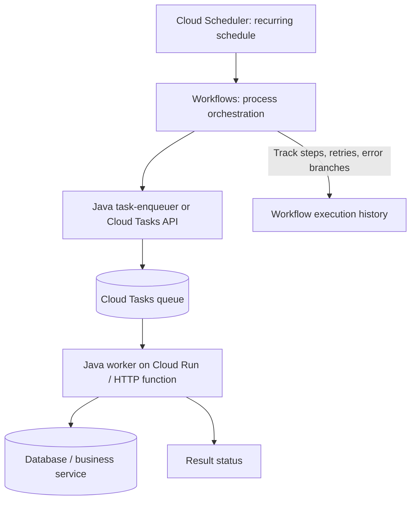
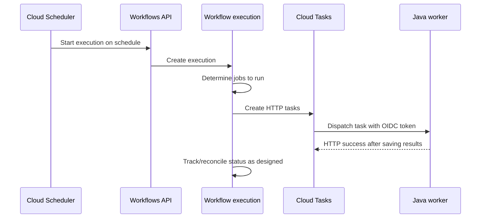
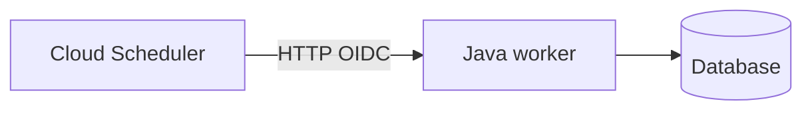
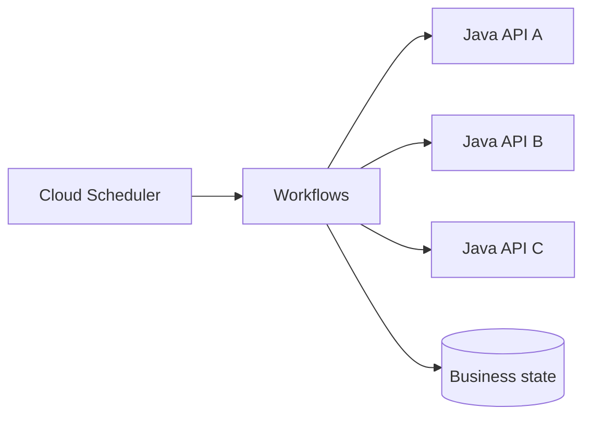
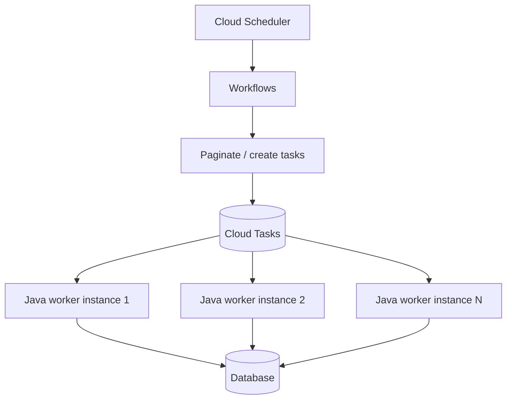
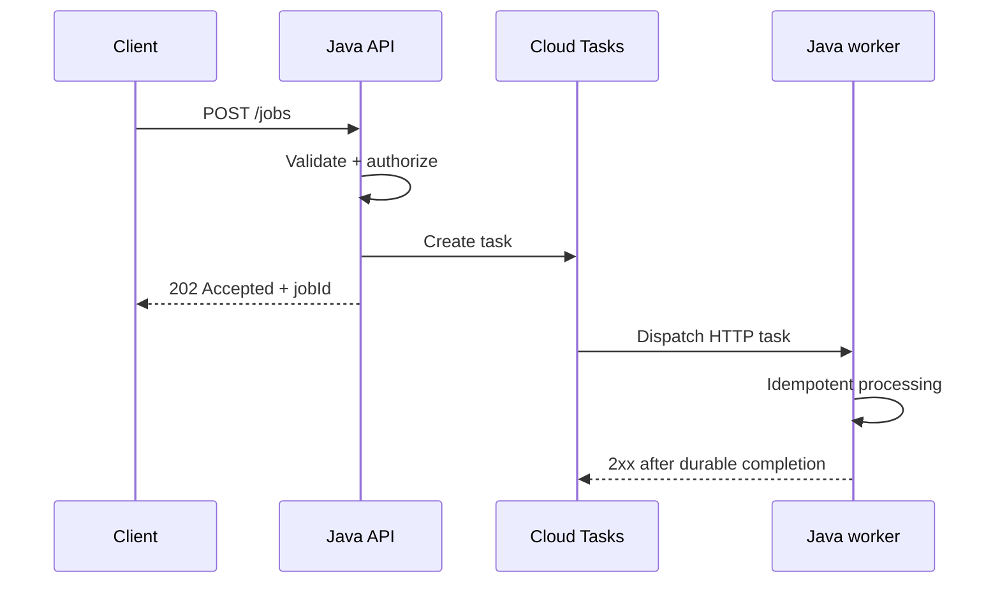

# Orchestrating with Workflows, Cloud Tasks, and Cloud Scheduler

A serverless application typically has several kinds of work: running a multi-step business workflow, dispatching a task to a worker at the right time, or automatically starting work on a schedule. On Google Cloud, **Workflows**, **Cloud Tasks**, and **Cloud Scheduler** solve three related yet distinct needs.

- **Workflows** orchestrates a multi-step process, stores execution state, and manages branching, retries, and errors across steps.
- **Cloud Tasks** queues an HTTP task for delivery to a worker, controlling dispatch rate and concurrency while retrying when the endpoint has not succeeded.
- **Cloud Scheduler** triggers a job on a cron schedule or configured cadence, such as nightly, hourly, or on the first day of the month.

These three services can work together. For instance, Cloud Scheduler launches Workflows every night; the workflow queries the data batches to process and creates Cloud Tasks; Cloud Tasks dispatches each task to a Java service running on Cloud Run or an HTTP function. This separation gives scheduling, orchestration logic, and load distribution clear boundaries of responsibility.

## 1. Distinguishing the roles of the three services

| Service | Primary question | Mechanism | Best suited for |
|---|---|---|---|
| Workflows | In what sequence must business steps run? | Workflow definition with steps, conditions, loops, parallel branches, retries, and error handling | Multi-step workflows, integrating multiple APIs, tracking progress state |
| Cloud Tasks | When and at what rate should an HTTP task be delivered to a worker? | Task queue, HTTP target, dispatch rate, concurrency, and retry policy | Background processing, deferred work, rate-limiting service calls, absorbing bursts |
| Cloud Scheduler | When should a job be triggered? | Cron schedule/time zone and HTTP, Pub/Sub, or App Engine targets | Periodic reports, cleanups, scheduled syncs, launching workflows |

Do not use one service to replace the other two entirely. Workflows can wait and retry a step, but it is not a queue for dispatching huge volumes of independent tasks with fine-grained rate control. Cloud Tasks can schedule a single task in the future, but it is not a recurring cron scheduler. Cloud Scheduler fires on a schedule, but it does not manage the full state of a multi-step workflow.

### Common combined architecture



For example: every day at 02:00 UTC, Scheduler starts a report-generation workflow. The workflow identifies customers to process, splits them into small tasks, and enqueues them in Cloud Tasks. The queue dispatches only a bounded number of requests per second. The Java worker processes each task, writes results, and returns HTTP success once completed or once durable intake state is saved per the contract.

## 2. Workflows: stateful process orchestration

Google Cloud Workflows is a serverless orchestration service. Developers describe workflows in YAML or JSON. Each execution progresses through steps that can call HTTP endpoints, use connectors to Google Cloud APIs, assign variables, branch, loop, run in parallel, handle errors, and invoke subworkflows.

Workflows is helpful when a process must explicitly express:

- Which step must finish before another starts.
- Which condition determines the next branch.
- Which steps can be retried and with what backoff.
- When a step fails, whether to stop, retry, invoke a compensating step, or mark the workflow failed.
- How the output of each step is passed to subsequent steps.

Workflows persists execution state and execution history so progress can be monitored. However, workflow state does not replace the business database. Data such as order status, ownership, balances, or results queried long-term should still live in application-managed data stores.

### Example workflow calling a Java HTTP service

Suppose a Java service on Cloud Run exposes `POST /prepare` and `POST /finalize`. The workflow invokes the preparation step and then finalizes; if a call fails transiently, the workflow retries with exponential backoff.

```yaml
main:
  params: [args]
  steps:
    - initialize:
        assign:
          - jobId: ${args.jobId}
          - workerUrl: ${sys.get_env("WORKER_URL")}

    - prepare:
        call: http.post
        args:
          url: ${workerUrl + "/prepare"}
          auth:
            type: OIDC
            audience: ${workerUrl}
          body:
            jobId: ${jobId}
        result: prepareResponse
        retry:
          predicate: ${http.default_retry_predicate}
          max_retries: 3
          backoff:
            initial_delay: 1
            max_delay: 20
            multiplier: 2

    - finalize:
        call: http.post
        args:
          url: ${workerUrl + "/finalize"}
          auth:
            type: OIDC
            audience: ${workerUrl}
          body:
            jobId: ${jobId}
            preparation: ${prepareResponse.body}
        result: finalizeResponse

    - finish:
        return:
          jobId: ${jobId}
          status: ${finalizeResponse.code}
```

This example illustrates Workflows syntax. Replace URLs, audience, and response contracts according to your real service. The workflow's service account must have permission to invoke the Cloud Run service, typically `roles/run.invoker`. If the endpoint uses a different authentication mechanism, configure `auth` accordingly. Never make a production endpoint public just so a workflow can call it.

### Retries in Workflows

Retries should be reserved for recoverable errors such as network timeouts, throttling, or transient service failures. A retry policy typically defines:

- A predicate identifying which errors are retryable.
- Maximum retry count.
- Initial wait delay.
- Maximum wait delay.
- Backoff multiplier.

Do not infinitely retry validation errors, permission errors, or invalid business data. When a step has produced a side effect and the response was lost, a retry may call that step again. Therefore, endpoints invoked by Workflows must be idempotent by `jobId`, operation ID, or business key.

### Compensation and Sagas

Workflows orchestrates steps, but does not automatically create a distributed transaction spanning databases, payment services, and other APIs. If the third step fails after the first two steps already produced side effects, the workflow can invoke application-defined compensating steps.

For example:

1. Reserve inventory.
2. Create payment request.
3. Confirm order.
4. If order confirmation fails, invoke payment cancellation and release inventory if business rules permit.

Compensating actions can also fail and require retries, auditing, and idempotency. Not every side effect is cleanly reversible; explicitly define intermediate states and manual remediation procedures.

### When should you avoid Workflows?

If you only need to call a single HTTP endpoint, a task queue or Scheduler directly may be simpler. If you need to process a huge number of independent messages with high throughput, Cloud Tasks or Pub/Sub is usually more appropriate. A workflow should model a multi-step business process that requires state visibility, rather than turning into a giant loop replacing a queue.

## 3. Cloud Tasks: controlled HTTP task dispatch

Cloud Tasks stores tasks in a queue and dispatches them to an HTTP target. The queue can control dispatch rate, concurrent requests, and retries when the target has not yet confirmed success. Workers can be Cloud Run services, Cloud Run functions, or compatible HTTP endpoints.

Cloud Tasks fits when an application needs to:

- Offload a task out of the current request so a response returns quickly.
- Defer a task until a specific future time.
- Rate-limit calls to external APIs or databases.
- Absorb traffic bursts and distribute work according to worker capacity.
- Retry requests when an endpoint suffers transient errors or timeouts.

Cloud Tasks is an HTTP-oriented queue. Producers create tasks and Cloud Tasks invokes the target endpoint; workers do not pull messages themselves as in traditional consumer-queue models. When the endpoint returns a success response per the Cloud Tasks contract, the task is considered complete. If the request fails or is unacknowledged, the task can be re-dispatched according to the retry policy.

### Dispatch rate and concurrency

Queues offer load-control settings such as:

- Maximum dispatches per second.
- Maximum concurrent dispatched tasks.
- Maximum number of attempts.
- Min/max backoff and max doublings.
- Maximum retry duration.

These limits help protect workers and dependencies. For example, if a database can handle only a fixed number of connections or requests, the queue can cap concurrency so workers do not generate excessive bursts. Monitor queue depth and oldest task age to tell whether workers are keeping up with producers.

### Retries and at-least-once delivery

Cloud Tasks may dispatch the same task multiple times. A typical scenario: the worker successfully writes data, but the response is lost before Cloud Tasks receives confirmation. The task will be dispatched again. Thus, workers must be idempotent.

Task names can help detect duplicate task creation within the service's supported deduplication window. However, do not rely on task names as an exactly-once guarantee for business logic. Persist a business idempotency key in the database and protect side effects using unique constraints or conditional updates.

Cloud Tasks is not an arbitrary-retention/replay event log and does not share the same DLQ model as a Pub/Sub subscription. Configure bounded retries, persist failure state in the application, and build a controlled investigation/re-enqueue workflow for permanently failed tasks.

## 4. Creating a Cloud Task from Java

Java can use the Google Cloud Tasks client library to enqueue HTTP tasks. Maven dependency:

```xml
<dependency>
    <groupId>com.google.cloud</groupId>
    <artifactId>google-cloud-tasks</artifactId>
    <version>${google.cloud.tasks.version}</version>
</dependency>
```

Manage the version with a Maven property or dependency management matching the BOM/library version selected by your project. The example below creates a POST task targeting a Cloud Run service and attaches a service account OIDC token for request authentication.

```java
import com.google.cloud.tasks.v2.CloudTasksClient;
import com.google.cloud.tasks.v2.HttpMethod;
import com.google.cloud.tasks.v2.HttpRequest;
import com.google.cloud.tasks.v2.OidcToken;
import com.google.cloud.tasks.v2.QueueName;
import com.google.cloud.tasks.v2.Task;
import com.google.protobuf.ByteString;

public final class TaskEnqueuer {
    private final CloudTasksClient client;
    private final String projectId;
    private final String locationId;
    private final String queueId;
    private final String workerUrl;
    private final String taskServiceAccount;

    public TaskEnqueuer(
            CloudTasksClient client,
            String projectId,
            String locationId,
            String queueId,
            String workerUrl,
            String taskServiceAccount) {
        this.client = client;
        this.projectId = projectId;
        this.locationId = locationId;
        this.queueId = queueId;
        this.workerUrl = workerUrl;
        this.taskServiceAccount = taskServiceAccount;
    }

    public Task enqueue(String jobId) {
        String body = "{\"jobId\":\"" + jobId + "\"}";

        HttpRequest request = HttpRequest.newBuilder()
                .setHttpMethod(HttpMethod.POST)
                .setUrl(workerUrl + "/tasks/process")
                .putHeaders("Content-Type", "application/json")
                .setBody(ByteString.copyFromUtf8(body))
                .setOidcToken(OidcToken.newBuilder()
                        .setServiceAccountEmail(taskServiceAccount)
                        .setAudience(workerUrl)
                        .build())
                .build();

        Task task = Task.newBuilder()
                .setHttpRequest(request)
                .build();

        QueueName queue = QueueName.of(projectId, locationId, queueId);
        return client.createTask(queue, task);
    }
}
```

This snippet focuses on constructing the request and OIDC token. In a real application, serialize the body with Jackson/Gson rather than string concatenation to avoid escaping bugs; validate `jobId`; and reuse `CloudTasksClient` across the application/execution environment lifecycle instead of creating a new client per task. `CloudTasksClient` must be closed according to a supported application lifecycle.

### Required permissions

Distinguish two identities:

1. **Enqueuer identity:** the identity of the Java service creating the task. This identity needs permission to create tasks in the queue and `iam.serviceAccounts.actAs` (commonly via `roles/iam.serviceAccountUser`) on the service account attached to the OIDC token.
2. **Task target identity:** the service account Cloud Tasks uses to sign the OIDC token when calling the worker. This identity needs permission to invoke the endpoint, such as `roles/run.invoker` on the Cloud Run service.

The project's Cloud Tasks service agent must also retain its Google-managed role to mint tokens. Do not use a broad default service account when a dedicated least-privilege identity satisfies the requirement.

### Acknowledging tasks in the worker

The worker must verify the request comes from an authorized identity, validate the schema/body, and process using an idempotency key. Return HTTP 2xx only when the work has durably completed or been recorded as accepted under an explicit contract. If the worker returns success before persisting state, the task may be deleted even though the work is not guaranteed.

If the worker returns an error, Cloud Tasks can retry according to the queue policy. Do not return 500 for permanent data errors without a retry cap, because the task will waste resources until the limit is reached. Persist business failures into a state store and provide a manual remediation/re-enqueue workflow.

## 5. Cloud Scheduler: schedule-based triggering

Cloud Scheduler is a managed cron scheduling service. A job can run on a schedule and invoke an HTTP endpoint, publish a message to Pub/Sub, or trigger an App Engine target. Scheduler is useful for periodic jobs without running a dedicated server continuously just to watch the clock.

Examples:

- Running daily revenue reports.
- Cleaning up temporary data weekly.
- Synchronizing partner data hourly.
- Triggering month-end closing workflows.
- Sending scheduled system health checks.

### Cron and time zone

Cloud Scheduler uses cron expressions consisting of minute, hour, day of month, month, and day of week. For example, `0 2 * * *` means run at 02:00 every day in the job's configured time zone.

```text
0 2 * * *
```

For operations and global data workloads, UTC usually avoids surprises from daylight saving time. If business rules require local time, set the time zone explicitly and verify behavior on DST transition days when a local hour can be skipped or repeated.

### Calling Workflows from Scheduler

Cloud Scheduler can call the Workflows Executions API to start an execution on schedule. This is a common combination: Scheduler decides when; Workflows manages the steps that follow.

Example architecture:



When Scheduler calls Google APIs such as the Workflows Executions API, configure an OAuth token using a service account with permission to invoke the workflow. When Scheduler calls a Cloud Run HTTP service directly, you can use an OIDC token and grant `roles/run.invoker` to the service account. Choose the token type according to the target type; do not swap OAuth and OIDC arbitrarily.

### Scheduler can send duplicates

Scheduler is a scheduled delivery mechanism; under certain failure or retry scenarios, the target may receive requests multiple times. The target endpoint should be idempotent by run date, reporting period, or schedule occurrence. For example, use a key like `daily-report:2026-11-17` to ensure two triggers for the same day do not produce two independent reports.

If a Scheduler job starts a workflow, store execution history and a business run ID in the database to prevent duplicate runs. Do not rely solely on request arrival timestamp to determine uniqueness for a run.

## 6. Choosing an orchestration pattern

The following patterns appear frequently in serverless Java applications.

### Pattern A: Scheduler calls worker directly



Use when the periodic job is simple, involves a single endpoint, and needs no multi-step orchestration. The worker must be idempotent with an appropriate timeout. If processing takes long or load fluctuates, move to Cloud Tasks or Workflows.

### Pattern B: Scheduler starts Workflows



Use when work involves sequences, branching, retries, conditions, and requires execution tracking. The workflow handles coordination, while Java services execute business logic.

### Pattern C: Scheduler -> Workflows -> Cloud Tasks -> worker



Use when a single scheduled run needs to fan out many independent jobs while rate-limiting and retrying workers individually. Workflows does not need to wait for every task if business logic only requires recording enqueue completion; if you need to know when all tasks finish, design an explicit state-reconciliation or callback mechanism.

### Pattern D: Intake API -> Cloud Tasks



Use when clients need fast responses and the work can run asynchronously. The API should persist job state or an outbox record before returning 202 to avoid accepting a request and losing the task if enqueuing fails. If database write and task creation cannot be atomic, add a reconciler/outbox to close the failure gap.

## 7. Coordinating retries across layers

When combining all three services, multiple retry layers can emerge:

- Cloud Scheduler retries target calls per the job's retry config.
- Workflows retries individual steps per predicate/backoff.
- Cloud Tasks retries HTTP dispatches per the queue retry policy.
- The Java worker or SDK may retry database/API calls inside the handler.

If every layer retries maximally, a single downstream outage can generate far more requests than expected. Assign which layer owns retries for each error category.

| Error type | Typical handling layer | Notes |
|---|---|---|
| Scheduler fails to call Workflows API | Cloud Scheduler retry | Workflow may not have been created yet; use a run ID/idempotency for the same schedule |
| Workflow calls an API that fails transiently | Workflows step retry | API must be idempotent if the request may already have produced side effects |
| Cloud Tasks worker call times out / 5xx | Cloud Tasks dispatch retry | Worker may already have finished before the response was lost |
| Worker database call gets throttled | Bounded SDK/worker retry | Do not retry past dispatch deadline or invocation timeout |
| Invalid business data | Do not retry blindly | Persist failed status and route to data remediation workflow |

A helpful rule is to retry closest to where the error originates if the error is clearly classifiable, while keeping the total retry budget bounded. Use exponential backoff and jitter when many workers may retry simultaneously. Avoid retrying simultaneously in both the workflow and the task queue for the same operation without idempotency.

### Distinguishing technical status and business status

An HTTP 2xx from a worker means the task was acknowledged per the queue contract; it does not necessarily mean all business processing completed if the worker only recorded intake. Define the response contract explicitly:

- If a task only represents enqueuing a child job, the worker can return 2xx once the child job is durably written.
- If a task represents completed processing, return 2xx only after results are committed.
- For non-retryable business failures, record `FAILED_PERMANENT` status and return a response according to the chosen strategy to prevent infinite retries.

## 8. Idempotency and preventing duplicate execution

Cloud Scheduler, Workflows, and Cloud Tasks can all cause an operation to be retried. Therefore, idempotency must be designed at the business layer, not just in service configuration.

Usable keys:

| Trigger source | Suggested idempotency key |
|---|---|
| Scheduler running daily report | `report:{reportDate}` |
| Scheduler launching monthly workflow | `monthly-close:{yearMonth}` |
| Workflows invoking step for an order | `orderId + operationName + workflowVersion` |
| Cloud Tasks processing job | `jobId` or business event ID |
| Per-item task in a batch | `batchId + itemId + operationVersion` |

The data store must enforce the key with a unique constraint or conditional write. Simple pattern:

1. Create an idempotency record with status `PROCESSING` if it does not exist.
2. If the record is already `COMPLETED`, return the stored result.
3. If another worker holds an active lease, do not execute side effects concurrently.
4. Commit the result and `COMPLETED` status in an appropriate transaction.
5. If a worker crashes midway, the lease expires so another worker can resume via recovery.

Do not use static variables for deduplication because each instance has isolated memory and can be reclaimed. Do not rely solely on task-name deduplication or execution history to protect side effects in databases or external partners.

## 9. IAM and authentication across services

In Google Cloud, each component should use a dedicated service account scoped to its role.

| Component | Typical required permissions |
|---|---|
| Cloud Scheduler job | Permission to invoke target: e.g., Workflows Invoker for workflows, or Cloud Run Invoker for services |
| Workflows execution | Permission to call APIs/services the workflow needs, e.g., `roles/run.invoker` or permission to create tasks in a queue |
| Java enqueuer | Permission to create tasks in the queue; `actAs` permission on the service account used to sign OIDC tokens if required |
| Cloud Tasks target identity | Permission to invoke the target Cloud Run service/function |
| Java worker runtime identity | Permission to access databases, Secret Manager, Storage, or required business services |

For HTTP tasks targeting Cloud Run, Cloud Tasks can attach a service account OIDC token. That service account needs permission to invoke the Cloud Run service. The enqueuer needs permission to create tasks and act as the specified service account. The Cloud Tasks service agent must also retain its Google-managed role.

Workflows calls Cloud Run using OIDC when the endpoint requires IAM authentication. Workflows calls Google APIs typically using OAuth/connector authentication appropriate for the API. Cloud Scheduler calls Google APIs like the Workflows Executions API using an OAuth token; when calling a Cloud Run HTTP target, OIDC is typically appropriate. Pick the token type based on the target type.

Do not share a single Editor-level service account across Scheduler, Workflows, enqueuers, and workers. Separating identities limits blast radius if any component is misconfigured or compromised.

## 10. Deployment regions, quotas, and latency

Workflows, Cloud Tasks queues, Cloud Scheduler jobs, and Cloud Run services each have region/location properties. Choose locations aligned with workers, data, and residency requirements. Cross-region calls increase latency, networking costs, and operational complexity.

Before selecting regions and scaling settings, check:

- Workflows location and ability to reach APIs/services in other regions.
- Cloud Tasks queue location and worker target location.
- Cloud Scheduler job location and target endpoint.
- Quotas for task creation, dispatch rate, concurrent dispatches, and Workflows executions.
- Quotas for Cloud Run concurrency, CPU/memory, and database connections.
- Payload limits, deadlines, and maximum processing durations of each service.

Do not assume raising the dispatch rate automatically makes the whole system faster. If the database is the bottleneck, speeding up the queue simply shifts the backlog from the queue into the database connection pool or lock contention.

## 11. Cost and architectural choices

Consider cost across the entire flow:

- Number of Scheduler job runs and target calls.
- Number of Workflows executions, steps, and execution time under current pricing.
- Number of tasks created and dispatched, plus retry overhead.
- Cloud Run/Functions resources consumed while workers run.
- Logging, tracing, metrics, state persistence, and databases.
- Cross-region or egress network traffic out of Google Cloud.

A small job running once a day might only need Scheduler calling a worker directly. Adding Workflows and Cloud Tasks adds observability, retries, and load control, while also adding components and cost. Conversely, when a workflow has many steps, complex retries, and thousands of tasks needing controlled dispatch, separating roles can reduce operational toil and protect downstream systems.

Estimate costs for both normal and burst scenarios, including retries and tasks generated per Scheduler run. Check current Google Cloud pricing and quotas before locking budgets; avoid hardcoding prices or limits in architecture documents if they may change.

## 12. Observability and troubleshooting

Each service offers its own operational view:

| Service | Signals to monitor |
|---|---|
| Cloud Scheduler | Job execution results, last run time, retries, and target errors |
| Workflows | Execution state, current step, step duration, errors, and retry history |
| Cloud Tasks | Queue depth, task dispatch count, task age, retries, and target responses |
| Cloud Run/Java worker | Request count, latency, error rate, concurrency, CPU/memory, and business logs |
| Database | Connection count, lock waits, query latency, transaction failures, and idempotency conflicts |

Propagate `correlationId`, `workflowExecutionId`, `jobId`, and `taskName` across steps. Use structured logging so you can trace from the Scheduler trigger down to the final worker. Never log access tokens, OIDC tokens, secrets, or full sensitive payloads.

### Common scenarios and investigation paths

- **Scheduler runs but no tasks appear:** check OAuth/OIDC, invoke permissions, target URI, request body, and job logs.
- **Workflow fails at a step:** inspect execution history, response code, retry predicate, and service account permissions.
- **Task queue backlog grows:** inspect dispatch rate, max concurrency, worker errors, downstream latency, and quotas.
- **Task dispatched multiple times:** inspect timeouts, 2xx responses, worker idempotency, and retry policy.
- **Worker returns 401/403:** verify OIDC audience, service account email, IAM bindings, and endpoint authentication.
- **Work completes twice:** inspect business-layer idempotency keys; do not look at task names alone.
- **Schedule fires at the wrong hour:** check time zone, cron expression, and daylight saving time rules.

## 13. Common design mistakes

| Mistake | Consequence | Fix |
|---|---|---|
| Using Scheduler to orchestrate multi-step business logic | Retry and state logic scattered across endpoints | Move sequence into Workflows |
| Using Workflows as a queue for huge numbers of independent tasks | Hard to control dispatch rate to workers | Push tasks to Cloud Tasks or Pub/Sub per model |
| Using Cloud Tasks for long-term cron schedules | Producer must repeatedly re-create tasks manually | Use Cloud Scheduler to launch periodic jobs |
| Assuming a task dispatches only once | Side effects can repeat when responses are lost | Durable idempotency in the worker |
| Returning 2xx before persisting state | Task is acknowledged even though work may be lost | Ack only after completion or durable acceptance |
| Retrying simultaneously at every layer | Amplifies load and prolongs incidents | Assign retry ownership and bound total retry budget |
| Sharing one broad service account | Expands blast radius | Separate service accounts and grant least privilege |
| Leaving workers public without auth | Any caller can trigger work | Use OIDC/IAM or gateway/network controls |
| Not propagating correlation IDs | Hard to trace a job across services | Pass job/workflow/task IDs in payloads and logs |
| Not reconciling permanently failed tasks | Work can be silently dropped | Persist failure state and build a controlled re-enqueue flow |

## 14. Workflow for designing a pipeline

When designing an orchestrated pipeline using these three services, follow this sequence:

1. **Describe goal and trigger.** Does work start on a schedule, on a request, or after an event?
2. **Identify the process.** Are there multiple steps, branches, retries, or compensations? If yes, consider Workflows.
3. **Identify distribution needs.** Are there many independent tasks requiring rate limits, concurrency control, and HTTP retries? If yes, consider Cloud Tasks.
4. **Identify schedules.** Is there a cron/time zone or recurring schedule? Use Cloud Scheduler.
5. **Design contracts.** Define job ID, payload version, callback/status, and 2xx responses.
6. **Design idempotency.** Choose business keys and durable state persistence.
7. **Design IAM.** Separate service accounts for Scheduler, Workflows, enqueuer, and worker; configure OAuth/OIDC per target.
8. **Set a retry budget.** Separate transient and permanent errors; avoid multiplicative retries across layers.
9. **Bound load.** Configure dispatch rate, concurrency, and worker limits to match downstream capacity.
10. **Set up observability and recovery.** Propagate correlation IDs, monitor backlogs, workflow failures, and task failures; define replay/re-enqueue steps.
11. **Failure test.** Test duplicate triggers, post-side-effect timeouts, worker 5xx, IAM 403, queue backlogs, and mid-workflow failures.

## 15. Pre-production checklist

- [ ] Roles of Scheduler, Workflows, and Cloud Tasks are clearly separated.
- [ ] Workflows have input/output contracts and per-step error handling.
- [ ] Side effects inside steps have idempotency keys.
- [ ] Cloud Tasks queues have appropriate dispatch rate, concurrency, and retry policies.
- [ ] Workers return 2xx only after work is processed or durably accepted.
- [ ] A state store exists for permanently failed tasks and a re-enqueue workflow.
- [ ] Scheduler uses explicit cron expressions and time zones.
- [ ] Endpoints are protected with appropriate OAuth/OIDC and IAM.
- [ ] Service accounts are separated by responsibility with least privilege.
- [ ] Retries across layers are bounded and do not amplify load.
- [ ] Correlation IDs flow across scheduler, workflow, task, and worker.
- [ ] Metrics/alerts cover workflow failures, queue backlogs, task retries, and worker errors.
- [ ] Costs are estimated and quotas verified for both normal and burst traffic.
- [ ] Duplicate triggers, timeouts, permission failures, and recovery have been tested.

## Conclusion

Cloud Scheduler decides **when** a job starts; Workflows describes the **steps** of a process and its execution state; Cloud Tasks controls **how fast HTTP tasks are dispatched** and how they are retried. Combining them lets serverless Java run scheduled jobs, coordinate multiple services, and shield workers from traffic spikes. For a reliable pipeline, implement business-layer idempotency, proper IAM/OIDC identities, bounded retry budgets, durable failure states, and end-to-end observability. Add a service only when the orchestration, load control, or operational capabilities it provides solve a concrete system requirement.
