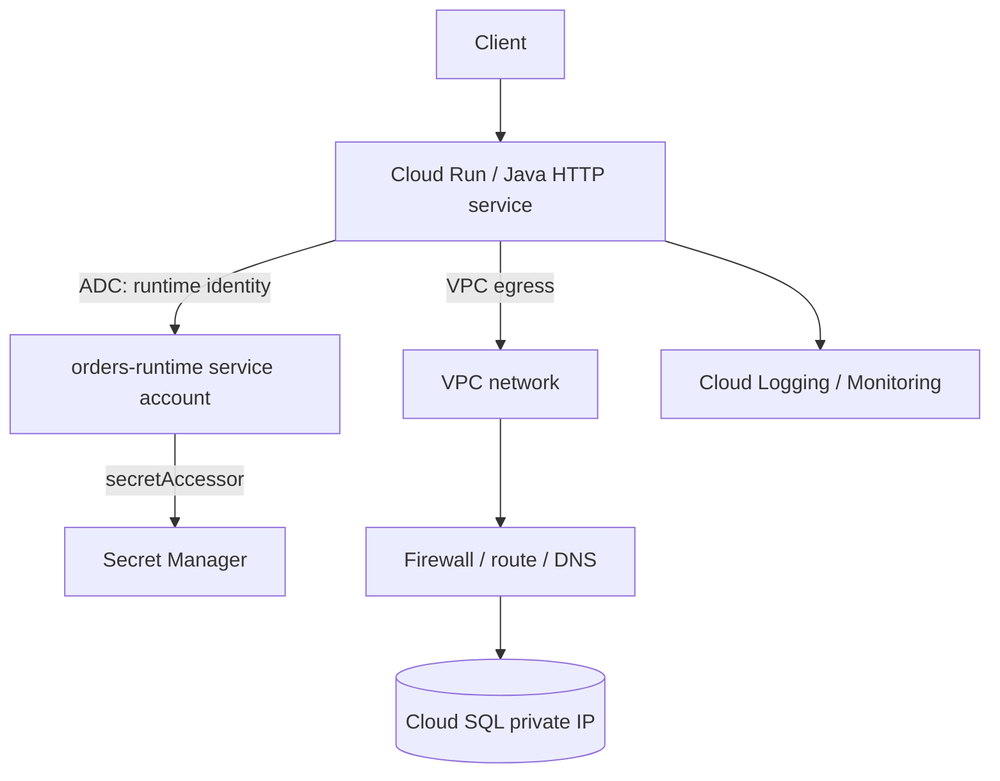

# Service accounts, Secret Manager, and VPC connectivity

A Java function on Google Cloud often needs to call APIs such as Cloud Storage, Pub/Sub, Cloud SQL, or Secret Manager; sometimes the function also needs to access a service that has only a private IP address inside a Virtual Private Cloud (VPC). To do that, the application needs a runtime identity with appropriate permissions, a secure way to retrieve secrets, and a network path to the right destination.

These three concepts answer three different questions:

- **Service account:** which identity is the function running under, and which Google Cloud APIs is it allowed to call?
- **Secret Manager:** where does the application fetch passwords, API keys, or sensitive credentials, and under what lifecycle?
- **VPC connectivity:** which private databases or services does the function have a network path to, and through which routes and firewalls?

Attaching a function to a VPC does not automatically grant IAM permissions. Assigning a service account with Secret Manager read permissions does not automatically create a network path to a private database. Similarly, knowing the database endpoint does not mean the function is authorized to log into the database. Design identity, secrets, and networking separately, then verify them together.

## 1. Identities in Google Cloud serverless applications

### 1.1. A service account is the workload's identity

A service account is an identity for an application or workload, not a human user login. When a Cloud Run service or Cloud Functions (2nd gen) workload is configured with a runtime service account, Java code running inside the function uses that identity when calling Google Cloud APIs.

Each workload should have its own dedicated service account scoped to its responsibilities. For example:

| Workload | Typical required permissions |
| --- | --- |
| `orders-api` | Read/write order data, read database connection secret |
| `image-processor` | Read input objects and write output objects in designated buckets |
| `event-consumer` | Read data to process and write outcome status |
| `report-generator` | Read report data and write artifacts to the reports bucket |

If every function shares a single service account with Editor permissions, a bug or vulnerability in one function can expand its impact across all workloads. Separating service accounts enables least privilege, auditing, and per-service revocation.

### 1.2. Distinguishing common identities

A deployment and its ongoing operation can involve multiple principals:

| Identity | Used for what? | Example permissions |
| --- | --- | --- |
| Deployer or CI/CD principal | Create/update functions, configure networking, and attach the runtime service account | Cloud Run Admin/Cloud Functions Developer, Service Account User on the runtime SA, artifact deployment permissions |
| Runtime service account | Identity used by Java code at runtime | Secret Accessor on a specific secret, Cloud SQL Client, Storage Object Viewer |
| Event trigger service account | Used by Eventarc or an event source to deliver events and invoke targets when needed | Eventarc Event Receiver, Cloud Run Invoker per trigger configuration |
| Build service account | Build artifacts/containers during deployment | Read source/artifacts and write images to Artifact Registry |
| Google-managed service agent | Allows Google Cloud services to perform platform control operations | Service-specific service agent roles |

Do not attach all of these permissions to the runtime service account. Deployment permissions, event delivery permissions, and the permissions used by application code have different lifecycles.

### 1.3. Runtime service account and Application Default Credentials

Google Cloud client libraries for Java typically use **Application Default Credentials (ADC)** to locate credentials. When a function runs on Cloud Run or Cloud Functions, the platform supplies short-lived credentials for the runtime service account via the metadata server. Google Cloud client libraries use ADC automatically and refresh tokens as needed.

Therefore, application code usually only needs to instantiate the client:

```java
import com.google.cloud.storage.Storage;
import com.google.cloud.storage.StorageOptions;

public final class StorageService {
    private final Storage storage = StorageOptions.getDefaultInstance().getService();
}
```

You do not need to load a JSON service account key file into the function, put keys in environment variables, or sign tokens manually when the client library supports ADC. The runtime service account attached in deployment configuration determines the identity used when calling APIs.

### 1.4. Avoid using service account keys unless necessary

A JSON key file is a long-lived credential. If committed to Git, baked into an image, or leaked in logs or artifacts, anyone can use it until it is revoked. In Google Cloud environments, prefer attaching a service account to the workload to receive short-lived credentials via ADC.

For workloads running outside Google Cloud, consider Workload Identity Federation to exchange identities from OIDC/SAML or another cloud provider for short-lived Google credentials. Create a service account key only when there is a genuine technical requirement and no suitable federation option; when doing so, manage rotation, storage, auditing, and revocation carefully.

## 2. Creating and attaching a runtime service account

### 2.1. Creating a dedicated service account

Example creating a service account for the orders API:

```bash
gcloud iam service-accounts create orders-runtime \
  --display-name="Orders API runtime"
```

The principal takes the form:

```text
orders-runtime@PROJECT_ID.iam.gserviceaccount.com
```

The project and service account names in this example must be replaced with real values. Use descriptive workload-specific names, avoiding a generic shared account like `default-runtime` across unrelated services.

### 2.2. Attaching a service account to Cloud Run

When deploying a Cloud Run service, specify the runtime service account:

```bash
gcloud run deploy orders-api \
  --image REGION-docker.pkg.dev/PROJECT_ID/apps/orders-api:VERSION \
  --region REGION \
  --service-account orders-runtime@PROJECT_ID.iam.gserviceaccount.com
```

The new Cloud Run revision runs with the specified service account. If you change the service account, a new revision must be created and its permissions verified before shifting traffic.

### 2.3. Attaching a service account to Cloud Functions 2nd gen

With Cloud Functions 2nd gen, you can specify the runtime service account at deploy time. Example Java HTTP function:

```bash
gcloud functions deploy orders-http \
  --gen2 \
  --runtime=java21 \
  --region=REGION \
  --source=. \
  --entry-point=com.example.OrdersHttpFunction \
  --trigger-http \
  --service-account=orders-runtime@PROJECT_ID.iam.gserviceaccount.com
```

Runtime identifiers and availability depend on the current list of supported runtimes in the region. The example uses `java21` for illustration; choose a supported runtime compatible with your application libraries. Cloud Functions 2nd gen is built on the Cloud Run platform, though the deploy command and certain options follow the Cloud Functions interface.

### 2.4. What permissions does the deployer need?

The deploying principal needs permissions to create/update functions or Cloud Run services, deploy artifacts, and attach the runtime service account. When the deployer specifies a service account other than its own identity, it typically needs `iam.serviceAccounts.actAs`, granted via `roles/iam.serviceAccountUser` on the attached service account.

Do not grant `Service Account Admin` or key-creation permissions to every developer just to deploy functions. Grant permissions scoped to the exact runtime service account and environment. The build service account also needs separate permissions to read source and write artifacts to Artifact Registry.

## 3. IAM: granting least privilege to the runtime

### 3.1. IAM roles and resource scope

An IAM role contains a set of permissions. Binding a role at the project level usually applies to many resources across the project; binding a role directly on a specific secret, bucket, or resource narrows the scope much better.

For example:

- Function reads only one secret: grant `roles/secretmanager.secretAccessor` on that secret.
- Function reads only objects in one bucket: use the appropriate Storage role and restrict by bucket/prefix where policy supports it.
- Function connects to Cloud SQL: grant `roles/cloudsql.client` on the project hosting the instance according to your access model.
- Function publishes messages: grant `roles/pubsub.publisher` on the target topic.

Never use `roles/editor` or `roles/owner` as a runtime role. When encountering `PERMISSION_DENIED`, identify the API, permission, resource, and denied principal before adding roles.

### 3.2. Verifying the effective principal

When logs report permission denied, confirm which service account the running function revision is actually using. A function may still be using the default service account due to an omitted deploy flag or an older revision still receiving traffic.

Check:

1. Which service account is attached in the revision/function configuration.
2. Which revision or version is receiving traffic/events.
3. Whether the role is bound at project scope or on the specific resource.
4. Whether any IAM conditions, deny policies, or organization policies affect access.
5. Whether the required API is enabled in the project.

IAM policy changes can take a brief moment to propagate. After granting permissions, retry in a controlled manner and log the principal/resource/action when investigating.

### 3.3. Invoke permissions vs. outbound API call permissions

The runtime service account is the identity used for outbound API calls. Permission allowing callers or Eventarc to invoke a Cloud Run service/function is a separate layer.

For instance, an Eventarc trigger may use a dedicated service account to receive events and invoke a Cloud Run service; that service account needs roles such as `roles/eventarc.eventReceiver` and target invocation permissions per configuration. The function's runtime service account may need permission to read Secret Manager or write to Cloud Storage. Do not merge these two identities into one.

For private HTTP services, callers need appropriate invoke permissions, typically `roles/run.invoker` on the Cloud Run service. The runtime service account having permission to call Pub/Sub does not automatically allow internet users to call the HTTP endpoint.

## 4. Secret Manager: storing and accessing secrets

### 4.1. When do you need Secret Manager?

Secret Manager is suitable for managing sensitive information such as:

- database passwords;
- external service API keys;
- private credentials or signing secrets;
- tokens used for legacy integrations;
- sensitive configuration requiring rotation and auditing.

Do not store secrets in source code, committed `.env` files, Docker images, event payloads, or logs. Non-sensitive configuration values such as bucket names, regions, feature flags, or endpoints can live in environment variables or a configuration service.

### 4.2. Secrets and secret versions

A secret is a resource managing metadata and policy; actual values are stored in versions. Versions can be enabled, disabled, or destroyed over their lifecycle. Applications access a specific version or an alias such as `latest` if policy permits.

Distinguish:

- **Secret ID:** identifier name of the secret, e.g., `orders-db-password`.
- **Version:** an immutable value added to the secret.
- **Alias:** a pointer name referencing a version, e.g., `latest`.
- **IAM policy:** which principals are allowed to access the secret/version.

Specific versions make deployments reproducible and rollbacks straightforward. The `latest` alias is convenient during rotation, but the application must handle when secrets are re-read and cached.

### 4.3. Creating a secret and adding versions

Example:

```bash
printf '%s' 'REPLACE_WITH_SECRET_VALUE' | \
  gcloud secrets create orders-db-password \
    --data-file=- \
    --replication-policy=automatic
```

If the secret already exists, add a new version:

```bash
printf '%s' 'REPLACE_WITH_NEW_SECRET_VALUE' | \
  gcloud secrets versions add orders-db-password --data-file=-
```

The placeholder strings above are not real credentials. When working in a shell or CI, avoid exposing secrets in command history, process lists, or pipeline logs; use your deployment environment's secret input mechanism whenever possible.

### 4.4. Granting Secret Accessor at the secret level

The runtime service account needs `roles/secretmanager.secretAccessor` to access the payload. Prefer granting the role directly on the specific secret:

```bash
gcloud secrets add-iam-policy-binding orders-db-password \
  --member="serviceAccount:orders-runtime@PROJECT_ID.iam.gserviceaccount.com" \
  --role="roles/secretmanager.secretAccessor"
```

Do not grant accessor across the entire project if the function only needs one secret. If the secret uses a customer-managed encryption key, verify KMS permissions and key policies according to your encryption setup; do not assume every secret requires the runtime principal to call `cloudkms.decrypt` directly.

### 4.5. Java: reading secrets via the Secret Manager API

Google Cloud Java client libraries use ADC, so the code does not need to read a service account key file. Example:

```java
package com.example.config;

import com.google.cloud.secretmanager.v1.AccessSecretVersionResponse;
import com.google.cloud.secretmanager.v1.SecretManagerServiceClient;
import com.google.cloud.secretmanager.v1.SecretVersionName;

import java.io.IOException;

public final class SecretLoader {
    private SecretLoader() {}

    public static String readSecret(
            String projectId,
            String secretId,
            String version) throws IOException {

        SecretVersionName name = SecretVersionName.of(
                projectId,
                secretId,
                version);

        try (SecretManagerServiceClient client = SecretManagerServiceClient.create()) {
            AccessSecretVersionResponse response = client.accessSecretVersion(name);
            return response.getPayload().getData().toStringUtf8();
        }
    }
}
```

`version` can be a specific version number or the `latest` alias. In a function, create the client at a reusable scope if supported by the library and close it properly with its lifecycle. Never log the secret string. In production, handle payload encoding, check for empty secrets, handle timeouts, and handle permission or disabled-version errors.

Maven dependency:

```xml
<dependency>
    <groupId>com.google.cloud</groupId>
    <artifactId>google-cloud-secretmanager</artifactId>
    <version>${google-cloud-secretmanager.version}</version>
</dependency>
```

Manage the library version in your project's BOM or dependency management and package dependencies into the artifact/container.

### 4.6. Avoid reading secrets on every request unless needed

Calling Secret Manager on every HTTP request increases latency, API quota usage, and cost. You can read secrets once during execution environment startup or cache them with a TTL, while accounting for credential rotation and revocation.

One approach:

- cache a shared Secret Manager client if thread-safe;
- cache secret values with an appropriate TTL if the application needs to refresh them;
- on authentication failures caused by stale credentials, refresh the secret in a controlled way and retry once if the operation is safe;
- never put secrets into logs, exception messages, or metric labels;
- limit how long secrets stay in memory and do not share them across unrelated requests.

Do not assume an execution environment is always brand new. Serverless runtimes may reuse processes; caches in static fields can persist across multiple invocations on the same instance.

### 4.7. Rotation and how functions pick up new versions

Rotation must be coordinated between the secret store and the target system, such as a database password. Updating a secret in Secret Manager without updating the password on the database (or vice versa) can disrupt connections.

For applications calling the Secret Manager API directly:

1. Add the new secret version after the target system accepts the new credential per your rotation procedure.
2. Verify the function can read the new version and connect successfully.
3. Update the alias or pinned version configuration as planned.
4. Revoke the old credential once no clients are still using it.

If pinning a numeric version, redeploy or reconfigure to switch to the new version. If using `latest`, the next read may retrieve the new version while stale caches may persist until their TTL expires.

With Cloud Run secret environment variables, the value is fetched when an instance starts; changing the secret does not automatically mutate environment variables on already-running instances. With secret volumes, the application can read the mounted version file, and update behavior depends on how the version/mount is configured. If automated rotation is required, check current product semantics, use an appropriate version strategy, and actively re-read files/secrets periodically. Do not assume all mount modes refresh instantaneously.

## 5. Secret injection for Cloud Run and Cloud Functions

There are two primary ways for an application to receive secrets:

1. **Reading via the Secret Manager API:** the application calls the API when needed; code controls versioning, caching, and refresh.
2. **Configuring secrets as environment variables or mounted files:** the platform injects the secret into the runtime per deployment configuration.

Environment variables are convenient for libraries configured at startup, yet secrets can leak via diagnostic dumps or logs if an application prints its full environment. Mounted files let applications read secrets like ordinary files and can fit version refreshes better; you still must restrict file access permissions and handle rotation explicitly.

Example Cloud Run configuration using a secret environment variable:

```bash
gcloud run deploy orders-api \
  --image REGION-docker.pkg.dev/PROJECT_ID/apps/orders-api:VERSION \
  --region REGION \
  --service-account orders-runtime@PROJECT_ID.iam.gserviceaccount.com \
  --set-secrets=DB_PASSWORD=orders-db-password:5
```

Here `DB_PASSWORD` is the environment variable name inside the container; `orders-db-password:5` specifies the secret and exact version number. The runtime service account needs accessor permission on that secret. Using a specific version makes revisions deterministic and easy to roll back.

If using the API, configure the secret ID/version separately, while reading the payload strictly through the client library. Regardless of approach, never place secret values in public deployment manifests, build logs, or command output.

## 6. VPC connectivity from serverless runtimes

### 6.1. When is VPC egress needed?

A function typically does not need VPC connectivity if it only calls Google Cloud APIs over public endpoints or processes requests without touching private resources. VPC connectivity is required when the function must reach:

- a Cloud SQL instance using a private IP;
- Memorystore or Redis/Valkey inside a VPC;
- a VM or internal service with a private IP;
- databases or APIs in peered or on-premises networks via Cloud VPN/Interconnect;
- a private endpoint published via Private Service Connect.

VPC egress is an outbound path from the function into the VPC network. It does not automatically create a public inbound endpoint for the function and does not replace IAM authorization.

### 6.2. Two common connectivity options

Google Cloud provides two primary models:

| Option | Characteristics | When to consider |
| --- | --- | --- |
| Serverless VPC Access connector | Creates a connector in a region/VPC; serverless runtime sends traffic through the connector | Cloud Functions 2nd gen and workloads requiring a connector per product configuration |
| Direct VPC egress | Cloud Run attaches directly to a VPC subnet without a separate connector | Cloud Run services/jobs and workload types supported by the product in the target region/runtime |

Cloud Functions, Cloud Run services, and Cloud Run functions have distinct deployment interfaces. Check the specific product, generation, region, and runtime before choosing a method; do not copy Cloud Run service flags over to Cloud Functions without verification.

### 6.3. Serverless VPC Access connector

A connector provides a path from the serverless runtime into a VPC. When creating a connector, select the same region as the workload, the target network, and a non-overlapping IP range. A connector typically requires a dedicated `/28` range; never reuse a range already assigned to another subnet or device.

Example creating a connector:

```bash
gcloud compute networks vpc-access connectors create orders-connector \
  --region=REGION \
  --network=orders-vpc \
  --range=10.8.0.0/28 \
  --min-instances=2 \
  --max-instances=4
```

This is an illustrative configuration. Choose a CIDR that does not overlap with existing subnets, peered networks, VPNs, or active IP ranges. Min/max instances and throughput must be sized for actual traffic, not copied from examples.

Attaching a connector to Cloud Functions 2nd gen:

```bash
gcloud functions deploy process-order \
  --gen2 \
  --runtime=java21 \
  --region=REGION \
  --source=. \
  --entry-point=com.example.ProcessOrderFunction \
  --trigger-topic=orders-topic \
  --service-account=orders-runtime@PROJECT_ID.iam.gserviceaccount.com \
  --vpc-connector=orders-connector \
  --egress-settings=private-ranges-only
```

The runtime and trigger flags are examples. Use your function's actual trigger type and check which egress flags are supported by your `gcloud`/API version.

### 6.4. Direct VPC egress on Cloud Run

Cloud Run can use Direct VPC egress to connect directly to a subnet without needing a Serverless VPC Access connector. Illustrative example:

```bash
gcloud run deploy orders-api \
  --image REGION-docker.pkg.dev/PROJECT_ID/apps/orders-api:VERSION \
  --region=REGION \
  --network=orders-vpc \
  --subnet=orders-subnet \
  --vpc-egress=private-ranges-only \
  --service-account=orders-runtime@PROJECT_ID.iam.gserviceaccount.com
```

Direct VPC egress can simplify network architecture and avoid managing separate connectors. Check subnet, firewall, scaling behavior, and product/region limits. For Cloud Functions 2nd gen, use the method supported by the Cloud Functions deployment interface; do not assume every Cloud Run service flag applies identically.

### 6.5. Choosing an egress mode

Two common modes:

- **Private ranges only:** only traffic destined for private IP addresses is routed through the VPC; public traffic can take the serverless runtime's default egress path.
- **All traffic:** all outbound traffic is routed through the VPC. If public internet access is needed, the VPC needs an egress path such as Cloud NAT and appropriate routes.

Choosing `all traffic` can be helpful when you need centralized egress control, firewalls, or NAT. However, without Cloud NAT/routes, the function may lose access to public APIs. Choosing `private ranges only` lets public traffic flow directly over the default path while private IPs route through the VPC.

## 7. Firewalls, routes, DNS, and private services

### 7.1. Firewall rules

Once VPC egress is configured, traffic from the serverless source to the destination must be permitted. Check:

- source ranges or network tags used by the connector/direct egress;
- destination subnet/IP or target tags;
- TCP port of the database/service;
- ingress/egress rules and rule priorities;
- hierarchical firewall policies or organization policies, if present.

For example, Cloud SQL PostgreSQL private IP typically accepts TCP 5432 from authorized sources; Redis may use another port depending on configuration. Open only required ports and restrict sources to the appropriate connector/subnet.

### 7.2. Routes and hybrid connectivity

If the destination lives in a peered VPC or on-premises, configure Cloud VPN or Cloud Interconnect, bidirectional routes, and firewalls on both sides. VPC peering does not automatically transit routes across intermediate networks; do not assume one peered VPC can act as a transit hop to a third network.

When using private service endpoints, inspect routing paths and DNS. With Private Service Connect, consumer endpoints and producer service attachments must be configured per the architecture. VPC egress only puts traffic into the VPC; it does not create peering or PSC endpoints by itself.

### 7.3. Private DNS

A function may connect using a private hostname. To resolve hostnames properly, inspect Cloud DNS private zones, zone visibility for the VPC, forwarding zones, and DNS policies. If resolving internal names from on-premises, configure DNS forwarding appropriately.

Avoid hardcoding private IPs if endpoints can change. Use DNS names provided by Cloud SQL, Memorystore, or the target service whenever possible.

### 7.4. Cloud NAT and the public internet

If all traffic routes through the VPC, outbound requests to public APIs require an internet egress path. Cloud NAT allows workloads without external IPs to initiate outbound connections; NAT does not create an inbound public endpoint for the function.

Check default routes, NAT mappings, allocated NAT IP addresses, and firewall rules. If a public API uses IP allowlisting, use static NAT addresses by design and update the allowlist. If calling only Google APIs, consider Private Google Access or Private Service Connect for Google APIs depending on network and service requirements.

## 8. Connecting to Cloud SQL from a Java function

Cloud SQL is a common example of private database access. You can connect using the Cloud SQL Java Connector or JDBC socket factory. The connector handles Cloud SQL authentication and encryption, but **does not create a VPC network path** to a private IP on its own. If the instance only has a private IP, the function still needs VPC egress and a route to that address.

### 8.1. IAM permissions for Cloud SQL

The runtime service account typically needs `roles/cloudsql.client` to establish connections via Cloud SQL connectors. If using IAM database authentication, you also need an IAM database user and corresponding role such as `roles/cloudsql.instanceUser` per Cloud SQL documentation. API connectivity permissions and in-database data access permissions are two distinct layers.

### 8.2. Java JDBC and Cloud SQL Connector

Configuring PostgreSQL via Cloud SQL Java Connector can use a JDBC URL and socket factory. Specific settings depend on the driver, connector version, and authentication mode:

```properties
db.url=jdbc:postgresql:///orders
db.user=orders_app
db.name=orders
cloudsql.instance=PROJECT_ID:REGION:INSTANCE_NAME
cloudsql.ipTypes=PRIVATE
```

When configuring HikariCP or a datasource, pass `cloudSqlInstance` and socket factory properties per the Cloud SQL Java Connector documentation for your version. For IAM database authentication, enable the connector's IAM auth option and configure the matching database user. Do not copy an example URL as a complete configuration while omitting dependencies, drivers, and TLS.

### 8.3. Connection pools and serverless/Cloud Run concurrency

Each Cloud Run instance or function instance may create its own pool. Total connections can be estimated as:

```text
Approximate max connections
  = max instances
    x pool size per instance
```

For example, 40 instances with a pool size of 5 can open roughly 200 connections. Bound max instances/concurrency or pool size according to Cloud SQL limits and other workloads. Using the Cloud SQL connector does not remove database connection limits.

For short-lived functions, a smaller pool or per-invocation connections may be easier to control. When reusing pools at the instance level, check stale connection handling, timeouts, and aggregate connections during scale-out.

## 9. Operations and troubleshooting

### 9.1. Layered diagnostics

| Symptom | Layer to inspect | Remediation |
| --- | --- | --- |
| `PERMISSION_DENIED` reading secret | IAM | Verify runtime SA, secret-level accessor role, project, and secret ID |
| `NOT_FOUND` reading secret | Secret/version | Verify project, secret ID, version, and version state |
| Function fails to resolve private hostname | DNS | Check private zones, DNS visibility, and forwarding |
| TCP timeout to private database | VPC/network | Check connector/direct egress, subnet, routes, firewall, and port |
| Connects but database rejects login | Database auth | Check DB user, password/IAM DB auth, and SQL grants |
| Public APIs unreachable under all-traffic | Egress | Check default route, Cloud NAT, and firewall |
| Intermittent connection exhaustion | Capacity | Check max instances, concurrency, pool size, and DB connection limit |
| Secret rotation breaks after deployment | Secret lifecycle | Check version pinning, cache TTL, and when DB credentials changed |

### 9.2. Logs and metrics

Structured logs should include:

- Cloud Run revision or function version;
- request ID, trace ID, or event ID;
- runtime service account (log email/identity only if needed for investigation and permitted by policy);
- secret ID/version, never the secret payload;
- destination hostname, port, and network error type, never credentials in URLs;
- durations for secret retrieval, connection acquisition, and query execution.

Monitor request latency, instance count, concurrency, container startup, error rates, Secret Manager API errors, Cloud SQL connection counts, VPC connector throughput/instance health, and NAT port utilization where applicable. Alert on spikes in permission denied errors, overloaded connectors, connection exhaustion, and rising latency.

### 9.3. Controlled retries

Errors such as `PERMISSION_DENIED`, missing secrets, or wrong database passwords do not fix themselves through repeated retries. Fix IAM, configuration, or rotation instead. Network resets or database failovers may be transient, yet retries must still be bounded with backoff and idempotency.

If a function writes data and loses the connection before receiving commit confirmation, you cannot assume the transaction rolled back. Query state by idempotency key or business ID before re-running an operation that produces side effects.

### 9.4. Cold starts and client reuse

Creating Google Cloud clients on every request can increase latency. You can reuse thread-safe clients at the instance level, such as `SecretManagerServiceClient` or Storage clients, while never storing request-specific state in static fields. Close clients with the instance/runtime lifecycle and avoid creating a brand-new client for each read unnecessarily.

Secret value caches and database connection pools have distinct lifecycles. Set TTL/refresh policies for secrets, validate stale connections, and account for aggregate pools as instances scale out. Instance reuse does not guarantee an instance lives forever or serves only one tenant.

## 10. Security and access control

### 10.1. Separating projects and environments

Dev, staging, and production should use separate service accounts, secrets, VPCs, and databases, or enforce strict permission boundaries. Never let a dev service account read production secrets. If cross-project access is required, grant permissions directly on the target project's resource and verify organization policies.

### 10.2. Restricting service account impersonation

Allow only deployer/CI principals to `actAs` the required runtime service accounts. Do not broadly grant `roles/iam.serviceAccountTokenCreator` to all developers unless impersonation is required. Monitor audit logs when service accounts are impersonated or policies change.

### 10.3. Secret payloads and sensitive data

Never place secrets into logs, error responses, metric labels, or tracing attributes. Restrict secret read access and audit accesses. Choose retention and rotation policies suited to the credential type. If a secret is exposed, have a procedure to disable the version, rotate credentials on the target system, and update workloads.

### 10.4. VPC is not authorization

A workload inside a VPC can send packets to a database, yet the database still requires user authentication and SQL privilege checks. A service account with Secret Accessor can fetch a password, yet that does not mean HTTP callers should be allowed to view every record. End-user authentication, tenant isolation, and authorization must be enforced at the application/domain layer.

## 11. End-to-end architecture example

A Java HTTP service on Cloud Run receives order-creation requests. The service uses the `orders-runtime` runtime service account to read Cloud SQL connection secrets. Cloud SQL uses a private IP inside a VPC. Cloud Run uses Direct VPC egress if supported by the product/region; otherwise, configure an appropriate Serverless VPC Access connector.



Processing flow:

1. Client calls the endpoint; ingress/IAM or the application authenticates the caller as required.
2. Java handler validates request, tenant, and business permissions.
3. Service fetches secrets via the Secret Manager API or secret mount as configured.
4. ADC provides short-lived credentials for `orders-runtime`.
5. Java Cloud SQL Connector/JDBC connects to the private IP over VPC egress.
6. Handler runs a short transaction and commits.
7. Logs record request/trace ID and outcome without logging secrets or tokens.

During scale-out, instance count and connection pools must stay within database limits. During password rotation, Secret Manager versions, application caches, and the Cloud SQL password must be updated through a consistent workflow.

## 12. Pre-deployment checklist

- [ ] Each workload has its own runtime service account scoped to its responsibilities.
- [ ] Deployer, build identity, trigger identity, and runtime identity are clearly separated.
- [ ] Runtime service account is explicitly attached to the Cloud Run/Cloud Functions revision.
- [ ] ADC is used in Google Cloud environments; no service account keys are bundled.
- [ ] Deployer only has `iam.serviceAccounts.actAs` on the required service accounts.
- [ ] IAM roles follow least privilege at the narrowest feasible resource scope.
- [ ] Secrets are stored in Secret Manager, never in source code, images, or logs.
- [ ] Runtime service account has Secret Accessor only on the secrets it needs to read.
- [ ] Secret versions, aliases, cache TTLs, and rotation are clearly defined.
- [ ] Java Secret Manager client uses ADC and does not log payloads.
- [ ] Function enables VPC egress only when private resources must be accessed.
- [ ] Connector/direct VPC egress is chosen according to product type and regional support.
- [ ] Connector/subnet CIDRs do not conflict with other networks.
- [ ] Firewalls, routes, DNS, VPN/peering/PSC, and NAT are verified along the actual network path.
- [ ] Private IP databases still enforce dedicated IAM/database authentication.
- [ ] Cloud SQL connector is not mistaken for a replacement for VPC routing.
- [ ] Max instances, concurrency, and connection pools fit database capacity.
- [ ] Logs, metrics, and alerts cover IAM, Secret Manager, VPC, and databases.
- [ ] Secret rotation, permission denied, network timeouts, failovers, and duplicate events have been tested.

## Conclusion

The service account defines the runtime identity of a Java function; Secret Manager stores and versions sensitive credentials; VPC egress provides the network path to private resources. These three layers must be configured independently and combined properly: the runtime service account needs IAM permissions, secrets need clear policies and lifecycles, and networking needs routes, DNS, and firewalls across every hop.

On Cloud Run and Cloud Functions, prefer ADC with an explicitly attached runtime service account instead of service account keys. Grant `roles/secretmanager.secretAccessor` on exact secrets, design rotation together with caching, and enable VPC connectivity only when the workload needs private resources. For databases, size connection pools alongside instance count/concurrency and remember that VPC connectivity never replaces database authentication or authorization.

In operations, monitor the effective principal, Secret Manager accesses, VPC egress, DNS/firewalls, connection counts, and latency. Separating identity, secrets, and networking helps Java functions run securely during scale-out, event processing, and multi-environment deployments.
