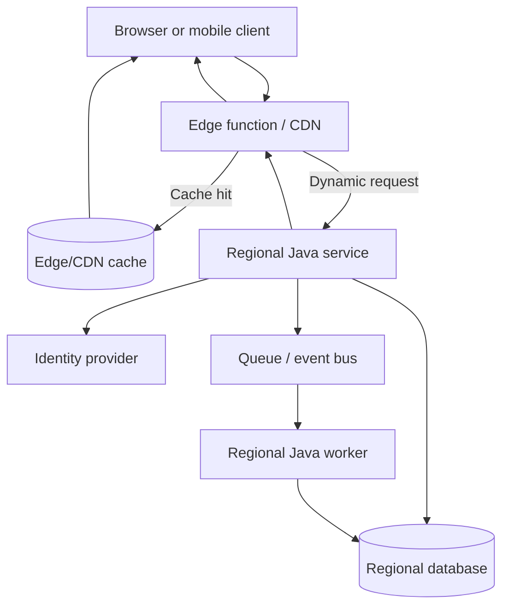

# Distinguishing Regional Serverless and Edge Functions

Regional serverless and edge functions both allow running code without the development team having to manage servers themselves. The main difference lies in **where the code is executed and the types of workloads each suits**.

Regional serverless runs workloads in one or more chosen regions, typically close to databases and backend services. Edge functions run at a provider's distributed points of presence (PoPs), typically close to end users or network entry points. Therefore, edge can reduce latency for lightweight operations at the request ingestion layer, whereas regional serverless is usually better suited for business logic that needs centralized data access, a full runtime, or longer execution.

In a Java serverless system, a Java function or Spring Boot service is typically placed in a region to handle core business logic. An edge function can sit in front to handle routing, token validation, request normalization, simple policy enforcement, or caching public content. The two models are commonly combined rather than forcing a single choice for the entire application.

## 1. What Is Regional Serverless?

Regional serverless is a model for deploying serverless functions, services, or containers into a specific cloud provider region. The provider manages servers, the operating system, instance provisioning, and scaling based on configuration; the development team selects the region, runtime, resources, and how to connect to dependent services.

Examples:

- AWS Lambda deployed in an AWS Region.
- Google Cloud Run and Cloud Run functions deployed in a Google Cloud region.
- Azure Functions deployed in an Azure region.
- Other serverless container platforms also typically allow choosing the region where workloads run.

A region usually consists of multiple availability zones (or zones), depending on the provider. Workloads are placed in the selected region to stay close to databases, queues, object storage, or internal systems. Regional does not mean a single server or virtual machine; the platform can still run many instances and distribute them across the region's infrastructure.

### Characteristics

- **Intentional deployment location:** the team selects the region based on data location, users, compliance requirements, and services to integrate.
- **Richer runtimes:** typically supports Java, .NET, Python, Node.js, Go, container images, and platform-compatible libraries.
- **Convenient backend connectivity:** functions can be placed close to databases, queues, and internal services within the same region or private network.
- **Scaling with load:** the platform scales instances up or down based on requests, events, concurrency, or configuration.
- **State still needs external storage:** instance memory can be stopped or replaced; business data must live in a database, object storage, queue, or appropriate data store.
- **Possible cold starts:** new instances must initialize the runtime and application before handling requests.

Regional serverless is well suited for core business logic, database processing, workers, workflows, and APIs with many dependencies.

## 2. What Is an Edge Function?

An edge function is a piece of code deployed to a provider's distributed edge infrastructure, typically across many PoPs close to access networks or end users. A request can be handled right at the nearest entry point according to the platform's routing, instead of always traveling to a backend region first.

Examples of platforms and services with edge compute capabilities:

- Cloudflare Workers.
- Vercel Edge Functions.
- AWS CloudFront Functions and Lambda@Edge.
- Several other CDN, hosting, and edge network platforms.

These products do not share the same runtime or limits. CloudFront Functions targets very lightweight processing at the CDN layer; Lambda@Edge has a different model and different limits; Workers and Edge Functions may provide runtimes based on JavaScript, Web APIs, or WebAssembly. Always check the documentation for the specific product before choosing.

### Characteristics

- **Distributed execution:** code can run across many PoPs, enabling request processing closer to users.
- **Low latency for suitable operations:** header inspection, URL rewriting, redirects, simple token validation, or origin selection can complete right at the edge.
- **Often constrained runtimes:** some platforms only support JavaScript/TypeScript or WebAssembly and restrict CPU, memory, execution time, OS APIs, native libraries, or network connections.
- **Distributed state:** each execution should not rely on process memory to retain long-lived or globally synchronized state.
- **Data may be far away:** if the edge must call a database or API in a distant region, network round trips can negate latency benefits.
- **More complex version distribution:** a single change can be rolled out to many PoPs; you need to understand the provider's rollout, caching, and rollback behavior.

An edge function is not synonymous with a CDN cache. A CDN can serve cached content without running application code. An edge function executes logic at the edge, sometimes deciding whether to use the cache, which cache key to apply, or which requests to forward to the origin.

## 3. Comparing Regional Serverless and Edge Functions

| Criterion | Regional serverless | Edge function |
|---|---|---|
| Execution location | Team-selected region | Provider's distributed PoPs |
| Primary goal | Handle business logic and access backend services | Process near request entry, reduce round trips |
| Runtime | Usually diverse, including Java and containers | Usually more restricted; many platforms favor JS/TS or WASM |
| Data connectivity | Convenient when data is in the same region | May need to call back to a region or use a distributed data store |
| Execution duration | Usually supports longer workloads, depending on service | Usually optimized for short tasks with tight limits |
| CPU/memory | Configurable across a relatively wide range | Often has smaller quotas or distinct limits |
| State | Uses regional database/cache/queue | Must be designed for a distributed environment and eventual consistency where applicable |
| Cold start | Depends on runtime, configuration, and platform | Depends on isolate/runtime and edge platform |
| Suitable tasks | Business APIs, workers, event processing, database integration | Rewrites, redirects, routing, headers, lightweight request checks, cache decisions |
| Data constraints | Easy to place near centralized data sources | Must account for data locality, residency, and distance to origin |
| Observability | Usually provides per-region and per-service metrics/logs | Needs tracking by PoP, country, or network region if supported by the platform |

There is no rule that edge is always faster or regional is always slower. The outcome depends on user location, origin, data services, protocols, cache hit rate, load, and how the provider routes traffic.

## 4. Latency: Where Is Code Actually Fast?

A request to an application typically passes through multiple hops:

1. The client resolves DNS and connects to the delivery network.
2. The request is routed to a PoP or a region.
3. Code executes at the selected location.
4. Code may read from cache or call other services.
5. The response returns to the client.

With an edge function, processing in step 3 can be very close to the user. However, if the code calls a database in a distant region, the request still has to travel from the edge to the region and back. Therefore, you must account for the entire path rather than measuring code execution time alone.

This can be expressed simply as:

```text
Total latency =
  client-to-edge
  + edge execution
  + edge-to-origin/data
  + origin processing
  + response network
```

For regional serverless:

```text
Total latency =
  client-to-region
  + function/service execution
  + region-to-data
  + data processing
  + response network
```

Edge is beneficial when processing at the PoP eliminates a round trip to the origin or enables serving a response from cache. If every request still has to call the regional backend, the benefit may be small or negative due to adding an extra processing hop.

### Example

A website with users across multiple countries:

- Redirecting from `/vi` to `/en` based on URL or headers can be handled at the edge.
- Selecting an optimized image variant or returning publicly cached content can be handled at the edge.
- Reading an account balance and updating an order requires authoritative data; a regional service close to the database is usually a better fit.
- Calculating order pricing based on multiple tables and business rules should run in a backend with the appropriate runtime, data access, and observability.

## 5. Runtime and Java Execution Capability

This is an important distinction when designing a Java serverless system.

Regional serverless typically supports official Java runtimes or allows packaging a Java application as a container. For example, you can run Java on AWS Lambda, Google Cloud Run functions for Java, or Spring Boot on Cloud Run/Azure Container Apps depending on the platform.

Many edge functions use a lightweight runtime based on a JavaScript engine, Web APIs, or WebAssembly. That does not mean you can directly upload a Java JAR or run a full JVM at every PoP.

If you want to bring Java logic to the edge, you must explicitly verify:

- Does the platform offer a Java runtime, or only JavaScript/TypeScript?
- Does it support WebAssembly modules?
- Can the Java toolchain compile the application into a compatible format?
- Are there limits on native libraries, reflection, threads, filesystem, sockets, and memory?
- Do cold starts and artifact footprint fit within quotas?
- Do cryptographic libraries, parsers, or SDKs work in that runtime?

Some toolchains can compile Java into a native executable or WebAssembly under specific configurations, but that does not guarantee the artifact will run on every edge runtime. GraalVM Native Image produces a native executable; by itself, it does not automatically turn an application into a WebAssembly module compatible with every platform.

### Practical Model for Java Teams

A commonly sensible design approach is:

- Edge functions use JavaScript/TypeScript or a supported edge runtime to handle lightweight requests.
- Java functions or Java containers run in the region to handle business logic.
- Databases, queues, and object storage are placed in the region appropriate for the data.
- The edge forwards requests to the backend after applying routing, caching, or initial checks.

This way, the team preserves the Java ecosystem for business logic and only uses the edge where it delivers clear value.

## 6. Example Edge Function Handling Redirects and Headers

The following example illustrates a handler style on a runtime compatible with Cloudflare Workers. This is JavaScript to demonstrate characteristics of an edge runtime; it is not Java code and cannot run directly in Java Lambda.

```javascript
export default {
  async fetch(request) {
    const url = new URL(request.url);

    if (url.pathname === "/legacy") {
      return Response.redirect(
        "https://www.example.com/docs",
        308
      );
    }

    const response = await fetch(request);

    const headers = new Headers(response.headers);
    headers.set("X-Served-By", "edge");

    return new Response(response.body, {
      status: response.status,
      statusText: response.statusText,
      headers
    });
  }
};
```

In this example:

- The redirect is handled at the edge without calling the Java backend.
- Other requests are forwarded to the origin.
- The edge adds a response header to illustrate processing at the distribution layer.

In production, you need to review which headers are allowed to be forwarded, cache policies, redirect allow-lists, and how to protect the origin. Do not add headers containing sensitive internal information. Also do not let clients arbitrarily control the target origin, as this can introduce SSRF or open proxy vulnerabilities.

## 7. Example Regional Java Service

A Java service can handle core business logic in the region, close to the database. Example Spring Boot endpoint:

```java
import org.springframework.http.ResponseEntity;
import org.springframework.web.bind.annotation.GetMapping;
import org.springframework.web.bind.annotation.PathVariable;
import org.springframework.web.bind.annotation.RestController;

@RestController
public class OrderController {

    private final OrderService orderService;

    public OrderController(OrderService orderService) {
        this.orderService = orderService;
    }

    @GetMapping("/orders/{orderId}")
    public ResponseEntity<OrderView> getOrder(
            @PathVariable String orderId) {

        OrderView order = orderService.findVisibleOrder(orderId);

        if (order == null) {
            return ResponseEntity.notFound().build();
        }

        return ResponseEntity.ok(order);
    }
}
```

This service can be packaged as a container and deployed on Cloud Run or a suitable regional serverless platform. `OrderService` enforces data access authorization and reads from the database in the same region.

The edge can forward requests to this service, but it does not replace authorization in `OrderService`. The fact that a request passed through the edge does not prove the user has permission to read the corresponding order.

## 8. Combining Edge and Regional Serverless

A hybrid architecture can place the edge at the request ingestion layer and regional services at the business layer.



Example responsibilities:

| Component | Responsibility |
|---|---|
| Edge function | Redirects, URL rewrites, locale selection, adding headers, appropriate-level token checks, cache decisions |
| CDN cache | Serve cached public content |
| Regional Java service | Business authorization, order processing, database reads/writes, workflow orchestration |
| Queue/event bus | Accept asynchronous work |
| Regional Java worker | Process messages, retries, idempotency, and state updates |
| Database | Authoritative data source for business operations |

There is no need to route every request through an edge function if a CDN or load balancer already meets your needs. Every additional layer carries its own cost, configuration, and failure modes.

### Path Design Rules

- Static and public requests: prefer CDN cache.
- Requests needing simple redirects or rewrites: edge functions may fit well.
- Requests needing authoritative data access: route to a regional service.
- Long-running or asynchronous tasks: persist durably, then hand off to a queue/workflow.
- Requests with sensitive data: enforce strict cache policies and authenticate at the backend.
- Requests requiring tenant or business-permission handling: the backend must verify resource-level authorization.

## 9. Distributed State and Data

Edge functions can run across many PoPs. One user request today might hit PoP A, and the next request might hit PoP B. You should not rely on global variables or local in-memory caches to store session state or business data.

Options for storing state include:

- A regional database.
- A distributed key-value store with an edge API.
- Durable Objects or an equivalent stateful edge service if provided by the platform.
- A distributed cache with TTL and an invalidation policy.
- A queue/event bus to hand off work to a regional backend.

Each option has trade-offs in consistency, latency, durability, cost, and data placement. For example, a distributed KV store can optimize reads near the edge, but eventual consistency may be unsuitable for account balances or payment states.

### Avoid Writing Critical Business Data Directly to Edge Cache

Caching is suited for reproducible data or data where staleness is acceptable. Do not use a distributed cache as the authoritative data source for operations requiring transactions and strong consistency if the service does not provide those semantics.

For data requiring updates, the regional backend should be the source of truth. The edge should only cache public results or data explicitly designed around TTL, invalidation, and stale responses.

## 10. Security at the Edge and Regional Backend

The edge is an early point of contact for Internet requests, so it can help reduce load and block some invalid requests. However, the edge does not replace the full security layer of the backend.

### At the Edge

- Validate HTTP method, path, header sizes, and basic formatting.
- Apply rate limiting or bot policies if supported by the platform.
- Validate tokens using standard rules and proper key rotation if genuinely needed at the edge.
- Normalize headers and strip spoofed headers according to policy.
- Do not log tokens, cookies, or sensitive personal data.
- Restrict access to secrets and environment variables.
- Do not let clients arbitrarily specify origin URLs or internal addresses.

### At the Regional Backend

- Verify identity and business permissions.
- Check tenant, owner, and per-resource permissions.
- Re-validate input data and schemas.
- Enforce idempotency for requests with side effects.
- Manage secrets and credentials with least privilege.
- Do not trust client-supplied headers claiming a request passed through the edge.

If the backend must only be callable through the edge, protect the origin with an appropriate mechanism such as private ingress, authenticated service-to-service calls, mTLS, or signed secrets/headers between layers. A static header added by the edge is insufficient if a client can send the exact same header itself. Use cryptographic authentication or private networking as supported by the platform.

### Tokens and Personal Data

Verifying JWTs at the edge can save a round trip to the identity service if the runtime has suitable libraries and key caching. However, you must validate the signature, issuer, audience, expiration, and allowed algorithms. During key rotation, the JWKS cache must be refreshed.

Do not cache responses containing personal information or per-user data using a cache key based solely on the URL. Cache keys must include safe partitioning dimensions, or better yet, avoid caching sensitive data at the edge without an explicit design.

## 11. Data Locality, Residency, and Compliance

Moving code closer to users does not mean data is also stored there. An edge function can execute in a PoP in another country and then call a database in a chosen region.

Distinguish between:

- Where code executes.
- Where data is stored.
- Where personal data is processed.
- Where logs, traces, and telemetry live.
- Where backups and replicas reside.

Some organizations require data to be processed or stored within specific geographic boundaries. In that case, verify where the edge runtime can execute and what data is permitted to transit it. Do not send sensitive payloads to the edge just to shave a few milliseconds if doing so violates residency requirements.

Regional deployment gives teams tighter control over storage and processing regions, though you still need to verify where auxiliary services, logs, and backups may reside.

## 12. Cold Starts, Concurrency, and Runtime Limits

Both regional serverless and edge functions can incur initialization time, but their runtime models differ.

A regional Java runtime may need to load the JVM, classes, frameworks, dependency injection, and connection pools. Large Spring Boot applications can experience noticeable cold starts. These can be reduced by optimizing dependencies, using controlled lazy initialization, selecting appropriate CPU/memory settings, or using snapshot/restore if the platform supports it.

Edge runtimes typically use isolates or lighter runtimes, but that does not mean zero startup latency or unlimited quotas. Platforms may limit:

- CPU time per request.
- Memory.
- Bundle size.
- Execution duration.
- Number of subrequests or connections.
- OS APIs and native libraries.
- Cache or state store capacity.

Read the limits for the specific product and service tier. Do not assume limits from Cloudflare Workers apply to Vercel Edge Functions or CloudFront Functions.

### Concurrency and Downstream Systems

The edge can receive traffic from many PoPs simultaneously. If every request calls back to a regional backend, the backend can experience sharp bursts. The regional service can also scale out and increase connections to the database.

Control points needed:

- Rate limits at the edge or gateway.
- Max instances/concurrency on the regional service.
- Connection pools and database quotas.
- Queues to smooth out workload spikes.
- Timeouts and retries to avoid retry storms.
- Caching to reduce repeated requests to the origin.

## 13. Cost: Overall Comparison

Do not compare only the price per function invocation. Account for networking and dependent services as well.

| Component | Regional serverless | Edge function |
|---|---|---|
| Compute | Invocations, CPU, memory, instance time | Requests, CPU time, or product-specific quotas |
| Network | Client-to-region and region-to-data | Edge-to-origin, data transfer, and subrequests |
| Data store | In-region database/cache | Distributed KV/state store or regional origin |
| CDN/cache | Can place a CDN in front | Usually tightly integrated with the edge network |
| Observability | Logs, metrics, traces by region and service | Logs/traces per platform and PoP if available |
| Operations | Manage multiple regions if HA is required | Manage rollouts and distributed behavior across PoPs |
| Cost risks | Long-running instances or dependencies | High subrequest counts, egress, and cache misses to origin |

Edge can save backend costs when the cache hit rate is high or when many invalid requests are rejected before reaching the origin. However, if every edge request calls a regional database, network and origin costs can increase.

A regional service can be more economical when workloads perform long business processing, require a full runtime, or access data frequently. Measure against real workloads rather than choosing based on the serverless label.

## 14. Observing a Hybrid System

When requests pass through the edge and then to a regional service, traces must be correlated across both layers.

Track:

- Request count and latency at the edge.
- Cache hit/miss and origin pass-through rate.
- Request distribution by country/PoP if provided by the platform.
- Edge execution errors and quota-exceeded events.
- Regional request latency, cold starts, and instance counts.
- Network latency from edge to origin.
- Database connections, query latency, and downstream errors.
- 4xx/5xx rates at each layer.
- Retries, timeouts, and queue age.

Use a correlation ID or trace context end to end. If the edge creates a new request to the origin, propagate trace context according to standards and do not trust arbitrary client-set trace headers unless sanitized.

Logs at the edge should stay concise because request volume can be high. Do not log full cookies, authorization headers, or request bodies. Log the route template, status, PoP/region if available, and correlation ID.

## 15. Choosing a Model by Scenario

| Scenario | Typically suitable model | Reason |
|---|---|---|
| Java REST API needing database access and business logic | Regional serverless | Java runtime and backend data in the same region |
| Redirect, URL rewrite, or locale selection | Edge function | Lightweight logic, no database access required |
| Caching public content and serving responses near users | CDN cache, optionally with edge | Avoids round trips to origin on cache hits |
| Token verification at the ingress layer | Edge or regional gateway depending on requirements | Edge can lower latency but requires key and policy management |
| Pricing calculation across multiple data tables | Regional serverless | Requires authoritative data and complex logic |
| Processing messages, workflows, or background jobs | Regional worker/serverless | Typically needs queues, retries, state, and a full runtime |
| Blocking requests based on simple rules | Edge/WAF/gateway | Drops invalid requests before they hit the backend |
| Processing sensitive data with residency requirements | Approved region | Easier to control where data is processed and stored |
| High-traffic global app with centralized data | Hybrid edge + regional | Edge handles lightweight requests; regional holds authoritative data |

### Three Decision Questions

**1. Does the logic require regional data or dependencies?**

If most of the time is spent accessing a database, queue, or internal API, placing logic near dependencies is usually advantageous. If the logic can finish using only the request and configuration, edge is worth considering.

**2. Does the runtime meet the requirements?**

If you need Java/JVM, native libraries, threads, or long execution durations, regional serverless is usually more appropriate. If the edge runtime restricts APIs or bundles, verify deployability before designing around it.

**3. Is the latency gain preserved after accounting for the network?**

Measure client-to-edge, edge-to-origin, processing time, and the response path. If the edge merely adds a hop before calling a regional backend for every request, it may not be worth deploying.

## 16. Design and Deployment Checklist

Before choosing an edge function or regional serverless, verify:

- [ ] Identify user locations and database/dependency locations.
- [ ] Define the latency budget for each request.
- [ ] Determine required runtime, language, and libraries.
- [ ] Check platform limits on CPU, memory, request duration, and networking.
- [ ] Determine what state can be cached and appropriate TTLs.
- [ ] Do not store business state in local memory of an edge instance.
- [ ] Check data locality, residency, and where logs are stored.
- [ ] Protect the origin so clients cannot bypass edge policies.
- [ ] Verify authentication and authorization at the proper layers.
- [ ] Configure timeouts, rate limits, concurrency, and retries.
- [ ] Measure cache hit rate, origin latency, and network costs.
- [ ] Test from multiple network regions and client types.
- [ ] Prepare rollout, rollback, and PoP/region-level observability.

## 17. Common Misconceptions

- **"Edge is always faster than regional."** Edge only helps if processing near the user eliminates a round trip or leverages caching; calling a distant origin can make it slower.
- **"An edge function is a CDN cache."** A cache serves stored content; an edge function executes code and can decide caching policies.
- **"You can run Java on every edge platform."** Many platforms only support JS/TS or WASM with specific limits; JAR/JVM is not supported by default.
- **"Global variables at the edge are shared state."** Instances/PoPs can be created, stopped, or routed differently; state must be stored in an appropriate service.
- **"Moving logic to the edge removes the need for backend auth."** The backend must still verify business and resource permissions.
- **"Ingress through the edge proves a request is trustworthy."** Clients can spoof headers if the origin is not protected by proper authentication mechanisms.
- **"Edge processing near users means data is near users."** Code placement and data storage/processing location are two separate decisions.
- **"Many PoPs mean infinite throughput."** Runtimes and quotas still have limits; origins and databases can still become overloaded.

## 18. Key Takeaways

Regional serverless runs functions or services in a selected region, typically well suited for the Java runtime, core business logic, databases, queues, and workers. Edge functions run lightweight logic on distributed infrastructure close to request entry points, suited for routing, redirects, rewrites, request checks, and cache decisions.

Edge is not automatically faster if it still has to call a distant origin; regional does not mean a single server. When designing for Java, a common pattern is to keep business logic in a regional Java service and push only lightweight operations with clear latency benefits to the edge.

Decide based on data location, runtime, end-to-end latency, state, security, platform limits, and cost. Combine edge and regional serverless when each layer has clear responsibilities and measurable benefits.
