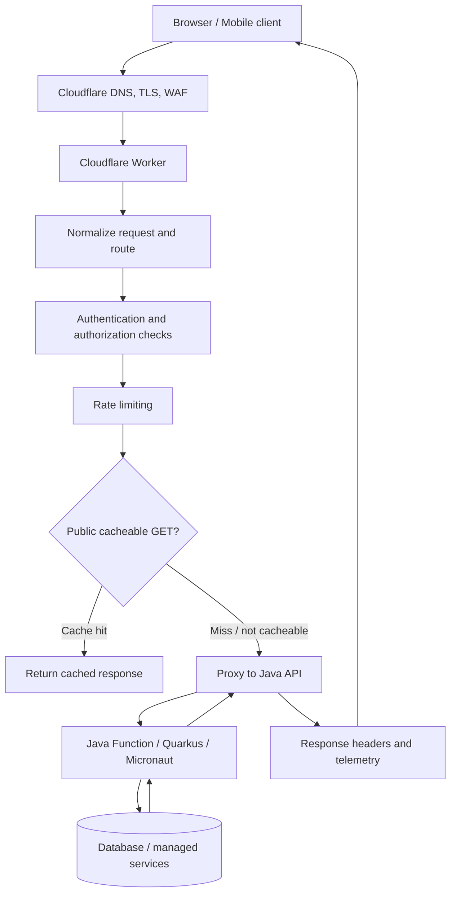
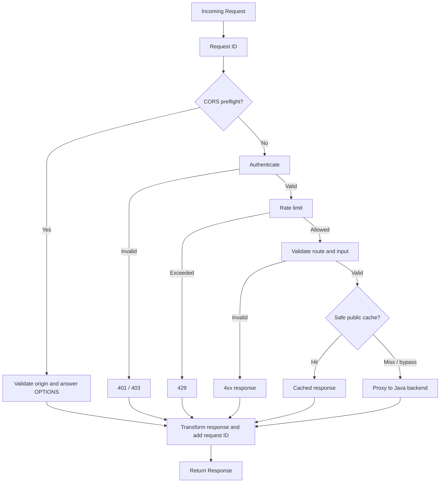

# Designing Edge Middleware with Cloudflare Workers

## 1. What Is Edge Middleware?

Edge middleware is an HTTP processing layer that runs close to users before requests reach the backend application. It can inspect requests, authenticate callers, apply rate limits, route traffic, transform headers/paths, cache responses, record telemetry, and forward requests to the origin.

In a Java serverless application, Cloudflare Workers typically acts as an edge layer sitting in front of a Java API running on AWS Lambda, Azure Functions, Google Cloud Run, or another container/serverless platform. The Worker handles cross-cutting policies at the perimeter; the Java backend continues to handle business logic, data access, and resource-level permission checks.

Cloudflare Workers is a runtime that executes JavaScript/TypeScript under the module worker model, built on Web APIs such as `Request`, `Response`, and `fetch`. It is not a JVM runtime for deploying a Java Function directly as on Java FaaS platforms. Workers can run certain WebAssembly modules and supports a subset of Node.js APIs based on the compatibility date, but that is not the same as running a standard Java/JVM application. Accordingly, this lesson uses TypeScript at the edge and Java in the backend.

Well-designed edge middleware should stay concise, have a clear execution order, and avoid turning into the home for all business logic. Work that requires transactions, large data processing, complex queries, or long execution times generally belongs in the downstream Java service, queue consumer, or workflow.

## 2. Overall Architecture: Worker in Front of a Java Backend

Suppose an order management system consists of a web app, a Java API, and a database. Requests pass through Cloudflare before reaching the Java backend:



Each component has distinct responsibilities:

- **Cloudflare DNS, TLS, and WAF:** receives traffic, terminates TLS, and enforces network/HTTP-layer protection policies per account configuration.
- **Worker:** runs per-request middleware, deciding whether to forward the request or return a response immediately.
- **Java backend:** re-authenticates when needed, executes domain logic, checks resource permissions, and accesses databases and business services.
- **Observability:** correlates edge requests with Java logs/traces using a request ID or trace context.

The Worker can reduce requests reaching Java via caching and early rejection of invalid requests. However, the Java backend must still protect itself if direct access paths exist or if it is invoked by other systems. Never treat a Worker-added header as proof of identity if the origin still allows clients to call it directly and spoof that header.

## 3. Cloudflare Workers Runtime and Request Lifecycle

### 3.1. Module Worker and Fetch Handler

The recommended model for new applications is the module Worker. Incoming HTTP requests arrive at the `fetch()` handler as a `Request` object; the handler returns a `Response` or `Promise<Response>`.

```ts
export default {
  async fetch(request: Request, env: Env, ctx: ExecutionContext): Promise<Response> {
    const url = new URL(request.url);

    return Response.json({
      method: request.method,
      path: url.pathname,
      host: url.host,
    });
  },
} satisfies ExportedHandler<Env>;
```

Three commonly used parameters:

- `request`: the incoming request's method, URL, headers, and body.
- `env`: bindings configured for the Worker, such as secrets, KV, rate limiters, or service bindings.
- `ctx`: execution context, including `waitUntil()` to track background work after the response has been returned.

Asynchronous operations such as `fetch()` must run inside the request/handler context. Do not call external services at module scope during Worker startup.

### 3.2. Isolates and State Across Requests

Workers may reuse an isolate to handle multiple requests. Module-scope variables can persist across invocations within the same isolate, but they must not be treated as durable storage or per-request private storage.

Do not store `currentUser`, tokens, request bodies, or tenant details in mutable global variables. Requests can interleave and share an isolate; data from one request can leak into another. Pass state via parameters, Hono context, or a per-request object. Data that must be shared durably belongs in an appropriate binding/storage service.

### 3.3. Compatibility Date and Node.js Compatibility

`compatibility_date` specifies the set of runtime behaviors the Worker uses. Declare an explicit date in `wrangler.jsonc` and update it with testing when adopting new runtime changes.

Cloudflare provides a subset of Node.js APIs. Starting with compatibility date `2026-08-04`, supported Node.js APIs and their polyfills are enabled by default; unsupported APIs may still be stubs or non-functional. Do not assume an npm package that runs on Node.js will necessarily run on Workers. Inspect the APIs the package actually uses.

## 4. Choosing How to Place a Worker in the Request Path

Cloudflare offers three common ways to expose a Worker to the Internet: Routes, Custom Domains, and `workers.dev`.

| Attachment method | Role of the Worker | When to use |
| --- | --- | --- |
| Route | Runs in front of an existing origin server in the zone; the Worker can call `fetch(request)` to forward to the origin | Adding middleware in front of a Java API already running behind Cloudflare |
| Custom Domain | The Worker is the origin for that hostname; Cloudflare creates the DNS record and certificate | Making the Worker the primary entry point that proxies to a Java backend or other services |
| `workers.dev` | Convenient hostname for development, previews, and experimentation | Demos, testing, or non-production-critical endpoints |

If the Java API already runs behind a Cloudflare-proxied hostname, a Route is usually appropriate. If the Worker serves as the primary API gateway for `api.example.com`, you can use a Custom Domain and proxy from the Worker to the Java origin.

### 4.1. Route Patterns

Route patterns support the `*` wildcard, not general regular expressions. When multiple patterns match, the more specific pattern takes precedence. Paths are case-sensitive; patterns do not include query parameters, and wildcards follow Cloudflare's matching rules.

Examples:

```text
api.example.com/*          -> edge-api Worker
api.example.com/admin/*    -> admin-edge Worker (if configured more specifically)
```

For a route to work, the hostname must have a DNS record proxied through Cloudflare. When using a route in front of an existing origin, verify the DNS record, zone, and pattern before deploying. Avoid overly broad hostname wildcards like `*example.com/*` unless you intend to match unrelated hostnames ending with that suffix.

### 4.2. How Routes and Custom Domains Differ

A Route attaches a Worker in front of an existing origin application. A Custom Domain points the hostname directly at the Worker, making the Worker the origin for that hostname. If a Custom Domain Worker needs to call a Java backend, the code must explicitly call `fetch()` against a configured origin URL.

With a Worker Route, calling `fetch(request)` creates a subrequest to the origin defined in the zone's DNS. With a Custom Domain, you can use `fetch()` to call an external origin using a configured URL. Never accept a destination hostname from a client's query string or header and fetch it arbitrarily; doing so turns the Worker into an open proxy and can introduce SSRF.

## 5. Middleware Pipeline: Processing Order

Middleware consists of steps wrapping the final handler. A request can flow through this sequence:

1. Generate a request ID and capture necessary metadata.
2. Normalize method, path, and headers per the API contract.
3. Handle CORS preflight.
4. Authenticate the token or identity.
5. Apply rate limits by user/tenant/route.
6. Validate method, schema, request size, and route.
7. Decide between caching or forwarding to the Java backend.
8. Normalize the response, adding the request ID and CORS headers.
9. Emit non-critical logs/metrics via background tasks if appropriate.

The order must match specific requirements. For example, CORS preflight must run before access-token middleware because browsers send `OPTIONS` to check policy before the actual request. Per-user rate limiting must run after authentication to have a reliable user ID. Public response caching can be checked before calling the backend, but must never bypass authorization for private data.



## 6. Organizing Middleware with Hono

Hono is a lightweight web framework commonly used with Cloudflare Workers. It provides a router and middleware composition via `app.use()`. Using Hono avoids writing a custom router and `next()` chain.

Example application setup:

```ts
import { Hono } from "hono";
import { cors } from "hono/cors";

type Bindings = {
  JAVA_API_ORIGIN: string;
  API_LIMITER: RateLimit;
};

type Principal = {
  subject: string;
  scopes: string[];
};

type Variables = {
  requestId: string;
  principal: Principal;
};

const app = new Hono<{ Bindings: Bindings; Variables: Variables }>();
```

Types such as `RateLimit`, `ExecutionContext`, and `ExportedHandler` are provided by the Cloudflare Workers type definitions. You can run `npx wrangler types` to generate binding types from the project's Wrangler configuration. Install Hono with `npm install hono`.

Middleware registration order matters. Hono executes middleware in declaration order, and `await next()` passes control to the next step. Middleware can append headers or process the response after downstream steps return.

## 7. Request ID, Logging, and Context

A Request ID links edge logs with Java backend logs. You can generate a new ID in the Worker or use an ID issued by a trusted upstream gateway. If taken from a client header, validate/normalize the value and never use it as a security identity.

```ts
app.use("/api/*", async (c, next) => {
  const requestId = c.req.header("cf-ray") ?? crypto.randomUUID();
  c.set("requestId", requestId);

  console.log({
    event: "request.started",
    requestId,
    method: c.req.method,
    path: new URL(c.req.url).pathname,
  });

  await next();
  c.header("X-Request-Id", requestId);
});
```

In practice, `cf-ray` is a useful reference ID for Cloudflare lookups, though an application request ID should follow your own convention if propagated across multiple systems. Never log access tokens, cookies, sensitive request bodies, or unnecessary personal information.

## 8. CORS and Preflight Handling

CORS is a browser mechanism that controls whether JavaScript from one origin may read responses from another origin. It is not authentication and does not prevent non-browser clients from calling the API.

A CORS configuration must specify:

- Allowed origins, such as `https://app.example.com`.
- Allowed methods, such as `GET`, `POST`, `PATCH`, `DELETE`.
- Client headers permitted, such as `Authorization`, `Content-Type`, `Idempotency-Key`.
- Response headers exposed to JavaScript, such as `X-Request-Id`.
- Whether cookies/credentials are allowed.
- How long browsers may cache preflight results.

Hono example:

```ts
app.use(
  "/api/*",
  cors({
    origin: ["https://app.example.com"],
    allowMethods: ["GET", "POST", "PATCH", "DELETE", "OPTIONS"],
    allowHeaders: ["Authorization", "Content-Type", "Idempotency-Key"],
    exposeHeaders: ["X-Request-Id"],
    maxAge: 600,
    credentials: true,
  }),
);
```

When credentials are enabled, do not use `Access-Control-Allow-Origin: *`. Only return origins on the allowlist. Ensure `OPTIONS` is answered before authentication middleware; preflight requests do not carry access tokens the way actual requests do.

## 9. Authentication and Authorization at the Edge

### 9.1. Token Verification

The Worker can verify JWTs before forwarding requests. When using JWTs, verify the signature with a trusted key and check at minimum `iss`, `aud`, `exp`, `nbf`, and required scopes/roles. Never merely Base64-decode the payload and trust its contents.

You can use a Workers-compatible JOSE library or Cloudflare Access to protect hostnames/APIs. When using Cloudflare Access, the Worker/backend must verify the Access JWT according to Access guidelines and the configured audience.

The middleware example below assumes a `verifyAccessToken()` function using a JWT verification library configured with trusted issuer, audience, and JWKS. The middleware is attached to private endpoints; public endpoints such as a catalog can use a separate route/policy:

```ts
app.use("/api/private/*", async (c, next) => {
  const authorization = c.req.header("Authorization");
  const token = authorization?.startsWith("Bearer ")
    ? authorization.slice("Bearer ".length)
    : undefined;

  if (!token) {
    return c.json({ error: "unauthorized" }, 401);
  }

  let principal: Principal | null;
  try {
    principal = await verifyAccessToken(token);
  } catch {
    principal = null;
  }
  if (!principal) {
    return c.json({ error: "invalid_token" }, 401);
  }

  c.set("principal", principal);
  await next();
});
```

`verifyAccessToken()` is an application authentication adapter; implement it with a maintained JWT library configured for the proper token issuer. Do not roll your own signature verification algorithm without a specialized reason.

### 9.2. Authentication Does Not Replace Business Authorization

A valid JWT indicates which principal sent the request and which scopes it holds. It does not by itself prove the principal may read every order. The Java backend still must enforce resource-level authorization, such as checking whether the user owns the queried `orderId`.

If the Worker adds `X-User-Id` or `X-Tenant-Id`, a client could send headers with the same names to spoof identity unless the Worker strips/overwrites them. The Java backend may trust identity headers only when the origin is protected so that only the trusted Worker can call it and values are verified appropriately. A safer option is forwarding the bearer token so the Java service re-verifies it.

### 9.3. Protecting the Java Origin from Direct Access

If the Java origin remains publicly reachable, clients can call it directly and bypass the WAF, rate limits, or auth middleware in the Worker. Choose an origin protection mechanism such as Cloudflare Tunnel, Cloudflare Access service tokens, mTLS, or appropriate network policies. The Java backend must still authenticate requests and check business permissions.

Never rely solely on `X-Forwarded-For`, `CF-Connecting-IP`, or custom headers to grant permissions. Forwarded headers must be normalized at the edge and trusted only when the path to the origin is controlled.

## 10. Rate Limiting and Backend Protection

Rate limiting at the edge helps curb abuse, protect the Java API, and allocate quotas by user/tenant/route. You can use the Workers Rate Limiting binding or Cloudflare WAF/rate limiting products.

With the Rate Limiting binding, the Worker calls `limit()` with an application-selected key:

```ts
app.use("/api/private/*", async (c, next) => {
  const principal = c.get("principal");
  const path = new URL(c.req.url).pathname;
  const { success } = await c.env.API_LIMITER.limit({
    key: `${principal.subject}:${path}`,
  });

  if (!success) {
    return c.json({ error: "rate_limit_exceeded" }, 429);
  }

  await next();
});
```

Example binding configuration in `wrangler.jsonc`:

```jsonc
{
  "name": "edge-api",
  "main": "src/index.ts",
  "compatibility_date": "2026-11-17",
  "ratelimits": [
    {
      "name": "API_LIMITER",
      "namespace_id": "1001",
      "simple": {
        "limit": 100,
        "period": 60
      }
    }
  ]
}
```

The simple Rate Limiting binding supports a 10- or 60-second period and enforces limits independently per Cloudflare location. Counters update asynchronously in the background, so requests can slightly exceed the configured threshold. This is a near-edge protection mechanism, not an exact global quota counter for billing or financial transactions. If you need strict system-wide limits, use an appropriate centralized/synchronized counter such as a Durable Object or dedicated quota service.

Place key selection after authentication to use verified user IDs/tenant IDs. If using IP addresses, keep in mind users behind NAT or mobile networks may share an IP. You can assign higher weights to resource-intensive endpoints like search or reporting.

## 11. Routing and Proxying to the Java API

### 11.1. Routing by Path and Method

The Worker can route different endpoint groups:

| Route | Java backend | Edge policy |
| --- | --- | --- |
| `GET /api/catalog/*` | Catalog API | Public data may be cached |
| `GET /api/orders/*` | Order API | Auth required; do not cache personal responses |
| `POST /api/orders` | Order API | Auth, validation, rate limit; preserve body |
| `POST /api/payments/*` | Payment API | Strong auth, idempotency, no caching |
| `/api/admin/*` | Admin API | Dedicated access policy, audit logging |

Never build an open proxy that takes `targetUrl` from a query string. The backend origin must be fixed in configuration/bindings, and the Worker must allow only expected routes.

### 11.2. Proxying Requests

The example below uses Hono and `fetch()` to forward requests to a Java origin. The Worker preserves the method, body, and query string while adding a request ID. `JAVA_API_ORIGIN` is managed configuration, not a client-controlled value.

```ts
app.all("/api/*", async (c) => {
  const incoming = new URL(c.req.url);
  const origin = new URL(c.env.JAVA_API_ORIGIN);
  const backendPath = incoming.pathname.replace(/^\/api(?=\/|$)/, "") || "/";
  const target = new URL(`${backendPath}${incoming.search}`, origin);

  const initialRequest = new Request(target, c.req.raw);
  const headers = new Headers(initialRequest.headers);

  // Do not forward the client-supplied Host header.
  headers.delete("host");
  headers.set("X-Request-Id", c.get("requestId"));
  headers.set("X-Forwarded-Host", incoming.host);
  headers.set("X-Forwarded-Proto", incoming.protocol.slice(0, -1));

  const upstreamRequest = new Request(initialRequest, { headers });
  const upstreamResponse = await fetch(upstreamRequest);

  const responseHeaders = new Headers(upstreamResponse.headers);
  responseHeaders.set("X-Request-Id", c.get("requestId"));

  return new Response(upstreamResponse.body, {
    status: upstreamResponse.status,
    statusText: upstreamResponse.statusText,
    headers: responseHeaders,
  });
});
```

This snippet illustrates the proxy flow. In production applications, add connection error handling, timeouts, request body limits, a route allowlist, and redirect rules. If the origin returns a redirect whose `Location` points to an internal hostname, decide whether to rewrite it to the public hostname. Never forward client-declared identity headers as if they were verified.

Register specific routes such as `/api/catalog` before the catch-all `app.all("/api/*")`, or split routers by group so the generic proxy route does not shadow specialized handlers.

### 11.3. Keeping Bodies Streamed

If the Worker is only proxying requests, do not call `await request.json()` and re-serialize the body. Reading the body consumes the stream and forces cloning/buffering, increasing memory usage and latency. Parse the body only when inspection or transformation is required; for large uploads, prefer streaming or uploading directly to backend/storage.

When JSON transformation is needed, enforce size limits, check `Content-Type`, handle parse errors, and construct the new body cleanly. Do not parse every request by default.

### 11.4. Worker-to-Worker and Service Bindings

Service bindings allow one Worker to call another Worker in the same account without traversing a public URL. They fit well when splitting middleware across multiple Workers or calling an internal Worker service.

Service bindings are not a direct mechanism for calling a Java Function on AWS/Azure/GCP. External Java backends are typically called via HTTP `fetch()` to a protected origin, or through an appropriate API gateway/tunnel. Do not confuse Service bindings with connecting to a Java service just because both use the word "service."

## 12. Request/Response Transformation

### 12.1. Request Transformation

The Worker can:

- Normalize path prefixes, e.g., `/api/v1/orders` to `/v1/orders` at the Java origin.
- Add a request ID and trace context.
- Strip disallowed headers before forwarding.
- Normalize `Accept`, `Content-Type`, or protocol headers.
- Map a public hostname to a fixed backend origin.
- Attach verified metadata when the origin has a mechanism to trust the sender.

Do not arbitrarily alter HTTP methods, bodies, or request semantics without a clear API contract. Request transformations should have tests covering URL encoding, slashes `/`, repeated query parameters, and duplicate headers.

### 12.2. Response Transformation

The Worker can add `X-Request-Id`, normalize CORS headers, strip internal headers, or adjust cache directives for public endpoints. Never expose stack traces, internal hostnames, server banners, or Java backend configuration details.

When constructing a new `Response` from the upstream response, preserve the status code and stream the body if no content modification is needed. If the body is altered, update `Content-Length`, `Content-Type`, `ETag`, `Content-Encoding`, and related validators properly.

### 12.3. Error Mapping

Standardize an error envelope between the Worker and the Java API. For example:

```json
{
  "error": {
    "code": "RATE_LIMIT_EXCEEDED",
    "message": "Too many requests",
    "requestId": "req-7f2a"
  }
}
```

Do not convert all upstream errors into `200 OK`. Preserve appropriate status codes so clients and monitoring can distinguish client errors (`4xx`), upstream errors (`5xx`), timeouts, and rate limits (`429`). If the Worker cannot reach the Java origin, return `502 Bad Gateway` or `503 Service Unavailable` according to the failure semantics.

## 13. Caching at the Edge

### 13.1. Cache Only Safely Shareable Data

Caching reduces latency and requests hitting the Java backend. Suitable endpoints typically serve public, infrequently changing data such as product catalogs, public configs, or static metadata.

Never cache by default responses containing private data, account details, orders, payments, or permission-dependent results. For personalized responses, use `Cache-Control: private, no-store` or an equivalent explicit policy.

### 13.2. Cache Keys and Response Variants

The cache key must include every factor that affects response content. If a response varies by locale, currency, tenant, query parameters, or `Accept`, the cache key/`Vary` header must reflect it. Omitting a factor can cause users to receive another tenant's or language's response.

Cache only safe `GET`/`HEAD` requests. Never cache `POST`, `PATCH`, `DELETE`, or side-effecting requests as shared responses. Define TTLs, stale behavior, purge/invalidation, and backend error handling.

### 13.3. Workers Cache, Cache API, and fetch

Cloudflare provides multiple caching mechanisms; understand the scope of each API:

- **Workers Cache:** caches HTTP responses for the Worker based on cache configuration and response headers. A cache hit can return a response without invoking the Worker; only `GET` and `HEAD` qualify, and standard bypass conditions still apply.
- **Cache API:** lets code explicitly `match`, `put`, and `delete` responses. The Cache API is scoped locally to each data center and does not provide tiered caching like Workers Cache.
- **`fetch()` to origin:** in middleware/proxy architectures, usually the right way to send subrequests to the origin and leverage existing zone/origin cache policies.

Cloudflare Workers Cache may automatically bypass when requests carry `Authorization` or responses include `Set-Cookie`. Even so, do not rely solely on automatic bypass: set cache policies appropriate for the business data and verify cache keys.

When using Worker-managed Workers Cache, enable `cache.enabled` in the Wrangler configuration; this feature requires Wrangler 4.69.0 or later per current documentation. Without enabling it, `Cache-Control` headers can still control browser caching or other cache layers, but will not automatically enable Workers Cache for the Worker.

```jsonc
{
  "cache": {
    "enabled": true
  }
}
```

### 13.4. Example Caching a Public Response

```ts
app.get("/api/catalog", async (c) => {
  const upstreamUrl = new URL("/v1/catalog", c.env.JAVA_API_ORIGIN);
  const upstream = await fetch(upstreamUrl);

  const headers = new Headers(upstream.headers);
  if (upstream.ok) {
    headers.set("Cache-Control", "public, max-age=60, s-maxage=300");
  } else {
    headers.set("Cache-Control", "no-store");
  }

  return new Response(upstream.body, {
    status: upstream.status,
    headers,
  });
});
```

This example is strictly for a public catalog. Do not copy the `public` policy onto authenticated endpoints. Specific TTLs should reflect data freshness requirements, purge capabilities, and business needs.

## 14. Secrets, Bindings, and Environment Configuration

### 14.1. Bindings and Configuration Variables

Workers receive resources through `env` bindings. You can use:

- `vars` for non-secret settings such as `JAVA_API_ORIGIN`, environment names, or default limits.
- Secrets for API tokens, shared secrets, or credentials.
- Rate limiting bindings for near-edge quotas.
- KV, R2, D1, or Durable Objects when the application genuinely needs those services.
- Service bindings when calling another Worker.

Never use `vars` to store secrets. Secrets are managed separately and accessed via `env`. In local development, use `.dev.vars` or `.env` per Wrangler conventions and add them to `.gitignore`.

### 14.2. Example Wrangler Configuration

```jsonc
{
  "$schema": "./node_modules/wrangler/config-schema.json",
  "name": "edge-api",
  "main": "src/index.ts",
  "compatibility_date": "2026-11-17",
  "upload_source_maps": true,
  "routes": [
    {
      "pattern": "api.example.com/*",
      "zone_name": "example.com"
    }
  ],
  "vars": {
    "JAVA_API_ORIGIN": "https://java-origin.example.net"
  },
  "ratelimits": [
    {
      "name": "API_LIMITER",
      "namespace_id": "1001",
      "simple": {
        "limit": 100,
        "period": 60
      }
    }
  ],
  "observability": {
    "enabled": true,
    "head_sampling_rate": 0.1
  }
}
```

This example shows a route in front of a Java origin. The hostname must have a DNS record proxied through Cloudflare. If the Worker is the origin for the hostname, use a Custom Domain configuration instead of a standard route.

Upload secrets to the Worker using the Wrangler CLI, for example:

```bash
npx wrangler secret put ORIGIN_SHARED_SECRET
```

This command prompts for the secret value in the terminal. Never commit secrets, never put them in `wrangler.jsonc`, and never log secret values. `JAVA_API_ORIGIN` is public configuration; if the origin uses a token or credential, manage it separately as a secret.

### 14.3. Separating Dev, Staging, and Production

Each environment should have its own origin, secrets, routes, and rate limits. Never reuse production secrets in local development. Audit preview/staging bindings so test requests never write to production databases or queues.

When rotating secrets or bindings, remember isolates can be reused. Avoid caching a global client bound to a rotatable secret unless the client refreshes properly.

## 15. Security and Trust Boundaries

### 15.1. Do Not Turn the Worker into an Open Proxy

The origin must come from trusted configuration or an internal route table. Never read target URLs from arbitrary query strings, bodies, or headers. If a Worker can fetch arbitrary client-supplied URLs, attackers can abuse it to probe internal services or generate unintended outbound traffic.

### 15.2. Headers and Input Data

Strip or overwrite internal headers that clients might spoof, such as `X-Authenticated-User`, `X-Internal-Role`, or `X-Forwarded-Host`. Restrict allowed HTTP methods, body sizes, content types, and paths. Never concatenate raw input directly into origin URLs, filenames, or queries.

### 15.3. Origin Protection

Whenever possible, restrict the Java origin to accept requests only over a trusted connection path. Options include Cloudflare Tunnel, Access service tokens, mTLS, or firewall/network policies. If the origin must remain public, use service-to-service authentication and still validate bearer tokens and business permissions.

### 15.4. CORS Is Not Authorization

CORS only governs whether a browser permits JavaScript to read a response. It does not replace authentication, authorization, or rate limiting. Non-browser clients can still call any publicly reachable endpoint.

### 15.5. Caching and Sensitive Data

Never cache tokens, cookies, personal data responses, or user-authorized responses unless the cache key fully reflects identity. When in doubt, bypass the cache. Inspect `Set-Cookie`, `Authorization`, `Vary`, and cache-control headers emitted by the Java origin.

## 16. Error Handling, Timeouts, and Background Work

### 16.1. Timeouts Between Edge and Java

The Worker must account for origin connection time, backend processing time, and client deadlines. Configure compatible timeouts on both the HTTP client and the Java service. If the Worker times out while Java keeps processing, the client may retry and trigger duplicate work; write endpoints require idempotency keys.

Do not blindly retry every request. Retrying safe `GET` requests is far simpler than retrying a `POST` creating a payment or order. For side-effecting requests, retry only when an idempotency contract and backend support exist.

### 16.2. Distinguishing Errors

| Scenario | Typical edge response | Notes |
| --- | --- | --- |
| Missing/invalid token | `401 Unauthorized` | Do not forward to Java if edge auth is mandatory |
| Principal lacks scope | `403 Forbidden` | Resource authorization must still run in the backend |
| Rate limit exceeded | `429 Too Many Requests` | Do not forward the request to the origin |
| Invalid request schema | `400 Bad Request` or `422` | Clarify which layer owns validation |
| Java origin unresponsive or gateway error | `502` / `503` / `504` depending on cause | Log the request ID for backend investigation |
| Unexpected error in Worker | `500 Internal Server Error` | Never return stack traces to the client |

### 16.3. `ctx.waitUntil()`

`ctx.waitUntil(promise)` lets the Worker continue background work after returning a response, such as sending analytics or emitting extra logs. It is not a durable queue and does not guarantee critical work will finish like a durable job.

Never use `waitUntil()` for mandatory operations such as recording orders, capturing payments, or updating authoritative state. Those operations must complete before returning the response or be written to a durable queue/workflow.

## 17. Observability and Tracing Across Edge/Backend

Workers Logs can capture invocation logs, custom logs, errors, and exceptions. Enable observability in Wrangler and tune `head_sampling_rate` to balance diagnostic visibility against log volume.

Emit structured logs:

```ts
console.log({
  event: "origin.response",
  requestId,
  route: "/api/orders/:id",
  status: upstream.status,
  durationMs,
  cacheStatus: response.headers.get("CF-Cache-Status"),
});
```

Metrics to track:

- Request counts by route/method/status.
- `4xx`, `5xx`, `429` rates and origin fetch errors.
- Edge latency and origin latency.
- Cache hit/miss/bypass rates and data age.
- Rate-limit rejections by tenant/route.
- CPU time, subrequest counts, and runtime errors.
- Java backend latency, database latency, and retry counts.

Propagate the request ID or W3C trace context across the edge to the Java backend to stitch distributed traces together. Do not generate a brand-new trace ID at each hop when maintaining a single end-to-end trace. Never log authorization headers, cookies, tokens, sensitive bodies, or secrets.

## 18. Testing Middleware

### 18.1. Unit Tests for Each Middleware

Every middleware needs tests for both happy and failure paths:

- Request ID is always present in responses even when the backend fails.
- CORS permits allowed origins and rejects origins outside the allowlist.
- `OPTIONS` preflight requests are not blocked by auth middleware.
- Expired JWTs, wrong issuer/audience, or missing scopes are rejected.
- Rate limiting keys off the verified principal and returns `429` when exceeded.
- Path rewrites preserve query strings and do not create unintended routes.
- Client-spoofed headers are stripped/overwritten.
- Private responses are never cached.

### 18.2. Integration Tests with the Java Backend

Run the Worker locally with Wrangler and connect to a test Java API. Verify HTTP methods, bodies, queries, headers, timeouts, redirects, and error mapping. Verify the Java backend receives the expected request ID and independently verifies tokens.

Do not test only against a healthy Java backend. Simulate origin timeouts, connection refused, `5xx` responses, large payloads, malformed JSON, and redirects pointing to internal hostnames.

### 18.3. Cache and Security Testing

Verify these scenarios:

- Two different users never share a cached private response.
- Query parameters or `Vary` headers properly partition cache keys.
- `Authorization` and `Set-Cookie` do not leak data through the cache.
- Requests to the origin cannot bypass authentication/authorization.
- The Worker cannot fetch arbitrary hostnames supplied by clients.
- The Java origin cannot be reached directly to bypass edge policies.

### 18.4. Local Development and Deployment

Common commands:

```bash
# Run Worker locally
npx wrangler dev

# Generate types for bindings from Wrangler configuration
npx wrangler types

# Deploy Worker
npx wrangler deploy

# Tail real-time logs
npx wrangler tail
```

Exact commands depend on the Wrangler version and project setup. Before production, run integration tests against staging hostnames/routes and verify DNS proxying, TLS, origin access, and environment secrets.

## 19. When to Use Hono vs. Custom Middleware

| Option | Fits well when | Considerations |
| --- | --- | --- |
| Hono | You have many routes, middleware, validation, and want a clean API | Adds a dependency; track middleware/package compatibility |
| Custom middleware | Small gateway, few routes, and simple logic | Team must own composition, error handling, and tests |
| Cloudflare WAF/Rules | Policies can be configured at the Cloudflare layer without code | Less flexible for logic depending on application identity or payloads |
| Dedicated API Gateway | You need API contract management, quotas, developer portals, or complex integrations | Adds another operational component; evaluate overlap with the Worker |

Do not write middleware merely to duplicate features already handled well by Cloudflare WAF or routing rules. Keep Worker code focused on logic requiring request/application data, proxying to the Java origin, and coordinating bindings.

## 20. Common Design Mistakes

| Mistake | Consequence | Fix |
| --- | --- | --- |
| Assuming Workers is a Java runtime | Wrong deployment model and dependencies | Keep the Worker in JS/TS/Wasm; run Java in its own backend/runtime |
| Placing all domain logic at the edge | Hard to manage transactions, data, and tests | Keep the Worker as middleware; keep domain services in the Java backend |
| Misusing Routes vs. Custom Domains | Requests miss the Worker or the origin is not invoked as expected | Decide whether the Worker sits in front of an origin or is the origin |
| Placing CORS after authentication | Browser preflight receives `401` | Register CORS before auth and handle `OPTIONS` |
| Trusting client-sent identity headers | User/tenant spoofing | Verify tokens, overwrite headers, and protect the origin |
| Using near-edge rate limiters as exact global quotas | Requests can still exceed thresholds | Use a centralized mechanism when strict limits are needed |
| Caching responses with Authorization | Cross-user data leakage | Never cache private responses; design explicit keys/TTLs |
| Fetching client-supplied URLs in the Worker | Open proxy / SSRF | Use an origin allowlist and fixed routes |
| Reading the full body when only proxying | Higher memory usage and latency | Keep request bodies streamed unless transformation is required |
| Retrying non-idempotent POSTs | Duplicate orders or payments | Use idempotency keys and controlled retries |
| Using `waitUntil()` for critical work | Work is lost if execution stops | Use a durable queue or workflow |
| Not forwarding request IDs to Java | Hard to investigate errors across layers | Use a unified correlation/request ID |

## 21. Process for Designing Edge Middleware for a Java API

1. **Define the boundary:** decide whether the Worker runs on a Route in front of a Java origin or as a Custom Domain/API gateway.
2. **Inventory routes:** methods, paths, target Java backends, and policies per endpoint.
3. **Establish the trust model:** define where authentication happens, how the origin is protected, and how Java checks resource permissions.
4. **Design middleware order:** request ID, CORS, auth, rate limiting, validation, caching, and proxying.
5. **Select bindings:** origin configs, secrets, rate limiters, service bindings, or required storage.
6. **Design the proxy:** preserve methods/bodies/queries, restrict paths, sanitize headers, and handle redirects/timeouts.
7. **Define cache policies:** cache only public data, design cache keys, TTLs, `Vary`, and purging.
8. **Set up observability:** structured logs, request IDs, trace context, metrics, and sampling.
9. **Test bypasses and failures:** auth, CORS, cache isolation, origin outages, rate limits, and large payloads.
10. **Deploy to staging:** verify DNS, routes, TLS, origin protection, secrets, and Java integration.
11. **Controlled rollout:** monitor latency/error rates, enable policies incrementally, and keep a rollback ready.

## 22. Conclusion

Cloudflare Workers serves well as a lightweight edge middleware layer in front of a Java serverless API. The Worker handles routing, CORS, perimeter authentication, rate limiting, caching, and request/response transformation; the Java backend continues to execute business logic, enforce resource-level authorization, and manage durable data.

A reliable design distinguishes Routes from Custom Domains, keeps middleware in a clear order, never trusts client-supplied headers, never caches personal data, and protects the Java origin against paths bypassing the edge. The Rate Limiting binding is approximate per Cloudflare location; strict global quotas require a centralized mechanism. Request IDs, trace context, and origin-failure testing enable end-to-end operability from the edge to the Java service.

## References

- [Cloudflare Workers — Fetch Handler](https://developers.cloudflare.com/workers/runtime-apis/handlers/fetch/)
- [Cloudflare Workers — Routes](https://developers.cloudflare.com/workers/configuration/routing/routes/)
- [Cloudflare Workers — Custom Domains](https://developers.cloudflare.com/workers/configuration/routing/custom-domains/)
- [Cloudflare Workers — Fetch API](https://developers.cloudflare.com/workers/runtime-apis/fetch/)
- [Cloudflare Workers — Bindings (`env`)](https://developers.cloudflare.com/workers/runtime-apis/bindings/)
- [Cloudflare Workers — Secrets](https://developers.cloudflare.com/workers/configuration/secrets/)
- [Cloudflare Workers — Rate Limiting binding](https://developers.cloudflare.com/workers/runtime-apis/bindings/rate-limit/)
- [Cloudflare Workers — Workers Cache](https://developers.cloudflare.com/workers/cache/)
- [Cloudflare Workers — Workers Logs](https://developers.cloudflare.com/workers/observability/logs/workers-logs/)
- [Cloudflare Workers — Compatibility dates](https://developers.cloudflare.com/workers/configuration/compatibility-dates/)
- [Cloudflare Workers — Node.js compatibility](https://developers.cloudflare.com/workers/runtime-apis/nodejs/)
- [Hono — Middleware](https://hono.dev/docs/guides/middleware)
