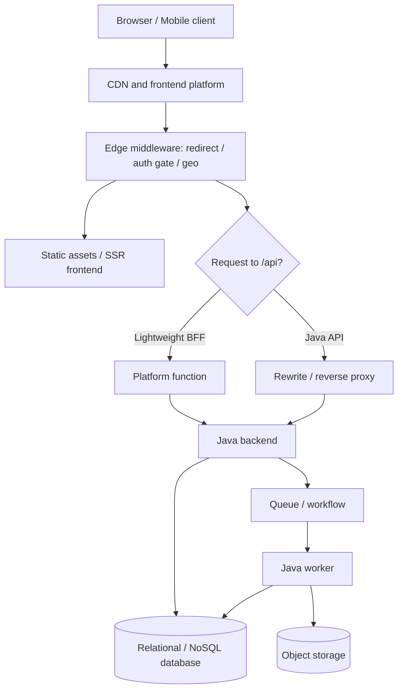
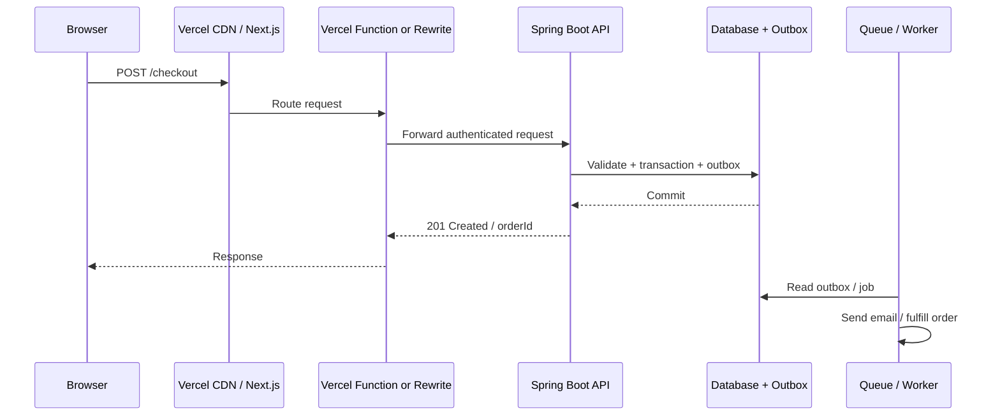
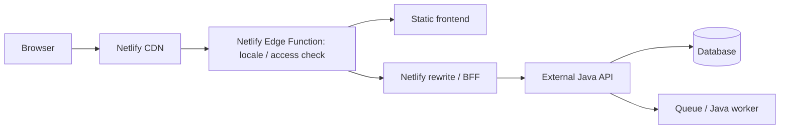

# Choosing Functions for Web Applications on Vercel and Netlify

Vercel and Netlify are web deployment platforms providing CDNs, Git-based builds, preview deployments, and server-side execution mechanisms. Both offer functions and edge functions to handle requests or events without managing servers yourself. However, they are heavily oriented toward frontend and full-stack web frameworks; their support for languages, runtimes, containers, and background tasks differs from general-purpose FaaS platforms.

For a Java application, three questions need to be separated:

1. **What does the web app need near the user?** Examples include static assets, SSR, rewrites, early authentication, regional routing, or small APIs.
2. **Which runtime will the function run on?** Java is not a standard first-party source-code runtime on Netlify or Vercel Edge. Vercel currently offers a Container Runtime beta to run OCI images, while Netlify provides Functions/Edge Functions and Netlify Server with their own runtimes.
3. **Where should Java business logic live?** You can run a Java container on Vercel Container Runtime if the beta limits fit, or deploy the Java backend on Cloud Run, AWS, Azure, or another container platform and connect it to the Vercel/Netlify frontend.

Do not pick an edge function merely because of the label "serverless" or "close to users." Edge runtimes are generally optimized for short request handling in JavaScript/TypeScript and Web APIs. A Spring Boot application needing a JVM, Java libraries, JDBC, thread pools, or long-lived connections usually fits a container/server runtime better.

## 1. Web Serverless Building Blocks on Both Platforms

### Vercel

Vercel combines a CDN, framework deployments, Vercel Functions, Routing Middleware/Edge Runtime, and storage/integration services. API routes or server-side routes in frameworks such as Next.js can be built into Vercel Functions. Functions typically run region-first, autoscale per request, and expose memory, duration, region, and plan-based limits.

Building blocks to distinguish:

- **Vercel Functions:** handle server-side requests or scheduled runs; supported runtimes include Node.js, Bun, Python, Rust, Go, Ruby, Wasm, and Edge.
- **Edge Runtime:** a V8-based environment with Web APIs and a constrained API surface; well suited for middleware, redirects, rewrites, access checks, or lightweight personalization.
- **Container Runtime:** runs OCI images from a `Dockerfile`/`Containerfile`, letting you package arbitrary applications and libraries. As of the time of writing (2026-11-17), this feature is in Beta across plans. It is a notable option for running a Java HTTP server, though Beta risks and Function limits must be evaluated before using it for critical workloads.
- **Cron Jobs:** schedules that trigger a Vercel Function by cron expression; not a replacement for a workflow engine in long-running multi-step processes.

Vercel Functions have a read-only filesystem except for the ephemeral `/tmp` area. Business data must live in a database or object storage. Choose function and database locations close to each other to minimize round trips; deploying functions across many regions while leaving the database far away can increase latency.

### Netlify

Netlify integrates static hosting, a CDN, framework adapters, deploy previews, and server-side primitives. Key building blocks include:

- **Netlify Functions:** functions triggered by requests, platform events, schedules, or background tasks. Current documentation focuses on JavaScript/TypeScript and includes a separate guide for Go. Function runtimes are ephemeral environments that scale with workload.
- **Netlify Edge Functions:** run JavaScript/TypeScript in a Deno-based runtime across edge locations. Used for modifying requests/responses, routing, early authentication, personalization, or caching.
- **Netlify Server:** a long-lived Node.js server capable of retaining connection pools, caches, SDK clients, WebSockets, and SSE across requests. At the time of writing, Netlify Server is in Early Access and documented for Node.js servers/frameworks; it is not a general Java/JVM runtime.
- **Background Functions and Scheduled Functions:** for background work or scheduled execution within plan capabilities and limits.

Netlify Functions and Edge Functions are built and deployed alongside the site, so deploy previews can carry the corresponding function version. For a Java backend, it is common to deploy the service on another platform and have Netlify proxy `/api/*` to that backend.

## 2. Comparing Runtimes and Java Execution Capabilities

The following table describes platform-level capabilities as of 2026-11-17. Plans, Beta status, limits, and supported runtimes may change; before deploying to production, verify the documentation and your actual account dashboard.

| Capability | Vercel | Netlify |
| --- | --- | --- |
| JavaScript/TypeScript functions | Yes, Node.js/Bun runtime | Yes, Netlify Functions runtime |
| Python functions | Official runtime available | Not documented as a standard option in current function runtimes |
| Go functions | Official runtime available | Lambda-compatible API guide available for Go |
| First-party Java source runtime | No dedicated Java source runtime in the official runtime list | No Java runtime among documented function runtimes |
| Running Java via container | Container Runtime Beta for OCI images; can package JVM/Java apps in an image | Netlify Functions/Edge Functions are not a platform for deploying arbitrary OCI containers |
| Edge runtime | V8-based Edge Runtime, not a JVM | Deno-based Edge Functions, not a JVM |
| Long-lived server | Container/service options per current products and limits | Netlify Server Early Access for Node.js servers |

Key point: **Vercel can run Java via container images**, but that does not mean Vercel provides a Java handler runtime like AWS Lambda Java or Azure Functions Java. The Java application must be packaged as an OCI image, start an HTTP server, and conform to the Container Runtime contract.

On Netlify, you can use a JavaScript/TypeScript function as a BFF layer or proxy to a Java backend. Netlify Server is currently documented for Node.js; if the application must run on a JVM, deploy the backend on Cloud Run, AWS Lambda/containers, Azure Functions/containers, or another suitable Java service.

### Why Can't Edge Runtimes Run Spring Boot?

Vercel Edge Runtime runs on V8 and Netlify Edge Functions run on Deno. They expose Web APIs such as `Request`, `Response`, `fetch`, `URL`, Web Crypto, and Streams, plus some platform-specific APIs. They do not boot a JVM, do not load JARs like a Java server, and do not provide full OS APIs like a standard Linux container.

Some platforms support WebAssembly or allow WASM libraries. That can be useful for a small algorithm compiled compatibly, but it is not equivalent to running an entire Spring Boot application, JDBC drivers, or a full JVM at the edge. Choose WASM only when the module compiles cleanly, does not rely on unsupported system APIs, and has been benchmarked in the target runtime.

## 3. How Do Regional Functions and Edge Functions Differ?

Regional functions typically run in a configured or default deployment region. They suit APIs that need database access, SDKs, server-side libraries, and business processing. Edge functions run closer to requests across a distributed network, reducing routing time and performing simple decisions before requests hit the backend.

| Criterion | Regional/serverless function | Edge function |
| --- | --- | --- |
| Location | One or more configured regions | Many edge locations near users |
| Runtime | Application runtimes such as Node.js, Python, Go, Rust, or containers depending on platform | Constrained runtime based on V8 or Deno |
| Workload | APIs, database queries, SDK integration, business logic | Redirects, rewrites, geo, auth gates, headers, caching, light personalization |
| Resources | Usually higher CPU/memory and longer duration depending on plan | Usually explicit CPU, memory, bundle, and API limits |
| Database connectivity | Better suited when placed near the database | Avoid calling a distant database on every request where possible |
| Java/JVM | Possible via containers on Vercel; not a native Java handler | Cannot run JVM/Spring Boot directly |

Moving a function to the edge does not guarantee the overall request is faster. If an edge function calls a database in a distant region, the database round trip can dominate total latency. Consider caching small datasets, Edge Config, or an authentication step that avoids heavy data lookups.

### Edge Limits to Read Before Choosing

Netlify publishes Edge Functions limits such as a maximum 20 MB compressed bundle, 512 MB memory across deployed edge functions, 50 ms CPU execution per request, and a 40-second response header timeout. These are runtime limits published at the time of reference, not an SLA or universal numbers across all edge platforms. Vercel Edge Runtime also restricts APIs: no standard filesystem, no direct `require`, and certain Node.js APIs are unsupported.

Do not place CPU-heavy logic, large file processing, multi-table queries, or Java/JVM onto the edge just to run near users. Placing a small decision step at the edge and routing requests to a regional service is usually much easier to control.

## 4. Choosing Functions for Web Apps by Workload Type

### Small APIs Tightly Coupled to the Frontend

If a Next.js app or a framework supported by Vercel/Netlify needs small endpoints to create sessions, call third-party APIs, hide API keys, or aggregate data for a page, the platform's native functions are usually the simplest option.

For example: the frontend calls `/api/profile`; the function checks the session, calls an internal service, and returns only the fields the UI needs. This is a Backend for Frontend (BFF). A BFF should focus on HTTP orchestration and data presentation, while core business rules can live in a Java backend shared across multiple clients.

### Early Authentication, Redirects, and Personalization

Edge functions suit lightweight cookie/session checks, locale redirects, geo routing, A/B testing, blocking clearly invalid requests, or adding security headers. If a decision needs calls to multiple systems or complex business permission checks, route to a backend API to keep the edge path fast and manageable.

### Webhooks and Background Tasks

Webhook receivers can run in a regional function if processing is quick: verify signatures, check the event ID, persist the event durably, and enqueue work. Longer tasks should move to a queue/worker or background execution. Do not rely on background threads after an HTTP handler returns a response unless the platform guarantees their lifecycle.

Vercel Cron Jobs can trigger functions on a schedule. Netlify provides Scheduled Functions and Background Functions. If you need multi-step retries, checkpoints, approvals, or long-running workflows, use a dedicated queue/workflow engine instead of turning a function into a self-managed scheduler.

### Business-Heavy Java Backends

If the application uses Spring Boot, Quarkus, or Micronaut, relies on JDBC/JPA, transactions, numerous endpoints, Java libraries, or logic shared with batch workers, consider a Java service/container. Vercel Container Runtime Beta can be an option if you want to keep the backend container on the same platform; Netlify typically pairs with an external Java backend proxied from the site.

Do not split every Java method into a tiny function just to appear serverless. Over-splitting increases network calls, complicates transaction management, multiplies retry points, and makes tracing harder. Split along business boundaries and independent scaling needs.

## 5. Hybrid Architecture Combining a Frontend Platform and a Java Backend

A common pattern for a Java web application is:

1. Vercel or Netlify serves static assets, the frontend framework, and CDN caching.
2. An edge function handles redirects, geo routing, or simple request checks when needed.
3. A BFF function or rewrite/proxy forwards `/api/*` to the Java backend.
4. The Java backend runs on an appropriate container/FaaS platform, accessing databases, queues, and object storage.
5. Workers or workflows process asynchronous tasks, while the API exposes job status if users need to track progress.



If Vercel Container Runtime is used for the Java backend, `J` can be a container service/function deployed inside Vercel. When using Netlify, `J` usually lives on Cloud Run, AWS, Azure, or another Java platform. Place the frontend and backend in regions aligned with users and databases; do not assume edge locations are optimal for every step.

### Sharing a Domain Simplifies Browser Security

Proxying `/api/*` through the frontend domain lets browsers use a single origin and reduces CORS configuration. However, proxying does not replace authentication and authorization. The backend must still verify tokens/sessions, check tenants/resources, limit request body sizes, and defend against CSRF when using cookie authentication.

## 6. Running a Java HTTP App with Vercel Container Runtime

As of 2026-11-17, Vercel Container Runtime is in Beta and can run code/libraries from an OCI container image. A Java HTTP application can be packaged in a Dockerfile and run as a container-based Vercel Function. The runtime requires the container to expose an HTTP server; the default port is `80` and can be overridden via the `PORT` environment variable.

Example Spring Boot port configuration via environment variables:

```properties
server.port=${PORT:80}
server.address=0.0.0.0
```

Illustrative multi-stage Dockerfile:

```dockerfile
FROM maven:3.9-eclipse-temurin-21 AS build
WORKDIR /workspace
COPY pom.xml .
COPY src ./src
RUN mvn -B -DskipTests package

FROM eclipse-temurin:21-jre
WORKDIR /app
COPY --from=build /workspace/target/app.jar /app/app.jar
ENV PORT=80
EXPOSE 80
ENTRYPOINT ["java", "-XX:MaxRAMPercentage=75.0", "-jar", "/app/app.jar"]
```

Adjust the JAR name and JDK to match your project. Build and test steps should run in CI; do not use `-DskipTests` as your final quality gate. The image must run a foreground process, log to stdout/stderr, and listen on `0.0.0.0:$PORT`.

For new Vercel projects where no other framework is detected, a root `Dockerfile` can select the Container preset. If the project already detects Next.js or another framework, set the project framework to Container or follow the runtime documentation's Dockerfile naming conventions. Then deploy via the Vercel CLI or Git integration as a container-based workload.

### Limits to Account For Up Front

- Container Runtime is in Beta; APIs, availability, and plan terms may change.
- Vercel Function limits and Active CPU pricing apply to custom container images.
- Functions/containers scale based on traffic. At the time of documentation review, instances receiving no traffic for 5 minutes in production and 30 seconds in preview scale down.
- During scale-down, the container receives `SIGTERM` and gets a 30-second grace period to clean up before forced termination.
- Do not store business state on the filesystem or heap across scale events; use a database/cache/object storage.
- The server must handle graceful shutdown: stop accepting new work, finish in-flight requests where possible, close connection pools, and never assume the process runs forever.

Because this is a Beta runtime, verify current limits, networking, deployment regions, request durations, image optimization limits, and compliance requirements before choosing it for a critical production backend. If you need long-lived processes, continuous background workers, specialized protocols, or deep OS control, a dedicated container/server platform may be a better fit.

## 7. Using Netlify for the Frontend and Connecting an External Java Backend

Netlify works well for building and deploying frontends and small functions in its supported runtimes. When the main backend is Java, deploy Spring Boot/Quarkus/Micronaut as a separate service. The Netlify site can proxy API routes to the backend domain.

Example `netlify.toml`:

```toml
[[redirects]]
  from = "/api/*"
  to = "https://api.example.com/api/:splat"
  status = 200
  force = true
```

This is a sample rewrite/proxy rule. Verify redirect syntax and proxy behavior against your current Netlify version, and avoid redirect loops if the backend also redirects to the frontend. Never put backend secrets in frontend code; keep credentials in the backend or server-side scoped environment variables. The backend must handle CORS, cookies, authorization, and forwarded headers according to the actual topology.

Netlify Functions can act as a small BFF in front of the Java API:

```typescript
// netlify/functions/profile.ts
import type { Config, Context } from "@netlify/functions";

export default async (request: Request, _context: Context) => {
  const session = request.headers.get("cookie");
  if (!session) {
    return Response.json({ error: "unauthorized" }, { status: 401 });
  }

  const upstream = await fetch(`${process.env.JAVA_API_URL}/v1/profile`, {
    headers: { cookie: session },
  });

  return new Response(upstream.body, {
    status: upstream.status,
    headers: {
      "content-type": upstream.headers.get("content-type") ?? "application/json",
      "cache-control": "no-store",
    },
  });
};

export const config: Config = {
  path: "/api/profile",
  method: "GET",
};
```

This example only illustrates a BFF calling a Java API. In production, do not blindly forward cookies: verify the session at a trusted layer, forward only what is needed, pull the upstream URL from trusted configuration, configure timeouts, cap response sizes, and never let clients control the destination hostname. If the Java backend can verify sessions/tokens directly, calling it straight through a rewrite can be simpler.

### Role of Netlify Server

Netlify Server is announced in Early Access and lets you run a long-lived Node.js server, retain connection pools/caches/SDK clients across requests, and support WebSockets and SSE. It fits Node.js backends. Current docs describe servers using Node.js handlers or Node.js frameworks such as Express, Fastify, Hono, and Koa; it should not be treated as a way to deploy a JVM/Spring Boot server directly. When Java is required, keep the Java API on a service supporting Java/containers.

## 8. What Should Edge Middleware Do?

An edge function should make cheap, fast decisions using data already available at the edge. For example:

- Select locale based on `Accept-Language` or geolocation.
- Redirect users to the appropriate path.
- Add or strip security headers.
- Validate signed cookies/tokens that are still valid under simple policies.
- Serve cached content variants by cookie/variant.
- Block clearly invalid requests before they reach the backend.

Avoid placing these tasks in an edge function:

- Running a JVM, Spring Boot, JDBC, or native Java libraries.
- Opening a fresh database connection on every edge request.
- Heavy CPU computation or large file processing.
- Long workflows, multi-step retries, or waiting on callbacks.
- Complex authorization requiring multiple queries and business state.

Edge middleware is not the sole authority for permissions. The Java backend must still verify permissions on every API and resource. If a token is tampered with or a request bypasses the edge via another path, the backend must never assume the caller is already authorized.

## 9. Handling Requests, Background Tasks, and Workflows

A web request generally falls into one of three processing patterns:

| Workload pattern | Suitable implementation |
| --- | --- |
| Fast response, small payload | Vercel/Netlify Function or direct Java API |
| Fast acceptance, bounded background processing | Return `202 Accepted`, save job, enqueue, and let client poll status |
| Long multi-step process, retries/approvals/compensation | Queue + workflow engine/durable orchestration and Java workers |

Netlify Background Functions can handle background work within plan and runtime limits. Vercel Functions can be triggered by Cron and integrated with queue/workflow primitives. However, never use `waitUntil`, background callbacks, or a single function invocation as a durable workflow engine. When checkpoints and resumption hours or days later are needed, store state in a durable system.

With a Java backend, queue workers can run on Cloud Run Jobs, AWS Lambda, Azure Functions, Kubernetes workers, or another suitable service. The frontend platform only needs to call the job-submission API and the status endpoint.

## 10. Security and Data

When the frontend platform and Java backend are separated, define clear security boundaries:

- **Authentication:** verify sessions/OIDC/JWT in the backend or a trusted BFF; never rely on a browser-supplied header.
- **Authorization:** check tenant, owner, and per-resource permissions inside the Java service.
- **Secrets:** store API keys, database passwords, and signing keys only in server-side environment/secret managers; never bundle them into the frontend.
- **CORS/CSRF:** with separate origins, configure origin allowlists, credentials, and cookie flags; with same-origin proxying, still protect against CSRF when using cookies.
- **Rate limiting:** limit by user, tenant, IP, or API key at the edge/gateway and backend.
- **Webhooks:** verify signatures, timestamps, event IDs, and idempotency; never trust payloads solely because they arrive at a public URL.
- **Network:** restrict backend ingress where possible, using private connectivity or service-to-service identity when supported by the platform.
- **Logs:** never log tokens, cookies, presigned URLs, secrets, or sensitive payloads.

If Vercel/Netlify proxies to a Java API, inspect forwarded host/proto/IP headers and trust only headers injected by a controlled proxy. Never allow clients to send forged headers to determine tenant or access permissions.

## 11. Regions, Latency, and Data

Edge functions may execute close to users, while the Java backend and database may live in a single region. A request going through the edge and then calling the Java API and database can incur multiple cross-region round trips. When selecting regions:

1. Identify where most users are located.
2. Identify where the database and supporting services reside.
3. Place the Java backend close to the database if most latency comes from data queries.
4. Use the edge for decisions that avoid round trips or can be safely cached.
5. Measure p50/p95/p99 latency from browsers through the CDN, edge, backend, and database.
6. Check data residency, compliance, and private networking requirements.

Do not leave the database in a distant region just to put functions at the edge. Often a regional Java API next to the database paired with a good CDN cache outperforms an edge function making cross-continental database calls.

## 12. Cost and Performance

Costs depend on plan, runtime, request volume, CPU time, memory, duration, bandwidth, caching, storage, logs, databases, and Java backend services. Account for the entire request path.

| Component | Factors to measure |
| --- | --- |
| CDN/static hosting | Bandwidth, cache hit ratio, builds/deployments, and request count |
| Regional Functions | Invocations, active CPU/compute, memory, duration, region, and streaming |
| Edge Functions | Invocations, CPU time, bundle size, memory, caching, and matched requests |
| Vercel Container Runtime | Beta/plan availability, function limits, active CPU, memory, image size, scale-down, and networking |
| Netlify Server | Early Access/plan, instance count, reserved memory/active CPU when billing applies, web requests |
| External Java backend | Instance/container/function compute, min instances, database connections, network egress, and logs |
| Data services | Queries, storage, replication, caching, egress, and backups |

Operational guidelines:

- Place functions near the database to cut latency and network costs.
- Avoid oversized connection pools per instance; total connections scale with instance count.
- Cache public or infrequently changing data at the CDN/edge when no private data leaks.
- Set explicit timeouts on every downstream call and return diagnosable errors.
- Bound background concurrency and queue retries to avoid load storms.
- Measure cost per successful business operation, not only per invocation.
- Evaluate cold starts, scale-to-zero, and the cost of keeping warm instances based on actual traffic.

## 13. Process for Choosing Between Vercel and Netlify for a Java Web App

### Choose Vercel When...

- The frontend uses Next.js or a framework deeply integrated with Vercel.
- You want a CDN, preview deployments, routing middleware, and Vercel Functions for small BFF/APIs.
- You can run the Java backend as an OCI container and are comfortable evaluating Container Runtime Beta.
- You want frontend and container-based backend within Vercel's unified deployment/observability workflow.

### Choose Netlify When...

- The frontend aligns with Netlify's framework/build ecosystem.
- You need deploy previews, static hosting, Netlify Functions/Edge Functions, and platform event integrations.
- The Java backend can run as a separate service called via rewrite/proxy or BFF.
- You need a long-lived Node.js server and Netlify Server Early Access fits.

### Choose a Dedicated Java Backend Platform When...

- Java/JVM is a hard requirement and needs a stable server/container environment.
- Workloads require long-lived connections, WebSockets/server processes, continuous background workers, or tasks exceeding function limits.
- You need VPC/private networking, large connection pools, complex transactions, or deep OS-level control.
- You do not want core systems depending on a Beta or Early Access container feature.

## 14. Quick Decision Table

| Requirement | Recommended direction |
| --- | --- |
| Static site + frontend framework | Vercel or Netlify based on team framework/workflow |
| TypeScript Next.js API routes | Vercel Function; Netlify adapter if deploying Next.js on Netlify |
| Simple redirects/geo/auth gates | Edge Middleware/Edge Function |
| Spring Boot Java API, request/response | Vercel Container Runtime Beta or external Java container service; Netlify proxying to external backend |
| Java backend with JDBC/JPA and transactions | Java service/container close to the database; use platform functions only as a BFF if needed |
| WebSockets/SSE with in-process state | Appropriate server/container runtime; Netlify Server is currently Node.js Early Access, not JVM |
| Small TypeScript webhook | Vercel/Netlify Function |
| Webhook calling Java domain logic | Function/BFF verifies then calls Java API, or Java service receives webhook directly |
| Short background task | Background function/queue worker within platform limits |
| Long batch, multi-step workflow | Queue + workflow engine + Java worker on a suitable backend platform |
| Edge needing a small Java algorithm | Consider compiling to WASM only if APIs are compatible; do not assume JVM execution |

## 15. Architecture Example: Vercel Frontend, Java Backend

Suppose a storefront uses Next.js on Vercel and Spring Boot to process orders. The frontend deploys static/SSR pages; an `/api/checkout` route can act as a lightweight BFF or proxy to the Java backend. The Java backend verifies the session/token, checks prices/inventory, creates the order in a transaction, and writes an outbox event. Workers handle emails and fulfillment asynchronously.

If using Vercel Container Runtime, Spring Boot is packaged in a Dockerfile and serves HTTP on `PORT`. Without the Beta runtime, the backend deploys to Cloud Run/AWS/Azure and Vercel rewrites `/api/*` to the API domain. Either way, the database and queue belong to the Java backend; never store order state in Vercel Function variables.



## 16. Architecture Example: Netlify Frontend, Java Backend

An Astro/React/Vue site can deploy to Netlify. An Edge Function can select locale or inspect cookies; a Netlify Function can serve as a BFF for an endpoint that aggregates data; a rewrite `/api/*` forwards remaining requests to a Spring Boot service on Cloud Run or another container platform.

Do not drop a Java JAR into `netlify/functions` expecting the host to run it as a JVM. The build system can build multiple languages for the frontend, but build-time availability does not mean the function runtime supports that language. When a Java runtime is needed, deploy the Java backend as a separate service.



## 17. Testing and Operations

Testing must cover both the frontend platform and the Java backend:

1. **Local frontend:** run the framework dev server, Vercel CLI, or Netlify CLI to verify routing, environment variables, and function adapters.
2. **Java unit tests:** test domain services, validation, authorization, and idempotency with JUnit.
3. **Container tests:** build the Java image, run it with the port passed via `PORT`, send HTTP requests, and verify graceful shutdown.
4. **Contract tests:** verify JSON payloads, status codes, cookies/headers, error mapping, and API versions between the BFF and Java backend.
5. **Integration tests:** databases, queues, secrets, object storage, and private networking.
6. **Preview tests:** verify preview deployments point to the right backend/environment and never touch production data unintentionally.
7. **Load tests:** measure concurrency, connection pools, cold starts, p95/p99 latency, rate limits, and cost.
8. **Failure tests:** backend timeouts, queue redelivery, duplicate webhooks, function retries, Java container `SIGTERM`, and database disconnects.

Propagate request IDs/correlation IDs through the CDN, function/edge, and Java service. Logs should distinguish failures at the edge, function, proxy, backend, and database layers. Never log access tokens, cookies, secrets, or full personal payloads.

## 18. Common Design Mistakes

1. **Assuming every serverless platform runs Java source.** Verify official runtimes and container options before choosing.
2. **Deploying Spring Boot to Edge Runtime.** V8/Deno edge runtimes are not JVMs; use a regional/container runtime for Java.
3. **Confusing build tools with runtimes.** The fact that CI can run Maven or a JDK does not prove the function host can execute JARs.
4. **Putting every API at the edge.** An edge function calling a distant database can increase latency.
5. **Putting all domain logic in a TypeScript BFF.** The Java backend and other clients may end up duplicating business rules.
6. **Storing state in function memory or `/tmp`.** Instances scale down, restart, or run in parallel; durable data belongs in storage/databases.
7. **Using functions for long tasks without checkpoints.** Move to a queue, background worker, or workflow engine.
8. **Proxying while forgetting security.** Same-origin proxying does not replace auth, authorization, CSRF, rate limiting, and forwarded-header validation.
9. **Ignoring networking and data locality.** Edge near users with a distant backend/database can make total requests slow and expensive.
10. **Adopting Beta/Early Access features in core systems without evaluation.** Verify limits, SLAs, support, and migration fallbacks.

## 19. Pre-Decision Checklist

- [ ] Do the frontend framework and Git/preview workflow fit Vercel or Netlify?
- [ ] Does the request need static/SSR, a regional function, an edge function, or a long-lived server?
- [ ] Does the runtime directly support the required language and libraries?
- [ ] If using Java, have you selected a genuine Java container/runtime?
- [ ] Does Vercel Container Runtime Beta satisfy your limits, plan, networking, and compliance needs?
- [ ] If using Netlify, is the Java backend deployed as a separate service with clear routing/proxying?
- [ ] Can edge code run purely on Web APIs without relying on JVM/filesystem/native APIs?
- [ ] Are databases, queues, and backends located in regions aligned with the functions?
- [ ] Do APIs have timeouts, idempotency, retries, and job status tracking for long tasks?
- [ ] Are authentication, authorization, CORS/CSRF, secrets, and rate limiting designed?
- [ ] Are local, contract, container, preview, integration, and load tests in place?
- [ ] Are p95/p99 latency, cold starts, concurrency, connection counts, and full-path costs measured?
- [ ] Is there a fallback plan if Beta/Early Access runtimes change or fail to meet production needs?

Vercel and Netlify make it easy to deploy frontends alongside server-side logic close to web workflows. Functions fit small APIs, webhooks, and scheduled/background tasks; edge functions fit short request handling near users; servers/containers fit applications needing full processes and libraries. For Java, Vercel Container Runtime Beta opens up running OCI images directly on Vercel, whereas Netlify currently fits better with a frontend plus an external Java backend. The final choice should rest on actual runtimes, limits, Beta/Early Access status, database location, and end-to-end request path operations.

## Official References

- [Vercel Functions – Runtimes](https://vercel.com/docs/functions/runtimes)
- [Vercel Container Runtime](https://vercel.com/docs/functions/runtimes/container)
- [Vercel Edge Runtime](https://vercel.com/docs/functions/runtimes/edge)
- [Vercel Functions – Limits](https://vercel.com/docs/functions/limitations)
- [Netlify Functions – Overview](https://docs.netlify.com/build/functions/overview/)
- [Netlify Functions – Get started](https://docs.netlify.com/build/functions/get-started/)
- [Netlify Edge Functions – Overview](https://docs.netlify.com/build/edge-functions/overview/)
- [Netlify Edge Functions – Limits](https://docs.netlify.com/build/edge-functions/limits/)
- [Netlify Server](https://docs.netlify.com/build/server/)
