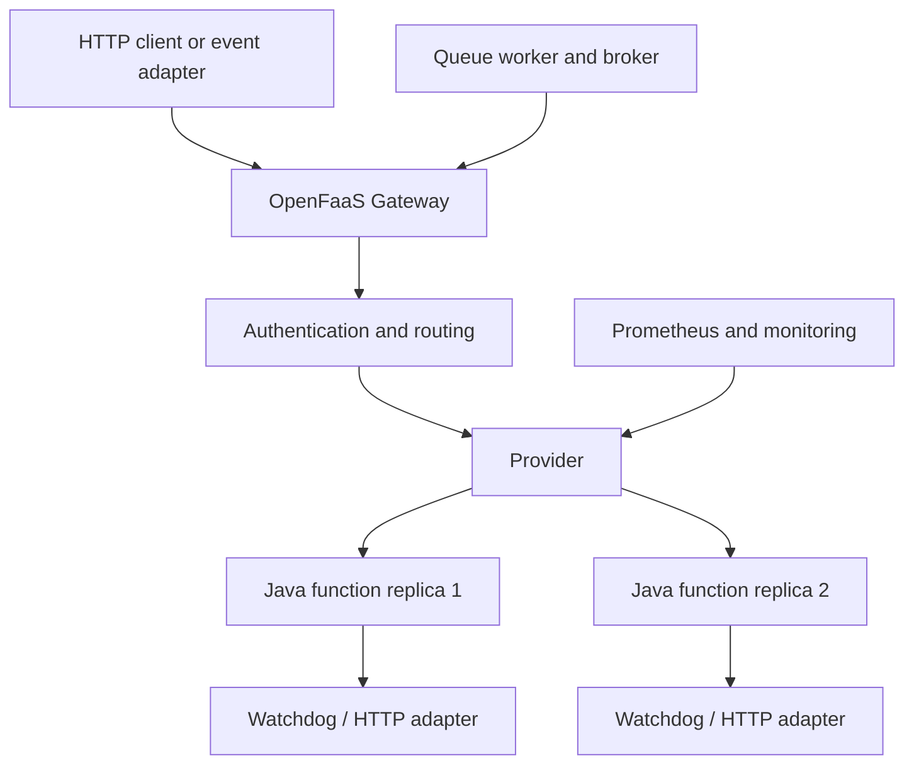
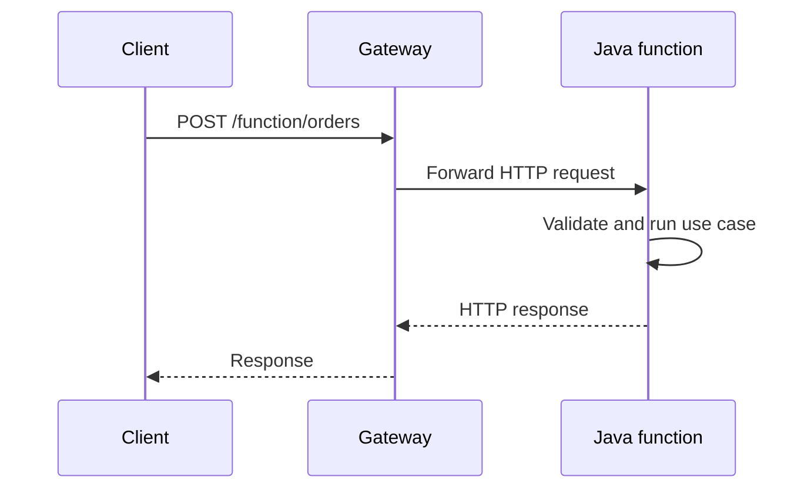
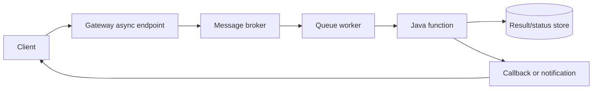
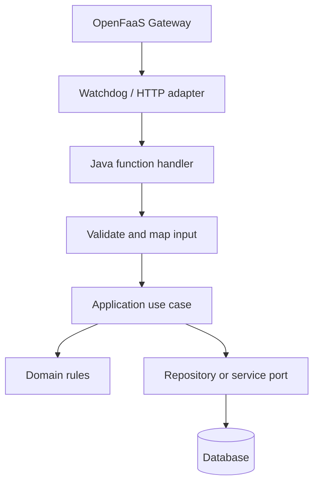

# Function and Gateway Models in OpenFaaS

OpenFaaS is an open-source platform for packaging and operating functions as containers. Rather than forcing application code into a proprietary runtime, OpenFaaS lets functions be built in many languages and deployed onto Kubernetes or a lightweight container environment such as `faasd`. A gateway sits in front of functions to receive requests, authenticate callers, route traffic, and connect to the workload management layer.

With Java, a function is typically packaged together with the required JRE/JDK runtime into a container image. The gateway forwards HTTP requests to the container; a watchdog or HTTP adapter inside the template bridges OpenFaaS's protocol to the function process. The platform manages replica counts and container lifecycles according to deployment configuration. Because functions run as container services, it is important to understand that a process can persist across multiple requests, in-memory state belongs to a single replica only, and scaling out creates multiple independent replicas.

Within **CLOUD_SERVERLESS**, this lesson focuses on developing and deploying Java functions triggered by HTTP, messages, or events; handling triggers, state, access control, retries, idempotency, cold starts, scaling, and cost. OpenFaaS illustrates an open serverless model where the gateway, provider, watchdog, function containers, and observability stack work together to run workloads.

## 1. What Is OpenFaaS?

OpenFaaS provides a platform layer for deploying and invoking functions over HTTP. Developers package a function as a container image; OpenFaaS deploys that image onto the configured provider. The gateway exposes a unified entry point to invoke functions by name.

Key characteristics:

- Functions are distributed as container images.
- A CLI and templates are provided to scaffold, build, push, and deploy projects.
- The gateway exposes HTTP endpoints to invoke functions.
- The provider deploys and manages workloads on Kubernetes or another supported environment.
- The watchdog/adapter forwards requests to the function process according to the template's contract.
- Autoscaling, metrics, logging, and asynchronous invocation can be integrated depending on the provider, version, and installed components.

OpenFaaS standardizes how functions are packaged and invoked, while the operations team remains responsible for the cluster or host, registry, networking, storage, gateway, platform updates, and infrastructure capacity.

## 2. Architecture Components

An OpenFaaS deployment typically includes these components:

| Component | Role | What to understand |
|---|---|---|
| `faas-cli` | Tool for scaffolding templates, building, pushing, and deploying functions | Use stack configs to make deployments reproducible |
| Gateway | HTTP entry point, authentication, routing requests to functions | Must secure endpoints, TLS, auth, and rate limits |
| Provider | Connects OpenFaaS to the underlying container platform | Can be the Kubernetes provider or `faasd`; operational capabilities depend on the provider |
| Function container | Runs Java code and dependencies | Each replica has its own process, memory, and resources |
| Watchdog/HTTP adapter | Receives requests under the runtime contract and forwards to the function process | Execution mode affects process lifecycle, concurrency, and streaming |
| Prometheus/metrics | Collects telemetry for autoscaling and observability | Keep metrics and alerts meaningful |
| Queue worker/broker | Supports asynchronous invocation when configured | Decouples request acceptance from execution time, but requires retries and idempotency |



The conceptual diagram shows the gateway handling synchronous calls; the queue worker is an additional component for asynchronous flows. Actual deployments vary by provider, OpenFaaS version, and installed components.

## 3. What Does the Gateway Do?

The gateway is the unified entry point for clients. Upon receiving a request, the gateway typically performs these steps:

1. Receives the HTTP request and identifies the target function from the URL.
2. Authenticates the caller using the configured mechanism.
3. Applies routing and forwards the request to the function's endpoint.
4. Receives the response from the function and returns it to the caller.
5. Records metrics or observability data as configured.

The standard synchronous endpoint has the form:

```text
POST http://<gateway>/function/<function-name>
```

Example invoking a function named `orders`:

```bash
curl -X POST \
  http://127.0.0.1:8080/function/orders \
  -H 'Content-Type: application/json' \
  -d '{"orderId":"ord-1042","action":"validate"}'
```

`127.0.0.1:8080` is suitable only for local environments or port-forwarding. In production, place the gateway behind an ingress/load balancer with TLS, DNS, access policies, and appropriate rate limits.

The gateway is an important boundary, but it does not replace business authorization. The function must still verify whether the caller is allowed to act on the specific order, tenant, or resource.

## 4. Providers and Where Functions Execute

The provider maps OpenFaaS operations onto resources of the underlying platform.

- **Kubernetes provider:** deploys functions as cluster workloads; can leverage Kubernetes scheduling, resource requests/limits, service discovery, HPA, and network policies depending on configuration.
- **`faasd`:** delivers the OpenFaaS experience on a lighter container environment suited for single-host or edge deployments; HA scope and scaling depend on host architecture.
- **Other environments:** verify the specific provider and support level in your OpenFaaS version.

The provider dictates how replicas are created, images updated, health checked, networked, and scaled. Therefore, do not assume every Kubernetes capability exists in `faasd`, or that identical autoscaling configs behave identically across providers.

In production, establish who manages the cluster/host, who updates the provider, how configs are backed up, how the gateway is recovered, and how nodes or container runtimes are monitored.

## 5. Watchdog and Function Process Lifecycle

The watchdog bridges OpenFaaS's function invocation protocol and your handler program. OpenFaaS templates usually supply a watchdog or adapter tailored to the language. The watchdog receives requests, passes input to the function process, and returns output to the gateway.

Different watchdog modes may spawn a process per request or forward requests to a long-lived HTTP process. The specific mode affects:

- Startup time and process-creation overhead.
- Ability to handle multiple concurrent requests.
- How request bodies, headers, and responses are passed.
- Streaming, timeouts, and error handling.
- Safety when functions use shared variables or resources.

With Java, read the contract of the template/watchdog in use before choosing how to structure handlers. If the template runs a long-lived HTTP server, the JVM can stay alive across the container's lifecycle. If the template spawns a process per request, startup overhead differs dramatically.

Never infer the JVM lifecycle merely from the word "function." Inspect the Dockerfile, watchdog mode, and actual entrypoint command in the image.

## 6. Synchronous Invocation Model

In the synchronous model, the client sends a request through the gateway and waits for the function's response. This fits quick operations with immediate results, such as input validation, small calculations, or data reads.



The client must wait until the function finishes or times out. For long-running tasks, holding the request open ties up connections and risks hitting gateway, ingress, or caller timeouts. In those cases, switch to an asynchronous model: accept the request, persist the task, return an ID, and process via a queue/workflow.

## 7. Asynchronous Invocation Model

OpenFaaS supports asynchronous invocation through a dedicated endpoint and queue worker/broker components when configured. The endpoint typically takes the form:

```text
POST /async-function/<function-name>
```

The request enters an asynchronous processing pipeline; the client does not wait for the function to finish as in synchronous calls. Broker mechanics, queue workers, callbacks, and result storage depend on deployment configuration.



Asynchronous invocation fits file processing, sending emails, generating reports, or work that does not need an immediate final response. Define how clients retrieve results: callbacks, webhooks, notifications, or a status-polling API.

Do not assume the async endpoint automatically provides a durable result store or exactly-once processing. Verify broker, queue worker, retry, retention, and callback behavior in your deployment.

## 8. Scaffolding a Java Function from a Template

`faas-cli` supports creating functions from templates. Available templates vary by repository, version, and configured store.

Discovery and scaffolding workflow:

```bash
faas-cli template store list
# Replace JAVA_TEMPLATE with a Java template name shown by the command above.
faas-cli template store pull JAVA_TEMPLATE
faas-cli new orders --lang JAVA_TEMPLATE
```

Replace `JAVA_TEMPLATE` and the `lang` value in the stack file with the actual Java template name from your template store. Some templates are maintained by the community or internally; verify the Java version, Maven/Gradle setup, watchdog, and base image before use.

A template typically generates a layout similar to:

```text
orders/
├── handler/
│   └── ... Java source ...
├── function/
│   └── ... runtime or adapter files ...
├── pom.xml
└── Dockerfile
stack.yml
```

The exact structure depends on the template. Read the template's README and Dockerfile to understand the handler contract, build command, port, watchdog mode, and how dependencies are packaged.

## 9. Structuring Java Code Inside a Function

The function adapter should stay thin: read the request, validate input, map into a command, invoke the use case, and build the response. Business rules must not depend on the gateway or watchdog.



Example pure Java use case:

```java
public record ValidateOrderCommand(String orderId) {}

public record OrderValidationResult(
        String orderId,
        boolean valid,
        String reason) {}

public interface OrderRepository {
    Optional<Order> findById(String orderId);
}

public final class ValidateOrderService {
    private final OrderRepository orders;

    public ValidateOrderService(OrderRepository orders) {
        this.orders = orders;
    }

    public OrderValidationResult execute(ValidateOrderCommand command) {
        return orders.findById(command.orderId())
                .map(order -> new OrderValidationResult(
                        order.id(), order.isValid(), "checked"))
                .orElseThrow(() -> new OrderNotFoundException(command.orderId()));
    }
}
```

`Order`, `OrderNotFoundException`, and the repository implementation are illustrative application types. The template-specific handler only needs to deserialize the request, construct `ValidateOrderCommand`, call the service, and serialize the result. The domain does not need to know whether a request arrived via the OpenFaaS gateway or a direct JVM unit test.

## 10. Docker Images and Java Runtime

Functions are deployed as container images, so the image must contain the Java runtime, artifact, and entrypoint matching the watchdog/template.

A minimal Java Dockerfile for a long-lived HTTP application might look like:

```dockerfile
FROM eclipse-temurin:21-jre
WORKDIR /app
COPY target/orders-function.jar /app/app.jar
ENV PORT=8080
EXPOSE 8080
CMD ["java", "-XX:MaxRAMPercentage=75.0", "-jar", "/app/app.jar"]
```

This example shows a container running an HTTP server directly. When using an OpenFaaS Java template with a watchdog, keep the template's Dockerfile and command or adapt them properly to the watchdog mode; never run two HTTP servers fighting over the same port.

Key optimization practices:

- Pick a JRE compatible with your application's Java version.
- Use multi-stage builds to keep Maven/Gradle build tools out of the runtime image when unneeded.
- Use security-patched base images matching the target CPU architecture.
- Run processes as a non-root user whenever possible.
- Align memory/CPU limits and JVM options with container limits.
- Never bake secrets into images or build layers.
- Scan images and pin versions/digests in the release pipeline.

## 11. Configuring Functions with stack.yml

OpenFaaS uses a stack file to describe functions to build and deploy. Simplified example:

```yaml
provider:
  name: openfaas
  gateway: http://127.0.0.1:8080

functions:
  orders:
    lang: <java-template>
    handler: ./orders
    image: registry.example.com/orders:0.1.0
    environment:
      LOG_LEVEL: info
      TZ: UTC
    limits:
      memory: 512Mi
      cpu: 500m
    requests:
      memory: 256Mi
      cpu: 100m
```

`<java-template>` is a placeholder to replace with the pulled template. The local gateway is only an example. With the Kubernetes provider, resource requests/limits typically map onto workload container resources. With other providers, support levels and enforcement may differ.

Never put passwords, tokens, or private keys directly under `environment`. Use the OpenFaaS/provider secrets mechanism and scope secret read access to only the functions that need them.

## 12. Building, Pushing, and Deploying

A common CLI workflow:

```bash
# Build function image from stack.yml
faas-cli build -f stack.yml

# Push image to registry
faas-cli push -f stack.yml

# Deploy function through the gateway
faas-cli deploy -f stack.yml --gateway http://127.0.0.1:8080

# List deployed functions
faas-cli list --gateway http://127.0.0.1:8080
```

These commands require a working registry, gateway access, and an operational provider. In production, the gateway typically uses an HTTPS hostname and authentication. Prefer immutable image tags or digests instead of `latest` for traceability and reliable rollbacks.

After deployment, verify health, logs, metrics, function endpoints, resource limits, and scaling behavior. Never treat `faas-cli deploy` returning success as proof that the entire business flow works.

## 13. Scaling and Scale-to-Zero

OpenFaaS can scale functions up or down by adjusting replicas based on metrics and provider settings. On Kubernetes, autoscaling mechanisms can leverage Prometheus metrics and HPA or a corresponding autoscaler component. Scale-to-zero capability depends on the deployed components/edition/provider; do not assume every OpenFaaS installation scales to zero out of the box.

Concepts to distinguish:

- **Min replicas:** minimum number of running replicas retained.
- **Max replicas:** upper replica limit for the function.
- **Autoscaling metric:** signal driving scale-up/scale-down, such as request rate, CPU, or concurrency.
- **Scale-to-zero:** scaling a function down to zero replicas when idle, if supported by the platform and config.
- **Cold start:** time spent creating the container, starting the watchdog/JVM, and loading the application when a new replica is needed.

If a function scales to zero, the first request after an idle period can incur a cold start. Keeping min replicas above zero lowers startup latency, but the cluster consumes resources even without traffic.

## 14. Concurrency and Java Resources

Concurrency is how many simultaneous requests a single replica can process effectively. It depends on the watchdog mode, HTTP server, thread pools, and how application code is written.

With Java:

- Ensure handlers and singleton services are thread-safe when a process serves concurrent requests.
- Never store request-specific state in static fields or mutable singletons.
- Size thread pools and HTTP client connection pools to match CPU/memory limits.
- Never share a JDBC connection across requests; use a pool and `try-with-resources`.
- Set DB/API call timeouts shorter than the overall request timeout.
- Test heap, GC, and native memory within container limits.

If the watchdog spawns a separate process per request, concurrency and startup costs differ from keeping a long-lived HTTP process. Determine the actual mode before benchmarking or setting replica counts.

## 15. State and Data Inside Function Containers

A container may stay alive across many requests, but replicas can restart, be replaced, or scale to zero. JVM memory belongs strictly to that replica and is not shared across replicas.

Never use static maps or local files as the source of truth for business state. Store persistent data in an appropriate database, object storage, Redis, or message broker. Local filesystems should only hold ephemeral scratch data within container capacity and lifecycle bounds.

If a function caches data, treat the cache as a dispensable optimization: authoritative data must reside externally, with proper TTLs and invalidation. Never tie the correctness of orders, payments, or idempotency to a single replica staying alive.

## 16. Retries and Idempotency

Synchronous gateway calls normally return results directly to the caller. If a client times out, it may resend the request even though the earlier function execution already committed side effects. With async invocation, queue workers/brokers may redeliver messages after errors or timeouts. Both cases require idempotency.

Principles:

- Accept an `Idempotency-Key` from HTTP or use a stable event/message ID.
- Persist keys and processing outcomes in a shared store, not replica memory.
- Use conditional writes/transactions to prevent two replicas from claiming the same key.
- Retry transient failures with backoff and a maximum retry cap.
- Route permanent data errors to quarantine/DLQ if the async architecture supports it.
- For external side effects, use the target system's idempotency API or the outbox/saga pattern.

Never retry validation, authentication, or authorization errors indefinitely. A function should return success only when business work has durably committed or the request has been durably recorded into a queue/store per contract.

## 17. Securing the Gateway and Functions

The gateway is the public or internal access surface for functions. Secure both the platform layer and business logic:

1. Place the gateway behind an ingress with TLS; never expose administrative endpoints publicly without authentication.
2. Enable OpenFaaS authentication and manage credentials safely; never embed gateway credentials in source code.
3. Use network policies or firewalls to allow traffic only from necessary sources.
4. Enforce authorization inside functions by user, tenant, and business resource.
5. Run containers as non-root, use minimal images, and keep dependencies patched.
6. Grant least-privilege secrets per function; avoid sharing one admin secret across all workloads.
7. Cap request sizes, timeouts, and rates to reduce abuse risks.
8. Emit audit events for sensitive operations without logging tokens or secret data.

If the gateway exposes management endpoints or function-listing APIs, restrict access to operators and deployment pipelines. Business clients should only have permission to invoke the functions they need.

## 18. Observability and Autoscaling Metrics

OpenFaaS commonly integrates Prometheus for metrics collection and Grafana for dashboards. Metrics to watch:

- Request count and request rate per function.
- p50/p95/p99 request duration.
- HTTP error rate and timeouts.
- Replica count, desired replicas, and autoscaling events.
- CPU/memory usage, restart count, and readiness.
- Queue depth, processing lag, and retries when using async invocation.
- Cold starts or time from scale trigger until a replica becomes ready.
- Cost or resource consumption by namespace/function.

Logs should include correlation IDs, function name, request ID, and error codes. If a request fans across multiple functions, propagate trace/correlation context via HTTP headers or message metadata to link steps.

Autoscaling metrics must reflect the real bottleneck. Scaling on RPS can misbehave if individual requests vary widely in CPU cost; CPU-only scaling can react sluggishly for mostly I/O-bound workloads. Measure and choose metrics matching each function's behavior.

## 19. Timeouts, Payloads, and Request Limits

A function can hit timeouts from the client, gateway, ingress, watchdog, or application. End-to-end timeouts must be consistent: inner-layer timeouts should be shorter than outer-layer timeouts so the application can return controlled errors.

For long-running tasks:

- Do not hold synchronous requests open for too long.
- Return a task ID after durably persisting the request.
- Enqueue work into a queue or workflow.
- Track status and progress in a shared store.
- Let clients poll status or receive callbacks.

Large payloads should be streamed or stored in object storage with a reference passed instead. Avoid pushing multi-MB files through the gateway when request size, memory, and timeouts are ill-suited.

## 20. Cost and Operational Responsibilities

Because OpenFaaS is self-hosted, cost goes beyond function execution time. Operations teams must account for:

- Compute for Kubernetes nodes or `faasd` hosts.
- Gateway, provider, Prometheus, Grafana, and system components.
- Container registry, storage, networking, and load balancers.
- Idle/min replicas and reserved headroom.
- Build pipelines, image scanning, backups, upgrades, and on-call operations.
- Databases, brokers, and external services used by functions.

Scale-to-zero can reclaim function compute when idle if supported, though the gateway, broker, metrics, and control plane still require resources. If a cluster already runs other workloads, the marginal cost of a function can be low; spinning up a cluster solely for a few small functions means platform overhead can dominate costs.

Measure cost per workload or function, set resource requests/limits, prune old images, watch idle replicas, and optimize processing times. Do not keep high min-replica counts just to avoid cold starts unless real latency requirements justify it.

## 21. When Is OpenFaaS a Good Fit?

OpenFaaS can fit well when an organization needs:

- A function platform supporting multiple languages and container images.
- Control over runtime environments, networking, and deployment locations.
- Deployment on Kubernetes or edge hosts.
- Integrating functions into an existing container estate.
- A unified CLI/template and HTTP gateway workflow across multiple teams.
- Avoiding complete lock-in to a single cloud provider's function deployment API.

OpenFaaS requires a team capable of operating the gateway, provider, cluster/hosts, registry, monitoring, security, and upgrades. If the goal is minimizing infrastructure operations entirely, a fully managed FaaS service may fit better.

## 22. Pre-Deployment Checklist for Java Functions

| Question | Evidence or configuration required |
|---|---|
| Which provider runs the function? | Kubernetes, `faasd`, or specific provider identified |
| How is the gateway protected? | TLS, authentication, ingress, and network policies |
| Which watchdog does the Java template use? | README, Dockerfile, command, and mode verified |
| Does the JVM stay alive across requests? | Process lifecycle and concurrency tested |
| Is the function stateless? | Durable state stored outside the container |
| Is the image secure? | Patched base image, non-root, scanned, immutable tags |
| Are CPU/memory bounded? | Requests/limits configured and benchmarked |
| Does autoscaling fit the workload? | Min/max replicas, metrics, and provider support |
| Is scale-to-zero actually enabled? | Components/edition and cold start behavior verified |
| Are retries safe? | Idempotency store, backoff, and DLQ/quarantine |
| Does async invocation have a broker? | Queue worker, broker, retention, and callbacks configured |
| Are requests traceable? | Correlation IDs, logs, Prometheus, and dashboards |
| Are platform costs accounted for? | Gateway, control plane, monitoring, idle replicas, and cluster |
| Is a rollback process ready? | Image versions/digests and deployment history |

## 23. Operational Model Summary

In OpenFaaS, clients invoke functions via the gateway. The gateway authenticates and routes requests; the provider manages container workloads; the watchdog or adapter passes requests to the Java process; the function calls storage or external systems. For asynchronous flows, brokers and queue workers decouple request acceptance from execution time.

Development teams must design stateless functions, handle retries with idempotency, cap concurrency to match Java and downstream resources, protect the gateway, instrument requests, and control images. Operations teams own the provider, cluster/hosts, registry, gateway, metrics, upgrades, and capacity.

The defining trait of OpenFaaS is running functions as container workloads behind an open gateway. Understanding the boundaries between the gateway, provider, watchdog, and function enables flexible Java deployments on cloud or edge while proactively managing cold starts, scaling, access control, and cost.
