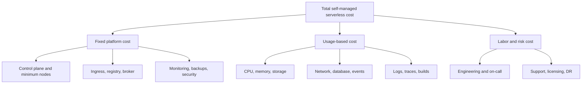

# Evaluating Operating Costs of Serverless on Self-Managed Infrastructure

Serverless on self-managed infrastructure lets teams deploy functions triggered by requests, messages, or events without managing individual application processes. Platforms such as Knative, OpenFaaS, Apache OpenWhisk, or Fission can run on Kubernetes, private clouds, enterprise server clusters, or edge sites. Developers focus on handlers; the platform handles routing, spawning execution instances, scaling, and part of the function lifecycle.

However, "serverless" does not mean free infrastructure or zero operations staff. When self-managing, an organization must buy or lease compute, storage, networking, redundancy, security, and observability; while maintaining Kubernetes, the function runtime, registries, ingress, message brokers, and control-plane components. The platform may meter by function invocation, but the underlying infrastructure usually carries fixed baseline costs even when zero requests arrive.

A sound evaluation examines the **Total Cost of Ownership (TCO)** of the entire platform and workloads, then converts it into cost per completed business unit. Do not compare only CPU prices or invocation counts, because cold starts, idle capacity, operations staffing, HA/DR, networking, logs, and databases often make up the majority of total cost.

## 1. What Does "Self-Managed Serverless" Actually Include?

In this model, users still deploy functions through a serverless interface, while the organization owns or takes responsibility for the infrastructure running the platform.

A typical architecture includes:

- **Control plane:** function management APIs, schedulers, controllers, autoscalers, admission control, and metadata.
- **Data plane:** ingress/gateways, queues/event brokers, function pods, or execution containers.
- **Compute layer:** Kubernetes worker nodes, VMs, bare-metal servers, or edge nodes.
- **Storage:** container registries, persistent volumes, databases, object storage, and log storage.
- **Network:** load balancers, ingress, service meshes, DNS, firewalls, VPNs, and inter-site links.
- **Operations layer:** monitoring, logging, tracing, alerting, backups, security scanning, and CI/CD.

Common platforms organize these pieces differently:

| Platform | Common model | Cost components to account for |
| --- | --- | --- |
| Knative Serving/Eventing | Serving revisions, request-based scaling, event brokers/channels, and Kubernetes integration | Kubernetes, ingress/networking, autoscalers, brokers, registries, observability, and node capacity |
| OpenFaaS | Function gateway, provider, watchdog/runtime, and autoscaling on Kubernetes or Docker | Gateway/provider, worker nodes, ingress, registries, queues if using async, support/subscriptions if applicable |
| Apache OpenWhisk | Controllers, invokers, action runtimes, and messaging/storage dependencies | Controller/invoker capacity, Kafka or messaging layer, databases/storage, Kubernetes/VMs, and operations |
| Fission | Environments, routers, executors, and function pods on Kubernetes | Routers/executors, builders, worker nodes, registries, ingress, and monitoring |
| KEDA with Kubernetes | Scales workloads from event sources; KEDA itself is not a full function runtime | Kubernetes, scalers/operators, message brokers, function containers, ingress, and node capacity |

Component names and deployment topologies vary by version and architecture. This table identifies resource groups to include in cost calculations rather than serving as a price sheet or platform recommendation.

### 1.1. Distinguishing Platform Cost from Workload Cost

Platform costs are what it takes for the serverless system to exist and stay ready to accept functions: control plane, minimum worker nodes, ingress, registries, brokers, monitoring, and operations staff.

Workload costs scale with functions or usage: CPU, memory, storage, databases, messages, networking, logs, and execution counts. Some items sit between the two groups. For instance, worker nodes are a platform baseline cost at low load, yet become a workload cost when scaling out to absorb peaks.



A platform can scale functions to zero, yet it cannot scale the entire control plane, brokers, ingress, and monitoring to zero if it still needs to ingest events or serve management APIs. That is why the minimum cost of a self-managed system is rarely zero.

## 2. Total Cost of Ownership Framework

TCO should be calculated over a consistent period—typically monthly or annually—and include both direct expenses and operational labor.

```text
Period TCO
  = compute and hardware
  + power, cooling, racks, and facilities
  + Kubernetes and control plane
  + networking, load balancers, and data transfer
  + storage, databases, registries, and message brokers
  + logging, metrics, tracing, and security
  + backups, HA, DR, and spare capacity
  + licenses, support, and external services
  + deployment, operations, and on-call labor
  + amortized migration, upgrade, and hardware replacement costs
```

Not every organization receives a separate invoice for every line item. On-premises servers may bury power and racks in a data center budget. Private clouds may charge back compute per VM or quota. Regardless of which cost center pays the bill, those resources are consumed by the workload and belong in TCO.

### 2.1. Compute and Hardware

Items to include:

- worker servers, CPUs, RAM, and accelerators if any;
- control plane nodes or management VMs;
- hypervisors, Kubernetes distributions, and system node pools;
- spare hardware, buffer capacity, and refresh cycles;
- cloud VM leases if self-managed infrastructure runs on IaaS.

When purchasing hardware, amortize purchase price across its practical useful life rather than expensing the entire purchase into one month. For example, a server costing 300 million VND with an expected 48-month lifespan carries simple depreciation of roughly 6.25 million VND/month, before maintenance, power, financing, and residual value.

Do not count only node totals. Calculate usable capacity after subtracting system reservations, daemons, kubelet, OS, runtime, and required headroom. A 32-vCPU node does not mean function workloads can consume all 32 vCPUs.

### 2.2. Power, Cooling, and Facilities

For on-premises infrastructure, calculate power draw of servers, switches, storage, and network gear alongside cooling, racks, UPS, and data center space. You can use PUE to estimate facility power overhead:

\[
Energy_{facility} = Energy_{IT} \times PUE
\]

Higher PUE means greater total facility power relative to power delivered directly to IT equipment. Obtain measurements from the data center or provider rather than assuming one constant across all sites.

At edge sites, power and maintenance across many locations can cost more than anticipated due to compact hardware, thermal constraints, backup power, and distributed field support.

### 2.3. Kubernetes and Control Plane

Self-managed Kubernetes may carry no direct license line item, yet still incurs costs:

- control plane nodes or managed control plane fees;
- etcd backups, quorum maintenance, and upgrades;
- cluster networking, CNI, CSI, and ingress controllers;
- autoscalers, KEDA, and Knative/OpenFaaS/Fission controllers;
- certificate management, policy engines, and secrets integration;
- upgrades, compatibility testing, and incident response.

When using a managed Kubernetes service, include control plane fees, node pools, load balancers, NAT gateways, persistent disks, and auxiliary services from the provider's price list. Self-hosting the control plane can lower service fees while increasing operational burden and staffing costs.

### 2.4. Networking and Data Transfer

Network costs can include:

- load balancers, ingress, and egress gateways;
- NAT gateways or firewalls;
- cross-zone/cross-region traffic;
- VPNs, leased lines, Internet transit, and inter-site connectivity;
- service mesh sidecar or gateway overhead;
- traffic to databases, object storage, registries, and external APIs.

A small function can generate heavy traffic to external services. When functions run across many edge sites, backhaul traffic to headquarters or cross-region transfers can outweigh CPU costs. Measure bytes in/out by actual workload and traffic path.

### 2.5. Storage, Databases, and Message Brokers

Do not count storage gigabytes alone. Factor in IOPS, throughput, replication, backups, retention, snapshots, and operational effort. For message brokers, include nodes/volumes, replication factors, partitions, retention, and network traffic. For databases, include connection capacity, reads/writes, backups, failover, and licenses if applicable.

A function platform may be open-source and free, yet every function can impose substantial database or queue load. When comparing options, price dependencies over the same workload scope.

### 2.6. Observability and Security

Logging, metrics, tracing, and auditing usually incur costs based on ingest volume, retention, cardinality, storage, and queries. Poor trace sampling can generate more data than application logs. Metric labels carrying `requestId`, `userId`, or event IDs create extreme cardinality and inflate monitoring infrastructure costs.

Security also spans image scanning, vulnerability management, secrets managers, certificate lifecycles, policy engines, audit archives, and penetration testing. Do not exclude these items from TCO just because a shared platform provides them.

## 3. Fixed Costs, Variable Costs, and Idle Capacity

### 3.1. Fixed Costs

Fixed costs are what it takes to keep the platform running even when workload is low:

- control plane and minimum nodes;
- ingress/routers and DNS;
- brokers or event buses that must stay online;
- registries and artifact storage;
- monitoring, log collectors, and security agents;
- licenses/support or on-call staffing.

Even when functions scale to zero, if queue brokers, controllers, and ingress remain up, the baseline compute bill persists.

### 3.2. Variable Costs

Variable costs grow with workload:

- number of function instances and execution duration;
- CPU/memory consumed;
- network bytes and requests;
- number of messages/events, partitions, or storage operations;
- database connections and query load;
- log/trace volume.

Some costs behave as step functions. For example, exceeding the capacity of 3 worker nodes forces the autoscaler to add a 4th node; costs jump by a step rather than rising linearly per request.

### 3.3. Idle Capacity

Idle capacity is paid or purchased resource capacity sitting unused by workloads. In self-managed platforms, idle capacity arises when:

- reserve nodes must be kept for peaks;
- nodes run control plane/system workloads;
- autoscalers take time to provision new nodes;
- workloads request high memory while consuming low CPU;
- functions are kept warm to reduce cold starts;
- multiple clusters or edge sites experience uneven load.

A node averaging 15% CPU utilization may still fail to scale down if pod memory requests have already claimed nearly all allocatable memory. Similarly, a CPU-idle node hosting system pods or unmovable local persistent volumes may have to stay online.

### 3.4. Scale-to-Zero Does Not Shrink the Entire System to Zero

Scale-to-zero typically applies to function workloads or revisions when idle for a period. It does not necessarily apply to:

- the control plane;
- brokers/queues needed to ingest events;
- ingress needed to receive HTTP requests;
- autoscalers and event source adapters;
- monitoring/agents;
- minimum node pools.

When a function scales up from zero, it takes time to start the container, JVM, framework, and dependency connections. If SLAs require fast responses, teams often keep warm replicas or provisioned capacity, increasing idle cost.

### 3.5. Utilization and Bin Packing

Bin packing schedules more workloads onto fewer nodes to raise utilization. However, targeting overly high utilization strips away headroom for bursts, rolling updates, node failures, and pod rescheduling.

Track utilization separately across CPU, memory, storage, and networking. For example, 70% CPU with 92% memory can prevent the cluster from scheduling any new pods. The bottleneck resource governs scaling capacity, not whichever metric looks most favorable.

## 4. Estimating Capacity Before Pricing

Compute costs only make sense when capacity satisfies both load and availability targets. Start from the workload profile:

- average, p95, and peak request/event rates;
- execution duration per invocation;
- CPU-seconds and memory footprint;
- target concurrency;
- batch size and backlog tolerance;
- fraction of functions requiring warm capacity;
- error/retry rates and dependency wait times.

### 4.1. Estimating Concurrency

A simple estimate via Little's Law:

\[
Concurrency \approx ArrivalRate \times AverageDuration
\]

If a system receives 200 requests/second with an average duration of 0.25 seconds, average concurrency is roughly 50. That is only the average; add headroom for bursts, tail latency, retries, and uneven load distribution.

### 4.2. Estimating Pod/Function Instance Count

If each pod is allowed to handle `c` concurrent requests and target total concurrency is `C`, preliminary pod count is:

\[
Pods \approx \left\lceil \frac{C}{c} \right\rceil
\]

Actual pod counts also depend on CPU, memory, thread limits, connection pools, in-process request queues, and dependency latency. Never set concurrency per pod too high if a Java handler creates threads or connections per request.

### 4.3. Estimating Node Count

A screening formula:

\[
Nodes \approx \left\lceil \frac{Demand + Headroom}{UsableCapacityPerNode} \right\rceil
\]

`UsableCapacityPerNode` must reflect capacity after subtracting system reservations and platform pods. `Headroom` must cover N+1, rolling updates, node drains, peak bursts, and uneven load across zones/sites.

This is a first-pass estimate, not a substitute for bin-packing simulations or load testing. A node with sufficient aggregate CPU and RAM can still fail to schedule pods if individual pods have large requests, restrictive affinity/anti-affinity rules, or non-portable volumes.

### 4.4. Capacity for High Availability

If a cluster must survive losing one node, enough capacity must remain to reschedule workloads after that node drops. Across three zones, check the scenario where one zone becomes unavailable and traffic shifts onto the remaining two zones. N+1 increases idle cost while lowering the risk of overload during incidents.

At the edge, decide which sites must operate autonomously. Provisioning full redundant capacity at every site can be expensive; some workloads can degrade gracefully or fail back to a central region when an edge site loses connectivity.

## 5. Cost Allocation Formulas

### 5.1. TCO and Unit Economics

Cost per successful invocation:

\[
CostPerSuccess = \frac{TCO_{period}}{SuccessfulInvocations_{period}}
\]

This metric works well when invocations are relatively uniform. If one function processes 20 MB images while another merely validates tokens, allocate by resource consumption or business units rather than dividing total cost evenly.

A better metric for many workloads is:

\[
CostPerBusinessUnit = \frac{AllocatedTCO}{CompletedBusinessUnits}
\]

Examples of business units include completed orders, processed images, generated reports, or successfully processed messages.

### 5.2. Allocating Shared Platform Costs

Control planes, ingress, and monitoring serve multiple teams. Establish consistent allocation rules, such as:

- by CPU/memory requests or usage;
- by invocation count weighted by duration/memory;
- by network bytes or log ingest volume;
- by function/revision/tenant count;
- by reserved capacity quotas;
- combining a fixed baseline allocation with usage-based allocation.

Do not split evenly across all functions when resource usage differs dramatically. Conversely, do not charge back purely on CPU if a workload drives costs primarily in networking, storage, or observability.

### 5.3. Resource-Based Allocation Example

Suppose in one month:

| Line item | Hypothetical cost |
| --- | ---: |
| Worker compute and depreciation | 36 million VND |
| Power, racks, and cooling | 8 million VND |
| Networking and load balancing | 7 million VND |
| Storage, registry, and brokers | 9 million VND |
| Logging, metrics, and tracing | 6 million VND |
| Licensing/support and security | 8 million VND |
| Allocated operations labor | 24 million VND |
| Backups, DR, and spare capacity | 7 million VND |
| **Total TCO** | **105 million VND/month** |

These are hypothetical numbers illustrating the calculation method, not market rates or vendor quotes. If that month sees 10 million completed business invocations and the entire TCO is allocated to this workload, average unit cost is:

\[
105,000,000 / 10,000,000 = 10.5\text{ VND/unit}
\]

With only 2 million invocations, unit cost rises to 52.5 VND/unit even though total cost barely changes. Scaling to 30 million invocations without adding nodes or staff drops unit cost to 3.5 VND/unit. Once capacity is exceeded and extra nodes must be added, total cost jumps by a step.

This shows how utilization and volume heavily shape unit economics. Never judge a workload as cheap or expensive solely from cost per invocation without checking payload size, duration, and business completion rates.

## 6. Comparing Self-Managed vs. Managed Serverless Services

Managed FaaS platforms such as AWS Lambda, Google Cloud Functions/Cloud Run functions, or Azure Functions shift most infrastructure and capacity management to the provider. Billing models typically meter invocations, execution duration, resources, requests, or auxiliary services per product.

Self-managed infrastructure generally carries higher fixed costs but can achieve lower marginal costs when utilization is high and workloads are steady. Managed services can carry higher variable costs at high volume while eliminating control-plane and worker-fleet operations.

| Criterion | Managed serverless | Self-managed serverless |
| --- | --- | --- |
| Upfront cost | Typically low, minimal infrastructure purchase | Can be high due to clusters, networking, storage, and platform setup |
| Cost at low load | Can be low with usage billing and scale-to-zero | Baseline control plane, brokers, nodes, and on-call still apply |
| Cost at steady high load | Can grow with invocations/resource usage | Can be efficient with high node utilization and good capacity planning |
| Operations staffing | Less runtime/worker-fleet maintenance | Requires staff for Kubernetes, runtime, networking, security, and upgrades |
| Infrastructure control | Bounded by provider limits and services | Deeper control over runtime, placement, networking, and data locality |
| Portability | Risk of coupling to provider-specific APIs/services | Can improve portability, though lock-in can remain in storage/network/identity/runtime |
| Edge/on-premises | Depends on provider offerings and connectivity | Can run at private sites or isolated networks |
| HA/DR | Often offered as a service, still needs configuration | Organization designs, tests, and owns responsibility |
| Hidden costs | Egress, logs, databases, API gateways, and vendor-specific services | Idle capacity, support, labor, spare hardware, backups, and upgrades |

Neither model is universally cheaper. Compare across identical workloads, SLAs, data regions, HA levels, and labor scopes.

### 6.1. Simple Break-Even Formula

Let:

- `F_s`: monthly fixed cost of the self-managed platform;
- `v_s`: variable cost per workload unit on the self-managed platform;
- `F_m`: monthly fixed cost of the managed service;
- `v_m`: variable cost per workload unit on the managed service;
- `W`: monthly workload units.

Then:

\[
Cost_{self} = F_s + v_s W
\]

\[
Cost_{managed} = F_m + v_m W
\]

If `F_s > F_m` and `v_s < v_m`, the simple break-even point is:

\[
W_{break-even} = \frac{F_s - F_m}{v_m - v_s}
\]

Hypothetical example: self-managed has a fixed cost of 100 million VND/month and variable cost of 1 VND/unit; managed has a fixed cost of 10 million VND/month and variable cost of 5 VND/unit. Break-even point:

\[
W = \frac{100,000,000 - 10,000,000}{5 - 1}
  = 22,500,000\text{ units/month}
\]

Above this volume, self-managed may be cheaper under the stated assumptions. Below it, managed may be cheaper. This example omits step costs for adding nodes, load variance, scaling labor costs, SLAs, egress, and migration costs; use it strictly for initial screening.

### 6.2. Comparisons Must Include People Costs

A self-managed platform may shrink the cloud invoice yet require more engineers. When a platform team handles on-call rotations, security patching, Kubernetes upgrades, autoscaler tuning, broker operations, and capacity planning, labor is a real component of TCO.

Conversely, managed services do not eliminate all work. Teams still manage IAM, event contracts, retries, idempotency, databases, observability, deployments, and cost monitoring. Credit only the operational work actually offloaded to the provider.

## 7. Real-World Factors That Shift Costs

### 7.1. Cold Starts and Warm Capacity

Scale-to-zero trims idle resources but creates cold starts on the first request. In Java, a cold start can include:

- container/JVM startup;
- class loading and framework bootstrapping;
- building the dependency injection context;
- initializing HTTP/database clients;
- loading configs and secrets;
- connecting to databases or message brokers.

Keeping warm replicas or minimum scale reduces latency but increases idle compute. Measure p50/p95/p99 cold starts and request frequency before picking minimum replicas. If a workload runs only a few times a day and tolerates a few seconds of latency, scale-to-zero can save money. If an API requires consistently low latency, warm capacity may be necessary.

### 7.2. JVM Memory and Concurrency

Java processes carry a noticeable baseline memory footprint compared to some lighter runtimes. If each function instance requests substantial memory, clusters can hit RAM limits before CPU limits. Measure heap, metaspace, direct buffers, thread stacks, and native memory.

Raising concurrency per pod can increase throughput, yet also increases threads, connections, and memory. Reducing pod count does not necessarily lower total cost if each pod must be sized larger or suffers high tail latency.

Native images or AOT compilation can reduce startup time and memory in some applications, at the expense of build complexity, compatibility constraints, and maintenance cost. Benchmark the full lifecycle rather than startup alone.

### 7.3. Autoscaling and Node Provisioning

Autoscalers need early enough signals to add pods or nodes. If node provisioning takes several minutes, queue backlogs can grow in the meantime. Keeping spare nodes cuts scale-out latency at the price of idle cost.

KEDA can scale workloads by queue depth or event lag; Knative can scale serving revisions by request/concurrency. However, scaling functions does not conjure new nodes instantaneously. Coordinate application autoscalers with cluster autoscalers and cloud/on-premises capacity limits.

### 7.4. Queue Backlogs and Retry Storms

Queues decouple event ingestion rate from processing rate, but backlogs lengthen completion times and keep workers running longer. Retries without backoff or poison messages multiply invocations, logs, and database load.

Build retries, DLQs, idempotency, and backpressure into the cost model. A message retried 8 times consumes far more resources than one succeeding on the first attempt. Track cost per successful event rather than cost per delivery attempt.

### 7.5. Databases and Connection Pools

If each Java pod holds a pool of 10 connections, 100 pods can open 1,000 connections. The database may require scaling up or adding a proxy/pooler. Database and connection management costs often exceed function compute costs.

Cap concurrency based on database capacity, keep transactions short, use compact pools, and evaluate RDS Proxy/connection poolers or managed database proxies. Never let the autoscaler amplify load beyond downstream capacity.

### 7.6. Observability Cardinality and Retention

A single function can emit millions of log entries. Debug logs inside loops, stack traces for expected business errors, or tracing 100% of traffic can rapidly inflate ingest and storage bills.

Set appropriate log levels, sample traces proportionally, retain audit logs as required, separate operational logs from business events, and cap metric label cardinality. Never drop data required for investigations or compliance; optimize via retention, sampling, and structured logging.

## 8. Costing Edge and Multi-Site Deployments

Edge platforms may run functions at factories, retail stores, telecom sites, or gateway devices. Additional costs to include:

- compact compute hardware at each site;
- power, UPS, racks, and thermal management;
- WAN links, VPNs, or dedicated lines;
- onsite labor, hardware swaps, and remote maintenance;
- syncing images, secrets, configs, and events across disconnects;
- local storage, replication, and retention;
- spare capacity for isolated sites;
- physical security and device management.

### 8.1. Locality Can Cut Network Costs

Running functions near data sources can cut WAN bandwidth to central regions, latency, and data transfer fees. For example, a factory function filtering telemetry sends only aggregates instead of streaming every raw sensor event to the cloud.

However, locality can multiply small clusters, administrative overhead, image distribution, and multi-version support. Compare total cost of edge processing against shipping all data to a region, including per-site operations.

### 8.2. Disconnects and Offline Operations

If an edge site can lose WAN connectivity, define which functions continue running locally, which queues buffer events, disk quotas, and how synchronization works after reconnection. Local queues/storage add cost yet may be mandatory for business continuity.

When sites operate autonomously, handle duplicate events, clock skew, version drift, and sync conflicts. Data recovery and post-offline operational costs belong in TCO.

### 8.3. One Large Cluster or Many Small Clusters?

One large central cluster improves utilization and reduces control planes, while increasing traffic and latency to the edge. Many small clusters improve locality and fault isolation, while multiplying control planes, monitoring, upgrades, and spare capacity.

Do not decide solely on node price. Compare:

- total usable capacity;
- number of control planes and system nodes;
- network transit;
- redundancy overhead;
- per-site operations labor;
- data residency and offline operation requirements.

## 9. Chargeback, Showback, and Cost Allocation

A shared platform needs to show teams which workloads consume resources. **Showback** reports costs per team without internal billing; **chargeback** allocates costs directly into team budgets.

### 9.1. Labeling Workloads

Every function/revision should carry metadata:

- team or cost center;
- service/application;
- environment;
- owner;
- business capability;
- criticality/SLA;
- data classification.

Labels must be stable and standardized. Avoid putting user IDs, request IDs, or event IDs into metric labels due to high cardinality.

### 9.2. Allocating Resource Usage

Collect CPU time, memory requests/usage, pod-seconds, network bytes, storage, log ingest, and invocation duration. Then allocate node, networking, storage, and platform costs proportionally by usage or reserved quotas.

For instance, team A consumes 40% of CPU-seconds and 30% of memory-seconds; team B consumes 60% and 70%. If compute is allocated via a weighted average of CPU and memory, publish the weights to avoid disputes. Memory-bound or network-heavy workloads may need dedicated cost models.

### 9.3. Allocating Idle and Reserved Capacity

Idle capacity must not vanish from reports. Allocate it by team-requested reserve quotas, peak reservations, or usage share plus a slice of shared overhead. This encourages teams to set realistic requests/limits and avoid unnecessary warm replicas.

If the platform team absorbs all idle costs, product teams may over-request capacity without seeing budget impact. Showback makes the cost of latency and availability choices visible.

## 10. Disciplined Cost Optimization

### 10.1. Optimizing Requests/Limits and Bin Packing

Measure actual resource usage and right-size CPU/memory requests. Oversized requests fragment clusters and force extra nodes; undersized requests trigger throttling/OOMs and retries. Set limits suited to the runtime and workload burst profile.

Do not optimize utilization so tightly that zero headroom remains for N+1, rolling deploys, or bursts. A cluster running continuously at 95% CPU may look cheap on a dashboard while turning expensive once latency spikes and incidents hit.

### 10.2. Choosing Scale-to-Zero vs. Minimum Replicas

Workloads can be grouped as:

| Workload type | Suggested policy to evaluate |
| --- | --- |
| Scheduled jobs running a few times/day | Consider scale-to-zero and accept cold starts |
| HTTP APIs with low-latency SLAs | Consider warm replicas for baseline traffic |
| Queue workers with backlogs | Scale on queue depth/age with min/max workers |
| Event processors without immediate response needs | Allow scale-to-zero while brokers and delivery stay active |
| Edge functions needing offline responses | Keep minimal runtime at the site if business continuity requires it |

Base policies on measured latency and workload data, not trigger type alone.

### 10.3. Optimizing the Java Runtime

- trim dependencies and classpath scanning;
- reuse thread-safe clients;
- defer initialization of components not needed on the first request;
- tune heap size and thread counts;
- match concurrency to CPU/memory;
- benchmark JVM flags and garbage collectors;
- evaluate native image/AOT after verifying compatibility.

Measure CPU-seconds, memory-seconds, startup latency, and error rates. A build that starts faster yet consumes more CPU may not lower total cost.

### 10.4. Optimizing Events and Retries

- batch events when payloads and latency allow;
- cap concurrency to match downstream capacity;
- use backoff with jitter;
- separate permanent from transient errors;
- use idempotency to avoid duplicate work;
- send poison messages to a DLQ;
- define explicit retention and redrive policies.

Reducing retries does not mean ignoring errors. Retain enough context to investigate and replay safely.

### 10.5. Optimizing Networking and Data Locality

Place functions near databases/event sources when appropriate, avoid needless cross-zone or cross-region traffic, shrink payloads, compress when beneficial, and use private/internal endpoints. At the edge, aggregate/filter locally if centralizing raw events is unnecessary.

### 10.6. Optimizing Observability

Set purpose-driven retention, sample traces, trim debug logs, avoid high-cardinality labels, and use aggregated metrics. Ensure audit and security logs still meet investigation and compliance mandates.

## 11. Cost Modeling Process

Use this process before deciding between self-managed and managed serverless:

1. **Define the workload:** request/event rates, payload sizes, duration, memory, CPU, concurrency, and SLAs.
2. **Select a reference architecture:** cluster/site counts, node types, control plane, brokers, ingress, registries, and observability.
3. **Calculate usable capacity:** subtract system reservations; add N+1, rolling updates, and peak headroom.
4. **Estimate utilization:** average load, peaks, idle capacity, scale-to-zero, and warm capacity.
5. **Price infrastructure:** compute, power, networking, storage, databases, backups, and DR.
6. **Price the platform:** Kubernetes, runtimes, autoscalers, brokers, gateways, monitoring, security, and support.
7. **Price labor:** builds, upgrades, on-call, incident response, capacity planning, and compliance.
8. **Compute cost per business unit:** successful invocations, completed events, orders, or processed data units.
9. **Compare against managed services:** use identical traffic, SLAs, HA, retention, regions, and labor assumptions.
10. **Run pilots/load tests:** measure cold starts, utilization, queue lag, database pressure, networking, and real costs.
11. **Run sensitivity analysis:** vary traffic, node pricing, labor, utilization, log volume, and retry rates.
12. **Set decision thresholds:** break-even points, minimum utilization targets, SLAs, and migration triggers.

### 11.1. Sensitivity Scenarios

Model at least these scenarios:

- **Low traffic:** mostly idle, scale-to-zero active, fixed costs dominate.
- **Expected traffic:** projected baseline load, normal node utilization, and routine staffing.
- **Peak traffic:** bursts, high concurrency, autoscaler behavior, and downstream pressure.
- **Failure scenario:** losing a node/zone/site, elevated retries, backlogs, and reserve capacity.
- **Growth scenario:** more teams/functions, higher log retention, and increased support load.

Do not vary invocation counts alone. Also vary duration, memory, payload sizes, retry ratios, and warm-instance hours. Two workloads with identical invocation counts but 3x duration difference have completely different compute profiles.

## 12. Decision Example: Function Platform for a Factory Network

An enterprise operates 8 factories, each generating device telemetry and events. Two options exist:

- **Option A:** ship all events to a managed cloud and process them via managed serverless.
- **Option B:** run a Kubernetes-based function platform at each site, filter/aggregate events locally, and sync results centrally.

### 12.1. Factors to Measure

| Factor | Managed cloud | Self-managed at the edge |
| --- | --- | --- |
| Compute | Usage fees and auxiliary cloud services | Per-site hardware, depreciation, power, spare nodes |
| Networking | WAN uploads and egress | Aggregate sync, VPN/leased lines, and site management |
| Availability | Depends on cloud region and WAN | Can continue local processing during WAN outages |
| Operations | Minimal per-site cluster management | Must patch, monitor, and support 8 sites |
| Data locality | Data leaves for the cloud | Raw telemetry can stay on site |
| Idle capacity | Scales with requests | Each site requires baseline runtime/control plane or gateway |

### 12.2. How to Decide

If WAN links are reliable, data volumes are modest, and traffic is low, managed cloud often yields lower TCO because 8 clusters do not need maintenance. If WAN links are expensive or unreliable, raw telemetry is massive, and local processing cuts network costs while preserving offline continuity, self-managed edge can pay off despite higher per-site compute.

A hybrid option may also fit: the edge runs only filtering/aggregation functions and local queues, while resource-heavy workloads and long-term reporting run in the managed cloud. Account for sync costs, version management, and operating both environments.

Never conclude "edge is cheaper because it saves bandwidth" without factoring in onsite staff, spare hardware, upgrades, and incident handling at every factory.

## 13. Common Cost Evaluation Mistakes

| Mistake | Why the conclusion fails | How to fix |
| --- | --- | --- |
| Counting only function CPU/RAM | Ignores control plane, ingress, brokers, logs, networking, and labor | Price full-platform and dependency TCO |
| Assuming scale-to-zero makes cost zero | System services and baseline nodes keep running | Separate fixed platform cost from function usage |
| Pricing peak capacity for the whole month | Overstates cost if peaks are rare and not kept warm 24/7 | Model autoscaling, queues, and SLA-based headroom |
| Relying on average utilization alone | Hides memory bottlenecks, bursts, and failure capacity | Track CPU, memory, network, and storage by percentiles |
| Ignoring operations labor | Understates self-managed platform TCO | Allocate engineering, on-call, upgrade, and incident effort |
| Omitting retries | Artificially lowers cost per delivery while hiding true cost per success | Account for retry attempts and business completion |
| Ignoring databases | Function compute is cheap while databases overload or balloon in cost | Include dependencies and connection budgets |
| Ignoring observability | Log/trace ingest can grow rapidly | Price volume, retention, sampling, and cardinality |
| Comparing unequal SLAs | A cheaper option may not meet availability/latency targets | Compare identical SLAs, HA/DR, and data locality |
| Omitting hardware lifecycles | Misses replacements, spares, and depreciation | Amortize costs across useful service life |

## 14. Checklist Before Self-Managing Serverless

- [ ] Workload profile documented including arrival rate, duration, memory, CPU, payloads, and concurrency.
- [ ] Clear separation of what scales to zero and what must stay always-on.
- [ ] Control plane, ingress, brokers, registries, and system nodes included.
- [ ] Usable capacity accounts for system reservations and N+1 headroom.
- [ ] Hardware depreciation, power, cooling, racks, and spare capacity priced where applicable.
- [ ] Networking, cross-zone/region traffic, NAT, VPNs, and edge links included.
- [ ] Databases, object storage, message brokers, backups, and retention priced.
- [ ] Logs, metrics, traces, auditing, and security scanning included.
- [ ] Labor for builds, upgrades, on-call, and incident response accounted for.
- [ ] Licensing, support, and vendor lock-in evaluated.
- [ ] Cold starts, warm replicas, and idle capacity costs calculated.
- [ ] Concurrency capped to match downstream capacity.
- [ ] Retries, DLQs, redrives, and cost per successful business unit included.
- [ ] Showback/chargeback defined for workloads and shared platform costs.
- [ ] Compared against managed services under identical workloads, SLAs, and cost scopes.
- [ ] Sensitivity analysis completed across low/expected/peak/failure/growth scenarios.
- [ ] Load tests/pilots executed and reconciled against modeled assumptions.
- [ ] Break-even thresholds and criteria for switching to managed/hybrid defined.

## Conclusion

Self-managed serverless offers control over runtimes, data, networking, and the ability to run on-premises or at the edge. In return, the organization takes on compute, control planes, node headroom, brokers, ingress, storage, observability, security, HA/DR, and operations staffing. Scaling functions to zero does not erase baseline platform costs.

Economic decisions must rest on whole-system TCO and cost per successful business unit. Low-volume, spiky workloads needing minimal customization usually benefit from managed services. High-volume, steady workloads with strict data locality or private network needs can fit self-managed platforms when utilization is high enough and the team has operational maturity. Many organizations adopt a hybrid model to place each workload where total cost and control align best.

Model across low, expected, peak, and failure scenarios, account for idle capacity and human effort, and validate with pilots and load tests. True cost becomes clear only when measuring the entire path from trigger to business completion, including retries, dependencies, networking, and platform operations.
