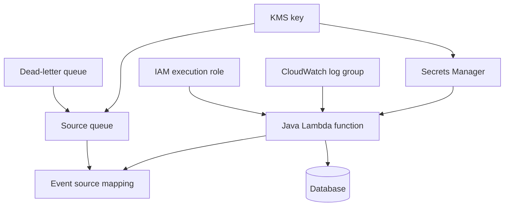
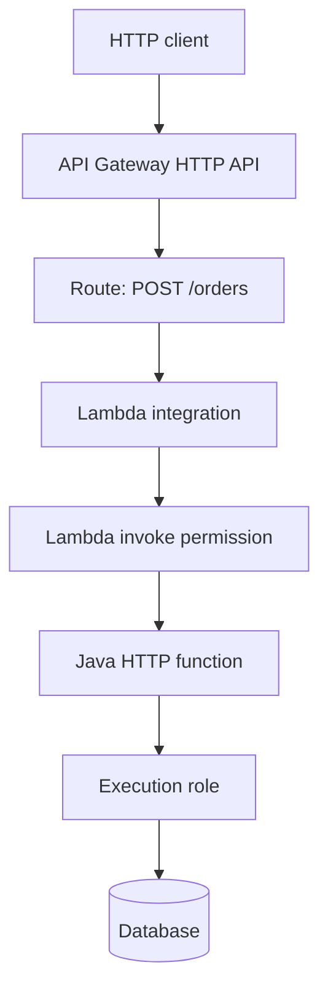

# Modeling Functions, Triggers, Permissions, and Dependent Resources

In a serverless application, a function rarely stands alone. It needs a runtime and deployment package, one or more triggers, an execution identity, access permissions, configuration, logs, queues or storage, and downstream business services. If these components are created manually through the console, configurations across environments easily drift apart, permissions can become broader than necessary, and recreating the system after an incident becomes difficult.

Infrastructure as Code (IaC) describes infrastructure using files that can be stored in version control, reviewed, tested, and deployed repeatably. For Java serverless, IaC makes explicit which runtime a function uses, where it receives events from, which resources it is allowed to access, and which components it depends on. That description becomes part of the system design, not just a deployment script.

This lesson focuses on how to model functions, triggers, permissions, and dependent resources; illustrates it with Terraform for a Java Lambda triggered from SQS; and presents principles applicable to AWS SAM/CloudFormation, Azure Bicep/ARM, and Google Cloud Terraform.

## 1. IaC Describes the Desired State of the System

Instead of recording a sequence of console actions such as “create queue, create role, upload JAR, configure trigger”, IaC describes the desired end state. The IaC tool compares that description with the current state and then proposes or applies the necessary changes.

For example, a serverless model might declare:

- A Java function with a specific runtime, handler, artifact, memory, timeout, and concurrency.
- An SQS queue receiving work and a dead-letter queue (DLQ) retaining failed messages long-term.
- An event source mapping connecting the queue to the function, including batch size and partial batch response.
- An execution role with permissions only to read/delete messages from the specified queue and write logs.
- A log group with explicit retention.
- Environment-specific configuration variables and references to securely managed secrets.

When components are declared together, reviewers can see where the function receives data from, which permissions allow that, and which resources must exist before the function operates.

### Declarative vs. Imperative

**Declarative IaC** describes the desired resources and attributes. The tool automatically computes the dependency graph and the order of creation/update/deletion. Terraform, CloudFormation, SAM, and Bicep are commonly used this way.

**Imperative deployment** describes each command to run in sequence. Scripts can be useful for packaging steps, migrations, or operations not yet supported by a provider, but using them to manage the entire infrastructure makes it hard to track drift and hard to guarantee safe repeatable runs.

The two approaches can be combined: the pipeline runs Maven/Gradle to build the JAR, and then IaC references the built artifact to update the function. You should not let IaC compile the application in an uncontrolled way or let deployment scripts create extra resources outside state without tracking them.

## 2. Modeling a Function as a Resource with a Contract

A function needs more attributes than just a name and runtime. You should treat a function declaration as a contract between the code, the platform, and the operations system.

| Attribute Group | What to Model | Impact |
|---|---|---|
| Runtime and artifact | Java runtime, architecture, handler, JAR/ZIP/container image, checksum/version | Runtime compatibility and rollback capability |
| Resources | Memory, CPU if supported by the platform, ephemeral storage | Processing time, heap, throughput, and cost |
| Timing | Timeout, startup/health behavior | Invocation limits and retries |
| Scaling | Reserved/max concurrency, min/max instances, scaling limits | Protecting downstream services and controlling cost |
| Configuration | Environment variables, endpoints, feature flags | Differences across dev/staging/prod |
| Identity | Execution role/service account/managed identity | Permissions to call downstream services |
| Observability | Logs, tracing, metrics, retention, alarms | Error detection and investigation |
| Network | VPC/VNet, subnets, security groups, private endpoints, egress | Connectivity and access scope |
| Release | Version, alias, revision, deployment strategy | Releases, canary, and rollback |

Not every platform has the same attributes or the same naming. IaC must accurately reflect the capabilities of the runtime/hosting plan being used. For example, one platform may configure memory and allocate CPU automatically based on memory; another allows setting CPU and memory separately. Do not copy a configuration from one cloud to another without checking its semantics.

### A Function Should Have a Clear Responsibility

If two flows have different triggers, timeouts, permissions, or scaling patterns, consider modeling them as two separate functions. A function handling HTTP requests to create orders may need fast responses and permission to write orders; a worker consuming a queue may need a longer timeout and permission to read messages. Sharing a single function just to reduce the number of resources can lead to overly broad permissions and hard-to-optimize configurations.

IaC should reflect the chosen business boundaries. Resource names, configuration variables, and IAM policies should indicate what task the function serves, rather than using generic names like `handler1` or `service-function`.

## 3. Modeling Triggers and Event Paths

Triggers determine what causes a function to run. Common trigger types include HTTP, queue, event bus, object storage, stream, and schedule. How a trigger is declared depends on the platform's integration mechanism.

| Trigger | Common Integration Model | Required IaC Components |
|---|---|---|
| HTTP | API gateway/router invokes function | API, route, integration, invoke permission, auth, and throttling |
| SQS/queue | Event source mapping polls queue then invokes Lambda | Queue, DLQ, redrive policy, mapping, batch/retry, and execution permissions |
| Object storage | Storage emits notification to function or event bus | Bucket/container, event filter, invoke permission, or event subscription |
| Event bus | Event bus routes events to function | Bus, rule/filter, target, retry/DLQ, and permission |
| Stream | Mapping reads partition/shard and delivers batch | Stream, mapping, checkpoint/batch failure, and read permissions |
| Schedule | Scheduler invokes function or workflow | Schedule, target, identity/permission, and retry policy |

### Distinguishing Function Invocation Permissions from Service Execution Permissions

There are two different permission directions:

1. **Invocation permission:** allows a service such as API Gateway, S3, or EventBridge to invoke the function. On AWS, this permission is typically expressed via a Lambda resource-based policy, such as `aws_lambda_permission`.
2. **Execution permission:** allows code inside the function to access SQS, DynamoDB, S3, Secrets Manager, or other services. On AWS, this permission lives in the IAM role attached to the function.

The two permission types do not substitute for each other. Granting Lambda permission to read SQS does not automatically allow SQS to invoke the function; the event source mapping configuration and execution role must align. Similarly, giving API Gateway permission to invoke a function does not give Java code permission to read the database.

### Push Triggers vs. Polling Triggers

Some services push events to an endpoint or function; some integrations use an event source mapping to poll a queue/stream. This difference affects scaling, retries, acknowledgement, and permissions.

With SQS, Lambda polls messages using an event source mapping. With API Gateway, the gateway invokes Lambda per request. With S3, notifications can be configured to call Lambda directly or route through EventBridge. IaC must model the actual mechanism accurately to avoid creating the wrong resource permissions or making wrong assumptions about where retries occur.

### Filtering Triggers at the Source

If a function only needs objects under the `incoming/` prefix, configure an appropriate event filter rather than sending every object event to the function and discarding it in code. If a worker only accepts a single message type, define clear schema/version and routing rules. Filtering reduces unnecessary invocations, though validation in the handler is still needed because the payload is untrusted input.

## 4. Modeling Access Permissions Using Least Privilege

IaC is a critical place to review permissions because policies usually sit right next to the resources that use them. A function should only have permissions to perform the actions needed for its task, on the exact resources required.

A good policy answers:

- Who is the principal? The Lambda execution role, service account, managed identity, or trigger service?
- Which actions are allowed? For example `sqs:ReceiveMessage`, `sqs:DeleteMessage`, `s3:GetObject`, or `secretsmanager:GetSecretValue`.
- Which resources are accessed? Specific ARN, bucket/prefix, queue, secret, or database.
- What conditions restrict the permission? Source ARN, account, encryption key, network, or tags if appropriate.
- How long are permissions granted and who is responsible for reviewing them?

### Execution Role and Trust Policy

For AWS Lambda, the execution role has a trust policy allowing the Lambda service to assume the role. The identity policy attached to the role defines the permissions the code can use. Do not confuse the trust policy with the permission policy: the trust policy defines who can assume the role; the permission policy defines what the role can do once assumed.

For example, an SQS worker only needs to read messages from one queue. The role does not need `sqs:*` on `*`, nor does it need permissions to delete buckets or administer the account. If the queue uses a customer-managed KMS key, you may also need permission to decrypt that specific key and a corresponding key policy.

### Separate Invocation Permissions

For push triggers like API Gateway or S3 calling Lambda, resource-based permissions should restrict the principal and source ARN. Leaving `Principal = "*"` or allowing the entire service within an account without scoping the source can allow the function to be invoked from unintended resources.

For polling triggers like an SQS event source mapping, the execution role needs permissions to poll/delete from the queue; the mapping links the queue to the function. Always verify both sides of the relationship.

### Do Not Put Plaintext Secrets in IaC

Do not write passwords, API tokens, or private keys directly in HCL, YAML, template parameters, or committed `.tfvars` files. You can declare a secret reference, ARN, or secret name in IaC and let the runtime fetch the value using its identity. Note that Terraform state can contain sensitive values passed through resources/data sources; marking `sensitive = true` only masks output in some interfaces and does not automatically encrypt state. State must be stored in a secure backend with encryption, access control, and locking.

## 5. Modeling Dependent Resources

Functions often depend on other resources. Dependencies must be declared explicitly so the IaC tool can create them in the right order and delete/update them safely.

| Resource | Purpose | Relationship with Function |
|---|---|---|
| Queue/topic/stream | Receives work or events | Trigger source or output destination |
| DLQ | Holds failed messages | Referenced by the source queue in its redrive policy |
| Bucket/container | Stores large inputs/outputs | Triggers function or is accessed by code |
| Database | Stores business state | Accessed by runtime via endpoint/identity/secret |
| Secret store | Stores credentials/sensitive config | Runtime retrieves secret via identity |
| KMS key | Encrypts data or secrets | Resource policy and IAM must allow the right principals |
| Log group/monitoring | Stores logs, metrics, and alarms | Function emits logs/telemetry; retention and alarms are managed |
| Network resources | VPC, subnets, security groups, private endpoints | Provides connectivity to private services |
| API gateway | Exposes HTTP endpoints | Route/integration and invocation permission |

A conceptual dependency graph:



The diagram shows dependencies and permissions at a conceptual level; arrow directions are not always the deployment order. For instance, the function needs the role to run, the event source mapping needs the function and queue to exist, the queue can reference the DLQ, and the KMS policy must allow the proper service principals.

### Explicit vs. Implicit Dependencies

Terraform automatically infers ordering when one resource references an attribute of another resource. For example, `aws_lambda_event_source_mapping` references the ARNs of the function and the queue, so Terraform knows it must create those two resources before the mapping.

Only use `depends_on` when there is a real dependency that cannot be expressed via references—for example, waiting for a policy to be attached to a role before creating the function to avoid eventual consistency errors. Overusing `depends_on` makes the graph overly tight, reduces parallelism, and can force unrelated changes to re-run.

## 6. Terraform Example: Java Lambda Consuming SQS

The example below models a Java worker processing orders from SQS. The source queue has a DLQ, the Lambda has a minimal execution role, the log group has retention configured, and the event source mapping enables partial batch responses.

```hcl
terraform {
  required_version = ">= 1.6.0"

  required_providers {
    aws = {
      source  = "hashicorp/aws"
      version = ">= 5.0"
    }
  }
}

provider "aws" {
  region = var.aws_region
}

variable "aws_region" {
  type        = string
  description = "AWS region for deployment"
}

variable "artifact_path" {
  type        = string
  description = "Path to the built Java JAR"
}

variable "environment" {
  type        = string
  description = "Environment name, e.g. dev, staging, or prod"
}

locals {
  function_name = "order-worker-${var.environment}"
  queue_name    = "order-events-${var.environment}"
}

resource "aws_sqs_queue" "dlq" {
  name                      = "${local.queue_name}-dlq"
  message_retention_seconds = 1209600
}

resource "aws_sqs_queue" "source" {
  name                       = local.queue_name
  visibility_timeout_seconds = 185
  message_retention_seconds  = 345600

  redrive_policy = jsonencode({
    deadLetterTargetArn = aws_sqs_queue.dlq.arn
    maxReceiveCount     = 5
  })
}

resource "aws_cloudwatch_log_group" "function" {
  name              = "/aws/lambda/${local.function_name}"
  retention_in_days = 30
}

data "aws_caller_identity" "current" {}
data "aws_region" "current" {}

resource "aws_iam_role" "execution" {
  name = "${local.function_name}-execution"

  assume_role_policy = jsonencode({
    Version = "2012-10-17"
    Statement = [{
      Effect = "Allow"
      Principal = {
        Service = "lambda.amazonaws.com"
      }
      Action = "sts:AssumeRole"
    }]
  })
}

resource "aws_iam_role_policy" "runtime" {
  name = "${local.function_name}-runtime"
  role = aws_iam_role.execution.id

  policy = jsonencode({
    Version = "2012-10-17"
    Statement = [
      {
        Effect = "Allow"
        Action = [
          "sqs:ReceiveMessage",
          "sqs:DeleteMessage",
          "sqs:GetQueueAttributes"
        ]
        Resource = aws_sqs_queue.source.arn
      },
      {
        Effect = "Allow"
        Action = [
          "logs:CreateLogStream",
          "logs:PutLogEvents"
        ]
        Resource = "arn:aws:logs:${data.aws_region.current.name}:${data.aws_caller_identity.current.account_id}:log-group:/aws/lambda/${local.function_name}:*"
      }
    ]
  })
}

resource "aws_lambda_function" "worker" {
  function_name = local.function_name
  role          = aws_iam_role.execution.arn
  runtime       = "java21"
  handler       = "com.example.orders.OrderHandler::handleRequest"
  filename      = var.artifact_path
  source_code_hash = filebase64sha256(var.artifact_path)

  memory_size                    = 1024
  timeout                        = 30
  reserved_concurrent_executions = 10

  environment {
    variables = {
      APP_ENV   = var.environment
      LOG_LEVEL = "INFO"
    }
  }

  depends_on = [
    aws_iam_role_policy.runtime,
    aws_cloudwatch_log_group.function
  ]
}

resource "aws_lambda_event_source_mapping" "orders" {
  event_source_arn = aws_sqs_queue.source.arn
  function_name    = aws_lambda_function.worker.arn
  enabled          = true
  batch_size       = 10

  function_response_types = ["ReportBatchItemFailures"]

  scaling_config {
    maximum_concurrency = 10
  }
}

output "function_name" {
  value = aws_lambda_function.worker.function_name
}

output "source_queue_url" {
  value = aws_sqs_queue.source.url
}

output "dead_letter_queue_arn" {
  value = aws_sqs_queue.dlq.arn
}
```

This is a skeleton to illustrate relationships between resources; provider versions, runtime, handler, artifact, retention, timeout, and policies should be tailored to the project. A few points to note:

- The JAR must be built before running `terraform plan/apply`; `artifact_path` points to an actual artifact in the pipeline.
- `source_code_hash` helps Terraform detect when the artifact content changes.
- The role only has permissions to receive/delete messages from the source queue and write logs to the function's log group.
- If the queue uses a customer-managed KMS key, you must add decrypt permission to the execution role and configure the key policy appropriately.
- `ReportBatchItemFailures` must match a Java handler returning `SQSBatchResponse`.
- A visibility timeout of 185 seconds is chosen to be greater than six times the 30-second function timeout; if a batching window is used, you must account for it as well per AWS recommendations.
- Both `reserved_concurrent_executions` and `maximum_concurrency` limit load; check the function's total concurrency if there are other triggers.
- `depends_on` on the Lambda ensures the policy and log group are created before the Lambda is created; referencing the role ARN already creates an implicit dependency on the role.
- Log retention is managed by a separate resource instead of relying on the default indefinite retention.

The example does not create a database or secret because they are unnecessary for illustrating a queue worker. When adding dependencies, declare the resource or reference outputs from the module that owns that resource, then grant least-privilege permissions to the function.

## 7. Modeling HTTP Triggers and Invoke Permissions

With an HTTP API, there are typically separate resources for the API, integration, route, stage, and permission for the gateway to invoke Lambda. Do not confuse the API route with the function's execution role.

Relationship model:



`aws_lambda_permission` can restrict the principal to `apigateway.amazonaws.com` and the source ARN to the API/route. The execution role only grants permissions to read/write the database or services the code needs. If the endpoint requires user authentication, declare an authorizer/JWT configuration or place an appropriate API Management layer in front; AWS-level invoke permissions do not replace business-level authorization.

For triggers from S3, you need a bucket notification and a Lambda permission for `s3.amazonaws.com` with `source_arn` scoped to the specific bucket. Avoid loop configurations by only watching an input prefix and writing outputs to a different prefix or bucket.

## 8. Environment-Based Configuration and State Management

A single module is often deployed across multiple environments. Differences such as region, queue name, timeout, concurrency, domain, and retention should be passed via variables or environment configurations rather than copying the entire file and editing it manually.

Example `dev.tfvars` file:

```hcl
aws_region    = "ap-southeast-1"
environment   = "dev"
artifact_path = "../../build/libs/order-worker.jar"
```

Production can use a separate variable file in the pipeline or a managed configuration source. Do not commit secrets in `.tfvars`. If sensitive variables must be passed to providers/resources, state may still store those values; use secret references and an encrypted backend.

### Remote State and Locking

Terraform state maps resources in code to real resources. In a team setting, state should be stored in a remote backend with encryption, access control, and locking to prevent two pipelines from applying concurrently and corrupting state. An S3 backend can use versioning and a locking mechanism appropriate for the Terraform/provider backend version in use; Terraform also supports other remote backends.

Do not edit state files manually or commit state containing sensitive information into a repository. When splitting modules, use explicit outputs/inputs or data sources to reference resources owned by another stack. Avoid having multiple states manage the same resource.

### Modularizing Along Ownership Boundaries

A module can encapsulate a pattern such as `java-sqs-worker`, containing the function, role, queue mapping, log group, and basic alarms. Inputs should represent decisions callers are allowed to configure: artifact, runtime, timeout, memory, queue ARN, concurrency, and retention. Outputs should expose what other stacks need: function ARN, queue URL, role ARN, or log group name.

Do not build a monolithic module containing every type of function, trigger, and service. Overly generic modules tend to accumulate confusing boolean flags and allow invalid configurations. Create small modules around real patterns, then compose them at the application layer.

## 9. Dependency Graph and Deployment Order

When designing IaC, draw or think through the dependency graph before writing resources. For example, with an SQS worker:

1. Create the DLQ.
2. Create the source queue referencing the DLQ.
3. Create the log group.
4. Create the execution role and policy.
5. Create the Lambda function using the role and log group.
6. Create the event source mapping referencing the queue and function.
7. Create alarms/dashboards referencing queue and function metrics.

This order is the logical dependency order; Terraform automatically sequences creation based on references. On deletion, the mapping should be deleted before the function or queue to avoid dangling configurations. The IaC engine typically computes reverse dependencies during destroy.

### Circular Dependencies

Circular dependencies can arise if:

- A function needs a bucket ARN to create its policy, while the bucket notification references the function ARN.
- A role policy references a resource, while that resource depends on the role policy to be created.
- Two modules reference each other's outputs.

You can break cycles by splitting resources across multiple steps/modules, using deterministic pre-computed ARNs where safe, creating the bucket/function first and attaching the notification afterward, or using a less-coupled policy scope. Do not try to resolve a cycle with bidirectional `depends_on`; that does not make the graph valid.

### Resource Replacement and Lifecycle

Changing certain attributes forces a resource to be replaced—for example, a queue name or certain identity settings. You need to understand whether `plan` will destroy/create or update in-place. For stateful resources like queues, buckets, or databases, replacement can lose messages or data. Use lifecycle policies like `prevent_destroy` when protection is needed, but do not overuse them because they can block legitimate changes. For stateful resources, establish a clear migration/cutover plan.

## 10. Protecting Data and Secrets in IaC

IaC can contain information about bucket names, queues, ARNs, and endpoints. While this metadata is not always secret, repository and state permissions still need to be properly controlled. Passwords, tokens, private keys, and credentials should not appear in code or plan output.

Core principles:

- Store secrets in Secret Manager, Secrets Manager, Key Vault, or an equivalent service.
- Grant runtime identity permissions so the function fetches secrets when needed.
- Avoid passing plaintext secrets via command lines or pipeline logs.
- Enable encryption and access control for remote state.
- Restrict read access to plan/state artifacts.
- Use secret rotation and verify that the function refreshes/reconnects after a secret changes.
- Do not treat `sensitive = true` as a substitute for state encryption.

If a function runs inside a VPC/VNet to access a private database, IaC must model subnets, security groups/network security groups, routes, NAT, or private endpoints appropriately. Attaching a function to a private subnet while forgetting an egress path can prevent the function from reaching required public services or management endpoints. Conversely, opening outbound traffic too broadly can violate security requirements.

## 11. Testing and Reviewing IaC Changes

IaC is code that can affect production. Pipelines should validate syntax, formatting, policies, and the change plan before applying.

A typical workflow:

1. Format files according to conventions (`terraform fmt` or the tool's formatter).
2. Validate syntax and schema (`terraform validate`).
3. Run static analysis/linting and policy-as-code checks to catch overly broad permissions, public resources, or missing encryption.
4. Generate a `terraform plan` and save a reviewable artifact.
5. Inspect which resources will be created/updated/replaced/destroyed, especially queues, buckets, databases, and IAM.
6. Apply through a pipeline with appropriate permissions and audit logging.
7. Run post-deployment checks: triggers fire, the function has needed permissions, logs/metrics appear, and alarms are configured.
8. Monitor drift between code and live infrastructure.

### Multi-Layered Testing

| Test Type | Goal |
|---|---|
| Module unit tests | Verify expected inputs/outputs and resource properties |
| Static policy checks | Detect wildcard IAM, public exposure, missing encryption/retention |
| Plan review | Catch destructive replacements or data-loss changes |
| Integration tests | Send a test event/message and confirm the function is triggered |
| Permission tests | Confirm required actions succeed and out-of-scope actions are denied |
| Drift detection | Detect manual changes made outside IaC |
| Recovery tests | Verify DLQ, replay, rollback, and resource recovery |

Local tests cannot replace testing permissions and triggers in the real cloud. Emulators can aid development, but they do not fully simulate IAM, event delivery, quotas, or provider eventual consistency.

## 12. Drift, Versioning, and Change Management

Configuration drift occurs when live infrastructure diverges from the repository description—for example, someone changes a timeout in the console or adds an IAM permission outside the policy. If undetected, the next apply may overwrite the change or leave uncontrolled permissions in place.

To reduce drift:

- Require production changes to go through pull requests and pipelines.
- Restrict manual editing permissions outside incident procedures.
- Run scheduled or periodic plans to detect out-of-band changes.
- Import existing resources into state when adopting IaC; do not create duplicate resources.
- Review all role/policy and trigger filter changes like security code changes.
- Version modules and providers, upgrade deliberately, and read the plan before applying.

### Deploying Functions and Infrastructure Together

Java code and IaC have related lifecycles, though they do not necessarily have to be released as a single artifact. A pipeline can:

1. Build and test the JAR.
2. Push an immutable artifact to an artifact store.
3. Generate a plan referencing the artifact version/checksum.
4. Review infrastructure and permissions.
5. Apply the function version/configuration and triggers.
6. Run a smoke test with a test event.
7. Shift alias/traffic if the platform supports versioned deployments.

Do not use a `latest.jar` path whose contents can change without changing the version. Artifacts should be identified by version or checksum so releases are reproducible and rollbacks are exact.

## 13. Common Modeling Mistakes

| Mistake | Consequence | Fix |
|---|---|---|
| Declaring only the function and creating triggers manually | Environments diverge and are hard to reproduce | Manage triggers/mappings/routes together in IaC |
| Using one broad role for every function | Larger blast radius and hard to audit | Use dedicated roles per function or responsibility group |
| Confusing invoke permissions with execution roles | Triggers fail to invoke or code lacks permissions | Model both permission directions separately |
| Using unnecessary wildcard resources/actions | Excessive permissions | Scope to specific ARNs, prefixes, and actions |
| Omitting DLQ/retry/visibility settings | Repeated failing messages or loss of diagnosability | Declare queue policies and recovery paths alongside triggers |
| Omitting log retention | Logs accumulate and costs grow | Manage log groups and retention in IaC |
| Writing plaintext secrets in HCL/tfvars | Secrets leak via Git, plans, or state | Use a secret manager and runtime identity |
| Adding `depends_on` to every resource | Rigid graph and slow applies | Use references; only add genuinely hidden dependencies |
| Letting multiple states manage the same resource | Drift and conflicting applies | Ensure each resource has a single clear owner/state |
| Skipping review of resource replacements | Loss of queue messages or stateful data | Review plans and define migration/cutover steps |
| Allowing console changes outside IaC | Drift and uncontrolled permissions | Enforce PR workflows, periodic plans, and restrict manual changes |

## 14. IaC Design Workflow for a Java Function

Before writing HCL/templates, answer the following questions:

1. **What is the function's job?** Define its name, Java runtime, handler, artifact, and responsibility boundary.
2. **Which trigger invokes the function?** HTTP, queue, stream, object event, or schedule; push or polling?
3. **What is the event contract?** Schema, batching, filtering, ordering, timeout, and retries.
4. **What permissions does the function need?** Separate the execution role from invoke permissions; scope by resource/action.
5. **Which resources does the function depend on?** Queue, DLQ, bucket, database, secret, KMS, network, and logs.
6. **How do scaling and timeouts behave?** Memory/CPU, concurrency, batching, queue visibility, and downstream limits.
7. **Which settings vary by environment?** Region, endpoints, resource names, feature flags, and secret references.
8. **Who owns the state and modules?** Define backend, locking, outputs/inputs, and lifecycle.
9. **How are changes verified?** Formatting, validation, policy scanning, plan review, integration testing, and drift detection.
10. **How does recovery work?** Artifact versioning, rollback, DLQ/replay, and data migration.

A good design lets a reviewer trace the path from trigger to function, from function to execution identity, from identity to accessible resources, and from resources to operational policies. If an edge in that flow is unmodeled or lacks an owner, that is a gap to address before deployment.

## 15. Pre-Production Apply Checklist

- [ ] Function has explicit runtime, handler, architecture, and artifact version/checksum.
- [ ] Memory, timeout, concurrency, and ephemeral storage match the workload.
- [ ] Triggers, filters, batching, ordering, and retries are fully declared.
- [ ] Invocation permissions and execution permissions are separated.
- [ ] IAM grants only required actions on specific resources.
- [ ] Queues have DLQ/redrive; streams have proper checkpoint/retry; HTTP has auth/throttling.
- [ ] Log groups, retention, metrics, and alarms are managed by IaC.
- [ ] Secrets are referenced from a secret manager; the state backend is protected.
- [ ] Network/subnets/routes/security groups/private endpoints match traffic flows.
- [ ] Dependency graph is acyclic and does not use `depends_on` arbitrarily.
- [ ] Stateful resources have a migration/retention plan and are not replaced unintentionally.
- [ ] Remote state has encryption, access control, and locking.
- [ ] Plan has been reviewed; policy scans and integration tests have passed.
- [ ] Rollback, replay, and drift detection procedures are in place.

## Conclusion

IaC models serverless infrastructure as a system with clear relationships: which code the function runs, which triggers invoke it, which identity allows the invocation, which resources the code can access, and how dependencies are created and managed. When invocation permissions are separated from execution permissions, queues/DLQs/logs/secrets/networking are declared alongside the function, and state is managed with proper controls, the system becomes easier to review, reproduce, and operate. For Java serverless, treat artifact versions, runtime, timeouts, concurrency, event contracts, and access permissions as part of the deployment configuration. Review `plan`, verify policies, and test triggers in a real environment before applying to production.
