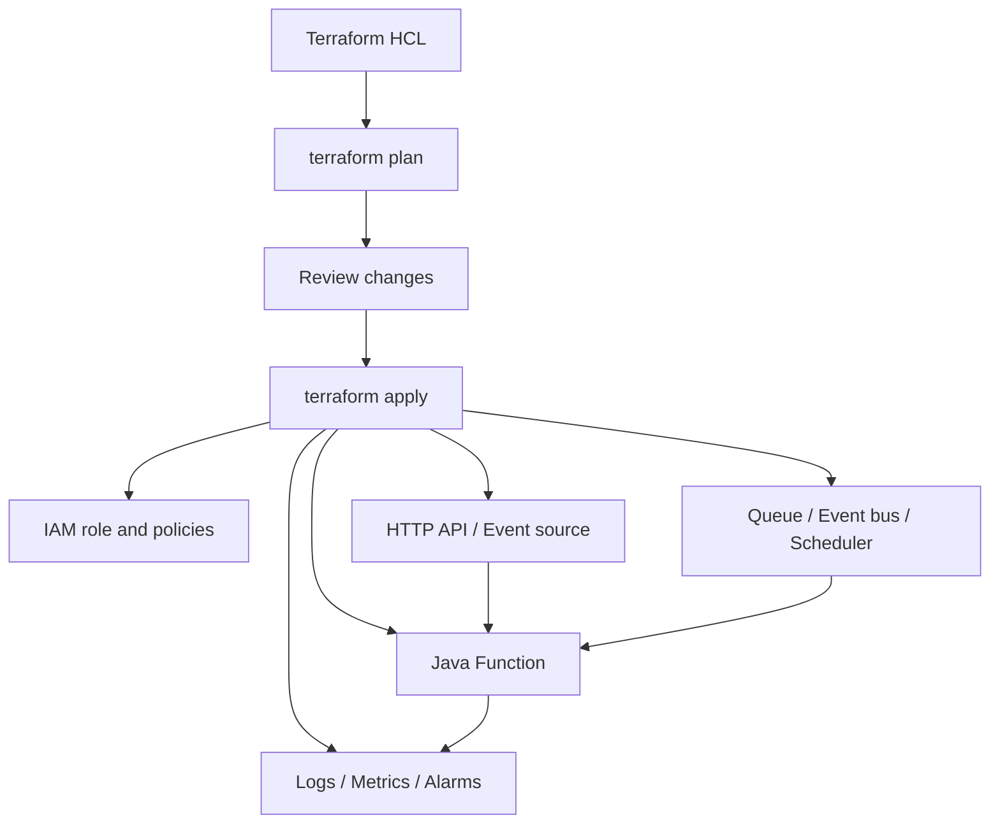

# Managing Serverless Infrastructure with Terraform

Serverless applications still require explicitly configured infrastructure: function runtime, access permissions, API endpoints, queues, event rules, log groups, alarms, storage, and networking. If these components are created manually in the portal, configurations across development, staging, and production easily drift apart; rebuilding environments or verifying changes also becomes unpredictable.

**Infrastructure as Code (IaC)** solves that problem by describing infrastructure in files that can be versioned, reviewed, and deployed repeatably. **Terraform** uses HCL to declare the desired state, compares it against current infrastructure, and generates an execution plan before applying changes. For Java FaaS, Terraform can manage the function resource and surrounding services; the application pipeline remains responsible for compiling, testing, and producing the JAR/ZIP or container image.

## 1. IaC in Serverless Architecture

A function rarely stands alone. For example, a Java Lambda invoked via an HTTP API needs at least the function, an IAM execution role, permission for API Gateway to invoke the function, and a log group. For background processing, the system may also need a queue, a dead-letter queue (DLQ), an event source mapping, and alarms.



Terraform manages cloud resources and the relationships between them. Java code handles business logic; Maven or Gradle builds the artifact; CI/CD delivers the artifact to the deployment target. Terraform can be used to update the function's code version, but `terraform apply` should not be turned into an ad-hoc build command on the deployment machine.

### 1.1. Practical Benefits

- **Repeatable:** the same configuration can spin up environments with different input variables.
- **Reviewable:** pull requests show which IAM policies, timeouts, memory settings, queues, and endpoints are about to change.
- **Auditable history:** Git records who changed the configuration and why.
- **Drift detection:** compares declared configuration against resources modified manually in the cloud.
- **Automation:** pipelines can validate, generate a plan, require approval, and apply per environment.
- **Standardized security:** permissions, encryption, retention, and alarms are defined alongside infrastructure.

IaC does not automatically guarantee a secure configuration. An overly broad IAM policy declared in Terraform is still an overly broad policy. Both the HCL source and the execution plan must be reviewed.

## 2. Essential Terraform Concepts

| Concept | Role | Serverless Example |
|---|---|---|
| Provider | Plugin communicating with cloud or service APIs | `hashicorp/aws`, `hashicorp/azurerm` |
| Resource | Infrastructure resource created and managed by Terraform | `aws_lambda_function`, `aws_sqs_queue` |
| Data source | Reads information about existing resources | Fetching AWS region or account ID |
| Variable | Input parameter | Region, function name, timeout |
| Local | Computed value reused within configuration | Environment-scoped resource names |
| Output | Value returned after apply | API endpoint, function ARN |
| Module | Groups resources into a reusable component | Java Lambda module with IAM, log group, and alarms |
| State | Record mapping resources in config to real resources | ID, ARN, and metadata of Lambda/queue |
| Backend | Where state is stored and how state locking works | S3 backend or HCP Terraform |

Terraform builds the dependency graph from resource references. For example, when `aws_lambda_function` references an IAM role's ARN, Terraform knows the role must exist before the function. Only use `depends_on` when a dependency cannot be inferred from direct references; overusing it makes the graph harder to understand and reduces parallel deployment.

## 3. Structuring a Terraform Project for Java Serverless

A root module can be organized as follows:

```text
serverless-infra/
├── versions.tf       # Terraform and provider constraints
├── providers.tf      # Provider configuration
├── backend.tf        # Remote state backend
├── variables.tf      # Input variables
├── main.tf           # Main resource graph
├── iam.tf            # Roles and policies
├── api.tf             # API Gateway or triggers
├── observability.tf  # Log groups, alarms, dashboards
├── outputs.tf        # ARNs, endpoints, resource names
├── terraform.tfvars  # Environment values, no secrets
└── modules/
    └── java-function/
        ├── main.tf
        ├── variables.tf
        └── outputs.tf
```

For small projects, you can start with a few `.tf` files in the same directory. Terraform automatically merges HCL files within a root module; splitting files primarily helps readers locate the part of the configuration they need to review.

As the number of functions grows, create reusable modules for common patterns such as Lambda + execution role + log retention, or Function App + Application Insights. Modules should accept configurable values via variables and expose only the outputs genuinely needed by callers.

Do not create an overly generic module from the start. A module with dozens of flags to support every trigger, runtime, and cloud provider is usually harder to use than a few small, focused modules.

## 4. Declaring Providers and Versions

Example root module using the AWS provider:

```hcl
terraform {
  required_version = ">= 1.10.0"

  required_providers {
    aws = {
      source  = "hashicorp/aws"
      version = "~> 6.0"
    }
  }
}

provider "aws" {
  region = var.aws_region
}
```

`required_version` constrains the Terraform CLI version; `required_providers` declares the provider source and version range. The `~> 6.0` constraint allows compatible updates within major version 6. Once the project stabilizes, commit `terraform.lock.hcl` so the team and CI use the exact same selected provider versions.

Example variables:

```hcl
variable "aws_region" {
  description = "AWS region for deploying the function"
  type        = string
  default     = "ap-southeast-1"
}

variable "environment" {
  description = "Environment name"
  type        = string
  validation {
    condition     = contains(["dev", "staging", "prod"], var.environment)
    error_message = "environment must be dev, staging, or prod."
  }
}

variable "function_name" {
  description = "Lambda function name"
  type        = string
}

variable "lambda_zip_path" {
  description = "Path to the pre-built ZIP artifact"
  type        = string
}
```

Values that differ across environments should flow through `*.tfvars`, pipeline variables, or an appropriate configuration mechanism. Do not commit cloud credentials or secrets into `terraform.tfvars`.

## 5. Managing Terraform State

Terraform state maps resources in HCL to real cloud resources. State enables Terraform to track IDs, ARNs, attributes, and dependencies of managed resources. State is not merely a cache file: it is critical data for the IaC workflow.

### 5.1. Why Shouldn't Teams Use Local State?

The default `local` backend writes state to `terraform.tfstate` on the machine running Terraform. If multiple people apply from different state copies, they can overwrite state or create duplicate resources. Local state is also hard to share and recover if a machine is lost.

For teams and CI/CD, use a remote backend with state locking. Example S3 backend:

In a real root module, merge this backend configuration into the `terraform` block that declares `required_version` and `required_providers`; the snippet below focuses only on illustrating the backend attributes.

```hcl
terraform {
  backend "s3" {
    bucket       = "company-terraform-state"
    key          = "serverless/orders/prod/terraform.tfstate"
    region       = "ap-southeast-1"
    encrypt      = true
    use_lockfile = true
  }
}
```

The state bucket must be created and protected beforehand, typically via a separate bootstrap stack or platform governance workflow. Enable S3 versioning to recover state if it is accidentally deleted or overwritten. `use_lockfile = true` enables state locking via an S3 lock file; this requires Terraform 1.10 or later. The legacy DynamoDB locking mechanism is marked deprecated in current S3 backend documentation.

The backend block cannot reference `var.*`, `local.*`, or resource outputs. If the backend differs per environment, use partial configuration and pass backend settings during `terraform init`, or separate root modules/state per environment.

### 5.2. State Can Contain Sensitive Data

Terraform state can store resource attribute values, including data marked sensitive by the provider. `sensitive = true` mainly hides values from certain CLI outputs; it does not remove values from state or plan files.

Therefore:

- Encrypt the backend at rest and use TLS in transit.
- Restrict read access to state; read access to state can expose sensitive details.
- Enable versioning/backups and control permissions for state recovery.
- Do not commit `terraform.tfstate`, `*.tfstate.backup`, `.terraform/`, or plan files to Git.
- Do not pass secrets via HCL literals or `-var` on the command line where they may be recorded in shell history/logs.
- Prefer workload identity/role federation for Terraform cloud authentication instead of long-lived access keys.

### 5.3. Separating State by Environment and Permissions

Development, staging, and production should have clear state boundaries. For production, use a dedicated state key, a separate account/subscription where appropriate, and stricter apply permissions. Terraform workspaces can create multiple states from the same configuration, but they do not create security or access control boundaries by themselves. When environments require different permissions, release schedules, or topologies, separate root modules or backend keys are usually easier to govern.

## 6. Example: Deploying a Java Lambda and HTTP API with Terraform

The following example illustrates a `GET /health` HTTP endpoint backed by a Java Lambda. Maven/Gradle builds the artifact beforehand; Terraform manages the Lambda, IAM execution role, CloudWatch log group, API Gateway HTTP API, and invoke permission.

### 6.1. Preparing the Java Artifact

Example Java handler deployable on the AWS Lambda Java runtime:

```java
package com.example;

import com.amazonaws.services.lambda.runtime.Context;
import com.amazonaws.services.lambda.runtime.RequestHandler;
import java.util.Map;

public final class HealthHandler
        implements RequestHandler<Map<String, Object>, Map<String, Object>> {

    @Override
    public Map<String, Object> handleRequest(
            Map<String, Object> event,
            Context context) {
        context.getLogger().log("Health endpoint invoked");
        return Map.of(
                "statusCode", 200,
                "headers", Map.of("content-type", "application/json"),
                "body", "{\"status\":\"ok\"}");
    }
}
```

Build and package into a ZIP following AWS Lambda Java conventions—for example, a ZIP with a `lib/` directory containing the application JAR and runtime dependencies. The handler in Terraform must match the package, class, and method in the artifact. The runtime name in the example is `java21`; check the supported AWS Lambda runtimes list when upgrading Java.

The pipeline should produce the artifact before the Terraform plan step. `source_code_hash` lets Terraform detect when the ZIP changes and update the function code. If the file does not exist yet when Terraform evaluates the configuration, the hash expression will fail; therefore, building the artifact before running Terraform is essential.

### 6.2. IAM Role and Log Group

```hcl
data "aws_iam_policy_document" "lambda_assume_role" {
  statement {
    effect  = "Allow"
    actions = ["sts:AssumeRole"]

    principals {
      type        = "Service"
      identifiers = ["lambda.amazonaws.com"]
    }
  }
}

resource "aws_iam_role" "health_function" {
  name               = "${var.function_name}-${var.environment}-role"
  assume_role_policy = data.aws_iam_policy_document.lambda_assume_role.json
}

resource "aws_iam_role_policy_attachment" "lambda_logs" {
  role       = aws_iam_role.health_function.name
  policy_arn = "arn:aws:iam::aws:policy/service-role/AWSLambdaBasicExecutionRole"
}

resource "aws_cloudwatch_log_group" "health_function" {
  name              = "/aws/lambda/${var.function_name}-${var.environment}"
  retention_in_days = 14
}
```

The execution role is the identity used by the function code when calling AWS services. The managed policy `AWSLambdaBasicExecutionRole` grants basic permissions to write logs to CloudWatch Logs. If the function needs to read SQS, write to S3, or fetch secrets, add a policy scoped only to the exact ARNs and actions needed; never attach `AdministratorAccess` or `PowerUserAccess` to a function.

Creating the log group explicitly lets IaC manage retention. If Lambda is invoked before the log group exists, the runtime may auto-create the log group with the permissions granted; in this example, `depends_on` on the function resource ensures the policy and log group are created before the function is deployed.

### 6.3. Lambda Function

```hcl
resource "aws_lambda_function" "health" {
  function_name = "${var.function_name}-${var.environment}"
  role          = aws_iam_role.health_function.arn
  runtime       = "java21"
  handler       = "com.example.HealthHandler::handleRequest"

  package_type = "Zip"
  filename     = var.lambda_zip_path
  source_code_hash = filebase64sha256(var.lambda_zip_path)

  memory_size = 1024
  timeout     = 15

  environment {
    variables = {
      APP_ENV = var.environment
    }
  }

  depends_on = [
    aws_iam_role_policy_attachment.lambda_logs,
    aws_cloudwatch_log_group.health_function
  ]
}
```

`memory_size` and `timeout` should be based on actual measurements. Java may need extra memory for the JVM and class loading; increasing memory can also increase allocated CPU and affect cost. Do not set an unbounded timeout. Environment variables should only hold non-sensitive configuration; secrets should be retrieved at runtime from Secrets Manager or Parameter Store using the execution role.

### 6.4. API Gateway HTTP API and Invoke Permission

```hcl
resource "aws_apigatewayv2_api" "http" {
  name          = "${var.function_name}-${var.environment}-api"
  protocol_type = "HTTP"
}

resource "aws_apigatewayv2_integration" "lambda" {
  api_id                 = aws_apigatewayv2_api.http.id
  integration_type       = "AWS_PROXY"
  integration_uri        = aws_lambda_function.health.invoke_arn
  payload_format_version = "2.0"
}

resource "aws_apigatewayv2_route" "health" {
  api_id    = aws_apigatewayv2_api.http.id
  route_key = "GET /health"
  target    = "integrations/${aws_apigatewayv2_integration.lambda.id}"
}

resource "aws_apigatewayv2_stage" "default" {
  api_id      = aws_apigatewayv2_api.http.id
  name        = "$default"
  auto_deploy = true
}

resource "aws_lambda_permission" "api_gateway" {
  statement_id  = "AllowHttpApiInvoke"
  action        = "lambda:InvokeFunction"
  function_name = aws_lambda_function.health.function_name
  principal     = "apigateway.amazonaws.com"
  source_arn    = "${aws_apigatewayv2_api.http.execution_arn}/*/*"
}

output "health_endpoint" {
  description = "HTTP endpoint of the health function"
  value       = "${aws_apigatewayv2_api.http.api_endpoint}/health"
}
```

API Gateway invokes Lambda via proxy integration; `payload_format_version = "2.0"` determines the HTTP event structure the handler receives. `aws_lambda_permission` is a resource-based permission allowing API Gateway to invoke the function. Lambda's execution role and the resource policy allowing invocation are two distinct permission types: the role is for code inside the function; the permission is for external services calling the function.

This snippet illustrates a public health endpoint. For business APIs, add an authorizer or appropriate authentication mechanism, throttling, access logging, and WAF where needed. Do not treat an obscure endpoint URL as a security mechanism.

## 7. Managing Queues, Event Source Mappings, and Schedules

Terraform also manages queue- and event-related triggers. For example, with SQS, common resources include:

| Terraform Resource | Role |
|---|---|
| `aws_sqs_queue` | Creates the main queue and DLQ |
| `aws_iam_role_policy` | Grants `ReceiveMessage`, `DeleteMessage`, `GetQueueAttributes` permissions to the Lambda worker |
| `aws_lambda_event_source_mapping` | Connects the queue to Lambda and configures batching |
| `aws_cloudwatch_event_rule` | Defines an EventBridge schedule or event pattern in applicable scenarios |
| `aws_cloudwatch_event_target` | Designates Lambda as the rule target |
| `aws_lambda_permission` | Allows EventBridge to invoke Lambda |

Example creating a main queue, a DLQ, and configuring redrive:

```hcl
resource "aws_sqs_queue" "orders_dlq" {
  name                      = "orders-${var.environment}-dlq"
  message_retention_seconds = 1209600
}

resource "aws_sqs_queue" "orders" {
  name                       = "orders-${var.environment}"
  visibility_timeout_seconds = 180
  message_retention_seconds  = 345600

  redrive_policy = jsonencode({
    deadLetterTargetArn = aws_sqs_queue.orders_dlq.arn
    maxReceiveCount     = 5
  })
}
```

Abbreviated example for an event source mapping:

```hcl
resource "aws_lambda_event_source_mapping" "orders" {
  event_source_arn = aws_sqs_queue.orders.arn
  function_name    = aws_lambda_function.order_worker.arn
  batch_size       = 10

  function_response_types = ["ReportBatchItemFailures"]
  enabled                = true
}
```

Here `aws_lambda_function.order_worker` is the worker declared in its corresponding resource block; the `orders` queue and DLQ were created in the example above. The 180-second visibility timeout illustrates a worker with a 30-second timeout and no long batching window; when changing the timeout or batch window, adjust it per AWS recommendations to prevent messages from reappearing while a prior invocation is still running. The worker needs an execution role with permissions to read/delete messages and read queue attributes. `ReportBatchItemFailures` requires the handler to return the proper partial batch response structure.

For scheduled runs, you can use EventBridge Scheduler or an EventBridge rule depending on requirements. Scheduler typically has dedicated resources such as `aws_scheduler_schedule`, a target, and an IAM role allowing Scheduler to invoke the function. Schedules and invoke permissions should be managed together to avoid a schedule existing without permission to call its target.

Do not assume every trigger uses the same retry mechanism. SQS event source mappings, Kinesis streams, EventBridge Scheduler, and async Lambda invocations all have different delivery semantics. Configure retries, DLQ, maximum event age, batch size, and concurrency to match the specific source type.

## 8. Applying the Same Principles to Azure Functions

Terraform is not tied to a single cloud provider. For Azure, the common provider is `hashicorp/azurerm`; resources may include a Resource Group, Storage Account, Service Plan, Function App, Application Insights, and role assignments.

Example Azure provider declaration:

```hcl
terraform {
  required_providers {
    azurerm = {
      source  = "hashicorp/azurerm"
      version = "~> 4.0"
    }
  }
}

provider "azurerm" {
  features {}
}
```

For a new Function App, you can use the resource corresponding to the hosting plan—for example, `azurerm_service_plan` together with `azurerm_function_app_flex_consumption` for Flex Consumption on Linux. The configuration also requires a Storage Account and deployment container for code, plus Application Insights/Log Analytics for observability. Resource names and attributes change across provider versions and hosting plans; use Microsoft's official Terraform quickstart as a reference for the pinned version.

Equivalent concepts between the two clouds:

| Need | AWS | Azure |
|---|---|---|
| Function compute | `aws_lambda_function` | Function App and Functions runtime |
| Runtime permissions | IAM execution role/policy | Managed identity and Azure RBAC |
| HTTP entry point | API Gateway / Function URL | HTTP trigger / API Management |
| Queue | SQS | Storage Queue / Service Bus |
| Event routing | EventBridge | Event Grid / Event Hubs |
| Logs/metrics | CloudWatch | Azure Monitor / Application Insights |
| IaC provider | `hashicorp/aws` | `hashicorp/azurerm` |

Do not try to build a single Terraform module full of conditionals to hide differences between AWS Lambda and Azure Functions. You can share a common interface module at the application layer, while resource modules should faithfully reflect each cloud's permission, trigger, scaling, and deployment model.

## 9. Modularization and Reuse

When you have many Java functions, you can build a `java-function` module accepting variables such as:

- Function name, runtime, handler, and artifact path.
- Memory, timeout, reserved concurrency, and non-sensitive environment variables.
- IAM policy statements scoped by resource.
- Log retention, alarm thresholds, and tags.
- Trigger integrations enabled as needed.

Example module invocation:

```hcl
module "order_api" {
  source = "./modules/java-function"

  function_name   = "orders-api"
  runtime         = "java21"
  handler         = "com.example.OrderHandler::handleRequest"
  lambda_zip_path = "${path.root}/artifacts/orders-api.zip"
  memory_size     = 1024
  timeout         = 20
  environment     = "prod"
}
```

This is an example module interface; the variables must be declared inside the module, and the internal resources must apply those values properly. Do not accept arbitrary policy JSON from every caller if the module can instead provide standardized, narrower, easier-to-review permissions.

Modules should be versioned when shared across repositories or teams. For internal modules, you can use Git tags or a private Terraform Registry. Avoid referencing an unpinned `main` branch in production, as the same configuration could pull different contents on a subsequent init.

## 10. Separating Infrastructure and Application Lifecycles

Infrastructure and Java artifacts evolve at different cadences. IAM, API Gateway, queues, VPCs, or log retention usually change less frequently than business code. Pipelines can be organized into two coordinated tracks:

1. **Infrastructure pipeline:** validates HCL, generates a plan, reviews, and applies resource changes.
2. **Application pipeline:** builds Java, runs tests, produces a versioned/digest-identified artifact, and deploys the artifact to the existing function.

If `aws_lambda_function` manages both configuration and the artifact, the application pipeline can pass the ZIP path and `source_code_hash` to the root module. Make sure the plan is generated from the exact artifact that will be applied. With high code release frequency, consider separating code deployment resources from infrastructure changes or using appropriate version/alias release mechanisms.

Do not let Terraform and another deployment tool manage the same resource as two competing sources of truth. For example, if Terraform manages `aws_lambda_function`, an out-of-band CLI command changing runtime, environment variables, or memory creates drift; the next apply may overwrite those changes.

## 11. Safe Terraform Workflow

Basic workflow locally or in CI:

```bash
terraform fmt -check -recursive
terraform init
terraform validate
terraform plan -out=tfplan
terraform show tfplan
terraform apply tfplan
```

Purpose of each step:

- `fmt`: standardizes HCL formatting so diffs are easy to read.
- `init`: downloads providers/modules and connects to the backend.
- `validate`: checks syntax and internal configuration consistency.
- `plan`: refreshes resource state and previews create/update/delete actions.
- `show`: reviews the saved execution plan.
- `apply tfplan`: applies the exact reviewed plan.

In production CI, plans should be generated and reviewed before applying; never run `terraform apply -auto-approve` blindly on every commit without controls. Plan files can contain sensitive data, so protect pipeline artifacts and delete them after they are no longer needed.

Additional checks may include:

- `terraform fmt -check` and `terraform validate`.
- TFLint to catch provider-specific configuration errors.
- Checkov or Trivy config to check IaC security rules.
- `terraform test` for modules with appropriate test files and fixtures.
- Policy as code to block public storage, wildcard IAM, or non-compliant logging/retention settings.

Scanning tools provide extra warnings; they do not replace reviewing the execution plan and understanding the architecture.

## 12. Drift, Import, and Resource Changes

**Drift** occurs when cloud resources differ from the Terraform configuration or state. For example, someone increases a Lambda timeout in the Console without updating HCL. The next `terraform plan` may propose reverting the timeout to the declared value.

When drift is detected:

1. Determine whether the manual change was intentional or out-of-process.
2. If the change is accepted, update HCL to reflect the desired state.
3. If the change is not accepted, review the plan and let Terraform restore the resource to the standard configuration.
4. If an existing resource is not yet in state, use an `import` block or `terraform import` to bring it under management; then write matching HCL and review the plan.

Carefully read `-/+` markers or `forces replacement` notices in the plan. Certain changes such as resource name, runtime/package type, or immutable attributes can force destroying and recreating the resource, disrupting triggers or endpoints. For stateful resources holding data—like queues, buckets, or databases—verify retention, deletion protection, and backups before applying.

Do not use `terraform state rm` or `terraform state push` as a default troubleshooting fix. These commands mutate state directly and can cause Terraform to lose track of real resources. Back up state and follow recovery procedures when truly necessary.

## 13. Security and Least Privilege

IaC often manages high-privilege resources, so security must apply to both the pipeline and the function runtime.

- **Terraform runner:** use OIDC/workload identity or assume role; scope deployment permissions to the right account, region, and resource types.
- **State backend:** enable encryption, versioning, locking, and restrict state read/write permissions.
- **Execution role:** grant permissions only for the APIs and ARNs the function needs.
- **Resource policy:** allow only required sources such as API Gateway, EventBridge, or specific service principals to invoke the function.
- **Secrets:** keep secret values out of HCL/state whenever possible; have the function read from Secrets Manager/Parameter Store or Key Vault via its identity.
- **Network:** place the function in a VPC/VNet only when accessing private resources; understand the impact on NAT, DNS, endpoints, and cold starts.
- **Logging:** set retention, encryption, and read access controls; avoid logging sensitive payloads.
- **Tagging:** attach owner, environment, cost center, and service tags for cost management, inventory, and auditing.

Terraform variables with `sensitive = true` mask values in some outputs, but state and plan files can still store those values. This is worth repeating when managing connection strings or secrets.

## 14. Controlling Serverless Costs with IaC

Terraform does more than create functions—it can standardize cost limits and alerts:

- Function memory, timeout, and reserved concurrency.
- Queue retention, visibility timeout, batch size, and DLQ.
- Log retention, metric filters, and alarms.
- API throttling/quotas and event schedule frequency.
- VPC endpoints, NAT Gateway, storage, and data transfer.
- Tags by environment, team, and cost center.

Total cost cannot be inferred from invocation count alone. A rarely invoked function that runs long, allocates large memory, traverses a NAT Gateway, or emits excessive logs can still be expensive. Measure load and inspect billing across supporting services.

For dev/test, you can set lower timeouts and concurrency than production, shorter retention, and schedules active only during working hours. Verify those values so they do not alter test behavior or hide errors.

## 15. Checklist Before Managing Serverless with Terraform

1. Are provider and Terraform versions pinned and `terraform.lock.hcl` committed?
2. Which resources belong to the Function App/Lambda, triggers, IAM, API, queues, logs, and alarms?
3. Is the Java artifact built before plan/apply with a deterministic version/hash?
4. Do handler, runtime, architecture, memory, timeout, and concurrency match the artifact?
5. Do the IAM execution role and resource policies follow least privilege?
6. Is state stored in a remote backend with encryption, versioning, locking, and proper access control?
7. Could state/plan contain any secrets? Can identity or a secret manager be used instead?
8. Does each environment have separated state, account/subscription, and deployment permissions?
9. Has the plan been reviewed, especially any replace/delete operations?
10. Are queue retries, DLQ, schedules, log retention, alarms, and cost limits declared?
11. Are drift detection, importing existing resources, and state rollback/recovery accounted for?
12. Does the pipeline enforce fmt, validate, scanning, plan review, and controlled apply?

## Conclusion

Terraform makes it possible to describe and manage all infrastructure around a Java function using reviewable, versioned, and repeatable configuration. Operating safely requires understanding providers/resources/modules, protecting remote state, separating deployment permissions from execution roles, versioning artifacts, reviewing plans, and controlling drift. For serverless, IaC must describe not only the function itself but also triggers, IAM, APIs, queues, DLQs, logs, alarms, and concurrency limits; creating only the function while omitting its surrounding components does not produce an operable system.

## Official References

- [Terraform language and configuration](https://developer.hashicorp.com/terraform/language)
- [Terraform modules](https://developer.hashicorp.com/terraform/language/modules)
- [Terraform state](https://developer.hashicorp.com/terraform/language/state)
- [S3 backend and state locking](https://developer.hashicorp.com/terraform/language/backend/s3)
- [AWS Lambda function resource](https://registry.terraform.io/providers/hashicorp/aws/latest/docs/resources/lambda_function)
- [AWS Lambda event source mapping resource](https://registry.terraform.io/providers/hashicorp/aws/latest/docs/resources/lambda_event_source_mapping)
- [AWS Lambda runtimes](https://docs.aws.amazon.com/lambda/latest/dg/lambda-runtimes.html)
- [AWS Lambda with API Gateway](https://docs.aws.amazon.com/lambda/latest/dg/services-apigateway.html)
- [Create Azure Functions resources from Terraform](https://learn.microsoft.com/en-us/azure/azure-functions/functions-create-first-function-terraform)
