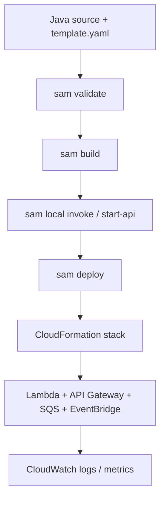

# Describing Lambda Applications with AWS SAM

AWS Serverless Application Model (AWS SAM) is an open-source framework for describing, packaging, and deploying serverless applications on AWS. Instead of creating individual Lambda functions, API Gateways, SQS queues, EventBridge rules, and IAM policies manually in the Console, you declare them in a template that can be stored alongside source code, reviewed via pull requests, and deployed repeatably across environments.

SAM extends AWS CloudFormation with a shorthand syntax for serverless resources. When deployed, SAM transforms the template into the corresponding CloudFormation resources. As a result, a SAM application still has stack lifecycles, change sets, rollbacks, and IAM permissions just like standard CloudFormation infrastructure.

In the Cloud Serverless module, SAM helps package Java Lambdas triggered by HTTP, messages, or events. Templates must describe functions, triggers, access permissions, runtime settings, and supporting resources together. Good design accounts for retries, idempotency, concurrency, cold starts, observability, and cost directly in the infrastructure configuration.

## 1. What Does AWS SAM Consist Of?

SAM is typically used through three components:

- **SAM template:** a YAML or JSON file describing the application, usually named `template.yaml`.
- **SAM CLI:** a command-line tool to initialize projects, validate templates, build artifacts, run locally, and deploy.
- **SAM transform:** the CloudFormation macro `AWS::Serverless-2016-10-31` that expands shorthand resources such as `AWS::Serverless::Function` into Lambda, IAM roles, event source mappings, API Gateway, and related resources.

Typical workflow:



SAM manages infrastructure as code; it does not replace application design. Business logic still lives in Java code, while the template describes how runtimes, triggers, permissions, and resources connect together.

## 2. Basic Structure of a SAM Template

A SAM template typically contains the following sections:

| Section | Purpose |
|---|---|
| `AWSTemplateFormatVersion` | CloudFormation format version |
| `Transform` | Declares the SAM transform |
| `Description` | Stack description |
| `Parameters` | Environment-specific input values |
| `Mappings` / `Conditions` | Lookup maps and conditional resource creation when needed |
| `Globals` | Shared properties for Function, API, or SimpleTable as supported by SAM |
| `Resources` | Lambdas, APIs, queues, event buses, IAM roles, and other resources |
| `Outputs` | Useful post-deployment values such as ARNs, URLs, or queue URLs |

Minimal template:

```yaml
AWSTemplateFormatVersion: '2010-09-09'
Transform: AWS::Serverless-2016-10-31
Description: Example serverless application

Resources:
  HelloFunction:
    Type: AWS::Serverless::Function
    Properties:
      CodeUri: hello/
      Handler: com.example.HelloHandler
      Runtime: java21
      MemorySize: 1024
      Timeout: 15
```

`CodeUri` points to the directory containing the function's project or build artifact. For a class implementing `RequestHandler`, `Handler` is the fully qualified class name; the `Class::method` form is used for the corresponding method handler. `Runtime` selects a Lambda-supported Java environment. `MemorySize` and `Timeout` directly affect allocated resources, latency, and cost.

## 3. `AWS::Serverless::Function` and Key Properties

`AWS::Serverless::Function` is the central resource for declaring a Lambda. Commonly used properties include:

| Property | Meaning |
|---|---|
| `CodeUri` | Location of source/build artifact |
| `Handler` | Java class/method to invoke |
| `Runtime` | Runtime, e.g. `java21` |
| `Architectures` | `x86_64` or `arm64` if supported by runtime/dependencies |
| `MemorySize` | Allocated memory; CPU also scales with memory setting |
| `Timeout` | Maximum duration for a single invocation |
| `Environment` | Function environment variables |
| `Policies` / `Role` | IAM execution role permissions |
| `Events` | HTTP, SQS, EventBridge, schedule, and other triggers |
| `Layers` | Attached Lambda layers |
| `ReservedConcurrentExecutions` | Reserved concurrency limit for the function |
| `Tracing` | AWS X-Ray tracing configuration |
| `AutoPublishAlias` | Version/alias management during SAM deployments |

Only set the properties that are needed. For example, an SQS-processing function needs a timeout aligned with batching and the queue's visibility timeout; an HTTP function needs a timeout below the API gateway synchronous limit and client expectations. Functions handling long-running tasks should typically be moved to a queue/workflow rather than holding a request open.

### Using `Globals` to Avoid Repeating Configuration

`Globals` applies default values across SAM resources of the same type. For example, all functions can share the same runtime, memory, timeout, and common environment variables:

```yaml
Globals:
  Function:
    Runtime: java21
    Architectures:
      - x86_64
    MemorySize: 1024
    Timeout: 30
    Environment:
      Variables:
        APP_ENV: !Ref EnvironmentName
```

Individual functions can override primitive values. For maps like `Environment.Variables`, SAM merges global values with function-specific values according to Globals rules; for lists, elements may be appended. Inspect the transformed template or SAM documentation when you need to verify the exact final result.

Do not place real secrets in `Globals`. Global values apply to many functions; if each function needs different permissions or secrets, declare them individually or separate function apps/stacks along trust boundaries.

## 4. Parameters, Conditions, and Outputs

### Parameters

Parameters allow using the same template across development, staging, and production without editing source files:

```yaml
Parameters:
  EnvironmentName:
    Type: String
    Default: dev
    AllowedValues:
      - dev
      - staging
      - prod
```

Then reference them via `!Ref EnvironmentName` in resource names, tags, or environment variables. Do not use parameters to embed passwords/tokens directly into templates. Parameter values may appear in deployment history or metadata depending on how they are used.

### Conditions

Conditions enable creating resources depending on the environment—for example, enabling an alarm or provisioned concurrency in production. Do not use conditions to hide an overly broad permission configuration; permissions must still be reviewed across every branch.

### Outputs

Outputs expose post-deployment values such as a function ARN, API URL, or queue URL:

```yaml
Outputs:
  OrdersQueueUrl:
    Description: URL of the order queue
    Value: !Ref OrdersQueue
  ProcessOrderFunctionArn:
    Description: ARN of the SQS consumer function
    Value: !GetAtt ProcessOrderFunction.Arn
```

Outputs are useful for pipelines or other stacks to reference. Avoid exporting secrets or sensitive data via Outputs.

## 5. Example Template: Java Lambda with HTTP, SQS, and EventBridge

The following example describes an order application with three functions:

- `CreateOrderFunction` receives an HTTP POST and sends work to SQS.
- `ProcessOrderFunction` reads messages from SQS, processes orders, and returns partial batch failures when needed.
- `AuditOrderFunction` receives `OrderCreated` events from EventBridge to record audit entries or update projections.

```yaml
AWSTemplateFormatVersion: '2010-09-09'
Transform: AWS::Serverless-2016-10-31
Description: Java order processing application using AWS SAM

Parameters:
  EnvironmentName:
    Type: String
    Default: dev
    AllowedValues: [dev, staging, prod]

Globals:
  Function:
    Runtime: java21
    Architectures:
      - x86_64
    MemorySize: 1024
    Timeout: 30
    Environment:
      Variables:
        APP_ENV: !Ref EnvironmentName

Resources:
  OrdersQueue:
    Type: AWS::SQS::Queue
    Properties:
      VisibilityTimeout: 210
      MessageRetentionPeriod: 345600
      RedrivePolicy:
        deadLetterTargetArn: !GetAtt OrdersDeadLetterQueue.Arn
        maxReceiveCount: 5

  OrdersDeadLetterQueue:
    Type: AWS::SQS::Queue
    Properties:
      MessageRetentionPeriod: 1209600

  CreateOrderFunction:
    Type: AWS::Serverless::Function
    Properties:
      CodeUri: .
      Handler: com.example.orders.CreateOrderHandler
      Timeout: 10
      Policies:
        - arn:aws:iam::aws:policy/service-role/AWSLambdaBasicExecutionRole
        - Version: '2012-10-17'
          Statement:
            - Effect: Allow
              Action:
                - sqs:SendMessage
              Resource: !GetAtt OrdersQueue.Arn
      Environment:
        Variables:
          ORDERS_QUEUE_URL: !Ref OrdersQueue
      Events:
        OrdersApi:
          Type: HttpApi
          Properties:
            Path: /orders
            Method: POST

  ProcessOrderFunction:
    Type: AWS::Serverless::Function
    Properties:
      CodeUri: .
      Handler: com.example.orders.ProcessOrderHandler
      Policies:
        - arn:aws:iam::aws:policy/service-role/AWSLambdaBasicExecutionRole
        - Version: '2012-10-17'
          Statement:
            - Effect: Allow
              Action:
                - sqs:ReceiveMessage
                - sqs:DeleteMessage
                - sqs:GetQueueAttributes
                - sqs:ChangeMessageVisibility
              Resource: !GetAtt OrdersQueue.Arn
      Events:
        OrdersQueueEvent:
          Type: SQS
          Properties:
            Queue: !GetAtt OrdersQueue.Arn
            BatchSize: 10
            MaximumBatchingWindowInSeconds: 5
            FunctionResponseTypes:
              - ReportBatchItemFailures

  AuditOrderFunction:
    Type: AWS::Serverless::Function
    Properties:
      CodeUri: .
      Handler: com.example.orders.AuditOrderHandler
      Policies:
        - arn:aws:iam::aws:policy/service-role/AWSLambdaBasicExecutionRole
      Events:
        OrderCreatedEvent:
          Type: EventBridgeRule
          Properties:
            Pattern:
              source:
                - com.example.orders
              detail-type:
                - OrderCreated

Outputs:
  OrdersQueueUrl:
    Description: URL of the order queue
    Value: !Ref OrdersQueue
  CreateOrderFunctionArn:
    Description: ARN of the HTTP function
    Value: !GetAtt CreateOrderFunction.Arn
  ProcessOrderFunctionArn:
    Description: ARN of the SQS consumer
    Value: !GetAtt ProcessOrderFunction.Arn
```

This template illustrates structure and must be adapted for real projects. `OrdersQueue` is linked to `OrdersDeadLetterQueue` via `RedrivePolicy`; when moving to production, also configure encryption, appropriate retention, alarms, and the data-plane permissions required by the business logic.

With a 30-second function timeout and 5-second batching window, the 210-second visibility timeout in the example exceeds the recommended minimum of 6 times the timeout plus batching window (185 seconds). Recalculate it whenever you change the timeout or batch window. For production queues, explicitly declare `RedrivePolicy` and `maxReceiveCount`.

`EventBridgeRule` in SAM creates the rule and the required target invoke permission. For an SQS event source mapping, SAM creates the mapping between the queue and Lambda; the function's execution role still needs permissions to read/delete messages. The `HttpApi` event type uses API Gateway HTTP API; if REST API v1 is required, choose the corresponding event type and configuration.

## 6. Declaring Least-Privilege IAM Permissions

Every Lambda runs with an execution role. SAM can automatically generate a role when `Policies` is declared, or use a separately managed role via the `Role` property. Permissions should be scoped to the exact resource ARNs and actions:

| Function | Typical Required Permissions |
|---|---|
| HTTP producer | `sqs:SendMessage` on the target queue |
| SQS consumer | `sqs:ReceiveMessage`, `sqs:DeleteMessage`, `sqs:GetQueueAttributes`, `sqs:ChangeMessageVisibility` on the source queue |
| EventBridge target Lambda | Invoke permission created by SAM for the rule; function execution role only needs permissions actually used by code |
| Secret-reading function | `secretsmanager:GetSecretValue` or corresponding SSM/Secrets Manager permission on the specific secret |
| Data-writing function | Corresponding DynamoDB/S3/RDS permissions on the specific table/bucket/resource |

Do not grant `sqs:*`, `dynamodb:*`, or `secretsmanager:*` on `*` just to make a quick example work. For CloudWatch Logs permissions, use the managed policy `AWSLambdaBasicExecutionRole` or an inline policy with the needed log actions. If X-Ray tracing is enabled, grant the appropriate trace-writing permissions or configure tracing/role policies per AWS guidance.

### SAM Policy Templates

SAM provides policy templates to shorten common permissions, such as `SQSPollerPolicy`, `SQSSendMessagePolicy`, or `DynamoDBCrudPolicy`. Example:

```yaml
Policies:
  - SQSPollerPolicy:
      QueueName: !GetAtt OrdersQueue.QueueName
```

Policy templates make definitions shorter, but you still need to inspect the generated policy and verify its scope. If tighter permissions are required, use an inline policy document or a separately managed IAM role.

## 7. Redrive Policy and DLQ for SQS Event Sources

Declaring a dedicated DLQ prevents failing messages from blocking the main stream indefinitely. You can attach a redrive policy to the source queue:

```yaml
OrdersQueue:
  Type: AWS::SQS::Queue
  Properties:
    VisibilityTimeout: 210
    RedrivePolicy:
      deadLetterTargetArn: !GetAtt OrdersDeadLetterQueue.Arn
      maxReceiveCount: 5
```

Queue policies or redrive configurations must satisfy SQS requirements, including compatible queue types and required permissions. After fixing the consumer bug, messages can be redriven from the DLQ back to the source queue under a controlled operational procedure.

With a Lambda SQS event source mapping, enable `ReportBatchItemFailures` and return the list of failed message IDs so only those items are redelivered. Without partial batch responses, a single failing record can cause the entire batch to be retried, leading to duplicate side effects on records that already succeeded.

## 8. Java Lambda Handler for HTTP API

A Java Lambda can use `RequestHandler` together with AWS Lambda Java Events to receive API Gateway HTTP API events. The following example accepts a POST request, pushes the body into SQS, and returns `202 Accepted` so the client knows the request was accepted.

```java
package com.example.orders;

import com.amazonaws.services.lambda.runtime.Context;
import com.amazonaws.services.lambda.runtime.RequestHandler;
import com.amazonaws.services.lambda.runtime.events.APIGatewayV2HTTPEvent;
import com.amazonaws.services.lambda.runtime.events.APIGatewayV2HTTPResponse;
import software.amazon.awssdk.services.sqs.SqsClient;
import software.amazon.awssdk.services.sqs.model.SendMessageRequest;
import java.util.Map;

public final class CreateOrderHandler implements
        RequestHandler<APIGatewayV2HTTPEvent, APIGatewayV2HTTPResponse> {

    private static final SqsClient SQS = SqsClient.create();

    @Override
    public APIGatewayV2HTTPResponse handleRequest(
            APIGatewayV2HTTPEvent event, Context context) {
        String body = event.getBody();
        if (body == null || body.isBlank()) {
            return response(400, "{\"error\":\"Request body is required\"}");
        }

        String queueUrl = System.getenv("ORDERS_QUEUE_URL");
        if (queueUrl == null || queueUrl.isBlank()) {
            context.getLogger().log("ORDERS_QUEUE_URL is not configured");
            return response(500, "{\"error\":\"Configuration unavailable\"}");
        }

        SQS.sendMessage(SendMessageRequest.builder()
                .queueUrl(queueUrl)
                .messageBody(body)
                .build());

        return response(202, "{\"status\":\"accepted\"}");
    }

    private static APIGatewayV2HTTPResponse response(int status, String body) {
        return APIGatewayV2HTTPResponse.builder()
                .withStatusCode(status)
                .withHeaders(Map.of("content-type", "application/json"))
                .withBody(body)
                .build();
    }
}
```

This simplified example omits domain request deserialization/validation, authentication, and idempotency. In production, the producer should attach a stable operation ID or idempotency key, authenticate the caller, enforce tenant/resource authorization, and only return `202` after SQS confirms receipt of the message. Do not forward full HTTP headers or tokens inside the message body.

The `SqsClient` is initialized at class scope so it is reused across invocations within the same execution environment. SDK clients are thread-safe; never use static fields to hold request-specific business data.

## 9. Java Lambda Handler for SQS with Partial Batch Response

When triggered by SQS, the handler receives a batch. Each message should be processed independently, and the function returns the list of failed items when `ReportBatchItemFailures` is configured.

```java
package com.example.orders;

import com.amazonaws.services.lambda.runtime.Context;
import com.amazonaws.services.lambda.runtime.RequestHandler;
import com.amazonaws.services.lambda.runtime.events.SQSEvent;
import com.amazonaws.services.lambda.runtime.events.SQSBatchResponse;
import java.util.ArrayList;
import java.util.List;

public final class ProcessOrderHandler implements
        RequestHandler<SQSEvent, SQSBatchResponse> {

    @Override
    public SQSBatchResponse handleRequest(SQSEvent event, Context context) {
        List<SQSBatchResponse.BatchItemFailure> failures = new ArrayList<>();

        for (SQSEvent.SQSMessage message : event.getRecords()) {
            try {
                OrderService.processIdempotently(message.getBody());
            } catch (Exception ex) {
                context.getLogger().log(
                        "Failed messageId=" + message.getMessageId());
                failures.add(new SQSBatchResponse.BatchItemFailure(
                        message.getMessageId()));
            }
        }

        return new SQSBatchResponse(failures);
    }
}
```

`OrderService.processIdempotently` is an illustrative application service. It must persist the processed event/message ID together with the data changes in a transaction or use the downstream system's idempotency key. Do not log the entire message body if the payload contains sensitive data.

## 10. Java Handler for EventBridge

EventBridge delivers an event envelope with fields such as `source`, `detail-type`, `id`, and `detail`. The handler should verify the event type and parse `detail` according to a defined schema.

```java
package com.example.orders;

import com.amazonaws.services.lambda.runtime.Context;
import com.amazonaws.services.lambda.runtime.RequestHandler;
import com.fasterxml.jackson.databind.ObjectMapper;
import java.util.Map;

public final class AuditOrderHandler implements
        RequestHandler<Map<String, Object>, Void> {

    private static final ObjectMapper MAPPER = new ObjectMapper();

    @Override
    @SuppressWarnings("unchecked")
    public Void handleRequest(Map<String, Object> event, Context context) {
        String source = (String) event.get("source");
        String detailType = (String) event.get("detail-type");
        String envelopeId = (String) event.get("id");

        if (!"com.example.orders".equals(source)
                || !"OrderCreated".equals(detailType)) {
            throw new IllegalArgumentException("Unexpected event type");
        }

        Map<String, Object> detail = (Map<String, Object>) event.get("detail");
        OrderCreatedDetail payload = MAPPER.convertValue(
                detail, OrderCreatedDetail.class);

        AuditService.recordIdempotently(payload.eventId(), envelopeId, payload);
        return null;
    }
}
```

The domain `eventId` inside `detail` should serve as the stable idempotency key. The EventBridge envelope `id` identifies an event placed onto the bus; if a producer republishes the same business change via a new `PutEvents` call, the envelope ID can change while the domain event ID remains the same.

## 11. Maven Packaging for Java Lambda

Java Lambdas require the runtime handler and dependencies inside the deployment artifact. A Maven project typically contains `pom.xml`, source under `src/main/java`, and required dependencies such as:

```xml
<dependencies>
  <dependency>
    <groupId>com.amazonaws</groupId>
    <artifactId>aws-lambda-java-core</artifactId>
    <version>${lambda-java.version}</version>
  </dependency>
  <dependency>
    <groupId>com.amazonaws</groupId>
    <artifactId>aws-lambda-java-events</artifactId>
    <version>${lambda-events.version}</version>
  </dependency>
  <dependency>
    <groupId>software.amazon.awssdk</groupId>
    <artifactId>sqs</artifactId>
    <version>${aws-sdk.version}</version>
  </dependency>
  <dependency>
    <groupId>com.fasterxml.jackson.core</groupId>
    <artifactId>jackson-databind</artifactId>
    <version>${jackson.version}</version>
  </dependency>
</dependencies>
```

Version properties are placeholders; projects should pin concrete versions or use the AWS SDK BOM to manage dependencies consistently. For classes implementing `RequestHandler`, `Handler` in the template is the fully qualified class name; `Class::method` syntax is for corresponding method handlers. Ensure the final artifact includes runtime dependencies in the build layout expected by the SAM Java builder. `sam build` uses the Maven/Gradle configuration in `CodeUri` to produce build artifacts under `.aws-sam/build`.

If the project uses native libraries or needs builds compatible with the Lambda Linux environment, consider `sam build --use-container` to build inside a container matching the target runtime. Choose `arm64` only when all dependencies/native libraries support that architecture; if unverified, `x86_64` is the broader compatibility choice.

## 12. Building, Validating, and Running Locally

A typical local cycle includes:

```bash
# Validate template structure and intrinsics
sam validate --lint

# Build Java artifacts
sam build

# Build in a Lambda-compatible container when needed
sam build --use-container

# Invoke function directly with a sample event
sam local invoke CreateOrderFunction --event events/api-gateway-v2.json

# Run local HTTP API
sam local start-api
```

`sam validate --lint` uses cfn-lint when installed. `sam local invoke` lets you test a handler with sample JSON events; `sam local start-api` spins up a local API for declared HTTP events. Local commands typically rely on Docker to emulate the Lambda runtime.

SAM local does not fully emulate IAM, SQS delivery, retries, EventBridge rule evaluation, concurrency, or live AWS service behavior. You can use sample JSON events to test handlers, but integration tests against a dedicated AWS environment are still needed for queues, permissions, DLQs, event routing, and retry semantics.

## 13. Deploying with SAM CLI

For the first run, you can run:

```bash
sam deploy --guided
```

SAM CLI prompts for stack name, AWS Region, permission to create IAM roles, change set confirmation, and whether to save the settings to `samconfig.toml`. When the template defines IAM roles/policies, select the appropriate capability such as `CAPABILITY_IAM`; if creating custom-named roles, `CAPABILITY_NAMED_IAM` may be required.

Once configured, you can deploy repeatably:

```bash
sam build
sam deploy --config-env default
```

Example `samconfig.toml`:

```toml
version = 0.1

[default.deploy.parameters]
stack_name = "orders-serverless-dev"
resolve_s3 = true
s3_prefix = "orders-serverless-dev"
region = "ap-southeast-1"
capabilities = "CAPABILITY_IAM"
confirm_changeset = true
parameter_overrides = "EnvironmentName=dev"
```

Do not store access keys, secrets, or tokens in `samconfig.toml`. Use AWS IAM Identity Center, role assumption, or OIDC from CI/CD to obtain short-lived credentials. Each environment should have its own stack name, parameters, and deployment permissions.

## 14. SAM and CloudFormation Stack Lifecycle

During deployment, SAM CLI uploads artifacts to deployment storage (typically S3 or a managed resolve bucket), creates a CloudFormation change set, and updates the stack. CloudFormation creates or updates Lambdas, APIs, queues, event source mappings, rules, and IAM roles as defined in the template.

This brings several advantages:

- Infrastructure can be reviewed and version-controlled alongside code.
- Environments can be reproduced from the same template with different parameters.
- CloudFormation tracks resource state and rolls back when a stack update fails within supported behavior.
- Changes to IAM permissions and triggers are reviewed in the same pull request.
- Outputs can be consumed by pipelines or other stacks.

However, not every change is non-disruptive. Changing a logical ID or a property requiring replacement can create a new resource; modifying queues or event source mappings can affect in-flight backlogs; altering API routes or IAM permissions can break clients or consumers. Before deploying to production, inspect the change set and understand which resources will be replaced, updated, or deleted.

## 15. Managing Environments and Secrets

Use Parameters or stack config for non-secret values like environment names, queue names, feature flags, and resource ARNs. For secrets, avoid putting plaintext values in templates or parameter overrides.

Ways to manage secrets:

- Have the function read secrets from AWS Secrets Manager or Systems Manager Parameter Store via SDK at runtime; scope the execution role to the specific secret/parameter.
- Use CloudFormation dynamic references when a resource property requires a secret at deploy time and the service supports dynamic references.
- Cache secrets in the execution environment with an appropriate TTL/refresh to reduce requests and latency while supporting rotation.

If a secret is placed into a Lambda environment variable, anyone with permission to read Lambda configuration may be able to view the resolved value. Environment variables are encrypted at rest, but you should still restrict `lambda:GetFunctionConfiguration` and consider runtime retrieval for sensitive secrets. Never put secrets in Outputs or logs.

## 16. Triggers and Event Source Mappings

SAM supports declaring many event types under `Events`. Common ones include:

| SAM Event Type | Trigger Source | Resources/Adapters Created |
|---|---|---|
| `HttpApi` | HTTP API Gateway | API route and Lambda permission |
| `Api` | API Gateway REST API | REST API method/integration and permission |
| `SQS` | SQS queue | Lambda event source mapping |
| `EventBridgeRule` | EventBridge rule | Rule and Lambda permission/target |
| `Schedule` | EventBridge scheduled rule via SAM syntax | Scheduled rule and target |
| `Kinesis` / `DynamoDB` | Stream | Event source mapping |

Each trigger has different delivery and retry semantics. Synchronous HTTP returns a response to the client; SQS consumers receive batches and can retry; EventBridge delivers events according to the target's retry policy. Do not apply the same ack/retry assumptions across all triggers.

For SQS, configure compatible `BatchSize`, `MaximumBatchingWindowInSeconds`, `FunctionResponseTypes`, concurrency, and queue visibility timeout. For EventBridge, event patterns should be narrow enough to avoid invoking functions on unrelated events. For HTTP APIs, configure authentication, throttling, and appropriate payload limits.

## 17. Idempotency and Error Handling in SAM Infrastructure

Templates can declare queues, DLQs, retry policies, and event source mappings, but idempotency remains the responsibility of application code and the database.

- For SQS, configure `RedrivePolicy`, `maxReceiveCount`, and a DLQ; consumers only ack after side effects have committed.
- With partial batch responses, return exact failed message IDs to avoid retrying the whole batch.
- For EventBridge, configure target retry policies and an SQS DLQ on the target where supported.
- For async Lambda invocations, configure maximum event age, retry attempts, on-failure destinations, or DLQs per trigger.
- For HTTP, use an idempotency key for resource-creating operations that clients may retry after timeouts.

If a function writes to a database and then publishes an event, use the transactional outbox pattern to avoid gaps between commit and publish. When a consumer receives the same event again, use an inbox or unique event ID so side effects are not duplicated. SAM creates the infrastructure resources, but does not by itself guarantee end-to-end exactly-once processing.

## 18. Cold Starts, Memory, and Concurrency

SAM templates declare runtime, memory, architecture, timeout, and concurrency. These settings affect execution time and cost:

- Increasing memory also increases CPU and network throughput in Lambda's model; benchmark multiple memory sizes instead of defaulting to the lowest.
- Java often has runtime and dependency initialization overhead; trim artifacts/dependencies, reuse clients, and pick lightweight frameworks when cold starts matter.
- `ReservedConcurrentExecutions` caps concurrent invocations and can protect downstream databases/APIs.
- SQS event source mappings can configure maximum concurrency to throttle consumers.
- Timeouts must be sufficient for the work without being excessive; long tasks should move to workflows or be split into messages.
- Provisioned concurrency can reduce cold starts for latency-sensitive workloads, at an ongoing cost.

Do not set concurrency high simply because Lambda can scale. Database connections, throughput, API quotas, and downstream costs remain limits. Use queues to smooth bursts and monitor queue depth and age of oldest message.

## 19. Observability in SAM

You can configure tracing in SAM—such as `Tracing: Active`—and grant appropriate trace-writing permissions to the execution role. Lambda automatically writes logs to CloudWatch Logs when the role has the required permissions. Define log retention, metric filters/alarms, and dashboards in the same template rather than creating them manually outside the stack.

Signals to monitor:

| Component | Metrics/Logs to Observe |
|---|---|
| Lambda | Invocations, Errors, Duration, Throttles, ConcurrentExecutions |
| API Gateway | Request count, 4xx/5xx, latency, and throttling |
| SQS | Queue depth, age of oldest message, DLQ depth, receive count |
| EventBridge | Matched events, failed invocations, throttling, and DLQ |
| Application | Correlation ID, event ID, business outcome, duplicate count, and step duration |

Propagate correlation IDs across HTTP, messages, and events. Do not use order IDs or event IDs as high-cardinality metric dimensions; keep those IDs in logs/traces. Set log retention according to operational needs and cost.

## 20. CI/CD with SAM

A deployment pipeline typically includes these steps:

1. Check out source and install Java/Maven/SAM CLI.
2. Run unit tests and dependency checks.
3. Run `sam validate --lint` to validate the template.
4. Run `sam build` to package Java artifacts.
5. Check IaC security and IAM permissions in the template.
6. Deploy to dev or staging stacks using a short-lived role.
7. Run integration/smoke tests for HTTP, queues, and event routing.
8. Promote the same artifact/template to production via approval/change set.
9. Monitor errors, latency, and DLQs, and roll back if needed.

CI should use OIDC or role assumption to obtain temporary AWS credentials. Do not store long-lived access keys in repositories or pipeline variables if avoidable. Preserve built artifacts so promoting across environments does not rebuild different binaries.

## 21. Common SAM Commands

| Command | Purpose |
|---|---|
| `sam init` | Create a sample project |
| `sam validate --lint` | Validate and lint the template |
| `sam build` | Build function artifacts |
| `sam local invoke` | Invoke a function with a sample event |
| `sam local start-api` | Run a local HTTP API |
| `sam local start-lambda` | Start a local Lambda endpoint for integration testing |
| `sam deploy --guided` | Interactive initial deployment |
| `sam deploy` | Deploy using saved configuration |
| `sam logs -n FunctionLogicalId --stack-name StackName --tail` | Tail function logs in a deployed stack |
| `sam sync --watch` | Rapidly sync changes in a development environment when appropriate |
| `sam delete` | Delete the stack and stack-managed resources per CloudFormation policies |

`sam delete` can delete resources and data depending on retention/deletion policies. Only run it after confirming the target environment and impact; for production, require proper approval and backup procedures.

## 22. Common Design Mistakes

| Mistake | Consequence | Fix |
|---|---|---|
| Putting plaintext secrets in the template or `samconfig.toml` | Credentials leak via Git, artifacts, or deployment history | Use Secrets Manager/SSM SecureString and minimal IAM |
| Granting `Resource: '*'` for all actions | Overly broad permissions, larger blast radius | Scope to specific ARNs and required actions |
| Sharing one role across all functions | Functions inherit each other's unnecessary permissions | Use separate roles or policies per function |
| Ignoring SQS visibility timeout | Messages are redelivered while the function is still running | Calculate timeout from Lambda timeout and batching window |
| Disabling partial batch response | One failing record causes the entire batch to retry | Use `ReportBatchItemFailures` and return exact failed message IDs |
| Assuming SAM local fully emulates AWS | Misses real IAM, retries, scaling, and routing behavior | Run integration tests on an AWS test stack |
| Modifying resources outside CloudFormation | Drift between live state and template | Manage changes via templates/stacks and drift detection |
| Renaming logical IDs casually | Resources may be replaced | Review change sets and plan migrations |
| Setting timeout/concurrency without checking downstream | Throttling, backlogs, or rising cost | Benchmark and cap according to downstream capacity |
| Lacking clear Outputs/stack config | Pipelines struggle to retrieve ARNs/URLs and environments are hard to reproduce | Declare controlled Outputs and parameters |

## 23. Pre-Deployment Checklist

- [ ] Template includes `Transform: AWS::Serverless-2016-10-31` and validates cleanly.
- [ ] Every function has appropriate `CodeUri`, `Handler`, `Runtime`, and resource configuration.
- [ ] Java runtime, dependencies, and architecture are Lambda-compatible.
- [ ] `Globals` only holds genuinely shared configuration.
- [ ] Parameters separate environment config; Outputs contain no sensitive data.
- [ ] HTTP, SQS, and EventBridge event definitions match handler contracts.
- [ ] IAM execution roles follow least privilege and are separated per function when needed.
- [ ] Queues have appropriate visibility timeout, retention, redrive policy, and DLQ.
- [ ] SQS partial batch response is configured if the handler returns batch failures.
- [ ] Consumers are idempotent; database/event publishing uses outbox/inbox where needed.
- [ ] Secrets are retrieved from Secrets Manager/SSM/secure mechanisms, not hardcoded.
- [ ] Timeout, memory, architecture, and concurrency have been benchmarked.
- [ ] Logs, metrics, tracing, alarms, and retention are declared.
- [ ] `sam validate`, `sam build`, local tests, and integration tests have run.
- [ ] Change sets are reviewed before production deployment.
- [ ] CI/CD uses short-lived credentials and controlled artifact promotion.

AWS SAM turns a Lambda application into infrastructure that can be described and deployed as code. Templates declare functions, runtimes, triggers, queues, event rules, IAM, and configuration; SAM CLI builds Java artifacts and CloudFormation manages the stack lifecycle. Combined with least-privilege IAM, DLQs, idempotency, concurrency limits, observability, and controlled deployment pipelines, development teams can operate serverless applications consistently across environments and evaluate the impact of every infrastructure change.
