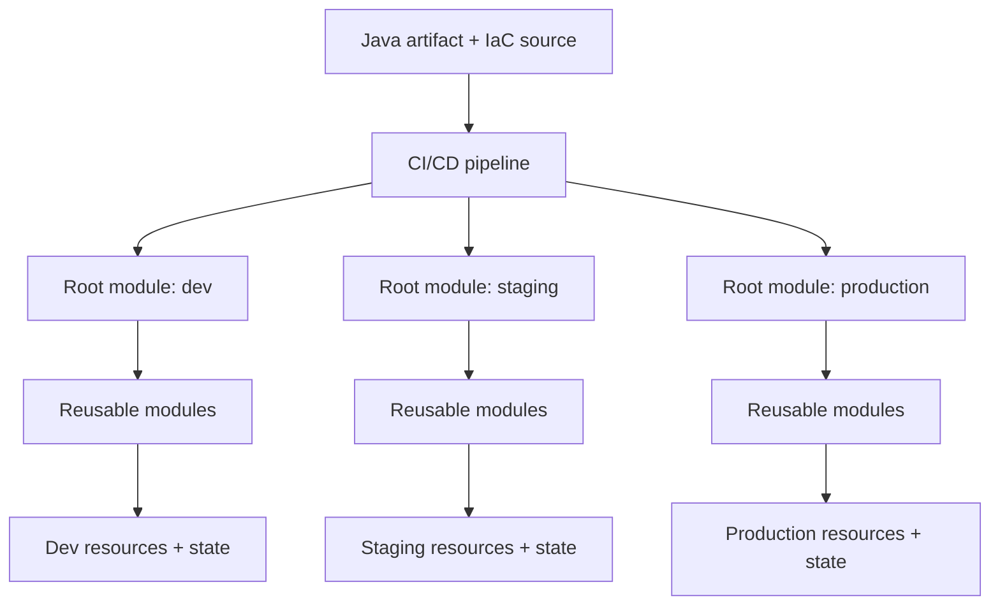
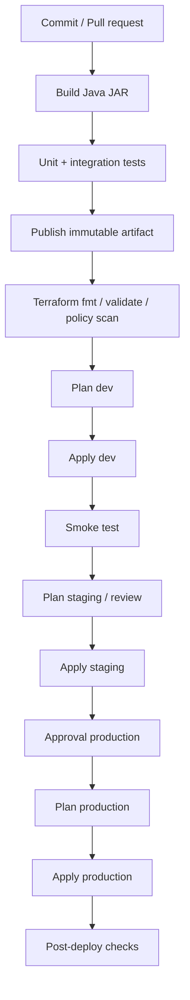

# Organizing Infrastructure Modules and Environment Parameters

A Java serverless application is typically deployed across multiple environments such as dev, test, staging, and production. These environments share the same overall architecture while differing in region, queue names, endpoints, memory, timeouts, concurrency, retention, domains, and access permissions. Copying a set of infrastructure files for each environment and editing them manually causes configurations to drift over time and forces bug fixes to be repeated in multiple places.

Infrastructure as Code (IaC) solves this by separating **reusable infrastructure patterns** from **environment-specific parameters and state**. Modules describe a component with a clear responsibility; input variables express the choices allowed to be configured; outputs expose information needed by other components; and root modules compose modules into a complete system.

This lesson focuses on organizing infrastructure modules and environment-specific parameters, illustrated with Terraform for a Java Lambda processing SQS. The principles around module contracts, state isolation, secrets, and releases also apply when using AWS SAM/CloudFormation, Azure Bicep/ARM, or Google Cloud Terraform.

## 1. Why Are Modules and Environment Configuration Needed?

Suppose a system has a Java worker receiving messages from SQS. The worker requires a function, execution role, queue mapping, log group, and operational limits. Dev and production use the same logic but differ in load and protection requirements:

| Parameter | Dev | Production |
|---|---:|---:|
| Lambda Memory | 512 MB | 2048 MB |
| Timeout | 15 seconds | 60 seconds |
| Reserved concurrency | 2 | 30 |
| Queue max concurrency | 2 | 20 |
| Log retention | 7 days | 90 days |
| Queue | `orders-dev` | `orders-prod` |
| Artifact | Test build | Released, versioned artifact |

If you maintain two separate infrastructure copies, every change to IAM or the event source mapping must be edited in two places. If you use one module and pass parameters, shared logic is defined once while intentional differences live in environment configuration.

### Three Common Structural Layers

1. **Component modules (child modules):** encapsulate a pattern with a clear responsibility, such as a Java SQS worker, HTTP API function, queue with DLQ, or log/alarm baseline.
2. **Environment root modules:** compose child modules and resources into a system for dev, staging, or production.
3. **Pipeline/configuration:** supplies artifact versions, environment variables, and deployment permissions to run plan/apply against the right environment.



Root modules can reference the same module source while maintaining separate state, variables, and deployment permissions. As a result, a change in the shared module is reviewed once, while each environment's plan shows the concrete impact before applying.

## 2. Designing Module Boundaries

A module should represent an infrastructure component with a relatively clear purpose and lifecycle. Do not split modules just to make each file shorter, and do not build a monolithic module with dozens of boolean flags controlling every trigger type.

### When Should You Create a Module?

Create a module when a group of resources:

- Is usually deployed together and has clear dependency relationships.
- Has its own configuration, permissions, and lifecycle.
- Is reused across multiple environments or multiple applications.
- Needs to be tested/reviewed as a cohesive unit.
- Has a stable input/output contract that callers can understand.

For instance, a `java-sqs-worker` module can own the Lambda function, execution role, log group, and event source mapping. The queue can be managed by a separate module if multiple workers share a queue or the queue has an independent lifecycle.

### When Should You Not Create a Module?

- A simple resource appears once and has no reusable logic.
- Two resources always change together, and modularizing them only complicates the interface.
- A module has too many flags like `enable_sqs`, `enable_s3`, `enable_http`, `enable_vpc`, `enable_dlq`, making it hard for callers to know which combinations are valid.
- A module merely wraps a single resource without adding meaningful conventions, validation, or ownership.

### Root Modules and Child Modules

A root module is the directory where the pipeline runs Terraform. It configures providers, the backend, environment variables, and invokes child modules. Child modules describe reusable resources and interfaces; they normally do not configure backends or provider credentials themselves.

Example repository structure:

```text
infra/
  modules/
    java-sqs-worker/
      main.tf
      variables.tf
      outputs.tf
      versions.tf
    sqs-queue/
      main.tf
      variables.tf
      outputs.tf
  environments/
    dev/
      main.tf
      variables.tf
      versions.tf
      backend.hcl
      dev.tfvars
    staging/
      main.tf
      variables.tf
      versions.tf
      backend.hcl
      staging.tfvars
    prod/
      main.tf
      variables.tf
      versions.tf
      backend.hcl
      prod.tfvars
```

Each environment directory is a separate root module. These directories call shared modules using relative source paths. Other layouts can also work as long as the ownership of state, modules, and environment variables is clear.

## 3. Module Contract: Variables, Locals, and Outputs

A usable module needs a clear contract. Callers must know which variables are required, which have defaults, what values are valid, which outputs are available, and which resources the module owns.

### Input Variables

Input variables form the external configuration interface. Variable names should convey meaning, type, and units. Use `description`, `type`, `default`, and `validation` to prevent misconfiguration.

```hcl
variable "function_name" {
  description = "Lambda function name for the worker"
  type        = string

  validation {
    condition     = length(var.function_name) > 0
    error_message = "function_name must not be empty."
  }
}

variable "memory_size" {
  description = "Lambda memory in MB"
  type        = number
  default     = 1024

  validation {
    condition     = var.memory_size >= 128 && var.memory_size <= 10240
    error_message = "memory_size must be between 128 and 10240 MB."
  }
}

variable "timeout_seconds" {
  description = "Maximum duration of a single invocation, in seconds"
  type        = number
  default     = 30

  validation {
    condition     = var.timeout_seconds >= 1 && var.timeout_seconds <= 900
    error_message = "timeout_seconds must be between 1 and 900 seconds."
  }
}
```

Do not expose variables for every resource attribute if callers do not need to customize them. Too many variables make modules hard to understand and allow environments to diverge unintentionally on unimportant details. Provide safe defaults and only open the interface for decisions with operational justification.

### Locals

`locals` compute or construct internal names from inputs. Callers should not have to pass values that can be derived consistently.

```hcl
locals {
  common_tags = merge(var.tags, {
    Environment = var.environment
    ManagedBy   = "Terraform"
    Service     = "cloud-serverless"
  })

  log_group_name = "/aws/lambda/${var.function_name}"
}
```

If every environment requires the `ManagedBy` tag, do not force callers to pass it. Keeping conventions inside the module prevents inconsistencies. For overridable tags, define the `merge` order explicitly so callers cannot accidentally overwrite mandatory values.

### Outputs

Outputs expose information needed by other modules or pipelines, such as a function ARN, queue URL, or log group name.

```hcl
output "function_arn" {
  description = "ARN of the Java worker Lambda"
  value       = aws_lambda_function.worker.arn
}

output "function_name" {
  description = "Lambda function name"
  value       = aws_lambda_function.worker.function_name
}

output "log_group_name" {
  description = "Name of the function's CloudWatch Log Group"
  value       = aws_cloudwatch_log_group.function.name
}
```

Do not output secrets or credentials. Outputs are not an API for exposing every resource attribute; expose only what callers need to wire dependencies or operate the system.

## 4. Reusable Module Example for a Java SQS Worker

Let us build a `java-sqs-worker` module that owns the function, execution role, log group, and event source mapping. The queue is created in the root module or a separate queue module, and its ARN is passed into the worker. This lets the queue have an independent lifecycle while the worker remains reusable across environments.

### Declaring Provider Requirements

In `modules/java-sqs-worker/versions.tf`:

```hcl
terraform {
  required_version = ">= 1.6.0"

  required_providers {
    aws = {
      source  = "hashicorp/aws"
      version = ">= 5.0"
    }
  }
}
```

Child modules declare provider requirements but do not configure regions or credentials themselves. The root module owns provider configuration and can pass provider aliases when multiple accounts or regions are required.

### Defining the Interface in `variables.tf`

```hcl
variable "function_name" {
  description = "Lambda function name"
  type        = string
}

variable "artifact_s3_bucket" {
  description = "Bucket containing the built Java artifact"
  type        = string
}

variable "artifact_s3_key" {
  description = "Versioned object key of the JAR"
  type        = string
}

variable "artifact_source_hash" {
  description = "SHA-256/base64 hash of the artifact to detect changes"
  type        = string
}

variable "queue_arn" {
  description = "ARN of the SQS source queue"
  type        = string
}

variable "environment" {
  description = "Deployment environment name"
  type        = string
}

variable "memory_size" {
  description = "Lambda memory in MB"
  type        = number
  default     = 1024

  validation {
    condition     = var.memory_size >= 128 && var.memory_size <= 10240
    error_message = "memory_size must be between 128 and 10240 MB."
  }
}

variable "timeout_seconds" {
  description = "Lambda timeout in seconds"
  type        = number
  default     = 30

  validation {
    condition     = var.timeout_seconds >= 1 && var.timeout_seconds <= 900
    error_message = "timeout_seconds must be between 1 and 900 seconds."
  }
}

variable "reserved_concurrency" {
  description = "Function concurrency limit"
  type        = number
  default     = 10
}

variable "maximum_queue_concurrency" {
  description = "Event source mapping concurrency limit"
  type        = number
  default     = 10
}

variable "log_retention_days" {
  description = "Number of days to retain logs"
  type        = number
  default     = 30
}

variable "environment_variables" {
  description = "Non-sensitive runtime configuration variables"
  type        = map(string)
  default     = {}
}

variable "tags" {
  description = "Tags applied to taggable resources"
  type        = map(string)
  default     = {}
}
```

Validation bounds must match the real service and runtime limits. The example above uses AWS Lambda memory/timeout limits; if adapting the module to another platform, do not reuse these validation rules verbatim.

### Declaring Resources in `main.tf`

```hcl
locals {
  log_group_name = "/aws/lambda/${var.function_name}"
}

resource "aws_cloudwatch_log_group" "function" {
  name              = local.log_group_name
  retention_in_days = var.log_retention_days
  tags              = var.tags
}

resource "aws_iam_role" "execution" {
  name = "${var.function_name}-execution"

  assume_role_policy = jsonencode({
    Version = "2012-10-17"
    Statement = [{
      Effect = "Allow"
      Principal = {
        Service = "lambda.amazonaws.com"
      }
      Action = "sts:AssumeRole"
    }]
  })
  tags = var.tags
}

resource "aws_iam_role_policy" "runtime" {
  name = "${var.function_name}-runtime"
  role = aws_iam_role.execution.id

  policy = jsonencode({
    Version = "2012-10-17"
    Statement = [
      {
        Effect = "Allow"
        Action = [
          "sqs:ReceiveMessage",
          "sqs:DeleteMessage",
          "sqs:GetQueueAttributes"
        ]
        Resource = var.queue_arn
      },
      {
        Effect = "Allow"
        Action = [
          "logs:CreateLogStream",
          "logs:PutLogEvents"
        ]
        Resource = "${aws_cloudwatch_log_group.function.arn}:*"
      }
    ]
  })
}

resource "aws_lambda_function" "worker" {
  function_name = var.function_name
  role          = aws_iam_role.execution.arn
  runtime       = "java21"
  handler       = "com.example.orders.OrderHandler::handleRequest"

  s3_bucket        = var.artifact_s3_bucket
  s3_key           = var.artifact_s3_key
  source_code_hash = var.artifact_source_hash

  memory_size                    = var.memory_size
  timeout                        = var.timeout_seconds
  reserved_concurrent_executions = var.reserved_concurrency

  environment {
    variables = merge(var.environment_variables, {
      APP_ENV = var.environment
    })
  }

  tags = var.tags

  depends_on = [
    aws_iam_role_policy.runtime,
    aws_cloudwatch_log_group.function
  ]
}

resource "aws_lambda_event_source_mapping" "queue" {
  event_source_arn = var.queue_arn
  function_name    = aws_lambda_function.worker.arn
  enabled          = true
  batch_size       = 10

  function_response_types = ["ReportBatchItemFailures"]

  scaling_config {
    maximum_concurrency = var.maximum_queue_concurrency
  }
}
```

This is a sample module for a Standard SQS queue and a Java handler supporting `SQSBatchResponse`. If using FIFO, revisit batch semantics, message groups, and ordering behavior. If the queue uses a customer-managed KMS key, the module or root module must grant decrypt permission for that specific key and configure the key policy accordingly.

`artifact_source_hash` should be generated by the pipeline from the exact artifact uploaded. `artifact_s3_key` should contain an immutable version/build identifier; avoid overwriting a mutable `latest.jar` key without a clear checksum/version. Depending on upload strategy, you can also pass an S3 object version so deployments bind to the exact object version.

### Declaring Outputs in `outputs.tf`

```hcl
output "function_arn" {
  description = "ARN of the Java Lambda worker"
  value       = aws_lambda_function.worker.arn
}

output "function_name" {
  description = "Name of the Java Lambda worker"
  value       = aws_lambda_function.worker.function_name
}

output "execution_role_arn" {
  description = "ARN of the execution role"
  value       = aws_iam_role.execution.arn
}

output "log_group_name" {
  description = "CloudWatch Log Group of the worker"
  value       = aws_cloudwatch_log_group.function.name
}
```

The root module can use outputs to create alarms, attach invoke permissions from another service, or expose ARNs to other stacks. Modules must not output secrets or raw environment variable contents.

## 5. Environment-Specific Root Modules

The root module is responsible for composing resources and child modules into a complete environment. It typically owns the queue, DLQ, queue policies, providers, backend state, and environment parameters.

Example `environments/dev/main.tf`:

```hcl
terraform {
  required_version = ">= 1.6.0"

  required_providers {
    aws = {
      source  = "hashicorp/aws"
      version = "~> 5.0"
    }
  }
}

provider "aws" {
  region = var.aws_region
  default_tags {
    tags = {
      Environment = var.environment
      ManagedBy   = "Terraform"
      Service     = "cloud-serverless"
    }
  }
}

resource "aws_sqs_queue" "orders_dlq" {
  name                      = "orders-${var.environment}-dlq"
  message_retention_seconds = 1209600
}

resource "aws_sqs_queue" "orders" {
  name                       = "orders-${var.environment}"
  visibility_timeout_seconds = var.queue_visibility_timeout
  message_retention_seconds  = 345600

  redrive_policy = jsonencode({
    deadLetterTargetArn = aws_sqs_queue.orders_dlq.arn
    maxReceiveCount     = var.max_receive_count
  })
}

module "order_worker" {
  source = "../../modules/java-sqs-worker"

  function_name                 = "order-worker-${var.environment}"
  artifact_s3_bucket            = var.artifact_s3_bucket
  artifact_s3_key               = var.artifact_s3_key
  artifact_source_hash          = var.artifact_source_hash
  queue_arn                     = aws_sqs_queue.orders.arn
  environment                   = var.environment
  memory_size                   = var.worker_memory_mb
  timeout_seconds               = var.worker_timeout_seconds
  reserved_concurrency          = var.worker_reserved_concurrency
  maximum_queue_concurrency     = var.worker_queue_concurrency
  log_retention_days            = var.log_retention_days
  environment_variables = {
    ORDER_TABLE_NAME = var.order_table_name
    LOG_LEVEL        = var.log_level
  }
  tags = {
    Component = "order-worker"
  }
}

output "worker_function_arn" {
  value = module.order_worker.function_arn
}

output "orders_queue_url" {
  value = aws_sqs_queue.orders.url
}
```

This is an example of module composition; declare input variables in `variables.tf` and ensure the queue visibility timeout exceeds processing time per SQS-Lambda guidance. `default_tags` is configured on the provider to apply common tags; component tags are passed into the module. For a specific provider version, verify resource schemas before using in production.

### Declaring Environment Variables

In `environments/dev/variables.tf`:

```hcl
variable "aws_region" {
  type        = string
  description = "AWS region"
}

variable "environment" {
  type        = string
  description = "Environment name"
  validation {
    condition     = contains(["dev", "staging", "prod"], var.environment)
    error_message = "environment must be dev, staging, or prod."
  }
}

variable "artifact_s3_bucket" { type = string }
variable "artifact_s3_key" { type = string }
variable "artifact_source_hash" { type = string }
variable "order_table_name" { type = string }

variable "worker_memory_mb" {
  type    = number
  default = 1024
}

variable "worker_timeout_seconds" {
  type    = number
  default = 30
}

variable "worker_reserved_concurrency" {
  type    = number
  default = 5
}

variable "worker_queue_concurrency" {
  type    = number
  default = 5
}

variable "queue_visibility_timeout" {
  type    = number
  default = 185
}

variable "max_receive_count" {
  type    = number
  default = 5
}

variable "log_retention_days" {
  type    = number
  default = 7
}

variable "log_level" {
  type    = string
  default = "DEBUG"
}
```

In a real project, you can group worker parameters into an object variable to reduce the number of standalone variables, while preserving validation and clear descriptions:

```hcl
variable "worker" {
  type = object({
    memory_mb       = number
    timeout_seconds = number
    concurrency     = number
  })

  default = {
    memory_mb       = 1024
    timeout_seconds = 30
    concurrency     = 5
  }
}
```

Object variables group related settings and make `.tfvars` easier to read. Avoid packing everything into a deeply nested object if different parts have different lifecycles and owners.

## 6. Passing Different Values per Environment

Dev and production root modules can share the same structure while passing different values via `.tfvars` or pipeline variables.

Example `dev.tfvars`:

```hcl
aws_region                   = "ap-southeast-1"
environment                  = "dev"
artifact_s3_bucket           = "company-artifacts-dev"
artifact_s3_key              = "order-worker/build-180.jar"
artifact_source_hash         = "<base64-sha256-of-dev-artifact>"
order_table_name             = "orders-dev"
worker_memory_mb             = 512
worker_timeout_seconds       = 15
worker_reserved_concurrency  = 2
worker_queue_concurrency     = 2
queue_visibility_timeout     = 95
max_receive_count            = 3
log_retention_days           = 7
log_level                    = "DEBUG"
```

Example `prod.tfvars`:

```hcl
aws_region                   = "ap-southeast-1"
environment                  = "prod"
artifact_s3_bucket           = "company-artifacts-prod"
artifact_s3_key              = "order-worker/release-4.2.1.jar"
artifact_source_hash         = "<base64-sha256-of-release-artifact>"
order_table_name             = "orders-prod"
worker_memory_mb             = 2048
worker_timeout_seconds       = 60
worker_reserved_concurrency  = 30
worker_queue_concurrency     = 20
queue_visibility_timeout     = 365
max_receive_count            = 5
log_retention_days           = 90
log_level                    = "INFO"
```

The hashes in these examples are placeholders; the pipeline must substitute real hashes. Queue visibility timeouts in the examples must be calculated from function timeout and batching window; production values must follow platform guidance and real execution-time measurements. The numbers merely illustrate separating configuration, not universal sizing advice.

### Which Settings Should Differ?

Settings should differ when there is a clear reason:

- Region/account/project and resource names.
- Artifact version/checksum.
- Memory, timeout, and concurrency sized for load.
- Log retention and log level.
- Domains, endpoints, and feature flags.
- Permissions, network boundaries, and data-protection policies.
- Backup, retention, and disaster recovery settings.

Settings should stay identical unless there is a good reason:

- Module structure and naming conventions.
- Least-privilege rules.
- Event schemas and API contracts.
- How logs, traces, and metrics are emitted.
- Plan, policy, and artifact verification processes.

Do not create production differences by making manual edits after apply. Every difference should live in reviewed configuration files or a controlled configuration source.

## 7. Separating State by Environment

Terraform state records the mapping between configuration and live resources. Dev and production should not share a single state if they have different lifecycles, deployment permissions, or blast radii.

Common patterns:

1. Each environment has its own root directory and backend key.
2. Each environment uses its own workspace within the same backend, when the access model and lifecycle permit.
3. Each account/project/subscription uses its own backend and permissions.

For production, clearly separating state and access permissions reduces the chance that a dev operation accidentally affects production. Terraform workspaces are not a security boundary: anyone with sufficient backend permissions can still access multiple workspaces within the same backend.

### Separate Backend Configuration

A backend block cannot reference Terraform input variables like ordinary resources. Use partial backend configuration and pass a config file during `terraform init`.

Example dev `backend.hcl`:

```hcl
bucket         = "company-terraform-state"
key            = "cloud-serverless/dev/terraform.tfstate"
region         = "ap-southeast-1"
dynamodb_table = "terraform-locks"
encrypt        = true
```

Production uses a different key and stricter backend permissions. Locking configuration depends on the Terraform/backend version and current conventions; use the locking mechanism supported by your backend. Never place backend credentials in this file.

Initialize the root module with the matching backend config, for example:

```bash
terraform init -backend-config=backend.hcl
terraform plan -var-file=dev.tfvars -out=dev.tfplan
terraform apply dev.tfplan
```

Run these inside the dev root module directory. Production pipelines must use the production backend and tfvars, a production deployment role, and a separate approval policy. Plan artifacts should be protected because they can contain sensitive information.

## 8. Terraform Workspaces or Environment Directories?

| Approach | Advantages | Limitations |
|---|---|---|
| Separate root directory per environment | Backend, variables, and permissions are clearly separated; easy to review per environment | Minor duplication of root boilerplate files |
| Separate workspaces | Shares root source, separates state by workspace | Easy to select the wrong workspace; does not create an IAM boundary; environment variables need careful handling |
| Separate repositories/states | Strong isolation of permissions and lifecycles | Multiple repositories/pipelines must stay synchronized on module versions |

For critical production systems or multi-account/project setups, separate root modules and states are usually easier to govern. Workspaces can suit short-lived experimental environments or deployments sharing the same backend access policy. Never rely on workspaces as a security boundary isolation mechanism.

## 9. Keeping Modules Reusable Without Hiding Differences

The goal of a module is to reuse shared logic, not force every environment into identical settings. Modules should supply sensible defaults and allow callers to adjust properties that affect workload behavior.

### Using Objects/Maps for Grouped Settings

Instead of creating dozens of separate variables, you can use an object:

```hcl
variable "scaling" {
  description = "Worker scaling limits"
  type = object({
    reserved_concurrency = number
    maximum_queue        = number
  })

  default = {
    reserved_concurrency = 10
    maximum_queue        = 10
  }
}
```

Or use a map for multiple workers following the same pattern:

```hcl
variable "workers" {
  type = map(object({
    queue_arn       = string
    memory_mb       = number
    timeout_seconds = number
  }))
}

module "worker" {
  for_each = var.workers
  source   = "../../modules/java-sqs-worker"

  function_name       = "${each.key}-${var.environment}"
  queue_arn           = each.value.queue_arn
  memory_size         = each.value.memory_mb
  timeout_seconds     = each.value.timeout_seconds
  environment         = var.environment
  artifact_s3_bucket  = var.artifact_s3_bucket
  artifact_s3_key     = var.artifact_s3_key
  artifact_source_hash = var.artifact_source_hash
}
```

This example shows a root module creating multiple workers from a map. When using `for_each`, keys must be stable because Terraform uses them to identify instances in state. Changing a key causes Terraform to treat it as destroying the old instance and creating a new one.

### Do Not Use Environment Variables as a Secret Manager Substitute

Environment variables fit non-sensitive configuration such as `APP_ENV`, log level, queue names, or feature flags. Passwords, tokens, and private keys should live in a secret manager and be retrieved by the function via its runtime identity. If a secret must be passed via an environment variable, understand that the value can appear in Terraform state or metadata and protect the state accordingly.

`sensitive = true` only masks values in certain CLI/output displays; it does not prevent values from being written to state. Never commit `.tfvars` containing secrets, never print variables in pipeline logs, and restrict read access to plan/state artifacts.

## 10. Providers, Regions, and Accounts by Environment

The root module usually owns provider configuration. Child modules should receive providers from the caller rather than instantiating providers with their own credentials.

Root module example:

```hcl
provider "aws" {
  region = var.aws_region
}

module "order_worker" {
  source = "../../modules/java-sqs-worker"

  providers = {
    aws = aws
  }

  # Other inputs...
}
```

If one root module deploys across multiple regions or accounts, you can use provider aliases and pass the appropriate provider to each module. However, avoid cramming multi-account management and complex business logic into a single module; splitting root stacks is usually easier to review and authorize.

Do not hardcode access keys in providers. Use role assumption, OIDC from CI/CD, or SDK/provider credential chains. Each pipeline environment should assume a role scoped to its exact permissions.

## 11. Module Versioning and Releases

When modules are shared across repositories or teams, manage versions explicitly. Local path modules are convenient within the same repository; module registries or versioned/tagged Git sources let multiple projects pin the same release.

Example calling a module from a Git tag:

```hcl
module "java_worker" {
  source = "git::https://example.com/platform/iac-modules.git//aws/java-sqs-worker?ref=v1.4.0"

  # Inputs...
}
```

This URL is illustrative; in practice use your internal repository and released tags. Do not target the `main` branch in production, as its contents can change without a fixed version.

### Backward-Compatible Module Changes

Typically compatible changes:

- Adding a new output.
- Adding an input variable with a safe default.
- Adding optional tags or metadata.
- Broadening validation without rejecting previously valid configurations.

Changes that can break callers:

- Renaming or removing a variable/output.
- Changing an input's data type or semantics.
- Changing a default in a way that increases concurrency/cost or widens permissions.
- Changing resource names so resources get replaced.
- Altering IAM policies or trigger semantics.

For breaking changes, bump the major version or publish a new module. Inspect plans across all environments before upgrading versions. If a module creates stateful resources, plan a migration/cutover instead of merely bumping the source version.

## 12. Multi-Environment CI/CD

Pipelines should share the same workflow while separating credentials, backends, variables, and approvals per environment.

A common flow:



Do not use a single production-privileged credential across all jobs. CI can build the artifact once, store an immutable artifact, and promote the exact same checksum through dev, staging, and production. Each environment's infrastructure still keeps its own state and permissions.

### Plans Must Bind to the Exact Artifact and State

A Terraform plan is computed from the source, input variables, provider versions, and state at plan time. If the artifact changes after planning, or another pipeline modifies state, the plan may no longer reflect current reality. Pipelines should pin the artifact checksum and plan, use locking, and apply the exact reviewed plan within a reasonable window.

For production, review the following changes before applying:

- Resources being destroyed/recreated.
- Queues, buckets, or databases that could lose data.
- IAM policies expanding principals/actions/resources.
- Changes to function timeout, memory, or concurrency.
- Changes to trigger filters, batching, retries, or visibility timeouts.
- Changes to secret references, KMS keys, or network boundaries.

## 13. Testing Modules and Environment Configurations

Modules should be tested like application code. Depending on scale, use `terraform validate`, static analysis, policy as code, `terraform test`, or integration tests deployed into a sandbox account/project.

| Test | Scope |
|---|---|
| Syntax/format | `terraform fmt -check`, `terraform validate` |
| Input validation | Memory, timeout, concurrency, retention, and resource names within bounds |
| Static security | No unintended IAM wildcards, plaintext secrets, or unintended public endpoints |
| Plan assertions | Module creates the expected function, role, trigger, queue mapping, and retention |
| Environment diff | Dev/prod differ only in permitted parameters, with no unintended structural drift |
| Integration | Send a test message and confirm function execution and proper response/ack |
| Permissions | Required actions succeed; out-of-scope actions are denied |
| Drift | Detects manual out-of-band changes outside IaC |

A module can be tested with multiple input sets: small dev, high-concurrency production, FIFO queues, or invalid configs. Validation should catch errors early before any resources are provisioned.

### Comparing Plans Across Environments

Dev and prod plans do not need to be identical because load parameters differ. What matters is verifying that differences are intentional. For example, production may have higher memory/concurrency and longer log retention while still using the same role patterns, trigger semantics, and module structure. An unexpected difference—such as dev enabling public access while prod does not—must be explained or fixed.

## 14. Common Mistakes When Organizing Modules and Environments

| Mistake | Consequence | Fix |
|---|---|---|
| Copying the full infrastructure for each environment | Duplicated logic and configuration drift | Use child modules and environment-specific root modules |
| Overly generic modules with many booleans | Confusing interface and invalid flag combinations | Split modules around patterns with clear responsibilities |
| Modules lacking input validation | Bad values surface only during apply or runtime | Add `type`, `description`, and `validation` |
| Turning every setting into an input | Callers must configure excessive low-level detail | Use locals/defaults for shared conventions |
| Missing output contracts | Other modules reach into internal resources | Expose only the minimal required outputs |
| Sharing Terraform state across dev/prod | Risk of accidental cross-environment applies and mixed permissions | Use separate state/backend keys and separate roles |
| Treating workspaces as a security boundary | State access is not isolated | Separate backends/accounts and IAM policies |
| Pointing production to the `main` branch | Uncontrolled module changes | Pin tags/versions or commit SHAs |
| Passing secrets via tfvars | Secrets can enter Git, plans, or state | Use a secret manager and runtime identity |
| Building different artifacts per environment | Unclear if production runs the exact tested build | Build once and promote the same checksum |
| Renaming resources without checking the plan | Stateful resources may be replaced | Review lifecycle behavior and plan migrations |
| Unrestricted providers/credentials | Pipelines can deploy to the wrong account/region | Separate roles and verify targets before applying |

## 15. Workflow for Organizing Modules for a Java Serverless Service

When starting a new infrastructure module, follow this sequence:

1. **Inventory resources and owners.** Identify which component owns the function, triggers, queues, DLQs, roles, logs, secrets, networking, and databases.
2. **Group resources by lifecycle.** Resources that are always deployed and changed together belong in the same module.
3. **Define the module contract.** Choose required inputs, defaults, validation, outputs, and tagging conventions.
4. **Create environment root modules.** Roots configure providers/backends, provision environment resources, and invoke child modules.
5. **Isolate state and permissions.** Give each environment an appropriate backend key/state and deployment role.
6. **Put environment differences in tfvars/pipeline.** Do not edit module code just to change memory, timeout, or queue names across environments.
7. **Pin artifacts and module versions.** Use immutable JARs/images, checksums, and fixed module tags/commits.
8. **Test and review plans.** Validate, policy scan, and inspect replacements, IAM, triggers, and scaling before applying.
9. **Promote with controls.** Use the same artifact across dev/staging/prod, while planning and applying independently against each environment's state and permissions.
10. **Monitor drift and upgrade deliberately.** Run periodic plans, upgrade providers/modules carefully, and document migrations.

A good design lets operators immediately answer: which resources this module owns, which inputs vary by environment, where state lives, who is authorized to apply, and which environments a module change will impact.

## 16. Pre-Production Checklist for Modules

- [ ] Module has a single clear responsibility without unrelated control flags.
- [ ] Inputs have appropriate types, descriptions, defaults, and validations.
- [ ] Locals enforce shared conventions; outputs expose only needed data.
- [ ] Root module owns providers, backend, and environment composition.
- [ ] Child modules do not hardcode credentials or backends.
- [ ] Dev/staging/prod use properly isolated state and deployment permissions.
- [ ] Secrets come from a secret manager; state and plans are protected.
- [ ] Java artifacts and module versions are pinned via immutable versions/checksums.
- [ ] Differences in memory, timeout, concurrency, and retention are justified.
- [ ] Triggers, retries, DLQs, IAM, and networking are tested.
- [ ] Plans are reviewed, especially for stateful resources and IAM.
- [ ] Pipeline builds once and promotes the tested artifact.
- [ ] Drift detection, rollback, and module upgrade processes are in place.

## Conclusion

Well-organized modules enable infrastructure reuse while preserving necessary differences across environments. Child modules encapsulate focused patterns, root modules compose components per environment, variables define allowed choices, locals maintain conventions, and outputs form contracts between modules. Separating state, backends, and deployment permissions prevents accidental applies between dev and production. For Java serverless, pin runtime, artifacts, triggers, IAM, timeouts, and concurrency inside modules; pass environment settings through reviewed variables; protect secrets and state; and promote the exact same immutable artifact across environments.
