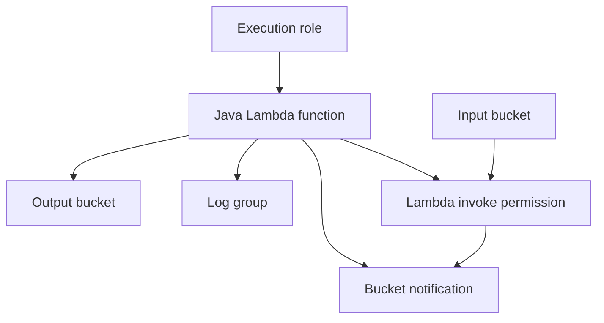
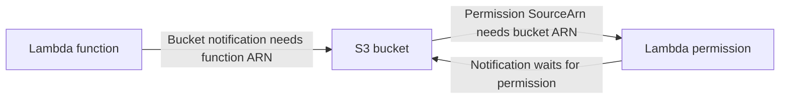
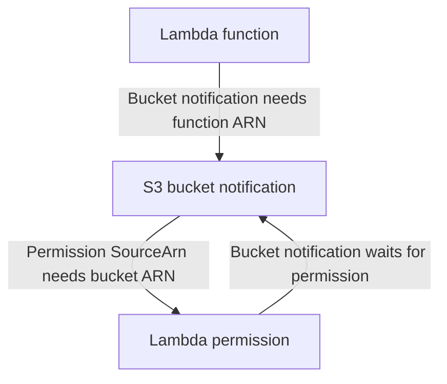
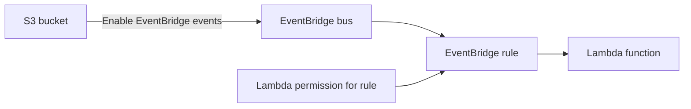
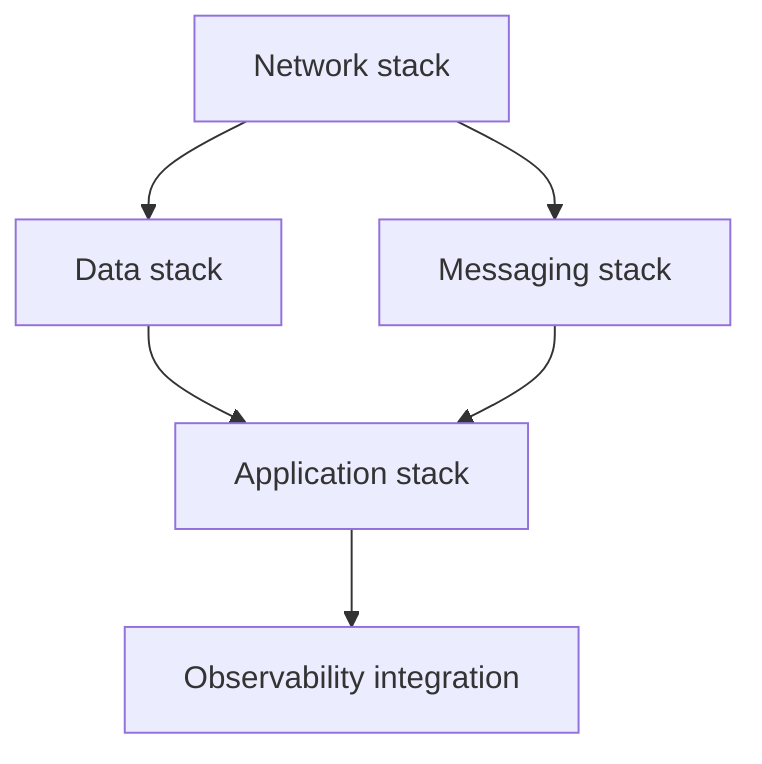
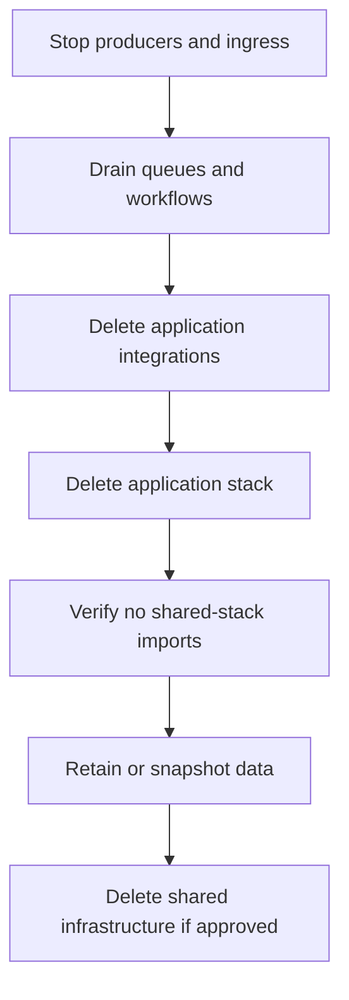

# Handling Deployment Order, Circular Dependencies, and Safe Stack Deletion

A serverless application typically consists of many resources: functions, API gateways, queues, event sources, buckets, databases, IAM roles, policies, log groups, and secrets. When deploying with Infrastructure as Code (IaC), these resources cannot be created in an arbitrary order. Some resources need the ARN or name of other resources; some policies can only grant permissions once the caller source is known; and some services must have triggers configured after the function already exists.

If ordering is modeled incorrectly, deployment can fail because a resource is not ready or because two resources reference each other. When tearing down an environment, uncontrolled stack deletion can also destroy data, logs, input files, or databases still used by other applications.

Within **CLOUD_SERVERLESS**, this lesson focuses on developing and deploying Java functions triggered by HTTP, messages, or events. Managing dependencies and infrastructure lifecycles directly affects triggers, access permissions, state, retries, scalability, and cost. This lesson covers reading dependency graphs, resolving circular dependencies, and designing safe teardown procedures.

## 1. IaC Describes a Resource Graph

A CloudFormation template, CDK app, or Terraform configuration describes resources and the relationships between them. You can picture the system as a directed graph:

- Each node represents a resource or deployment step.
- An edge `A → B` indicates that B requires A to exist or needs a value provided by A.
- The deployment engine orders creation, updates, and deletions based on these edges.

Example of a Java function processing files from S3:



The diagram shows conceptual relationships; actual dependencies depend on which attributes are referenced. The function needs its execution role before running. S3 needs permission to invoke the function. The bucket notification needs the function ARN and must have S3 verify invoke permissions. If one resource references back to a resource that already depends on it, the graph can form a cycle.

IaC is not just a list of resources. A good template expresses deployment order, ownership, data boundaries, and how resources are torn down.

## 2. Implicit Dependencies vs. Explicit Dependencies

Most IaC tools can infer dependencies from references between resources.

**Implicit dependencies** arise when one resource uses an output/attribute of another resource. For example, CloudFormation `!GetAtt Function.Arn` or Terraform `aws_lambda_function.processor.arn` tells the tool that the target resource must exist before creating the referencing resource.

**Explicit dependencies** are declared when an ordering relationship cannot be inferred from data references—for instance, a custom resource step that must run after a role policy is attached, even though the config does not directly read any output of the policy.

| Tool | Implicit Dependency | Explicit Dependency |
|---|---|---|
| AWS CloudFormation | `Ref`, `Fn::GetAtt`, `Fn::Sub` referencing a resource | `DependsOn` |
| AWS CDK | Construct/attribute references and construct bindings | `node.addDependency()` or equivalent API |
| Terraform | Attribute references across resources/modules | `depends_on` |
| Google Cloud Deployment Manager / Config Connector | Tool-specific resource references and relationships | Dependency field or tool-managed apply ordering |
| Azure Bicep / ARM | Symbolic/resource references | `dependsOn` when no reference can be inferred |

Prefer dependencies inferred from data references because they express the reason for the dependency directly. Only add explicit dependencies when an order is required that the graph cannot infer. Sprinkling `DependsOn` or `depends_on` everywhere makes templates harder to understand and can reduce parallel deployment.

## 3. Deployment Ordering Example in CloudFormation

Suppose a Lambda needs an execution role, the role needs a policy to read a bucket, and the function needs to be invoked by S3. A template might place the role earlier logically, yet CloudFormation relies on the dependency graph rather than YAML line order.

```yaml
Resources:
  ProcessorRole:
    Type: AWS::IAM::Role
    Properties:
      AssumeRolePolicyDocument:
        Version: '2012-10-17'
        Statement:
          - Effect: Allow
            Principal:
              Service: lambda.amazonaws.com
            Action: sts:AssumeRole

  ProcessorRolePolicy:
    Type: AWS::IAM::Policy
    Properties:
      PolicyName: ReadIncomingObjects
      Roles:
        - !Ref ProcessorRole
      PolicyDocument:
        Version: '2012-10-17'
        Statement:
          - Effect: Allow
            Action: s3:GetObject
            Resource: !Sub '${InputBucket.Arn}/incoming/*'

  ProcessorFunction:
    Type: AWS::Lambda::Function
    Properties:
      Runtime: java21
      Handler: example.Handler::handleRequest
      Role: !GetAtt ProcessorRole.Arn
      Code:
        S3Bucket: deployment-artifacts
        S3Key: processor/function.zip

  AllowBucketInvoke:
    Type: AWS::Lambda::Permission
    Properties:
      FunctionName: !GetAtt ProcessorFunction.Arn
      Action: lambda:InvokeFunction
      Principal: s3.amazonaws.com
      SourceArn: !GetAtt InputBucket.Arn
      SourceAccount: !Ref AWS::AccountId
```

This is a partial snippet illustrating dependencies; `InputBucket` must be declared in the same template or passed in appropriately. In practice, inline/managed IAM policies and runtime properties must match the real artifact and required permissions.

Key relationships:

- `ProcessorRolePolicy` references `ProcessorRole`, so the role must be created before the policy.
- `ProcessorFunction` references the role's ARN, so the role must exist before the function.
- `AllowBucketInvoke` references both the function and the bucket, so both must exist before the permission.
- If the bucket notification references the function ARN, the bucket notification must be configured after both the function and the permission are ready.

CloudFormation automatically orders resources based on references. If a step must run after the policy is attached without a data reference, `DependsOn` can add that ordering constraint.

## 4. When Is `DependsOn` Needed?

Suppose a custom resource calls an API to register configuration after an IAM policy has been created. If that resource does not reference the policy ARN or an output of the policy, CloudFormation might not know it has to wait for the policy.

```yaml
RegisterIntegration:
  Type: Custom::IntegrationRegistration
  DependsOn:
    - ProcessorRolePolicy
  Properties:
    ServiceToken: !GetAtt RegistrationFunction.Arn
```

`DependsOn` tells `RegisterIntegration` to wait for `ProcessorRolePolicy`. During stack deletion, dependencies are reversed: dependent resources are deleted before the resources they depend on.

Never use `DependsOn` to mask a circular dependency. If A depends on B and B depends on A, adding a third edge or forcing an arbitrary order does not eliminate the cycle. You must change the boundaries or the resource creation sequence.

## 5. What Is a Circular Dependency?

A circular dependency occurs when the dependency graph contains a path leading back to the starting node. Example:



In CloudFormation, cycles typically appear as an error like `Circular dependency between resources`. Terraform may report `Cycle` when resources/modules reference each other.

Common causes in serverless:

- An S3 bucket notification references a Lambda function, while the Lambda permission or execution policy references the bucket back.
- A Lambda execution role and policy split resources in a way that creates bidirectional references.
- An API Gateway integration references a Lambda ARN, while the Lambda permission references an API execution ARN derived from an API resource depending on the integration.
- Two stacks export/import each other's outputs bidirectionally.
- Two Terraform modules each require outputs from the other module.
- A custom resource creates a resource that itself requires the custom resource to finish first.

Not every bidirectional relationship in an architecture creates an IaC dependency cycle. A cycle only exists when the tool infers dependency edges forming a loop back to the same node or module.

## 6. Classic Example: S3 Notification and Lambda Permission

A bucket notification needs the Lambda function's ARN. At the same time, the Lambda permission needs to restrict `SourceArn` to the specific bucket. If the bucket notification is declared inside the bucket resource and the permission references the bucket, the graph can become:



Adding `DependsOn` to the bucket or permission does not solve the cycle because the two resources genuinely reference each other. You must split deployment into phases or adjust the architecture.

### Option A: Two-Phase Deployment

1. Create the bucket and Lambda function first without configuring the notification.
2. Create the Lambda permission scoped to the bucket ARN.
3. Update the bucket notification to point to the function.

This can be implemented using two stacks/modules or a single pipeline running twice with a parameter/feature flag. When using multiple stacks, avoid bidirectional cross-stack exports/imports.

### Option B: Custom Resource Configuring the Notification Afterward

A custom resource can call the API to configure the bucket notification after the bucket, function, and permission exist. The custom resource must have idempotent create/update/delete handlers, handle retries, and clean up the configuration on stack deletion.

This approach is flexible but increases operational code. Ensure the custom resource does not overwrite notifications owned by other systems and does not leave stale rules behind on updates.

### Option C: Using EventBridge as the Routing Layer

S3 can emit events to EventBridge. The bucket only needs EventBridge notifications enabled; an EventBridge rule filters events and routes them to Lambda. The permission allows `events.amazonaws.com` to invoke the function and scopes the source using the rule ARN.



This pattern usually eliminates the direct reference from the bucket notification to Lambda. However, evaluate EventBridge latency, cost, retries, event filtering, and dead-letter behavior. Do not choose EventBridge solely to dodge a template error if direct notifications are simpler and cycle-free once staged.

## 7. Designing IAM to Minimize Circular Dependencies

IAM roles and policies often create complex dependencies because policies need resource ARNs while resources may reference roles or policies. Ways to reduce risk:

- Create the execution role independently of the function; the function only references the role ARN.
- Attach required policies to the role in a way that avoids reverse references from the role back to the function.
- Use stable ARN/prefix patterns where appropriate, without hardcoding environment values that can be passed via parameters or outputs.
- Separate invocation permissions (function resource-based policy) from service access permissions (execution role policy).
- Avoid creating one giant policy referencing every resource if doing so tangles the graph.
- If a permission requires a function ARN or API ARN, attach that permission in a later phase after those resources exist.

For Lambda, keep the two permission layers distinct:

1. The execution role allows function code to access S3, DynamoDB, SQS, Secrets Manager, or other services.
2. The resource-based policy allows another service or principal to invoke the function.

Separating these two layers makes policies easier to review and reduces unnecessary references.

## 8. Dependencies Across Stacks and Modules

For large systems, infrastructure can be split into multiple stacks/modules by lifecycle or ownership:

- **Foundation/network stack:** VPC, subnets, security groups, shared endpoints.
- **Data stack:** databases, long-term storage buckets, encryption keys.
- **Messaging stack:** queues, topics, event buses, and dead-letter queues.
- **Application stack:** Java functions/services, API gateways, and subscriptions.
- **Observability stack:** log groups, dashboards, alerts, and tracing configuration.

Splitting stacks limits blast radius and lets owning teams deploy independently. However, every stack boundary introduces an input/output contract. Avoid two stacks importing each other's outputs.

One-way dependency example:



In practice, the observability stack may be created first and the application stack may reference its log groups/alerts. What matters is keeping dependency direction consistent with ownership and lifecycle. Shared foundations are normally deployed first; the application layer deploys later; teardown proceeds in reverse order.

## 9. Cross-Stack References and Export/Import

CloudFormation `Export` and `Fn::ImportValue` allow one stack to provide values to another stack. This is useful for sharing a VPC ID, subnet ID, bucket ARN, or queue ARN.

```yaml
Outputs:
  UploadBucketArn:
    Description: ARN of the shared upload bucket
    Value: !GetAtt UploadBucket.Arn
    Export:
      Name: shared-upload-bucket-arn
```

The application stack can import it:

```yaml
Parameters:
  SharedBucketExportName:
    Type: String
    Default: shared-upload-bucket-arn

Resources:
  ProcessorPolicy:
    Type: AWS::IAM::Policy
    Properties:
      PolicyName: ReadSharedBucket
      Roles:
        - !Ref ProcessorRole
      PolicyDocument:
        Version: '2012-10-17'
        Statement:
          - Effect: Allow
            Action: s3:GetObject
            Resource:
              Fn::Sub:
                - '${BucketArn}/incoming/*'
                - BucketArn:
                    Fn::ImportValue:
                      Fn::Sub: '${SharedBucketExportName}'
```

This snippet illustrates importing an output; adapt the YAML intrinsic syntax to your parser and real template. In CloudFormation, an export currently imported by another stack cannot be modified or deleted until consumers stop importing it.

Therefore, renaming an export, replacing a bucket, or deleting a foundation stack requires a transition process:

1. Update consumers so they no longer depend on the old output.
2. Deploy consumers and verify.
3. Remove the old import or switch to the new output.
4. Only then remove or modify the export in the producer stack.

Avoid circular dependencies between two stacks. If two stacks appear to need each other's outputs, introduce an intermediate contract/foundation stack, pass some values via pipeline parameters, or restructure so dependencies flow one way.

## 10. Terraform Dependency Graph and Module Design

Terraform builds its graph from resource/module references. Example:

```hcl
resource "aws_iam_role" "processor" {
  name = "processor-role"

  assume_role_policy = jsonencode({
    Version = "2012-10-17"
    Statement = [{
      Effect = "Allow"
      Principal = { Service = "lambda.amazonaws.com" }
      Action = "sts:AssumeRole"
    }]
  })
}

resource "aws_lambda_function" "processor" {
  function_name = "object-processor"
  role          = aws_iam_role.processor.arn
  runtime       = "java21"
  handler       = "example.Handler::handleRequest"
  filename      = "build/function.zip"
}
```

Referencing `aws_iam_role.processor.arn` creates an implicit dependency ensuring the role exists before the function. When an uninferred relationship is needed, Terraform supports:

```hcl
resource "aws_lambda_permission" "allow_bucket" {
  statement_id  = "AllowBucketInvoke"
  action        = "lambda:InvokeFunction"
  function_name = aws_lambda_function.processor.function_name
  principal     = "s3.amazonaws.com"
  source_arn    = aws_s3_bucket.upload.arn
}
```

The permission resource references both the function and the bucket, so the graph already knows both dependencies. Only add `depends_on` when there is a real dependency not expressed via attributes. Overly broad `depends_on` forces Terraform to update or wait on more resources than necessary.

When designing modules, pass required inputs and export clear outputs. A network module should not call back into an application module to fetch a function ARN. If a module needs a function reference to configure a trigger, extract trigger integration into a third module taking outputs from both sides.

## 11. Configuration Changes and Replacement

Not every IaC change is an in-place update. Certain attributes require creating a new resource and replacing the old one. For serverless, replacement can affect:

- Function ARN/name and triggers invoking the function.
- Queue/topic ARNs, subscriptions, and in-flight messages.
- Bucket names, objects, and notification configurations.
- KMS keys and data encrypted with those keys.
- Database endpoints, schemas, and connection strings.
- IAM role names/ARNs referenced by other resources.

Before applying, read the change plan to distinguish create, update, replace, and delete actions. Identify which resources will be replaced, which can lose data, and whether migrations or cutover phases are required.

With Terraform, `terraform plan` shows proposed changes; `-/+` usually indicates replacement. With CloudFormation, change sets indicate which resources will be modified or replaced. Do not auto-apply merely because the pipeline produced a plan; review changes that risk data loss or downtime.

## 12. What Is Safe Stack Deletion?

Deleting a stack is not simply deleting configuration files. It removes cloud resources and can permanently delete live data. A safe procedure must answer:

- Is the stack still referenced by another stack or application?
- Which resources hold durable data and which are ephemeral compute?
- Do backups/snapshots exist and has restore capability been tested?
- Are there pending messages, unprocessed events, or running workflows?
- Are there object versions, delete markers, retention locks, or legal holds?
- Are there KMS keys that must be retained to decrypt historical backups/objects?
- Are there logs, metrics, or traces that must be retained for auditing?
- Can teardown be rolled back or paused if something goes wrong mid-way?

Classify resources before deleting:

| Group | Examples | Appropriate Action |
|---|---|---|
| Ephemeral compute | Lambda functions, Cloud Run service revisions | Can be deleted after stopping traffic and triggers |
| Integration | API routes, event subscriptions, notifications, queue mappings | Stop callers or drain before deleting |
| Data | S3 buckets, databases, object stores, persistent disks | Back up/retain and require explicit approval |
| Security | KMS keys, secrets, IAM roles/policies | Check dependencies and recoverability before deleting |
| Observability | Log groups, dashboards, alerts, trace storage | Retain per retention/audit policies |

Do not apply the same deletion policy to every resource type. Functions can be replaced frequently; buckets or databases may hold irreplaceable data.

## 13. CloudFormation `DeletionPolicy` and `UpdateReplacePolicy`

CloudFormation provides `DeletionPolicy` to control what happens to a resource when it is removed from a template or when the stack is deleted. Common options:

- `Delete`: deletes the resource using the resource type's default behavior.
- `Retain`: preserves the resource after the stack or resource is deleted; the stack no longer manages it as before.
- `Snapshot`: takes a snapshot before deleting, applicable only to supported resource types.
- `RetainExceptOnCreate`: retains the resource on normal deletions while allowing deletion of a newly created resource during create rollback per documented behavior.

Example retaining a data bucket and snapshotting a database upon stack deletion:

```yaml
Resources:
  UploadBucket:
    Type: AWS::S3::Bucket
    DeletionPolicy: Retain
    UpdateReplacePolicy: Retain

  OrdersDatabase:
    Type: AWS::RDS::DBInstance
    DeletionPolicy: Snapshot
    UpdateReplacePolicy: Snapshot
    Properties:
      DBInstanceClass: db.t4g.micro
      Engine: postgres
      AllocatedStorage: 20
```

This is an abbreviated example without full production properties, credentials, or networking. `UpdateReplacePolicy` governs the old resource when an update forces replacement; `DeletionPolicy` governs removal from the stack or stack deletion. The two policies serve different purposes.

`Retain` does not mean the resource stays automatically managed after stack deletion. Retained resources can become orphaned resources requiring import into another stack or separate management. Document the owner, name, ARN, tags, and handoff procedure for retained resources.

## 14. Protecting Stacks from Accidental Deletion

In CloudFormation, stack termination protection prevents a stack from being deleted until protection is explicitly disabled. This is a stack-level safeguard useful for production or stacks holding critical resources.

Stack policies can restrict which update actions are permitted on resources. However, stack policies and termination protection cover different scopes; do not use a stack policy as a substitute for stack deletion protection.

In CDK, you can configure removal policies on constructs/resources. Conceptual example:

```java
Bucket bucket = Bucket.Builder.create(this, "DataBucket")
        .versioned(true)
        .removalPolicy(RemovalPolicy.RETAIN)
        .build();
```

Package names and APIs can vary across AWS CDK Java versions. Inspect the synthesized template to verify it actually includes the intended policy rather than relying solely on code inspection.

Additional safeguards:

- Use separate accounts/regions for development, staging, and production.
- Apply `environment`, `owner`, `data-classification`, and `managed-by` tags.
- Restrict `cloudformation:DeleteStack` or destroy permissions via IAM and approval workflows.
- Require change set/plan review for stateful resources.
- Enable backups, snapshots, and retention per data policies.
- Alert when someone disables termination protection or deletes critical resources.

## 15. S3 Buckets Cannot Be Deleted While Containing Objects

An S3 bucket normally must be empty before deletion. Versioned buckets can also hold multiple object versions and delete markers; deleting current objects alone does not necessarily empty the bucket.

Before deleting a bucket:

1. Confirm the bucket is no longer used by functions, APIs, replication, or other systems.
2. Check versioning, object versions, delete markers, multipart uploads, and replication.
3. Check Object Lock, retention periods, and legal holds.
4. Identify data requiring archiving, backup, or retention.
5. Delete versions/markers only under an approved procedure.
6. Delete the bucket once confirmed empty and free of dependencies.

Do not enable automatic deletion of all objects in production buckets just so stack deletion succeeds. An option such as CDK's `autoDeleteObjects` can be convenient for temporary buckets in test environments, but it can bulk-delete data; understand its behavior and restrict permissions before using it.

## 16. Databases, KMS Keys, and Secrets Need Dedicated Policies

Databases may require a snapshot prior to deletion. For RDS, review final snapshots, automated backup retention, and restore capabilities. Snapshots must be stored in the right account/region with appropriate access controls and verified via restore tests when data is critical.

KMS keys are special resources: deleting a key or scheduling deletion can render encrypted data permanently unreadable. Before deleting a key, identify every dependent object, snapshot, backup, secret, and system. Keys should generally follow the data lifecycle rather than the function lifecycle.

Secrets may be referenced by multiple functions or deployment pipelines. Before deleting, migrate consumers to a new secret, confirm no invocations still use the old secret, and respect audit retention periods.

## 17. `terraform destroy` and Data Protection

Terraform destroys resources in reverse dependency order compared to creation. Before running `terraform destroy`, verify workspace, backend state, environment variables, and the exact scope of resources slated for deletion.

Example review workflow:

```bash
# Check current workspace and state
terraform workspace show
terraform state list

# Generate destroy plan for review
terraform plan -destroy -out=destroy.tfplan

# Inspect saved plan
terraform show destroy.tfplan

# Execute only after review/approval
terraform apply destroy.tfplan
```

These commands illustrate the workflow; never run `destroy` just to clean up an environment without verifying workspace and state. Plan files can contain sensitive configuration values, so protect them like secret artifacts.

Terraform supports `lifecycle { prevent_destroy = true }` to reject plans that would destroy a resource while it remains in configuration:

```hcl
resource "aws_db_instance" "orders" {
  identifier = "orders-production"
  engine     = "postgres"

  lifecycle {
    prevent_destroy = true
  }
}
```

`prevent_destroy` is a guard inside Terraform planning—not a backup—and does not protect a resource if the block is removed from configuration or state is manipulated out of band. Nor does it stop an authorized user from deleting the resource directly in the cloud console or API.

Never use `terraform state rm` to pretend a resource was deleted from the cloud; that command only removes the resource from state management while leaving the live resource running. Use it only for planned ownership transfers.

## 18. Deleting in Reverse Order and Draining Workloads First

When tearing down an event-driven application, the safe order is normally to stop accepting new work first, finish or preserve in-flight work, then delete compute, and finally handle foundation/data resources.

A reference sequence:

1. Disable or shift API traffic; stop producers and event schedules.
2. Disable S3 notifications, EventBridge rules, or event source mappings to stop new invocations.
3. Wait for queues to drain or decide how to archive/replay remaining messages.
4. Stop consumers/Java functions once no in-flight work remains.
5. Remove unused permissions, subscriptions, routes, and integrations.
6. Retain or snapshot databases, buckets, keys, secrets, and logs per data policies.
7. Delete the application stack.
8. Delete shared infrastructure only after confirming no other consumers or stacks reference it.

For long-running workflows, wait for terminal states or run cancel/resume procedures. Deleting a function while messages remain in a queue halts processing until a consumer is redeployed; deleting a queue can lose unprocessed messages.

## 19. Cross-Stack Deletion and Dependency Teardown Order

If an Application stack imports VPC/subnet/bucket outputs from a Foundation stack, you must delete the Application stack or remove the imports before deleting the Foundation stack. CloudFormation will refuse to delete an export that is still imported.

A multi-stack teardown flow:



If a shared stack serves multiple environments, do not delete it during a single application's teardown process. Confirm the full consumer list and resource owner before deleting.

## 20. Rollback and Handling Failed Deployments

A deployment can fail after some resources have already been created. IaC tools generally roll back changes within their control, but rollback cannot always undo every side effect.

Examples:

- A custom resource called an external API without a proper delete handler.
- A function processed messages or wrote objects before the stack rolled back.
- A database migration altered the schema in a way that cannot be automatically reversed.
- A resource was replaced and data moved to the new resource.
- A resource marked `Retain` remains after rollback.

To reduce risk:

- Design custom resources with idempotent create/update/delete handlers.
- Use forward-compatible migrations that work with old code during rollouts.
- Back up data before destructive changes or replacements.
- Use change sets/plans to preview actions.
- Inspect stack events or Terraform outputs to determine each resource's final state.
- Document reconciliation procedures for retained or orphaned resources after rollback.

Do not assume `ROLLBACK_COMPLETE` or `apply failed` means all side effects were undone. Inspect live resources and data before the next deployment.

## 21. Drift Detection and Out-of-Band Changes

Drift occurs when cloud resources are altered outside IaC—for instance, someone edits a security group, adds a bucket notification, or changes max instances in the console.

Drift can make the dependency graph in code diverge from reality. When deleting a stack, the tool might delete a resource or policy that another team has begun relying on.

Best practices:

- Restrict direct production edits outside the IaC pipeline.
- Use CloudFormation drift detection or Terraform refresh/plan workflows.
- Investigate discrepancies before reconciling; do not blindly overwrite out-of-band config before identifying its owner.
- Bring approved changes back into the source of truth via reviewed pull requests.
- Use tags and inventories to map resources back to their owning stack/module.

Drift detection does not catch every type of change or side effect. Still verify policies, triggers, and data directly in the live services.

## 22. Pre-Deployment Checklist

| Question | Required Evidence |
|---|---|
| Is the dependency graph acyclic? | CloudFormation validate/change set or Terraform plan reports no cycles |
| Do references create implicit dependencies? | ARNs, IDs, names, and outputs flow through resource references |
| Is explicit ordering needed? | `DependsOn`/`depends_on` explains why |
| Are there reverse-referencing resources? | S3 notifications, Lambda permissions, API routes, and IAM policies checked |
| Are stack/module dependencies unidirectional? | Producer/consumer diagram and outputs defined |
| Do cross-stack exports have owners? | Consumer list and export change procedure documented |
| Is IAM properly scoped? | Execution roles and resource-based policies separated |
| Do replacements affect data? | Change set/plan reviewed with migration/backup plans |
| Do custom resources clean up? | Idempotent and retry-safe create/update/delete handlers |
| Was the new deployment tested? | Staging deployment and trigger smoke tests completed |

## 23. Pre-Stack Deletion Checklist

| Question | Required Evidence |
|---|---|
| Correct account, region, project, and workspace? | Context confirmed before delete/destroy command |
| Do other stacks/modules reference this stack? | No remaining imports/exports or consumer dependencies |
| Have traffic and event sources stopped? | APIs, schedules, S3 notifications, EventBridge, and mappings handled |
| Have queues/workflows drained? | Backlog is 0 or messages archived/replayed as decided |
| Are databases backed up? | Snapshots, backup retention, and restore tests verified |
| Do buckets have objects/versions to keep? | Inventory, versioning, retention, and legal holds checked |
| Are KMS keys still in use? | Dependencies from objects, backups, secrets, and snapshots verified |
| Must logs and audits be retained? | Retention policies and exports configured |
| Is deletion protection handled properly? | Termination protection, `DeletionPolicy`, `prevent_destroy` reviewed |
| Is there a destroy plan/change set? | List of deleted/replaced resources reviewed and approved |
| Is there an owner for retained resources? | Tags, ARNs, handoff docs, and ongoing management plan exist |
| Can you recover from accidental deletion? | Backups, restore procedures, and responsible owner identified |

## 24. Serverless Infrastructure Lifecycle Workflow Pattern

A unified workflow can be divided into three phases:

**Provision:** create shared foundations first, then data/messaging, then Java functions/APIs, and finally triggers/integrations. Verify the dependency graph is acyclic and permissions follow least privilege.

**Operate and change:** route all changes through pull requests and plans/change sets. Distinguish in-place updates from replacements; for stateful changes, plan migrations, backups, and phased rollouts. Monitor drift and cross-stack dependencies.

**Decommission:** stop producers/ingress, drain events and workflows, remove integrations, delete the application stack, retain/snapshot data, and only then consider deleting shared foundations. Every retained resource must have an owner and ongoing management plan after stack deletion.

Proper deployment ordering ensures functions are triggered only once permissions and dependencies are ready. An acyclic dependency graph keeps deployments schedulable and rollback behavior clear. Controlled teardown protects data, pending messages, and shared resources—essential conditions for operating Java serverless safely across releases and environments.
