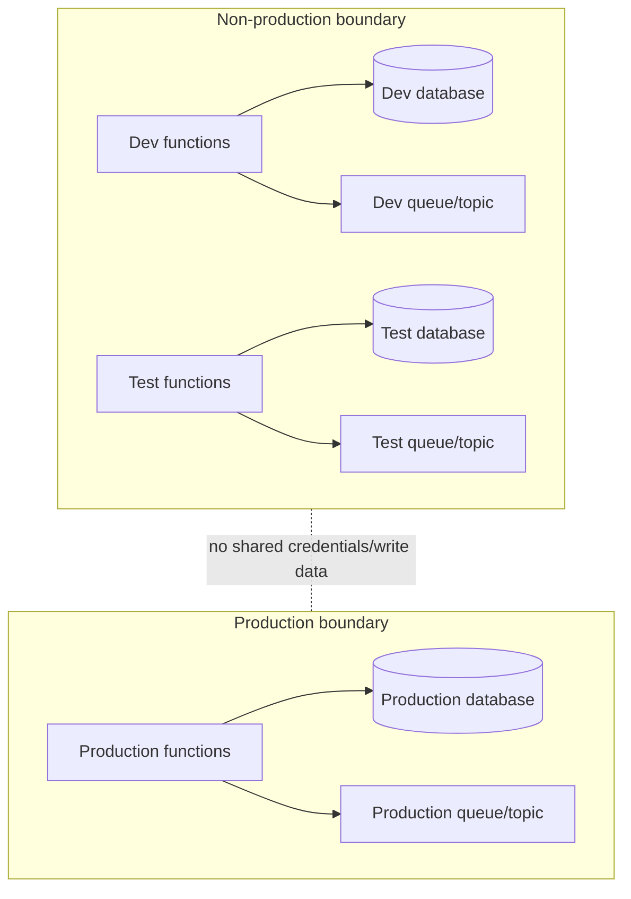
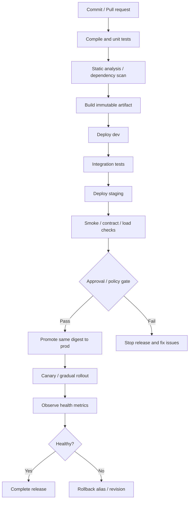

# Separating Development, Testing, and Production Environments

A Java serverless application typically runs across multiple environments: local machines, development, integration test, staging, and production. Each environment has different endpoints, databases, queues, secrets, IAM permissions, networks, and resource limits. If a production function accidentally uses a test database, or a staging deployment writes to a production queue, a configuration error can cause data loss even when the code has no bugs.

Environment separation is the practice of establishing clear boundaries between data, identities, infrastructure, and release processes. The goal is to allow teams to experiment and deploy frequently without affecting real workloads, while ensuring that the exact tested artifact is the one released.

In serverless, environment boundaries must cover both functions and surrounding services: API Gateway/HTTP endpoints, event buses, queues, databases, object storage, secret stores, workflows, logs, and monitoring. Simply renaming a function to `orders-dev` or `orders-prod` is not enough if both still share an overly permissive role, the same bucket, or the same database.

## 1. Development, testing, and production environments

### 1.1. Role of each environment

| Environment | Purpose | Data and access permissions | Operational characteristics |
| --- | --- | --- | --- |
| Local | Fast development, debugging, and unit testing | Fixture/synthetic data; mock credentials or limited dev identity | Can use emulators, containers, or mock dependencies |
| Development (dev) | Integrating new code and testing features | Synthetic data; write permissions scoped to dev | Can change frequently, easy to reset |
| Integration/Test | Testing functions against real queues, databases, APIs, and events in an isolated environment | Controlled test datasets; no direct use of production data | Verifies contracts, retries, idempotency, and integration |
| Staging/Pre-production | Release rehearsal closely matching production | Anonymized or synthetic data; permissions close to production but separately scoped | Verifies configuration, load, rollout, and rollback |
| Production (prod) | Serving real users and business operations | Real data; least-privilege permissions, auditing, and strict change control | SLAs, backups, alerts, on-call, and incident processes |

Not every project needs five separate environments. A small team may use local, dev, staging, and production. What matters is that each environment has a clearly defined purpose, data set, permissions, and deployment policy.

### 1.2. Isolation levels

Environments can be isolated at multiple layers:

- **Account/project/subscription:** strong administrative and billing boundary; reduces the risk of accidental cross-environment operations.
- **Network:** dedicated VPC/VNet, subnets, firewalls, private endpoints, and DNS.
- **Identity:** dedicated runtime service account/role, secret access, and deployment permissions.
- **Data:** dedicated databases, buckets, queues, topics, and caches.
- **Compute:** dedicated clusters, namespaces, functions/services, concurrency, and quotas.
- **Operations:** dedicated log groups, metric namespaces, alerts, dashboards, and retention policies.

Strong isolation models typically use separate cloud accounts or projects for production and non-production. Separate namespaces or prefixes within the same account/project may suffice for smaller workloads, but you must understand which resources could be shared and the impact when policies or quotas change.



### 1.3. Choosing boundaries based on risk

An environment does not need to be separated by a dedicated cloud account in every case. Evaluate:

- the consequences if dev code accidentally writes to real data;
- who has permissions to deploy and modify IAM;
- audit, data residency, and compliance requirements;
- the degree of network or database sharing;
- the ability to set separate quotas, billing, and alerts;
- the operational overhead of managing additional accounts/projects/clusters.

For production systems holding sensitive data or critical workloads, a dedicated account/project generally provides a stronger boundary. For dev/test, a shared non-production account can be used while still separating databases, buckets, queues, service accounts, and secrets by environment.

## 2. What must be separated across environments

### 2.1. Functions and endpoints

Name functions/services/routes using clear conventions, such as `orders-api-dev`, `orders-api-staging`, and `orders-api-prod`. Each environment should have its own endpoint and DNS. Avoid having staging clients point to the production API or having production webhooks send events to dev endpoints.

Do not rely on naming alone to protect resources. Authorization policies and resource boundaries must prevent a dev function from invoking or writing to production resources even if the code is misconfigured.

### 2.2. Databases and schemas

Dev/test/staging should have separate databases, or at least separate schemas and credentials. Avoid sharing the production database for integration testing because tests can:

- write or delete real data;
- create locks and slow down production queries;
- run incompatible migrations;
- trigger real notifications or payments;
- expose personal data to unauthorized users.

If near-production data is needed, create an anonymized copy or a synthetic dataset. Never copy sensitive data into dev casually. Check backups, exports, logs, and caches as well, since data may exist outside the main tables.

### 2.3. Queues, topics, and event buses

Each environment needs dedicated queues/topics/event buses or clearly controlled namespaces. For example:

```text
orders-created-dev
orders-created-test
orders-created-staging
orders-created-prod
```

Do not allow a dev consumer to subscribe to a production queue. Event routing rules must restrict source, account/project, event type, and environment. When testing retries or DLQs, use dedicated queues so test messages do not increase the production backlog.

### 2.4. Object storage and temporary files

Buckets or file storage containers should be separated by environment. Use prefix-scoped policies if sharing a bucket is an intentional choice, keeping in mind that bucket permissions, lifecycle rules, encryption keys, and event notifications can affect multiple prefixes.

In particular, a function processing objects may generate new events when writing output. If dev and prod share a bucket or notification setup, a test upload can trigger a production function. Separate buckets or configure prefix filters and test event routing thoroughly.

### 2.5. Caches and state stores

Caches, session stores, idempotency tables, and workflow state also require environment boundaries. If staging shares a cache keyspace with production, a colliding key can return wrong data or evict real cache entries. Use separate instances or separate namespaces/prefixes and credentials according to the service's capabilities.

### 2.6. IAM roles and service accounts

Each runtime should have its own identity. `orders-dev` only reads dev secrets and writes to dev tables; `orders-prod` only has the permissions required for production tables/secrets. Never use a single broad administrative execution role/service account across all environments.

Separate deployer and runtime identities as well:

- Developer/CI principals have permissions to deploy only to authorized environments.
- Runtime identities only have the permissions the function needs while executing.
- Trigger identities have permissions to invoke/receive events as configured.
- Build identities have permissions to read source code and write to artifact registries.

This separation limits the blast radius if dev credentials are leaked or a function has a vulnerability.

## 3. Configuration must live outside the artifact

### 3.1. Build one artifact, configure per environment

A valuable release principle is to build an immutable artifact once, then promote that exact artifact through test, staging, and production. Differences between environments are supplied through configuration, identity, and infrastructure.

For example, the same JAR `orders-service-1.8.0.jar` can run in staging and production with different database endpoints, secret references, log levels, and concurrency settings. If separate JARs are built for each environment, there is a risk that the code or dependencies across artifacts will diverge.

Artifacts should have a version or digest to identify the exact tested contents. CI/CD can store checksums, image digests, SBOMs, and security scan results alongside the release.

### 3.2. Classifying configuration

| Category | Examples | Management approach |
| --- | --- | --- |
| Non-sensitive configuration | Region, endpoint, bucket name, queue, feature flag | Environment variables or config service |
| Secrets | DB password, API key, signing key | Respective Secret Manager/Secrets Manager/Key Vault |
| Infrastructure | Memory, timeout, concurrency, VPC, triggers | Infrastructure as Code (IaC) or deployment manifest |
| Runtime policy | Log level, retry limit, batch size, feature rollout | Versioned and validated configuration |
| Business data | Orders, records, workflow state | Environment-specific database/state store |

Never embed passwords, private keys, or tokens into source code, JARs, container images, Git repositories, or event payloads. Encrypting a config file does not replace controlling who can decrypt and use the secret.

### 3.3. Java example reading environment variables

A Java handler can read configuration when initializing application components:

```java
import java.util.Set;

public record AppConfig(
        String environment,
        String ordersTable,
        String queueName,
        String logLevel) {

    public static AppConfig fromEnvironment() {
        String environment = required("APP_ENV");
        String ordersTable = required("ORDERS_TABLE");
        String queueName = required("ORDERS_QUEUE");
        String logLevel = System.getenv().getOrDefault("LOG_LEVEL", "INFO");

        if (!Set.of("dev", "test", "staging", "prod").contains(environment)) {
            throw new IllegalStateException("Unsupported APP_ENV value");
        }

        return new AppConfig(environment, ordersTable, queueName, logLevel);
    }

    private static String required(String name) {
        String value = System.getenv(name);
        if (value == null || value.isBlank()) {
            throw new IllegalStateException("Missing required configuration: " + name);
        }
        return value;
    }
}
```

This example uses `Set`, so `import java.util.Set;` is required. Validating configuration at startup helps catch missing variables or invalid values early, rather than waiting until the first request calls a dependency. Never include secret values in exception messages.

### 3.4. Avoid using APP_ENV as a security mechanism

The `APP_ENV=dev` variable is useful for logs, metrics, and selecting configuration. However, if the code relies solely on this variable to decide whether it is allowed to write to production, a misconfiguration can break the security boundary.

Access must be enforced at the IAM, database grants, bucket policy, network, and resource boundary layers. Even if a dev function accidentally receives `APP_ENV=prod`, the dev runtime identity must have no permission to write to production resources.

### 3.5. Configuration precedence

An application can receive configuration from multiple sources: defaults in code, config files, environment variables, config services, and secret stores. Define a clear precedence order, for example:

1. Safe defaults in the application.
2. Packaged non-sensitive config files.
3. Environment variables provided by the deployment platform.
4. Config service for values that can change over time.
5. Secret store for sensitive credentials.

Do not allow multiple sources to override the same value without clear rules. At startup, you can log configuration names and their sources, but never log secret values.

## 4. Managing secrets per environment

### 4.1. One dedicated secret per environment

For example:

```text
dev/orders-db-password
test/orders-db-password
staging/orders-db-password
prod/orders-db-password
```

Alternatively, use separate projects/accounts with the same secret ID in each project. The second approach lets the code keep consistent secret names while permissions and data are isolated by project/account.

The dev runtime identity must only read dev secrets; the prod runtime identity must only read prod secrets. Never grant a dev service account permission to read all secrets in the production project.

### 4.2. Rotation and versioning

Secrets require a lifecycle: creation, distribution, rotation, revocation, and auditing. When changing a database password, coordinate rotation with the database and connection pool. If a function caches secrets in-process, set a TTL and handle cases where old credentials are rejected.

Staging should test rotation before it is performed in production. Never share the same secret value between staging and production just to reduce configuration effort.

### 4.3. Keep secrets out of the pipeline

Pipelines must deploy functions without printing secrets to logs. Avoid passing secrets as command-line arguments because they can appear in process listings or shell history. Prefer secret store integrations and short-lived read permissions for the CI principal.

Build artifacts do not need to contain production secrets. If an image-building pipeline has permission to read production secrets, any build step or dependency script could become an exfiltration path; separate build and deploy stages, and grant runtime secret access only to the workloads that need it.

## 5. Environment parity and intentional differences

### 5.1. Keeping structure consistent

Staging should closely match production in:

- Java runtime and operating environment;
- artifact/container image;
- trigger types and event schemas;
- database engine/version and migration process;
- network paths and TLS;
- IAM patterns and secret injection;
- concurrency, timeout, and retry semantics;
- logging/tracing and deployment strategy.

Staging does not necessarily need the same scale or SLA as production. Smaller instances and lower traffic can be used, but document these differences because they can mask capacity or timeout issues.

### 5.2. Differences that must be declared

Some differences are necessary:

- database endpoints and datasets;
- buckets/queues/topics;
- service accounts/roles;
- secret versions/references;
- memory, timeout, concurrency, and min/max instances;
- domains, callback URLs, and webhook destinations;
- log levels, alert thresholds, and retention.

Keep these differences in versioned configuration or IaC. Avoid manual console edits without updating the source of truth.

### 5.3. Do not assume staging fully represents production

Staging typically has lower traffic, smaller datasets, and less resource contention. Therefore, it may fail to expose:

- connection exhaustion when Lambda/Cloud Run scales out;
- hot partitions or lock contention;
- sustained queue backlogs;
- cold starts under low load;
- high log/metric cardinality at scale;
- downstream dependency rate limits.

Supplement staging with controlled load tests and production canaries. Do not run heavy load tests against production without proper guardrails, scheduling, and operational approval.

## 6. CI/CD: promoting the same artifact

### 6.1. Reference pipeline



A solid pipeline keeps the artifact immutable after the build. Deployment steps change environment configuration and infrastructure rather than recompiling code with different dependencies for production.

### 6.2. Pre-deployment checks

The pipeline should verify:

- unit tests and integration tests;
- code style, static analysis, and vulnerability scans;
- dependency/license policies;
- artifact checksum or image digest;
- required configuration and secret references;
- IAM permission diffs;
- IaC plan and destructive changes;
- event schema and database migration compatibility.

Never include secret values in artifact metadata or pipeline output. Store only safe references, versions, or checksums when traceability is needed.

### 6.3. Promoting across environments

A workflow might look like this:

1. Build `orders-api:1.8.0` once.
2. Deploy that digest to dev and run smoke tests.
3. Promote the exact same digest to test/staging.
4. Run contract, integration, security, and performance checks.
5. Obtain policy-required approval for a production release.
6. Update the alias/revision/traffic split so production serves the tested digest.
7. Observe metrics and roll back if error thresholds are exceeded.

If the artifact needs to be rebuilt, that produces a new build and must pass all required gates again. Never assign the same version tag to two images with different digests.

## 7. Infrastructure as Code and preventing configuration drift

### 7.1. Managing infrastructure as code

Functions, roles, policies, triggers, queues, database parameters, networking, and monitoring should be declared via IaC such as Terraform, AWS SAM/CDK/CloudFormation, or the corresponding Google Cloud deployment tooling.

IaC helps:

- review changes before applying them;
- reproduce environments;
- detect broadened permissions;
- compare dev/staging/prod;
- track history and roll back configurations;
- reduce undocumented manual changes.

You can use shared modules for function structure and pass different values per environment. However, avoid shared variables that could cause production to accidentally inherit dev permissions or endpoints.

### 7.2. Separating state and deploy permissions

If IaC uses remote state, separate state by account/project and environment, and restrict read/write access. State files can contain resource metadata or secret values depending on the provider; protect them as sensitive data.

A dev CI principal should not have permission to apply production state. Separate pipeline environments, approvals, and credential federation. Avoid storing long-lived cloud keys in repositories.

### 7.3. Detecting drift

Configuration drift occurs when live resources diverge from the IaC declaration. For example, someone enables public access on a bucket via the console while the IaC source still specifies private. If the pipeline does not detect this, subsequent deployments might fail to fix it or unintentionally overwrite changes.

Run periodic plan/drift detection and review changes to IAM, networking, secret policies, triggers, and concurrency. Any production hotfix must be backported into IaC so the source of truth does not fall out of sync.

## 8. Testing per environment

### 8.1. Local and unit tests

Unit tests should verify domain logic without requiring real cloud resources. Inject interfaces for repositories, clocks, HTTP clients, and event publishers to test:

- validation and business rules;
- input/output mapping;
- idempotency decisions;
- retry classification;
- error mapping;
- behavior when dependencies time out or return malformed data.

Mocks do not replace integration tests. Mocks only prove that the code responds to assumed behavior; they do not prove that IAM, networking, schemas, or event source mappings are correct.

### 8.2. Integration tests

Integration tests should verify real components or compatible emulators:

- functions receiving the expected event schema;
- runtime identity permissions accessing resources;
- database migrations and transactions;
- queue acknowledgements, retries, and DLQs;
- object storage notifications;
- secret retrieval and TLS;
- configured timeouts/concurrency.

Never allow integration tests to publish messages to production topics or send real emails/payments. Use sandbox accounts, fake providers, or simulated destinations.

### 8.3. Contract tests

For event-driven systems, the event schema is the contract between producer and consumer. Verify required fields, versions, enums, timestamps, encoding, and backward compatibility. Staging producers must publish events to staging topics; staging consumers must read from those same topics.

When changing a schema, use a compatible strategy such as adding optional fields first, updating consumers, and then switching producers. Never deploy a new producer emitting events that production consumers cannot yet understand.

### 8.4. End-to-end and smoke tests

Post-deployment smoke tests should verify minimal endpoints or event flows without executing data with real side effects. You can use health endpoints, synthetic requests with a test tenant, or test-marked messages.

E2E tests must verify both the final outcome in the state store and any controlled side effects. An HTTP 202 only proves the request was accepted under the contract; it does not guarantee the workflow completed processing.

### 8.5. Performance and resilience tests

Staging should run tests for:

- average and peak load;
- cold starts and scale-from-zero;
- burst concurrency;
- database connection limits;
- dependency latency and rate limits;
- retry storms and poison messages;
- duplicate events and idempotency;
- failovers or connection drops;
- memory pressure and timeouts.

Scope tests so they do not affect shared systems. Test data must be cleaned up or have a TTL.

## 9. Database migrations and deployment compatibility

### 9.1. Do not assume code and schema change simultaneously

Serverless systems often run multiple revisions concurrently during a rollout. Events can remain in queues for minutes or hours. Consequently, new code may read data written by old code and vice versa.

Use the **expand-and-contract** strategy:

1. Expand: add new columns/tables/indexes in a backward-compatible way.
2. Deploy code capable of reading both old and new schemas.
3. Backfill or dual-write if necessary, under control.
4. Shift all traffic and consumers to the new schema.
5. Contract: drop old columns or constraints only after confirming no active revisions or queued events still depend on them.

Do not drop or rename columns in the same deployment while old code is still running.

### 9.2. Migrations must have a clear owner

Do not let every Lambda instance run migrations on cold start. Multiple instances can execute migrations simultaneously and cause locks or races. Use a dedicated migration step in a pipeline/job with appropriate permissions, lock/version control, and auditing.

The runtime role usually does not need broad DDL permissions. Separate the migration identity from the application runtime identity.

## 10. Deployment and rollback strategies

### 10.1. Rolling, blue/green, and canary

- **Rolling:** gradually replaces instances/revisions; requires compatibility between old and new code.
- **Blue/green:** runs two revisions/environments and shifts traffic once the new version is ready; requires accounting for the cost of running in parallel.
- **Canary:** routes a small percentage of traffic or events to the new version, observes metrics, and then ramps up gradually.

Serverless platforms may support versions, aliases, revisions, or traffic splitting. Exact configuration depends on the platform. For queue consumers, shifting traffic is different from HTTP; you must manage event source mappings, concurrency, and compatibility with older messages.

### 10.2. Rollback criteria

Define thresholds before deploying:

- rising error rates;
- p95/p99 latency exceeding thresholds;
- rising timeouts/throttles;
- growing queue age/backlog;
- increasing database connections or lock waits;
- declining business success rate;
- abnormal increase in cost per successful operation.

Rolling back code does not automatically revert database migrations or already-executed side effects. Ensure schemas remain compatible with the previous version and have compensation or forward-fix procedures if data has already changed.

### 10.3. Feature flags

Feature flags allow enabling features by environment, tenant, or traffic percentage without deploying new code. Flags need owners, safe defaults, expiration dates, and auditing. Never use feature flags as a substitute for IAM or authorization.

Production flags must have controlled modification permissions and support rapid rollback. Avoid leaving stale flags indefinitely, as they increase code branching and testing overhead.

## 11. Managing resources and costs per environment

Non-production environments can still incur significant costs if functions, databases, queues, and logs are not cleaned up. Set budgets/quotas and lifecycle policies:

- cap max concurrency and min instances;
- shut down or scale down dev resources off-hours when appropriate;
- set TTLs for test objects, database snapshots, and messages;
- set separate log retention for dev/test;
- automatically delete preview environments after PRs close;
- isolate quotas so load tests do not consume production capacity.

Do not apply scale-to-zero or short retention policies to production solely to cut costs if doing so violates SLAs, audit rules, or incident investigation needs.

## 12. Observability and auditing per environment

Each environment should have appropriate dashboards and alerts. Dev may log more verbosely for short periods; production requires structured logging, redaction, and policy-compliant retention.

Useful fields include:

- environment, service, and function version;
- request ID, trace ID, event ID, and correlation ID;
- artifact digest or build version;
- permitted tenant/business keys;
- retry attempt and failure category;
- deployment ID and change reference.

Do not use environment labels to record secrets or sensitive data. Avoid high-cardinality metric labels such as request ID. Audit logs should record the principal, action, resource, and timestamp of IAM/configuration changes.

## 13. Example environment configuration structure

Example configuration file without secrets:

```yaml
app:
  name: orders-api
  logLevel: INFO

environments:
  dev:
    databaseInstance: orders-dev
    ordersTable: OrdersDev
    queue: orders-created-dev
    maxConcurrency: 5
  staging:
    databaseInstance: orders-staging
    ordersTable: OrdersStaging
    queue: orders-created-staging
    maxConcurrency: 10
  prod:
    databaseInstance: orders-prod
    ordersTable: Orders
    queue: orders-created-prod
    maxConcurrency: 100
```

This is a conceptual structure example; how values are injected into Lambda/Cloud Run and the IaC syntax depend on the platform. Do not place passwords in this file. Secret references should be managed separately per environment and corresponding runtime identity.

Production configurations must be validated before being applied: `maxConcurrency` must align with database and downstream capacity. Never copy example values into a live environment without measuring load first.

## 14. Environment separation checklist

- [ ] Each environment has a clear purpose, owner, and deployment policy.
- [ ] Production has an account/project or protective boundary suited to its risk level.
- [ ] Function endpoints, triggers, and event routing are separated by environment.
- [ ] Databases, schemas, buckets, queues, topics, caches, and workflow states are separated or safely namespaced.
- [ ] Dev/test cannot write to production data using runtime identities.
- [ ] Dedicated runtime service accounts/roles exist for each workload and environment.
- [ ] Deployer, build, and trigger identities are separated from runtime identities.
- [ ] Secrets are separated per environment, accessor permissions are least-privilege, and rotation is tested.
- [ ] Immutable artifacts are built once and promoted across environments.
- [ ] Non-sensitive configuration is injected outside the artifact; secrets never appear in source/images/logs.
- [ ] Staging closely matches production in runtime, event contracts, IAM patterns, and network paths.
- [ ] IaC manages functions, triggers, roles, networking, databases, and monitoring.
- [ ] Drift detection and a process to backport hotfixes into IaC are in place.
- [ ] Unit, integration, contract, smoke, load, and resilience tests have dedicated scopes.
- [ ] Database migrations are compatible with both old and new code during rollouts.
- [ ] Canary/gradual rollouts and measurable rollback thresholds are configured.
- [ ] Rollbacks do not corrupt schemas or previously executed side effects.
- [ ] Non-production environments have budgets, quotas, TTLs, and cleanup policies.
- [ ] Logs/metrics/tracing are separated by environment and do not leak sensitive data.

## Conclusion

Separating dev, test, staging, and production means separating identities, networks, data, secrets, triggers, and operational processes. A different `APP_ENV` variable or function name does not create a security boundary. Production must be protected by appropriate accounts/projects, IAM, resource policies, and networking; dev/test must use dedicated data and credentials.

Build immutable artifacts once, manage configuration outside the artifact, use IaC to reproduce environments, and promote the same digest through testing stages. Staging must match production closely enough to catch configuration and integration defects, while canary/rollback strategies reduce deployment risk. For databases and event-driven workloads, always account for multiple concurrent revisions, older queued messages, schema compatibility, retries, and side effects.

A solid environment workflow not only prevents accidental writes to real data; it also makes releases repeatable, auditable, and recoverable in a controlled way when changes cause incidents.
