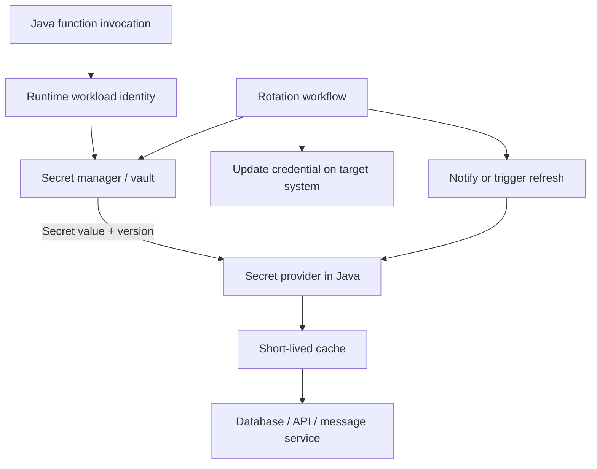
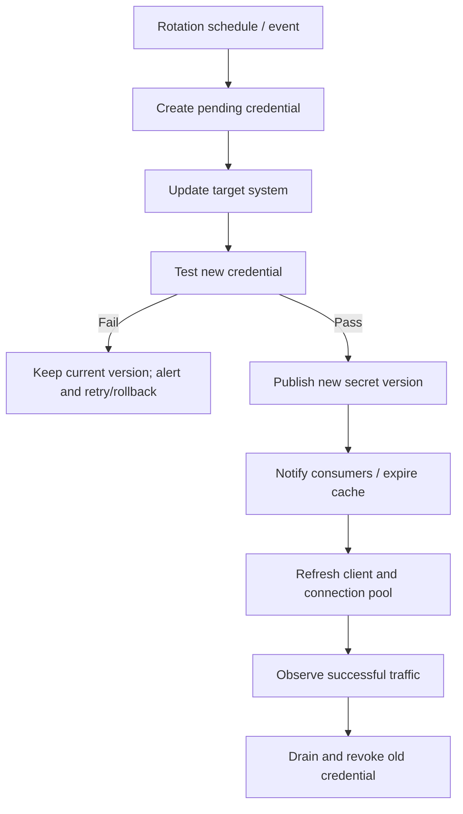

# Loading Secrets Safely and Rotating Credentials

Java functions often need credentials to call databases, partner APIs, queues, object storage, or internal services. Values such as database passwords, API keys, OAuth client secrets, webhook signing keys, and private keys are **secrets**: if exposed, others can impersonate the application or access sensitive data.

In serverless environments, functions can be newly created, reused, scaled out, or stopped at any time. Therefore, secrets must be stored in a dedicated management system, granted to workloads via runtime identity, and supported by a rotation process. Never embed credentials into source code, JARs, container images, or committed configuration files.

This lesson focuses on three things: choosing secretless authentication when possible; loading secrets from a secret manager in Java; and rotating credentials without disrupting running functions or active connections.

## 1. Distinguishing configuration, secrets, and workload identity

These three categories serve different roles:

| Type | Examples | Management approach |
| --- | --- | --- |
| Configuration | Region, queue name, bucket, timeout, feature flag | App settings/environment variables or configuration service |
| Secret | Password, API key, private key, client secret, signing key | Secret manager/vault with access control, versioning, and auditing |
| Workload identity | Lambda execution role, Azure managed identity, Google service account | IAM/Entra ID and the platform's short-lived token mechanism |

Workload identity is how a function proves its identity to the cloud provider. When the target service supports IAM, Microsoft Entra ID, or Google IAM, use identity instead of a long-lived access key. For example, a Java function can use a Lambda execution role to read S3, a managed identity to read Key Vault, or a service account to call Google APIs.

A secret manager is still needed when the target system only supports passwords/API keys or when credentials outside the cloud must be managed. In that case, workload identity is used to authenticate to the secret manager, which returns the credential needed by the application.



If the target service supports direct authentication via workload identity, skip fetching a secret. Every credential eliminated is one less credential to rotate, store, or protect.

## 2. What counts as a secret?

The following values generally need protection as secrets:

- Database or message broker usernames/passwords.
- API keys, OAuth client secrets, refresh tokens, and long-lived access tokens.
- Private keys, certificate private material, and webhook signing keys.
- Connection strings containing credentials.
- Application-managed signing/encryption keys.
- Credentials for legacy systems that do not support identity federation.

Some data may not strictly be a secret yet still be sensitive, such as internal database hostnames, account IDs, or resource names. Classify them according to organizational policy; do not expose sensitive infrastructure details in logs or public configuration just because they are not passwords.

**Secrets are different from encryption keys.** Secret Manager/Key Vault stores and controls access to secret values. KMS/Key Vault Keys/Cloud KMS manage cryptographic operations like encrypting, decrypting, or signing with keys. Rotating an encryption key does not automatically change a database password; changing a password does not mean the encryption key was rotated. The two processes may relate, but they must be planned separately.

## 3. Why not store secrets in source code or images?

Putting credentials in code or images increases the number of places you must protect:

- Secrets can remain in Git history even after being deleted from current files.
- JARs, Docker images, build caches, and artifact registries can be downloaded or copied.
- Build logs, crash dumps, exceptions, or diagnostic bundles can leak values.
- Every credential change requires rebuilding and redeploying the artifact if the secret is packaged with the application.
- Multiple environments might accidentally share production credentials.

Never place secrets in:

- Source code, committed `application.properties`, YAML, or JSON files.
- Dockerfile `ENV`, build arguments, or image layers.
- `.env` files, `local.settings.json`, or committed local config files.
- URLs/query strings, command-line arguments, or resource names/tags.
- Logs, metric labels, trace attributes, exception messages, or public tickets.

Local files can use placeholders or developer credentials via CLI/credential providers. If local secrets are needed, store them outside the repository, restrict file permissions, and add them to `.gitignore`. Never copy production credentials to personal machines just to make local tests run.

## 4. Secret loading architectures in serverless

A function can retrieve secrets in three primary ways:

1. **Platform secret injection:** the platform resolves a secret reference into an environment variable or mounted file before starting the container/function.
2. **Direct SDK/API:** Java uses workload identity to call the secret manager and fetch the secret by name/version.
3. **Sidecar/extension or agent:** a platform-provided or co-packaged component fetches and caches secrets; the application reads from a local endpoint/file according to that component's contract.

| Loading method | Pros | What must be controlled |
| --- | --- | --- |
| Environment variable/secret reference | Simple code, platform manages read access | Values are often bound to revision/instance lifecycle; must understand refresh and restart timing |
| Java SDK | Full control over version, caching, refresh, and error handling | Requires SDK, IAM permissions, network path, timeouts, and cache |
| Extension/sidecar | Can standardize caching and reduce provider-specific code | Adds an operational component, local endpoint, and extension configuration |

None of these approaches automatically solves rotation if the application or runtime holds onto stale values. Clarify whether secrets are fetched at deploy time, at instance startup, or when an invocation needs them; once a secret changes, how will running instances receive the new value?

### Choosing based on needs

- If a secret only changes on deploy and you want a controlled rollout, pin the version in deployment config and release a new revision.
- If a secret rotates independently of releases, use an SDK/cache with TTL or a platform refresh mechanism.
- If the platform provides auto-refreshing secret references, carefully verify the cache/refresh interval and instance restart behavior.
- If a credential is used by a connection pool, there must be a step to create a new pool and drain the old one; simply updating a secret variable in memory is not enough.

## 5. Using workload identity instead of long-lived access keys

Workload identity allows the application to obtain short-lived credentials issued by the platform. Do not store service account access keys or client secrets in environment variables just to call cloud APIs when the platform provides an appropriate identity mechanism.

| Platform | Typical runtime identity | Secret read permission |
| --- | --- | --- |
| AWS Lambda | Function execution role | `secretsmanager:GetSecretValue`; plus `kms:Decrypt` if using a customer-managed KMS key |
| Azure Functions/App Service | System-assigned or user-assigned managed identity | Role such as `Key Vault Secrets User` or appropriate secret `get` permission |
| Google Cloud Run/Functions | Workload-attached service account and Application Default Credentials | `roles/secretmanager.secretAccessor` on the target secret |

### Principle of least privilege

- Each function or group of functions with distinct responsibilities should use separate roles/service accounts when permission isolation is needed.
- Grant read permission only on specific secrets, not list/read access across the entire vault unless needed.
- Functions should only read secrets; only the rotation workflow should have permissions to create versions or update credentials on target systems.
- Separate permissions across development, staging, and production environments.
- Never use personal user accounts or developer keys as production identities.
- Track which principal/role read or modified secrets via platform audit logs.

## 6. Loading secrets with AWS Secrets Manager and Java SDK v2

AWS Lambda can use its execution role to call AWS Secrets Manager. Java SDK v2 uses the default credentials provider chain, so inside Lambda it obtains temporary credentials from the execution role without hardcoding access keys.

Maven dependency:

```xml
<dependency>
    <groupId>software.amazon.awssdk</groupId>
    <artifactId>secretsmanager</artifactId>
</dependency>
```

Example provider reading the version labeled `AWSCURRENT`:

```java
import software.amazon.awssdk.regions.Region;
import software.amazon.awssdk.services.secretsmanager.SecretsManagerClient;
import software.amazon.awssdk.services.secretsmanager.model.GetSecretValueRequest;

public final class AwsSecretReader {
    private final SecretsManagerClient client;

    public AwsSecretReader(Region region) {
        this.client = SecretsManagerClient.builder()
                .region(region)
                .build();
    }

    public String getCurrent(String secretId) {
        var request = GetSecretValueRequest.builder()
                .secretId(secretId)
                .versionStage("AWSCURRENT")
                .build();

        var response = client.getSecretValue(request);
        String value = response.secretString();
        if (value == null || value.isBlank()) {
            throw new IllegalStateException("Secret has no string payload");
        }
        return value;
    }

    public void close() {
        client.close();
    }
}
```

Create the client once per execution environment and reuse it if the lifecycle/runtime permits; do not instantiate a new SDK client on every request. In Lambda, you can hold the provider/client in a shared handler field to benefit from warm invocations, without assuming the instance will live forever. Close the client on application/runtime shutdown using an appropriate shutdown hook.

The execution role needs `secretsmanager:GetSecretValue` on the specific secret ARN. If the secret is encrypted with a customer-managed KMS key, the role also needs appropriate decrypt permissions and the key policy must allow it. Never log `response.secretString()` or payloads containing credentials.

AWS Secrets Manager uses staging labels to identify versions:

| Label | Meaning |
| --- | --- |
| `AWSCURRENT` | Version applications normally read and treat as active |
| `AWSPREVIOUS` | Previous version, useful for verification/rollback per procedure |
| `AWSPENDING` | Version currently being created and tested during rotation |

If neither `VersionStage` nor `VersionId` is specified, `GetSecretValue` defaults to `AWSCURRENT`. Regular application code should not move version labels itself; that belongs to a dedicated rotation workflow with its own permissions.

## 7. Loading secrets with Azure Key Vault and Java SDK

Azure Functions can use a managed identity to read Azure Key Vault. The `azure-security-keyvault-secrets` Java SDK provides `SecretClient`; `DefaultAzureCredential` supports multiple credential sources and can use Azure CLI in local development and managed identity when running on Azure.

Maven dependencies:

```xml
<dependency>
    <groupId>com.azure</groupId>
    <artifactId>azure-security-keyvault-secrets</artifactId>
</dependency>
<dependency>
    <groupId>com.azure</groupId>
    <artifactId>azure-identity</artifactId>
</dependency>
```

Example reading the latest secret by name:

```java
import com.azure.identity.DefaultAzureCredentialBuilder;
import com.azure.security.keyvault.secrets.SecretClient;
import com.azure.security.keyvault.secrets.SecretClientBuilder;

public final class AzureSecretReader {
    private final SecretClient client;

    public AzureSecretReader(String vaultUrl) {
        this.client = new SecretClientBuilder()
                .vaultUrl(vaultUrl)
                .credential(new DefaultAzureCredentialBuilder().build())
                .buildClient();
    }

    public String getLatest(String secretName) {
        var secret = client.getSecret(secretName);
        if (secret.getValue() == null || secret.getValue().isBlank()) {
            throw new IllegalStateException("Secret has no value");
        }
        return secret.getValue();
    }
}
```

Place `KEY_VAULT_URI` or the vault name in an app setting; this is a vault identifier, not a secret value. Assign the managed identity read access under the vault's RBAC model, typically `Key Vault Secrets User` scoped to the required vault or secret. Do not grant `set`, `delete`, or vault admin permissions to a function that only needs to read.

`getSecret(name)` fetches the latest version; the SDK also supports reading a specific version. Choose a specific version when a controlled rollout is needed. When using a Key Vault reference in an Azure Functions app setting, application code reads the setting like a normal environment variable; the platform resolves the reference using the configured managed identity. This reference mechanism has its own caching and refresh behavior, so never assume a new value appears instantaneously inside a running process.

## 8. Loading secrets with Google Cloud Secret Manager and Java

Cloud Run or Cloud Functions can use an attached service account and Application Default Credentials (ADC) to call Secret Manager. Do not generate and download JSON service account keys into containers when runtime identity already meets the requirements.

Maven dependency:

```xml
<dependency>
    <groupId>com.google.cloud</groupId>
    <artifactId>google-cloud-secretmanager</artifactId>
</dependency>
```

Example reading a specific version or the `latest` alias:

```java
import com.google.cloud.secretmanager.v1.AccessSecretVersionResponse;
import com.google.cloud.secretmanager.v1.SecretManagerServiceClient;
import com.google.cloud.secretmanager.v1.SecretVersionName;
import java.io.IOException;
import java.nio.charset.StandardCharsets;

public final class GoogleSecretReader {
    public String getVersion(
            String projectId,
            String secretId,
            String versionId
    ) throws IOException {
        SecretVersionName name = SecretVersionName.of(
                projectId, secretId, versionId);

        try (SecretManagerServiceClient client =
                     SecretManagerServiceClient.create()) {
            AccessSecretVersionResponse response =
                    client.accessSecretVersion(name);
            byte[] data = response.getPayload().getData().toByteArray();
            return new String(data, StandardCharsets.UTF_8);
        }
    }
}
```

This example creates the client inside the method to illustrate resource lifecycle; for functions handling many invocations, safely reuse the client across calls rather than repeatedly opening and closing it. When reusing, manage shutdown and thread safety per SDK guidance. The service account only needs `roles/secretmanager.secretAccessor` on the corresponding secret.

Secret Manager has immutable versions and a `latest` alias pointing to the newest version. `latest` is convenient in development, but can cause a broken version to take effect immediately across all new instances. For production releases requiring controlled rollouts, pin the version ID in deployment configuration, roll out gradually, and retain the ability to roll back to the previous version.

## 9. Reading secrets via schema instead of arbitrary strings

A secret can store JSON containing multiple related fields, such as username, password, and endpoint. Define a schema and validate after reading:

```json
{
  "schemaVersion": 1,
  "username": "app_user",
  "password": "<secret-value>",
  "host": "db.internal.example",
  "port": 5432
}
```

Java DTO example:

```java
public record DatabaseCredentials(
        int schemaVersion,
        String username,
        String password,
        String host,
        int port
) {
    public DatabaseCredentials {
        if (schemaVersion != 1) {
            throw new IllegalArgumentException("Unsupported secret schema");
        }
        if (username == null || username.isBlank()
                || password == null || password.isBlank()
                || host == null || host.isBlank()
                || port < 1 || port > 65535) {
            throw new IllegalArgumentException("Invalid database credentials");
        }
    }
}
```

Parse JSON using Jackson or an equivalent serializer. Never include secret values in the DTO's `toString()`, logs, or exceptions. When changing schemas, support two versions during rollout so both old and new instances can read them.

Separate secrets by permissions and lifecycle. A single JSON secret holding credentials for ten services forces a function needing only one field to be granted read access to all of them. Only bundle multiple fields when they share the same owner, consumers, and rotation schedule.

## 10. Caching secrets in serverless environments

Calling the secret manager on every invocation increases latency, request volume, and cost. When a function scales out, many instances may hit the vault concurrently, causing burst traffic or throttling. Thus, client-side caching is often beneficial.

However, unbounded caching creates a problem: a running instance may continue using old credentials after a secret has rotated. A long-lived warm function or retained connection pool can outlive multiple rotations.

A cache should have:

- A short TTL configurable according to sensitivity and rotation policy.
- Refresh on expiration or upon receiving a rotation signal.
- Synchronization when multiple invocations trigger a refresh concurrently.
- Timeouts and retries with backoff when calling the vault.
- Clear behavior when the vault is temporarily unavailable.
- No logging of secret values or retaining unnecessary copies.

Minimal TTL cache example for one secret inside a single runtime:

```java
import java.time.Duration;
import java.time.Instant;
import java.util.Objects;

public final class TtlSecretCache {
    @FunctionalInterface
    public interface Loader {
        String load();
    }

    private record Entry(String value, Instant expiresAt) {}

    private final Loader loader;
    private final Duration ttl;
    private volatile Entry entry;

    public TtlSecretCache(Loader loader, Duration ttl) {
        this.loader = Objects.requireNonNull(loader);
        this.ttl = Objects.requireNonNull(ttl);
    }

    public String get() {
        Entry current = entry;
        if (current != null && Instant.now().isBefore(current.expiresAt())) {
            return current.value();
        }

        synchronized (this) {
            current = entry;
            if (current != null && Instant.now().isBefore(current.expiresAt())) {
                return current.value();
            }

            String value = loader.load();
            if (value == null || value.isBlank()) {
                throw new IllegalStateException("Secret loader returned no value");
            }
            entry = new Entry(value, Instant.now().plus(ttl));
            return value;
        }
    }

    public synchronized void invalidate() {
        entry = null;
    }
}
```

This cache only illustrates one secret within one process. Real-world applications may need multiple keys, version metadata, jitter, stale-while-refresh, metrics, and memory limits. `synchronized` prevents multiple invocations in the same instance from fetching the secret simultaneously; it does not coordinate caches across multiple instances or serverless execution environments.

### How to choose a TTL?

The TTL must be shorter than the duration the organization accepts an old credential remaining in use after rotation, factoring in propagation time and connection pool lifetimes. Too short a TTL increases API calls and throttling risk; too long a TTL delays adoption of the new credential.

There is no universal TTL for every application. For instance, an API key supporting dual active versions may tolerate caching for a few minutes; a suspected compromised credential needs faster refresh/revocation and may require active cache invalidation or workload restarts. Use jitter so instances do not all refresh at the same instant.

Do not spawn a background scheduled thread to refresh caches inside a FaaS invocation if the runtime does not guarantee the thread stays alive after the handler returns. Refresh when requests need the secret, via platform-supported lifecycle hooks, or via a dedicated rotation event/extension.

## 11. What is secret rotation?

Rotation is the process of replacing a credential in **both the secret store and the system that accepts that credential**. Creating a new version in the vault without updating the target database/API is not a complete rotation. Conversely, changing a database password without updating the secret store leaves functions using the old credential.

A safe rotation typically includes these steps:

1. **Prepare:** identify consumers, permissions, deadlines, rollback methods, and the active credential.
2. **Create:** generate a new credential or version in an unpublished state for consumers.
3. **Apply:** update the target system to accept the new credential.
4. **Test:** verify the new credential works with a real connection/operation.
5. **Publish:** switch the version/label/alias so consumers begin reading the new credential.
6. **Refresh:** update consumer caches, environments/revisions, or connection pools.
7. **Drain:** wait for in-flight requests and connections using the old credential to finish.
8. **Revoke:** disable the old credential after confirming no legitimate consumers still use it.
9. **Verify:** monitor authentication errors, latency, pool exhaustion, and audit events post-rotation.



The exact sequence depends on the target system. For services allowing only one password, there may be a gap between changing the password and consumers receiving the new secret. For services supporting two active credentials simultaneously, near-zero-downtime rotation is possible by creating the new credential, rolling out consumers, and then revoking the old credential.

## 12. Zero-downtime database credential rotation

Database connection pools make rotation more complex than swapping a password string. Already-authenticated connections typically stay open after a password changes; new connections will use the new credential. If a pool keeps handing out stale connections or tries to open new connections with a revoked password, failures will appear gradually as existing connections close.

A safe pattern when the database supports two users:

1. Create user B with permissions equivalent to user A, scoped strictly to required schemas/operations.
2. Store credential B in the secret store as a new version.
3. Verify user B can connect and execute required queries.
4. Update consumers to read credential B.
5. Build a new connection pool with B, check health, and shift traffic to the new pool.
6. Drain the old pool using A and wait for active transactions/requests to finish.
7. Revoke user A after verifying no valid connections remain.

If the database only allows a single user/password, rotation may require a maintenance window or tighter coordination: rotate the password, update the secret, rapidly refresh all consumers, and prepare a rollback. Test this on staging; never assume updating the secret and the database password form an atomic transaction.

### Dual-slot API keys

Some providers allow two valid API keys at once. Use active key A and new key B with this workflow:

- Create key B without deleting A.
- Publish a new secret version containing B.
- Roll out/refresh consumers and verify successful requests.
- Revoke A after a defined drain period.

If the provider allows only one key, coordinate the swap timing and consumer refresh; rotation events may arrive late or be redelivered, so consumers still need retries and idempotency.

## 13. AWS Secrets Manager rotation

AWS Secrets Manager supports scheduled rotation. For many AWS-managed services, managed rotation can be used. For custom credentials, Secrets Manager can invoke a rotation Lambda function.

A rotation Lambda typically implements four steps:

| Step | Responsibility |
| --- | --- |
| `createSecret` | Create a new version and store it with the `AWSPENDING` label |
| `setSecret` | Update the credential on the target database or service |
| `testSecret` | Verify the pending credential works |
| `finishSecret` | Move `AWSCURRENT` to the new version; previous version becomes `AWSPREVIOUS` |

Saving the pending version before updating the target system lets rotation resume safely on retries. The rotation handler must be idempotent on the client request token/version ID; never generate a different credential on each retry of the same rotation.

For databases supporting alternating users, rotation can switch between two users so consumers have time to swap pools. With a single user, account for the window between password change and propagation. The rotation Lambda's VPC/endpoint configuration must also allow access to both the database and Secrets Manager.

Applications read `AWSCURRENT`; they should not read `AWSPENDING` in normal business flows. `AWSPREVIOUS` is useful for investigation/rollback, though it does not automatically guarantee the old credential is still accepted by the database.

## 14. Azure Key Vault and Azure Functions

Azure Key Vault stores multiple versions of a secret. There are two common ways for an Azure Function to retrieve values:

- Use a Key Vault reference in an app setting; code reads the setting like an environment variable.
- Use Java `SecretClient` to call Key Vault directly, fetching the latest or a specific version.

For unpinned Key Vault references, App Service/Functions caches the value and typically resolves new versions within roughly 24 hours. Updating app configuration can restart the application and refresh references sooner; Microsoft also provides an API to refresh references. Thus, a versionless reference does not mean all instances receive a new secret immediately when a version is created.

Azure Key Vault does not automatically change passwords on databases or partner APIs just because a secret gets a new version. Rotation requires a workflow that updates the target system, such as Event Grid emitting near-expiry or secret lifecycle events for an Azure Function to run rotation logic. For targets supporting only one credential, a brief interruption may occur between updating the vault and updating the target. If the target supports two credentials, alternate between two credential sets to minimize disruption.

For Azure SQL Database/Azure SQL Managed Instance, prefer Microsoft Entra authentication when applicable to eliminate SQL passwords altogether. Use password rotation only when the application or target system genuinely requires SQL logins.

## 15. Google Cloud Secret Manager rotation

Google Cloud Secret Manager manages secrets and immutable versions. You can read a specific version or the `latest` alias. Secret Manager supports rotation schedules and sends `SECRET_ROTATE` notifications to a configured Pub/Sub topic when rotation is due.

This notification is a trigger signal for the rotation system to act; it does not automatically change passwords in external databases or APIs. A consumer/Cloud Run job/Cloud Function must receive the message, generate a new credential, update the target, test it, add the secret version, and notify consumers.

In production, pinning the version ID in rollout configuration aids verification and rollback per the release process. Using `latest` can cause a new version to apply immediately to newly started instances; if the new version is broken, scaling up can cause many instances to fail at once. If choosing `latest`, maintain procedures to detect failures and revert to a known-good version.

## 16. Handling rotation events and cache refreshes

Rotation events can arrive duplicated, late, or fail to reach a consumer. Treat the event as a signal to check for a new version, not proof that every rotation step succeeded.

A consumer can handle the event as follows:

1. Verify the event source/type and authenticate the producer.
2. Read the current secret version/metadata from the vault.
3. Compare the version ID against the cached version.
4. If different, validate the schema and attempt to build the new credential/client.
5. Test connectivity to the target using the new credential.
6. Safely switch traffic to the new client/pool.
7. Only after succeeding, replace the cache entry and mark the event processed.

If an event is redelivered, matching version IDs let the handler recognize the refresh already happened. If the new secret version is invalid, retain the working version within safe bounds, raise an alert, and trigger the rotation workflow to recover. Never include secret values in events; events should carry only secret resource IDs, version IDs, or necessary metadata.

## 17. When the secret manager is temporarily unavailable

Failures when loading secrets can stem from missing IAM permissions, wrong network endpoints/DNS, vault throttling, service outages, disabled versions, or expired secrets. Distinguish these cases to avoid infinite retries.

| Scenario | Expected behavior |
| --- | --- |
| Secret never loaded and vault unavailable | Fail fast with a clear error; never use dummy credentials or hardcoded fallbacks |
| Cache still valid and vault transiently failing | May continue using cache per approved policy while alerting |
| Cache expired and new version cannot be fetched | Do not extend indefinitely; apply fail-closed or degraded mode per business criticality |
| AccessDenied/401/403 | Do not retry continuously; check workload identity, IAM/RBAC, and resource policy |
| Throttling/5xx/network timeout | Bounded retries with exponential backoff and jitter |
| Disabled/expired version | Stop using that version and follow controlled recovery procedures |

Do not keep using stale secrets indefinitely just so functions keep returning success. For certain non-sensitive read workloads, degraded mode may be acceptable; for payments or sensitive writes, fail-closed is usually safer. Document the decision as policy and test it.

## 18. Emergency credential revocation on suspected exposure

Scheduled rotation does not replace incident response. When a credential may have been exposed:

1. Identify the secret, target system, consumers, and permission scope of the credential.
2. Create a replacement credential or new identity with least privilege.
3. Update the secret store and roll out/refresh consumers via emergency procedures.
4. Revoke the compromised credential according to risk severity; if necessary, revoke immediately even if service disruption occurs.
5. Invalidate caches, replace connection pools, and restart instances/revisions if needed.
6. Inspect audit logs, API access, database logins, queue activity, and potentially accessed data.
7. Trace the leak source across Git history, artifacts, logs, CI/CD, support bundles, and developer machines.
8. Delete or invalidate exposed copies; update secret scanning rules and preventive controls.

Never just delete a secret from the vault and assume the credential is disabled at the target system. You must revoke the credential wherever it is accepted. If the credential is a time-bounded token, verify old tokens have expired or been revoked via the provider's mechanism.

## 19. Protecting secrets inside the Java process

Secret managers protect values at rest and in transit, but once read by the application, values exist in process memory. Minimize exposure duration and copies:

- Fetch secrets only right before needed; do not load every system secret when the function starts.
- Cache in memory only as long as necessary; never write to temporary files without an explicit requirement.
- Avoid copying secret strings across multiple DTOs/services; pass credentials directly to the component that needs them.
- Never log values or put them in exceptions, metric labels, or traces.
- Never expose secrets through health endpoints, debug endpoints, or actuator environment endpoints.
- Restrict heap dumps, core dumps, and diagnostic bundles; control access if they must be collected.
- Use TLS when calling the secret manager and target services.
- Clear references when no longer needed, while understanding that Java `String` is immutable and the garbage collector does not guarantee immediate memory erasure.
- Do not treat `String.clear()` or assigning `null` as a guarantee that memory has been securely wiped.

When handling ultra-sensitive data, consider appropriate data types and libraries supporting explicit memory management, minimize plaintext residency time, and evaluate runtime/OS requirements. Never roll your own cryptography.

## 20. Network path to the secret manager

Workload identity enables authentication, but it does not automatically create a network route. If a function runs in a private subnet or VPC connector, ensure it can reach the secret manager endpoint:

- AWS Lambda inside a VPC may require a NAT gateway or a Secrets Manager interface VPC endpoint, along with appropriate security groups and endpoint policies.
- Azure Functions using a Key Vault private endpoint require VNet integration, DNS/private DNS, and proper routing per hosting plan.
- Google Cloud Run/Functions require appropriate network egress/DNS; with private service access or VPC egress, verify connectivity to Google APIs and configure Private Google Access/Private Service Connect as appropriate.

If a function cannot reach the vault, invocations may time out even when IAM roles are correct. Diagnose networking (DNS, routes, firewalls, endpoints) separately from authorization (IAM/RBAC, resource policies, KMS key policies). Set short, bounded timeouts on secret fetches and monitor latency/error rates.

## 21. Auditing, monitoring, and alerting

Secret managers typically emit audit events for reads, version creations, metadata updates, disables, or deletions. Enable appropriate logging and alert on:

- A principal reading a secret outside expected schedules or workloads.
- A role showing sudden spikes in reads or accessing unrelated secrets.
- Secrets nearing expiration or overdue rotation schedules.
- Rotation workflow failures during creation, target update, testing, or publishing.
- Functions encountering `AccessDenied`, throttling, timeouts, or downstream authentication errors.
- Old credentials still in use after the drain window.
- New secret versions created without consumers refreshing.

Metrics should use safely categorized secret names/ARNs or service groups; never put secret values in metrics. Log version IDs, request IDs, and rotation execution IDs for investigation. Review retention policies and access controls on audit logs, since metadata can also reveal infrastructure topology.

## 22. Testing the rotation workflow

Rotation must be tested as a distributed workflow, not just a unit test of the secret-reading method.

| Scenario | What to verify |
| --- | --- |
| Valid new secret | Consumers fetch the new version and connect successfully |
| Malformed new secret | Validation rejects it before replacing caches/pools |
| Target rejects new credential | Rotation does not publish current; alerts and retries/rolls back |
| Function warm during rotation | TTL/event refresh works; old credentials are not used indefinitely |
| Scale-out during rotation | Both new and old instances use permitted versions during overlap |
| Redelivered rotation event | Handler is idempotent and does not generate extra unwanted credentials |
| Secret manager throttling/outage | Backoff, timeouts, and stale-cache policy behave as designed |
| Connection pool holding old sessions | New pool is created, old pool drains, and old credential is revoked on time |
| Version rollback | Consumers can revert to a known-good version and target still accepts it |
| Compromised credential | Emergency revocation, cache refresh, and audit steps execute completely |

Test on staging with dedicated credentials. Never run experimental rotations against a production database just to confirm code works. Measure the duration from creating a new version until all consumers finish transitioning; use that measurement to set TTLs, overlap windows, and revocation schedules.

## 23. Common mistakes

1. **Storing passwords in Git or Docker images.** Credentials get duplicated across every clone, artifact, and cache.
2. **Using long-lived access keys to read the secret manager.** Use workload identity whenever the platform supports it.
3. **Granting read access to the entire vault.** Scope permissions to specific secrets and actions.
4. **Calling the secret manager on every invocation.** Increases latency/cost and risks throttling; use controlled TTL caching.
5. **Caching secrets indefinitely.** Warm instances may keep using revoked credentials.
6. **Updating only the secret store while forgetting the target system.** The new credential is not yet accepted by the target.
7. **Rotating passwords without refreshing connection pools.** New connections keep using the old password or old pools fail to drain.
8. **Assuming secret references auto-refresh instantaneously.** Platforms have specific caching/restart behaviors; verify docs and measure in practice.
9. **Using `latest` in production without rollout/rollback controls.** A broken version can roll out widely to new instances.
10. **Logging payloads or exceptions containing secrets.** Secrets leak into broadly accessible observability systems.
11. **Deleting a secret without revoking the credential on the target.** Exposed credentials can keep working.
12. **Confusing KMS key rotation with password rotation.** The two processes have different goals and impacts.

## 24. Secret lifecycle design workflow for Java functions

1. **Inventory:** list secrets, owners, consumers, target services, permissions, and expiration dates.
2. **Eliminate:** replace long-lived credentials with workload identity whenever possible.
3. **Store:** store secrets in per-environment secret managers; enable encryption, versioning, and auditing.
4. **Grant:** grant least-privilege read access to functions; separate rotation permissions from runtime permissions.
5. **Load:** use SDKs or platform references; validate schemas and timeouts.
6. **Cache:** choose TTL, jitter, refresh events, and stale policies according to risk.
7. **Rotate:** create new credentials, update targets, test, publish, and roll out to consumers.
8. **Drain/revoke:** swap pools, wait for old connections, and revoke prior credentials.
9. **Observe:** monitor rotation age, secret fetch errors, auth failures, and credential usage.
10. **Recover:** periodically test rollbacks and emergency incident rotations.

## 25. Pre-production checklist

- [ ] Secrets are classified separately from regular configuration.
- [ ] No secrets appear in source, Git history, JARs, images, build args, or logs.
- [ ] Workload identity is used instead of long-lived access keys whenever possible.
- [ ] Functions only have read access to the exact secrets they need.
- [ ] Rotation workflows have separate permissions to create versions and update targets.
- [ ] Java SDK clients are reused properly across the lifecycle; timeouts and retries are bounded.
- [ ] Secret payloads have a schema version and are validated.
- [ ] Caches have TTLs, jitter, refresh/invalidation, and a policy when the vault is unavailable.
- [ ] Refresh behavior of secret references/env injection is clearly understood.
- [ ] Rotation updates both the secret store and the target database/API.
- [ ] Overlap/dual credentials are used if supported by the target and downtime reduction is needed.
- [ ] Connection pools/clients are refreshed and drained after rotation.
- [ ] Consumers handle duplicate/late rotation events idempotently.
- [ ] Version rollback and old credential revocation procedures are in place.
- [ ] Audit logs, alerts, and tests exist for rotation failures and credential compromise.
- [ ] Network paths, DNS, private endpoints, and IAM/RBAC have been verified independently.

Safe secret loading combines workload identity, secret managers, least privilege, bounded caching, and careful plaintext handling in the Java process. Complete rotation must update credentials on the target system, publish a new version, refresh consumers, and revoke old credentials only after connections/requests have transitioned. Managing this full lifecycle enables Java functions to scale and reuse runtimes without relying on artifact-embedded credentials or secrets that never expire.

## Official references

- [AWS Secrets Manager – Get secret value with Java SDK](https://docs.aws.amazon.com/secretsmanager/latest/userguide/retrieving-secrets-java-sdk.html)
- [AWS Secrets Manager – Rotate secrets](https://docs.aws.amazon.com/secretsmanager/latest/userguide/rotating-secrets.html)
- [AWS Secrets Manager – Rotation Lambda functions](https://docs.aws.amazon.com/secretsmanager/latest/userguide/rotate-secrets_lambda-functions.html)
- [Azure Key Vault – Java Secret client library](https://learn.microsoft.com/java/api/overview/azure/security-keyvault-secrets-readme)
- [Azure App Service/Functions – Key Vault references and refresh](https://learn.microsoft.com/azure/app-service/app-service-key-vault-references)
- [Azure Functions – Configure connections and managed identity](https://learn.microsoft.com/azure/azure-functions/manage-connections)
- [Azure Key Vault – Secret rotation tutorial](https://learn.microsoft.com/azure/key-vault/secrets/tutorial-rotation)
- [Google Cloud Secret Manager – Access a secret version](https://docs.cloud.google.com/secret-manager/docs/access-secret-version)
- [Google Cloud Secret Manager – Rotation recommendations](https://docs.cloud.google.com/secret-manager/docs/rotation-recommendations)
- [Google Cloud Secret Manager – Rotation schedules](https://docs.cloud.google.com/secret-manager/docs/secret-rotation)
