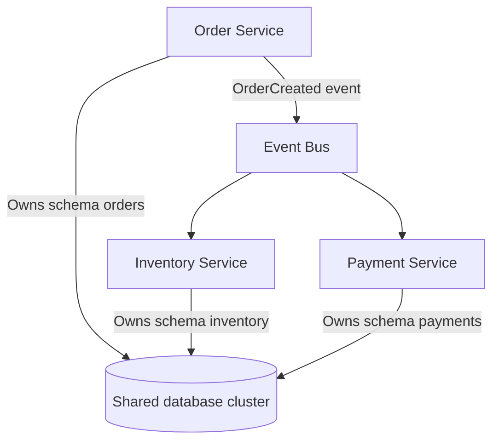
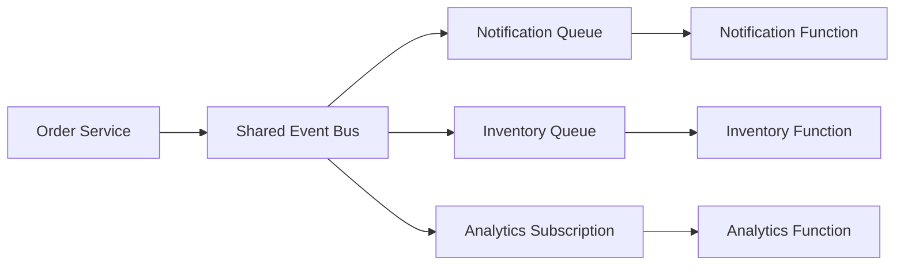
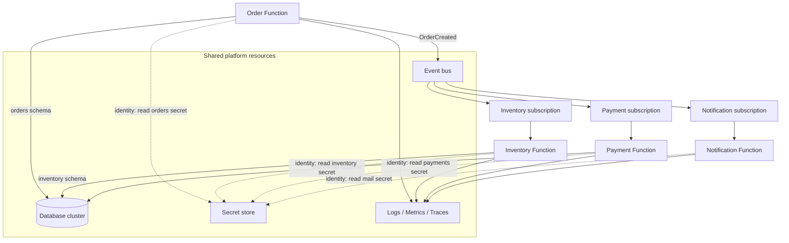

# Managing Shared Resources Across Multiple Services

In a serverless system, multiple services may share a database cluster, object storage, message broker, secret store, private network, observability platform, or third-party APIs. Sharing resources lowers costs and operational effort, yet also introduces dependencies across services. Without clear ownership, access controls, usage limits, and change procedures, one service can slow down or cause outages for the rest.

Managing shared resources means designing **sharing boundaries**: deciding which parts are shared at the infrastructure layer, which parts must stay isolated in terms of data and permissions, who owns operations, and how each service connects via configuration. For Java functions, configuration should hold endpoints or resource identifiers alongside non-sensitive options; credentials should be supplied via workload identities or a secret manager.

## 1. Which resources are commonly shared?

A serverless service does not necessarily own a dedicated physical deployment for every dependency. Multiple services can share an underlying platform or resource cluster, provided permissions and data are partitioned logically.

| Resource group | Shared examples | What must be controlled |
|---|---|---|
| Data | Database server/cluster, read replicas, data warehouse | Database/schema/table ownership, connection limits, migrations, and backups |
| Messaging | Message broker, event bus, topic namespace | Dedicated queues/subscriptions, publish/consume permissions, ordering, retention, and quotas |
| Object storage | Storage account, bucket, or container | Dedicated prefixes/buckets, IAM/RBAC, encryption, lifecycle, and data classification |
| Configuration and secrets | Parameter Store, App Configuration, Secrets Manager, Key Vault | Namespaces, read permissions, versioning, rotation, and auditing |
| Cache | Redis cluster or distributed cache | Key namespaces, TTLs, eviction, memory quotas, and invalidation |
| Network | VPC/VNet, subnets, NAT, DNS, private endpoints | Segmentation, routing, egress policies, throughput, and shared points of failure |
| Observability | Log workspace, metrics backend, tracing collector | Tenant/service labels, retention, read permissions, and ingestion quotas |
| External services | Payment gateway, email provider, identity provider | Separate credentials, rate limits, idempotency, timeouts, and circuit breakers |

"Shared" has multiple levels. Two services can share a database cluster while each owns its own database; share a bucket while each has its own prefix and policy; or share a message broker while each consumer has its own queue/subscription. Sharing compute or a control plane does not imply sharing all data and access permissions.

## 2. Define sharing boundaries before granting permissions

Before provisioning resources or configuring functions, answer four questions:

1. **Who owns the resource?** A platform team or a business service team? Who decides schemas, retention, quotas, and maintenance windows?
2. **Who is allowed to use it?** Which services may read, write, publish, consume, administer, or modify configuration?
3. **What is actually shared?** Only physical infrastructure, or also databases/schemas/topics/buckets and the data inside?
4. **What happens during failures or changes?** Will a slow consumer, a faulty migration, or a secret rotation affect other services?

A practical ownership model separates platform responsibilities from business-service responsibilities:

| Role | Primary responsibilities |
|---|---|
| Platform/resource owner | Provisioning, patching, backups, encryption, networking, capacity, infrastructure SLOs, and recovery procedures |
| Service owner | How the service uses the resource, service-owned schemas/contracts, retries, idempotency, timeouts, and data handling |
| Security/data owner | Data classification, access approval, retention, auditing, and compliance requirements |
| On-call/operations | Dashboards, alerts, runbooks, incident coordination, and escalation |

Every shared resource needs a clear owner, registered consumer services, documented purpose, data classification, SLOs, quotas, retention, and a change request process. If nobody knows who is accountable when a resource fills up or a credential leaks, that resource lacks a complete operational model.

## 3. Choosing between sharing and separating

Sharing maximizes utilization and reduces the number of managed resources. Separation improves isolation, at the expense of higher cost and more operational components. There is no universal rule that every service must share or every service must have dedicated physical resources.

| Criterion | Shared | Dedicated |
|---|---|---|
| Fixed cost | Infrastructure cost is amortized | Each service may pay for minimum baseline capacity |
| Fault isolation | One overloading service can impact others | Smaller blast radius |
| Security | Requires strict policies, namespaces, and auditing | Easier to establish isolated permission and data boundaries |
| Scaling | Services compete for shared quotas/capacity | Scales according to each service's load profile |
| Change management | Must stay compatible with all consumers | Owners can evolve more independently |
| Operations | Fewer physical resources, but requires shared governance | More resources, with clear per-service accountability |

Prefer dedicated resources when handling sensitive data or differing compliance requirements; when a service has heavy or spiky traffic; when separate maintenance schedules or retention are needed; when one service could exhaust connections, memory, or quotas; or when teams require independent administrative control. Sharing works well for smaller workloads within the same trust boundary and similar SLOs, backed by reliable partitioning and quotas.

### 3.1. Share physical infrastructure, separate logical access

A balanced pattern shares the infrastructure layer while separating logical units:

- One database cluster hosting multiple databases or schemas owned individually per service.
- One object storage bucket with separate prefixes, policies, and lifecycles per data group.
- One broker cluster with dedicated queues or topic/subscriptions per consumer.
- One shared log workspace using `service.name` and `environment` resource attributes alongside group-scoped read access.
- One cache cluster with per-service key prefixes, TTLs, and memory limits where supported by the platform.

Logical partitioning only works when access controls are enforced at the service layer. Prefixing keys with `service-a/` while granting every service read access to the entire bucket provides no real isolation.

## 4. Sharing databases without creating tight data coupling

Databases are the easiest resource to over-share. A single cluster can serve multiple services, yet services should not casually read and write across every table.

### 4.1. Separating data ownership

Each table or schema should have one service responsible for its data model and migrations. Other services access that information through the owner's APIs or event contracts rather than querying or writing directly into its internal tables.

Example:



The physical cluster is shared for operational efficiency, yet each service owns its own schema and data. When Order Service alters the `orders` schema, it does not directly modify `inventory` or `payments` schemas.

When multiple services read/write the same business table, the schema becomes an implicit contract between teams. Changing a column or data semantics can break other services with no API version or event schema warning. Share tables only within a well-defined bounded context with a clear owner and unified change process.

### 4.2. Bounding database connections from serverless

Java functions can scale out into many execution environments, each creating its own connection pool. Total approximate connections equal:

\[
\text{DB connections} \approx \text{active instances} \times \text{pool size per instance}
\]

For example, 40 instances each opening up to 10 connections can create roughly 400 connections. If the database only supports 150 connections, function scale-out can overwhelm the database even while every individual instance looks healthy.

Controls include:

- Keep pool sizes small and bounded; do not size pools solely for concurrent requests per instance.
- Reuse pools/clients across the execution environment lifecycle when supported by the library; avoid opening/closing connections on every invocation casually.
- Cap function concurrency or reserved concurrency according to database capacity.
- Use proxies/connection poolers such as RDS Proxy or PgBouncer where appropriate.
- Set connection, query, and idle timeouts; close broken connections.
- Monitor active connections, connection wait times, saturation, query latency, and active Lambda instance counts.

Never share a single singleton connection across concurrent operations if the driver or transaction model is not thread-safe. Reusing a pool/client safely is fine, while each transaction/request still requires its own connection and transaction boundary.

### 4.3. Migrations and compatibility

Migrations on a shared database must be coordinated. Apply the *expand and contract* pattern:

1. Add new columns or tables in a backward-compatible manner.
2. Deploy code capable of reading/writing both old and new structures as needed.
3. Backfill data and confirm consumers have moved to the new structure.
4. Stop using legacy fields before dropping them in a later release.

Never execute destructive migrations from every function startup. When multiple instances start concurrently, they may race or contend on migration locks. Use a controlled migration job, a dedicated pipeline step, or database-level locking.

## 5. Sharing queues, topics, and event buses

One broker can serve multiple services, but distinguish queues from topics/event buses.

- **Queues** typically deliver each message to one consumer in a competing-consumer group. If multiple services must independently receive the same event, fan out via a topic/event bus into separate queues/subscriptions.
- **Topics/event buses** allow multiple subscribers to receive the same event types under separate rules/filters. Each consumer needs dedicated permissions and appropriate retention/retry settings.
- **Streams** retain records by retention policy and track consumer group offsets. One slow consumer increases lag; size quotas and retention sufficiently for recovery.

Example event fan-out:



Do not let unrelated services poll the same queue if all of them need every message. They will compete for messages, causing one service to steal messages meant for another. Giving each consumer group its own subscription/queue lets retries, DLQs, throughput, and access permissions be managed independently.

For shared brokers, establish:

- Consistent naming and namespaces, e.g., `orders-created.v1`, `billing-events`.
- Separate publish permissions for producers and consume permissions for each subscriber.
- Message sizes, throughput, partitions, ordering keys, and retention matching requirements.
- Dedicated retry policies, visibility/lock durations, dead-letter policies, and replay procedures.
- Quotas or throughput units so one service cannot starve broker capacity.
- Event schemas/versions and compatibility processes when producers evolve payloads.

Consumers should be idempotent because retries or redeliveries can occur. A shared event bus does not mean every service may publish every event type or read all events.

## 6. Sharing object storage and caches

### 6.1. Object storage

One bucket or storage account can serve multiple services if each service has its own prefix/container and scoped permissions. For example:

```text
shared-data/
├── orders-service/
│   ├── invoices/
│   └── exports/
├── profile-service/
│   └── avatars/
└── analytics-service/
    └── reports/
```

Prefix naming alone is not enough. Enforce policies restricting `GetObject`/`PutObject` to each service's prefix, configure appropriate encryption keys, lifecycle/retention rules, and access auditing. If datasets have differing retention, encryption keys, or data residency rules, separate buckets/containers or accounts may be safer.

Do not treat object storage as a synchronous shared filesystem if multiple functions need to update the same file concurrently. Design immutable versioned objects or use a database/lock suitable for concurrent state updates.

### 6.2. Caches

Shared cache clusters reduce costs, but key collisions and noisy neighbors can occur. Every service should have an explicit key namespace—such as `orders:v2:order:123`—appropriate TTLs, and size/eviction limits. Caches should never become the primary data store without a recovery mechanism.

Define who may delete keys, flush namespaces, or change cache configuration. A single `FLUSHALL` on a shared cluster affects every service. When a service has heavy cache workloads or sensitive data, consider a dedicated instance or isolation policies.

## 7. Managing configuration and secrets for multiple services

Shared resources require configuration for endpoints, resource IDs, regions, queue names, database names, or feature flags. Separate these values from source code and manage them per environment.

### 7.1. Distinguishing configuration from secrets

| Type | Examples | Appropriate storage |
|---|---|---|
| Non-sensitive configuration | Queue URL, database host, timeout, batch size, feature flag | Environment variables, App Configuration, Parameter Store, or managed config files |
| Secrets/credentials | Password, API key, client secret, private key | Secrets Manager, Key Vault, secret store, or workload identity |
| Resource identity | ARN, resource ID, URI, database/schema name | Per-environment configuration; do not treat as credentials |

Never store secrets in Git, Docker images, JARs, event payloads, or logs. Where the platform supports workload identity, prefer granting permissions directly to the function rather than issuing long-lived access keys. When secrets are required, store them in a secret manager and grant read access only to the specific service.

### 7.2. Each service receives only the configuration it needs

Do not assemble one giant `.env` file holding endpoints and secrets for all services and mount it into every function. Each function should receive only the resource references and permissions needed for its job. This limits exposure if one service is compromised or accidentally logs its configuration.

Example environment variables for Order Worker:

```text
APP_ENV=prod
ORDERS_QUEUE_URL=https://sqs.ap-southeast-1.amazonaws.com/123456789012/orders-prod
DATABASE_SECRET_ARN=arn:aws:secretsmanager:ap-southeast-1:123456789012:secret:orders-db
CONFIG_VERSION=orders-worker-v12
```

Queue URLs and secret ARNs are resource references, not credentials. The function accesses the queue and secret via its execution role. The actual password is retrieved at runtime from the secret manager, never placed in a plain environment variable.

### 7.3. Configuration changes at runtime

Environment variables are typically loaded when the execution environment initializes. Updating app settings or deployment config causes some platforms to restart workers or spin up new instances; never assume running functions automatically pick up new values instantaneously.

For feature flags or fast-changing configuration, use a versioned config service with explicit refresh rules. Short-TTL caching reduces calls, provided you understand the maximum propagation delay before all instances observe the new configuration. For sensitive settings, caching secrets requires TTLs, rotation, and handling expired secrets.

Do not mix arbitrary configuration versions within a workflow. Log `configVersion` or a non-sensitive version identifier so you can trace which invocation ran with which configuration.

## 8. Java example: reading configuration and reusing clients safely

The following example uses AWS SDK for Java 2.x to construct an SQS client. The queue endpoint comes from an environment variable; credentials are resolved by the SDK from the execution role via the default credentials provider. The client is reused across the execution environment to avoid recreating HTTP connection pools on every invocation.

```java
import java.util.Objects;

import software.amazon.awssdk.auth.credentials.DefaultCredentialsProvider;
import software.amazon.awssdk.regions.Region;
import software.amazon.awssdk.services.sqs.SqsClient;
import software.amazon.awssdk.services.sqs.model.SendMessageRequest;

public final class SharedQueuePublisher {
    private static final String QUEUE_URL = required("ORDERS_QUEUE_URL");
    private static final Region REGION = Region.of(required("AWS_REGION"));

    // SqsClient is thread-safe; reuse the client across invocations.
    private static final SqsClient SQS = SqsClient.builder()
            .region(REGION)
            .credentialsProvider(DefaultCredentialsProvider.create())
            .build();

    public void publish(String eventJson) {
        SQS.sendMessage(SendMessageRequest.builder()
                .queueUrl(QUEUE_URL)
                .messageBody(eventJson)
                .build());
    }

    private static String required(String name) {
        return Objects.requireNonNull(
                System.getenv(name), "Missing environment variable: " + name);
    }
}
```

This is a minimal client example; production applications should manage lifecycle and close the client on environment shutdown if the framework/runtime exposes an appropriate hook. Never call `close()` after every message, as that defeats connection reuse. For FIFO queues, `messageGroupId` is required, and `messageDeduplicationId` must be supplied if content-based deduplication is not enabled on the queue.

Example reading a secret from AWS Secrets Manager using the execution role:

```java
import software.amazon.awssdk.services.secretsmanager.SecretsManagerClient;
import software.amazon.awssdk.services.secretsmanager.model.GetSecretValueRequest;

public final class DatabaseSecretProvider {
    private static final SecretsManagerClient CLIENT = SecretsManagerClient.create();

    public String loadSecret(String secretArn) {
        return CLIENT.getSecretValue(GetSecretValueRequest.builder()
                .secretId(secretArn)
                .build())
                .secretString();
    }
}
```

Do not call Secrets Manager on every query. Cache secrets with an appropriate TTL or use a provider-supported caching component; on rotation, refresh credentials and rebuild connection pools safely. Grant `secretsmanager:GetSecretValue` only for the specific secret ARN, plus minimal decrypt permissions if using a customer-managed KMS key.

## 9. Controlling noisy neighbors, quotas, and usage limits

One service may consume more resources than planned and degrade other services—commonly called the *noisy neighbor* problem.

Limits to design:

- **Database:** max connections, query timeouts, statement timeouts, and per-role/schema workload classes or quotas where supported.
- **Queue/event bus:** throughput, message size, partitions, subscriptions, max deliveries, and consumer concurrency.
- **Storage:** request rates, lifecycles, capacity quotas, and egress limits.
- **Cache:** memory quotas, key TTLs, eviction policies, and command rates.
- **External APIs:** rate limits, timeouts, retry budgets, circuit breakers, and idempotency keys.
- **Functions:** reserved concurrency, max instances, batch sizes, timeouts, and memory.

Place limits on both producers and consumers. Unbounded retries can create a load-amplifying feedback loop: a slow downstream causes functions to retry, and retries overload the queue and downstream further. Use exponential backoff with jitter, retry budgets, and DLQs; never retry non-recoverable data errors.

Monitor usage per service. Cluster-wide aggregate metrics alone hide which service is causing overload. Attach service identity or namespace tags to metrics, logs, and audit records.

## 10. Security and environment isolation

Shared resources need clear trust boundaries. A function's permissions must never grant blanket access to all data inside a resource merely because it resides in the same account or VPC.

### 10.1. Permissions by workload identity

Each service/function should have its own identity. Grant permissions tailored to exact actions and resources:

- Order Worker consumes the `orders` queue and reads the `orders` database secret.
- Notification Worker reads the `notifications` queue and calls the email provider using its own credentials.
- Analytics Function reads the `analytics` subscription and writes to `analytics` storage.

Avoid sharing one IAM role or service principal across all functions. If shared credentials leak, every service is exposed and audit logs cannot pinpoint which component acted.

### 10.2. Environment separation

Development, staging, and production should have separate resource namespaces, accounts/subscriptions, or projects aligned with risk. Never allow a dev function to write to a production queue or database just because endpoints are shared. When testing requires production-like data, use masked copies or synthetic datasets.

Never share secrets across environments. Compromised staging credentials must never open a path into production. Resource naming should clearly indicate the environment, e.g., `orders-dev`, `orders-staging`, `orders-prod`.

### 10.3. Encryption and auditing

Enable encryption at rest and TLS in transit as supported by each service. For datasets requiring separate keys, consider dedicated customer-managed keys per data domain. Audit policy changes, secret reads, sensitive data access, message replays, and retention changes.

Separate resource administrative permissions from runtime permissions. Functions usually only need data-plane permissions; they do not need permissions to create/delete queues, edit policies, or reconfigure clusters.

## 11. Updating shared resources without breaking consumers

When resource endpoints, schemas, credentials, or policies change, multiple services may be affected at once. Follow a versioned change process:

1. Identify all affected consumers and owners.
2. Communicate the change, rationale, timing, compatibility level, and rollback plan.
3. For contract changes, run the new version in parallel whenever possible.
4. Roll out consumer updates in batches while watching error rates and lag.
5. Retire the old version only after confirming zero remaining consumers.

For secret rotation, use an overlap window if supported by the service: create the new credential, update consumers, verify healthy connections, and then revoke the old credential. For endpoint migrations, maintain aliases/DNS or dual endpoints during the transition. Never rotate a secret by replacing its value instantaneously while multiple instances hold open pools without a refresh mechanism.

## 12. Observing and operating shared resources

A shared resource needs both aggregate metrics and per-consumer metrics. Dashboards should answer both "Is the resource healthy?" and "Which service is consuming it?"

| Resource | Aggregate metrics | Per-service/consumer metrics |
|---|---|---|
| Database | CPU, storage, connections, replication lag | Connection count, query latency, errors, workload/role |
| Queue/broker | Queue depth, throughput, storage, broker health | Consumer lag, message age, retries, DLQ count |
| Object storage | Request rate, errors, capacity, egress | Requests/bytes by bucket or prefix where available |
| Cache | Memory, evictions, latency, connection count | Key namespace, command rate, hit ratio per service |
| Secret/config service | Availability, throttling, request count | Access denied, refresh failures, active version |
| External API | Availability, latency, throttling | Request rate, timeouts, errors, and retries by client identity |

Each resource should have:

- Clear SLOs and alert thresholds.
- An owner and escalation/on-call channel.
- Runbooks for saturation, outages, credential rotation, and restores.
- Backup/restore tests for durable data.
- Maintenance procedures and consumer notification channels.
- Retention and auditing matching data classification.

When a shared resource degrades, you must know which services are impacted and prioritize recovery by criticality. A dashboard showing only database CPU cannot identify which consumer is generating runaway queries.

## 13. Architecture example: multi-service order platform

Suppose a system includes Order, Inventory, Payment, and Notification services sharing one database cluster, one event bus, one secret store, and one observability workspace.



In this architecture, the database cluster, event bus, secret store, and observability workspace are operated centrally. Schemas, subscriptions, secrets, and identities are separated per service. Order Service emits `OrderCreated`; each consumer receives its own copy via a dedicated subscription with independent retries and DLQs. If Payment Service experiences an outage, Notification Service can keep processing its own events.

If Payment load spikes, Payment Function's concurrency and subscription quota can be capped so it does not exhaust database connections or event bus throughput. If Payment later develops distinct compliance or SLO requirements, it can move to its own database/cluster or secret boundary without redesigning the entire event model.

## 14. Common design mistakes

| Mistake | Consequence | Fix |
|---|---|---|
| All functions share one admin credential | One leaked secret compromises every service | Dedicated identities with least-privilege per resource |
| Multiple services write directly to the same tables | Tight coupling, hard migrations, hard-to-trace data bugs | Single schema owner; communicate via APIs/events |
| Multiple consumers compete on one queue when all need the event | One consumer steals messages from another | Fan out via topic/event bus and separate queues/subscriptions |
| Unbounded connection pools | Scale-out exhausts database connections | Small pools, concurrency caps, proxies, and metrics |
| Shared cache without namespaces | Key collisions or flushes break other services | Dedicated prefixes, TTLs, quotas, and policies |
| Sharing secrets between dev and prod | Weaker environment can access production | Environment-isolated secrets and identities |
| Abrupt endpoint/secret changes | Running instances keep stale config and fail invocations | Versioning, overlap windows, refreshes, and phased rollouts |
| No per-consumer quotas or metrics | Noisy neighbors are hard to diagnose | Limits and telemetry tagged by service identity |

## 15. Shared resource design checklist

1. Which resources are physically shared and which logical boundaries must stay separated?
2. Who is the resource owner, who are the consumer owners, and who handles incidents?
3. Does each service have a distinct identity and tightly scoped permissions?
4. Do database schemas/tables, queues/subscriptions, buckets/prefixes, and cache keys have clear ownership?
5. Are connections, throughput, memory, storage, and API rates governed by per-service quotas?
6. Could function scale-out exceed database or downstream limits?
7. Is configuration separated from code, scoped by environment, and versioned?
8. Are secrets stored in a secret manager with a planned rotation process?
9. Are retries, DLQs, idempotency, and replays isolated per consumer?
10. Are migrations and contract changes backward-compatible with transition windows?
11. Do dashboards expose both aggregate metrics and per-service/consumer metrics?
12. Do backups, restores, retention, auditing, SLOs, and runbooks have clear owners?

## Conclusion

Effective shared-resource management means sharing at the right layer while keeping strict boundaries on data, permissions, quotas, and operations. A database cluster, broker, storage account, secret store, or observability platform can be shared, provided each service maintains clear ownership, identity, namespace, and limits. For Java serverless, account for scale-out creating many concurrent clients and connection pools; configure per environment, reuse clients safely, bound concurrency, and track consumption per consumer. When a resource has significantly different security, SLO, or load demands, dedicating a separate resource shrinks the blast radius and clarifies accountability.
