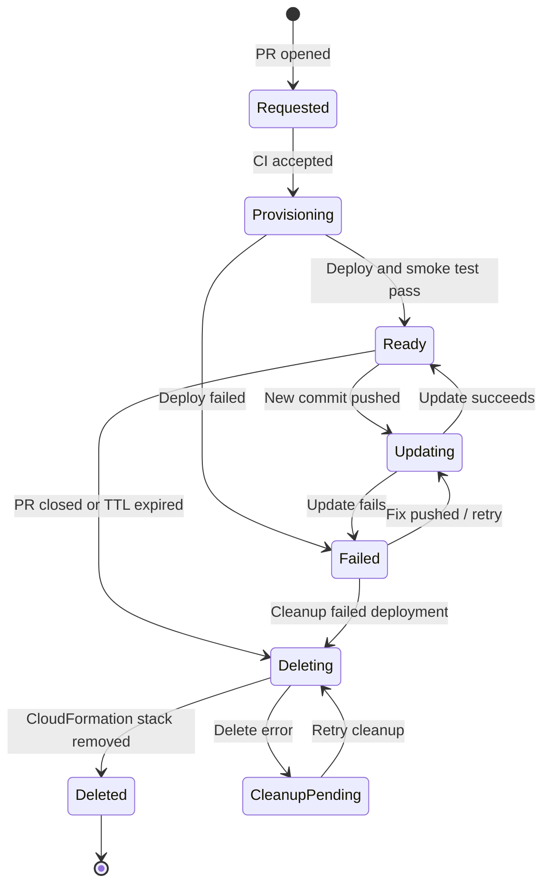

# Ephemeral Environments per Branch and Automatic Cleanup Rules

## 1. What is an ephemeral environment?

During serverless application development, a Git branch often needs to be tested independently before merging. An ephemeral environment (or preview environment) is a deployment whose lifecycle is tied to a specific branch, pull request (PR), or change. When a PR opens, the pipeline provisions infrastructure and deploys the function; when new commits arrive, the pipeline updates the environment; when the PR closes or expires, the system automatically reclaims the resources.

For example, a team develops a Java order-processing service. PR #482 adds an inventory-check endpoint. The pipeline can provision a stack `orders-preview-pr-482` containing API Gateway, Lambda, SQS, and test data tables. Reviewers hit the preview endpoint to test the new flow without impacting the shared dev environment. When the PR is merged or closed, the stack is deleted.

Ephemeral environments are especially effective in serverless because infrastructure can be described as IaC and deployed rapidly per stack. However, "ephemeral" does not mean resources vanish on their own. If a pipeline is canceled, a webhook misses delivery, or stack deletion fails, resources remain active and continue accruing cost. You must design lifecycle management, ownership, TTLs, and an independent cleanup mechanism.

## 2. Why create environments per branch or PR?

Shared environments frequently suffer from collisions: two branches may deploy different Lambda versions, overwrite environment variables, or run conflicting schema changes at the same time. A dedicated preview environment enables:

- **Isolated testing:** each PR gets its own API, functions, queues, and configuration.
- **Early review:** reviewers verify behavior against a real endpoint instead of only reading code or running locally.
- **Catching integration bugs:** tests IAM, triggers, DNS, databases, timeouts, and event contracts on AWS.
- **Reduced conflicts:** deploying one branch does not overwrite another branch's environment.
- **Architecture experimentation:** temporary resources can be spun up to measure cold starts, concurrency, or service integrations.
- **Automated lifecycle:** infrastructure is created and reclaimed alongside the PR lifecycle.

In return, each environment may create extra Lambdas, API Gateways, queues, log groups, databases, secrets, NATs, or VPC endpoints. Without caps on count and lifetime, preview environments inflate costs and consume service quotas.

## 3. Lifecycle of a preview environment

A basic lifecycle includes these states:



| Event | Action |
|---|---|
| PR opened/reopened | Create a new environment and deploy the current commit |
| Commit pushed/synchronized | Update that same PR's environment |
| Smoke test passes | Mark environment `Ready`, publish preview URL |
| Deploy fails | Record `Failed` state, retain info for debugging or clean up per policy |
| PR merged/closed | Delete the PR's stack and dedicated resources |
| Branch deleted | Can trigger fallback cleanup if no PR event arrived |
| TTL expired | Reaper discovers overdue environments and reclaims them |
| Cleanup failed | Record `CleanupPending`, alert, and retry |

Do not rely solely on `branch deleted` events. A PR can close while the branch remains; conversely, a branch can be deleted while a PR is open. The PR `closed` event is the primary cleanup signal, while a TTL reaper serves as the fallback when webhooks or workflows fail to run.

## 4. Choosing the scope of isolation

Not every resource must be created fresh per PR. Classify resources by statefulness and risk level.

| Component | Typical organization | Notes |
|---|---|---|
| Lambda function and version | Dedicated per preview stack | Avoids overwriting shared functions |
| API Gateway route/API | Dedicated per PR or shared gateway with route prefix | Shared routes require precise auth and cleanup |
| SQS queue and DLQ | Dedicated per PR | Prevents one branch's messages from entering another branch's worker |
| EventBridge rule/target | Dedicated per PR or shared bus with event namespace | Delete rules/targets during cleanup |
| DynamoDB table/database | Dedicated if independent schema/data is needed; or shared database with dedicated partition/schema | Never use production data |
| S3 bucket/objects | Dedicated bucket or dedicated prefix | Empty objects before deleting bucket if policy requires |
| Secrets Manager secret | Dedicated or shared test secret with restricted scope | Never copy production secrets into previews |
| VPC/subnets/NAT | Typically shared managed network infrastructure | Provisioning a VPC per PR is usually slow and costly |
| CloudWatch log group | Dedicated per function/stack | Set an appropriately short retention period |
| DNS/custom domain | Dedicated subdomain like `pr-482.preview.example.com` | Remove records/certificate mappings on teardown |

A preview environment should have clear data and access boundaries. Sharing a VPC or artifact bucket saves money, whereas queues, secrets, database schemas, and IAM permissions must be isolated carefully.

## 5. Stable environment and resource naming

Branch names are not always valid resource names. Branches can contain `/`, dots, Unicode characters, or long strings; AWS services enforce differing character and length constraints.

A clean convention uses the PR number as a unique identifier:

```text
Environment ID: pr-482
CloudFormation stack: orders-preview-pr-482
API hostname: pr-482.preview.example.com
Queue: orders-pr-482
DLQ: orders-pr-482-dlq
Tags:
  EnvironmentType=ephemeral
  PullRequest=482
  OwnerRepo=acme/orders-service
  CommitSha=7a4c...
```

PR numbers stay stable across the PR lifecycle and map cleanly from workflow events. If an environment per branch independent of a PR is needed, normalize the branch name into a slug and append a short hash to avoid collisions, e.g., `feature-checkout-a81f2c`.

Naming rules:

- Use only characters supported by the target service; for CloudFormation stack names, use letters, digits, and hyphens, starting with a letter.
- Bound length by the resource with the strictest character limit.
- Never put emails, usernames, or sensitive data into resource names.
- Reuse the same environment ID across the stack, queue, logs, secrets, and DNS records.
- Do not reuse an ID from a deleted environment if out-of-stack resources might still linger.
- Avoid hardcoding physical resource names when CDK/CloudFormation can generate unique names automatically.

## 6. Stamping ownership and expiration with tags

Every preview stack needs metadata identifying which PR and repository own it and when it must be deleted. Attach tags at the CloudFormation stack level and propagate them to taggable resources.

Recommended tags:

| Tag | Example | Purpose |
|---|---|---|
| `EnvironmentType` | `ephemeral` | Lets cleanup jobs identify the stack category |
| `OwnerRepo` | `acme/orders-service` | Prevents accidentally deleting stacks from another repository |
| `PullRequest` | `482` | Links the stack to its PR |
| `CommitSha` | `7a4c...` | Identifies which commit is deployed |
| `CreatedAt` | UTC ISO-8601 | Audits creation timestamp |
| `ExpiresAt` | UTC ISO-8601 | TTL for reaper reclamation |
| `OwnerTeam` | `payments-platform` | Identifies accountable team |
| `CostCenter` | `engineering` | Cost allocation |

Tags do not replace IAM permissions or access control. They are metadata for inventory, resource filtering, and cleanup. Some resources do not support tags or do not inherit stack tags; for those, record metadata in a dedicated registry or name them using the environment ID.

## 7. Creating preview stacks with AWS CDK in Java

CDK makes it straightforward to synthesize one stack per PR. The CDK app reads the environment ID from the pipeline and uses it for the stack ID/name.

```java
import software.amazon.awscdk.App;
import software.amazon.awscdk.Environment;
import software.amazon.awscdk.StackProps;
import software.amazon.awscdk.Tags;

public final class PreviewApp {
    public static void main(String[] args) {
        String previewId = requireEnv("PREVIEW_ID");
        String pullRequest = requireEnv("PULL_REQUEST_NUMBER");
        String ownerRepo = requireEnv("OWNER_REPO");
        String commitSha = requireEnv("COMMIT_SHA");
        String expiresAt = requireEnv("EXPIRES_AT");

        if (!previewId.matches("pr-[0-9]+")) {
            throw new IllegalArgumentException("Invalid PREVIEW_ID");
        }

        App app = new App();
        Environment env = Environment.builder()
                .account(System.getenv("CDK_DEFAULT_ACCOUNT"))
                .region(System.getenv("CDK_DEFAULT_REGION"))
                .build();

        PreviewStack stack = new PreviewStack(
                app,
                "OrdersPreview-" + previewId,
                StackProps.builder()
                        .env(env)
                        .stackName("orders-preview-" + previewId)
                        .build());

        Tags.of(stack).add("EnvironmentType", "ephemeral");
        Tags.of(stack).add("PullRequest", pullRequest);
        Tags.of(stack).add("OwnerRepo", ownerRepo);
        Tags.of(stack).add("CommitSha", commitSha);
        Tags.of(stack).add("ExpiresAt", expiresAt);

        app.synth();
    }

    private static String requireEnv(String name) {
        String value = System.getenv(name);
        if (value == null || value.isBlank()) {
            throw new IllegalStateException("Missing environment variable: " + name);
        }
        return value;
    }
}
```

`PreviewStack` defines the preview's API, functions, queues, and dedicated resources. The stack name is built from a validated PR number. The pipeline computes `EXPIRES_AT` in UTC and passes it before `synth`. For example, use an `ExpiresAt` tag such as `2026-11-20T12:00:00Z` so the cleanup service can parse it unambiguously.

In real environments, add tags like `OwnerTeam`, `CostCenter`, `Service`, and `EnvironmentType` to all supported resources. If the stack creates globally named resources like S3 buckets, include the account/region or a unique suffix to avoid naming collisions.

## 8. Per-environment configuration

Do not let previews and production share an entire configuration set. Each preview needs its own endpoint, queue, database namespace, and secret reference.

Example:

| Configuration | Preview PR 482 | Preview PR 483 | Production |
|---|---|---|---|
| `APP_ENV` | `preview` | `preview` | `production` |
| `PREVIEW_ID` | `pr-482` | `pr-483` | None |
| Queue | `orders-pr-482` | `orders-pr-483` | `orders-prod` |
| Database | `orders_preview_482` | `orders_preview_483` | `orders_prod` |
| Secret | `preview/orders/pr-482` | `preview/orders/pr-483` | `production/orders` |
| API host | `pr-482.preview.example.com` | `pr-483.preview.example.com` | `api.example.com` |

Manage configuration under a unified schema so the same code runs in every environment. Differences should be restricted to endpoints, resource identifiers, feature flags, and secret references; avoid creating preview-only code branches.

Never pass real secrets in PR titles, branch names, workflow outputs, or comments. Use Secrets Manager/Parameter Store with IAM permissions scoped to the preview role. If a test secret is shared across previews, ensure permissions allow only required operations and can never reach production secrets.

## 9. Isolating data and dependencies

Ephemeral environments are often built from unreviewed code. Treat all data flowing through previews as untrusted.

- Use synthetic or fixture data; never copy raw production data containing personal information.
- If production snapshots are needed for testing, run masking/anonymization before loading them into previews.
- Use dedicated databases or per-PR schema/table prefixes.
- Use dedicated queues and DLQs so messages never enter workers of another environment.
- Create dedicated buckets or prefixes and restrict IAM to exact ARNs/prefixes.
- Disable or stub payments, emails, SMS, and webhooks that cause real-world side effects.
- Use sandbox accounts/tenants provided by external vendors.
- Restrict outbound networking so preview code cannot arbitrarily call sensitive internal systems.

A shared database can save money, provided namespaces, migrations, and cleanup are isolated per PR. Never let two PRs run destructive migrations on a shared schema simultaneously. When migrations are incompatible or large data experiments are needed, a dedicated database is usually safer.

## 10. IAM permissions and security boundaries

Each preview stack should have its own execution role or a role constrained by resource naming/tags. A Lambda in PR 482 does not need access to PR 483's queues or secrets.

Principles:

- Enforce least privilege on Lambda execution roles.
- Allow functions to access only resources matching their environment ID.
- Separate the IaC deployment role from the Lambda runtime role.
- Never grant account-admin permissions to workflows executing PR code.
- Use AWS IAM Identity Center for development and OIDC federation for CI/CD instead of long-lived access keys.
- Scope OIDC trust policies to the exact repository, workflow, branch, or event claims.
- Use a separate AWS account for preview workloads when risk or resource consumption is high.
- Set service quotas, budgets, and concurrency limits so previews cannot impact production.

### Fork PRs are a critical trust boundary

Code in a pull request can modify workflows, Maven plugins, build scripts, or tests to execute arbitrary commands. If a pipeline grants a broad AWS role to untrusted code, a PR could read environment variables or use credentials to access resources.

Never grant production deployment permissions or sensitive secrets to workflows running code from forks. For public repositories, skip preview deployments for forks, run credential-free tests only, or use a strictly sandboxed account/role gated by authorized human approval. Never use `pull_request_target` to check out and execute PR code without strict controls.

## 11. Automating creation and updates in CI/CD

A preview pipeline typically triggers when a PR is opened, updated, or reopened. Each PR owns a single stack; new commits update that stack rather than creating another one.

Deployment flow:

1. Receive PR number, repository, head SHA, and branch.
2. Verify the PR belongs to a trusted repository and satisfies security checks.
3. Derive the preview ID from the PR number.
4. Compute TTL and `ExpiresAt` in UTC.
5. Build the Java artifact and run tests.
6. Synth the CDK template with the preview ID and environment config.
7. Deploy the stack into the preview account/region.
8. Run smoke tests against the endpoint.
9. Update metadata/registry and publish the preview URL to reviewers.
10. When new commits arrive, update the same stack and extend the TTL per policy.

Skeleton GitHub Actions workflow example:

```yaml
name: Preview environment

on:
  pull_request:
    types: [opened, reopened, synchronize, closed]

concurrency:
  group: preview-${{ github.event.pull_request.number }}
  cancel-in-progress: false

permissions:
  contents: read

jobs:
  build-preview:
    if: >-
      github.event.action != 'closed' &&
      github.event.pull_request.head.repo.full_name == github.repository
    runs-on: ubuntu-latest
    outputs:
      preview_id: ${{ steps.meta.outputs.preview_id }}
      expires_at: ${{ steps.ttl.outputs.expires_at }}
    steps:
      - uses: actions/checkout@v4
        with:
          ref: ${{ github.event.pull_request.head.sha }}

      - uses: actions/setup-java@v4
        with:
          distribution: temurin
          java-version: '21'

      - uses: actions/setup-node@v4
        with:
          node-version: '20'

      - name: Build and test
        run: mvn -B test package

      - name: Install pinned CDK CLI
        run: npm install --global "aws-cdk@${CDK_CLI_VERSION}"
        env:
          CDK_CLI_VERSION: ${{ vars.CDK_CLI_VERSION }}

      - name: Set preview ID
        id: meta
        env:
          PR_NUMBER: ${{ github.event.pull_request.number }}
        run: echo "preview_id=pr-${PR_NUMBER}" >> "$GITHUB_OUTPUT"

      - name: Calculate preview expiry
        id: ttl
        run: echo "expires_at=$(date -u -d '+72 hours' +'%Y-%m-%dT%H:%M:%SZ')" >> "$GITHUB_OUTPUT"

      - name: Synthesize preview stack
        env:
          PREVIEW_ID: ${{ steps.meta.outputs.preview_id }}
          PULL_REQUEST_NUMBER: ${{ github.event.pull_request.number }}
          OWNER_REPO: ${{ github.repository }}
          COMMIT_SHA: ${{ github.event.pull_request.head.sha }}
          EXPIRES_AT: ${{ steps.ttl.outputs.expires_at }}
          CDK_DEFAULT_ACCOUNT: ${{ vars.PREVIEW_AWS_ACCOUNT_ID }}
          CDK_DEFAULT_REGION: ${{ vars.AWS_REGION }}
        run: |
          cdk synth "OrdersPreview-${PREVIEW_ID}" --output cdk.out

      - uses: actions/upload-artifact@v4
        with:
          name: preview-cloud-assembly
          path: cdk.out/
          if-no-files-found: error

  deploy-preview:
    needs: build-preview
    if: >-
      github.event.action != 'closed' &&
      github.event.pull_request.head.repo.full_name == github.repository
    runs-on: ubuntu-latest
    environment: preview-sandbox
    permissions:
      actions: read
      contents: read
      id-token: write
    steps:
      - uses: actions/download-artifact@v4
        with:
          name: preview-cloud-assembly
          path: cdk.out

      - uses: actions/setup-node@v4
        with:
          node-version: '20'

      - name: Install pinned CDK CLI
        run: npm install --global "aws-cdk@${CDK_CLI_VERSION}"
        env:
          CDK_CLI_VERSION: ${{ vars.CDK_CLI_VERSION }}

      - uses: aws-actions/configure-aws-credentials@v4
        with:
          role-to-assume: ${{ vars.PREVIEW_DEPLOY_ROLE_ARN }}
          aws-region: ${{ vars.AWS_REGION }}

      - name: Deploy synthesized stack
        env:
          PREVIEW_ID: ${{ needs.build-preview.outputs.preview_id }}
        run: cdk deploy --app cdk.out "OrdersPreview-${PREVIEW_ID}" --require-approval never

  cleanup-preview:
    if: >-
      github.event.action == 'closed' &&
      github.event.pull_request.head.repo.full_name == github.repository
    runs-on: ubuntu-latest
    permissions:
      contents: read
      id-token: write
    steps:
      - uses: aws-actions/configure-aws-credentials@v4
        with:
          role-to-assume: ${{ vars.PREVIEW_CLEANUP_ROLE_ARN }}
          aws-region: ${{ vars.AWS_REGION }}

      - name: Verify ownership and delete preview stack
        env:
          PR_NUMBER: ${{ github.event.pull_request.number }}
          GITHUB_REPOSITORY: ${{ github.repository }}
        run: |
          STACK_NAME="orders-preview-pr-${PR_NUMBER}"
          STACK_JSON=$(aws cloudformation describe-stacks --stack-name "$STACK_NAME" 2>/dev/null || true)
          if [ -z "$STACK_JSON" ]; then
            echo "Preview stack already removed."
            exit 0
          fi
          ENV_TYPE=$(printf '%s' "$STACK_JSON" | jq -r '.Stacks[0].Tags[]? | select(.Key == "EnvironmentType") | .Value')
          OWNER_REPO=$(printf '%s' "$STACK_JSON" | jq -r '.Stacks[0].Tags[]? | select(.Key == "OwnerRepo") | .Value')
          if [ "$ENV_TYPE" != "ephemeral" ] || [ "$OWNER_REPO" != "$GITHUB_REPOSITORY" ]; then
            echo "Refusing to delete a stack not owned by this preview workflow."
            exit 1
          fi
          aws cloudformation delete-stack --stack-name "$STACK_NAME"
          aws cloudformation wait stack-delete-complete --stack-name "$STACK_NAME"
```

This is an illustrative skeleton with a 72-hour TTL; `CDK_CLI_VERSION`, `PREVIEW_AWS_ACCOUNT_ID`, and `AWS_REGION` are repository variables that must be defined. The CDK app must generate the matching stack ID, and the pipeline must build the module containing the function artifact before `synth`/`deploy`. Build/test/synth runs in a job without OIDC permissions; the deploy job only consumes the synthesized Cloud Assembly and assumes a role inside a protected GitHub Environment. In production, pin GitHub Actions by commit SHA, lock Node/CDK CLI versions, and add policy checks and smoke tests. The AWS OIDC trust policy must restrict the exact repository and event subject; the `head.repo.full_name` condition is only an extra filter, not a replacement for the IAM trust policy. The cleanup role should only have permissions to describe/delete preview stacks in the sandbox account and retain tag-ownership checks as shown. If `cdk synth` requires context lookups, prepare context in a trusted process or use a separate read-only lookup role; never pass deploy credentials into steps executing PR code.

If a deploy workflow runs from a PR branch, any script executed during the build can touch the job's credentials. Use only a tightly scoped sandbox role and run only for trusted contributors/repositories. For unauthorized forks, the pipeline should stop at credential-free testing.

## 12. Updating the same stack on new commits

On every push, the pipeline should redeploy using the same environment ID. CloudFormation compares the new template with the stack state and updates changed resources.

Pass the commit SHA in a tag or parameter to identify running code. The preview URL does not need to change when new commits are deployed. If smoke tests fail, keep the `Failed` status and report the failing commit; you can redeploy the prior commit or fix the PR.

Edge cases to handle:

- **Two commits deployed concurrently:** serialize deployments per PR ID so the stack does not receive simultaneous updates.
- **Deployment canceled mid-flight:** CloudFormation may continue updating; subsequent cleanup or deployments must wait for the stack to stabilize.
- **PR closed while deployment is running:** cleanup must wait for the update to finish before deleting the stack.
- **Schema changes:** migrations must stay compatible while old and new code overlap.
- **Resource replacement:** inspect CloudFormation change sets; never replace databases or stateful buckets without a plan.

Never assume canceling a CI workflow cancels the underlying CloudFormation operation. Enforce concurrency control per environment ID and check stack status before updating or deleting.

## 13. Automatic cleanup when a PR closes

The `pull_request.closed` event is the primary trigger to delete a preview stack. The cleanup job derives the exact stack name from the PR number, verifies ownership tags, and calls CloudFormation delete.

Example deletion script checking tags first:

```bash
STACK_NAME="orders-preview-pr-${PR_NUMBER}"

STACK_JSON=$(aws cloudformation describe-stacks \
  --stack-name "$STACK_NAME" 2>/dev/null || true)

if [ -z "$STACK_JSON" ]; then
  echo "Preview stack does not exist; cleanup is already complete."
  exit 0
fi

ENV_TYPE=$(printf '%s' "$STACK_JSON" | jq -r \
  '.Stacks[0].Tags[]? | select(.Key == "EnvironmentType") | .Value')
OWNER_REPO=$(printf '%s' "$STACK_JSON" | jq -r \
  '.Stacks[0].Tags[]? | select(.Key == "OwnerRepo") | .Value')

if [ "$ENV_TYPE" != "ephemeral" ] || [ "$OWNER_REPO" != "$GITHUB_REPOSITORY" ]; then
  echo "Refusing to delete a stack not owned by this preview workflow."
  exit 1
fi

aws cloudformation delete-stack --stack-name "$STACK_NAME"
aws cloudformation wait stack-delete-complete --stack-name "$STACK_NAME"
```

This script is illustrative; the job must configure `PR_NUMBER`, `GITHUB_REPOSITORY`, AWS credentials, and `jq`. If the stack does not exist, cleanup exits cleanly to support idempotent reruns. If tags do not match, the job aborts with an error instead of deleting resources with unclear ownership.

In real workflows, cleanup must run whether a PR is merged or closed without merging. You can add a `branch deleted` trigger to clean up previews lacking PR events, provided you can resolve the linked PR/stack reliably. Never pass an unsanitized branch name directly as an argument to CloudFormation commands.

## 14. TTL and cleanup reaper

Webhooks are not always delivered or processed reliably. Workflows can be deleted, tokens can expire, runners can disconnect, or PRs can go stale. A TTL (time to live) enforces a lifetime cap independent of Git events.

A policy might specify:

- **Inactivity TTL:** delete if no commits or activity occur for 48 hours.
- **Maximum lifetime:** even if the PR remains open, an environment lives at most 7 days unless renewed.
- **Grace period:** warn before deletion, e.g., 2 hours ahead.
- **Keep-alive:** accountable owners can extend lifetime through a controlled process.
- **Immediate cleanup:** delete right away when the PR closes or is canceled without waiting for TTL.

These numbers are examples. Choose TTLs based on review cycles, testing duration, and cost. Long-running integration test environments may need longer TTLs than UI previews.

A reaper is a scheduled job that scans ephemeral environments and deletes expired stacks. It can be implemented with EventBridge Scheduler invoking a cleanup Lambda, a scheduled workflow, or a centralized operations service.

Reaper workflow:

1. List active CloudFormation stacks with pagination.
2. Inspect only stacks tagged `EnvironmentType=ephemeral`.
3. Check `OwnerRepo`, `PullRequest`, and `ExpiresAt`.
4. Verify whether the PR is closed or TTL/hard maximum lifetime has expired.
5. Skip stacks currently in `CREATE_IN_PROGRESS`, `UPDATE_IN_PROGRESS`, or `DELETE_IN_PROGRESS`; record them to retry on the next run.
6. Perform a final ownership tag check before deleting.
7. Call `DeleteStack` and track the result.
8. Emit audit logs, count of deleted resources, errors, and reclaimed cost metrics.
9. Alert if cleanup fails more than the allowed retry threshold.

The reaper must have IAM permissions restricted strictly to preview stacks and never be allowed to delete production stacks. If IAM tag conditions cannot enforce everything desired, use a dedicated AWS account for ephemeral workloads and enforce tag checks in cleanup logic.

## 15. Avoid deleting environments actively in use

TTLs can expire while a reviewer is testing or presenting a demo. Use a lease/heartbeat mechanism:

- Each preview tracks `ExpiresAt` and `LastActivityAt`.
- The pipeline extends the TTL on new commits.
- Authorized users can request a time-bounded keep-alive extension.
- The reaper warns prior to deletion and skips environments holding a valid lease.
- A hard maximum lifetime still caps total lifetime so environments cannot be renewed forever.

Do not extend leases on arbitrary HTTP requests; bots or health checks would keep the environment alive indefinitely. If tracking activity, count only meaningful actions such as new commits, authenticated review actions, or explicit renewals.

A DynamoDB registry can track state:

| Field | Meaning |
|---|---|
| `environmentId` | Primary key, e.g., `pr-482` |
| `stackName` | CloudFormation stack to reclaim |
| `ownerRepo` | Owning repository |
| `pullRequest` | Associated PR |
| `commitSha` | Currently deployed commit |
| `status` | `PROVISIONING`, `READY`, `FAILED`, `DELETING`, `DELETED` |
| `createdAt` | Creation timestamp |
| `lastActivityAt` | Last accepted activity |
| `expiresAt` | Expiration timestamp |
| `leaseUntil` | End of current active lease |
| `previewUrl` | Environment URL |

A registry is useful when rendering dashboards, managing multiple accounts, or tracking resources outside CloudFormation stacks. If you only have a few simple preview stacks, stack tags may suffice with fewer moving parts.

## 16. Cleanup must be idempotent and retryable

Cleanup is also a distributed workflow. One run may delete some resources and fail on another. Operators may re-run cleanup manually; therefore, operations must be safe to repeat.

Rules:

- If the stack does not exist, treat it as already reclaimed.
- If the stack is updating, wait for it to stabilize before attempting deletion.
- If the stack is already `DELETE_IN_PROGRESS`, do not repeatedly issue delete calls.
- On `DELETE_FAILED`, inspect CloudFormation events to identify which resource blocked deletion.
- Retry throttling or transient service errors with backoff.
- Do not retry permission errors, dependency blocks, or non-empty retained resources infinitely.
- Persist `CleanupPending` state and alert when manual intervention is required.

CloudFormation deletes stack resources in dependency order. However, retained resources, out-of-stack data, or manually created resources may linger. Cleanup needs an inventory of out-of-stack artifacts, such as objects under a shared bucket prefix, externally managed DNS records, or test accounts in third-party providers.

## 17. Hard-to-reclaim resources and leftover data

Certain resources require special handling:

| Resource | Deletion risk | Rule |
|---|---|---|
| S3 bucket | Bucket still contains objects or versions | Delete objects/versions in dedicated prefix or use auto-delete only for ephemeral buckets |
| DynamoDB table | Data may be needed for investigation | Use dedicated tables and retain/backup policies as required |
| CloudWatch log group | Logs keep incurring cost after stack deletion | Set explicit retention and ensure log groups are managed by the stack |
| ECR image | Images remain after function stack deletion | Use tag/age lifecycle policies or a dedicated repository |
| Secrets Manager secret | Secrets may have a recovery window | Set deletion policy for ephemeral secrets and handle pending-deletion state |
| DNS record | Hostnames may point to deleted endpoints | Remove records on teardown or manage inside the stack |
| NAT Gateway/Elastic IP | Can be left behind and continue billing | Prefer stack-owned resources; verify status after deletion |
| Shared database schema | Schemas do not vanish when stacks are deleted | Run scoped migration/drop scripts targeting only the PR's schema |
| Queue messages | Messages linger in shared queues | Use dedicated queues or controlled purges; never purge shared queues |

For ephemeral S3 buckets, configure `RemovalPolicy.DESTROY` and `autoDeleteObjects(true)` so CDK creates a mechanism to empty objects before deleting the bucket. Use this only on buckets with disposable data; never apply it to shared buckets or retained data. Auto-delete creates a custom resource and requires extra permissions during deletion.

## 18. Resource and cost limits

Ephemeral environments are inexpensive when consisting only of Lambdas and queues, yet costs grow rapidly if every PR creates databases, NAT Gateways, or VPC endpoints. Enforce limits at both the pipeline and AWS account levels.

Controls:

- Cap the maximum number of concurrent preview environments.
- Cap function memory, timeout, and reserved concurrency.
- Use SQS to buffer test load and protect shared databases from spikes.
- Set short log retention for previews.
- Choose DynamoDB on-demand or lightweight databases when suitable; never provision production capacity per PR.
- Reuse shared managed VPC/networking whenever possible instead of creating a NAT Gateway per PR.
- Shut down or delete resources immediately after PR closure.
- Configure AWS Budgets and cost anomaly alerts for the preview account.
- Attach `CostCenter`, `OwnerRepo`, `PullRequest`, and `EnvironmentType` tags for cost attribution.
- Set service quotas and alerts for abnormal growth in Lambdas, APIs, queues, or ENIs.

Measure average cost per preview-hour and per PR. If previews live for 3 days while reviewers only test for 30 minutes, shorten the TTL or use shared environments for tests that do not need full isolation.

## 19. Networking and endpoints for preview environments

Not every preview needs a public endpoint. Three common patterns exist:

1. **Authenticated public preview:** public API Gateway requiring a JWT/authorizer or reviewer access token.
2. **Private preview:** API reachable only via VPC, VPN, or internal network; ideal for sensitive data and internal systems.
3. **Shared gateway with dedicated routes:** one shared gateway routing to each PR's function; requires exact authentication, route mapping, and cleanup.

When using custom domains, create `pr-482.preview.example.com` with a wildcard certificate for `*.preview.example.com`. DNS records must be created and deleted automatically. Using default API Gateway endpoints avoids custom DNS management, though you still need a secure way to share URLs.

Preview environments must never expose databases or admin endpoints to the public internet just for reviewer convenience. Every public endpoint must enforce authentication, rate limits, and appropriate test data.

## 20. Handling triggers and messages during teardown

Serverless environments may have event source mappings, EventBridge rules, scheduled triggers, and queues. Deleting the stack removes mappings/rules owned by the stack, yet messages sitting in queues or events already emitted to other services may still exist.

Safe design:

- Use dedicated queues per preview so messages are not picked up by other workers.
- Disable schedules before deleting resources if schedules live outside the stack.
- Delete preview-owned EventBridge rules/targets and mappings.
- Set short message retention on ephemeral queues and DLQs.
- Never emit preview events onto a production bus if consumers cannot distinguish environments.
- Include `environmentId` in event metadata and verify consumers reject preview events in production.
- Prefix idempotency keys with an environment namespace to prevent colliding with real data.

During cleanup, decide whether leftover messages should be deleted, archived, or redriven. Never purge a shared queue just because one preview closed.

## 21. Preventing race conditions between deploy and cleanup

A tricky edge case occurs when a PR closes right as a workflow is deploying a new commit. If cleanup finishes first, the in-flight deploy could recreate the stack afterward. If two deploys run concurrently, CloudFormation may fail because the stack is already updating.

To prevent this:

- Serialize operations on the same environment ID.
- Record desired state in a registry: `ACTIVE` or `DELETING`.
- Before deploying, verify the PR is still open and the environment has not transitioned to `DELETING`.
- Cleanup transitions state to `DELETING` before calling CloudFormation.
- Once a PR is closed, reject late-arriving deploy jobs.
- If a deploy is in progress, wait for CloudFormation to stabilize before deleting.
- Run a reaper to detect stacks unintentionally recreated after PR closure.

CI concurrency groups per PR reduce duplicate deploys, but cannot eliminate every race condition on their own. Canceling a CI job does not necessarily halt an already-submitted CloudFormation operation. Across multiple pipelines or repositories, a registry/lease with conditional updates provides stronger state control.

## 22. Observing and auditing preview lifecycles

A preview dashboard should display:

- PR, branch, commit SHA, and owner.
- Stack name, account, region, and preview URL.
- Deployment status and last deploy timestamp.
- `CreatedAt`, `LastActivityAt`, `ExpiresAt`, and `LeaseUntil`.
- Resource count and estimated cost per environment.
- Last cleanup attempt, CloudFormation status, and any errors.
- Reaper retry count and alert timestamps.

Cleanup logs should record `environmentId`, `stackName`, `ownerRepo`, action, actor, timestamp, outcome, and error code. Never log secrets or user data payloads.

Key metrics:

| Metric | Meaning |
|---|---|
| Preview environments active | Number of currently existing environments |
| Preview creation duration | Time from PR opened to Ready |
| Deployment failure rate | Rate of failed preview deployments |
| Expired environments | Environments past TTL awaiting deletion |
| Cleanup success/failure | Reclamation success rate |
| Orphaned resource count | Ephemeral resources lacking a matching registry/PR |
| Preview cost per hour/PR | Average cost by runtime or per PR |

Alert when environments exceed expiration grace periods, cleanup fails, or preview account spend exceeds budget. Many running previews do not reflect healthy usage if many stacks are orphaned.

## 23. Handling an orphaned environment

An orphaned environment is an ephemeral stack/resource that no longer has a valid PR or owner. The reaper detects them using the `ExpiresAt` tag, the registry, and the Git provider API.

Resolution procedure:

1. Find expired stacks with `EnvironmentType=ephemeral`.
2. Check whether the PR is still open; never rely solely on branch names.
3. Verify the owner repository and environment ID.
4. Check whether the stack is currently updating or deleting.
5. Alert if the stack holds data needing review or still has an active lease.
6. If no exceptions apply, delete the stack.
7. Inspect out-of-stack resources such as S3 prefixes, DNS records, ECR images, and schemas.
8. Log the outcome and close the registry record.
9. If deletion fails, leave the record in `CleanupPending` and open a ticket/alert.

Never delete a resource solely because its name contains `preview` or `pr-`. Always verify ownership tags and account/region. A naming pattern alone is insufficient proof for deletion.

## 24. End-to-end implementation workflow

An operational workflow can be standardized as follows:

1. **PR opened:** validate PR origin and trust conditions.
2. **Build:** run unit tests, check dependencies, and build the Java artifact.
3. **Provision:** create the stack by PR ID, attach ownership/TTL tags, and grant scoped permissions.
4. **Deploy:** provision required Lambdas, APIs, queues, database namespaces, and triggers.
5. **Verify:** run smoke tests and check auth, event processing, logs, and metrics.
6. **Publish preview URL:** post the URL for reviewers via the repository's mechanism.
7. **Update:** each commit updates the same stack, updates commit SHA, and extends TTL.
8. **Close:** merging or closing the PR transitions the environment to `DELETING`.
9. **Cleanup:** delete the stack and clearly owned out-of-stack resources.
10. **Reconcile:** reaper scans TTLs and orphans to catch missed events.
11. **Audit:** record cleanup status and results, and attribute costs.

## 25. Pre-production checklist for preview environments

- [ ] Every PR/branch has a unique environment ID and valid resource names.
- [ ] Stacks are tagged with `EnvironmentType`, `OwnerRepo`, `PullRequest`, `CommitSha`, and `ExpiresAt`.
- [ ] Pipelines create or update the same stack as the PR changes.
- [ ] Previews have a URL and appropriate authentication mechanism.
- [ ] Queues, DLQs, event rules, and database namespaces are isolated.
- [ ] Unmasked/non-anonymized production data is never used.
- [ ] Secrets and IAM roles are isolated; PR code never receives production permissions.
- [ ] Fork PRs cannot access AWS credentials or sensitive secrets.
- [ ] Deploys and cleanups are serialized by environment ID.
- [ ] Closing or merging a PR triggers cleanup immediately.
- [ ] A TTL reaper serves as an independent backup mechanism.
- [ ] Cleanup verifies ownership tags before deleting.
- [ ] Cleanup is idempotent, retryable, and reports `CleanupPending` on failure.
- [ ] Resources outside CloudFormation stacks have dedicated reclamation procedures.
- [ ] S3 buckets, logs, secrets, ECR images, DNS, and NAT gateways are not left behind.
- [ ] Concurrency, quotas, max concurrent previews, and AWS budgets are capped.
- [ ] Dashboards track active previews, expired previews, cleanup failures, and orphans.
- [ ] Tested closing a PR mid-deploy, canceling workflows, and concurrent reaper runs.

## References

- [AWS CloudFormation stack lifecycle](https://docs.aws.amazon.com/AWSCloudFormation/latest/UserGuide/stacks.html)
- [AWS CDK Developer Guide](https://docs.aws.amazon.com/cdk/v2/guide/home.html)
- [CloudFormation stack tags](https://docs.aws.amazon.com/AWSCloudFormation/latest/UserGuide/aws-properties-resource-tags.html)
- [GitHub Actions events that trigger workflows](https://docs.github.com/actions/using-workflows/events-that-trigger-workflows)
- [GitHub Actions OIDC in AWS](https://docs.github.com/actions/deployment/security-hardening-your-deployments/configuring-openid-connect-in-amazon-web-services)
- [AWS IAM best practices](https://docs.aws.amazon.com/IAM/latest/UserGuide/best-practices.html)
- [AWS Budgets](https://docs.aws.amazon.com/cost-management/latest/userguide/budgets-managing-costs.html)

## Conclusion

Preview environments tied to branches or PRs enable isolated serverless testing and let reviewers validate changes against real infrastructure. To preserve these benefits without creating orphaned resources, every environment needs a stable ID, ownership tags, isolated configuration and data, scoped deployment permissions, cleanup on PR closure, and a TTL reaper as a safety net. Cleanup must be idempotent, verify ownership, and handle race conditions with in-flight deploys. Combining IaC, CI/CD, auditing, and cost controls turns ephemeral environments into a well-governed part of the development lifecycle rather than forgotten test clutter.
