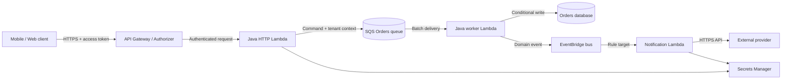
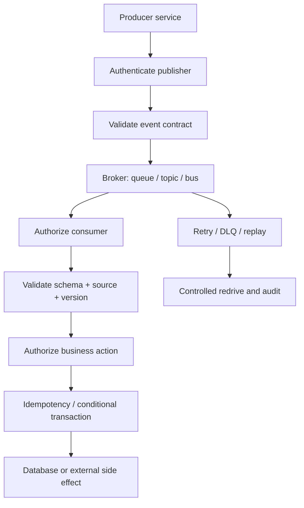

# Threat Modeling for APIs, Triggers, and Event Pipelines

Serverless applications often receive data across multiple boundaries: HTTP clients, API Gateway, Function URLs, queues, topics, event buses, object storage, schedules, and partner services. Each trigger has different authentication, delivery, retry, and access control semantics. A Java function can be legitimately invoked by multiple sources, yet the payload may still be malformed, spoofed, replayed, or contain data that causes the function to perform unintended actions.

**Threat modeling** is a systematic way to analyze assets to protect, data flows, trust boundaries, threat actors, and attack paths before an incident occurs. The output is not just a list of vulnerabilities; it is an architectural model with prioritized risks, mitigations, owners, and verification methods.

For Cloud Serverless, a threat model must cover both synchronous APIs and asynchronous pipelines. An API might authenticate users properly, but after putting a message into a queue, the consumer trusts a tenant ID sent by the client. An EventBridge rule might only accept events from an allowed source, yet the Lambda execution role still has overly broad permissions. Therefore, the same action must be traced across the producer, broker, function, database, and external systems.

## 1. What questions should a threat model answer?

A useful threat model helps the development team answer:

1. What data, resources, and actions is the system protecting?
2. Who or what component can send data into each entry point?
3. Which services, queues, functions, accounts, and network boundaries does the data cross?
4. To what extent is each component trusted, and based on what evidence?
5. Where can an attacker spoof, tamper with, replay, disclose, or exhaust resources?
6. If a function or credential is compromised, what is the maximum blast radius?
7. Which controls prevent, detect, or recover from each risk?
8. How do we test that those controls actually work?

Threat modeling should be part of design and architectural changes. Update it whenever adding triggers, exposing new endpoints, changing IAM permissions, routing events to another account, adding consumers, changing schemas, or enabling data replay.

## 2. Defining scope, assumptions, and assets

Before listing attacks, document the system being modeled. You do not need to describe the entire cloud account if a change only involves one API and one queue; however, you must include every component that can affect that data path.

### Assets to protect

| Asset group | Examples | Impact if compromised |
|---|---|---|
| User data | Profiles, addresses, order history, payment data | Privacy breach, fraud, contractual/regulatory violations |
| Business data | Orders, payments, inventory, workflow state | Corrupted state, financial loss, wrong or duplicate fulfillment |
| Credentials and secrets | API keys, database passwords, signing keys, tokens | Unauthorized access to services or data |
| Identities and permissions | IAM roles, service principals, JWT claims, tenant context | Privilege escalation, cross-tenant access |
| Events and messages | Event body, schema, event ID, queue backlog | Spoofing, data tampering, replay, or poison messages |
| Infrastructure | Functions, APIs, queues, event buses, databases, KMS keys | Execution hijacking, destruction, or disruption |
| Deployment pipeline | Source, dependencies, build artifacts, IaC, deployment roles | Shipping malicious code or altering permissions/infrastructure |
| Operational evidence | Audit logs, traces, deployment history | Inability to investigate or non-repudiation failure |

Classify data by sensitivity and retention period. Identify which data requires encryption, log redaction, export restrictions, retention-based deletion, and which services are permitted to read it. Do not put secrets inside event payloads simply because a consumer needs to authenticate to another system; the consumer should retrieve secrets from a secret manager using its own identity.

### Documenting assumptions

Examples of assumptions that must be verified:

- API Gateway validates the JWT before invoking the function; the function still must check resource-level authorization.
- The EventBridge bus only accepts events from allowed accounts or principals.
- The SQS queue has a policy restricting producers and consumers.
- The database has a tenant partition key, and every repository query enforces tenant scoping.
- CI/CD only deploys from protected branches using short-lived roles.

Unverified assumptions must be recorded as risks, not treated as existing controls. A padlock icon on an architecture diagram does not prove that a resource policy or code actually enforces that permission.

## 3. Drawing data-flow diagrams and trust boundaries

A Data-Flow Diagram (DFD) describes external entities, processes, data stores, data flows, and trust boundaries. Keep diagrams simple and focus on the paths of sensitive data and execution privileges.

Example of an order-creation API with asynchronous processing:



Trust boundaries in this example:

- **TB1 – Internet to API:** clients are untrusted; tokens, bodies, headers, and path parameters all require verification.
- **TB2 – API Gateway to Lambda:** principal/claims are verified via authorizer configuration; the function must read the exact context from the integration and must not trust client-supplied headers.
- **TB3 – Producer to queue:** messages can be redelivered; the queue policy and producer/consumer IAM determine who may send or receive.
- **TB4 – Queue to worker:** the payload is untrusted input until schema, source, and business authorization are verified.
- **TB5 – Function to database/event bus:** the execution role restricts actions and resource ARNs.
- **TB6 – Cloud account to partner:** outbound requests may leak data or be abused to call unintended destinations.
- **TB7 – Source control/build to production:** dependencies, artifacts, templates, and deployment roles are paths for introducing changes into the system.

Not every boundary is a network boundary. A queue within the same account is still a trust boundary because producers and consumers have different permissions, responsibilities, and lifecycles.

### Information to record for each data flow

Record source, destination, protocol, data type, calling identity, authentication mechanism, permissions used, encryption, reliability, delivery semantics, and error handling. For messages, record event ID, schema version, retention, retries, DLQ, and consumer group. For HTTP, record auth mechanism, rate limit, payload limit, and timeout.

## 4. Using STRIDE to identify threats

STRIDE groups threats into six categories. Use it to systematically review each process, data flow, and data store in the DFD.

| Category | Question | Serverless examples | Typical controls |
|---|---|---|---|
| **Spoofing** | Can an attacker impersonate a user, producer, or service? | Forged JWT, publishing events to a bus, sending spoofed messages | Token verification, resource policies, IAM, event signatures/sources |
| **Tampering** | Can data or configuration be modified without authorization? | Modifying `tenantId`, amount, event body, templates, or artifacts | Validation, integrity checks, immutable artifacts, least privilege |
| **Repudiation** | Can actions be denied due to missing evidence? | Missing audit logs for admin replay or refund | Audit logs, request ID, actor, timestamp, immutable retention |
| **Information Disclosure** | Can data reach unauthorized parties? | Logging tokens, broad queue policies, IDOR, cross-tenant queries | Authorization, encryption, redaction, data minimization |
| **Denial of Service** | Can concurrency, quotas, queues, or cost be exhausted? | Request floods, poison messages, retry storms, oversized payloads | Throttling, quotas, batch limits, reserved concurrency, DLQ |
| **Elevation of Privilege** | Can a component perform actions beyond its intended privileges? | Functions with `*`, confused deputy, CI role deploying to any account | IAM scoping, permission boundaries, separation of duties |

STRIDE is a threat discovery technique, not a scoring formula. A single threat can span multiple categories; for instance, a forged event is both spoofing and can cause business-logic tampering.

## 5. Threat modeling HTTP APIs and Function URLs

HTTP is a direct boundary with clients or partner systems. Having API Gateway authenticate a request does not mean the function is authorized to operate on every resource specified by the request.

### Authentication: identifying the caller

Identify whether the caller is a user, service, partner, or public client. Choose an appropriate mechanism:

- OAuth 2.0/OIDC or JWT authorizers for user/API clients.
- IAM authorization or SigV4 for service-to-service calls within AWS when appropriate.
- Mutual TLS or client certificate authentication for partners requiring transport-level identity.
- API keys primarily for consumer identification/quotas, not as a strong authentication mechanism for sensitive data.

Verify issuer, audience, expiry, signature, algorithm, and key rotation according to the authorizer mechanism. Do not manually decode a JWT and trust its claims without verifying the signature. For tokens with scopes/roles, verify the exact scope required for the endpoint.

A Function URL can use `AWS_IAM` or `NONE`. `NONE` makes the endpoint publicly accessible if no other control layer exists; you must explicitly confirm intent, rate limiting, WAF/API Gateway, or additional protections. Never enable a public Function URL for quick testing and forget to close it.

### Authorization: checking permissions per resource

After authentication, verify that the caller is authorized to perform the action on the specific resource. This is where Broken Object Level Authorization (BOLA/IDOR) vulnerabilities commonly occur.

For example, a client sends:

```http
GET /tenants/tenant-A/orders/order-123
Authorization: Bearer <token>
```

Never assume the user has access to `tenant-A` just because they supplied that ID. Tenant and subject should be extracted from verified claims or a trusted authorization context. Then the repository query must bind both the tenant and the order ID.

```java
public Order getOrder(AuthenticatedPrincipal principal, String orderId) {
    String tenantId = principal.requireTenantId();
    return orderRepository.findByTenantAndId(tenantId, orderId)
            .orElseThrow(NotFoundException::new);
}
```

`AuthenticatedPrincipal` must be constructed from context verified by the authorizer, never bound directly from the JSON body. Return `404` instead of disclosing that a resource exists in another tenant if that matches the API's anti-enumeration policy.

### Input validation and injection

All HTTP inputs are untrusted: path, query, headers, body, files, content type, and encoding. Validate schemas, enforce length/count limits, check enums/ranges, and reject disallowed fields. Use parameterized queries for SQL rather than concatenating SQL strings from input. Encode output according to context to prevent XSS in clients or dashboards. Inspect archives/file uploads to prevent path traversal, decompression bombs, and malicious files.

If a function accepts a URL to fetch data, the threat model must include SSRF: block loopback, link-local, private IP ranges, and metadata endpoints; use hostname allowlists, validate DNS/rebinding, and restrict redirects and outbound network access. Do not let clients control the full URL if the business logic only needs to select from a known provider.

### Rate limits, payloads, and timeouts

Configure throttling per API key/user/tenant/IP as appropriate, and limit body size, batch item counts, pagination sizes, and processing duration. API Gateway throttling does not replace business quotas: a single tenant can generate heavy load even while overall traffic stays within the global quota.

Set timeouts for the gateway, function, and downstream calls within an end-to-end budget. Do not let requests hold a function open waiting for long-running work; return `202 Accepted` with an operation ID and process via a queue/workflow when appropriate. Ensure client retries include an idempotency key so duplicate orders or charges are not created.

### CORS and browser security

CORS is a browser policy governing which origin's JavaScript may read a response; it is not an authentication mechanism. Configure allowlists for origins, methods, and required headers. Never use wildcard origins with credentialed requests. The API must still authenticate and authorize every request even when CORS is configured.

## 6. Threat modeling event triggers and message pipelines

Message brokers decouple producers and consumers, but introduce specific risks: events can arrive late, duplicated, out of order, be replayed, or remain in a queue longer than the code version that produced them.

### Authenticating producers and event sources

Define who is allowed to send messages to a queue/topic/event bus. Use IAM/resource policies, service principals, cross-account trusts, or broker authentication mechanisms to restrict producers. With EventBridge, restrict `PutEvents` by bus ARN and inspect source/detail-type in rules/consumers; the `source` field inside a payload does not by itself prove producer identity.

For partner webhooks, verify HMAC or asymmetric signatures per the protocol, along with timestamp, nonce, and replay window. Verify the signature against the raw body before parsing/normalizing if the protocol requires it. Rotate signing secrets and use constant-time comparison when checking MACs.

### Event payloads are not access credentials

Fields such as `userId`, `tenantId`, `role`, `isAdmin`, or `approved=true` inside a payload are not proof of authentication. A producer could have a bug or be compromised; the consumer must verify the source and authorization against trusted data. If an event represents an action already approved by another service, the consumer must trust the event-publishing contract and the producer's publish permissions, while still enforcing key invariants before side effects.

### Replay and duplicates

A legitimate event can still be dangerous when replayed. For example, processing `PaymentCaptured` twice could record two payments or trigger duplicate fulfillment. Use a stable event ID, idempotency records, and transactions to store the processing marker alongside the side effect. For operations outside the database, use downstream idempotency keys or reconciliation.

Legitimate replays can also produce unintended behavior: an EventBridge archive replaying historical events to current rules could cause consumers to resend emails or rerun payments. Classify consumers into side-effecting and rebuildable projections; provide safe replay modes, limit time ranges/scopes, and require approval for replay operations.

### Poison messages and malicious payloads

Malformed messages or messages containing extremely large payloads can cause repeated function failures, increase costs, and build up backlogs. Limit payload size, validate schema/version, bound JSON depth, and cap batch record counts. Route unprocessable messages to a DLQ after a reasonable receive count; do not infinitely retry deterministic data errors.

DLQs contain potentially sensitive data and may hold malicious payloads. Restrict who can read/redrive/delete from a DLQ, enable encryption, set retention, and audit all operations. Never perform bulk automatic redrives without first identifying the root cause and checking for duplicate side effects.

### Ordering, concurrency, and state transitions

Never assume queues/event buses guarantee global ordering. If business logic requires per-aggregate ordering, use FIFO/appropriate partitioning or include a version/sequence number in the event and check it before updating. Conditional writes/optimistic locking prevent stale events from overwriting newer state.

Concurrency can spike suddenly. Cap maximum concurrency, batch size, and downstream connections; use queues to smooth bursts. Configure visibility timeouts appropriately so messages are not redelivered while a function is still processing them. Use backoff/jitter in consumers and avoid retry storms.

## 7. Serverless-specific threats

| Threat | How it happens | Mitigation |
|---|---|---|
| Excessive function permissions | A compromised function can read/delete broad data or call unrelated services | Dedicated execution roles, narrow action/resource scopes, permission boundaries/SCPs where appropriate |
| Confused deputy | A privileged function executes requests against resources/tenants specified by the caller | Bind resources to principals, allowlists, ownership checks, avoid accepting arbitrary ARNs |
| Event source spoofing | Unintended principals publish events or invoke the function | Queue/topic/bus resource policies, Lambda resource policies, IAM conditions, and schema validation |
| Cross-tenant access | Function uses an unvalidated tenant ID from body or query | Extract tenant from trusted principal, always include tenant predicates in queries, isolation tests |
| Secret exposure | Secrets appear in env/logs/deployment outputs or are readable by other roles | Secret manager, runtime retrieval, log redaction, restrict configuration read access |
| Runtime/extension compromise | Malicious dependency or layer executes inside a privileged execution role | Dependency pinning/scanning, artifact provenance, layer allowlists, and least-privilege roles |
| Concurrency exhaustion | Request floods spawn excessive instances/connections | Throttling, reserved concurrency, queue buffering, quotas, and circuit breakers |
| Retry amplification | Downstream errors cause broker and function to retry simultaneously | Retry budgets, exponential backoff, jitter, DLQs, and concurrency caps |
| Data exfiltration | Compromised function is abused to send data to external endpoints | Egress controls, allowlists, data minimization, secret/data access monitoring |
| Function URL exposure | Public endpoint is invoked unexpectedly | Auth type, resource policies, API Gateway/WAF, throttling, and endpoint inventory |

### Confused deputy in practice

Suppose a Lambda has permission to read every object in a bucket. The API accepts `bucketName` and `key` from the client and asks the Lambda to fetch the object. An attacker changes the key to read another tenant's file. The Lambda was authenticated with a valid execution role, yet it uses its own privileges to serve an unauthorized request.

Mitigate this by not accepting arbitrary bucket/key inputs, deriving resources from the authenticated tenant, scoping IAM to required buckets/prefixes, and checking ownership in the database. If multi-tenant access is needed, isolate permissions and data architecturally instead of turning one endpoint into a broad-privilege proxy.

## 8. Threat modeling a concrete event pipeline

An event pipeline should be evaluated from publish through to side effect:



Each step needs an answer:

- Is the producer authorized to publish to the right destination?
- Can spoofed or schema-invalid events be published?
- Does the broker policy allow unintended principals?
- Can the consumer read from other queues?
- Is the payload validated before deep deserialization or calling dependencies?
- Does the consumer verify tenant/resource ownership and current state?
- Will duplicate, stale, or replayed events produce duplicate side effects?
- Does the DLQ/archive contain PII or secrets, and who has access to it?
- Are redrives approved, audited, and scoped by event type/time range?

### Example: partner webhook to queue

A partner sends a `ShipmentDelivered` webhook to an HTTP function. The function verifies the signature, timestamp, and nonce; parses the schema; checks which shipments the partner ID is allowed to send events for; and then writes the event to a queue. The worker receives the message, verifies the shipment belongs to the corresponding tenant, compares current state, and updates it via a conditional write. If the webhook is resent, the processed event ID prevents duplicate updates.

If you only verify the signature without checking authorization over the shipment, a partner with a valid identity could still submit events for another tenant's shipment. Producer authentication and action authorization are two distinct steps.

## 9. Threat modeling CI/CD pipelines and Infrastructure as Code

Deployment pipelines can modify code, IAM, API exposure, event source mappings, networking, and secret access. Therefore, CI/CD is a critical entry point into production.

### Assets and threats

| Asset | Threat | Controls |
|---|---|---|
| Source repository | Malicious commits, bypassed branch protection | Protected branches, reviews, CODEOWNERS, signed commits where needed |
| Dependencies | Package typosquatting, hijacked dependencies, vulnerable versions | Lockfiles, version pinning, dependency scanning, allowlists/provenance |
| Build runner | Compromised runner stealing credentials or tampering with artifacts | Isolated runners, short-lived credentials, never run untrusted PRs with secrets |
| Artifacts | Artifact swapped after testing or rebuilt differently from source | Immutable artifacts, checksums/signatures, provenance, and promoting the same artifact |
| IaC templates | Public endpoints, wildcard IAM, encryption disabled | IaC linting/security scanning, policy-as-code, change set reviews |
| Deployment role | Role has admin rights or deploys to any account | Short-lived OIDC/assume-role, account/stack scoping, separation of duties |
| Pipeline secrets | Credentials printed to logs or stored in configs | Secret managers, masking, short-lived credentials, log redaction |
| Production approval | One person modifies and deploys sensitive changes alone | Risk-based approvals, auditing, and separated duties |

### Controls for AWS SAM/CloudFormation

- Use short-lived IAM roles via OIDC or role assumption; avoid long-lived access keys in CI.
- Separate build/test roles from production deployment roles.
- Scan templates before deployment to catch public APIs, wildcard resources, broad role trusts, unencrypted buckets, or improper log retention.
- Review CloudFormation change sets, especially resource replacements/deletions, IAM changes, and event source changes.
- Do not allow pull requests from forks to execute scripts with access to production secrets.
- Pin versions of the SAM CLI, build images, Maven plugins, and dependencies.
- Retain built and tested artifacts; promote the exact same artifact across environments.
- Record commit SHA, artifact digest, stack, deployer principal, and change set ID.

A well-protected pipeline can still deploy misconfigurations. IaC scanning is one detection layer; you must still test runtime permissions and verify post-deployment state.

## 10. Risk assessment and prioritization

Not every threat requires the same treatment. Assess threats by likelihood and impact while considering exploitability, blast radius, and detectability.

A simple scoring scale you can use:

| Score | Likelihood | Impact |
|---|---|---|
| 1 | Unlikely, requires many preconditions | Minor impact, easy to recover |
| 2 | Possible, but requires additional privileges/conditions | Limited to a single feature or small group |
| 3 | Realistic exploit path exists | Affects critical data or services |
| 4 | Easy to exploit or frequently targeted | Significant leakage/disruption, multi-tenant impact |
| 5 | Broadly exploitable or active indicators exist | Severe damage, takeover, or major data loss |

You can calculate `Risk = Likelihood × Impact` for initial sorting, but do not treat the score as absolute truth. A very high-impact risk such as reading production secrets may still require controls even if likelihood is low. Record residual risk after applying mitigations.

### Example risk register

| ID | Threat scenario | Likelihood | Impact | Primary controls | Residual risk |
|---|---|---:|---:|---|---|
| R1 | User reads another tenant's order via IDOR | 3 | 5 | Tenant extracted from verified claims; repository queries include tenant predicate; authorization tests | Low if all read paths enforce it |
| R2 | Replayed `PaymentCaptured` event causes duplicate recording | 4 | 5 | Domain event ID, unique inbox key, transaction, downstream idempotency | Low if external API supports keys |
| R3 | Function is compromised and reads entire bucket | 3 | 5 | Bucket/prefix-scoped role, resource policy, data access alerts | Medium if function still needs broad data reads |
| R4 | Poison messages grow backlog and cost | 4 | 3 | Schema validation, receive limit, DLQ, batch cap, alarms | Low to medium |
| R5 | Malicious CI dependency gets deployed | 2 | 5 | Lockfiles, scanning, provenance, reviews, and narrow deploy role | Medium; requires supply-chain monitoring |

A risk register should include owner, due date, status, control evidence, and risk acceptance decisions. Accepted risks require sign-off from an authorized owner, a review expiration date, and conditions that trigger re-evaluation.

## 11. Layered security controls

### Identity and access management

- Use a dedicated identity per function or per group of functions sharing the same responsibility.
- Restrict IAM actions and resource ARNs; avoid wildcards whenever resources can be identified.
- Use resource policies to restrict who can invoke functions, publish to topics, or send to queues.
- Separate deployment permissions from runtime permissions; separate DLQ/replay administration permissions from normal message processing permissions.
- Use temporary credentials and secret managers; rotate keys/certificates.
- Review role trust policies, cross-account permissions, and service principal conditions.

### Data protection

- Encrypt in transit with TLS; encrypt at rest using database, queue, object store, and KMS mechanisms.
- Limit payloads following data minimization; send only fields the consumer needs.
- Never log tokens, secrets, full payment data, or sensitive payloads.
- Use field-level encryption/tokenization if data must remain protected even when storage is read.
- Set retention, backup, deletion, and archive policies aligned with data classification.

### Application controls

- Validate schemas and business invariants in consumers, not only at the API gateway.
- Use parameterized queries, output encoding, URL/host allowlists, and safe file handling.
- Enforce authorization per resource and per tenant.
- Use idempotency, conditional writes, optimistic locking, and outbox/inbox patterns.
- Bound payload size, batch size, concurrency, timeouts, and retry budgets.
- Use circuit breakers or bulkheads when downstream dependencies are unstable.

### Network controls

- Use private endpoints/VPC integration when network isolation is required.
- Restrict outbound egress to required destinations where the architecture supports it.
- Block functions from reaching metadata endpoints or internal networks via client-controlled URLs.
- Separate public ingress from private services and databases.
- Use WAF/API Gateway throttling appropriate for HTTP exposure.

### Detection and response

- Enable audit logs for IAM, policy, API exposure, event rule, and deployment changes.
- Monitor auth failures, unusual publish rates, DLQ growth, replays, throttling, and anomalous secret access.
- Include correlation ID, event ID, function request ID, and actor in sanitized logs/traces.
- Maintain runbooks to block producers, disable rules, revoke credentials, quarantine queues, or roll back deployments.
- Test incident response procedures and retain evidence according to retention policies.

## 12. Java: validating event envelopes and bounding data

Consumers should parse envelopes against a controlled schema, verify event type/version, and bound data before invoking business logic. The following example illustrates part of that validation; publish-source authentication must still be enforced via IAM/resource policies or transport-level signatures.

```java
import java.time.Instant;
import java.util.Set;

public record DomainEvent<T>(
        String eventId,
        String eventType,
        int schemaVersion,
        Instant occurredAt,
        String tenantId,
        T data) {}

public final class OrderEventValidator {
    private static final Set<String> ALLOWED_TYPES =
            Set.of("OrderCreated", "OrderCancelled");
    private static final int MAX_SCHEMA_VERSION = 2;

    public static void validate(DomainEvent<?> event) {
        if (event == null
                || event.eventId() == null || event.eventId().isBlank()
                || event.eventId().length() > 128) {
            throw new IllegalArgumentException("Invalid event ID");
        }
        if (!ALLOWED_TYPES.contains(event.eventType())) {
            throw new IllegalArgumentException("Unsupported event type");
        }
        if (event.schemaVersion() < 1
                || event.schemaVersion() > MAX_SCHEMA_VERSION) {
            throw new IllegalArgumentException("Unsupported schema version");
        }
        if (event.occurredAt() == null || event.tenantId() == null
                || event.tenantId().isBlank()) {
            throw new IllegalArgumentException("Missing event metadata");
        }
    }

    private OrderEventValidator() {}
}
```

Schema validation only checks structure and value domains. The consumer must still verify that the event came from an authorized producer, that the tenant is permitted to perform the action, and that the aggregate state remains valid. Do not trust `tenantId` in the payload as a credential; treat it as an attribute to cross-check against the producer contract and ownership data.

## 13. Java: idempotent consumer inside a transaction

An inbox pattern stores `(consumerName, eventId)` with a unique constraint. When an event has already been processed, the consumer returns success without repeating side effects. Write the inbox entry and business changes in the same transaction to avoid a "marked processed without executing" state.

```java
public interface OrderEventRepository {
    /** Execute all operations atomically in one database transaction. */
    boolean applyOnce(String consumerName, String eventId, OrderEvent event);
}

public final class OrderEventConsumer {
    private final OrderEventRepository repository;

    public OrderEventConsumer(OrderEventRepository repository) {
        this.repository = repository;
    }

    public void handle(OrderEvent event) {
        OrderEventValidator.validate(event);
        repository.applyOnce("order-projection", event.eventId(), event);
    }
}
```

`applyOnce` is a contract that must be backed by a real transaction/unique constraint, not `if (exists) return` followed by an insert in two separate statements. Two concurrent Lambda invocations could both observe "not found"; a unique constraint or conditional write is the final safeguard.

If the side effect calls a payment provider, sends email, or writes to a different database, a local transaction cannot span everything. Use downstream idempotency keys, outbox patterns, workflow state, and corresponding reconciliation/compensation.

## 14. Logging, auditing, and privacy

Logs must contain enough information to answer who called what, when, through which trigger, and with what outcome, without containing unnecessary sensitive data.

A log record may contain:

```json
{
  "timestamp": "2026-11-17T12:00:00Z",
  "service": "order-worker",
  "functionRequestId": "lambda-request-id",
  "correlationId": "flow-77",
  "eventId": "evt-01J9Q7M2",
  "tenantRef": "tenant-hash",
  "action": "apply-order-event",
  "outcome": "accepted",
  "durationMs": 42
}
```

Never log access tokens, API keys, passwords, private keys, full card data, or unsanitized raw bodies. Avoid logging email/phone/address unless required for investigation. When linking to a tenant/user is needed, use internal IDs or pseudonymous references and restrict log access.

Audit logs differ from application logs: audit logs require actor, action, target resource, timestamp, result, and request origin; they need appropriate retention/integrity controls and must not be freely modifiable/deletable by business functions. Sensitive operations such as DLQ replays, IAM role changes, disabling security rules, or manual refunds require dedicated auditing.

## 15. Testing the threat model

A threat model is only useful when controls are tested. Combine multiple testing layers:

| Test type | Objective | Example |
|---|---|---|
| Unit tests | Validation and authorization logic | Tenant A cannot read Tenant B's order |
| Contract tests | Schema/version compatibility | Consumer rejects unsupported event type/version |
| Integration tests | IAM, resource policies, and trigger behavior | Principals outside the allowlist cannot publish to queue |
| Security tests | API and input attacks | IDOR, injection, oversized payloads, SSRF |
| Resilience tests | Retries, duplicates, timeouts, and poison messages | Processing an event twice produces only one side effect |
| Load/abuse tests | Quotas, concurrency, and cost | Burst requests do not exhaust database connections |
| IaC/pipeline tests | Permissions and deployment configuration | Templates do not open unintended public endpoints |
| Incident exercises | Detection/response capability | Quarantine queue, revoke credentials, and safe redrive |

Test boundary failure cases: function commits to the database then drops the response; message is redelivered; EventBridge replays old events; consumer receives an unsupported newer schema; DLQ grows; role is narrowed; secret is rotated; deployment modifies resource policies. These scenarios are easily missed when testing only the happy path.

## 16. Running threat modeling within a sprint

A lightweight workflow can be completed in the following steps:

1. **Lock scope:** identify relevant APIs, functions, event sources, data stores, accounts, and pipelines.
2. **List assets:** classify data, credentials, permissions, and business actions.
3. **Draw DFD:** mark external entities, processes, data stores, data flows, and trust boundaries.
4. **Enumerate threats:** apply STRIDE across each boundary and data flow; add business abuse cases.
5. **Estimate risk:** assess likelihood, impact, blast radius, and detectability.
6. **Select controls:** prioritize prevention at the right boundary, then add detection and recovery.
7. **Assign owners:** every mitigation has an owner, due date, and verification evidence.
8. **Write tests:** turn key threats into unit/integration/security/resilience tests.
9. **Review on change:** update whenever adding triggers, consumers, permissions, event schemas, or deployment paths.

Not every review needs to become a lengthy document. For small changes, update the DFD and a short risk register. For payments, sensitive data, cross-account flows, public APIs, or administrative privileges, perform deeper analysis and independent review.

## 17. Threat register template

Use the following template for each threat:

| Field | Information to record |
|---|---|
| Threat ID | Unique identifier, e.g., `API-03` |
| Asset | Data/action to protect |
| Entry point / boundary | API, queue, event bus, CI runner, or network boundary |
| Threat scenario | What the attacker does, with what privileges, through which steps |
| STRIDE | Relevant threat category |
| Preconditions | Conditions required for exploitation |
| Likelihood / Impact | Scores and rationale |
| Existing controls | Implemented mitigations and evidence |
| Mitigation | Changes to implement |
| Detection / response | Metrics, alerts, logs, and runbooks |
| Owner / due date | Responsible owner and target date |
| Residual risk | Remaining risk and risk acceptor |
| Verification | Tests or evidence upon completion |

## 18. Threat model checklist for APIs, triggers, and event pipelines

### Architecture and assets

- [ ] Sensitive data, secrets, identities, resources, and business actions are listed.
- [ ] DFD includes external entities, processes, data stores, data flows, and trust boundaries.
- [ ] Protocol, principal, permissions, payload, encryption, and delivery semantics are documented per flow.
- [ ] Assumptions about authorizers, IAM, resource policies, networking, and consumers are verified.

### APIs and HTTP triggers

- [ ] Authentication verifies issuer, audience, signature, expiry, and scopes.
- [ ] Authorization checks permissions per resource and per tenant.
- [ ] Tenant/principal context comes from verified sources, not arbitrary body/headers.
- [ ] Input schemas, payload sizes, pagination, files, and content types are bounded.
- [ ] SQL/command/HTML/URL inputs are handled to prevent injection, XSS, and SSRF.
- [ ] Rate limits, timeouts, quotas, and idempotency exist for write operations.
- [ ] CORS is not treated as authentication; Function URL exposure has been reviewed.

### Event and message pipelines

- [ ] Only authorized producers can publish to queues/topics/event buses.
- [ ] Consumers verify schema, event type/version, tenant, and business authorization.
- [ ] Stable event IDs, idempotency, and conditional writes prevent duplicates/replays.
- [ ] Retries are bounded with backoff/jitter, DLQs, and redrive procedures.
- [ ] Archives/replays do not accidentally re-trigger dangerous side effects.
- [ ] Batch sizes, visibility timeouts, ordering, and concurrency match downstream capacity.
- [ ] DLQs/archives are encrypted, access-restricted, and have retention/auditing.

### Serverless identity and infrastructure

- [ ] Each function has a least-privilege execution role matching its responsibility.
- [ ] Resource policies, cross-account trusts, and Lambda invoke permissions are restricted.
- [ ] No confused deputy paths exist for caller-controlled resource ARNs, tenants, or URLs.
- [ ] Secrets live in a secret manager; tokens/secrets never appear in logs or payloads.
- [ ] Egress, private endpoints, VPC, WAF, and network paths match the threat model.
- [ ] Concurrency, quotas, retry budgets, and cost alarms protect against DoS/anomalous spend.

### CI/CD and operations

- [ ] Source, dependencies, runners, and artifacts have integrity/provenance controls.
- [ ] Deployment roles are short-lived, narrowly scoped, and separated from runtime roles.
- [ ] IaC is linted/scanned/reviewed; CloudFormation change sets are inspected.
- [ ] Logs/audits trace actors, events, functions, and deployments with proper redaction.
- [ ] Alerts and runbooks exist for auth failures, unusual publishes, DLQs, replays, and secret access.
- [ ] Key threats are converted into tests and residual risks have assigned owners.

Threat modeling for serverless must follow data across its entire lifecycle: from API or trigger, through brokers, to functions and side effects. STRIDE helps discover threat categories; DFDs clarify trust boundaries; risk registers help prioritize; and tests prove controls work. By combining authentication, per-tenant/per-resource authorization, least-privilege IAM, idempotency, DLQs, pipeline protection, and observability, teams can significantly reduce the risks of event spoofing, cross-tenant access, replays, secret leaks, privilege escalation, and denial of service.
