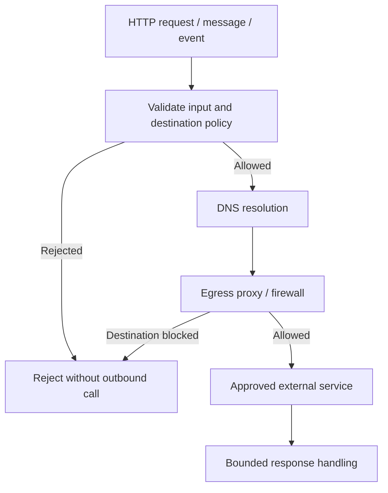

# Preventing SSRF When Functions Call External Services

A Java serverless function often calls partner APIs, downloads images, fetches content from URLs, dispatches webhooks, or accesses internal services. If an incoming request can dictate the target URL, an attacker may trick the function into sending a request to an address that ordinary users cannot reach. This vulnerability is called **Server-Side Request Forgery (SSRF)**.

SSRF is particularly noteworthy in serverless architectures because functions typically have network access and a cloud identity to read secrets, write to databases, publish messages, or invoke other services. An endpoint that looks like it merely "downloads an image from a URL" can become a pivot point to probe internal networks or access metadata services.

Preventing SSRF requires multiple layers: avoiding arbitrary URLs, allowing only approved destinations, controlling redirects and DNS, restricting egress at the network layer, narrowing IAM permissions, and bounding response data. This lesson focuses on those controls in Java serverless applications triggered by HTTP, messages, or events.

## 1. What is SSRF?

SSRF occurs when a server-side application initiates a request to an address controlled by a user or an untrusted data source. An attacker does not need direct connectivity to internal systems; they leverage the function's network privileges as an intermediary.

For example, an API receives a request:

```http
POST /preview
Content-Type: application/json

{
  "url": "https://images.example.net/photo.png"
}
```

The function fetches the URL content and generates a thumbnail. If the handler accepts any URL, an attacker can substitute an internal address:

```text
http://127.0.0.1:8080/admin
http://169.254.169.254/
http://10.0.4.12:9000/internal
```

The function can send the request using its own network privileges. If the target returns data, the application might inadvertently include that data in a response, log, object storage, or another system.

### SSRF is not just about reading responses

Two common forms exist:

- **Basic SSRF (with response):** the attacker can observe response contents or status codes.
- **Blind SSRF:** the attacker cannot read the response, but can infer outcomes via timing, errors, callbacks, or side effects on the target system.

Blind SSRF can still be dangerous. A request to an internal service can trigger actions, create records, send emails, or leak information through side channels.

## 2. Why serverless functions need SSRF protection

Functions typically run in environments granted privileges to perform business work. Depending on deployment, a function may:

- Access databases inside a VPC or private network.
- Call internal APIs not exposed to the public Internet.
- Read secrets using a runtime service account or execution role.
- Access object storage, queues, event buses, and cloud services.
- Reach metadata services or credential-issuing endpoints in some environments.
- Scale out into many instances, allowing a single vulnerability to generate high request volume.

An untrusted inbound HTTP request can trigger SSRF directly. In message- or event-driven functions, a malicious URL can also be stored in a queue or database and processed later. This is **second-order SSRF**: the initial data is merely persisted, and the vulnerability triggers when a worker uses that URL later.

For example:

1. An HTTP API receives a URL from a user and writes it to an `import_jobs` table.
2. A queue emits an event announcing a new job.
3. A Java worker reads the URL and fetches the content.
4. If the worker does not re-validate the destination, a malicious payload can reach internal networks.

Never assume data in a queue is trustworthy just because another service sent it. Identify the origin, schema, and trust boundary of each field.

## 3. Common scenarios that introduce SSRF

| Feature | Attacker-controlled data | Risk |
|---|---|---|
| Import image from URL | Image URL | Calling localhost, private IPs, or metadata endpoints |
| Generate link preview | Web page URL | Reading internal dashboards or APIs |
| PDF generator | Page URL to render | Browser/headless renderer accessing internal networks |
| Webhook tester | Callback URL | Sending requests to internal services |
| URL redirect checker | URL to inspect | Port scanning and probing internal addresses |
| Proxy or fetch API | Target URL | Becoming an open proxy or SSRF gateway |
| Event-driven importer | URL inside message | Delayed SSRF occurring inside the worker |
| Load schema or config file | Tenant-supplied URL | Reading resources outside permitted scope |

Not every URL field is dangerous. Risk arises when the server uses an untrusted value to determine the host, port, scheme, redirects, or target network address.

## 4. Trust boundaries of an outbound request

When a function calls an external service, distinguish the following components:

- **Caller:** user, service, or producer generating the request/event.
- **Input:** URL, hostname, path, header, or identifier passed in.
- **Java function:** validates the data and decides whether to send the request.
- **DNS:** resolves a hostname to IP addresses.
- **Network path:** routes, proxies, NAT, VPCs, and firewalls.
- **Destination:** partner API, origin, or internal service.
- **Response:** data received by the function and potentially forwarded.

Checking at one layer does not replace controls at another layer. For example, a hostname allowlist enforces destination naming per application policy, while an egress firewall limits which addresses connections can actually reach. IAM reduces blast radius if a request still reaches a cloud service.



## 5. Best control: do not accept arbitrary URLs

If the business logic only needs to call one of a few known partners, accept a **service identifier** instead of a URL.

For example, instead of:

```json
{
  "targetUrl": "https://some-host.example/path"
}
```

accept:

```json
{
  "provider": "PAYMENT_PARTNER",
  "operation": "VERIFY_TRANSACTION",
  "transactionId": "txn-1842"
}
```

The backend maps the provider and operation to a configured endpoint:

```java
public enum PartnerOperation {
    VERIFY_TRANSACTION,
    GET_CUSTOMER_STATUS
}

public final class PartnerEndpoints {

    private static final URI PAYMENT_BASE =
            URI.create("https://api.payment.example");

    private PartnerEndpoints() {}

    public static URI endpoint(PartnerOperation operation) {
        return switch (operation) {
            case VERIFY_TRANSACTION ->
                    PAYMENT_BASE.resolve("/v1/transactions/verify");
            case GET_CUSTOMER_STATUS ->
                    PAYMENT_BASE.resolve("/v1/customers/status");
        };
    }
}
```

The client can only select an operation supported by the application. The caller cannot alter the host or scheme. Data such as transactionId is sent in the body or encoded query parameters per the API contract.

This is the preferred choice for payment, identity, notification, inventory, and integrations with fixed endpoints.

### Endpoint configuration must come from a trusted source

If endpoints vary by environment, they can be read from environment variables or a config service. However, end users must never have permission to modify that configuration through ordinary requests. Validate endpoints at startup and restrict hosts, schemes, and ports according to approved policy.

Do not allow tenants to configure arbitrary URLs if the function has access to internal networks. If the business genuinely requires customer-defined destinations, design a dedicated domain registration flow with ownership verification, allowlists, an egress proxy, and explicit restriction policies.

## 6. Allow only approved schemes, hosts, and ports

If the application must accept URLs, parse them with URI and validate each component. Do not validate using substring checks such as `url.contains("partner.example")` or `url.startsWith("https://partner.example")`.

Baseline checks:

1. Allow only `https` unless the business case specifically requires HTTP.
2. Host must be present and match the allowlist exactly.
3. Allow only expected ports, typically 443 for HTTPS.
4. Reject user-info such as `user:password@`.
5. Reject fragments and unnecessary components.
6. Restrict paths per the API contract if the path is also influenced by input.
7. Reject IP literals if the business only permits hostnames.
8. Normalize hostnames and handle IDNs consistently before comparison.

Examples of URLs that easily fool string checks:

```text
https://partner.example.attacker.invalid/
https://partner.example@127.0.0.1/
https://attacker.invalid/?next=https://partner.example/
http://partner.example:8080/
```

The actual host of the second URL is `127.0.0.1`, while `partner.example` is merely user-info. Use a parser and compare the host, scheme, and port fields; never infer from the prefix of the string.

### Hostname allowlists must compare on exact boundaries

If subdomains are permitted, the condition should be:

```java
boolean isAllowedSubdomain(String host, String domain) {
    return host.equals(domain)
            || host.endsWith("." + domain);
}
```

Do not use `host.endsWith("example.com")` because it also matches `evil-example.com`. Even so, wildcard subdomains are only safe if the organization controls every permitted subdomain. A hijacked or user-created subdomain can become an SSRF target.

For fixed integrations, exact hostname allowlists are easier to govern than wildcards.

## 7. Java example: calling a fixed endpoint with redirects disabled

The following example uses JDK HttpClient. The endpoint comes from trusted deployment configuration and is validated on initialization. The caller only supplies business data, never a URL.

```java
import java.io.IOException;
import java.net.URI;
import java.net.http.HttpClient;
import java.net.http.HttpRequest;
import java.net.http.HttpResponse;
import java.time.Duration;
import java.util.Locale;
import java.util.Set;

public final class PartnerClient {

    private static final Set<String> ALLOWED_HOSTS =
            Set.of("api.payment.example");

    private static final URI ENDPOINT = loadEndpoint();

    private static final HttpClient HTTP = HttpClient.newBuilder()
            .connectTimeout(Duration.ofSeconds(2))
            .followRedirects(HttpClient.Redirect.NEVER)
            .build();

    private PartnerClient() {}

    private static URI loadEndpoint() {
        String configured = System.getenv("PAYMENT_VERIFY_URL");
        if (configured == null || configured.isBlank()) {
            throw new IllegalStateException(
                    "Missing PAYMENT_VERIFY_URL");
        }

        URI uri = URI.create(configured);
        String host = uri.getHost();

        boolean valid =
                "https".equalsIgnoreCase(uri.getScheme())
                && host != null
                && ALLOWED_HOSTS.contains(
                        host.toLowerCase(Locale.ROOT))
                && uri.getRawUserInfo() == null
                && uri.getRawFragment() == null
                && uri.getRawQuery() == null
                && (uri.getPort() == -1 || uri.getPort() == 443)
                && "/v1/transactions/verify".equals(uri.getRawPath());

        if (!valid) {
            throw new IllegalStateException(
                    "PAYMENT_VERIFY_URL violates outbound URL policy");
        }

        return uri;
    }

    public static HttpResponse<String> verify(String jsonBody)
            throws IOException, InterruptedException {

        HttpRequest request = HttpRequest.newBuilder(ENDPOINT)
                .timeout(Duration.ofSeconds(4))
                .header("Content-Type", "application/json")
                .header("Accept", "application/json")
                .POST(HttpRequest.BodyPublishers.ofString(jsonBody))
                .build();

        HttpResponse<String> response = HTTP.send(
                request,
                HttpResponse.BodyHandlers.ofString());

        if (response.statusCode() >= 300
                && response.statusCode() < 400) {
            throw new IllegalStateException(
                    "Partner redirect is not permitted");
        }

        if (response.statusCode() < 200
                || response.statusCode() >= 300) {
            throw new IllegalStateException(
                    "Partner API returned HTTP "
                            + response.statusCode());
        }

        return response;
    }
}
```

This example demonstrates key principles:

- The URL comes from deployment configuration and is validated at initialization.
- Host, scheme, port, and path are constrained.
- User-info, unexpected queries, and fragments outside the contract are rejected.
- Redirects are disabled.
- Connect timeout and request timeout are explicitly configured.
- The caller cannot alter the endpoint via method parameters.

In production applications, serialize JSON using a library such as Jackson rather than manual string concatenation; enforce request/response size limits; handle errors per contract; and avoid logging untrusted response bodies. The example uses `BodyHandlers.ofString()` for illustration with a known partner API; for large or untrusted responses, read via streaming with a byte limit and appropriate read timeouts.

Hostname allowlist code alone does not solve DNS rebinding or block all private addresses. Pair it with network-layer egress controls or an outbound proxy as covered in the following sections.

## 8. Blocking internal and special-use IP addresses

If an application must fetch external URLs, prevent requests to disallowed addresses. Address ranges to watch carefully:

### IPv4

- Loopback: `127.0.0.0/8`.
- Private RFC 1918: `10.0.0.0/8`, `172.16.0.0/12`, `192.168.0.0/16`.
- Link-local: `169.254.0.0/16`.
- Unspecified: `0.0.0.0/8` and corresponding unspecified addresses.
- Multicast: `224.0.0.0/4`.
- Broadcast, documentation, benchmarking, and other special-use ranges per current registries.

### IPv6

- Loopback: `::1`.
- Unspecified: `::`.
- Link-local: `fe80::/10`.
- Unique local: `fc00::/7`.
- Multicast: `ff00::/8`.
- IPv4-mapped IPv6 and other special-use ranges.

Beyond those ranges, block platform-specific internal endpoints, VPC CIDRs, service meshes, Kubernetes service CIDRs, and administrative addresses in your actual architecture.

Do not merely block RFC 1918 and allow everything else. Non-public unicast ranges can cause unexpected behavior; the allow/deny list must align with your organization's egress policy and special-use address registries.

### Checking only the hostname is insufficient

A public hostname can resolve to multiple A/AAAA records. If one of the resolved addresses is disallowed, do not let the client pick another remaining address uncontrolled. Inspect all resolution results and ensure the actual IP address used for the connection also complies with policy.

## 9. DNS rebinding and TOCTOU

DNS rebinding occurs when a hostname returns different IP addresses over time. For example:

1. The application checks `files.attacker.example` and receives a public IP.
2. The application accepts the hostname because that IP appears valid.
3. The HTTP client resolves the hostname again when opening the connection.
4. DNS returns `127.0.0.1` or a private address.
5. The request goes to an internal destination.

This is a time-of-check to time-of-use (TOCTOU) flaw: the address checked is not necessarily the address used when connecting.

Mitigations:

- Do not resolve a hostname in code and assume the subsequent connection will use the same IP.
- For arbitrary URLs, route through an outbound proxy or egress gateway that inspects the IP after DNS resolution and at connection time.
- The proxy must handle both A and AAAA records, CNAMEs, special-use IPs, and changing DNS records.
- If pinning an IP, preserve the original hostname for TLS SNI, certificate verification, and the HTTP Host header; do not connect by raw IP in a way that breaks TLS verification.
- Apply network egress policies to block private, link-local, loopback, and internal ranges even if application checks are bypassed.

Do not write custom DNS pinning or custom socket connectors without thoroughly understanding TLS, IPv6, proxies, and connection pooling. A subtle bug can cause the policy check to inspect a different address from the one actually connected to.

## 10. Redirects as an SSRF bypass path

An initial URL may point to an allowed host, while the response returns a redirect to an internal address:

```text
https://api.partner.example/redirect
    -> 302 Location: http://169.254.169.254/
```

If the HTTP client follows redirects automatically, the request can reach an unvalidated destination.

How to handle this:

- Disable automatic redirects unless the business case requires them.
- If redirects are needed, cap the maximum hop count.
- Re-parse and re-validate every Location header as a brand-new URL.
- Prevent redirects from downgrading HTTPS to HTTP.
- Never forward Authorization, Cookie, or secret-bearing headers to a different origin.
- Apply the same egress policy to every hop.
- Detect redirect loops and reject invalid URLs.

With JDK HttpClient, configuring `HttpClient.Redirect.NEVER` gives the application explicit control over handling 3xx responses. Never validate only the initial URL and let the library follow redirects automatically.

## 11. Controlling egress at the network layer

Validation in Java is an important control layer, but not the final boundary. Egress policies restrict which addresses a function can connect to even when application code has a bug.

A common design:

1. The function sends outbound requests through a managed egress proxy or NAT path.
2. The proxy validates hostname, port, and IP address after DNS resolution.
3. Firewall/security rules block private ranges or unapproved destinations.
4. Only necessary routes to the Internet or internal services are permitted.
5. Destinations and allow/deny decisions are logged for investigation.

Implementation differs by cloud provider:

- **AWS:** place Lambda inside a VPC when route control is needed; use security group egress rules, route tables, NAT Gateways, and firewalls/proxies per the architecture. Security groups have stateful rules but do not replace application-level URL allowlists. Ensure private subnets have no unintended routes to administrative networks.
- **Google Cloud:** for Cloud Run or 2nd-gen functions, consider Direct VPC egress or Serverless VPC Access as supported by the service, configuring egress, firewall rules, Cloud NAT, or proxies accordingly. Choose routing all traffic through the VPC if policy requires controlling outbound Internet access as well.
- **Azure:** use VNet integration for Function Apps when routing to private networks; combine routes/NSGs, NAT, or firewalls to constrain outbound traffic per architecture.

Feature names and limits vary by runtime, generation, region, and configuration. Check the documentation for the specific service in use before deploying.

### Destination-based egress allowlists

If a function only calls three partner APIs, network policy can allow only those three destinations or the corresponding egress proxy. If partner APIs rotate IPs frequently, manage them via a hostname-aware proxy or firewall service; do not hardcode stale IP sets without an update process.

## 12. Protecting cloud metadata and credential endpoints

Metadata services can supply instance details, tokens, or credentials to workloads. If SSRF reaches this endpoint, an attacker can retrieve sensitive data or credentials and use them to call cloud APIs.

Addresses commonly needing awareness in cloud environments:

| Environment | Examples of endpoints to protect |
|---|---|
| AWS EC2/ECS | EC2 Instance Metadata Service at `169.254.169.254`; ECS task metadata has its own link-local endpoint |
| Google Cloud | Metadata server via `metadata.google.internal` or `169.254.169.254`, with contract metadata headers |
| Azure | Instance Metadata Service at `169.254.169.254`; managed identity endpoints may be provided via workload environment variables |

Do not assume every serverless runtime exposes the same metadata endpoint. For example, AWS Lambda execution role credentials are supplied via Lambda's runtime mechanism, which differs from an EC2 instance having IMDS. Verify the specific runtime and platform.

Controls:

- Block metadata IPs/hostnames at the outbound proxy or egress firewall when workloads do not need access.
- Never let user-controlled URLs reach link-local or internal addresses.
- Use least-privilege IAM roles/service accounts; never grant project/account-wide administrative permissions to a function.
- Never return metadata responses to callers and never log credentials.
- Use official SDK credential providers instead of manually fetching tokens from metadata URLs.
- Where the platform offers metadata protection options, enable them per guidance and verify effectiveness.

Some metadata services require newer headers or session tokens. That is a defense-in-depth layer, not a reason to skip SSRF controls. Attackers may control headers in certain fetch or proxy features; network egress controls and least-privilege IAM remain necessary.

## 13. Bounding responses and HTTP client behavior

Even when the destination is an approved host, a response can still cause harm if it is too large, too slow, or contains unwanted content.

Enforce limits on:

- Connect timeout and request timeout.
- Body read duration or idle read timeout as supported by the client.
- Maximum response bytes.
- Maximum redirects if allowed.
- Accepted Content-Types.
- Decompressed size and compression ratio.
- Concurrent requests to the same destination.
- Total duration of all work within the invocation.

Do not rely solely on `Content-Length`: the header may be missing or untrustworthy. For large responses, use a streaming body handler and stop reading once the byte limit is exceeded. If decompressing gzip or other compressed formats, bound the decompressed size as well to prevent decompression bombs.

Do not automatically forward all response headers or the full body to the caller. Strip sensitive headers, inspect Content-Type, and return only the data required by the API contract.

## 14. Never forward credentials to user-chosen URLs

A severe mistake is having a function accept a URL from a user while still attaching an Authorization header, cookies, or internal service tokens.

Dangerous example:

```java
HttpRequest request = HttpRequest.newBuilder(userSuppliedUri)
        .header("Authorization", "Bearer " + internalServiceToken)
        .GET()
        .build();
```

If the URL points to an attacker's server, the internal token can be exfiltrated.

Principles:

- Attach credentials only to verified, preconfigured endpoints.
- Never reuse a request template carrying an Authorization header for URLs on another origin.
- Never forward cookies or headers from inbound requests to outbound destinations by default.
- When redirecting to a different origin, do not forward credentials.
- Never put tokens in query strings.
- Use distinct service identities and proper token audiences for each service-to-service call.

If multiple partners must be called, give each partner its own client and credential scope. Never create a shared HTTP client preloaded with a broad token and use it with caller-supplied URLs.

## 15. SSRF in webhooks and callback URLs

Webhooks have a specific property: users or tenants can register URLs to receive events. When an event occurs, the system sends an HTTP request to the registered URL. If that URL can point to internal networks, that is also outbound SSRF.

A secure webhook registration flow should:

1. Authenticate the registrant and check permission to manage the endpoint.
2. Allow only HTTPS and approved ports.
3. Verify domain ownership via a challenge or appropriate confirmation mechanism.
4. Block private, loopback, link-local, metadata, and internal IP ranges.
5. Re-validate DNS and destination at delivery time, not only at registration time.
6. Use an egress proxy/firewall to defend against DNS rebinding.
7. Never send internal credentials or user headers to callback URLs.
8. Sign webhooks with a secret dedicated to that subscription.
9. Dispatch asynchronously via queues with bounded retries and timeouts.
10. Temporarily suspend endpoints that fail repeatedly and audit URL changes.

A domain ownership challenge only proves the registrant controlled the domain at one point in time; it does not prevent DNS from changing later. Therefore, you still must check the destination address at connection time.

If the business case does not require arbitrary URLs, it is safer to let tenants pick from managed integrations rather than registering arbitrary endpoints.

## 16. Handling SSRF in event- or message-driven functions

For SQS, Pub/Sub, EventBridge, Kafka, or stream events, URL data can arrive from multiple producers. Consumers should:

- Validate schema and event source before processing.
- Identify which fields contain URLs and who is authorized to write them.
- Never trust data merely because the message came from an internal queue.
- Enforce the same outbound URL policy across every consumer.
- Attach correlation IDs and record IDs for traceability.
- Bound retries; messages containing blocked URLs should not retry infinitely.
- Route policy-violating records to quarantine/DLQ with a safe reason, avoiding logging full URLs if they might contain tokens.
- Ensure idempotency if downloading files or calling APIs produces side effects.

Do not validate only at the ingress API. Data may be written directly to the database by batch imports, admin tools, or other services. Consumer-side validation is the final safeguard before making outbound requests.

## 17. Least-privilege IAM limits SSRF blast radius

If a function is still tricked into calling an internal endpoint, the function's permissions determine what an attacker can do next.

For example, if a function can only read one specific secret and write to one bucket prefix, the impact is far smaller than a function with Owner or Administrator permissions across the entire project.

Principles:

- Use a dedicated execution role/service account per workload.
- Grant only required permissions on exact resources.
- Never grant IAM administration or credential-creation rights if the function does not need them.
- Separate permissions for reading secrets, writing objects, publishing messages, and accessing databases.
- Use appropriate token audiences and scopes when calling other services.
- Rotate and revoke credentials on a defined schedule.
- Monitor audit logs for sensitive actions.

Network controls stop requests from reaching targets; IAM restricts actions if a request still reaches a service. Both layers complement each other.

## 18. Logging, monitoring, and alerting

SSRF can manifest as unusual requests or probing of internal addresses. Monitor outbound requests by policy decisions, not just HTTP errors.

Useful metrics and logs:

- Outbound request counts by normalized destination/host.
- Blocked request counts by reason: scheme, host, port, IP range, or redirect.
- Counts of DNS responses returning multiple addresses or disallowed addresses.
- Requests rejected due to metadata/link-local destinations.
- Rates of timeouts, redirects, oversized responses, and TLS errors.
- Unusual request volume by tenant, user, or event source.
- Webhook endpoints suspended due to policy violations.
- Function accesses to secrets or resources outside baseline patterns.

Logs should record normalized host, port, policy decision, request ID, and source identity. Never log full query strings, URLs containing tokens, Authorization headers, cookies, secrets, or entire response bodies.

Alert when a function attempts to reach localhost, private ranges, metadata IPs, or hosts outside the allowlist. A blocked request can still indicate an attack attempt and should be recorded in a controlled manner.

## 19. Testing SSRF protections

Testing must cover parsers, DNS, redirects, networking, and IAM. Testing only valid URLs is insufficient.

| Test case | Expected result |
|---|---|
| HTTPS endpoint on allowlist | Allowed if network policy permits |
| HTTP instead of HTTPS | Rejected |
| Host not on allowlist | Rejected before outbound call |
| URL containing user-info | Rejected |
| Disallowed port | Rejected |
| Loopback or private IP | Rejected |
| Link-local/metadata endpoint | Blocked at application and egress layers |
| IPv6 loopback or ULA | Blocked |
| Host returning multiple A/AAAA records with a private IP | Blocked per policy |
| DNS changes result after validation | Egress proxy still blocks invalid destination |
| Redirect to private IP | Not followed; if handled manually, must re-validate |
| Redirect to another host | Rejected or permitted only per explicit policy |
| Oversized response | Stop reading and raise error |
| Slow response | Time out within invocation budget |
| URL inside message/event | Consumer re-validates before calling |
| Caller tries choosing another endpoint | Cannot override client's fixed endpoint |

Use isolated test environments; never probe metadata endpoints or production networks. You can simulate DNS and redirects using local test servers in a lab environment to verify policies without sending requests to real systems.

## 20. Common implementation mistakes

- **Validating URLs with startsWith or contains:** easily tricked by user-info, spoofed suffixes, and special characters; parse the URI and compare components.
- **Accepting any HTTPS URL:** HTTPS only encrypts the connection; it does not prove the destination is trustworthy.
- **Blocking only 127.0.0.1:** misses private ranges, link-local, IPv6, metadata, and internal ranges.
- **Resolving DNS once and trusting the result:** the HTTP client may resolve again; DNS rebinding creates TOCTOU.
- **Allowing automatic redirects:** an initially valid URL can redirect to an internal address.
- **Using broad subdomain wildcards:** a compromised subdomain can become an attack target.
- **Forwarding Authorization headers to arbitrary URLs:** can leak internal tokens.
- **Relying on CORS for SSRF defense:** CORS is a browser policy and does not restrict server-side outbound requests.
- **Validating only at API Gateway:** messages, events, or batch imports can take other paths; consumers must re-validate.
- **Using broad IAM permissions:** SSRF can escalate into unintended data access or cloud actions.
- **Leaving responses unbounded:** even allowed endpoints can return huge payloads that exhaust memory or prolong invocations.
- **Infinitely retrying blocked URLs:** creates unnecessary load and cost; classify policy errors as non-retryable.

## 21. Practical implementation workflow

When building a Java function that calls external services, follow this sequence:

1. Inventory all outbound requests and data sources determining destinations.
2. Eliminate arbitrary URLs wherever possible; substitute provider/operation IDs mapped to fixed endpoints.
3. If dynamic URLs are required, define allowlists for scheme, host, port, and path.
4. Normalize hostnames and reject user-info, IP literals, or unnecessary components.
5. Disable automatic redirects; re-validate every redirect if business logic requires following them.
6. Design against DNS rebinding using an egress proxy or connection-time inspection policy.
7. Block private, loopback, link-local, metadata, and internal network ranges at the network layer.
8. Bound timeouts, response bytes, content types, concurrency, and total invocation duration.
9. Never forward credentials or inbound headers to unverified destinations.
10. Apply least-privilege IAM and separate service identities per function.
11. Re-validate URLs inside message/event workers and webhook dispatchers.
12. Log policy decisions, monitor outbound destinations, and alert on anomalous behavior.
13. Test redirects, IPv4/IPv6, DNS rebinding, oversized responses, and dependency failures in isolated environments.

## 22. Key takeaways

SSRF happens when a function is abused to send requests to destinations controlled by untrusted data. In serverless architectures, the flaw can expose internal networks, metadata services, or cloud APIs using the function's privileges.

Prefer not accepting arbitrary URLs. Use fixed endpoints or strict allowlists, restrict scheme/host/port, disable automatic redirects, and re-validate any redirects. For dynamic URLs, defend against DNS rebinding and block private, loopback, link-local, and metadata addresses at the egress layer at connection time.

Combine network controls with least-privilege IAM, timeouts, response limits, and selective logging. Validate data in both HTTP handlers and message/event consumers so SSRF cannot slip through another entry point. Together, these layers ensure functions call only intended services and limit damage if one validation layer is missed.
