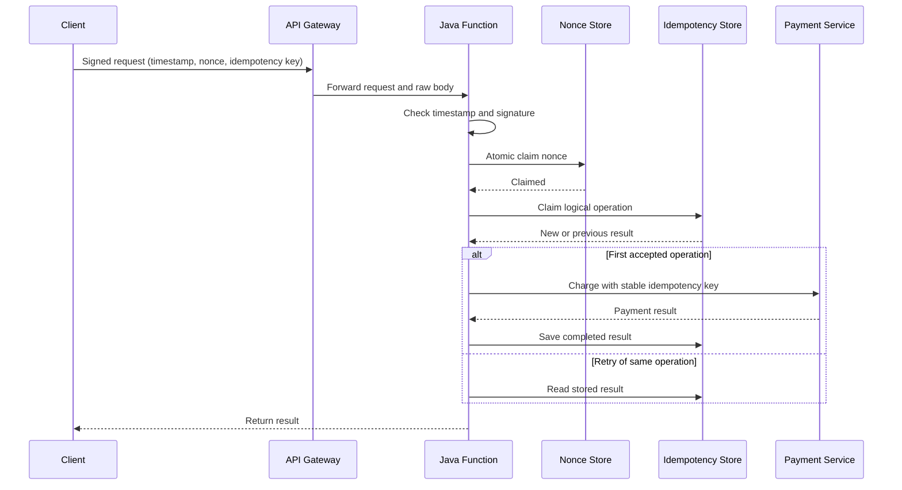
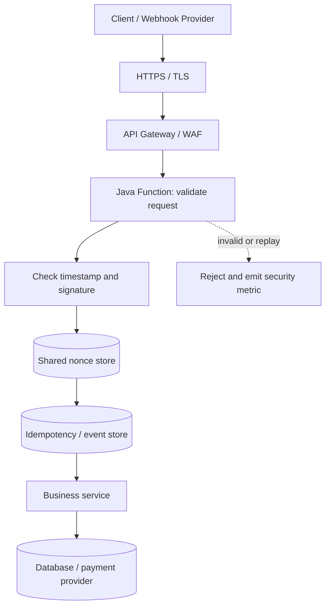

# Preventing Replay Attacks and Bounding Request Validity Windows

## 1. What is a replay attack?

A replay attack occurs when an attacker captures a legitimate request and re-sends it to repeat an action or reuse authentication proof. The original request may have been sent by a legitimate user; the problem is that the system accepts the same message multiple times without recognizing that it has already been used.

For example, a webhook announcing a successful payment is sent to a function. An attacker captures the validly signed request and resends it multiple times. If the function accepts each delivery as a new transaction, the order might be updated repeatedly, emails sent multiple times, or another unintended side effect executed.

Replays can also happen without an active attacker. Gateways, clients, or message brokers may retry when no response arrives. A function might complete a side effect but time out before returning a response. Subsequent delivery causes the same request/event to be processed again. Therefore, replay protection is both a security requirement and a distributed-systems correctness requirement.

In serverless applications, multiple execution environments can handle requests concurrently, and functions can be re-initialized at any time. In-process memory on a single instance is insufficient to detect requests already seen by another instance. You must design timestamp checks, unique identifiers, and anti-replay state tracking in a shared store supporting atomic operations.

## 2. Distinguishing replay, duplicate delivery, and idempotency

These three concepts are related but not identical:

| Concept | Meaning | Example |
| --- | --- | --- |
| Replay attack | A valid message or authentication proof is re-sent for reuse | Re-sending a signed request or stolen token |
| Duplicate delivery | The system delivers the same message/event multiple times due to retries or delivery semantics | A queue redelivers a message when the consumer has not acknowledged it |
| Idempotency | Processing the same logical operation multiple times while producing only one intended business result | A client retries order creation with the same idempotency key and receives the previous result |

Replay protection usually checks a specific transmission: is the timestamp still valid, has the nonce already appeared, and is the signature valid? Idempotency controls the business effect of a logical operation: repeating the same order-creation or payment request must not create multiple transactions.

Both mechanisms must work together. A client may legitimately retry the same operation after a timeout with a fresh timestamp and nonce while keeping the same idempotency key. The new request passes replay checks because it is a new transmission, while the business layer recognizes it as the same logical operation and returns the stored result. Conversely, an identical request re-sent verbatim with the same nonce and timestamp must be rejected at the replay-protection layer.

`requestId`, `correlationId`, or trace IDs do not automatically prevent replay. They exist primarily for tracing. An ID only provides replay protection if the system verifies its uniqueness in a shared state store and claims it atomically.

## 3. Goals and threat model

An anti-replay design typically aims to:

- Accept only authenticated requests with valid signatures/tokens.
- Bound the time window during which a request may be used.
- Detect when a specific transmission has already been used.
- Prevent two concurrent function instances from claiming the same nonce.
- Preserve correctness when clients or brokers retry.
- Avoid turning the nonce store into a bottleneck or resource-exhaustion target via forged requests.
- Enable investigation of rejected requests without logging secrets.

Scenarios to consider:

1. An attacker captures a signed HTTP request and replays it while the signature remains valid.
2. A bearer token leaks and is used from another device or environment.
3. A webhook provider retries the same event because the endpoint timed out.
4. API Gateway or a proxy forwards a request to the function multiple times.
5. Two invocations receive the same request nearly simultaneously across two execution environments.
6. Client clock skew causes legitimate requests to be rejected or stale requests to be accepted too long.
7. A request's path, query, or body is altered after signing due to inconsistent canonicalization.

TLS protects data in transit and reduces network eavesdropping/tampering risks, but does not replace application-layer replay protection. A request can still be replayed if credentials leak, a request is captured at an endpoint, or an intermediary retries it.

## 4. Bounding request validity windows

### 4.1. Timestamp, issued-at, and expiration

A request can carry an issuance time (`issuedAt` or `timestamp`) and an expiration time (`expiresAt`). The server uses its own clock to decide whether the request is still valid. Never trust a `now` value sent by the client.

Given request timestamp (t_r), server time (t_s), and allowed window (Delta), a simple rule is:

\[
|t_s - t_r| \leq \Delta
\]

If the request carries an explicit expiration timestamp, you can also check:

\[
t_s \leq t_{expires}
\]

Timestamps bound how long a request can be replayed. However, a timestamp alone does not prevent the same request from being sent repeatedly within the validity window. An attacker can still replay the request within seconds or minutes of the first transmission. Therefore, sensitive operations require combining timestamps with nonces or an equivalent single-use mechanism.

### 4.2. Choosing a replay window

The replay window is the maximum difference the server accepts between the request timestamp and current server time. A window that is too wide extends how long a stolen request can be used. A window that is too narrow risks rejecting legitimate requests during slow networks, client clock skew, or multi-hop routing.

Some systems use a window of a few minutes for webhooks or signed APIs; higher-risk operations may require shorter windows. There is no universal value for every API. Base the choice on:

- SLA and p95/p99 network latency.
- Number of proxies/gateways and queuing time before processing.
- Sensitivity of the action.
- Time-synchronization accuracy of clients and servers.
- Sender retry policies.
- How nonces are stored and their retention duration.

If a webhook may be retried by a provider for several hours, do not stretch the HTTP signature window to several hours just to support retries. Instead, require each delivery attempt to carry a fresh timestamp/signature per the provider contract, or separate delivery authentication from business event idempotency.

### 4.3. Clock skew and time synchronization

Clock skew is the offset between clocks across machines. If a client is several minutes ahead of the server, its timestamp may look like it is in the future. If behind, the request may look too old. Serverless workloads typically run on managed infrastructure, yet clients, IoT devices, containers, or self-managed hosts can still drift.

Best practices:

- Use UTC and explicit timezone formats, preferring epoch timestamps or ISO-8601 with `Z`/offset.
- Synchronize server clocks with an appropriate time synchronization/NTP service.
- Permit clock skew only within defined limits.
- Use `java.time.Instant` to represent absolute instants.
- Never use timezone-less `LocalDateTime` for signature verification.
- Use `System.nanoTime()` for intra-process elapsed duration measurement, never as a network timestamp.

Do not automatically widen the replay window when seeing timestamp rejections. First inspect client clocks, proxies, and timezone configurations; widening the window unintentionally extends the usable lifetime of stolen requests.

### 4.4. Expiration must be enforced on the server

For password-reset links, invitations, or one-time verification codes, the server must store both the expiration timestamp and consumed status. Clients may display remaining time, but acceptance decisions must rely on the server clock and persisted state.

If a request contains `expiresAt`, that value must be protected by a signature or signed token. Otherwise, a client could modify expiration to extend validity. The server should also enforce a maximum permitted lifetime to prevent senders from minting overly long-lived tokens.

## 5. Request signing and canonicalization

### 5.1. Why sign requests?

A request signature proves the request was created by the party holding the corresponding secret key or private key. The signature must cover all components that affect request meaning, such as:

- HTTP method.
- Canonicalized path and query string.
- Host or authority if required by the protocol.
- Timestamp and nonce.
- Key ID (`kid`) to bind the selected key identifier.
- Content type and digest of the raw body.
- Idempotency key or other security-critical headers.

If you sign only the body without signing method/path, a valid body can be redirected to another endpoint or HTTP method. If the timestamp is excluded from signed data, an attacker can swap the timestamp to extend the request's validity.

### 5.2. HMAC and asymmetric signatures

| Mechanism | How it works | Best suited when |
| --- | --- | --- |
| HMAC-SHA-256 | Client and server share a secret; both compute a MAC over the canonical request | Both sides can protect a shared secret and consumer count is bounded |
| Asymmetric signatures (e.g., Ed25519 or ECDSA) | Sender signs with a private key; server verifies with a public key | Multiple independent senders; server does not need to hold a secret capable of forging signatures |
| TLS/mTLS | TLS protects the channel; mTLS authenticates certificates on both sides | Transport-level connection authentication and credential protection in transit are needed |

HMAC is fast and simple, but any party holding the shared secret can produce valid signatures. With asymmetric signatures, the server only needs the public key to verify. Regardless of mechanism, manage key IDs, key rotation, and revocation of compromised keys.

### 5.3. Canonical requests

Both sides must construct the exact same byte sequence for signing and verification. Canonicalization typically normalizes method, path, query, headers, and body digest under fixed rules. Illustrative example:

```text
POST
/v1/payments
amount=120000&currency=VND
application/json
2026-11-17T10:15:30Z
client-42
nonce-8f31
<sha256-of-raw-body>
```

This is an illustrative format only. In production, use an agreed signing standard or the provider's official signing specification. Do not invent custom canonicalization rules without explicitly defining how to handle:

- Duplicate query parameters and query parameter ordering.
- Percent-encoding, `/` characters, Unicode, and reserved characters.
- Duplicate header names, whitespace, and casing.
- Host, port, and path prefixes added or stripped by reverse proxies.
- Empty bodies, JSON whitespace, encoding, and content types.
- Headers injected by gateways versus headers signed by the client.

If a gateway transforms a request before the function receives it, the signature may no longer match. For webhooks signed over the raw body, preserve the exact raw bytes for verification before parsing or re-serializing JSON. Never verify a signature over a JSON object that was parsed and re-serialized, because field order, whitespace, or encoding may change.

### 5.4. Signed request example

An internal protocol might send headers such as:

```http
POST /v1/payments HTTP/1.1
Host: api.example.com
Content-Type: application/json
X-Key-Id: partner-key-2026-02
X-Request-Timestamp: 2026-11-17T10:15:30Z
X-Request-Nonce: 2kJqv7d8nN1vW3aQmP9xYg
X-Request-Signature: <base64url-signature>
Idempotency-Key: order-42-charge

{"orderId":"order-42","amount":120000,"currency":"VND"}
```

The server resolves the key via `X-Key-Id`, validates the timestamp, constructs the canonical request from the specified fields, verifies the signature, claims the nonce, and only then invokes business logic. Header names and formats here are examples, not a mandatory HTTP standard.

## 6. Nonces and detecting previously used requests

### 6.1. What is a nonce?

A nonce (number used once) is a unique value for a single transmission. The client generates a fresh nonce for each request, includes it in the signed data, and the server records accepted nonces. If the same nonce is submitted again within the validity scope, the server rejects the request.

Nonces should be unpredictable and carry sufficient entropy. For typical APIs, generate at least 128 random bits using the operating system's cryptographically secure random number generator. Never use timestamps, predictable counters, or `Math.random()` as nonces.

Example generating a nonce in Java:

```java
import java.security.SecureRandom;
import java.util.Base64;

public final class NonceGenerator {
    private final SecureRandom random = new SecureRandom();

    public String newNonce() {
        byte[] bytes = new byte[16]; // 128 bit
        random.nextBytes(bytes);
        return Base64.getUrlEncoder().withoutPadding().encodeToString(bytes);
    }
}
```

### 6.2. Where must nonces be stored?

In serverless applications, never track used nonces solely in a `static Set` or local in-memory cache inside a Java function. Two invocations can run on different instances, and a newly started instance will not know what previous instances saw.

The nonce store must:

- Be shared across all execution environments and replicas verifying the same namespace.
- Support atomic insert-if-absent / put-if-absent operations.
- Support expiration/retention to automatically clean up old nonces.
- Provide sufficiently strong consistency for anti-replay guarantees.
- Sustain expected request rates and concurrency.

Common storage choices:

| Store | Atomic nonce claim | Notes |
| --- | --- | --- |
| Redis | `SET key value NX EX seconds` | Ensure topology/consistency and persistence meet requirements; do not use a best-effort cache if data loss allows replay |
| Amazon DynamoDB | `PutItem` with condition `attribute_not_exists(pk)` and TTL | Conditional writes let only one invocation succeed; TTL deletes asynchronously, so still check expiration timestamps on read |
| Azure Cosmos DB | Create item with unique ID in an appropriate partition | Handle conflict when item exists; choose consistency and partition key appropriately |
| SQL database | Unique constraint on `(client_id, nonce)` inside a transaction | Can insert and handle duplicate-key errors; manage throughput and connection pools |

TTL is a cleanup mechanism, not a sole validation check. Some stores do not purge expired items immediately at TTL expiration; the server must still check timestamps/expiry on every request. If an expired record has not yet been purged, conditional updates or time-bucketed keys can handle it cleanly.

### 6.3. Claiming a nonce must be atomic

Suppose two function instances receive the same request nearly simultaneously. If both execute `if (!exists(nonce)) { save(nonce); process(); }`, both instances can read "does not exist" before either writes. Consequently, both execute the side effect.

You must use a single atomic operation in the data store: only one invocation creates the record; the other receives a duplicate result. Never split check and write into two separate requests.

### 6.4. Nonce retention duration

If the server accepts timestamps within a symmetric window (±Δ), a request with timestamp `t_r` remains valid until roughly `t_r + Δ`. The nonce must be retained at least until the request can no longer be accepted. Compute TTL from `expiresAt - serverNow`, bounded and non-negative.

Never set a fixed TTL shorter than the replay window. If a nonce is evicted while the timestamp is still valid, an old request can be accepted again. Conversely, keeping nonces longer than necessary increases storage volume; size retention based on request rate and window length.

### 6.5. Claim nonces after verifying signatures

Do not write every unverified nonce into the store. An attacker could flood millions of forged requests with random nonces to fill caches or databases. A sensible order:

1. Validate basic request size and formatting.
2. Check that the timestamp falls within the allowed window.
3. Look up the key by key ID and verify the signature.
4. Atomically claim the nonce in the shared store.
5. Perform business authentication/authorization and idempotency handling.
6. Execute side effects.

In some protocols, principal authorization must be checked before claiming. Regardless of ordering, never let unauthenticated requests write arbitrarily into another client's nonce namespace.

## 7. Java example: verifying timestamp, signature, and nonce

The following example illustrates a verification boundary for an internal HMAC protocol. It is not a drop-in replacement for webhook provider or AWS/Azure signing specifications. `CanonicalRequestBuilder`, `KeyResolver`, and `NonceStore` must be implemented according to your agreed contract.

```java
import java.nio.charset.StandardCharsets;
import java.security.MessageDigest;
import java.time.Clock;
import java.time.Duration;
import java.time.Instant;
import java.util.Base64;
import javax.crypto.Mac;
import javax.crypto.spec.SecretKeySpec;

public final class RequestReplayVerifier {
    private final Clock clock;
    private final Duration allowedSkew;
    private final KeyResolver keyResolver;
    private final NonceStore nonceStore;
    private final CanonicalRequestBuilder canonicalizer;

    public RequestReplayVerifier(
            Clock clock,
            Duration allowedSkew,
            KeyResolver keyResolver,
            NonceStore nonceStore,
            CanonicalRequestBuilder canonicalizer) {
        this.clock = clock;
        this.allowedSkew = allowedSkew;
        this.keyResolver = keyResolver;
        this.nonceStore = nonceStore;
        this.canonicalizer = canonicalizer;
    }

    public void verify(SignedRequest request) {
        Instant now = clock.instant();
        Instant oldest = now.minus(allowedSkew);
        Instant newest = now.plus(allowedSkew);

        if (request.timestamp().isBefore(oldest)
                || request.timestamp().isAfter(newest)) {
            throw new SecurityException("Request timestamp outside allowed window");
        }

        byte[] secret = keyResolver.resolve(request.keyId());
        if (secret == null) {
            throw new SecurityException("Unknown signing key");
        }

        String canonical = canonicalizer.build(request);
        byte[] expected = hmacSha256(secret, canonical);
        byte[] supplied;
        try {
            supplied = Base64.getUrlDecoder().decode(request.signature());
        } catch (IllegalArgumentException ex) {
            throw new SecurityException("Malformed signature", ex);
        }

        if (!MessageDigest.isEqual(expected, supplied)) {
            throw new SecurityException("Invalid request signature");
        }

        // Retain nonce until the request is no longer valid.
        Instant expiresAt = request.timestamp().plus(allowedSkew);
        if (!expiresAt.isAfter(now)) {
            throw new SecurityException("Request expired");
        }

        boolean claimed = nonceStore.claimIfAbsent(
                request.keyId(), request.nonce(), expiresAt);
        if (!claimed) {
            throw new SecurityException("Request nonce already used");
        }
    }

    private static byte[] hmacSha256(byte[] secret, String canonical) {
        try {
            Mac mac = Mac.getInstance("HmacSHA256");
            mac.init(new SecretKeySpec(secret, "HmacSHA256"));
            return mac.doFinal(canonical.getBytes(StandardCharsets.UTF_8));
        } catch (Exception ex) {
            throw new IllegalStateException("Cannot calculate request MAC", ex);
        }
    }
}
```

Interfaces and records used in the example:

```java
import java.time.Instant;

public record SignedRequest(
        String keyId,
        Instant timestamp,
        String nonce,
        String signature,
        String method,
        String canonicalPathAndQuery,
        String contentType,
        byte[] rawBody) {}

public interface KeyResolver {
    byte[] resolve(String keyId);
}

public interface NonceStore {
    // Must be atomic insert-if-absent, not exists followed by insert.
    boolean claimIfAbsent(String keyId, String nonce, Instant expiresAt);
}

public interface CanonicalRequestBuilder {
    String build(SignedRequest request);
}
```

In production, add null/format checks for every field, length limits on nonce/key ID/signature, body size limits before reading the full body, separation between client errors and store errors, and avoid leaking internal details in responses. `MessageDigest.isEqual` is used to compare signature bytes in a way that mitigates timing leaks; never use standard string comparison for MACs.

This code assumes `timestamp` has been parsed in a consistent format and `CanonicalRequestBuilder` signs the exact raw body digest and agreed components. Never read `canonicalPathAndQuery` from arbitrary client-supplied headers; obtain it from the request normalized by the gateway per contract while understanding any proxy transformations.

## 8. Idempotency for business operations

### 8.1. Why nonces alone are insufficient

A nonce prevents the same transmission from being reused. However, when a client misses a response, it needs to retry the legitimate operation. The retry should carry a fresh timestamp and nonce; relying only on nonces would treat it as a brand-new request and potentially create duplicate transactions.

An idempotency key identifies one logical operation across multiple transmissions. For example:

- Initial request: nonce `n1`, idempotency key `order-42-charge`.
- Client times out and retries: nonce `n2`, idempotency key remains `order-42-charge`.
- Server accepts the new request from a replay perspective, while the idempotency store returns the recorded payment result.

Nonces and idempotency keys have different lifecycles. Nonces are typically short-lived matching the replay window; idempotency records may need longer retention matching business rules and client retry windows.

### 8.2. Storing idempotency state

An idempotency record typically holds:

- A key namespaced by client/tenant and operation.
- A hash of the logical request to detect the same key reused with a different payload.
- Status such as `IN_PROGRESS`, `COMPLETED`, or `FAILED_RETRYABLE`.
- The stored result or a reference to the result.
- Creation timestamp and expiration timestamp.

If the same idempotency key is sent with a different payload, return a conflict error rather than mistakenly returning the previous result. Claiming the key and updating state must use atomic operations, transactions, or conditional updates.

### 8.3. Processing sequence example



If the payment provider charged the customer but the function timed out before saving the result, the retry must pass the same key to the payment provider or reconcile the transaction before re-sending. You cannot achieve an ACID transaction spanning the nonce store, idempotency store, and external payment provider merely by calling APIs sequentially.

## 9. JWTs, bearer tokens, and token replay mitigation

### 9.1. Validating JWT time claims

JWTs typically carry these claims:

| Claim | Meaning | Server-side check |
| --- | --- | --- |
| `iss` | Issuer that minted the token | Must belong to a trusted issuer |
| `aud` | Intended audience | Must include the receiving API/service |
| `exp` | Expiration timestamp | Expired tokens must be rejected, allowing only minimal clock skew |
| `nbf` | Not valid before this timestamp | Reject tokens before `nbf` |
| `iat` | Issued-at timestamp | Can enforce a maximum token age |
| `jti` | Unique token identifier | Only prevents replay if the server tracks usage or maintains a denylist by design |

The server must verify the JWT signature using configured trusted algorithms and keys, and validate `iss`, `aud`, `exp`, `nbf`, and required claims. Never accept arbitrary algorithms from the token header, never skip signature verification, and never treat `jti` as decorative.

### 9.2. Bearer tokens are inherently reusable

Bearer access tokens are generally intended to be used across multiple requests until expiration. That is a design property of bearer tokens, not automatically a flaw. If a token is stolen, someone else can use it while it remains valid.

To reduce risk:

- Issue access tokens with appropriate lifetimes and narrow scopes/audiences.
- Protect tokens on clients and keep them out of logs and URLs.
- Maintain a revocation/denylist mechanism when early invalidation is needed.
- For high-risk clients, consider sender-constrained tokens such as mTLS-bound access tokens or DPoP.
- Verify issuer, audience, and signature at the gateway/authorizer or function per architecture.

Do not convert every access token into a one-time token if the API legitimately requires multiple requests. One-time tokens fit actions such as password resets, email verification, or single-action approvals.

### 9.3. DPoP and sender-constrained proofs

Demonstrating Proof of Possession (DPoP) binds access token usage to a client-held key. The client sends a proof JWT containing claims such as HTTP method (`htm`), URI (`htu`), issuance time (`iat`), unique ID (`jti`), and optionally a server nonce. The resource server validates the proof, token binding, and prevents reuse of `jti` within the permitted window.

DPoP reduces the risk that a stolen bearer token can be used independently from another device, though it must conform properly to the OAuth/DPoP specification. Do not invent a simplified `DPoP` header and treat it as valid DPoP. For internal systems, request signing or mTLS may fit better depending on the client model.

## 10. Webhooks: signatures, timestamps, and event deduplication

### 10.1. Verifying webhooks

Webhook providers typically send an HTTP request with a signature header. Depending on the provider, the signature may be computed over the raw body, timestamp + body, or specific headers. Always follow the provider's official specification:

1. Preserve the raw body bytes exactly as received.
2. Read signature/timestamp headers using the specified names and formats.
3. Validate the timestamp within the replay window if supported by the protocol.
4. Compute the signature over the exact message bytes/canonical string.
5. Compare signatures securely and handle key rotation.
6. Check event ID and idempotency before executing business logic.

Never parse and re-serialize JSON before verification when the provider signs the raw body. Never assume all webhooks use HMAC-SHA-256 or identical header names.

### 10.2. Event IDs and provider retries

Providers usually assign a stable event ID across retries. Persist event IDs scoped by provider and event type to prevent processing the same event multiple times. A new retry delivery may have a fresh timestamp and signature while carrying the same event ID.

If webhook processing takes significant time, verify the signature, durably claim the event ID, enqueue the event, and return `2xx` quickly per the provider contract. Consumers then process asynchronously with idempotency. Ensure recording the event and enqueuing do not create a data-loss gap; use transactions/outbox patterns or durable message ingestion where appropriate.

### 10.3. Distinguishing request nonces from event IDs

A nonce typically identifies one HTTP transmission; an event ID identifies the business event. A provider may retry the same event ID inside a fresh request envelope. Storing only nonces would treat each retry as distinct; storing only event IDs could allow a replayed request through without side effects if deduplication holds. Systems should apply both signature/timestamp checks and event-ID deduplication.

## 11. One-time requests and expiring tokens

Some workflows require single-use tokens:

- Password reset links.
- Email/phone verification codes.
- Workspace invitation links.
- Transaction approval tokens.
- URLs executing a sensitive action.

Tokens need high entropy, binding to the specific user/action/resource, an expiration timestamp, and a consumed state. Store a hash of the token rather than the raw token when possible. Upon consumption, the server must verify expiration and mark the token consumed in a single atomic transaction or conditional update.

For example, two concurrent requests submitting the same password reset token must not both succeed. Only one request may transition the token state from `UNUSED` to `CONSUMED`; the other receives an already-used error. If you read `used=false` and update in two separate operations, both concurrent requests can pass the check simultaneously.

Avoid placing sensitive tokens in query strings whenever possible, as URLs appear in browser history, proxy logs, referrers, and analytics. If links are unavoidable, use HTTPS, short lifetimes, avoid loading third-party resources on the token landing page, and exchange the token for a secure session after verification.

## 12. Anti-replay architecture for serverless applications

### 12.1. Defense layers



Gateway/WAF layers enforce request size limits, rate limits, IP reputation, and baseline token authentication. The function verifies signatures/claims per contract, claims the nonce, enforces idempotency, and runs business logic. Nonce and idempotency stores must be shared across all execution environments.

### 12.2. Never rely on local memory as the anti-replay source of truth

A Java singleton or `ConcurrentHashMap` can serve as an optimization cache, never as the source of truth. When AWS Lambda, Azure Functions, or Cloud Run scales out or starts new instances, each process has isolated memory. Restarts also wipe state.

If a local cache is used to short-circuit lookups, every acceptance decision must still be confirmed by the shared store. Never let a cache miss or cache reset allow an old request to be reprocessed.

### 12.3. Multi-region and consistency

If the same API is served from multiple regions, a replayed request could hit two different regions. Two independent nonce stores will not detect cross-region duplicates. You need:

- A claim store offering sufficiently strong consistency across the relevant regions; or
- Routing each client/key to a stable home region; or
- A global idempotency key at the business layer preventing duplicate side effects; or
- Conflict-aware conditional writes with explicit handling when two regions race to claim.

A globally replicated cache with eventual consistency can allow two regions to claim simultaneously for a brief period. Do not rely on it as the sole guarantee if immediate global uniqueness is required for anti-replay. Understand the storage service's consistency model, replication lag, and failure behavior.

### 12.4. Partition keys and namespaces

Nonce keys should be namespaced by client/key ID or tenant, for example:

```text
replay:v1:<tenantId>:<keyId>:<nonce>
```

This avoids collisions across clients and enables independent quotas/retention. Avoid embedding sensitive data into keys if keys may appear in metrics or logs. You may hash nonces before storage to minimize identifier exposure, provided uniqueness semantics remain exact.

## 13. Protecting the nonce store and preventing DoS

The nonce store itself is a resource that can be targeted by forged requests or traffic floods. Essential protections include:

- Validate body/header bounds and formats before deep reading/parsing.
- Rate limit by client, key ID, tenant, or IP at the gateway/WAF.
- Verify signatures before writing nonces to avoid storing unauthenticated garbage.
- Enforce length limits on key ID, nonce, and signature fields.
- Configure reasonable TTLs and monitor item counts.
- Partition keys and provision capacity for peak concurrency.
- Use short timeouts and circuit breakers if the nonce store degrades.
- Distinguish "nonce already used" from "nonce store unavailable"; do not return the exact same error for both.

When the nonce store is unavailable, choosing fail-open versus fail-closed must be risk-driven. For payments, permission changes, or sensitive actions, fail-closed is generally appropriate to avoid accepting replays. For non-side-effecting telemetry, a different policy may apply. Never silently skip replay checks when the store fails.

## 14. Key management and key rotation

For request signing, maintain a proper key-management lifecycle:

1. Issue separate keys per client or integration whenever possible.
2. Include a key ID (`kid`) in requests to select the right key.
3. Store secrets/private keys in a secret manager or appropriate HSM/KMS.
4. Grant functions read access only to the specific keys they need.
5. Rotate keys using a bounded overlap period accepting both old and new keys.
6. Revoke compromised keys immediately and reject requests using revoked keys.
7. Monitor last-used timestamps and retire old keys once clients migrate.

Never embed HMAC secrets in source code, container images, frontend JavaScript, or committed configuration files. Never log secrets, full authorization headers, or complete signatures. With asymmetric signing, the private key stays strictly with the signer; the server needs only the public key to verify.

During key rotation, determine how long in-flight requests or webhook retries may still arrive signed with the old key. Keep the overlap window bounded and aligned with the replay window/retention; never keep old keys indefinitely "to avoid integration errors."

## 15. Observability and incident response

### 15.1. Metrics to monitor

- Requests rejected due to expired or future timestamps.
- Requests with invalid signatures by key ID/client.
- Duplicate nonce rejections versus successful nonce claims.
- Idempotency hit, conflict, and in-progress rates.
- Latency and errors of the nonce/idempotency store.
- Duplicate webhook events, retries, and DLQ counts.
- Observed clock skew between clients/providers and the server.
- Rate limits, throttling, and requests blocked at gateway/WAF.

### 15.2. Safe logging

Logs should capture request ID, normalized tenant/client ID, key ID, route, verification outcome, and reason code. Never log raw secrets, tokens, private keys, raw signatures, or sensitive payloads. When needed for investigation, record a controlled hash or fingerprint rather than the full value.

Never place raw nonces into metric labels, as cardinality will explode. You can log a truncated fingerprint in controlled environments or simply record the duplicate outcome alongside the key ID.

### 15.3. Distinguishing attacks from clock drift

A spike in stale-timestamp rejections might indicate a replay attack, or it might mean a client lost time sync or a queue backed up. Cross-check:

- Request origin and key ID.
- Timestamp offset distribution per client.
- Duplicate nonce counts versus invalid timestamp counts.
- Time-sync health of client infrastructure.
- Gateway/queue latency and provider retry schedules.

Never automatically loosen the replay window just to quiet down a metric. If a client persistently drifts, fix its clock source or grant a tightly bounded, monitored exception policy.

## 16. Testing replay protections

A test suite should cover the following scenarios:

| Test case | Expected result |
| --- | --- |
| Valid signature, timestamp within window, fresh nonce | Accepted once |
| Re-sending identical request with same nonce | Rejected as duplicate/replay |
| Same nonce with modified body | Invalid signature; nonce not claimed prior to verification |
| Stale timestamp | Rejected before side effects execute |
| Future timestamp beyond skew | Rejected |
| Wrong signature or unknown key ID | Rejected, nonce not recorded |
| Two concurrent invocations with same nonce | Only one invocation claims successfully |
| Same operation with new nonce and same idempotency key | Returns previous result or in-progress status; no second side effect |
| Same idempotency key with different payload | Returns conflict per contract |
| Nonce store unavailable | Applies defined fail-open/fail-closed behavior; does not silently skip checks |
| Replay directed to another region | Still blocked per consistency/idempotency design |
| Webhook provider retries same event ID with fresh signature | Delivery verified without repeating business effect |
| Expired token or token before `nbf` | Rejected |
| One-time token submitted twice concurrently | Only one request consumes it successfully |

Beyond unit tests, run integration/load tests against real data stores or equivalent environments to validate atomic claims, TTLs, concurrent requests, and failure modes. Local single-process tests cannot prove anti-replay correctness under scale-out.

## 17. Signed request handling workflow

A reference sequence for sensitive HTTP requests:

1. **Bound input:** verify method/route, content type, body size, and header formats.
2. **Read time:** parse timestamp per published format; use UTC server clock.
3. **Check window:** reject requests that are too old or too far in the future beyond clock skew.
4. **Select key:** look up key ID and key status; accept only configured algorithms.
5. **Build canonical request:** use raw body, path/query/headers per specification.
6. **Verify signature:** compare MAC/signature safely; never log secrets.
7. **Claim nonce:** atomic insert-if-absent with appropriate expiration.
8. **Authenticate/authorize business action:** verify principal is authorized on the resource.
9. **Check idempotency:** claim logical operation or return stored result.
10. **Execute side effect:** apply timeouts, transactions/outbox, and downstream idempotency.
11. **Persist result:** store completion state so client retries receive the same result.
12. **Observe:** emit metrics/logs for verification outcomes, duplicates, latency, and store errors.

Exact ordering can vary by protocol and authorization requirements, provided unauthenticated requests cannot write arbitrarily to the nonce store and side effects never run before required security checks finish.

## 18. Common design mistakes

| Mistake | Consequence | Fix |
| --- | --- | --- |
| Checking only timestamps | Requests can still be replayed repeatedly within the replay window | Combine with nonces or shared one-time identifiers |
| Storing nonces only in RAM | Other instances do not know a nonce was used | Use a shared store with atomic claims |
| Checking nonce then writing in separate calls | Two concurrent invocations both pass | Use conditional inserts / unique constraints |
| TTL shorter than replay window | Nonce expires while the request is still valid | Set expiration to the end of the acceptance window |
| Relying solely on TTL for expiry | Expired records may linger or purge late | Always check timestamp/expiry on the server |
| Signing body without method/path/timestamp | Requests can be redirected to other endpoints or extended in time | Sign a canonical request covering all critical components |
| Parsing and re-serializing JSON before verifying | Body bytes change and signature mismatches original data | Verify raw body per provider spec |
| Treating JWT `jti` as automatic anti-replay | Tokens remain reusable unless `jti` is tracked/checked | Use denylists/one-time state or sender-constrained tokens when needed |
| Using idempotency keys in place of nonces | Stolen requests can still be replayed to access logic | Combine signature, timestamp, nonce, and idempotency checks |
| Letting retries mint new idempotency keys | One logical operation creates multiple side effects | Keep the idempotency key stable across retries |
| Failing open when nonce store errors | Replays are accepted during store outages | Choose fail-closed for sensitive actions with recovery plans |
| Logging tokens, signatures, or raw payloads | Secrets and personal data leak | Log minimal metadata and redact sensitive values |

## 19. Implementation checklist

- [ ] Identify which requests/events face replay risk and which side effects are sensitive.
- [ ] Select authentication protocol: HMAC, asymmetric signatures, JWT, mTLS, or DPoP.
- [ ] Define timestamp, expiration, clock skew, and replay window.
- [ ] Ensure timestamps and nonces are included in signed content.
- [ ] Canonicalize method, path, query, headers, and raw body under one consistent contract.
- [ ] Generate nonces using a CSPRNG and validate length/format.
- [ ] Store nonces in a shared store supporting atomic insert-if-absent.
- [ ] Set TTL no shorter than the request acceptance window.
- [ ] Use stable idempotency keys for retries of the same business operation.
- [ ] Handle concurrent duplicates and multi-region consistency.
- [ ] Protect keys in secret manager/KMS with rotation/revocation procedures.
- [ ] Bound body size, rate, and nonce-store resource consumption.
- [ ] Define fail-open/fail-closed behavior when the nonce store fails.
- [ ] Never log secrets, tokens, signatures, or sensitive raw payloads.
- [ ] Test concurrent replays, retries, clock skew, TTLs, and provider webhooks.
- [ ] Monitor timestamp rejections, duplicate nonces, idempotency hits, and store latency.

## 20. Conclusion

Replay protection requires coordinated layers. Timestamps and expirations bound how long a request can be accepted; signatures protect the integrity of method, path, headers, and body; nonces detect reuse of the same transmission; and a shared nonce store with atomic operations ensures concurrent execution environments cannot accept the same request twice. Idempotency protects business outcomes when clients or brokers retry the same logical operation in a new request.

In serverless architectures, pay special attention to scale-out, concurrency, restarts, and multi-region deployments. Local memory cannot be the sole anti-replay source of truth, and TTL does not replace server-side time checks. Choose replay windows based on latency and risk, synchronize clocks, manage keys securely, verify raw bodies per specification, and test concurrent requests. This approach keeps Java APIs, webhooks, and consumers resilient against replays while preserving legitimate retries and business correctness.
