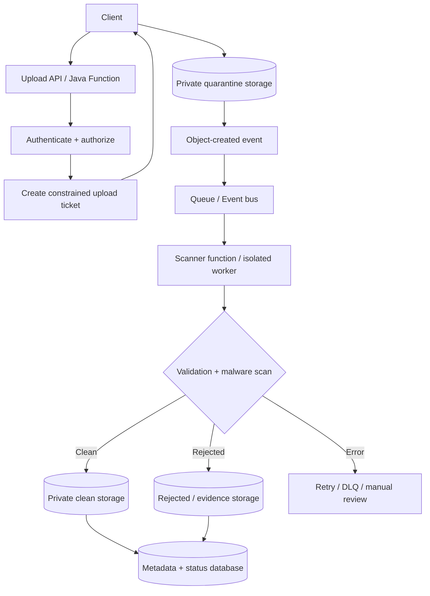
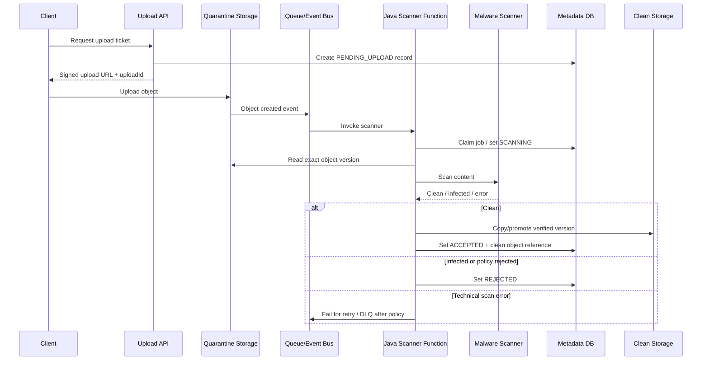

# Handling File Uploads, Malicious Content, and Archive Bombs

File uploads are a common entry point for untrusted data. Users can submit malformed files, spoofed MIME types, filenames containing dangerous paths, malware, or tiny archives that decompress into tens of gigabytes. If a function places files in a shared directory, extracts them synchronously inside a request, or exposes objects publicly before inspection, a single upload can cause data leaks, file overwrites, out-of-memory crashes, disk exhaustion, or full workload disruption.

In serverless architectures, the safe approach is typically to receive uploads into an isolated **quarantine** area, bound size and content types, verify file signatures, scan for malware, process archives in a resource-bounded environment, and only then promote verified results to clean storage. Inspection should run asynchronously for large or CPU-intensive files so HTTP handlers do not hold invocations open for long periods.

This lesson focuses on designing secure upload pipelines for Java functions/FaaS. The principles apply across object storage, queues, event triggers, and serverless platforms; specific limits for API Gateways, function runtimes, and storage providers must be verified against the service you deploy on.

## 1. Identifying threats from untrusted files

### 1.1. Uploaded files are not safe data

Never conclude a file is safe based on its name, extension, or client-supplied `Content-Type`. For example:

- `invoice.pdf` may contain non-PDF content, a polyglot file, or a parser exploit.
- `photo.jpg` may contain malformed image data or exploit a vulnerability in an image processing library.
- `report.zip` may contain `../../...` paths, symlinks, or millions of tiny entries.
- A compressed file of a few kilobytes can expand into gigabytes or burn CPU for a long time.
- An Office document may contain macros or malicious embedded content.
- HTML/SVG files can contain scripts and execute in the browser when served on the same origin as the application.

Treat filenames, metadata, MIME types, file contents, archive entries, and every path inside an archive as attacker-controlled input.

### 1.2. Primary risk categories

| Risk | Example | Impact |
| --- | --- | --- |
| MIME/content spoofing | Submitting an executable while declaring `image/png` | Bypasses validation or causes browsers to misinterpret content |
| Path traversal / Zip Slip | Entry named `../../app/config.yml` | Writes files outside the extraction directory |
| Archive bomb | Small compressed file expanding enormously | Exhausts disk, memory, CPU, or causes timeouts |
| Nested archives | ZIP containing deeply nested ZIPs | Amplifies extraction and scanning costs |
| Symlinks / special files | Entry pointing outside the directory or representing a device | Reads/writes outside intended scope or triggers unsafe behavior |
| Malware / exploits | File containing malware or parser exploits | Infection, code execution, or process takeover |
| Polyglot / parser confusion | Content valid under multiple parsers | Bypasses checks or triggers unexpected interpretation |
| Resource exhaustion | Huge entry counts, extreme names, massive image dimensions | Exhausts RAM, CPU, inodes, logs, and processing time |
| Public exposure | Quarantine object receives a public URL | Distributes unverified content |
| TOCTOU / overwrite | Object replaced after scanner checks it | Function processes one version while users download another |

### 1.3. Defining policy by intended use

You do not need to support every file format. Explicitly define:

- which file types users are permitted to upload;
- maximum size limits;
- whether archives are accepted;
- which file types are allowed inside archives;
- whether files will be rendered inline in browsers or downloaded only;
- whether antivirus scanning, CDR (Content Disarm and Reconstruction), or specialized checks are required;
- maximum time from upload until a file is accepted;
- how long data must be retained and who may access it.

A narrow allowlist is far safer and easier to operate than accepting every format and trying to block dangerous ones individually.

## 2. Secure upload architecture in serverless

### 2.1. Avoid routing large files through HTTP functions unnecessarily

For large files, the API should typically only authenticate the user, grant bounded upload permissions, and issue an upload ticket. The client uploads directly to object storage via a short-lived URL or policy. Once uploaded, storage emits an event for a worker function to process.



This flow keeps upload requests from waiting on antivirus scanning or extraction. The API returns an upload ID; once storage confirms the object, metadata transitions to `UPLOADED` or `PENDING_SCAN` depending on implementation. The client polls or queries status later. Workers only process objects in quarantine with an explicit event ID/version.

### 2.2. Storage zones should be separated

| Zone | Purpose | Access policy |
| --- | --- | --- |
| Quarantine | Receives new, untrusted files | Private; only upload principals and scanners hold required permissions |
| Processing/temp | Holds files currently being analyzed or extracted | Isolated per job/invocation; bounded capacity and lifetime |
| Clean | Holds files that passed all checks | Private by default; downloads authorized via API or short-lived URLs |
| Rejected/evidence | Holds rejected files and investigation metadata | Accessible only to security/operations principals; clear retention |

Never use the same public bucket/prefix for quarantine and clean files. If storage must be shared, strictly separate prefixes, IAM policies, lifecycles, and event filters; however, separate buckets are usually easier to govern.

### 2.3. Upload states

Store upload metadata in a database, for example:

| State | Meaning |
| --- | --- |
| `PENDING_UPLOAD` | Ticket created; client has not completed upload |
| `UPLOADED` | Object appeared in quarantine |
| `SCANNING` | Worker claimed the job and is inspecting it |
| `ACCEPTED` | File passed policy and was promoted to clean storage |
| `REJECTED` | File violated policy or scanner detected malicious content |
| `SCAN_FAILED` | Scan could not complete due to technical error; retryable |
| `EXPIRED` | Upload or scan exceeded its processing deadline |

Distinguish `REJECTED` from `SCAN_FAILED`. Malware detection is a final policy outcome; a scanner timeout or temporarily unavailable antivirus service is a technical failure. Never promote a file to clean storage simply because the scan service failed.

### 2.4. Binding metadata to object versions

Each upload should have an unpredictable identifier bound to a tenant/user and its own object key. After upload, record the storage-provided object version ID or generation, size, and checksum. The scanner must read that exact recorded version.

If an object key can be overwritten after the event fires, the scanner might inspect version A while the API later serves version B. Prevention:

- use a unique object key per upload;
- enable versioning or track generation/version IDs;
- deny overwrite permissions after upload;
- store the checksum and size of the inspected version;
- when copying to clean storage, re-verify source/version and metadata.

Do not assume an ETag is always an MD5 hash. For multipart uploads or certain encryption modes, ETags do not directly represent content checksums. Use provider-supported checksums and verify them per provider contract.

## 3. Issuing constrained upload tickets

### 3.1. Authenticate and authorize before issuing URLs

The upload API must authenticate the caller and verify:

- whether the user/tenant has permission to create an upload;
- whether the document type is allowed for this use case;
- whether the tenant still has remaining quota;
- whether pending uploads are within limits;
- maximum allowed size and upload expiration;
- that the object key is server-generated rather than using the client-chosen filename verbatim as the key.

The original filename should only be stored as sanitized display metadata, never as a physical path. The object key should contain a random upload ID or UUID under a server-determined tenant prefix.

### 3.2. Presigned URLs or signed upload policies

A presigned upload URL lets a client upload directly to a specific object without receiving long-lived credentials. The URL must:

- have a short lifetime;
- permit only the single required HTTP method;
- restrict the bucket/object key or prefix;
- bind content type if supported by the provider, without treating it as content inspection;
- enforce size limits via upload policy/provider features where available;
- grant no read/list/delete permissions;
- prohibit overwriting already accepted objects.

Some presigned PUT variants do not enforce all size constraints as strictly as presigned POST policies. If the storage provider cannot enforce content length on the signed request, check actual size after upload and delete/quarantine oversized objects. Multipart uploads require bounds on total size, part count, and cleanup of incomplete uploads.

### 3.3. Layered limits

Do not rely solely on function limits. Enforce limits at:

1. API Gateway/ingress to block oversized requests before reaching handlers.
2. Upload tickets/storage policies to constrain size and target objects.
3. Post-upload metadata validation to verify actual size.
4. Scanners to bound total bytes, entry counts, archive depth, and processing time.
5. Download APIs to control who can retrieve accepted content.

Limits must be consistent. For instance, if the API accepts 100 MB uploads while the scanner handles only 20 MB, users will routinely get stuck in a scan-failed state. Publish maximum sizes matching actual pipeline policy.

### 3.4. Do not trust client Content-Type

Client-supplied `Content-Type` headers can be wrong or deliberately forged. Treat them as hints, not proof. Combine:

- normalized extension allowlists;
- magic-byte/file-signature detection;
- actual format parsing;
- internal structure and dimension checks;
- malware scanning or CDR where required.

Never use `Files.probeContentType()` as your sole security check. Its output can depend on the OS or filename and does not prove content is safe.

## 4. Validating filename, size, and file content

### 4.1. Sanitizing filenames

Original filenames are client-controlled data. When storing metadata or displaying them:

- strip control characters and null bytes;
- enforce maximum length;
- reject `/` or `\` separators in display names unless needed;
- never use the original name as a filesystem path;
- prevent HTML injection when rendering names on web pages;
- handle Unicode normalization and name collisions per policy;
- never trust double extensions like `invoice.pdf.exe`.

Renaming files to UUIDs does not replace content inspection, though it reduces path manipulation and collision risks.

### 4.2. Size checks

Verify actual object size after upload, not just the client-declared `Content-Length`. Reject or quarantine files exceeding limits. When streaming, count actual bytes read and abort immediately once thresholds are exceeded.

Enforce multi-level bounds:

- maximum upload size;
- maximum decompressed size per entry;
- maximum total decompressed size;
- maximum entry count;
- maximum entry name length;
- maximum nested archive depth;
- maximum processing time;
- maximum scanner CPU and memory.

### 4.3. Magic bytes and file signatures

Read the file header to compare its signature against allowed formats. For example, PDFs normally start with `%PDF-`; PNG has a specific 8-byte signature; JPEG has corresponding start markers. Derive signature checks from format specifications and reliable parsers.

Magic bytes are one inspection layer, not proof of safety. A file can spoof a signature, carry trailing payload data, or be a polyglot. After checking signatures, parse using an appropriate library and enforce format-specific policies.

### 4.4. Parsing in resource-bounded environments

Image, PDF, Office, and archive parsers can all have vulnerabilities. Keep libraries updated; run parsers in least-privilege processes/containers; bound CPU, memory, file descriptors, disk, and execution time; and disable unnecessary network egress.

For Office documents, consider rejecting macros or using CDR to reconstruct safe documents if business workflows allow. For PDFs, disarm JavaScript, embedded files, or dangerous actions as needed. For images, decoding and re-encoding to an allowed format can strip metadata and extraneous structures, though pixel dimensions must still be bounded to prevent image bombs.

## 5. Malware scanning and acceptance decisions

### 5.1. Malware scanning is not the only step

Antivirus scanners detect known signatures, but cannot guarantee detection of every zero-day malware sample, exploit, or malicious payload. A "clean" result simply means the scanner found no issues under its current engine, signatures, and policy.

Combine layers:

- format allowlists and business validation;
- signature/content inspection;
- antivirus or malware scanning;
- sandboxing/detonation for high-risk file types when needed;
- CDR for eligible document types;
- updated parsers running in sandboxes;
- restricted download/serving permissions.

### 5.2. Asynchronous scanning model

Scanner workers can be triggered from a queue/event when a new object arrives. Workers claim jobs via conditional state updates in the database so two invocations never scan or promote the same object concurrently.



### 5.3. Distinguishing infected files from scan errors

Outcomes should be classified clearly:

| Scanner result | Meaning | Handling |
| --- | --- | --- |
| Clean | No malware detected and passes policy | Eligible for promotion after metadata/version checks |
| Infected | Malware or prohibited signature detected | Reject, quarantine, never serve content |
| Unsupported | Unsupported format or password-encrypted | Reject or route to manual review per policy |
| Scan timeout/unavailable | Scanner or dependency hit a technical error | Bounded retries; do not promote |
| Resource limit exceeded | File exceeded CPU/memory/size/entry budget | Reject or route to specialized workflow |
| Unknown | Indeterminate result | Fail closed; manual review or controlled retry |

Never treat an unresponsive scanner as clean. Whenever inspection cannot complete, leave the file in quarantine.

### 5.4. Idempotency and duplicate events

Object storage events can arrive duplicated or out of order. Use a stable processing key such as `bucket + objectKey + versionId + scanPolicyVersion`. Update state with conditional writes or transactions so only one worker claims the job.

When promoting to clean storage, the destination object key should tie a version/ID to the upload. If a worker retries after copying succeeded but before updating the database, the worker must detect that the clean object already exists and verify its checksum/version before finalizing status, avoiding duplicate copies or records.

## 6. Archive bombs and extraction risks

### 6.1. What is an archive bomb?

An archive bomb is a compressed file crafted to consume massive resources during extraction or inspection. A tiny archive can expand into huge data volumes, contain millions of entries, or nest many compression layers.

Examples of attack patterns:

- a single entry compressed to a few kilobytes that expands to gigabytes;
- hundreds of thousands or millions of empty/tiny entries exhausting inodes and metadata;
- nested archives containing other archives repeated across many levels;
- overly long or malformed entry names causing parser CPU/memory spikes;
- duplicate entry names, or distinct names that collide after normalization/case folding;
- encrypted archives preventing scanners from inspecting inner contents.

Never check compression ratio alone. An archive with a modest ratio can still have an enormous total decompressed size or excessive entry count. Combine multiple independent limits.

### 6.2. Mandatory extraction limits

| Limit | Purpose |
| --- | --- |
| Compressed upload size | Blocks oversized input archives |
| Max entries | Prevents archives with excessive files/directories |
| Max bytes per entry | Caps decompressed size of a single file |
| Max total expanded bytes | Caps total decompressed data |
| Max compression ratio | Detects abnormally expanding entries when metadata is reliable |
| Max nesting depth | Blocks deeply nested archives |
| Max filename/path length | Prevents oversized metadata/paths or parser anomalies |
| Max processing time | Prevents CPU exhaustion and runaway invocations |
| Max temp disk usage | Protects ephemeral storage and node filesystems |
| Allowed compression methods | Accepts only supported, tested algorithms |

Illustrative example policy: max 25 MB upload, max 2,000 entries, max 20 MB per entry, max 100 MB total expanded bytes, max nesting depth 1, and 30-second scan deadline. These numbers are not universal safe defaults; tune them for your document types and scanner capacity.

### 6.3. Calculating compression ratios properly

Compression ratios are usually calculated as uncompressed size divided by compressed size. However, archive metadata can be untrustworthy or unavailable in streaming APIs. With `ZipInputStream`, compressed size may be unknown while reading an entry; never treat `-1` or missing metadata as proof of safety.

For reliable enforcement:

- bound total actual bytes written while extracting;
- bound actual bytes per entry;
- bound entry count and elapsed time;
- if ratio checks are required, inspect the central directory using a library that supports it and compare against actual bytes read;
- reject archives with contradictory or unverifiable metadata per policy.

### 6.4. Zip Slip and path traversal

Zip Slip occurs when an entry name is joined directly to a target directory without path validation. An entry such as `../../outside.txt` can escape the extraction directory.

Never use:

```java
File output = new File(destinationDirectory, entry.getName());
```

unless the path has been normalized and verified safe. Always verify the resolved path remains under the root directory. Reject absolute paths, `..`, unusual path separators, drive prefixes, empty names, and names that collide under the target filesystem's rules.

### 6.5. Symlinks and special files

Some archive formats can represent symbolic links, hard links, or special entry types. If the extraction library does not expose metadata to identify them, do not assume every entry is a regular file. For untrusted data:

- prefer libraries able to inspect Unix modes and entry types;
- reject symlinks, hard links, devices, and special files;
- never follow symlinks when writing files;
- extract into a freshly created, job-dedicated directory;
- never extract into application directories, home directories, or shared volumes.

Plain Java `ZipInputStream` does not expose full Unix external attributes needed to detect all symlinks. If policy requires entry-type verification, use an archive library with appropriate APIs or restrict support to formats/variants you can inspect reliably.

## 7. Java: extracting ZIP files with resource limits

The example below illustrates a baseline defensive layer when reading ZIPs: bounding entry count, per-entry size, and total extracted bytes; rejecting absolute paths, backslashes, and `..` segments; and writing only into a newly created temp directory. It does not replace a malware scanner, does not inspect Unix symlink metadata, and does not compute central-directory compression ratios.

```java
import java.io.IOException;
import java.io.InputStream;
import java.io.OutputStream;
import java.nio.file.Files;
import java.nio.file.Path;
import java.nio.file.StandardOpenOption;
import java.util.zip.ZipEntry;
import java.util.zip.ZipInputStream;

public final class SafeZipExtractor {
    private static final int MAX_ENTRIES = 2_000;
    private static final long MAX_ENTRY_BYTES = 20L * 1024 * 1024;
    private static final long MAX_TOTAL_BYTES = 100L * 1024 * 1024;
    private static final int BUFFER_SIZE = 8 * 1024;

    private SafeZipExtractor() {}

    public static Path extract(InputStream archive, Path privateTempRoot)
            throws IOException {
        Path destination = Files.createTempDirectory(
                privateTempRoot,
                "upload-scan-");
        Path root = destination.toRealPath();

        int entries = 0;
        long totalWritten = 0;
        byte[] buffer = new byte[BUFFER_SIZE];

        try (ZipInputStream zip = new ZipInputStream(archive)) {
            ZipEntry entry;
            while ((entry = zip.getNextEntry()) != null) {
                entries++;
                if (entries > MAX_ENTRIES) {
                    throw new IOException("Archive contains too many entries");
                }

                Path output = resolveSafeEntry(root, entry.getName());

                if (entry.isDirectory()) {
                    Files.createDirectories(output);
                    zip.closeEntry();
                    continue;
                }

                Files.createDirectories(output.getParent());
                long entryWritten = 0;

                // CREATE_NEW rejects duplicate paths and avoids overwriting an existing file.
                try (OutputStream out = Files.newOutputStream(
                        output,
                        StandardOpenOption.CREATE_NEW,
                        StandardOpenOption.WRITE)) {
                    int read;
                    while ((read = zip.read(buffer)) != -1) {
                        if (read > MAX_ENTRY_BYTES - entryWritten) {
                            throw new IOException("Archive entry exceeds size limit");
                        }
                        if (read > MAX_TOTAL_BYTES - totalWritten) {
                            throw new IOException("Archive exceeds total expanded size limit");
                        }

                        out.write(buffer, 0, read);
                        entryWritten += read;
                        totalWritten += read;
                    }
                }

                zip.closeEntry();
            }
        } catch (IOException | RuntimeException error) {
            deleteTreeBestEffort(destination);
            throw error;
        }

        return destination;
    }

    private static Path resolveSafeEntry(Path root, String entryName)
            throws IOException {
        if (entryName == null || entryName.isBlank()
                || entryName.indexOf('\\') >= 0
                || entryName.indexOf(':') >= 0
                || entryName.indexOf('\0') >= 0
                || entryName.startsWith("/")
                || entryName.length() > 1_024) {
            throw new IOException("Unsafe archive entry name");
        }

        String[] segments = entryName.split("/", -1);
        for (int i = 0; i < segments.length; i++) {
            String segment = segments[i];
            if (segment.isEmpty() && i != segments.length - 1) {
                throw new IOException("Archive path contains an empty segment");
            }
            if (segment.equals("..") || segment.equals(".")) {
                throw new IOException("Archive path traversal detected");
            }
            if (segment.length() > 255) {
                throw new IOException("Archive path segment is too long");
            }
        }

        Path output = root.resolve(entryName).normalize();
        if (!output.startsWith(root) || output.equals(root)) {
            throw new IOException("Archive entry escapes destination");
        }
        return output;
    }

    private static void deleteTreeBestEffort(Path root) {
        if (root == null || !Files.exists(root)) {
            return;
        }
        try (var paths = Files.walk(root)) {
            paths.sorted((a, b) -> b.getNameCount() - a.getNameCount())
                    .forEach(path -> {
                        try {
                            Files.deleteIfExists(path);
                        } catch (IOException ignored) {
                            // Production code should log cleanup failure without hiding the original error.
                        }
                    });
        } catch (IOException ignored) {
            // Production code should record that temporary data could not be fully removed.
        }
    }
}
```

Items to add before production use:

- Verify archive signature and format before constructing `ZipInputStream`.
- Count incoming compressed bytes and enforce the upload size limit.
- Set deadlines/CPU limits at the worker/container level; entry and byte caps in code alone do not cap total CPU.
- Inspect the central directory and compression ratios with an appropriate library if required by policy.
- Reject symlinks/special entries using a library capable of reading that metadata.
- Handle duplicate names after Unicode normalization or case folding per target filesystem rules.
- Never automatically extract nested archives; reject them by default or treat them as opaque files. If recursion is required by business logic, pass a nesting-depth budget throughout and abort when exceeded.
- Use isolated temp directories, minimal filesystem permissions, and monitored cleanup.
- Scan every extracted file; never execute files or macros.
- Do not treat extracted results as clean content until all policy checks finish.

This snippet illustrates defense for simple ZIP files. Never treat it as proof that every archive is safe; if TAR, 7z, RAR, or other formats must be supported, use updated dedicated parsers and enforce the same limits.

## 8. Resource limits in FaaS

### 8.1. Memory and streaming

Never read entire files into `byte[]` when sizes can be large. Approaches like `Files.readAllBytes()` or unbounded `ByteArrayOutputStream` grow heap linearly with upload size and cause OOMs under concurrent invocations.

Prefer streaming from object storage through scanners, writing chunk-by-chunk to temp space and counting actual bytes. Use small fixed buffers. For parsers that must hold content in memory, cap input sizes and size memory against concurrency.

### 8.2. Ephemeral storage

FaaS runtimes provide temp directories with bounded capacity tied to the execution environment lifecycle. Extraction may require space equal to total expanded size plus intermediate files, scan artifacts, and outputs. Budget capacity upfront and clean up files upon completion.

Never treat `/tmp` as durable storage or shared across instances. If extracted files exceed ephemeral storage limits, offload to container workers/jobs with dedicated volumes or stream without materializing the entire archive.

### 8.3. Timeouts and CPU

Antivirus database updates, deep parsing, and nested archives can take significant time. If jobs routinely approach function timeouts, move work to queue workers or container jobs with higher resource and time budgets. Never raise timeouts indefinitely; that ties up concurrency and inflates costs when hit by archive bombs.

### 8.4. Concurrency and backpressure

An upload surge can trigger many concurrent scanner invocations. Cap concurrency according to:

- scanner CPU and memory;
- connection limits to antivirus services;
- object storage read throughput;
- database status-update throughput;
- temp storage capacity and file limits;
- upload processing SLAs.

Use queues as buffers to regulate throughput. Monitor queue age, backlog, retries, and DLQs. When scanners are overloaded, leave objects in quarantine and allow controlled processing delays; never skip scanning to drain a queue.

### 8.5. Separating scanners from high-risk parsers

Antivirus engines and complex parsers may require large signature databases, high CPU/memory, or long runtimes. Run scanners in isolated worker containers with:

- non-privileged users;
- read-only filesystems outside temp directories;
- blocked or allowlisted network egress;
- CPU/memory/PID/disk quotas;
- no mounted Docker sockets, host paths, or unnecessary credentials;
- timeouts and kill policies;
- regularly scanned and updated container images.

Serverless functions orchestrate jobs while worker containers perform heavy analysis. This isolates parsers and shields HTTP APIs from malformed files.

## 9. Safely serving accepted files

Files that pass scanning still require safe serving. Avoid hosting user uploads on the same origin as administrative applications whenever possible.

### 9.1. Downloads behind an authorization layer

Download APIs must verify the user is authorized to access that upload/tenant/object. Generate short-lived signed download URLs only after authorization succeeds. Never use predictable object keys or permanent public URLs.

### 9.2. Content-Disposition and Content-Type

For user-uploaded content, prefer `Content-Disposition: attachment` unless direct preview is required. Set `X-Content-Type-Options: nosniff`; return only the MIME type confirmed by the validation pipeline. Safely encode/quote filenames in headers to prevent CRLF/header injection.

If HTML/SVG or active-content documents must be displayed, consider separate domains, sandboxed iframes, Content Security Policy, and CDR. Never serve untrusted content inline from an origin holding admin session cookies.

### 9.3. Never expose quarantine publicly

Quarantine buckets/prefixes must be private. Never attach public ACLs or public website endpoints to quarantine storage. Only scanners should read; uploaders should write only to their target object within the ticket window. Application accounts should not hold list permissions over all of quarantine unless required.

### 9.4. Metadata and display names

Never reflect client-supplied filenames, MIME types, or metadata unescaped into HTML. Never use filenames as SQL identifiers, shell arguments, or filesystem paths. Store sanitized `originalFilename` separately from server-generated `storageObjectKey`.

## 10. Protecting the pipeline against TOCTOU and duplicate events

### 10.1. Time-of-check to time-of-use

TOCTOU happens when data changes after inspection and before use. For example, a scanner reads object key `uploads/123` and marks it clean, yet the client still has overwrite access; the download API then serves newer, unscanned content.

Mitigations:

- use unique object keys and prohibit overwrites;
- record the version/generation ID of the scanned object;
- promote/copy that exact version;
- save the clean reference only after copy and checksum verification succeed;
- expire upload ticket write permissions and never apply them to clean storage.

### 10.2. Duplicate or out-of-order events

Object-created events can be redelivered. Workers must be idempotent and check that the upload is in a valid state before processing. If a record is already `ACCEPTED` for the same version/policy version, duplicate invocations can exit cleanly without re-scanning or re-promoting.

If an upload has multiple versions, stale events must not overwrite newer version states. Store version IDs and use conditional updates keyed by version/state.

### 10.3. Policy versions

Scan results depend on antivirus signatures and policy. Record `scannerVersion`, `signatureVersion`, `scanPolicyVersion`, scan timestamp, and checksum. When policy changes or false negatives emerge, you can identify which files need re-scanning. Never treat clean status as permanent if policy requires re-inspection.

## 11. Errors, retries, and operational handling

### 11.1. Classifying pipeline errors

| Error | Category | Action |
| --- | --- | --- |
| Upload exceeds size limit | Validation/policy | Reject immediately, do not retry |
| Extension/MIME/signature mismatch | Validation/policy | Reject or route to manual review |
| Antivirus detects malware | Security rejection | Quarantine, mark `REJECTED`, do not promote |
| Scanner service timeout | Technical transient | Retry with backoff and cap |
| Object version no longer exists | State/integrity error | Mark failed, investigate event/version; do not scan a substitute object |
| Storage permission denied | Configuration/security | Stop aggressive retries, fix IAM/policy |
| Archive exceeds expanded byte/entry/depth limit | Resource/policy rejection | Reject, clean up temp, and record reason |
| Worker out of memory or timeout | Resource failure | Reduce concurrency/size, adjust validated resources, or move to suitable worker |
| Database state update fails after promote | Partial completion | Retry idempotently, verify clean object before completing metadata |

### 11.2. DLQ and manual review

After reaching max retries, route technically failed scan jobs to a DLQ/failure destination. Record upload ID, object version, checksum, scan policy version, error category, and correlation ID. Avoid placing raw malware into logs or DLQ payloads unless necessary; keep objects in restricted quarantine.

Manual review fits unsupported formats, password-protected files, or ambiguous scanner outputs. Operators need dedicated access and audit trails. Never allow a "mark clean" action without a reason, approver, and supporting evidence.

### 11.3. Cleanup and retention

Configure lifecycle policies to:

- remove incomplete upload tickets after expiration;
- abort and clean up incomplete multipart uploads;
- delete temporary objects after processing;
- retain rejected evidence per security/legal retention rules;
- purge expired quarantine objects;
- retain clean objects per business retention rules.

Cleanup must avoid deleting objects actively being scanned or retained for investigation. Use job states, leases/locks, and safety grace periods before deletion.

## 12. Logging, metrics, and auditing

### 12.1. Structured logging

Useful fields:

- permitted `uploadId` and `tenantId`;
- `objectKey` or internal identifier, never signed URLs;
- `objectVersion`/generation and checksum;
- `eventId`, `requestId`, `correlationId`;
- `scannerVersion`, `scanPolicyVersion`;
- upload size, expanded size, entry count;
- detected file type, signature/parser/AV outcomes;
- final state and error category.

Never log raw file bytes, secrets, signed URLs, document contents, or unnecessary personal data. Original filenames may contain sensitive information; consider redacting them or logging only the upload ID.

### 12.2. Metrics to monitor

| Metric | Meaning |
| --- | --- |
| Upload count/bytes | Inbound traffic and storage volume |
| Rejected by policy | Share of files failing policy checks |
| Malware detections | Detections reported by scanners |
| Scan duration p50/p95/p99 | Scanning performance |
| Expanded bytes / compression ratio | Archive expansion behavior |
| Entry count / nesting depth | Archive complexity |
| Scanner timeouts/OOMs | Resource shortages or resource-heavy files |
| Queue depth/oldest age | Backlog and waiting times |
| DLQ depth | Unprocessed jobs |
| Quarantine age | Files awaiting final decisions |
| Clean promotion failures | Failures moving objects to clean storage |
| Cost per accepted upload | Cost per verified file |

Never use upload IDs or filenames as metric labels due to extreme cardinality. Use logs/traces to look up individual uploads; keep metric labels low-cardinality such as file category, result, region, and worker type.

### 12.3. Audit trails

Record who initiated the upload, who uploaded it, who viewed/downloaded it, who approved manual reviews, which scanner/policy version ran, and which object version was promoted. Audit records must be tamper-resistant against out-of-band modification/deletion and retained per legal requirements.

## 13. Java workflow example: confirming uploads and dispatching scan jobs

The upload API should create metadata and an upload ticket, while workers inspect the actual object once the storage event arrives. The example interfaces below illustrate business boundaries; URL-signing implementations depend on your object storage provider.

```java
import java.time.Duration;
import java.time.Instant;

public record UploadTicket(
        String uploadId,
        String objectKey,
        String uploadUrl,
        Instant expiresAt,
        long maxBytes) {
}

public final class UploadService {
    private static final long MAX_UPLOAD_BYTES = 25L * 1024 * 1024;

    private final UploadRepository repository;
    private final ObjectStorageSigner signer;

    public UploadService(
            UploadRepository repository,
            ObjectStorageSigner signer) {
        this.repository = repository;
        this.signer = signer;
    }

    public UploadTicket createTicket(
            AuthenticatedUser user,
            String originalFilename,
            long requestedBytes,
            String declaredContentType) {

        if (requestedBytes <= 0 || requestedBytes > MAX_UPLOAD_BYTES) {
            throw new UploadPolicyException("Upload size is not allowed");
        }

        String safeDisplayName = FilenamePolicy.normalize(originalFilename);
        UploadId uploadId = UploadId.random();
        String objectKey = "quarantine/" + user.tenantId()
                + "/" + uploadId.value();

        repository.createPending(
                uploadId,
                user.tenantId(),
                safeDisplayName,
                requestedBytes,
                declaredContentType,
                objectKey);

        SignedUpload signed = signer.signPut(
                objectKey,
                Duration.ofMinutes(5),
                requestedBytes,
                declaredContentType);

        return new UploadTicket(
                uploadId.value(),
                objectKey,
                signed.url(),
                signed.expiresAt(),
                MAX_UPLOAD_BYTES);
    }
}
```

`ObjectStorageSigner.signPut()` is an abstraction, not a universal standard API. Providers must support the corresponding signed conditions. If presigned PUT cannot strictly enforce content length, verify actual size post-upload and delete/quarantine oversized objects. Do not persist presigned URLs in logs or databases longer than needed.

Workers receiving object events must verify upload ID, tenant, bucket/key, version/generation, actual size, and current state before scanning. Only after the scanner reports clean should the worker promote that exact version and update status via conditional write.

## 14. Production readiness checklist for upload pipelines

- [ ] Accept only genuinely required formats via an allowlist.
- [ ] Authenticate user/tenant and check quotas before issuing upload tickets.
- [ ] Server-generate object keys; never use client filenames as storage paths.
- [ ] Give upload tickets short lifetimes and restrict HTTP method/target object.
- [ ] Enforce size limits at ingress, storage policy, and post-upload verification.
- [ ] Keep quarantine storage private and isolated from clean storage.
- [ ] Record object version/generation, checksum, and upload ID.
- [ ] Never trust client Content-Type or extensions; check signatures and parse content.
- [ ] Scan for malware; fail closed and keep files in quarantine on scanner errors.
- [ ] Bound archives by entry count, per-entry bytes, total expanded bytes, ratio, depth, time, and temp disk.
- [ ] Block Zip Slip, absolute paths, drive prefixes, symlinks, and special entries.
- [ ] Handle nested archives, encrypted archives, and compression methods under explicit policy.
- [ ] Run parsers in isolated, least-privilege environments without unnecessary network egress.
- [ ] Never load large files completely into heap; stream and cap concurrency.
- [ ] Ensure idempotency for duplicate events and conditional state transitions.
- [ ] Promote the exact scanned object version; eliminate overwrite TOCTOU windows.
- [ ] Require authorization for downloads, using short-lived URLs and safe response headers.
- [ ] Maintain DLQ, manual review, cleanup, and lifecycle retention policies.
- [ ] Keep file contents, tokens, and signed URLs out of logs/metrics/audits.
- [ ] Test oversized uploads, spoofed MIME types, benign malware test samples, Zip Slip, sample archive bombs, duplicate events, and scanner outages.

## Conclusion

Uploaded files must be treated as untrusted data until they pass policy checks. A secure pipeline lands files in quarantine, verifies size and true format, scans for malware, extracts archives in resource-bounded environments, and only then promotes the exact object version to clean storage. For large files, direct uploads to object storage paired with asynchronous scanning prevent holding HTTP invocations open unnecessarily.

Defending against archive bombs requires multiple simultaneous bounds: input size, entry count, per-entry size, total decompressed bytes, compression ratio, nesting depth, execution time, and temp disk usage. Defending against Zip Slip requires normalized path checks; symlinks and special files must be rejected or handled with libraries that inspect them accurately. Never treat any single MIME check or antivirus scan as an absolute guarantee.

In FaaS environments, streaming, ephemeral storage, timeouts, concurrency, queue backpressure, and idempotency determine whether a pipeline handles load safely. Keeping quarantine private, pinning object versions, limiting runtime privileges, and gating downloads behind authorization significantly lowers the risk of malicious content entering your system or reaching other users.
