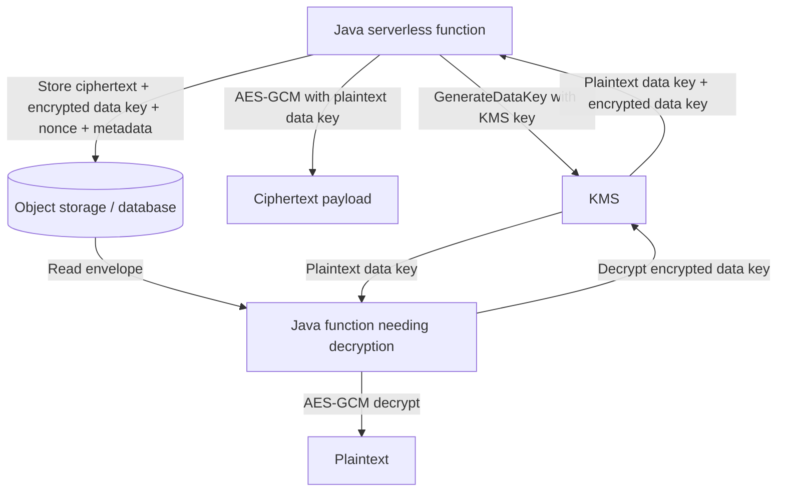

# Data Encryption and Key Management with KMS

Java serverless applications frequently store data in object storage, databases, queues, or secret stores. Data can be encrypted at the service layer, yet some business requirements demand stricter key control: who may decrypt, which tenant owns the data, how keys rotate, and how to investigate anomalous key usage.

A Key Management Service (KMS) provides capabilities to create and manage encryption keys, control key-usage permissions, execute cryptographic operations, and record activity. In serverless architectures, KMS is commonly used to encrypt data at rest, protect secrets, generate application data keys, and support envelope encryption when payloads exceed direct encryption API limits.

It is essential to distinguish a **KMS-managed key** from a **data key used to encrypt payloads**. Applications generally do not send large payloads directly to KMS for encryption. Instead, KMS generates a data key; the application uses the plaintext data key in memory to encrypt data symmetrically and stores the KMS-encrypted data key alongside the ciphertext. When decryption is required, the application sends the encrypted data key back to KMS to retrieve the plaintext data key.

This lesson covers encryption models, envelope encryption, key policies and lifecycle, Java SDK integration in Lambda, encrypting serverless data and resources, rotation, auditing, recovery, and common mistakes.

## 1. What problems does KMS solve?

If an application generates an AES key itself and stores it next to the encrypted data, anyone with storage read access can read both the ciphertext and the key. If the key is embedded in source code or environment variables, it can leak through repositories, logs, configuration files, or runtime read permissions. When keys are manually shared across multiple services, revocation and rotation also become hard to control.

KMS separates key-usage permissions from data-read permissions:

- KMS manages key material and provides encrypt/decrypt or data-key generation operations.
- IAM, key policies, and grants determine which principal may use a key for which actions.
- Encrypted data can be stored in S3, databases, or other systems without keeping plaintext keys next to the data.
- KMS API calls can be recorded via audit logs such as AWS CloudTrail.
- Key aliases and lifecycle policies let applications reference keys stably while the organization manages rotation.

KMS does not replace user authentication, business authorization, or TLS. A function with `kms:Decrypt` permission still must check whether the caller is authorized to read that record. TLS is still required to protect data in transit; KMS primarily manages keys and supports encrypting data at rest or at the application layer.

### Core concepts

| Concept | Meaning |
|---|---|
| KMS key | Logical resource representing a key managed by KMS and used in cryptographic operations |
| Key material | Underlying cryptographic material; for KMS-generated keys, applications cannot export plaintext key material |
| Key ID / ARN | Identifier of a key within an account/region |
| Alias | Friendly name pointing to a KMS key, which can be switched to another key |
| Data key | Data encryption key generated by KMS, typically used to encrypt payloads with AES-GCM |
| Ciphertext blob | KMS-encrypted copy of a data key; can be stored alongside data ciphertext |
| Key policy | Resource policy defining who may use or administer an AWS KMS key |
| Grant | Delegated permission granting a principal/service specific key actions and conditions |
| Encryption context | Additional key-value pairs authenticated with symmetric KMS operations; not secret data |

Naming and IAM models vary across cloud providers, but the principles of key management and separation of privileges remain similar.

## 2. Distinguishing encryption at rest, in transit, and application-level

Three protection layers address three distinct scopes:

| Layer | What does it protect? | Examples |
|---|---|---|
| Encryption at rest | Data persisted in storage, databases, queues, or backups | S3 SSE-KMS, SQS SSE-KMS, DynamoDB encryption at rest |
| Encryption in transit | Data moving across networks | HTTPS/TLS between clients, API Gateway, Lambda, and databases |
| Application-level encryption | Content encrypted before writing to storage services | Java encrypting a sensitive field with a data key before saving to a database |

Cloud service encryption at rest typically protects underlying storage media. However, services or principals with data-read permissions still receive plaintext through standard APIs. Application-level encryption is valuable when you want to restrict how many components can ever see plaintext—for example, allowing only one service to decrypt identity records or financial data.

Not every field needs application-level encryption. It adds complexity to querying, indexing, rotation, key access, and recovery. Identify which data needs protection, who needs plaintext, and for how long before choosing a model.

## 3. Envelope encryption: the right model for application data

Envelope encryption uses a KMS-protected key to encrypt a data key, while the data key encrypts the actual payload. For large payloads, this avoids sending entire payloads to KMS and leverages AES-GCM inside the JVM.



Encryption workflow:

1. The function authenticates and authorizes the write operation.
2. The function calls KMS `GenerateDataKey` with the configured KMS key.
3. KMS returns a plaintext data key and an encrypted data key.
4. The function uses the plaintext data key to encrypt the payload with AES-256-GCM.
5. The function stores the ciphertext, encrypted data key, nonce, encryption context, and envelope format version.
6. The function clears its copy of the plaintext data key from memory on a best-effort basis.

Decryption workflow:

1. The function authenticates the caller and checks read authorization on the record.
2. The function reads the envelope from storage.
3. The function verifies metadata/context matches the expected tenant, record, and purpose.
4. The function calls KMS `Decrypt` with the encrypted data key and the exact encryption context used at encryption time.
5. The function uses the plaintext data key to decrypt AES-GCM and verify the authentication tag.
6. The function returns plaintext over a protected channel, never logging plaintext or keys.

### Why use AES-GCM?

AES-GCM is an authenticated symmetric encryption mode. It protects confidentiality and detects ciphertext tampering. A nonce must never repeat under the same AES key. When generating a dedicated data key per payload, use a random 96-bit nonce for the single encryption operation and store the nonce alongside the ciphertext.

Never pair AES with an unauthenticated mode and skip integrity verification. If data has been modified, the system must detect it and refuse decryption.

### A KMS key is not a data key

A KMS key normally never leaves KMS in plaintext. A data key is an ephemeral key generated by KMS for application use. Applications must protect the plaintext data key during its brief stay in the JVM; never write it to databases, temporary files, logs, traces, or caches without an explicit policy.

With AWS KMS, the `Encrypt` operation on symmetric keys has a plaintext size limit (up to 4,096 bytes). For larger payloads, use envelope encryption via `GenerateDataKey` or the AWS Encryption SDK. Exact limits and semantics must be verified for your target service and region.

## 4. AWS KMS keys: key types and ownership

AWS KMS offers several key types based on management model and usage:

| Type | Who manages policies/rotation? | Use cases |
|---|---|---|
| AWS owned key | AWS owns and operates it; customers do not manage key policies directly | Default encryption for certain services with minimal key-policy customization |
| AWS managed key | AWS manages policies and lifecycle; customers cannot edit its key policy | Integrated service encryption with minimal dedicated administration |
| Customer managed key | Customer manages policies, aliases, tags, rotation, and deletion schedules | Dedicated auditing/permissions, cross-account access, or lifecycle control |

Customer managed keys provide fine-grained control alongside operational responsibility: protecting key policies, monitoring usage, handling rotation, keeping keys active long enough, and verifying decryption of older backups.

### Symmetric and asymmetric keys

- **Symmetric encryption key:** the same key material encrypts and decrypts. This is the standard choice for envelope encryption and data-at-rest encryption.
- **Asymmetric key:** consists of a public key and private key. The public key can be used for encryption/verification operations; KMS retains the private key for decryption/signing per key usage.
- **HMAC key:** creates/verifies message authentication codes, not a substitute for payload encryption.

Choose key spec and key usage based on purpose. You cannot arbitrarily convert an existing KMS key from encryption to signing. If requirements change, create a new key and perform an appropriate migration.

### Regions and multi-Region keys

Standard KMS keys are bound to a single region. If functions run across multiple regions and must decrypt data encrypted in another region, multi-Region keys can be used when semantics and policies align. Replica keys remain distinct regional resources whose policies and usage permissions must be configured. Do not pick multi-Region keys merely to avoid designing data routing; they broaden management scope and require checking data residency requirements.

## 5. Key policies, IAM policies, and grants

In AWS KMS, the key policy is the primary authority for key access. An IAM policy attached to a role grants KMS access only when the key policy enables IAM authorization. An IAM policy containing `kms:Decrypt` does not override a key policy that denies or omits that principal.

Three common mechanisms:

1. **Key policy:** resource policy attached directly to the KMS key defining which principals may administer or use the key.
2. **IAM identity policy:** policy attached to a user/role; takes effect when the key policy allows account IAM policies to delegate access.
3. **Grant:** delegates a specific set of operations to a principal/service, commonly used for service integrations and independently scoped lifetimes.

### Least privilege for Lambda

A Lambda that only encrypts data may need only `kms:GenerateDataKey` on one specific key. A function that decrypts envelopes needs `kms:Decrypt`. If one function performs both, grant only those two actions when genuinely required. Never grant `kms:*` or `Resource: "*"` account-wide to a runtime role.

Conceptual IAM policy example:

```json
{
  "Version": "2012-10-17",
  "Statement": [
    {
      "Sid": "UseOrderDataKey",
      "Effect": "Allow",
      "Action": [
        "kms:GenerateDataKey",
        "kms:Decrypt"
      ],
      "Resource": "arn:aws:kms:ap-southeast-1:111122223333:key/12345678-1234-1234-1234-123456789012"
    }
  ]
}
```

The ARN is illustrative only. The KMS key's key policy must also allow this role or delegate permissions to account IAM policies. Inside a key policy, `Resource` is normally `"*"` because the policy is attached directly to that single key; do not confuse that with an IAM identity policy granting access across all keys.

### Encryption context conditions

Key policies or IAM policies can constrain access using encryption context—for example, allowing `kms:GenerateDataKey` only when the context includes `application=orders`. This binds key usage to a specific purpose. Context must be constructed from trusted server-side data; never let clients supply arbitrary context values to bypass policy conditions.

Encryption context is not secret and can appear in CloudTrail. Never put passwords, tokens, emails, government IDs, or sensitive data into encryption context. Use non-sensitive technical identifiers such as service name, purpose, controlled internal tenant ID, and non-sensitive record IDs.

### Cross-account access

If a role in account A must use a key in account B, both sides are normally required:

- Key policy in account B allowing the principal/role from account A.
- IAM policy in account A allowing the role to call KMS actions on account B's key ARN.
- Matching network, identity, and account-organization conditions.

Never add an IAM policy only in the calling account and assume access works. Test with the exact runtime role and inspect CloudTrail when AccessDenied occurs.

## 6. Key lifecycle management

KMS keys must be governed from creation through retirement. A typical lifecycle includes:

1. Identify owner, purpose, data classification, and region.
2. Select appropriate key spec, key usage, origin, and key type.
3. Author least-privilege key policies separating key administrators from key users.
4. Create clear aliases, such as `alias/serverless/orders-data`.
5. Attach tags identifying owner, environment, application, and data class.
6. Enable rotation if supported by the key type/origin and required by policy.
7. Monitor usage, errors, grants, and policy changes.
8. Plan key replacement, re-encryption, or retirement.
9. Schedule deletion only after confirming no ciphertext, backups, or records still depend on the key.

### Using aliases in applications

Applications can configure `alias/serverless/orders-data` instead of hardcoding a key ID. Aliases let you switch to a new key during manual rotation without code changes. However, an alias is a mutable pointer; restrict who can update aliases and audit all changes.

For already encrypted data, encrypted data keys typically embed metadata letting KMS identify which key decrypts them. During decryption, do not rely solely on the current alias or assume older data uses the new key. Keep older keys enabled with decrypt permissions until dependent data/backups are migrated or pass retention.

### Automatic rotation and manual rotation

For symmetric customer managed keys with AWS KMS-generated key material and supported key types, automatic rotation can be enabled. KMS retains previous key material versions to decrypt older ciphertext while using the new version for subsequent encryptions. Specific rotation support and intervals depend on key type, origin, and current configuration.

Manual rotation typically creates a new KMS key, updates aliases or configs so new data encrypts with the new key, and migrates/re-encrypts old data when required. Never delete an old key merely because an alias now points to a new key.

Rotating a KMS key does not immediately re-encrypt all application-level data. With envelope encryption, old encrypted data keys still require the old key material to decrypt. With service encryption like S3 SSE-KMS, rotation is handled per service integration, though switching to a different customer managed key may require copying/re-encrypting objects.

### Disabling and scheduling deletion

Disabling a key blocks cryptographic operations requiring that key, so applications may fail to read data even though ciphertext remains intact. Scheduling deletion introduces a waiting period during which deletion can be canceled per service mechanics. Once a key is actually deleted, ciphertext depending solely on that key may become permanently unreadable.

Never schedule deletion just to "clean up resources" before inventorying data, backups, log archives, event replays, exports, and disaster recovery environments. Require owner sign-off and evidence that data has been migrated or expired past retention.

## 7. Envelope encryption in Java with AWS SDK for Java 2.x

In Java Lambda functions, use AWS SDK for Java 2.x `KmsClient` to generate and decrypt data keys. `KmsClient` is a thread-safe service client and should be reused within the same execution environment. Rely on the runtime/execution role's default credential provider; never hardcode access keys.

Maven dependency:

```xml
<dependency>
    <groupId>software.amazon.awssdk</groupId>
    <artifactId>kms</artifactId>
    <version>${aws.sdk.version}</version>
</dependency>
```

Manage `${aws.sdk.version}` via the AWS SDK BOM or project dependency management so SDK modules share compatible versions.

### Creating a shared KMS client

```java
import software.amazon.awssdk.regions.Region;
import software.amazon.awssdk.services.kms.KmsClient;

public final class KmsClients {
    private static final KmsClient INSTANCE = KmsClient.builder()
            .region(Region.of(System.getenv("AWS_REGION")))
            .build();

    private KmsClients() {}

    public static KmsClient get() {
        return INSTANCE;
    }
}
```

The client uses the AWS SDK default credential chain, which in Lambda reads credentials from the execution role. Each execution environment has its own JVM and client instance. Do not call `close()` at the end of each handler invocation; if your framework provides shutdown lifecycle hooks, you may close it there. In Lambda, processes can be reclaimed without reliable shutdown callbacks, so correctness must never depend on client-close hooks.

### Envelope structure

An envelope must retain enough metadata for future decryption:

| Field | Purpose |
|---|---|
| `ciphertext` | Payload encrypted with AES-GCM |
| `encryptedDataKey` | Data key encrypted by KMS |
| `nonce` | 96-bit nonce used with AES-GCM |
| `encryptionContext` | Context passed to KMS, which must match exactly upon decryption |
| `formatVersion` | Envelope format version supporting future migrations |
| `keyReference` | Key/alias or metadata for inventory and operations |
| `algorithm` | Encryption algorithm and parameters, e.g., `AES-256-GCM` |

Never store plaintext data keys. Never put secrets or PII into encryption context. Context should bind data to its purpose and resource identity so ciphertext cannot be swapped across records undetected.

### Data encryption example

```java
import software.amazon.awssdk.services.kms.KmsClient;
import software.amazon.awssdk.services.kms.model.DataKeySpec;
import software.amazon.awssdk.services.kms.model.GenerateDataKeyRequest;
import software.amazon.awssdk.services.kms.model.GenerateDataKeyResponse;

import javax.crypto.Cipher;
import javax.crypto.spec.GCMParameterSpec;
import javax.crypto.spec.SecretKeySpec;
import java.io.ByteArrayOutputStream;
import java.io.DataOutputStream;
import java.io.IOException;
import java.nio.charset.StandardCharsets;
import java.security.SecureRandom;
import java.util.Arrays;
import java.util.Map;
import java.util.TreeMap;

public final class EnvelopeCrypto {
    private static final int NONCE_BYTES = 12;
    private static final int GCM_TAG_BITS = 128;
    private static final SecureRandom RANDOM = new SecureRandom();

    private final KmsClient kms;
    private final String keyIdOrAlias;

    public EnvelopeCrypto(KmsClient kms, String keyIdOrAlias) {
        this.kms = kms;
        this.keyIdOrAlias = keyIdOrAlias;
    }

    public record Envelope(
            byte[] ciphertext,
            byte[] encryptedDataKey,
            byte[] nonce,
            Map<String, String> encryptionContext,
            String keyId,
            String algorithm,
            int formatVersion) {
        public Envelope {
            ciphertext = ciphertext.clone();
            encryptedDataKey = encryptedDataKey.clone();
            nonce = nonce.clone();
            encryptionContext = Map.copyOf(encryptionContext);
        }

        @Override
        public byte[] ciphertext() {
            return ciphertext.clone();
        }

        @Override
        public byte[] encryptedDataKey() {
            return encryptedDataKey.clone();
        }

        @Override
        public byte[] nonce() {
            return nonce.clone();
        }
    }

    public Envelope encrypt(byte[] plaintext, String tenantRef, String recordId)
            throws Exception {
        Map<String, String> context = Map.of(
                "application", "orders-service",
                "purpose", "order-record",
                "tenant-ref", tenantRef,
                "record-id", recordId
        );

        GenerateDataKeyResponse generated = kms.generateDataKey(
                GenerateDataKeyRequest.builder()
                        .keyId(keyIdOrAlias)
                        .keySpec(DataKeySpec.AES_256)
                        .encryptionContext(context)
                        .build()
        );

        byte[] dataKey = generated.plaintext().asByteArray();
        byte[] nonce = new byte[NONCE_BYTES];
        RANDOM.nextBytes(nonce);

        try {
            Cipher cipher = Cipher.getInstance("AES/GCM/NoPadding");
            cipher.init(Cipher.ENCRYPT_MODE,
                    new SecretKeySpec(dataKey, "AES"),
                    new GCMParameterSpec(GCM_TAG_BITS, nonce));
            cipher.updateAAD(canonicalContext(context));
            byte[] ciphertext = cipher.doFinal(plaintext);

            return new Envelope(
                    ciphertext,
                    generated.ciphertextBlob().asByteArray(),
                    nonce,
                    Map.copyOf(context),
                    generated.keyId(),
                    "AES-256-GCM",
                    1
            );
        } finally {
            // Best-effort: JVM/SDK may already have created additional copies in memory.
            Arrays.fill(dataKey, (byte) 0);
        }
    }

    static byte[] canonicalContext(Map<String, String> context) throws IOException {
        ByteArrayOutputStream bytes = new ByteArrayOutputStream();
        try (DataOutputStream output = new DataOutputStream(bytes)) {
            for (Map.Entry<String, String> entry : new TreeMap<>(context).entrySet()) {
                byte[] key = entry.getKey().getBytes(StandardCharsets.UTF_8);
                byte[] value = entry.getValue().getBytes(StandardCharsets.UTF_8);
                output.writeInt(key.length);
                output.write(key);
                output.writeInt(value.length);
                output.write(value);
            }
        }
        return bytes.toByteArray();
    }
}
```

This is an illustrative example for structured payloads and controlled contexts. In production, use a standard envelope serializer and a formally specified canonicalization. `tenantRef` and `recordId` must be opaque references without PII/secrets, sourced from verified business state rather than unvalidated caller inputs.

The example uses `byte[]` for readability, holding the payload in memory during encryption. For large objects, stream ciphertext to storage so the object is published only once encryption finishes, still persisting the nonce, encrypted data key, and envelope metadata. Consider the AWS Encryption SDK if you need streaming formats, key commitment, or library-managed envelopes.

### Decrypting envelopes

```java
import software.amazon.awssdk.core.SdkBytes;
import software.amazon.awssdk.services.kms.KmsClient;
import software.amazon.awssdk.services.kms.model.DecryptRequest;
import software.amazon.awssdk.services.kms.model.DecryptResponse;

import javax.crypto.Cipher;
import javax.crypto.spec.GCMParameterSpec;
import javax.crypto.spec.SecretKeySpec;
import java.util.Arrays;
import java.util.Map;
import java.util.Objects;

public final class EnvelopeDecryptor {
    private final KmsClient kms;

    public EnvelopeDecryptor(KmsClient kms) {
        this.kms = kms;
    }

    public byte[] decrypt(
            EnvelopeCrypto.Envelope envelope,
            String expectedTenantRef,
            String expectedRecordId) throws Exception {

        Map<String, String> context = envelope.encryptionContext();
        validateContext(context, expectedTenantRef, expectedRecordId);

        DecryptResponse decrypted = kms.decrypt(DecryptRequest.builder()
                .ciphertextBlob(SdkBytes.fromByteArray(envelope.encryptedDataKey()))
                .encryptionContext(context)
                .build());

        byte[] dataKey = decrypted.plaintext().asByteArray();
        try {
            Cipher cipher = Cipher.getInstance("AES/GCM/NoPadding");
            cipher.init(Cipher.DECRYPT_MODE,
                    new SecretKeySpec(dataKey, "AES"),
                    new GCMParameterSpec(128, envelope.nonce()));
            cipher.updateAAD(EnvelopeCrypto.canonicalContext(context));
            return cipher.doFinal(envelope.ciphertext());
        } finally {
            Arrays.fill(dataKey, (byte) 0);
        }
    }

    private static void validateContext(
            Map<String, String> context,
            String expectedTenantRef,
            String expectedRecordId) {
        if (!"orders-service".equals(context.get("application"))
                || !"order-record".equals(context.get("purpose"))
                || !Objects.equals(expectedTenantRef, context.get("tenant-ref"))
                || !Objects.equals(expectedRecordId, context.get("record-id"))) {
            throw new SecurityException("Encryption context does not match the requested record");
        }
    }
}
```

`expectedTenantRef` and `expectedRecordId` must come from verified database/authorization context. Never trust only the context persisted alongside ciphertext, because someone able to alter metadata could swap it. KMS requires the decryption context to match the encryption context; AES-GCM also authenticates AAD and rejects tampered ciphertext or context.

The encryption and decryption snippets are two complete classes that can live in the same package. In real projects, map KMS errors, format errors, and authentication tag errors clearly without leaking internal key IDs or cryptographic details in external responses.

### Persisting envelopes durably

Envelopes can be serialized as JSON/Avro/Protobuf or stored across separate columns. Persist `formatVersion` so algorithms or formats can evolve in the future. Non-sensitive metadata can be stored separately for filtering/search; sensitive plaintext must never be copied into indexes or logs.

Conceptual JSON structure:

```json
{
  "formatVersion": 1,
  "algorithm": "AES-256-GCM",
  "keyId": "arn:aws:kms:ap-southeast-1:111122223333:key/example",
  "ciphertext": "<base64-ciphertext>",
  "encryptedDataKey": "<base64-kms-ciphertext-blob>",
  "nonce": "<base64-12-byte-nonce>",
  "encryptionContext": {
    "application": "orders-service",
    "purpose": "order-record",
    "tenant-ref": "tenant-internal-42",
    "record-id": "order-123"
  }
}
```

Base64 is merely encoding for byte arrays, not encryption. Ciphertext and encrypted data keys must still be protected as sensitive data; encryption context is not secret, yet can leak sensitive metadata if poorly designed.

## 8. KMS in AWS Lambda and serverless services

A Java function can invoke KMS directly or rely on storage-service encryption integrations. These two models differ in where encryption happens and which principal needs permissions.

| Resource | KMS integration | Permissions typically required |
|---|---|---|
| Lambda environment variables | Lambda can encrypt config using a customer-selected KMS key | Role/service config requires decrypt permissions per Lambda and key-policy mechanics |
| SQS SSE-KMS | SQS encrypts messages stored in the queue | Producers/consumers and service principals require KMS permissions per queue/key policy |
| S3 SSE-KMS | S3 encrypts objects using KMS-protected data keys | Writing roles typically need `kms:GenerateDataKey`; reading roles typically need `kms:Decrypt` |
| DynamoDB encryption at rest | DynamoDB encrypts stored data with service- or customer-managed keys | Key administration and service-integration permissions; application does not necessarily call KMS directly |
| Secrets Manager | Secrets are encrypted under a KMS key | Secret-reading roles need `secretsmanager:GetSecretValue`; with customer managed keys, matching decrypt permissions are needed |
| Event/logging services | Certain services support customer managed keys | Service principal, resource policy, and IAM permissions per service documentation |

Exact permissions depend on configuration, key policies, service principals, and cross-account setup. Never copy an S3 policy onto SQS or Secrets Manager without checking the service's documentation.

### Encrypting S3 objects with SSE-KMS

If a function only needs to protect objects at rest, use server-side encryption rather than encrypting payloads manually. On upload, the SDK can instruct S3 to use a specific KMS key; on download, S3 decrypts transparently after verifying KMS permissions.

Conceptual example with AWS SDK for Java v2:

```java
PutObjectRequest request = PutObjectRequest.builder()
        .bucket(bucketName)
        .key(objectKey)
        .serverSideEncryption(ServerSideEncryption.AWS_KMS)
        .ssekmsKeyId(kmsKeyArnOrAlias)
        .build();

s3Client.putObject(request, RequestBody.fromBytes(content));
```

This is S3 SSE-KMS integration. The application never handles plaintext data keys directly. S3 manages data keys and calls KMS on the service's behalf. Both role policies and key policies must permit the operations. If requirements state that only one service may see plaintext even when other principals have S3 read access, evaluate application-level encryption instead of SSE-KMS alone.

### Secrets Manager and KMS

Never use KMS as a storage vault for passwords or API tokens. Use Secrets Manager, Parameter Store, or Key Vault to manage secrets, rotation, and access; those services use KMS to encrypt secrets at rest. Functions retrieve secrets using their runtime identity and cache them only under an explicit TTL/policy.

## 9. IAM configuration for Java Lambda

For example, a role for a function using envelope encryption requires KMS permissions on the exact key. A minimal policy might look like:

```hcl
data "aws_iam_policy_document" "kms_usage" {
  statement {
    sid    = "UseOrderDataKey"
    effect = "Allow"
    actions = [
      "kms:GenerateDataKey",
      "kms:Decrypt"
    ]
    resources = [var.kms_key_arn]
  }
}

resource "aws_iam_role_policy" "kms_usage" {
  name   = "order-worker-kms-usage"
  role   = aws_iam_role.lambda_execution.id
  policy = data.aws_iam_policy_document.kms_usage.json
}
```

This is only the identity policy. The key policy on `var.kms_key_arn` must also allow this role to use the key or delegate permission to account IAM policies. If the function only encrypts, omit `kms:Decrypt`; if it only decrypts, omit `kms:GenerateDataKey`.

Never grant administrative actions such as `kms:PutKeyPolicy`, `kms:ScheduleKeyDeletion`, `kms:DisableKey`, or `kms:CreateKey` to application execution roles. Separate runtime users from key administrators. Policy management, rotation, and deletion should run through dedicated operational pipelines/roles with approvals and auditing.

### Encryption context to constrain purpose

You can add conditions to IAM/key policies requiring an encryption context:

```json
{
  "StringEquals": {
    "kms:EncryptionContext:application": "orders-service",
    "kms:EncryptionContext:purpose": "order-record"
  }
}
```

This condition only works if every legitimate call supplies the matching context. When evolving schemas or contexts, roll out policy and application updates in a backward-compatible sequence. Since encryption context is not secret, never use it to store secrets or replace per-record authorization.

## 10. Connecting to KMS when Lambda runs inside a VPC

Lambda functions inside a VPC may need KMS access to generate or decrypt data keys. If the function lacks an egress route to the public KMS endpoint, calls will time out or fail to connect.

Common options:

- Route through a controlled NAT gateway/egress path to reach the public service endpoint.
- Create an interface VPC endpoint for AWS KMS inside the VPC where supported by the region and architecture.
- Configure endpoint security groups, DNS, and routes properly.
- Apply endpoint policies when restricting which APIs or principals may traverse the endpoint.

Do not confuse Lambda having IAM permissions with Lambda having a network path. AccessDenied typically points to policies; timeouts or connection errors require checking VPC endpoints, DNS, security groups, NAT, and endpoint policies.

In serverless architectures, cold starts and invocation spikes can create bursts of KMS API calls. Monitor KMS latency, throttling, and quotas. If a function calls KMS on every request, measure its impact on p95/p99 latency and invocation time budgets.

## 11. Performance, data-key caching, and quotas

Calling KMS on every payload increases API calls, latency, and cost. Conversely, caching plaintext data keys for too long expands blast radius if compromised and complicates rotation.

Options:

| Strategy | Advantages | Risks / trade-offs |
|---|---|---|
| GenerateDataKey per payload | Dedicated key per item, narrowest blast radius | Higher KMS call volume and latency |
| AWS Encryption SDK with bounded data-key caching | Reduces KMS calls for suitable workloads | Must bound age, bytes, and message count per key |
| Custom plaintext data-key cache | Can lower latency | Easy to create unbounded caches, hard rotation, higher leak and concurrency risk |
| Storage SSE-KMS | Service manages data keys and encryption | Does not provide application-level isolation; storage readers receive plaintext |

If using data-key caching, prefer purpose-built cryptographic libraries and enforce strict usage/TTL thresholds. Never cache plaintext keys indefinitely in a static map. Account for bytes and operations per key, cache lifetime, tenant boundaries, key rotation, and cache eviction after permission changes.

### Reusing KMS clients does not mean reusing data keys

`KmsClient` can be reused across invocations within the same execution environment because the SDK client is thread-safe. That does not mean you should reuse a plaintext data key across every request. The client is a service-connection object; a data key is cryptographic secret material with its own lifecycle and usage limits.

To reduce cold-start overhead, initialize `KmsClient` once at environment/application singleton scope. Align SDK timeouts/retries with the function timeout. Never infinitely retry AccessDenied, disabled-key, or invalid-encryption-context errors.

## 12. Rotation, re-encryption, and data migration

Rotation must be designed alongside envelope format and encrypted-data-key storage. Two cases exist:

1. **Automatic rotation of the same KMS key:** KMS keeps older key material to decrypt older ciphertext; applications continue using the key ID/alias without touching every record solely for automatic rotation.
2. **Switching to a new KMS key resource:** aliases/configs must be updated for new writes, and existing encrypted data keys or payloads may be re-encrypted depending on migration goals.

### Re-encrypting data keys

With envelope encryption, KMS `ReEncrypt` can re-wrap an encrypted data key from a source key to a destination key without ever returning the plaintext data key to the application. The AES-GCM payload does not necessarily need to be decrypted and re-encrypted if only the data-key wrapper changes and algorithm/metadata remain compatible.

Conceptual workflow:

1. Create the new KMS key with appropriate policies.
2. Grant `kms:ReEncryptFrom` on the old key and `kms:ReEncryptTo` on the new key to a migration role.
3. Iterate over records holding old encrypted data keys.
4. Call ReEncrypt with matching encryption contexts.
5. Update encrypted data keys/key references transactionally or with versioning.
6. Verify decryption using the new key.
7. Retain the old key until all data, backups, and replay windows no longer depend on it.

A dedicated migration role should hold broader permissions only temporarily and under auditing. Never grant `ReEncrypt` to every runtime function if runtime only needs encrypt/decrypt.

### Versioned envelope formats

Store `formatVersion` and `algorithm` so code can decrypt legacy records across upgrades. You can adopt dual-read/single-write:

- Read both old and new formats.
- Write new data using the new format.
- Run a background migration over older records.
- Track remaining records using the old format.
- Remove legacy support only once no data or backups require it.

Never change algorithms and drop old format support in the same deployment without inventorying all stored data first.

## 13. Auditing, logging, and detecting anomalous access

KMS is a critical security boundary. Monitor who invokes which actions, on which keys, from which services/roles, and with what outcomes.

On AWS, CloudTrail records KMS operations such as `GenerateDataKey`, `Decrypt`, `Encrypt`, `CreateGrant`, `PutKeyPolicy`, `DisableKey`, and `ScheduleKeyDeletion`. Forward logs to centralized logging/SIEM and alert on key policy modifications, unusual grant creation, or spikes in decryption volume.

Metrics and signals to monitor:

- `GenerateDataKey`/`Decrypt` counts by key and application.
- KMS throttling, AccessDenied, and invalid ciphertext/context errors.
- KMS call latency p50/p95/p99.
- Function retries triggered by KMS errors.
- Key rotation and key state transitions.
- Alias changes, grant changes, policy updates, and scheduled deletions.
- Anomalous decryption rates by tenant or service.

Never log plaintext data keys, plaintext payloads, secrets, tokens, or full encryption contexts if context could expose sensitive data. Context is recorded in CloudTrail per KMS semantics; design it as observable metadata.

### Separating business audits from KMS audits

CloudTrail shows that a principal called KMS, but does not fully explain the business reason. Applications should emit dedicated audit events containing operation ID, normalized record reference, tenant reference, authenticated actor, and allow/deny outcome—never plaintext. Use correlation IDs to link application audit events with CloudTrail events.

## 14. Backups, disaster recovery, and long-term decryptability

Ciphertext is useful only as long as the key needed to decrypt it remains accessible. Backup plans must include:

- Ciphertext and encrypted data keys.
- Envelope metadata: format version, algorithm, nonce, key reference, and context.
- Required KMS key resources and policies in the recovery region/account.
- Procedures to grant decrypt permissions to the disaster recovery role.
- Alignment between backup retention and when keys may be disabled or deleted.
- Restoring and decrypting test data using the exact DR role and region.

Do not merely verify that backup files exist. Perform test restores and decrypt a representative dataset. If keys reside in another region, verify accessibility and data residency rules. With imported key material or external key stores, availability also depends on the external key source and ability to re-import key material.

### Key deletion is a data-altering operation

Deleting a KMS key can render ciphertext permanently unreadable. Treat key deletion as a destructive data operation requiring an owner, approval, dependency inventory, restore testing, and a waiting period. A key with zero recent requests might still be needed for older backups or regulatory records retained for years.

## 15. Comparing KMS services across clouds

Product names and semantics differ, yet the shared goal is protecting key material, governing cryptographic operations, and integrating with workload identities.

| Cloud | Primary service | Common serverless integrations |
|---|---|---|
| AWS | AWS Key Management Service (KMS) | Lambda, S3 SSE-KMS, SQS SSE-KMS, DynamoDB, Secrets Manager |
| Microsoft Azure | Azure Key Vault Keys / Managed HSM | Azure Functions use managed identities to call Key Vault; storage/service encryption integrates per service |
| Google Cloud | Cloud Key Management Service (Cloud KMS) | Cloud Run/Functions use service accounts to call Cloud KMS; CMEK for supported services |

Never port policies verbatim across clouds. Azure Key Vault access models, Google Cloud IAM, and AWS key policies follow different semantics. When building multi-cloud Java abstractions, standardize business interfaces such as `encrypt`, `decrypt`, `generateDataKey`, and envelope metadata; dedicated adapters handle mapping to provider APIs, identities, and policies.

## 16. Common mistakes when using KMS

| Mistake | Consequence | Fix |
|---|---|---|
| Storing plaintext data keys alongside ciphertext | Storage readers can decrypt data | Store only encrypted data keys; keep plaintext keys transiently in memory |
| Calling KMS Encrypt for large payloads | Exceeds API plaintext limits | Use envelope encryption or the Encryption SDK |
| Reusing the same AES-GCM nonce with one key | Weakens security and risks leaking plaintext | Use unique nonces; prefer one data key per payload |
| Failing to persist encryption context/metadata | Cannot decrypt or verify target resource | Store context and format version inside the envelope |
| Putting PII/secrets into encryption context | Metadata can appear in audit logs | Use only non-sensitive technical context |
| Granting IAM policies while overlooking key policies | KMS returns AccessDenied | Verify key policies, IAM policies, grants, and cross-account rules |
| Granting `kms:*` to a Lambda role | Runtime can alter, delete, or administer keys | Separate key admins from key users; grant minimal actions |
| Hardcoding key IDs in many places | Hard to rotate keys and manage migrations | Use controlled aliases or configuration |
| Disabling/deleting keys while old backups remain | Data becomes undecryptable | Inventory dependencies and test restores before deletion |
| Caching plaintext data keys indefinitely | Expands blast radius and delays rotation | Use bounded/TTL caches or per-payload data keys |
| Lambda in VPC lacking a route to KMS | Timeouts on GenerateDataKey/Decrypt | Verify NAT or KMS VPC endpoint, DNS, and security groups |
| Logging plaintext/keys while debugging | Data and secrets leak | Log IDs, states, and correlation IDs; never keys/payloads |
| Treating SSE-KMS as application-level encryption | Storage-reading services still receive plaintext | Use envelope encryption when application-layer isolation is required |

## 17. Encryption design workflow for Java serverless

When introducing KMS into a Java function, follow this sequence:

1. **Classify data.** Identify sensitive fields, retention, residency, and who may read plaintext.
2. **Select encryption layer.** SSE-KMS for storage protection; envelope encryption for application-level control.
3. **Choose the KMS key.** Decide symmetric/asymmetric, customer-managed vs. service-managed, region, and owner.
4. **Design policies.** Separate key administrators, runtime roles, and migration roles; constrain actions/resources/context.
5. **Design the envelope.** Persist ciphertext, encrypted data key, nonce, algorithm, context, and format version.
6. **Integrate Java SDK.** Reuse KMS clients, rely on execution roles/managed identities, and never hardcode credentials.
7. **Harden runtime.** Never log plaintext/keys; zero local data keys best-effort; authorize callers before decrypting.
8. **Evaluate performance.** Measure KMS latency, quotas, retries, cold starts, and costs; cache data keys only under explicit policy.
9. **Plan rotation.** Use aliases, keep older keys for decryption, version envelopes, and plan migrations when replacing key resources.
10. **Audit and recover.** Monitor CloudTrail, policy changes, grants, decrypt spikes, and test backup restores.

## 18. Pre-production checklist

- [ ] Data is classified with clear justification for application-level encryption.
- [ ] Envelope encryption uses data keys and AES-GCM or a vetted cryptographic library.
- [ ] Nonces never repeat under the same data key; authentication tags are always verified.
- [ ] Encrypted data key, nonce, context, algorithm, and format version are stored completely.
- [ ] Encryption context contains no secrets/PII and comes from trusted sources.
- [ ] KMS keys have assigned owners, aliases, tags, policies, and rotation strategies.
- [ ] Key policies and IAM policies allow only the intended runtime role, actions, and keys.
- [ ] Key administrators are separated from application execution roles.
- [ ] KMS clients are reused; credentials come from runtime identity.
- [ ] Functions inside VPCs have a verified network path to KMS.
- [ ] KMS latency, throttling, retries, and quotas have been measured.
- [ ] Plaintext data keys and plaintext payloads never appear in logs or secondary stores.
- [ ] CloudTrail/audit alerts cover policy, grant, alias, disable, and deletion changes.
- [ ] Rotation, re-encryption, backup restores, and key recovery have been tested.
- [ ] An inventory proves no key is deleted while ciphertext or backups still depend on it.

## Conclusion

KMS enables secure key management and fine-grained usage control in serverless applications. For large payloads or application-level encryption, envelope encryption lets KMS protect data keys while Java encrypts payloads with AES-GCM. Operating safely requires pairing key policies with least-privilege IAM, keeping secrets out of encryption contexts, planning aliases and rotation, reusing KMS clients across invocations, auditing via CloudTrail, and testing backup decryption. Always treat disabling or deleting a key as a potentially irreversible data-loss event, not routine resource cleanup.
