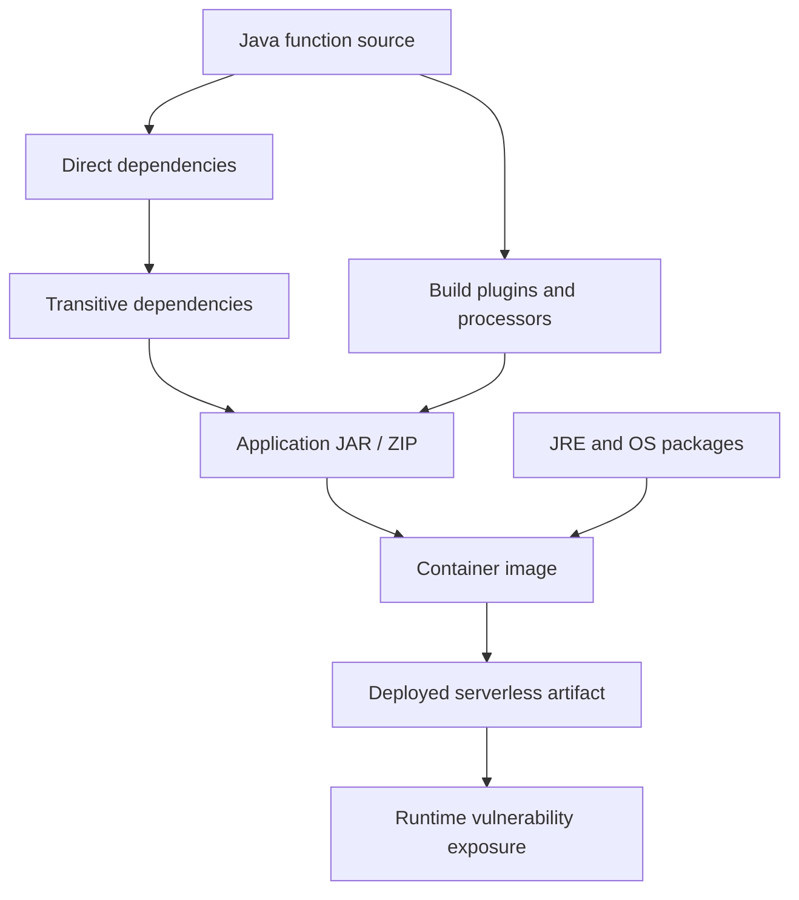
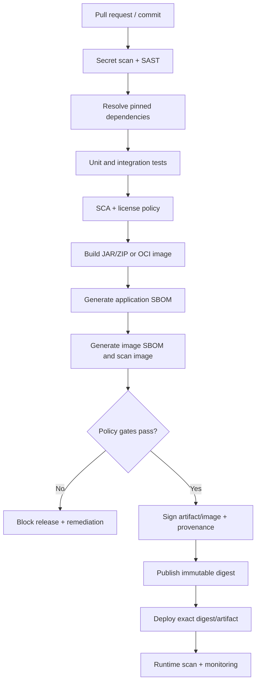

# Securing Dependencies, Generating SBOMs, and Scanning Images

A Java serverless function might contain only a handful of business classes, yet the deployment artifact typically pulls in dozens or hundreds of libraries: frameworks, JSON parsers, HTTP clients, database drivers, cloud SDKs, logging libraries, and transitive dependencies. If any library in that chain contains a vulnerability, the function can still be affected even though the team never directly wrote or invoked the vulnerable code path.

For functions packaged as JAR/ZIP files, risks reside in application dependencies and the platform-managed runtime. For functions deployed as container images, additional risk comes from the JRE/JDK, base OS, system packages, shell utilities, and image layers. Therefore, securing the software supply chain requires combining **dependency management**, **SBOMs (Software Bill of Materials)**, and **artifact/container image scanning**.

An SBOM records which components were included in a build. Scanners match those components against vulnerability databases, licenses, and policies. Signatures and provenance verify which pipeline built an artifact and whether it was altered afterward. These controls complement one another; no single tool proves an artifact is completely safe.

## 1. Dependencies are part of the attack surface

In Java, dependencies originate from multiple sources:

- Direct dependencies declared in `pom.xml` or `build.gradle`.
- Transitive dependencies pulled in by other libraries.
- Build plugins, annotation processors, compiler plugins, and packaging tools.
- JARs manually copied into a `lib` directory or bundled into an image.
- Runtime base images, JRE/JDK distributions, and OS packages.
- Extensions or SDKs provided by the serverless platform.

For example, an application uses an HTTP client; the HTTP client pulls in a codec library; the codec library depends on a parser. A vulnerability in that parser can ship inside the artifact even though application source code never imports the parser directly.



A ZIP-deployed function might omit an OS or JRE because the platform manages the runtime. That does not eliminate risk: you still need to know the runtime version, bundled libraries, and how the provider patches platform components. With container deployments, the development team owns updating the base image and all packaged OS/application packages.

## 2. Distinguishing direct, transitive, and build-time dependencies

Not every dependency is loaded or executed in production. Distinguish scope and purpose:

| Category | Examples | Risks to evaluate |
| --- | --- | --- |
| Compile/runtime | Jackson, AWS SDK, JDBC driver | Loaded into the function at runtime |
| Provided/platform | APIs or libraries supplied by the runtime | Must verify the actual deployed environment version |
| Test | JUnit, Mockito, Testcontainers | Usually absent from runtime artifacts, yet still affect build/test pipelines |
| Build plugin | Maven Surefire, compiler plugin, Gradle plugin | Runs in CI; malicious plugins can read source, tokens, or tamper with artifacts |
| Annotation processor | Lombok or code-generating processors | Executes during compilation with access to the build environment |
| OS/runtime package | JRE, libc, CA certificates, shell utilities | Lives inside the container image or is managed by the platform |

SCA (Software Composition Analysis) should cover both runtime dependencies and critical build components. Never ignore plugins merely because they stay out of the final JAR: plugins execute in CI with source access and can reach credentials if the pipeline grants overly broad privileges.

### Inspecting the dependency tree

With Maven:

```bash
mvn dependency:tree
mvn dependency:tree -Dverbose
```

The first command displays the dependency tree; `-Dverbose` reveals dependencies omitted due to conflicts or mediation. When a vulnerability appears, trace the inclusion path to identify which parent library must be upgraded.

With Gradle:

```bash
./gradlew dependencies
./gradlew dependencyInsight --dependency jackson-databind --configuration runtimeClasspath
```

`dependencyInsight` explains why a particular version was selected within a configuration. Inspect `runtimeClasspath` and relevant build/test configurations rather than looking solely at directly declared dependencies.

## 3. Pinning versions and controlling dependency sources

Builds must be reproducible. If the same commit resolves one version today and a different version next week due to dynamic version declarations, the artifact can change without a corresponding code review.

Principles to apply:

- Pin exact versions for dependencies and critical build plugins.
- Use controlled BOMs (Bills of Materials) to align libraries within an ecosystem, such as Spring Boot or the AWS SDK.
- Avoid dynamic versions like `1.+`, `latest.release`, or `SNAPSHOT` dependencies in production builds.
- Use trusted repositories, avoid adding unnecessary repositories, and protect private artifact repository credentials.
- Verify checksums/signatures where supported by tools and repositories.
- Review dependency updates like source code changes: inspect release notes, breaking changes, and advisories.
- Commit lockfiles or dependency verification metadata where supported by the build tool.

### Gradle dependency locking

Gradle supports dependency locking to record resolved versions for configurations. You can enable locking across configurations:

```groovy
dependencyLocking {
    lockAllConfigurations()
}
```

Once configured, resolve dependencies and write lock state:

```bash
./gradlew dependencies --write-locks
```

Commit generated lockfiles to source control and update them via reviewed pull requests. Locking ensures builds resolve the exact locked versions; it does not prove libraries are free of vulnerabilities. Continue scanning locked state and updating when advisories appear.

Gradle also supports dependency verification metadata to verify artifact checksums or signatures:

```bash
./gradlew --write-verification-metadata sha256 help
```

That command generates metadata from downloaded artifacts; the team must review and commit the output rather than blindly trusting checksums captured from an uncontrolled build. When dependencies change legitimately, update metadata through code review.

### Maven dependency management

Maven core lacks a built-in dependency lockfile equivalent to Gradle dependency locking across all projects. You can improve reproducibility by:

- Declaring explicit versions or importing version-pinned BOMs in `dependencyManagement`.
- Pinning plugin versions under `build/plugins` and governing plugin repositories.
- Using Maven Enforcer to enforce dependency convergence, version rules, and JDK/toolchains.
- Saving dependency tree/SBOM outputs per build to diff changes.
- Using an internal repository manager if the organization needs proxy/cache/allowlist controls over artifacts.

BOM import example:

```xml
<dependencyManagement>
    <dependencies>
        <dependency>
            <groupId>software.amazon.awssdk</groupId>
            <artifactId>bom</artifactId>
            <version>${aws.sdk.version}</version>
            <type>pom</type>
            <scope>import</scope>
        </dependency>
    </dependencies>
</dependencyManagement>
```

Version properties must be pinned explicitly in the project or parent POM. A BOM aligns module versions within one library family; it does not replace CVE, license, or checksum checks.

## 4. Managing dependency vulnerabilities

SCA scanners typically match package/version coordinates against advisory databases such as CVEs, the GitHub Advisory Database, or vendor feeds. For Java, coordinates are commonly expressed as Maven coordinates (`groupId:artifactId:version`) or Package URLs (PURLs).

A finding should be triaged across multiple factors:

- **Severity:** severity score per CVSS or the scanner's rating system.
- **Exploitability:** is there a public exploit, active exploitation in the wild, or exploitability under your application's conditions?
- **Reachability:** does the function actually load/call the affected code path? Not every scanner performs accurate reachability analysis.
- **Exposure:** does the function expose public endpoints, process untrusted inputs, or run with broad permissions?
- **Fix availability:** is there a patched version, workaround, or compatible upgrade?
- **Runtime scope:** is the package actually bundled in the production artifact, or only present in test/build scope?

Never dismiss a CVE simply because a function receives low traffic. A public function accepting untrusted input still exposes a major attack surface even if invoked only a few times a day. Conversely, a finding in a test-only dependency may not affect runtime, yet still warrants evaluating build-pipeline risk.

### Finding remediation workflow

1. Identify the affected package, version, dependency source, and impacted artifacts/images.
2. Inspect the upstream advisory, affected versions, exploit preconditions, and patched versions.
3. Determine whether the dependency is direct or transitive; trace parent dependencies if transitive.
4. Upgrade the parent library/BOM or override the version if compatible and vendor-supported.
5. Run unit/integration tests and check for API/behavior changes.
6. Rebuild the artifact/image, generate a fresh SBOM, and rescan.
7. Deploy the new revision/image; confirm older revisions are replaced or drained.
8. Record remediation evidence and track findings in registries/runtime scanners.

If upgrading is temporarily blocked, document the rationale, blast radius, compensating controls, owner, and exception expiration date. Never create permanent suppressions merely to make pipelines green.

## 5. What is an SBOM and what is it used for?

An SBOM is a structured inventory of software components inside a product or artifact. It answers: which libraries does this build contain, at what versions, from which origins, with what dependency relationships, and under what declared licenses.

Two common standards:

- **CycloneDX:** an SBOM and risk-data standard developed by OWASP CycloneDX; supports components, dependency relationships, vulnerabilities, and rich metadata.
- **SPDX:** an ISO/IEC standard for describing packages, files, licenses, copyrights, and relationships in software.

SBOMs can use JSON, XML, or text formats depending on the standard/tool. In CI/CD, JSON is usually easiest for scanners and governance tools to ingest.

A useful SBOM should include:

- Product name, version/release, or build identifier.
- Generation timestamp and SBOM generator tool.
- Component name, version, and supplier/author where known.
- Package URL (PURL), CPE, or equivalent identifier where available.
- Component or artifact hashes/checksums when supported by the tool.
- License metadata and external references/advisories.
- Dependency relationships (depends on, contains) where determined by the tool.
- Scope and inventory source: application, OS package, runtime, or build component.

An SBOM is not a safety certificate and does not automatically discover every vulnerability. It is a point-in-time build inventory; scanners must match that inventory against current advisory feeds to uncover risks. An SBOM missing OS layers or failing to recognize shaded JARs can overlook components.

## 6. Generating SBOMs for Java artifacts with the CycloneDX Maven plugin

For Maven, the CycloneDX plugin can generate an SBOM from the project's dependency graph. Add the plugin to `pom.xml` and pin an organization-approved version:

```xml
<build>
    <plugins>
        <plugin>
            <groupId>org.cyclonedx</groupId>
            <artifactId>cyclonedx-maven-plugin</artifactId>
            <version>${cyclonedx.maven.plugin.version}</version>
            <executions>
                <execution>
                    <phase>package</phase>
                    <goals>
                        <goal>makeAggregateBom</goal>
                    </goals>
                </execution>
            </executions>
        </plugin>
    </plugins>
</build>
```

Then run:

```bash
mvn -B clean verify
```

The plugin typically writes CycloneDX JSON/XML files under `target` (exact filenames depend on goal and plugin configuration). Inspect the generated output and archive it alongside the build artifact. In multi-module projects, an aggregate BOM gives a holistic view of module dependencies; if deploying separate function artifacts, generate an SBOM matching each deployed artifact.

Never embed secrets or sensitive environment details in SBOM metadata. Bind each SBOM to an artifact version/hash to avoid confusing one build's inventory with another binary.

## 7. Generating SBOMs for Java artifacts with Gradle

Gradle offers a CycloneDX plugin to generate SBOMs from selected configurations. Example declaration in `build.gradle`:

```groovy
plugins {
    id 'java'
    id 'org.cyclonedx.bom' version '<approved-plugin-version>'
}

cyclonedxBom {
    includeConfigs = ['runtimeClasspath']
    skipConfigs = ['testCompileClasspath', 'testRuntimeClasspath']
    projectType = 'application'
    schemaVersion = '1.6'
    destination = file("$buildDir/reports")
    outputName = 'application-sbom'
    outputFormat = 'json'
}
```

Run the task:

```bash
./gradlew clean build cyclonedxBom
```

Extension/property names can vary across plugin versions; check the documentation for your pinned version. The example includes only `runtimeClasspath` in the application SBOM to focus on deployed components; if you want build/test inventories, generate a separate SBOM or expand configurations. Clearly document scope so consumers do not mistake a runtime SBOM for the entire repository's dependencies.

## 8. Container image SBOMs vs. JAR SBOMs

SBOMs generated from Maven/Gradle primarily describe application dependencies known to the build tool. They may omit:

- Linux base image packages.
- JRE/JDK and system libraries.
- Binaries copied manually into the image.
- Native libraries and files not recognized as packages.
- Components in layers inherited from the base image.

Therefore, for container-deployed Java functions, produce both an application SBOM and a final-image inventory/SBOM. Tools such as Syft or Trivy can inspect images and generate SBOMs from detected packages and files.

Syft example:

```bash
syft packages registry.example.com/orders-function:1.8.2 \
  -o cyclonedx-json=orders-image.cdx.json
```

Trivy SBOM generation example:

```bash
trivy image --format cyclonedx \
  --output orders-image.cdx.json \
  registry.example.com/orders-function:1.8.2
```

Use immutable image digests instead of mutable tags when recording build evidence. Tag `1.8.2` can be overwritten to point to another image if the registry permits tag mutation; digests uniquely identify exact image contents. Bind SBOMs to their corresponding digests.

## 9. Scanning Java project dependencies

You can run OWASP Dependency-Check or your organization's SCA platform to inspect Maven/Gradle dependencies. Maven example:

```bash
mvn org.owasp:dependency-check-maven:check
```

Dependency-Check analyzes dependencies and matches them against vulnerability data; output can contain false positives or imprecise component identifications. Review reports and configure suppressions with clear justification, narrow scope, owners, and expiration dates.

A pipeline can run multiple check types:

| Check | Scope |
| --- | --- |
| Dependency tree/convergence | Version conflicts, transitive dependencies, and unexpected versions |
| SCA | CVEs/advisories across libraries and packages |
| License scan | Licenses incompatible with distribution policies |
| Secret scan | Tokens/passwords accidentally committed or packaged |
| SAST | Insecure code patterns in source code |
| SBOM generation | Build component inventory |
| Image scan | OS packages, JRE, application dependencies, and image misconfigurations |

No single scanner replaces code reviews, testing, threat modeling, or runtime monitoring.

## 10. Scanning OCI images with Trivy

Trivy scans for vulnerabilities, misconfigurations, secrets, and licenses according to configured modes. Example image scan:

```bash
trivy image --scanners vuln,misconfig,secret \
  --severity HIGH,CRITICAL \
  --exit-code 1 \
  registry.example.com/orders-function:1.8.2
```

`--exit-code 1` returns a non-zero exit status when findings match the selected severities; CI can use this to fail builds. Keep scanner versions and vulnerability databases updated. Do not scan only a local tag before pushing and skip scanning the actual deployed digest.

You can also scan the filesystem prior to building:

```bash
trivy fs --scanners vuln,misconfig,secret --severity HIGH,CRITICAL .
```

Filesystem scans catch secrets or problematic dependency manifests early, but do not replace image scans. Only image scans inspect the packages and layers actually shipped in the final image.

### Scanning by digest

After building/pushing, capture the digest returned by the registry and scan that exact digest:

```bash
trivy image registry.example.com/orders-function@sha256:<image-digest>
```

Deploy the exact scanned digest. Whenever rebuilt or when the base image changes, the digest changes and requires a fresh inventory/scan. Never scan a tag and then deploy that tag after another pipeline could have overwritten it.

## 11. Scanning images with Grype and registry scanners

Grype can scan either images or SBOMs. Examples:

```bash
grype registry.example.com/orders-function@sha256:<image-digest>
grype sbom:orders-image.cdx.json
```

Scanning SBOMs lets you re-evaluate inventories as advisory feeds update, even without rebuilding the image. Accuracy still depends on the completeness and accuracy of the SBOM.

Registries and cloud platforms also offer built-in scanners, such as Amazon ECR image scanning, Google Artifact Analysis, or Microsoft Defender for Cloud container registry integrations depending on service and configuration. Registry scanning can continue evaluating images after push or as new advisories appear. Verify scanner engine, package coverage, feed refresh frequency, region availability, and service pricing.

Never assume registry scanning is active merely because an image sits in a registry. Verify repository policies, scan modes, permissions to view findings, and alert routing. For functions deployed as ZIP/JAR packages, registry image scanners cannot see the artifact; scan the JAR/ZIP and dependency graph separately.

## 12. Designing secure Docker images for Java functions

Smaller images with fewer packages and minimal privileges shrink the attack surface and reduce findings to triage. Example multi-stage build separating the Maven build environment from runtime:

```dockerfile
FROM maven:3.9-eclipse-temurin-21 AS build
WORKDIR /workspace
COPY pom.xml .
COPY src ./src
RUN mvn -B -DskipTests package

FROM eclipse-temurin:21-jre
WORKDIR /app
COPY --from=build /workspace/target/function.jar /app/function.jar
USER 10001:10001
ENTRYPOINT ["java", "-jar", "/app/function.jar"]
```

This is a skeletal example. In production, full builds and tests should run in CI; the final image-build step receives only tested artifacts. Choose maintained JRE/base images receiving security patches. When using distroless or minimal images, verify CA certificates, timezones, native libraries, and required diagnostic tooling.

Hardening principles:

- Use multi-stage builds to exclude Maven, compilers, source, and caches from runtime images.
- Choose minimal base images that still receive active vendor security patches.
- Pin base images by digest in production workflows; proactively update digests when patches release.
- Run as a non-root user; drop unnecessary Linux capabilities.
- Never copy `.env` files, credentials, SSH keys, token-bearing Maven settings, or local files into images.
- Use `.dockerignore` to exclude stale `target` folders, `.git`, secret files, and unnecessary docs.
- Keep filesystems read-only where supported by the application; use only runtime-provided temp directories when needed.
- Never run sidecar shells or daemons if the function only needs a single Java process.
- Log to stdout/stderr and handle SIGTERM/graceful shutdown per platform semantics.
- Configure appropriate CPU/memory, timeouts, and concurrency; constrain runtime IAM permissions.

A minimal image is not automatically secure. If the base image is unpatched or missing required CA certificates, a small image still carries risk and can cause operational failures.

## 13. Distinguishing image scans, dependency scans, and configuration scans

These three scan types answer different questions:

| Scan type | Question | Example finding |
| --- | --- | --- |
| Dependency/SCA | Which app/build libraries have advisories or disallowed licenses? | A Jackson version affected by a CVE |
| Container image scan | Which OS packages/JRE/libraries inside the final image have CVEs? | Outdated OpenSSL or OS package; JRE package with advisory |
| Image/configuration scan | Which image/deployment settings increase risk? | Running as root, mutable image tags, missing health/permission controls |

An application can pass SCA while its container image still contains OS vulnerabilities. Conversely, an image scanner may fail to detect a dependency shaded/relocated inside a fat JAR. Combine scans at source/build-artifact level and on the final image.

Secret scanning should also run against both source and images. A secret copied into one layer and deleted in a later layer disappears from the final filesystem yet remains in layer history bytes. Proper remediation requires rebuilding a clean image from secret-free source, rotating exposed credentials, and preventing the file from entering the build context.

## 14. CI/CD pipeline for Java serverless

A baseline pipeline should produce immutable artifacts, verify them, and deploy the exact verified artifact:



Recommended execution order:

1. Run secret scanning and SAST before building.
2. Resolve pinned dependencies from trusted repositories.
3. Run unit/integration tests and license checks.
4. Build the JAR/ZIP or image once.
5. Generate an SBOM bound to build ID and artifact hash.
6. Scan dependencies and the final image.
7. Enforce policy gates and handle exceptions.
8. Sign the artifact/image and emit provenance/attestations where supported.
9. Publish under an immutable digest.
10. Deploy the exact scanned digest; record release metadata for rollbacks.
11. Monitor for new vulnerabilities disclosed after build time.

For Lambda ZIPs or Azure Functions packages, there is no container image to scan; still run SCA, artifact SBOM generation, and secret scanning over the package. For Cloud Run or Lambda container images, scan both application dependencies and OS/runtime layers.

## 15. Policy gates: when should a build fail?

Do not apply a single rigid CVSS threshold across every repository. Policies should weigh severity, exploitability, exposure, fix availability, and artifact type.

Starter policy example:

| Finding | Recommended action |
| --- | --- |
| Actively exploited Critical with fix on a public/reachable function | Block release; require upgrade or approved mitigation |
| Critical in a package absent from the runtime artifact | Verify scope/false positive; document evidence and time-bound exception if appropriate |
| High with reachable path to an endpoint handling untrusted input | Prioritize fixing before release; optionally block per org policy |
| Medium/Low with no exploit and unreachable | File backlog item with remediation SLA per risk policy |
| Disallowed license | Block if violating distribution/legal policy |
| Real secret in source/image | Fail build, revoke/rotate credential, and scrub from artifact |
| Container running as root or unsupported base image | Block per hardening policy or require owner-approved exception |

CVSS, EPSS, and Known Exploited Vulnerabilities catalogs aid prioritization. They do not replace architectural and exposure analysis of the function. Policies must define owners, SLAs, exception workflows, expiration dates, and risk-acceptance evidence.

### Exceptions and suppressions

A finding may be temporarily exempted when:

- The scanner is verified to have misidentified the package/version.
- The dependency is not packaged or is unreachable under the advisory's preconditions, backed by technical evidence.
- No compatible patch exists yet and concrete compensating controls are active.
- Risk is accepted by an authorized owner for a bounded period.

Every exception should record CVE/advisory ID, package, artifact/image digest, rationale, scope, compensating controls, approver, and expiration date. Never suppress an entire package or severity tier simply to reduce finding counts.

## 16. Signing, provenance, and artifact integrity

An SBOM tells you what an artifact contains; signatures verify the artifact actually came from a trusted pipeline; provenance describes the source and build process.

A strong supply chain produces:

- Artifact digests (SHA-256) for JAR/ZIPs or OCI images.
- SBOMs bound to those digests.
- Build provenance/attestations describing source commit, builder, build workflow, and materials.
- Digital signatures over images/artifacts or attestations.
- Policies verifying signatures/provenance prior to deployment.

For OCI images, Sigstore Cosign can sign by digest. Illustrative example using keyless signing in CI with OIDC identity:

```bash
cosign sign --yes registry.example.com/orders-function@sha256:<image-digest>
cosign verify registry.example.com/orders-function@sha256:<image-digest>
```

Keyless signing still requires a trust policy checking the OIDC issuer, repository/workflow identity, and certificate identity. Never accept a signature merely because "a signature exists"; verify who signed, from which workflow, and for which digest.

For non-OCI JAR/ZIP artifacts, sign artifacts or emit attestations using compatible organizational mechanisms. Not all serverless platforms natively verify SBOM/provenance signatures before deployment; where platforms lack native enforcement, enforce verification in CI/CD or admission/deployment gates.

## 17. Monitoring vulnerabilities after deployment

An SBOM generated today may have zero findings, yet a newly disclosed CVE tomorrow can affect a component inside an already-deployed artifact. Security scanning therefore does not end in CI.

Required ongoing practices:

- Retain SBOMs and digests for every active release.
- Periodically rescan stored SBOMs/images against updated vulnerability feeds.
- Enable registry scanning/continuous assessment where supported.
- Track base image/JRE security advisories and patch schedules.
- Map findings to service/function owners, environments, and running versions.
- Maintain fast rebuild/redeploy workflows for critical CVEs.
- Track older images, revisions, function versions, and artifacts still active.

If a scanner flags a vulnerability in a newer image, merely building a replacement image is insufficient. Verify deployments rolled over to the new digest, traffic drained from old revisions, and rollback policies will not accidentally redeploy the vulnerable image to production.

## 18. Java serverless specifics to watch

### Fat JARs and shaded dependencies

Spring Boot executable JARs or shaded JARs bundle many dependencies into a single artifact. Scanners must inspect nested JARs, package metadata, and versions. Verify your SBOM lists all runtime libraries; if not, supplement inventory with archive/image inspection tools.

### Native images

GraalVM native images reduce startup time and memory, compiling Java dependencies into a native binary. Generate build SBOMs from the dependency graph prior to native compilation and combine them with OS/native library inventories from the final image. Scanners inspecting only compiled binaries may miss or misidentify Java components.

### JRE and base images

The JDK is needed only at build time; runtime typically needs only a JRE or native executable plus runtime libraries. Still, base images and JREs must stay patched. Pinning digests makes builds reproducible, yet pinning an old digest indefinitely freezes vulnerabilities in place; automate proposals for updated digests.

### Function ZIPs and managed runtimes

For functions deploying JAR/ZIP packages onto managed Java runtimes, scan application-bundled dependencies and packages. Track the cloud provider's managed runtime versions, deprecation timelines, and patching behavior. You cannot directly scan OS/JRE layers the provider does not expose; instead monitor security bulletins, runtime update policies, and redeploy when needed.

### Plugins and build environments

Maven/Gradle plugins execute during CI and can run arbitrary code. Pin plugin versions, scope CI token privileges, use ephemeral runners, block fork pull requests from accessing production secrets, and protect artifact repository credentials.

## 19. Metrics and evidence to retain

| Evidence / metric | Purpose |
| --- | --- |
| SBOM per artifact digest | Pinpoints exact components inside a release |
| SCA/image scan reports | Records CVEs, licenses, and misconfigurations at scan time |
| Exception register | Tracks temporarily accepted findings and expiration dates |
| Build provenance | Traces source, builder, and workflow producing the artifact |
| Signature verification results | Confirms artifacts are unmodified and from trusted identities |
| Base image/JRE versions | Guides runtime patch planning |
| Mean time to remediate (MTTR) | Measures elapsed time from discovery to patched deployment |
| Vulnerable deployed artifact count | Shows how many functions/revisions still run impacted images |
| Scan coverage | Share of production artifacts with valid SBOMs and scans |

SBOMs and scan reports can reveal package names, versions, and internal structure. Store them in access-controlled artifact repositories with appropriate retention; internal application SBOMs do not necessarily need to be public.

## 20. Common mistakes

1. **Scanning only direct dependencies.** Vulnerabilities frequently hide in transitive dependencies.
2. **Scanning only source or JARs.** Container images can still harbor vulnerable OS/JRE packages.
3. **Scanning images while ignoring build plugins.** Malicious plugins can compromise CI before the image is even built.
4. **Generating SBOMs without binding digests.** Inventories can be misattributed to the wrong binary.
5. **Generating SBOMs from dependency graphs without inspecting the final image.** Base images and system packages are missed.
6. **Scanning a mutable tag and deploying a changed tag.** Always scan and deploy the exact digest.
7. **Using small base images that are unpatched.** Fewer packages does not equal safe.
8. **Pinning dependencies and forgetting to update.** Reproducible builds do not replace vulnerability remediation.
9. **Failing on every finding without triage.** False positives and test-only dependencies create noise; use risk-based policies.
10. **Suppressing findings indefinitely.** Exceptions need owners, evidence, and expiration dates.
11. **Scanning only at build time.** New CVEs appear post-deploy; continuous reassessment is required.
12. **Treating an SBOM as a safety certification.** An SBOM is an inventory, not proof components are vulnerability-free.

## 21. Workflow for securing dependencies and images for Java functions

1. **Inventory:** identify whether the function artifact is a JAR/ZIP or OCI image; list runtime, build, and base-image dependencies.
2. **Control:** pin dependencies/plugins, manage BOMs/lockfiles, repositories, and checksums.
3. **Test:** run unit/integration tests and SAST before packaging.
4. **Analyze:** run SCA, license scans, and secret scans over source/build graphs.
5. **Build:** produce the artifact/image once atop a maintained base image.
6. **Describe:** generate application and image SBOMs bound to digest/build ID.
7. **Scan:** scan the final artifact/image; triage findings by severity, exploitability, and exposure.
8. **Gate:** enforce release policies; require owners and expiration dates for exceptions.
9. **Attest:** sign artifacts/images and provenance where pipeline tooling supports it.
10. **Deploy:** roll out the exact scanned and signed digest/artifact.
11. **Monitor:** rescan inventories, track new advisories, and watch base-image patches.
12. **Remediate:** upgrade dependencies/base images, test, rebuild, scan, and deploy updated releases.

## 22. Pre-production checklist for Java functions

- [ ] Have direct, transitive, build-plugin, and annotation-processor dependencies been reviewed?
- [ ] Are critical dependencies and plugins pinned via versions/BOMs?
- [ ] Are Gradle lockfiles or equivalent version controls committed?
- [ ] Are artifact repositories and build credentials tightly controlled?
- [ ] Do SCA, license scans, secret scans, and SAST run in CI?
- [ ] Is a CycloneDX or SPDX SBOM generated for the exact release artifact?
- [ ] Does the SBOM include package/version/PURL/hash/relationships and build metadata?
- [ ] For containers, do SBOMs and scans cover OS packages, the JRE, and final layers?
- [ ] Does the image use a maintained base image pinned by digest with an update workflow?
- [ ] Does the container run non-root without unnecessary secrets, tools, or build caches?
- [ ] Does CI scan the final image and deploy that exact scanned digest?
- [ ] Are policy gates, exception owners, and remediation SLAs clearly defined?
- [ ] Are artifacts/images signed with provenance as supported by the pipeline?
- [ ] Are registry/runtime scanning and new-CVE response workflows enabled?
- [ ] Is there an inventory of active functions/revisions to identify affected deployments?
- [ ] Have rebuild, rollback, and redeploy procedures been tested for critical CVEs?

Securing dependencies, generating SBOMs, and scanning images form a continuous control loop for Java serverless workloads. Dependency management limits unintended changes; SCA uncovers library vulnerabilities; SBOMs record exact build contents; image scanning catches OS/JRE and container-layer risks; signing/provenance verify artifact origin; and continuous scanning catches CVEs disclosed post-deployment. Pairing these controls with owner-backed, time-bound remediation lets teams know exactly what their functions run and update them safely.

## Official references

- [OWASP Dependency-Check](https://owasp.org/www-project-dependency-check/)
- [OWASP CycloneDX](https://cyclonedx.org/)
- [SPDX specification](https://spdx.dev/specifications/)
- [Gradle dependency locking](https://docs.gradle.org/current/userguide/dependency_locking.html)
- [Gradle dependency verification](https://docs.gradle.org/current/userguide/dependency_verification.html)
- [Apache Maven Enforcer Plugin](https://maven.apache.org/enforcer/maven-enforcer-plugin/)
- [Trivy documentation](https://trivy.dev/latest/docs/)
- [Anchore Syft](https://github.com/anchore/syft)
- [Anchore Grype](https://github.com/anchore/grype)
- [Sigstore Cosign](https://docs.sigstore.dev/cosign/overview/)
- [SLSA provenance](https://slsa.dev/spec/v1.0/provenance)
