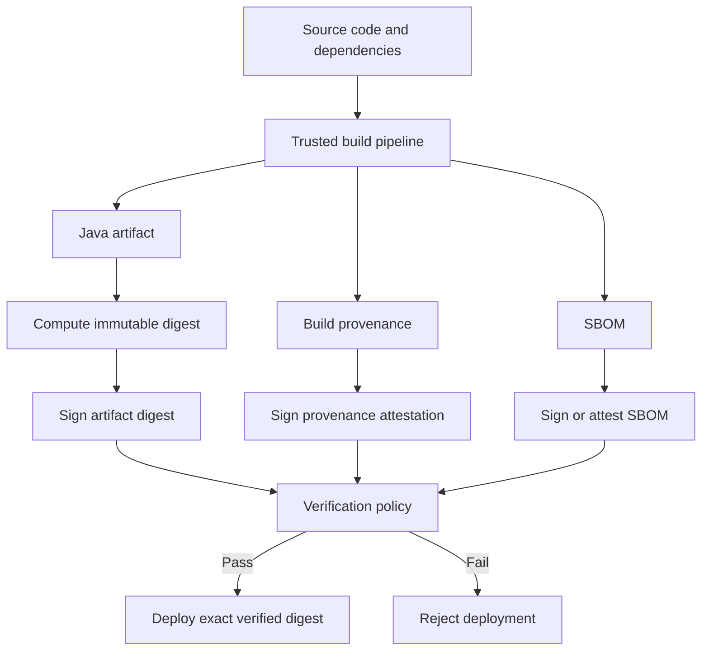
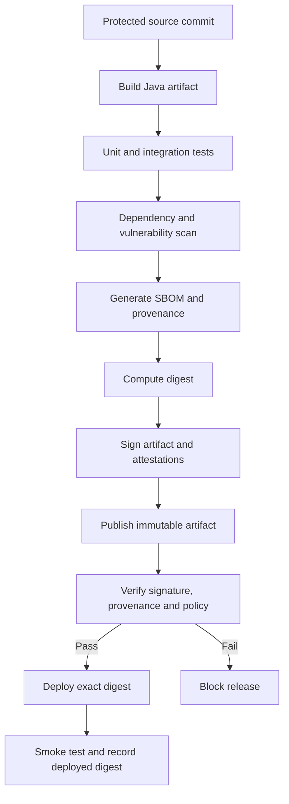

# Signing Artifacts and Verifying Deployment Package Provenance

A Java function can be built as a JAR, a ZIP containing code and dependencies, or a container image. Before deployment, the system must answer two questions: **is the artifact intact and signed by a trusted identity; and from which source code, dependencies, and build process was the artifact produced?** Digital signatures verify integrity and signer identity. Provenance (evidence of origin) describes how the artifact was created. Both mechanisms complement each other.

Merely checking that a downloaded file opens or carries the right version name is insufficient. Artifacts can be swapped in registries, buckets, or intermediate transfers. An image tag can point to a different digest after an update. A package signed by a valid identity can still contain malicious code if the pipeline or a dependency was compromised. Therefore, signatures, digests, provenance, SBOMs, and deployment policies must be bound together in a single workflow.

Within **CLOUD_SERVERLESS**, this lesson focuses on developing and deploying Java functions triggered by HTTP, messages, or events. Artifact signing and verification protect the path from source code through the build pipeline to the running function, while enabling version traceability during incidents, retries, permission updates, or rollbacks.

## 1. Distinguishing artifact, digest, signature, and provenance

These concepts serve distinct purposes:

| Component | Question answered | Example |
|---|---|---|
| Artifact | Which package is being deployed? | `orders-function.zip`, `orders.jar`, container image |
| Digest | What is the exact content of the package? | SHA-256 of a ZIP or OCI image manifest |
| Signature | Who signed that content and has it been altered? | Cosign signature, JAR signature, AWS Signer |
| Provenance | From which source, dependencies, and builder was it produced? | SLSA provenance / in-toto attestation |
| SBOM | Which software components are inside the artifact? | CycloneDX or SPDX document |
| Deployment policy | Which artifacts are allowed to run? | Accept only digests with required signatures and provenance |

A digest is a content identifier. Changing even a single byte of a file almost certainly changes its SHA-256 digest. A digital signature binds a signer to the digest or signed content. Provenance is a document describing the subject (artifact digest), builder, source, and build process; provenance itself must also be signed or authenticated to prevent tampering.



## 2. Why does Java serverless need artifact signing?

Java functions are typically deployed automatically via CI/CD. A pipeline builds source code, packages dependencies, uploads artifacts, updates functions, and enables triggers. If any step in the chain is compromised, an attacker can substitute the deployment package without altering source code in the repository.

Artifact signing and provenance verification help to:

- Detect artifacts modified after build or after signing.
- Accept only artifacts produced by organization-trusted builders or release workflows.
- Bind artifacts to the exact repository, branch/tag, commit, and dependencies used.
- Block deployment of ZIP/JAR/images of unknown origin or built from untrusted pull requests.
- Investigate which function version actually ran during an incident.
- Promote the exact same artifact unchanged through staging and production instead of rebuilding per environment.

Signatures do not prove source code is bug-free, and do not replace reviews, testing, vulnerability scanning, or dependency controls. They provide verifiable evidence for deployment policies to decide whether to trust a package.

## 3. Identifying the exact target to sign

Java serverless supports multiple artifact formats. Sign the exact object the platform actually deploys:

| Deployment method | Artifact to identify | Notes |
|---|---|---|
| Java JAR | Final JAR file | JAR signing verifies signed entries inside the archive; it does not sign an outer ZIP wrapper |
| AWS Lambda ZIP | Final ZIP deployment package | Lambda Code Signing verifies packages signed by an allowed profile |
| Container-based function/service | OCI image digest | Sign the digest, not only a mutable tag |
| Package in a registry | Digest / immutable version | Verify the exact deployed artifact, not merely a name or path |

If a Lambda ZIP contains a signed JAR, the JAR signature checks entries inside the JAR. However, it does not verify other files inside the ZIP such as bootstrap scripts, native libraries, or configuration files. When the platform deploys the entire ZIP, sign and verify at the ZIP deployment-package layer as well.

Never edit, recompress, or add files to an artifact after signing. Rebuilding, shading dependencies, modifying manifests, updating config files, or building a new image changes the digest and requires fresh signatures and provenance.

## 4. Hashes and digests: immutable content identifiers

SHA-256 is a common choice for computing file digests:

```bash
# Linux/macOS
sha256sum orders-function.zip

# Windows PowerShell
Get-FileHash .\orders-function.zip -Algorithm SHA256
```

Sample output format:

```text
9f2a...e41c  orders-function.zip
```

The truncated string above only illustrates the format; real workflows must store the full digest. Record the digest alongside the build ID, source commit, artifact URI, and release metadata.

For container images, reference digests such as `registry.example.com/orders@sha256:...` during verification and deployment. Tags like `:latest`, `:release`, or `:1.4.0` are convenient for humans yet can be repointed to another digest. Deployments must pin the verified digest.

A digest is not a secret. Recipients can recompute the digest to compare. However, if an attacker can replace both an artifact and an unprotected checksum file, a standalone checksum does not prove origin. You need a digital signature or attestation backed by a trusted identity.

## 5. Signing JARs with jarsigner

The JDK provides `keytool` to manage certificates/keystores and `jarsigner` to sign and verify JARs. JAR signing writes signature metadata under `META-INF` and signs entries listed in the manifest.

Example creating a test keystore:

```bash
keytool -genkeypair \
  -alias release-signer \
  -keyalg RSA \
  -keysize 3072 \
  -sigalg SHA256withRSA \
  -validity 365 \
  -keystore release-signing.p12 \
  -storetype PKCS12
```

This is a test-environment example. Never generate or commit production private keys in source repositories. Production should use HSM/KMS or a signing service with access controls and auditing.

Signing a JAR:

```bash
jarsigner \
  -keystore release-signing.p12 \
  -storetype PKCS12 \
  -sigalg SHA256withRSA \
  -digestalg SHA-256 \
  -signedjar orders-signed.jar \
  orders.jar \
  release-signer
```

Verification:

```bash
jarsigner -verify -strict -verbose -certs orders-signed.jar
```

Verification results must be evaluated alongside the certificate chain and trust policy. `jarsigner -verify` checks signatures on signed entries; it does not prove a certificate belongs to your organization unless trust anchors and signer identities are verified against system policy.

### Limitations to understand about JAR signing

- A JAR can still contain unsigned entries; inspect output to detect unsigned entries.
- JAR signing does not sign the entire ZIP container byte-for-byte in the same way as a file-level signature.
- Repackaging or shading after signing invalidates the signature.
- A JAR signature does not prove which commit built the artifact.
- JAR signing does not replace signing an outer deployment package.
- Expired, revoked, or untrusted certificates must be handled by the release process.

## 6. Signing JAR or ZIP files with Sigstore Cosign

Sigstore provides an artifact-signing ecosystem in which Cosign signs both container images and file blobs. With keyless signing, the pipeline uses an OIDC identity to obtain a short-lived certificate; signatures and certificates can be recorded in a transparency log.

Signing a JAR file with keyless signing:

```bash
cosign sign-blob --yes \
  --bundle orders.jar.sigstore.json \
  orders.jar
```

Verifying the file:

```bash
cosign verify-blob \
  --bundle orders.jar.sigstore.json \
  --certificate-identity="https://github.com/example-org/orders/.github/workflows/release.yml@refs/heads/main" \
  --certificate-oidc-issuer="https://token.actions.githubusercontent.com" \
  orders.jar
```

The identity and issuer above are examples only. Substitute the actual OIDC identity of your authorized release workflow. Never use overly permissive verification rules such as accepting any certificate from an issuer; the issuer only identifies the identity provider, whereas certificate identity binds the specific workflow and repository.

With key-based signing, private keys can live in KMS/HSM or a Cosign-compatible secret manager. CI should hold signing access only inside protected release jobs. Never download production private keys onto runners when you can sign directly via a key management service.

## 7. Signing container images by digest

When packaging a Java function as a container image, push the image to the registry, retrieve the final digest, and sign that digest.

Example:

```bash
docker build -t REGION-docker.pkg.dev/PROJECT/apps/orders:1.4.0 .
docker push REGION-docker.pkg.dev/PROJECT/apps/orders:1.4.0

# Retrieve the immutable digest from the registry, then sign that exact digest.
cosign sign --yes \
  REGION-docker.pkg.dev/PROJECT/apps/orders@sha256:IMAGE_DIGEST
```

Verify the signature:

```bash
cosign verify \
  --certificate-identity="https://github.com/example-org/orders/.github/workflows/release.yml@refs/heads/main" \
  --certificate-oidc-issuer="https://token.actions.githubusercontent.com" \
  REGION-docker.pkg.dev/PROJECT/apps/orders@sha256:IMAGE_DIGEST
```

`IMAGE_DIGEST` is a placeholder and must be replaced with the full digest returned by the registry. After signing, deployments must reference that same digest. If you deploy only a tag, the registry tag could be overwritten to another image after verification.

## 8. How do signatures and provenance differ?

A signature proves that content or an attestation was signed by a verifiable identity and remains unmodified. Provenance describes how the artifact was built.

Strong provenance typically contains:

- Subject: artifact name and digest.
- Builder identity: the system/workflow that executed the build.
- Build type: build process or pipeline type.
- Invocation: relevant parameters, source ref, and build environment.
- Materials: source repository, commit, and input dependencies.
- Metadata: timestamps, run ID, build ID, and related context.

An unsigned provenance document or one lacking a trusted builder identity can be fabricated by an attacker. Conversely, an artifact signed by a valid release key without provenance may still lack proof that it originated from a reviewed source commit.

Deployment policies should verify both:

1. Artifact digest matches the subject in provenance.
2. Attestation is signed by an authorized builder identity.
3. Source repository, branch/tag, and commit fall within release scope.
4. Build workflow and builder version are approved.
5. Dependencies/materials comply with organizational policy.
6. The artifact has not been modified after build.

## 9. SLSA and in-toto provenance

SLSA (Supply-chain Levels for Software Artifacts) is a framework for strengthening build process integrity and provenance. in-toto provides an attestation model describing subjects and predicates, with SLSA provenance being a widely used predicate type.

An in-toto statement has the following conceptual structure:

```json
{
  "_type": "https://in-toto.io/Statement/v1",
  "subject": [
    {
      "name": "orders-function.zip",
      "digest": {
        "sha256": "FULL_SHA256_DIGEST"
      }
    }
  ],
  "predicateType": "https://slsa.dev/provenance/v1",
  "predicate": {
    "buildDefinition": {
      "buildType": "https://example.org/build-types/java-function/v1",
      "externalParameters": {
        "repository": "https://github.com/example-org/orders",
        "ref": "refs/tags/v1.4.0"
      },
      "resolvedDependencies": [
        {
          "uri": "git+https://github.com/example-org/orders",
          "digest": {"gitCommit": "FULL_COMMIT_SHA"}
        }
      ]
    },
    "runDetails": {
      "builder": {
        "id": "https://example.org/trusted-builders/java-release"
      }
    }
  }
}
```

This is a simplified illustration of structure, not complete provenance or a default builder identity. In production, use schemas and builders supported by the SLSA specification; never populate client-supplied values and treat them as trusted evidence. The builder must generate provenance from actual build-execution state and sign the attestation with an authenticated identity.

A SLSA level measures build-process assurance, not source-code quality. Never claim a SLSA level merely because a pipeline emits a provenance file; you must satisfy all requirements for source, build platform, isolation, provenance, and tamper resistance under the applicable specification version.

## 10. Verifying provenance before deployment

A verifier must enforce an explicit policy rather than merely checking that an attestation exists.

| Check | Question |
|---|---|
| Subject digest | Does provenance describe the exact digest of the artifact about to be deployed? |
| Builder identity | Did the build run on a trusted builder/workflow? |
| Source repository | Did the artifact originate from the official repository? |
| Source ref | Does the commit/tag belong to an authorized branch or release? |
| Review state | Did the source commit pass code review and branch protection? |
| Build parameters | Are there unapproved build parameters or anomalous secret injections? |
| Materials | Do dependencies and base images have verified origins? |
| Signature | Was the attestation signed by an identity permitted by policy? |
| Freshness/revocation | Has the signing identity or artifact been revoked/banned? |

For example, policy might allow only artifacts built by `release.yml` from `v*` tags in the official repository, whose digest matches the subject and whose provenance is signed by that workflow's OIDC identity.

Never verify only a filename, image tag, self-declared pipeline branch name, or signature without identity binding. Those fields can be spoofed unless sourced from an authenticated authority.

## 11. SBOMs and Java dependency checks

An SBOM (Software Bill of Materials) lists libraries and components inside an artifact. For Java, an SBOM reveals which versions of Spring, Jackson, the AWS SDK, logging libraries, and transitive dependencies a function ships.

SBOMs can be generated in CycloneDX or SPDX formats. Example using Syft to generate an SBOM for a build directory:

```bash
syft dir:target -o cyclonedx-json=sbom.cdx.json
```

For container images:

```bash
syft REGION-docker.pkg.dev/PROJECT/apps/orders@sha256:IMAGE_DIGEST \
  -o cyclonedx-json=sbom.cdx.json
```

Bind SBOMs to the exact artifact digest. An SBOM generated for a JAR before adding dependencies or for an image tag before pushing may not match what is actually deployed.

SBOMs can also be signed or published as attestations. With container images and Cosign, a workflow can use `cosign attest` to attach an SBOM predicate to the digest; verifiers then check both the attestation and subject. Even when an SBOM is signed, continue scanning for vulnerabilities and evaluating licenses per policy.

## 12. Managing signing keys and CI identities

Release signing private keys are sensitive assets. If an attacker steals a key, they can sign malicious artifacts with valid signatures.

Principles:

- Never commit private keys, keystores, or passphrases to Git.
- Never print secrets or signing tokens to build logs.
- Prefer KMS/HSM or signing services so private keys never leave managed boundaries.
- Restrict signing permissions to protected release workflows; test jobs and pull requests do not need production signing rights.
- Use OIDC federation/keyless signing where supported by your CI platform and signer.
- Constrain identities by repository, workflow, branch/tag, and issuer.
- Enable audit logging for signing operations, rotate keys/certificates per policy, and maintain revocation procedures.
- Separate build, signing, and deployment permissions when risk requires separation of duties.

Keyless signing eliminates storing long-lived private keys in CI, yet does not eliminate compromised-workflow risk. If an attacker controls an authorized release workflow identity, they can ask the signer to sign a malicious artifact. Branch protection, action pinning, minimal token scopes, and isolated runners therefore remain critical.

## 13. Hardening the build pipeline before signing

A signature is only as trustworthy as the pipeline that produced it. A pipeline should:

1. Fetch source from a verified repository and commit.
2. Build releases only from protected branches or protected tags.
3. Pin actions, plugins, and container images by trusted versions or digests.
4. Lock dependencies using Maven/Gradle locking or dependency verification.
5. Never execute arbitrary scripts from untrusted pull requests inside jobs holding signing access.
6. Use ephemeral runners or isolated build environments.
7. Scope cloud permissions and OIDC tokens per job as needed.
8. Generate the artifact, digest, provenance, and SBOM within the same traceable build execution.
9. Grant signing access only after tests, scans, and release checks pass.
10. Store artifacts and attestations in write-controlled registries/storage.

In particular, never let a post-build step download a new JAR from a mutable URL and sign it merely because its filename matches the built artifact. The signing step must consume the exact verified output of the build job.

## 14. Reference CI/CD workflow for Java functions

A release pipeline can be structured into stages:



Build once and promote the exact same artifact across environments. Never rebuild JAR/ZIP/images separately for staging or production, because separate builds can yield different digests and require distinct provenance and signatures.

Every deployment should record the digest, provenance reference, signer identity, release ID, function version/revision, and deployment timestamp. When rolling back, redeploy a previously verified digest rather than rebuilding an old source tag and assuming identical output.

## 15. AWS Lambda Code Signing

AWS Lambda supports code signing for ZIP deployment packages via AWS Signer and Lambda Code Signing Config. A signing profile signs packages; the code signing configuration defines which signing profiles are accepted and what happens when an untrusted artifact is encountered.

Components:

- **AWS Signer signing profile:** signer/profile identity used to sign deployment packages.
- **Signed ZIP package:** output package from the signing job.
- **Lambda Code Signing Config:** list of permitted signing profile version ARNs and a `Warn` or `Enforce` policy.
- **Function association:** attaches the Code Signing Config to the Lambda function.

Policies:

| Policy | Behavior |
|---|---|
| `Warn` | Logs a warning when a package violates the code signing policy; allows deployment to proceed |
| `Enforce` | Rejects deployment packages not signed by an allowed profile or carrying an invalid signature |

CloudFormation provides the `AWS::Lambda::CodeSigningConfig` resource; functions use the `CodeSigningConfigArn` property to link the configuration. For production environments, `Enforce` is typically appropriate once the full pipeline signs properly and a plan exists for legacy artifacts.

Lambda Code Signing verifies the ZIP package signature against allowed profiles. It does not replace provenance verification for source commits, dependencies, or builders. When build-origin assurance is needed, add attestation and policy checks in CI/CD before calling deploy APIs.

## 16. Google Cloud and Binary Authorization

For Java functions packaged as containers and deployed on Cloud Run, you can combine Artifact Registry, image signatures, and Binary Authorization to control which images may deploy.

Conceptual workflow:

1. Build the container image and push it to Artifact Registry.
2. Record the immutable image digest.
3. Sign the image or create an attestation bound to the digest.
4. Configure Binary Authorization policies and appropriate attestors.
5. When deploying to Cloud Run, the policy requires an attestation from a trusted attestor.
6. Reject images failing policy.

Binary Authorization enforces deployment policies based on attestations/attestors; it does not by itself prove source code is safe. Cosign signatures and Binary Authorization attestations are not automatically the same format or interchangeable. The pipeline must generate/publish attestations in the mechanism accepted by Binary Authorization and its configured attestors; running `cosign verify` as a separate CI step acts as an independent deploy gate unless an explicit conversion integration is configured. Design trusted attestation authorities and build pipelines carefully. For Cloud Run functions deployed from source, identify the final artifact/container built by the platform and select controls suited to that deployment path.

## 17. Other platforms and pipeline enforcement

Not every FaaS platform offers native ZIP signature or provenance verification at the deploy API. Where platforms lack native admission policies, the pipeline must perform verification before invoking deploy APIs and allow deployment jobs to access only verified artifacts.

For container platforms, use OCI signatures/attestations and registry/runtime-compatible admission policies. For ZIP/JAR platforms, enforce code signing or signature verification in the release pipeline and restrict deployment permissions to the verified job.

CI-only checks are weaker than runtime/platform enforcement if an attacker can invoke deploy APIs outside the pipeline. Restrict IAM/RBAC deployment permissions so only the release controller can update production functions.

## 18. Verifying the exact artifact right before deployment

Verification must happen after retrieving the artifact from registry/storage and immediately prior to deployment. Never verify only a local copy and then deploy a URI that could now point to different content.

Workflow:

1. Fetch the artifact by digest or immutable object version.
2. Recompute its digest and compare against release metadata.
3. Verify the signature and signer identity.
4. Verify the provenance subject matches the digest.
5. Check source, builder, workflow, and materials against policy.
6. Check SBOM, vulnerability, and license policies.
7. Deploy the exact verified digest.
8. Record the digest/version/revision confirmed by the platform as deployed.

If any step fails, halt the release. Never fall back to manual deployment using mutable tags or alternate artifacts to bypass controls.

## 19. Post-deployment checks and rollbacks

After deployment, confirm the function is actually running the verified artifact:

- Compare the function version/revision or image digest against the release record.
- Run smoke tests via HTTP triggers or message/event triggers.
- Confirm logs, metrics, and traces report the expected release ID/build ID.
- Verify the execution role/service account and environment-specific secrets/configs are attached properly.
- Monitor error rates, latency, retries, and DLQs during early rollout.

If rolling back, select a previously signed digest with verified provenance from an earlier release. Never reuse a mutable tag without verifying its digest. Retain older artifacts within a retention window long enough for rollbacks and incident investigation.

## 20. Handling certificates, key rotation, and revocation

Certificates and keys have lifecycles. When a key is compromised or a signer is no longer trusted, revoke signing permissions and block new deployments from that identity.

Response workflow:

1. Pause the release workflow or revoke the affected signer's permissions.
2. Identify the timeframe, artifact digests, and deployments signed by that identity.
3. Assess whether the private key or OIDC workflow was compromised.
4. Rotate keys/certificates or update trust policies.
5. Re-sign valid artifacts with the new signer if policy permits and provenance remains trustworthy.
6. Rebuild from verified source if older artifacts cannot be trusted.
7. Re-verify active deployments and roll out replacements where needed.
8. Record the audit trail, signer ID, key version, and revocation decisions.

Do not delete old keys immediately if historical signatures still require verification; retain public keys/certificate chains and transparency evidence for the audit retention period. Revoking future signing authority and preserving historical verification capability are two separate concerns.

## 21. Common mistakes

| Symptom | Likely cause | Remediation |
|---|---|---|
| JAR verify reports unsigned entries | Entries added after signing or excluded from signature manifest | Inspect archive contents and re-sign the complete artifact |
| JAR signature invalid | JAR modified, repackaged, or shaded after signing | Rebuild and sign after the final packaging step |
| Cosign verify finds no signature | Checking wrong tag/digest or signature missing from registry | Resolve the real digest and check the right registry/repository |
| Cosign identity mismatch | Workflow identity or OIDC issuer differs from policy | Verify actual identity; update policy only after review |
| Provenance subject mismatch | Attestation generated for a different artifact | Block deployment and investigate pipeline/artifact substitution |
| Valid signature from untrusted source | Policy checks signer only without checking provenance | Add repository, commit, branch, and builder checks |
| AWS Lambda rejects ZIP | Package not signed by an allowed profile or signature invalid | Inspect signing job and Code Signing Config |
| Cloud Run deploy rejected by Binary Authorization | Missing attestation or wrong attestor/image digest | Verify image digest, attestor, and policy |
| Rollback cannot find old artifact | Registry retention purged old artifacts | Retain released artifacts per rollback policy |
| SBOM does not match image | SBOM generated prior to steps modifying the image | Generate SBOM from the final digest and re-attest |

## 22. Pre-release checklist for Java functions

| Question | Required evidence |
|---|---|
| What is the final artifact? | Explicitly identified JAR, ZIP, or image digest |
| Is the digest immutable? | SHA-256/OCI digest and immutable artifact reference |
| Is the artifact signed? | Signature/bundle and signer identity |
| Is the signer trusted? | Trust policy binding issuer, repository, and release workflow |
| Does verified provenance exist? | Signed in-toto/SLSA attestation |
| Does subject match digest? | Provenance subject equals the deployed artifact digest |
| Is source approved? | Repository, commit, tag, and branch protection |
| Are dependencies controlled? | Lock/verification, SBOM, and vulnerability scans |
| Is the build pipeline hardened? | Isolated runners, pinned actions/plugins, minimal OIDC permissions |
| Does verification run right before deploy? | Release job fetches and verifies the exact artifact digest |
| Does the platform enforce controls? | Lambda Code Signing Config, Binary Authorization, or deploy gate |
| Are deploy permissions restricted? | Only the release controller can update production |
| Are verified artifacts available for rollback? | Older digests, signatures, and provenance are retained |
| Is there an audit trail? | Build ID, signer, digest, function version/revision, and deploy timestamp |

## 23. Supply-chain operations workflow for serverless

A secure Java serverless release begins from a reviewed source commit, builds inside a controlled environment, produces the artifact and origin metadata, signs the digest with an authorized signer, and verifies everything prior to deployment. Verified artifacts must be promoted untouched across environments; environment-specific settings such as environment variables, secrets, and IAM roles are injected at deploy time without modifying artifact contents.

In operations, retain provenance, SBOMs, signature bundles, and release records alongside artifact retention windows. During rollbacks or investigations, trace backward from the running function version to its digest, signer, builder, source commit, and dependencies. When a signer or pipeline is compromised, use the audit trail to locate every affected artifact and revoke trust appropriately.

Digital signatures prove an artifact was signed by a trusted identity and remained unaltered afterward. Provenance explains how the artifact was built. SBOMs describe internal components. Deployment policies combine those pieces of evidence so only compliant packages run in your serverless environment—protecting the entire path from Java source code to functions serving requests or handling events.
