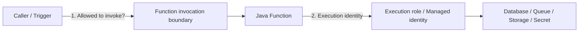
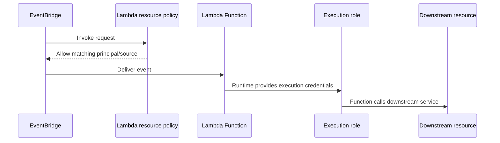
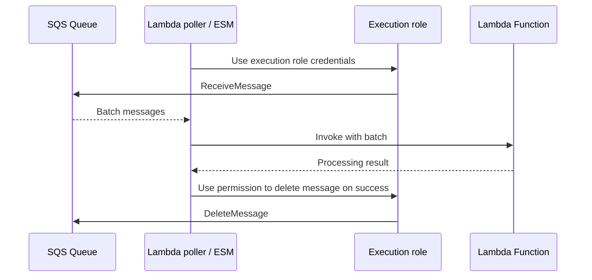

# Distinguishing Execution Identity and Function Invoke Permissions

A serverless function has two security access dimensions that must be designed separately. The first dimension is **who or which service is allowed to invoke the function**. The second dimension is **what the function is allowed to do once it is running**. The identities and permissions across these two dimensions are usually different.

For example, API Gateway is allowed to invoke a Java Lambda; after being invoked, the Java code uses its execution role to read a DynamoDB record and send a message to SQS. API Gateway's permission to invoke Lambda does not automatically grant the function permission to read DynamoDB. Conversely, an execution role with permission to read DynamoDB does not mean every client can invoke the function.

To avoid confusion, clearly separate caller identity, execution identity, function permissions, trigger source access permissions, and deployment identity.

## 1. Two Permission Dimensions in a Single Execution



**Invoke permission** is evaluated before or at the function invocation boundary. It determines which principal can send a request, event, or message to start an invocation.

**Execution identity** is the identity that the function code uses when accessing other resources during processing. This identity has its own permissions, provided to the execution environment or worker by the platform.

| Concept | Question to answer | Example |
|---|---|---|
| Caller identity | Who is requesting the function to run? | Backend API's IAM role, EventBridge, HTTP calling application |
| Invoke permission | Does the caller have permission to invoke the right function/version/route? | `lambda:InvokeFunction`, Lambda resource policy, HTTP auth |
| Execution identity | Who does the function code represent when calling other services? | AWS Lambda execution role, Azure managed identity |
| Trigger-source permission | Does the runtime/poller have permission to read the event source? | Permission to read SQS or Service Bus |
| Deployment identity | Who is allowed to create, update, or configure the function? | CI/CD role, pipeline service principal |

A request might pass the network layer yet be rejected at the authentication layer; a caller might be authenticated yet lack invoke permission; a function might start successfully yet be denied when accessing the database. Identify the denial layer based on the principal and resource involved.

## 2. AWS Lambda: Execution Role and Invoke Permissions

AWS Lambda represents these two permission dimensions with distinct IAM mechanisms.

### 2.1. Execution Role: Permissions of Running Code

Every Lambda function has an **execution role**. When an invocation starts, the Lambda service assumes this role and provides temporary credentials to the execution environment. Java code uses the AWS SDK credentials provider to obtain credentials from the role; there is no need to embed access keys in the JAR or environment variables.

An execution role has two key parts:

- **Trust policy:** defines which principal can assume the role. For standard Lambda, the trusted service principal is `lambda.amazonaws.com` and the action is `sts:AssumeRole`.
- **Permissions policy:** defines what the code is allowed to do, such as writing to CloudWatch Logs, reading an SQS queue, or retrieving a specific secret.

Example trust policy:

```json
{
  "Version": "2012-10-17",
  "Statement": [
    {
      "Effect": "Allow",
      "Principal": {
        "Service": "lambda.amazonaws.com"
      },
      "Action": "sts:AssumeRole"
    }
  ]
}
```

Example permissions policy for a function that needs to write logs and read a queue:

```json
{
  "Version": "2012-10-17",
  "Statement": [
    {
      "Effect": "Allow",
      "Action": [
        "logs:CreateLogStream",
        "logs:PutLogEvents"
      ],
      "Resource": "arn:aws:logs:ap-southeast-1:123456789012:log-group:/aws/lambda/order-worker:*"
    },
    {
      "Effect": "Allow",
      "Action": [
        "sqs:ReceiveMessage",
        "sqs:DeleteMessage",
        "sqs:GetQueueAttributes"
      ],
      "Resource": "arn:aws:sqs:ap-southeast-1:123456789012:orders-prod"
    }
  ]
}
```

This is an illustrative example; actual permissions depend on triggers, application code, encryption, and logging configuration. If the queue uses a KMS customer-managed key, corresponding KMS permissions may be needed. Grant only the exact actions and ARNs required. Do not attach `AdministratorAccess` to an execution role just to make an `AccessDenied` error disappear.

### 2.2. Invoke Permissions: Who Can Call Lambda?

Invoke permissions reside on the caller side or in the function's resource policy, depending on the caller type:

- A user or IAM role calling the Lambda SDK needs an identity-based policy allowing `lambda:InvokeFunction` on the exact function or alias.
- An AWS service such as EventBridge, S3, or SNS calling Lambda typically needs a resource-based policy on the function allowing the service principal to invoke it.
- Another account calling Lambda requires cross-account access configuration; the resource owner allows the external principal/account in the resource policy and the caller also needs corresponding permissions in its own account.

Example policy for a backend IAM role allowed to invoke only the `prod` alias:

```json
{
  "Version": "2012-10-17",
  "Statement": [
    {
      "Effect": "Allow",
      "Action": "lambda:InvokeFunction",
      "Resource": "arn:aws:lambda:ap-southeast-1:123456789012:function:orders-api:prod"
    }
  ]
}
```

Example granting a specific EventBridge rule permission to invoke a function:

```bash
aws lambda add-permission \
  --function-name orders-worker \
  --statement-id AllowOrdersRule \
  --action lambda:InvokeFunction \
  --principal events.amazonaws.com \
  --source-arn arn:aws:events:ap-southeast-1:123456789012:rule/orders-created \
  --source-account 123456789012
```

`--source-arn` restricts permission to the specific rule. If you allow the principal `events.amazonaws.com` without restricting the source, a rule in another account could potentially be configured to invoke your function if other conditions allow.

### 2.3. How Identity Policies and Resource Policies Work Together

For same-account calls, AWS can allow access if either the caller's identity policy or Lambda's resource-based policy allows it, provided there is no explicit deny or higher-level restriction blocking the request. For cross-account access, both the resource owner must allow the external principal in the resource policy and the principal in the calling account must have an identity policy allowing the action. SCPs, permissions boundaries, session policies, and explicit denies can still restrict the effective permissions.

For AWS service push events, Lambda evaluates the resource-based policy to determine which service can invoke the function. For event source mappings, the Lambda poller reads the data source using the execution role's permissions; this mechanism differs from EventBridge or S3 pushing an event directly to Lambda.

### 2.4. Function URL and API Gateway

If using a Lambda Function URL with `AuthType = AWS_IAM`, the caller needs both `lambda:InvokeFunctionUrl` and `lambda:InvokeFunction`. Starting October 2025, new Function URLs require both of these permissions; for same-account callers, they can reside in an identity-based policy or be granted via a resource-based policy, whereas cross-account calls require policies on both sides. If using `AuthType = NONE`, Lambda does not authenticate callers with IAM; the resource policy must still allow public invoke, so only enable it when the endpoint is truly designed to be public and has appropriate business-level protections.

With API Gateway, two permissions must be distinguished: API Gateway is allowed to invoke Lambda via a resource-based permission; end users are allowed to call the API based on the configured authorizer, JWT/Cognito, IAM authorization, resource policy, or API mechanism. The fact that API Gateway can invoke Lambda does not mean everyone on the internet is allowed to call the API.

## 3. Push Triggers and Event Source Mappings Do Not Use the Same Permission Path

AWS has two common integration patterns:

### 3.1. Services Pushing Events to Lambda

For example, S3, SNS, and EventBridge send events to Lambda. The function needs a resource-based permission allowing the right service principal to invoke it. Permissions should be restricted with source ARN and source account when supported by the service.



The resource policy answers "Can EventBridge invoke the function?". The execution role answers "Can code inside the function read DynamoDB or send messages?". These are two independent decisions.

### 3.2. Lambda Polling Sources via Event Source Mapping

With SQS, Kinesis Data Streams, DynamoDB Streams, or Kafka, Lambda manages an event source mapping to poll the source and invoke the function in batches. In this model, the execution role needs permission to read the event source; for example, SQS needs `ReceiveMessage`, `DeleteMessage`, and `GetQueueAttributes`. For Kinesis or DynamoDB Streams, the role needs shard/record read permissions and supporting permissions per configuration.



There is no need to create an `events.amazonaws.com`-style permission for an SQS event source mapping the way EventBridge push requires. With ESM, Lambda needs permission to read the source; the event source mapping is the connection and polling configuration. Retry settings, visibility timeout, batch failure handling, and DLQ are still required to handle failed or duplicate deliveries.

## 4. Azure Functions: Managed Identity and HTTP Trigger Authorization

Azure Functions also requires separating outbound identity from inbound access control.

### 4.1. Managed Identity: Function App Identity When Calling Other Services

Managed identity allows code inside a Function App to obtain Microsoft Entra tokens to access Azure Storage, Key Vault, Service Bus, Azure SQL, or other Entra ID-supported services. The platform manages the identity's credentials so the application does not have to store long-lived client secrets.

Two types of managed identity:

- **System-assigned:** created attached to the Function App; the identity's lifecycle is tied to the resource. Deleting the app deletes this identity.
- **User-assigned:** a standalone resource that can be attached to one or more Function Apps; useful when the identity must survive app recreation or be shared in a controlled manner.

A managed identity only provides an identity; it does not automatically have permission to read every resource. You must grant an appropriate Azure RBAC role or data-plane permission on the target resource. For example, a function reading blobs needs a data reader role on the specific storage account/container; a function receiving Service Bus messages needs the Data Receiver role on the appropriate namespace or entity.

### 4.2. HTTP Function Invoke Authorization

Azure Functions HTTP triggers have `authLevel`:

| Level | Mechanism | Meaning |
|---|---|---|
| `anonymous` | No Function key required | Requests can reach the endpoint; the app/gateway must handle authentication if needed |
| `function` | Requires a valid function key or host key | Uses a shared secret to protect the endpoint |
| `admin` | Requires the master key | Broad Function App-level privilege; never share with regular clients |

A function key is a bearer shared secret: anyone holding the key can use it to call the endpoint within that key's scope. A key is not a Microsoft Entra user identity and provides no claims such as user ID, tenant, or app role. Never embed a master key in mobile apps, browsers, or untrusted clients.

For production APIs needing user or workload identification, consider App Service Authentication/Authorization (Easy Auth) with Microsoft Entra ID, API Management, or JWT validation middleware inside the application. When Easy Auth is enabled, platform middleware authenticates the request before passing it to the function; the application must still enforce authorization such as app roles, scopes, tenants, and permissions on business resources.

### 4.3. Service Bus or Storage Triggers

For non-HTTP triggers, the Functions host needs to connect to the event source to receive events. You can use a connection string in app settings or an identity-based connection if supported by the binding/extension and hosting/runtime. When using managed identity, configure the connection with the prefix required by the extension and grant the corresponding RBAC data-plane role.

For example, a Service Bus trigger needs permission to receive messages; a Blob trigger or Queue trigger needs permission to read the corresponding data/metadata. This is the Function App/host's permission to connect to the source, which is distinct from the managed identity that Java code uses to call another downstream API. An app can use the same identity for both purposes, yet permissions must still be scoped per resource.

## 5. Java: Using Execution Identity to Access Downstream Services

### 5.1. AWS Lambda Java and AWS SDK

In Lambda, do not hardcode access keys in code. AWS SDK for Java 2.x uses the default credentials provider chain to fetch temporary credentials for the execution role when running on Lambda.

```java
import software.amazon.awssdk.auth.credentials.DefaultCredentialsProvider;
import software.amazon.awssdk.regions.Region;
import software.amazon.awssdk.services.sqs.SqsClient;
import software.amazon.awssdk.services.sqs.model.SendMessageRequest;

public final class OrderPublisher {
    private static final SqsClient SQS = SqsClient.builder()
            .region(Region.of(System.getenv("AWS_REGION")))
            .credentialsProvider(DefaultCredentialsProvider.create())
            .build();

    public void publish(String queueUrl, String eventJson) {
        SQS.sendMessage(SendMessageRequest.builder()
                .queueUrl(queueUrl)
                .messageBody(eventJson)
                .build());
    }
}
```

The function needs the `sqs:SendMessage` policy on the exact queue ARN. `DefaultCredentialsProvider` does not grant permissions; it only locates the execution environment's credentials. Actual permissions come from the policies attached to the execution role and associated IAM constraints.

### 5.2. Java Caller Invoking Lambda with Its Own Identity

Another Java application invoking Lambda via the AWS SDK uses the caller's own credentials. That caller needs `lambda:InvokeFunction` on the target function/alias. This permission does not come from the target function's execution role.

```java
import software.amazon.awssdk.regions.Region;
import software.amazon.awssdk.services.lambda.LambdaClient;
import software.amazon.awssdk.services.lambda.model.InvokeRequest;
import software.amazon.awssdk.services.lambda.model.InvokeResponse;
import software.amazon.awssdk.core.SdkBytes;

public final class FunctionInvoker {
    private final LambdaClient lambda = LambdaClient.builder()
            .region(Region.of(System.getenv("AWS_REGION")))
            .build();

    public InvokeResponse invoke(String functionArn, String payload) {
        return lambda.invoke(InvokeRequest.builder()
                .functionName(functionArn)
                .payload(SdkBytes.fromUtf8String(payload))
                .build());
    }
}
```

The default credentials provider of `LambdaClient` represents the identity of the calling application. In production, backend applications typically run on compute with their own IAM role. Check both `statusCode` of the Invoke API and `functionError` in the response; the API accepting the invocation does not mean the handler succeeded.

### 5.3. Azure Functions Java and DefaultAzureCredential

With the Azure SDK for Java, use `DefaultAzureCredential` to acquire tokens from the runtime environment. When deployed on Azure, the credential chain can use the managed identity attached to the Function App. When running locally, the chain can use the signed-in developer identity.

```java
import com.azure.identity.DefaultAzureCredential;
import com.azure.identity.DefaultAzureCredentialBuilder;
import com.azure.storage.blob.BlobServiceClient;
import com.azure.storage.blob.BlobServiceClientBuilder;

public final class SharedBlobReader {
    private final BlobServiceClient blobService;

    public SharedBlobReader(String endpoint) {
        DefaultAzureCredential credential =
                new DefaultAzureCredentialBuilder().build();

        this.blobService = new BlobServiceClientBuilder()
                .endpoint(endpoint)
                .credential(credential)
                .buildClient();
    }

    public String readBlobText(String containerName, String blobName) {
        return blobService.getBlobContainerClient(containerName)
                .getBlobClient(blobName)
                .downloadContent()
                .toString();
    }
}
```

This snippet illustrates reading the text content of a blob; for large or binary files, use an appropriate streaming API instead of loading the entire content into memory. The Function App must have a managed identity attached, and that identity must hold a data-plane permission such as `Storage Blob Data Reader` at the required scope. Do not confuse the Azure Resource Manager `Reader` role with permission to read blob contents: resource management roles and data-plane roles serve different purposes.

## 6. Caller Identity Does Not Automatically Become Execution Identity

Suppose a user logs in and calls API Gateway. API Gateway authenticates the user and invokes Lambda. Lambda runs with the function's execution role, not automatically with that user's IAM permissions.

If the function needs to decide whether the user is allowed to view an order, the system must pass the authenticated identity information via a trusted mechanism, such as claims from a JWT verified by an authorizer or request context provided by the gateway. The function validates user/tenant/role against business data. Never take an arbitrary `userId` from the request body and treat it as an authenticated identity.

Similarly, an Azure Function having a managed identity to read Key Vault does not mean the user calling the HTTP function is authorized to read that secret. The managed identity represents the workload; end users must be authenticated and authorized separately. If the function needs to access downstream services **on behalf of the user**, design a proper delegated token/OBO flow instead of using the managed identity's broad permissions as if they were the user's permissions.

## 7. Identity and Network Permissions Are Two Independent Layers

VPCs, VNets, private endpoints, firewalls, IP restrictions, and security groups control network routing. They do not replace service-layer authorization.

- A function can sit in a private subnet and still require IAM/RBAC to read a database or storage.
- A public endpoint can be protected by JWT/OAuth and appropriate policies.
- A private endpoint only restricts where connections can originate; if the identity has overly broad permissions, workloads on the network can still access excessive data.
- TLS protects data in transit; it does not grant permission to read a resource.

Check both the network path and identity permissions. Timeout/DNS errors usually suggest connectivity issues; `AccessDenied`, `403`, or `AuthorizationPermissionMismatch` errors usually suggest permission or token issues. However, some services intentionally return generic errors to avoid leaking details, so inspect logs/audits on the resource side.

## 8. Deployment Permissions Are Not Runtime Permissions

CI/CD pipelines need permissions to create or update functions, configure runtimes, attach execution roles/managed identities, and update triggers. These are **deployment identity** or control-plane permissions.

A running function should only have the data-plane permissions needed for business logic. Do not use the same administrative role for both deploying infrastructure and running production code. If function code is compromised, narrow runtime permissions limit the impact; if the pipeline is compromised, deployment permissions still need protection via approvals, federation, and auditing.

A typical separation:

| Principal | Required permissions | Should NOT have by default |
|---|---|---|
| CI/CD deployment role | Update functions, artifacts, configurations, and managed resources | Permission to read all runtime business data |
| Lambda execution role | Logs, queues/tables/buckets/secrets the function needs | Permission to create IAM users/roles or modify admin policies |
| API backend caller role | `lambda:InvokeFunction` on the target alias | Permission to read the database used by Lambda |
| EventBridge service principal | Invoke function from a specific rule | Permission to access the function's internal resources |
| Azure Function managed identity | Data-plane roles for downstream resources | Owner/Contributor across the entire subscription |
| Client/user identity | Call endpoints per granted scope/role/tenant | The Function App's execution role or managed identity |

## 9. Common Configuration Errors

| Symptom | Possible Cause | How to Check |
|---|---|---|
| Lambda runs but cannot read SQS | Execution role lacks queue read or KMS permissions | Check role policy, queue ARN, KMS key policy, and CloudTrail |
| EventBridge does not invoke Lambda | Function resource policy missing principal or wrong source ARN | Check resource-based policy and rule ARN |
| Backend calling Lambda gets `AccessDenied` | Caller role lacks `lambda:InvokeFunction` or alias ARN mismatch | Check identity policy, resource ARN, and SCP/boundary |
| Lambda is invoked but cannot write to DynamoDB | Execution role lacks data-plane permissions on table/index | Check execution role policy and table/index ARN |
| Azure Function calling Key Vault gets 403 | Managed identity not attached or lacks Key Vault data-plane role | Check principal/object ID and role assignments on the vault |
| Azure HTTP trigger returns 401/403 | Missing function key, wrong token audience/issuer, or blocked by Easy Auth policy | Check `authLevel`, key header, token claims, and authentication settings |
| Azure Function reads Storage locally but fails when deployed | Local developer credential has access; production managed identity lacks RBAC | Check which identity is selected and data-plane permissions |
| Function calls downstream and times out | Misconfigured VNet, DNS, firewall, route, or private endpoint | Check network path before modifying IAM/RBAC |

Do not fix errors by immediately granting `*` or Owner/Administrator. Identify the actual principal, denied action, resource ARN/URI, and policy conditions. Once you understand the root cause, grant the smallest necessary permission and retest.

## 10. Identity and Invoke Permission Design Checklist

1. Who or what service invokes the function? Is the caller a user, workload, AWS service, or event source poller?
2. Does the caller need identity-based permissions, resource-based permissions, HTTP auth, or a combination of layers?
3. Which execution role or managed identity does the function run with?
4. Does the execution role's trust policy allow only the proper runtime service to assume it?
5. Does the execution identity have least-privilege permissions on the exact tables, queues, buckets, secrets, and keys?
6. Is the trigger push-based or an event source mapping pull? Are source read permissions granted to the right principal?
7. Do cross-account/cross-tenant accesses have policies on both the resource owner and caller sides?
8. Does the HTTP endpoint authenticate users/workloads with OAuth/JWT, API gateway, or function keys? Is a function key being mistaken for a user identity?
9. If delegating on behalf of a user is needed, are tokens/claims verified and restricted by audience/scope?
10. Have network restrictions, private endpoints, TLS, and IAM/RBAC been verified independently?
11. Is the deployment identity separated from the runtime identity?
12. Can logs/audits identify the principal, action, and resource when an access error occurs?

## Conclusion

Execution identity determines which resources a function can access after starting; invoke permission determines who or which service is allowed to initiate an invocation. AWS Lambda uses an execution role for code permissions, combining identity-based policies and resource-based policies to control callers or service triggers. Azure Functions uses managed identities for outbound connections, while HTTP triggers can use function keys or Microsoft Entra/App Service Authentication for inbound requests. Separate caller, runtime, trigger source, and deployment principals; grant least privilege to each identity and verify network boundaries as an independent layer of defense.

## Official References

- [AWS Lambda permissions and IAM](https://docs.aws.amazon.com/lambda/latest/dg/lambda-permissions.html)
- [AWS Lambda execution role](https://docs.aws.amazon.com/lambda/latest/dg/lambda-intro-execution-role.html)
- [AWS Lambda resource-based policies](https://docs.aws.amazon.com/lambda/latest/dg/access-control-resource-based.html)
- [Control access to Lambda Function URLs](https://docs.aws.amazon.com/lambda/latest/dg/urls-auth.html)
- [Granting Lambda access to AWS services](https://docs.aws.amazon.com/lambda/latest/dg/permissions-function-services.html)
- [Cross-account access to Lambda](https://docs.aws.amazon.com/lambda/latest/dg/permissions-function-cross-account.html)
- [Azure Functions security concepts](https://learn.microsoft.com/en-us/azure/azure-functions/security-concepts)
- [Managed identities for Azure Functions](https://learn.microsoft.com/en-us/azure/app-service/overview-managed-identity)
- [Azure Functions HTTP trigger authorization](https://learn.microsoft.com/en-us/azure/azure-functions/functions-bindings-http-webhook-trigger)
- [Azure Functions access keys](https://learn.microsoft.com/en-us/azure/azure-functions/function-keys-how-to)
- [Authentication and authorization in Azure Functions](https://learn.microsoft.com/en-us/azure/app-service/app-service-authentication-overview)
- [Identity-based connections in Azure Functions](https://learn.microsoft.com/en-us/azure/azure-functions/manage-connections)
- [Azure Storage Blob client library for Java](https://learn.microsoft.com/en-us/java/api/overview/azure/storage-blob-readme?view=azure-java-stable)
