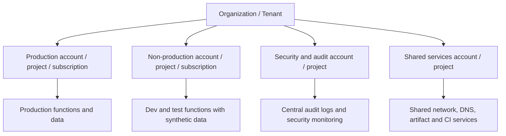
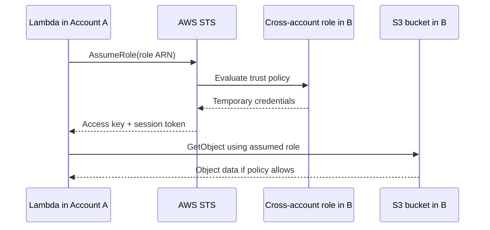

# Restricting Access Across Accounts, Projects, and Subscriptions

Serverless applications are often split into multiple functions and services running across different environments, teams, or business domains. A function may need to read data from storage in another account, receive messages from a queue in another project, or call an internal API located in another subscription. If every workload shares a single account, project, or subscription with broad permissions, a misconfiguration or a compromised function can spread across multiple systems.

Cloud providers offer management tiers such as **account**, **project**, and **subscription** to organize resources, permissions, billing, and policies. They are not identical, yet all can be used to establish administrative boundaries and limit blast radius. Beyond administrative boundaries, a system also needs identity and network boundaries: who can invoke a service, which data a service can access, which paths traffic traverses, and whether data is allowed to leave the trusted zone.

In the Cloud Serverless module, access restriction must follow the entire request or event path: trigger → function → service identity → API/broker → data store. IAM allows a principal to perform an action; network policies determine whether a connectivity path exists; resource policies and encryption policies can add conditions. None of these layers replaces the others.

## 1. Distinguishing Administrative, Identity, and Network Boundaries

Three concepts that are often lumped together:

- **Administrative boundary:** the scope for managing resources, billing, quotas, policies, and administrative privileges. Examples: AWS account, Google Cloud project, Azure subscription.
- **Identity boundary:** where principals are authenticated and permissions are evaluated. Examples: AWS IAM role, Google service account, Microsoft Entra service principal or managed identity.
- **Network boundary:** where traffic is routed, allowed, or blocked. Examples: VPC, VNet, subnet, firewall, security group, private endpoint, and service perimeter.

One account/project/subscription can contain multiple networks and multiple workload identities. Conversely, an application may need to access resources outside its own administrative scope. Therefore, "same account" does not mean "allowed access," and "having a private network route" does not mean "allowed to read data."

| Control Layer | Question to Answer | Example |
|---|---|---|
| Organization guardrail | Does the organization allow creating or using this type of resource? | AWS SCP, Google Organization Policy, Azure Policy |
| Identity/IAM | Which principal is allowed to call which action? | `sqs:ReceiveMessage`, `roles/pubsub.subscriber`, Azure `Storage Blob Data Reader` |
| Resource policy | Which principals does the resource accept? | SQS queue policy, S3 bucket policy, Key Vault RBAC |
| Network | Is there a connectivity path from source to destination? | VPC route, VNet integration, firewall, PrivateLink |
| Data protection | How is data encrypted and who can use the keys? | KMS key policy, Cloud KMS IAM, Key Vault key permissions |
| Application authorization | Does the caller have permissions on the specific record/tenant? | Tenant predicate, ownership check, domain policy |

A request should succeed only when all mandatory conditions are satisfied. For example, a Lambda with IAM permission to read S3 still cannot access a private database without a network path to it. Conversely, a function might reach a database over a VPC yet have its query rejected by the database role.

## 2. Resource Hierarchy of the Three Cloud Providers

### AWS: Organization, OU, and Account

Typical hierarchy:

```text
AWS Organization
  └── Organizational Unit (OU)
        └── AWS Account
              └── Region
                    └── VPC / service resources
```

An AWS account is a critical boundary for IAM, billing, quotas, and resource management. AWS Organizations lets you group multiple accounts into an organization, organize accounts with OUs, and apply Service Control Policies (SCPs) as guardrails. SCPs cap the maximum permissions that can be granted within an account/member account; SCPs do not grant permissions to roles or users on their own.

Multi-account models commonly separate production, non-production, security/log archive, shared services, and sandbox. If a production workload is compromised, account isolation limits the scope of resources that workload credentials can reach, while enabling separate billing, quotas, audits, and network boundaries.

### Google Cloud: Organization, Folder, and Project

Typical hierarchy:

```text
Google Cloud Organization
  └── Folder
        └── Project
              └── Region / Zone resources
```

A project is the core unit for enabling APIs, managing resources, billing association, quotas, and IAM policies. Folders group projects by environment, team, or business domain. IAM policies can be inherited from the organization or folder down to projects/resources, so a high-level binding can affect many workloads beneath it.

Separate projects by environment or trust domain. For instance, `orders-prod`, `orders-nonprod`, and `security-logging` have different permissions, quotas, and lifecycles. Avoid sharing one project for both production and experimentation merely for the convenience of sharing a service account or network.

### Azure: Management Group, Subscription, and Resource Group

Typical hierarchy:

```text
Microsoft Entra tenant
  └── Management Group
        └── Subscription
              └── Resource Group
                    └── Resource
```

A subscription is a billing/quota unit and a common scope for managing Azure resources. Management Groups organize subscriptions to apply Azure Policy and RBAC at a higher tier. Resource Groups cluster resources with related lifecycles or management permissions.

A Microsoft Entra tenant is a separate identity boundary from the subscription hierarchy. A subscription is associated with one Entra tenant at a time, while a single tenant can manage multiple subscriptions. When sharing resources across tenants, consider cross-tenant identities, guest/workload identities, resource permissions, and private networking.

### Comparison Table

| Concept | AWS | Google Cloud | Azure |
|---|---|---|---|
| Organizational boundary | AWS Organization | Organization | Entra tenant + Management Groups |
| Intermediate management grouping | OU | Folder | Management Group / Resource Group |
| Common resource/billing unit | Account | Project | Subscription |
| Workload identity | IAM role | Service account | Managed identity / service principal |
| Organizational guardrail | SCP | Organization Policy, IAM Deny where applicable | Azure Policy, contextual deny assignments |
| Private network | VPC | VPC network | VNet |

These tiers do not have identical semantics. When designing multi-cloud architectures, define the goal of each boundary (billing, blast radius, identity, compliance, network) instead of trying to force a one-to-one mapping of provider names.

## 3. Choosing Account, Project, and Subscription Boundaries

Boundaries should be chosen based on trust levels and lifecycles, not merely team names. Key criteria:

- **Environment:** production, staging, development, and sandbox need different permission levels and data.
- **Data classification:** sensitive or regulated data may require a separate project/account/subscription for stricter policies, auditing, and networking.
- **Ownership:** which team owns operations, budgets, and incident response?
- **Blast radius:** if credentials or a deployment pipeline are hijacked, what is the maximum impacted scope?
- **Quotas and billing:** which workloads need separate quotas, budgets, or cost allocation?
- **Compliance and residency:** in which region, account, or subscription must data reside?
- **Lifecycle:** which resources are created/deleted together, and which must outlive the application?
- **Connectivity:** do services need frequent communication over private networks or only API/event contracts?

### Common Separation Pattern



Production and non-production should have separate identities, data, secrets, queues, databases, and deployment roles. Shared services can provide DNS, artifact repositories, or network transit, with access granted according to service contracts. Security/logging accounts should hold log collection permissions that workloads cannot arbitrarily modify or delete.

Do not create a new account/project/subscription for every small function if operational overhead outweighs the benefits. Separate along trust boundaries, ownership, and blast radius; within the same scope, you can still separate execution roles, resource policies, and network segments.

## 4. Workload Identity and the Least-Privilege Principle

Each function or group of functions should have its own workload identity. That identity is granted permissions only for the required operations and required resources.

| Provider | Common identity | How permissions are granted |
|---|---|---|
| AWS | Lambda execution role | IAM identity policy, resource policy, trust policy, and organization guardrails |
| Google Cloud | User-managed service account attached to Cloud Run/Functions | IAM role bindings on project or resource; service account impersonation when needed |
| Azure | System-assigned or user-assigned managed identity | Azure RBAC role assignments at management group, subscription, resource group, or resource |

Avoid using a developer's user credentials as runtime credentials. Avoid attaching the same overly broad role/service account/managed identity to every function in an application. An email-sending function does not need permission to read the entire database; an order-processing function does not need permission to modify IAM roles.

### Runtime Permissions and Deploy Permissions Are Different

- **Runtime identity:** used by the function while processing requests/events.
- **Deployment identity:** used by pipelines to create or update functions, roles, queues, networks, and policies.
- **Human admin identity:** used by operators for configuration or incident response.

Do not use the runtime role to deploy infrastructure. Do not assign the deployment role to a function. Do not use a single long-lived credential across CI, developers, and production workloads. Role separation prevents a runtime code bug from automatically turning into infrastructure modification privileges.

### Smallest Possible Scope

Prefer granting permissions on a specific resource rather than across the entire account/project/subscription. If a function reads only one queue, grant permissions on that queue ARN. If it reads only one bucket prefix, restrict the bucket/prefix. If an Azure Function reads only one secret, grant the role on the appropriate vault or secret scope rather than the subscription. If a GCP function consumes only one Pub/Sub subscription, grant the role on that subscription when supported by the service.

Permissions granted at a higher scope can be inherited down to many resources. During reviews, inspect both direct policies and inherited policies; a narrow binding on a resource does not negate broad permissions inherited from a project/account/subscription.

## 5. Cross-Account Access on AWS

AWS supports cross-account access via identity-based policies combined with resource-based policies, or by assuming a role in the target account.

### Assuming a Role in the Target Account

Suppose a Lambda in account A needs to read data in account B. A common pattern:

1. The Lambda execution role in account A is allowed to call `sts:AssumeRole` on a designated role in account B.
2. The trust policy of the role in account B allows the exact principal from account A (or specific role) to assume it.
3. The role in account B has an identity policy allowing only the required actions on the target resource.
4. Lambda uses temporary credentials from STS to call the service in account B.



Example minimal trust policy for the role in account B:

```json
{
  "Version": "2012-10-17",
  "Statement": [{
    "Effect": "Allow",
    "Principal": {
      "AWS": "arn:aws:iam::111122223333:role/orders-worker-role"
    },
    "Action": "sts:AssumeRole"
  }]
}
```

The Lambda execution role in account A needs `sts:AssumeRole` permission on the role ARN in B. The role in B might have a policy allowing only `s3:GetObject` on a specific prefix. For third-party integrations, use `ExternalId` in the trust policy to mitigate confused deputy risks; external ID is not a secret replacing the trust policy.

### Resource-Based Policies

Several AWS resources support resource policies allowing principals from another account to access them directly. Examples include S3 bucket policies, SQS queue policies, SNS topic policies, Lambda resource policies, and EventBridge event bus policies. Check permissions on both the principal side and resource side; an allow policy on one side is not necessarily sufficient if the other side does not allow it.

### Organization Guardrails and Permissions Boundaries

SCPs cap the maximum permissions usable within a member account; SCPs do not grant permissions. Permissions boundaries cap the maximum permissions an identity policy can grant to a principal. Session policies can narrow permissions for a session. Resource policies decide which principals a resource accepts. When debugging `AccessDenied`, examine all of these layers rather than looking only for an `Allow` in a single IAM policy.

## 6. Cross-Project Access on Google Cloud

Google Cloud uses service accounts as the standard workload principal. A Cloud Function/Cloud Run service can run under a service account in project A and access resources in project B if the IAM policy on the resource/project B grants the right permission.

Example:

1. Create a dedicated service account for the function in project A.
2. Attach that service account to the function runtime.
3. In project B, grant the required role to the `serviceAccount:...` principal on the exact target resource.
4. The function uses Application Default Credentials to acquire credentials from the runtime environment.
5. Google client libraries automatically use those credentials to call authorized APIs.

Do not grant `Editor` or `Owner` on project B just so a function can read a bucket or consume a subscription. Grant specialized roles such as Storage Object Viewer on the bucket or Pub/Sub Subscriber on the appropriate subscription.

### IAM Inheritance and Organization Policy

IAM policies can be inherited from the organization or folder down to projects and resources. A service account can receive permissions from multiple bindings; inspect effective permissions rather than reading only the resource-level policy.

Organization Policy is a guardrail governing how resources are configured (for example, restricting locations, domain types, or service account usage depending on the constraint). It does not replace IAM permissions allowing a principal to read data. IAM Deny policies can block certain permissions within supported scopes; when debugging, check both allow and deny policies.

### Shared VPC and Project Boundaries

Shared VPC allows service projects to use networks managed in a host project. This separates workload ownership from network ownership. However, network management permissions, workload creation permissions, and data-plane access permissions must still remain separate. Do not grant host project network admin rights to every developer simply because they deploy functions in a service project.

VPC Service Controls can establish service perimeters to reduce data exfiltration risk from supported services. This is a data perimeter protection layer, not a firewall replacing VPC firewalls or IAM. Review ingress/egress rules and supported services before applying it.

## 7. Cross-Subscription Access on Azure

Azure RBAC role assignments can be placed at the management group, subscription, resource group, or resource level. A Function App's managed identity in subscription A can be granted roles on resources in subscription B if both subscriptions belong to the same tenant and identity configuration permits it.

Example:

1. Enable a system-assigned or attach a user-assigned managed identity to the Function App in subscription A.
2. Retrieve the principal/object ID of the identity.
3. On the resource or resource group in subscription B, create a role assignment for that principal.
4. The function uses the Azure Identity SDK/Managed Identity to obtain a token and call the service.
5. The resource validates the token and Azure RBAC data-plane permissions.

Do not grant Contributor on subscription B just so a function can read a blob. Use a data-plane role such as `Storage Blob Data Reader` at the storage account or appropriate scope. For Key Vault, select the right authorization model (Azure RBAC or access policies) and the exact secret-reading role needed.

### Tenant Boundaries Differ from Subscription Boundaries

A subscription is not an Entra tenant. When accessing across subscriptions within the same tenant, principals can be referenced directly in role assignments with appropriate administrative rights. When accessing across tenants, additional cross-tenant identity configuration is required, such as guest/service principals, workload identity federation, or service-supported mechanisms; tokens and role assignments must be issued in the target tenant/resource.

Never assume a managed identity automatically exists in another tenant. Check the token's issuer/tenant, the resource's audience, the service principal in the target tenant, and the role assignment. Network peering between two tenants also does not automatically grant identity or data permissions.

### Azure Policy and RBAC

Azure Policy governs resource configuration state, such as requiring private endpoints or blocking public network access per policy. Azure RBAC determines which management or data-plane actions a principal can perform. Both mechanisms complement each other: policy may require a resource to be private, while the function still needs a role to read data.

## 8. Network Segmentation for Serverless Workloads

Serverless compute is typically provider-managed; a function does not necessarily have a fixed server. Yet network paths still must be designed. Distinguish:

- **Ingress:** who can call the function/API?
- **Egress:** which destinations can the function call?
- **Private service access:** over which private path does the function access databases, storage, or internal APIs?
- **Service-to-service path:** through which endpoints do functions, brokers, and data stores communicate?
- **DNS:** do hostnames resolve to private/public addresses matching the design?

### AWS Lambda in a VPC

By default, Lambda can call public services over AWS-managed networking. When attaching a function to a VPC, Lambda creates network interfaces in the chosen subnets/security groups to access resources inside the VPC. VPC attachment does not automatically make a function a private HTTP endpoint, nor does it grant permission to read resources.

If a function needs internet egress from a private subnet, a NAT Gateway/NAT instance or properly designed egress path is usually required. To access certain AWS services without traversing the internet/NAT, consider VPC endpoints (gateway endpoints for supported services such as S3/DynamoDB; interface endpoints/PrivateLink for many other services). Endpoint policies can restrict actions through the endpoint, but do not replace IAM/resource policies.

Security groups control traffic at network interfaces; route tables and NACLs also affect connectivity. Lambda invocations from API Gateway/EventBridge/SQS are still governed by invoke/event source permissions and trigger configuration, not by security groups alone.

### Google Cloud Serverless Networking

Cloud Run and Cloud Functions offer different ingress/egress modes and VPC connectivity options depending on generation/runtime. You can use Direct VPC egress or a Serverless VPC Access connector when supported to reach private IPs in a VPC. Ingress settings can restrict call sources; IAM Invoker still must be configured for allowed principals.

Shared VPC lets workloads in service projects use the host project's network. Private Service Connect can provide private access paths to supported services. Firewall rules, routes, DNS, and IAM remain separate layers.

### Azure Functions Networking

Azure Functions can use VNet integration for outbound access to resources in a VNet and private endpoints. A private endpoint for the Function App can restrict inbound access; VNet integration and private endpoints solve two different directions. Configure private DNS zones, routes, and network security appropriately.

Service endpoints and private endpoints are not the same. A service endpoint opens a path from a selected subnet to an Azure service over the backbone and ties network rules to the subnet; a private endpoint creates a network interface with a private IP inside the VNet for a supported service. Choose based on private addressing, DNS, exfiltration control, and connectivity architecture requirements.

### Network Comparison Table

| Need | AWS | Google Cloud | Azure |
|---|---|---|---|
| Private network | VPC | VPC network | VNet |
| Subnet segmentation | Subnet per AZ | Regional subnet | Subnet inside VNet |
| Workload/network firewall | Security Group, NACL | VPC firewall rules | NSG, Azure Firewall |
| Private service endpoint | VPC Endpoint / PrivateLink | Private Service Connect | Private Endpoint |
| Connecting serverless to VPC | Lambda VPC configuration | Direct VPC egress / connector | Function VNet integration |
| Cross-scope network connectivity | VPC peering, Transit Gateway, shared VPC patterns | Shared VPC, VPC peering, PSC | VNet peering, VPN, ExpressRoute |

## 9. Cross-Scope Access Permissions for Triggers and Events

A function can be triggered from a queue or event bus in another account/project/subscription. Verify both publish/subscribe permissions at the broker and invoke/consume permissions of the function.

### AWS: SQS/SNS/EventBridge/Lambda

- Cross-account SQS: the queue policy allows principals to send/receive; producer/consumer roles also need corresponding identity permissions.
- SNS topic: topic policy restricts which accounts/principals can publish or subscribe.
- EventBridge bus: event bus resource policy allows accounts/principals to call `PutEvents`; rule targets have appropriate roles or invoke permissions.
- Lambda: resource-based policy allows services or other accounts to invoke the function; the function's execution role governs permissions used after invocation.
- KMS: if the queue/topic/event data uses a customer-managed key, the key policy or grant must allow the required principals/services.

### Google Cloud: Pub/Sub/Eventarc/Cloud Run

- The producer service account needs publish permission on the topic.
- The consumer service account or service agent needs consume/subscribe permissions depending on the trigger type.
- The Cloud Run service needs invoke permissions for the appropriate principal or service agent.
- Eventarc triggers may require service agent permissions and target invoke permissions; never grant Owner to a service agent to fix trigger errors.
- For cross-project resources, place IAM bindings on the target resource and verify the actual service identity/agent in use.

### Azure: Service Bus/Event Grid/Functions

- Publishers/consumers use managed identities or service principals with appropriate data-plane roles.
- Service Bus sender/receiver roles must be granted at the namespace, queue, or topic level as supported.
- Event Grid subscriptions need appropriate identity/delivery permissions for the destination.
- Function trigger identity and target resource identity can differ; verify extension versions and identity-based connection configuration.
- For cross-subscription setups, role assignments must reside on the target resource and identities must resolve in the proper tenant.

Never use event, queue, or subscription names in payloads to make authorization decisions. Permissions must be enforced via IAM/resource policies and application authorization.

## 10. Encryption and Key Usage Permissions Across Boundaries

Encryption at rest protects data only if key policies are also properly restricted. A function with permission to read an object but lacking permission to decrypt the KMS key cannot read the content when the bucket uses a customer-managed key. Conversely, a principal with overly broad decrypt permissions can decrypt data across multiple resources if key policies and encryption context permit it.

Checkpoints:

- Which account/project/subscription owns the key and manages its lifecycle?
- Which principals are allowed to encrypt, decrypt, sign, or verify?
- Are encryption context, resource ARN, or service principals constrained?
- Does cross-account key usage require a key policy in the owning account and an IAM policy in the calling account?
- How are rotation, disabling, deletion windows, and backups managed?
- Do logs/audits capture who used the key and from which resource?

Separate key administration permissions from data read permissions. Workloads typically need only `Decrypt` or `Encrypt` within service scope; they do not need permission to create, delete, or alter key policies. Apply the same principle for Azure Key Vault and Google Cloud KMS using specialized roles/permissions.

## 11. Java: Accessing Another AWS Account Using AssumeRole

AWS SDK for Java 2.x can use STS to obtain temporary credentials from a role in a target account. The example below illustrates role chaining from a Lambda execution role.

```java
import software.amazon.awssdk.auth.credentials.AwsCredentialsProvider;
import software.amazon.awssdk.services.sts.StsClient;
import software.amazon.awssdk.services.sts.auth.StsAssumeRoleCredentialsProvider;
import software.amazon.awssdk.services.sts.model.AssumeRoleRequest;

public final class CrossAccountCredentials {
    public static AwsCredentialsProvider assumeRole(String roleArn) {
        StsClient sts = StsClient.create();

        AssumeRoleRequest request = AssumeRoleRequest.builder()
                .roleArn(roleArn)
                .roleSessionName("orders-reader")
                .durationSeconds(3600)
                .build();

        return StsAssumeRoleCredentialsProvider.builder()
                .stsClient(sts)
                .refreshRequest(request)
                .build();
    }

    private CrossAccountCredentials() {}
}
```

In production, reuse `StsClient` and the credentials provider across the application instance lifecycle, close clients when no longer needed, and never write access keys/session tokens to files. `roleArn` should come from trusted configuration rather than accepting arbitrary ARNs from HTTP requests. The target role needs an accurate trust policy; the source role needs `sts:AssumeRole` on the exact ARN; the target role's policy limits resources/actions.

## 12. Java: Using Managed Identity on Azure

With Azure SDK for Java, `DefaultAzureCredential` can use Managed Identity when running inside a Function App and developer credentials when running locally. Example reading blobs from a storage account in another subscription:

```java
import com.azure.identity.DefaultAzureCredentialBuilder;
import com.azure.storage.blob.BlobServiceClient;
import com.azure.storage.blob.BlobServiceClientBuilder;

public final class AzureStorageAccess {
    public static BlobServiceClient create(String accountUrl) {
        return new BlobServiceClientBuilder()
                .endpoint(accountUrl)
                .credential(new DefaultAzureCredentialBuilder().build())
                .buildClient();
    }

    private AzureStorageAccess() {}
}
```

The Function App identity needs a data-plane role such as `Storage Blob Data Reader` on the target storage account/container scope in the destination subscription. If the storage account blocks public networks, corresponding VNet integration/private endpoint/DNS is required. SDK credentials do not create network routes on their own.

## 13. Java: Using a Service Account on Google Cloud

In a Google Cloud environment, Application Default Credentials typically obtain credentials from the service account attached to the runtime. Client libraries use those credentials to call APIs; IAM policies on the target project/resource govern permissions.

```java
import com.google.cloud.storage.Storage;
import com.google.cloud.storage.StorageOptions;

public final class GcsAccess {
    public static Storage create() {
        // Uses Application Default Credentials from the runtime identity.
        return StorageOptions.getDefaultInstance().getService();
    }

    private GcsAccess() {}
}
```

Do not load a service account JSON key into the function if you can attach a service account or use Workload Identity Federation/impersonation. If cross-project access is needed, grant a role to the service account principal on the target bucket/resource instead of switching to a broad long-lived key.

## 14. Organization-Level Guardrails

Guardrails restrict what an account/project/subscription can do, even if an administrator or deployment pipeline attempts to create an improper configuration.

| Provider | Common guardrails | Example objectives |
|---|---|---|
| AWS | SCPs, permissions boundaries, IAM conditions, account-level controls | Block disabling CloudTrail, restrict regions, prevent public resources by policy |
| Google Cloud | Organization Policy, IAM Deny, folder/project hierarchy | Restrict service account key creation, limit domains/regions or resource config |
| Azure | Azure Policy, Management Group policy assignments, service deny assignments | Require private access, encryption, allowed locations, or block public configurations |

Guardrails must be tested before broad rollout. An overly strict policy can break deployments or service-managed operations. Use audit mode/dry-run where supported, roll out by OU/folder/management group, and monitor violations before switching to deny.

Do not use guardrails as a substitute for runtime least privilege. SCPs/Organization Policies/Azure Policies typically govern limits or resource configuration; functions still need specific IAM/RBAC permissions to perform business tasks.

## 15. Controlled Cross-Boundary Access

When a workload needs to access resources in another scope, design an access contract:

1. **Owner:** which account/project/subscription owns the resource and is accountable for the data?
2. **Caller:** which function or service identity needs access?
3. **Action:** does it need only read, write, publish, consume, or invoke?
4. **Resource scope:** which specific resource ARN/ID, bucket prefix, queue, topic, subscription, or database?
5. **Network path:** public endpoint, private endpoint, peering, transit, or service perimeter?
6. **Data protection:** which encryption keys and encryption contexts are required?
7. **Lifecycle:** how are credentials/role assignments issued, rotated, and revoked?
8. **Audit:** which logs prove who accessed what and when?
9. **Failure behavior:** how are `AccessDenied`, network timeouts, quotas, and partial failures handled?

Do not open an entire VPC/VNet or grant subscription-level roles just to resolve a single connection. Prefer API/service endpoints with explicit contracts, dedicated principals, and specific resource permissions.

### Sample Access Matrix Table

| Caller | Source scope | Target resource | Action | Network path | Owner/expiry |
|---|---|---|---|---|---|
| `orders-worker-prod` | Account A / project X | Orders queue | Receive/Delete | Broker endpoint | Orders team / quarterly review |
| `reporting-function` | Project Y | Analytics bucket | Read prefix `daily/` | Private endpoint | Data team / fixed end date |
| `billing-function` | Subscription M | Invoice API | Invoke | Private VNet path | Finance platform / per-release review |

An access matrix helps uncover excess permissions, unowned callers, or indefinite grants. Every cross-scope grant requires an owner, justification, scope, and review deadline.

## 16. Common Design Mistakes

| Mistake | Consequence | Fix |
|---|---|---|
| Using one account/project/subscription for all environments | Dev credentials or deploy mistakes can impact production | Separate scopes by environment and trust boundary |
| Treating a project/account as a network boundary | Resources can still be public or reachable via other routes | Design dedicated network segmentation |
| Granting permissions at too high a scope | Function can read/modify unrelated resources | Grant IAM/RBAC at the resource or smallest scope |
| Sharing a runtime identity | Hard to attribute accountability and increases blast radius | Dedicated identity per function/responsibility |
| Configuring only IAM and forgetting resource policy | Cross-account invocation/publish fails or is misopened | Verify both identity and resource sides |
| Configuring only private endpoints and forgetting IAM | Network connects, yet data access is denied | Verify identity, role, and data-plane permissions |
| Opening public endpoints to fix connection errors | Increases attack surface and exfiltration risk | Use private paths, DNS, and proper policies |
| Using long-lived service account keys/access keys | Secrets can be copied and persist after workload deletion | Managed identity/role/federation and temporary credentials |
| Giving deployment role permissions to runtime | Runtime code can modify infrastructure | Separate deploy identity and runtime identity |
| Not reviewing inherited permissions | Broad folder/OU/management group permissions get overlooked | Evaluate effective permissions across the whole hierarchy |
| Not auditing cross-scope grants | Permissions linger long after integration ends | Owner, expiration, periodic access reviews |

## 17. Testing and Verifying Boundaries

Testing must prove both allowed and denied cases. A test proving only that a function can read a resource is insufficient; you must prove the function cannot read out-of-scope resources.

| Test Type | What to Verify |
|---|---|
| Positive authorization | Function A reads/writes the exact resources it was granted |
| Negative authorization | Function A is denied when accessing another team's/account's/project's resources |
| Network isolation | Cannot connect to disallowed endpoints; private DNS resolves properly |
| Cross-account/project/subscription | Principals and resource policies on both sides produce expected outcomes |
| Tenant isolation | Caller from tenant A cannot read or update tenant B's data |
| Key access | Function decrypts only with the granted key and cannot modify/delete keys |
| Event trigger | Only authorized producers can publish/invoke; consumers cannot consume other queues |
| Revocation | Revoking a role/identity causes access denial after reasonable propagation |
| Guardrails | Policy-violating deployments are blocked or alerted per configured mode |
| Audit | Logs capture actor, resource, action, outcome, and proper correlation |

Run negative tests with actual principals or test roles resembling production permissions. Do not use administrator credentials to verify runtime access, as doing so masks missing-permission bugs. Periodically review role assignments, trust policies, resource policies, firewall rules, peering, and endpoint policies.

## 18. Auditing and Operating Access Permissions

Monitor permission changes and data access activity:

- AWS: CloudTrail records API/control-plane activity; enable data events for resources needing audit such as S3/Lambda based on requirements and cost. AWS Config can evaluate resource configurations.
- Google Cloud: Cloud Audit Logs include Admin Activity, System Event, Data Access, and Policy Denied depending on service/configuration; Data Access logs may need to be enabled or configured with appropriate retention/exports.
- Azure: Activity Log captures subscription control-plane operations; resource logs/diagnostic settings and Entra audit/sign-in logs supplement data-plane/identity telemetry per service.

Centralize logs into a security account/project/subscription that workloads have no permission to delete. Alert on unexpected role assignment changes, policies, trust relationships, public endpoints, firewalls, service account keys, access keys, and cross-scope grants.

An access review should verify: does the principal still exist, is the owner still accountable, does the resource still need sharing, can the scope be narrowed, and does the permission have an expiration? Revoke grants when integrations end; never let temporary access become permanent.

## 19. Design Checklist

- [ ] Goals of each boundary are defined: billing, ownership, blast radius, identity, network, or compliance.
- [ ] Production, non-production, and security/logging are properly separated.
- [ ] Provider resource hierarchy and top-down permission inheritance are understood.
- [ ] Each function has its own runtime identity or a clearly justified permission group.
- [ ] Runtime, deployment, and human admin identities are separated.
- [ ] Cross-account/project/subscription grants have caller, action, resource scope, owner, and expiry/review date.
- [ ] Identity policies, resource policies, trust policies, and organization guardrails have been reviewed.
- [ ] Control-plane and data-plane permissions are distinguished.
- [ ] Network ingress, egress, DNS, private endpoints, routes, and firewalls are designed independently of IAM.
- [ ] No public endpoints or outbound paths exist beyond approved requirements.
- [ ] KMS/key policies allow only exact principals and services; key administration is separated.
- [ ] Event brokers, queues, topics, and function invocations have principal-restricting policies.
- [ ] Tenant/resource authorization is enforced inside the application service.
- [ ] Negative tests prove out-of-scope access is denied.
- [ ] Audit logs are centralized, integrity-protected, and have permission-change alerts.
- [ ] Cross-scope grants are reviewed and revoked when no longer needed.

Restricting access across accounts, projects, and subscriptions combines administrative isolation, workload identities, IAM/RBAC, resource policies, network segmentation, and data protection. Administrative boundaries reduce blast radius; identities define principals; IAM governs actions; networks control paths; application authorization protects individual resources and tenants. For Java serverless functions, grant permissions per trigger and task, use short-lived credentials, prefer private connectivity when needed, and test both valid and denied access paths.
