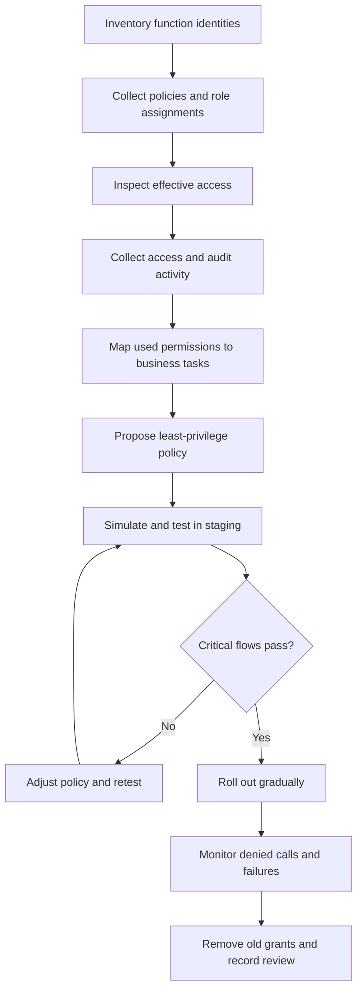

# Reviewing IAM, Access Logs, and Detecting Excess Permissions

A Java function typically runs with a workload identity to read secrets, access databases, write objects, receive messages, or call other services. If that identity holds overly broad permissions, a code bug, exploited dependency, or leaked credential can cause impact far beyond the function's intended scope. Therefore, serverless security requires continuous verification: which permissions does the function actually need, which permissions have been used, which requests accessed resources, and which permissions are excessive?

**IAM review** is the process of inspecting identities, roles, policies, trust relationships, and resource scopes. **Access logs** record requests or access operations for investigation and measurement. **Audit logs** capture who changed configurations/permissions or performed critical actions. These three data sources complement one another: policies state what is allowed; logs state what actually happened; permission usage analysis identifies privileges that can be narrowed.

This lesson focuses on Java serverless across AWS, Azure, and Google Cloud. The goal is to design per-function identities, detect excess permissions, use audit/access logs effectively, and tighten permissions safely without disrupting processing.

## 1. Distinguishing Authentication, Authorization, and Auditing

Three concepts that are often conflated:

- **Authentication:** identifying who the caller is. For example, API Gateway validates a JWT, Azure Functions authenticates Microsoft Entra ID, or a service account invokes Cloud Run.
- **Authorization:** deciding what that identity is allowed to do on which resources. For example, an execution role has `s3:GetObject` on a specific bucket/prefix.
- **Audit/observability:** recording requests, actions, outcomes, and configuration changes for investigation or compliance proof.

An HTTP API has at least two identity boundaries:

1. **Caller identity:** the user or service calling the HTTP endpoint. This identity governs which business data the caller may view or modify.
2. **Workload identity:** the Java function's identity when calling AWS/Azure/GCP services. This identity governs which secrets, databases, or messages the function can read, write, or publish.

Do not treat an HTTP request passing an API key or JWT as proof that the function has permission to access all data. Conversely, an execution role having permission to read a bucket does not mean every user calling the API is allowed to download objects in that bucket. Business authorization must check permissions per tenant/resource.

## 2. What Is IAM in a Serverless Environment?

IAM (Identity and Access Management) governs identities and access permissions. A policy typically defines:

| Component | Question |
| --- | --- |
| Principal/identity | Who or which workload is requesting access? |
| Action/permission | Which operations are permitted? |
| Resource | Which resources does the operation apply to? |
| Condition | Under what conditions does the permission apply? |
| Effect | Allow or deny? |

In serverless, the runtime identity is usually attached to the function or service. Each function can have its own role/service account. When the runtime calls a cloud SDK, the platform issues temporary credentials for that identity; the application does not need to store long-lived access keys in source code.

A secure design separates:

- Runtime permissions needed to perform business logic.
- Function/deployment management permissions needed by CI/CD or operators.
- Log-reading and investigation permissions for operations/security teams.
- IAM policy modification permissions for controlled administrative groups.

Never grant cloud admin privileges to an execution role simply because a function encountered an `AccessDenied` error. First identify the denied action/resource and grant only the exact permission required.

## 3. Least Privilege: Minimal Permissions per Function and Task

Least privilege requires each identity to hold only the minimal permissions needed to complete its task, within the required resource scope and time window.

Consider an invoice-processing system with three functions:

| Function | Responsibility | Expected Runtime Permissions |
| --- | --- | --- |
| `upload-api` | Create upload sessions and metadata | Write upload records; generate scoped upload URL for one object/prefix; write logs |
| `invoice-worker` | Read files and extract data | Read objects under input prefix; write results; read required secrets; update status |
| `notification-worker` | Send notifications | Read notification records; publish to one topic/queue; no need to read raw invoice files |

If all three functions share one role with `AdministratorAccess` or `*` across all buckets, databases, and queues, a bug in the notification worker could become an access path to invoice data. Separating roles by responsibility shrinks the blast radius.

### Policy Design Rules

1. Start from the list of specific use cases and operations, not from an overly broad template policy.
2. Scope resources by the exact ARN, resource ID, bucket/prefix, table, secret, or queue needed.
3. Grant only the corresponding read/write/delete actions; never grant `Delete*` if the function only needs read access.
4. Use conditions such as tenant/resource tags, source ARN, VPC endpoint, or encryption context where appropriate.
5. Separate secret read permissions from secret creation/rotation permissions.
6. Separate deployment/configuration permissions from business runtime permissions.
7. Set a review date and owner for policies carrying exceptions.

Not all cloud providers express permissions with the same syntax. AWS policies typically specify actions/resources/conditions; Azure RBAC assigns roles at management-plane or data-plane scopes; Google Cloud IAM binds roles containing permissions onto the resource hierarchy. Despite syntax differences, the goal remains the right principal, sufficient permissions, and the narrowest scope.

## 4. Distinguishing Identity Policies, Resource Policies, and Trust Policies

In AWS, understand the different policy types:

- **Identity-based policy:** attached to a user, group, or role; states which actions/resources the principal can access.
- **Resource-based policy:** attached directly to a resource such as an S3 bucket, SQS queue, SNS topic, or Lambda function; states which principals the resource accepts.
- **Trust policy:** attached to an IAM role; defines which principals/services are allowed to assume the role.
- **Permissions boundary:** caps the maximum permissions an identity policy can grant to a principal.
- **Service control policy (SCP):** caps maximum permissions inside an AWS Organizations account/OU.
- **Session policy:** can narrow permissions for a single role session.

A successful request can depend on multiple policies simultaneously. Explicit Deny typically overrides Allow. You cannot look at an identity policy in isolation and conclude effective permissions; evaluate resource policies, SCPs, permissions boundaries, session policies, and related conditions.

Example of a Lambda needing to read objects from a bucket:

```json
{
  "Version": "2012-10-17",
  "Statement": [
    {
      "Sid": "ReadInvoiceInputOnly",
      "Effect": "Allow",
      "Action": ["s3:GetObject"],
      "Resource": "arn:aws:s3:::invoice-input/tenant/*"
    }
  ]
}
```

This policy does not permit listing the bucket, writing objects, or deleting objects. If code needs `s3:ListBucket`, add a separate statement on the bucket ARN with an appropriate prefix condition; do not change it to `s3:*` on `*` just to silence an error.

### Lambda Execution Role Trust Policy

An execution role requires a trust policy allowing the Lambda service to assume the role. This is the permission for the runtime to acquire its identity, not permission to read S3/Secrets Manager. Data access permissions reside in the role's permission policy.

A minimal trust policy typically has `lambda.amazonaws.com` as the principal and `sts:AssumeRole` as the action. Granting EventBridge/S3/API Gateway permission to invoke Lambda is a separate boundary: the function's resource policy or corresponding invoke mechanism must permit the caller source.

## 5. Separating Function Invoke Permissions from Data Access Permissions

A common design mistake is merging two permission directions into one concept:

1. **Who can invoke the function?** For example, API Gateway, EventBridge, S3 notifications, or another service account allowed to invoke it.
2. **Which services can the function call?** For example, reading secrets, writing to S3, publishing to SQS, or querying DynamoDB.

In AWS, invoke permissions can live in Lambda's resource-based policy or the caller's IAM permissions depending on the invocation type. The execution role is the identity the function uses after invocation begins.

In Azure, permissions to call the HTTP endpoint (function keys, Entra ID, or ingress auth) differ from the managed identity the function uses to access Key Vault/Storage. In Google Cloud, permissions to invoke Cloud Run/Functions differ from the runtime service account used to call Google APIs.

Review both directions independently. A function should not be public merely because its execution role is restricted; conversely, a private function still poses risk if its runtime identity holds overly broad permissions.

## 6. IAM for Java on AWS Lambda

AWS Lambda uses an execution role to supply temporary credentials to code. AWS SDK for Java v2 includes a default credentials provider chain that automatically retrieves credentials from the Lambda environment when running on AWS. Never put long-lived `AWS_ACCESS_KEY_ID` or `AWS_SECRET_ACCESS_KEY` values in production environment variables.

Java example reading an object with SDK v2:

```java
import software.amazon.awssdk.regions.Region;
import software.amazon.awssdk.services.s3.S3Client;
import software.amazon.awssdk.services.s3.model.GetObjectRequest;

public final class InvoiceReader {
    private final S3Client s3 = S3Client.builder()
            .region(Region.AP_SOUTHEAST_1)
            .build();

    public byte[] read(String bucket, String key) {
        var request = GetObjectRequest.builder()
                .bucket(bucket)
                .key(key)
                .build();
        try (var input = s3.getObject(request)) {
            return input.readAllBytes();
        } catch (java.io.IOException e) {
            throw new IllegalStateException("Unable to read invoice", e);
        }
    }
}
```

This example is suitable only for small objects because `readAllBytes()` loads the entire content onto the heap. For large files, use streams or buffered processing. `s3:GetObject` must be granted to the execution role on the exact bucket/prefix. Java code does not need to know any access key; the SDK acquires credentials from the role.

### Common Permissions and Over-Privilege Risks

| Need | Example Action | Risk When Overly Broad |
| --- | --- | --- |
| Write logs | `logs:CreateLogStream`, `logs:PutLogEvents`, and log group creation if needed | Log permissions on `*` can allow writing to many log groups |
| Read secret | `secretsmanager:GetSecretValue` | Reading all secrets in the account instead of one secret |
| Read object | `s3:GetObject` | Reading any bucket or prefixes holding other tenants' data |
| Write object | `s3:PutObject` | Overwriting/deleting business content or planting malicious data under other prefixes |
| Write DynamoDB | `dynamodb:PutItem`, `UpdateItem` | Modifying unrelated tables or another tenant's data |
| Send SQS | `sqs:SendMessage` | Sending messages to arbitrary queues and triggering unintended workflows |
| Publish SNS | `sns:Publish` | Emitting events to sensitive topics or causing unexpected fan-out |

Action names are illustrative; an operation may require auxiliary actions such as KMS decrypt, describe, or tag conditions. Use IAM Access Analyzer policy generation and CloudTrail activity to find actually used permissions, then test the tightened policy in staging.

## 7. IAM for Azure Functions

Azure Functions can use a system-assigned or user-assigned managed identity. Managed identities are issued short-lived tokens by Entra ID; Java applications use `DefaultAzureCredential` or an appropriate credential to call Azure SDKs.

Java example reading a blob using managed identity:

```java
import com.azure.identity.DefaultAzureCredentialBuilder;
import com.azure.storage.blob.BlobClient;
import com.azure.storage.blob.BlobClientBuilder;

public final class AzureBlobReader {
    private final BlobClient blob;

    public AzureBlobReader(String accountUrl, String container, String blobName) {
        this.blob = new BlobClientBuilder()
                .endpoint(accountUrl)
                .containerName(container)
                .blobName(blobName)
                .credential(new DefaultAzureCredentialBuilder().build())
                .buildClient();
    }

    public void downloadTo(java.nio.file.Path destination) {
        blob.downloadToFile(destination.toString(), true);
    }
}
```

In production, assign an appropriate data-plane role such as `Storage Blob Data Reader` on the exact container/account to be read. The management-plane `Reader` role allows reading only Azure resource metadata; it does not implicitly allow reading blob contents. This is a common point of confusion between resource management permissions and data access permissions.

### Azure RBAC Scope

Role assignments can be placed at the management group, subscription, resource group, resource, or service-supported child scopes. Permissions generally inherit down to child scopes. Thus, assigning a role at the subscription level can be far broader than a function needing to read only one container.

Prefer the smallest scope supported by the service. For Storage, use the appropriate data role scoped to the account/container. For Key Vault, use secret-management roles at the vault or secret scope depending on the permission model. Never grant `Owner` or `Contributor` to a managed identity just to read data.

### Managed Identities and Role Assignments

A system-assigned identity is tied to the Function App lifecycle; deleting the Function App can delete the identity. A user-assigned identity is more independent and can be shared across multiple workloads, though it requires careful review because sharing an identity widens the blast radius. If two functions have different responsibilities and sensitivity levels, dedicated identities are usually easier to audit and narrow.

## 8. IAM for Cloud Run and Google Cloud Functions

Google Cloud Run/Functions use a service account attached to the workload. Google Cloud Java client libraries use Application Default Credentials (ADC), obtaining credentials from the runtime service account in Google Cloud environments. Never load a long-lived JSON service account key into a container unless there is an exceptional requirement.

Java example creating a Storage client using ADC:

```java
import com.google.cloud.storage.Storage;
import com.google.cloud.storage.StorageOptions;

public final class GcsObjectReader {
    private final Storage storage = StorageOptions.getDefaultInstance()
            .getService();

    public byte[] read(String bucket, String objectName) {
        var blob = storage.get(bucket, objectName);
        if (blob == null) {
            throw new IllegalArgumentException("Object not found");
        }
        return blob.getContent();
    }
}
```

`getContent()` loads the entire object into memory; use it only for small objects. For large data, use a read channel/stream. The runtime service account needs an appropriate role on the bucket, such as `roles/storage.objectViewer` when only reading objects. Avoid assigning `roles/storage.admin` at the project level when the function only needs to read a single bucket.

### Roles and Permissions in Google Cloud

A Google Cloud IAM role is a collection of permissions. There are service-specific predefined roles, broad basic roles such as Owner/Editor/Viewer, and organization-managed custom roles. Prefer narrow predefined roles or controlled custom roles; avoid broad basic roles for production runtimes.

Assigning a role at the project level applies more broadly than assigning it on a specific bucket, secret, or resource when supported by the service. For service accounts, distinguish:

- **Runtime service account:** used by the function to access resources.
- **Deployer service account:** used by the pipeline to create/update the function or service.
- **Trigger/invoker service account:** identity used by Eventarc or event sources to invoke the target when needed.

Do not use one service account for deployment, runtime, and triggers when roles can be separated.

## 9. Access Logs, Audit Logs, and Application Logs Differ

Different log types answer different questions:

| Log Type | Records | Used For |
| --- | --- | --- |
| Application log | Application logic, business keys, errors, processing results | Debugging and understanding function behavior |
| HTTP access log | Method, path, status, latency, caller metadata, request ID | Monitoring API traffic and investigating requests |
| Data access log | Data reads/writes on resources such as objects, secrets, tables, or APIs | Identifying which principal accessed data |
| Audit/management log | Changes to IAM, config, deployments, role assignments, resources | Investigating changes and governance auditing |
| Network flow log | Accepted/rejected network connections between interfaces/subnets | Analyzing network paths and anomalous traffic |

Do not enable every log at maximum verbosity without a clear objective. Data access logs can carry significant cost, volume, and privacy impacts. Identify sensitive resources, retention, log read permissions, and audit requirements before enabling them.

### Application Logs Are Not Audit Logs

A log line emitted by Java code such as `user updated invoice` is not automatically reliable audit evidence. Applications can omit logs, log inaccurately, or be tampered with by a compromised workload. Cloud provider control-plane/data-plane audit logs record actions at the platform layer; application audit events add business context such as order ID, tenant ID, actor, and reason for change.

For critical business operations, persist durable audit events inside the same transaction as the data change or via a transactional outbox. Then forward events to a centralized logging/auditing system. Do not rely solely on a log statement after commit, since the process can crash between commit and logging.

## 10. AWS: CloudTrail, CloudWatch Logs, and Access Analyzer

### CloudTrail

AWS CloudTrail records account API activity. Distinguish:

- **Management events:** resource and configuration management operations, such as creating roles, editing policies, deploying Lambdas, or modifying security groups.
- **Data events:** data-plane operations, such as reading/writing S3 objects or certain supported resource invoke/access operations. Data events typically require explicit configuration in a trail/event data store and can incur charges.
- **CloudTrail Insights:** can help detect unusual API activity for certain event types when enabled and supported by the service.

CloudTrail Event history provides recent management event history in the account; if you need long-term retention, querying, or data events, configure an appropriate trail/Lake and retention. Do not assume every `GetObject` call or every function data access appears in default Event history.

### CloudWatch Logs

Lambda typically sends stdout/stderr and logger output to CloudWatch Logs under the function's log group. Application logs are useful for request IDs, event IDs, and business context. CloudWatch Logs does not replace CloudTrail: a function might not log every API call, and application logs do not prove full effective permissions.

### IAM Access Analyzer

IAM Access Analyzer helps detect resource policies permitting access from outside the account/organization or findings on unintended access depending on the analyzer type. The analyzer can review external access for supported resources. Additionally, policy generation based on CloudTrail activity can propose a policy for a role over an observation window.

Policy generation sees only activities recorded in CloudTrail during the analysis window. If a function runs a quarterly job or executes only during incidents, a short observation window may miss necessary permissions. Never remove an action simply because it did not appear over a few days of logs.

### IAM Last Accessed Information

Last accessed information can help identify services/actions not used recently, yet the data is not absolute proof that a permission is unnecessary. Consider the observation window, which action types support tracking, service-linked roles, and infrequent tasks.

## 11. Azure: Activity Log, Diagnostic Logs, and Entra Audit

Azure has multiple logging layers:

- **Azure Activity Log:** records subscription control-plane operations such as resource creation, configuration updates, and role assignments. It is not a complete log of all data-plane reads/writes.
- **Resource diagnostic logs:** configured via Diagnostic Settings to ship resource logs/metrics to a Log Analytics workspace, Storage, or Event Hubs. For instance, Storage data-plane logs can record read/write/delete requests when corresponding categories are supported and enabled.
- **Microsoft Entra audit/sign-in logs:** record identity changes, sign-ins, and Entra ID-related activities by log type.
- **Application Insights:** collects Function App telemetry, requests, dependencies, traces, and exceptions.

When a Function App calls Key Vault successfully, you may need to inspect Key Vault diagnostic/audit logs to see which secret was read and by which identity. The subscription Activity Log records only resource management changes; it does not replace Key Vault data-plane logs.

### Azure RBAC Review

Use role assignment listings, Access Reviews, and entitlement management tools to determine:

- Which principals are assigned roles at subscription/resource group/resource levels.
- Whether a role has a broader scope than required.
- Whether duplicate direct and inherited role assignments exist.
- Which managed identities are no longer attached to active workloads.
- Whether data-plane permissions have been confused with management-plane permissions.

Azure Policy can assist with configuration governance and compliance, but does not replace reviewing effective permissions. For privileged human access, use Privileged Identity Management (PIM), eligible assignments, and time bounds where appropriate instead of permanent Owner/Contributor assignments.

## 12. Google Cloud: Cloud Audit Logs and IAM Policy Intelligence

Cloud Audit Logs have four primary log types:

- **Admin Activity:** resource configuration or metadata changes; typically recorded by default.
- **Data Access:** data reads/writes or data-plane API calls; for many services, Data Access logging must be explicitly enabled and can incur charges.
- **System Event:** actions performed by Google Cloud systems.
- **Policy Denied:** requests denied by policies, useful for investigating permission failures when the log type is supported and enabled.

Do not assume every object or secret read appears in default logs. Identify services requiring auditing, enable Data Access logs at the proper project/folder/organization scope, and configure log sink retention/permissions.

### IAM Policy Intelligence

Google Cloud provides tools under Policy Intelligence:

- **Policy Analyzer:** analyzes which principals can access which resources across policies and inheritance relationships.
- **IAM Recommender:** suggests roles or permissions that can be removed based on usage history and analysis.
- **Policy Troubleshooter:** explains why a principal is or is not permitted to perform an action on a resource.
- **Service Account Insights:** surfaces signals about inactive service accounts or permissions needing review.

Recommendations are inputs for review, not commands to auto-delete permissions. Infrequent tasks, scheduled jobs, and disaster recovery paths may not appear within the observation window.

## 13. Designing Useful Access Logs for Java Functions

A useful log record needs enough context to correlate requests with function invocations and business operations, without containing secrets or sensitive payloads.

Typically useful fields:

| Field | Purpose |
| --- | --- |
| `timestamp` | Time of event |
| `service` / `function` | Function or service performing the operation |
| `invocationId` / `requestId` | Links log to the platform's invocation/request |
| `correlationId` / `traceId` | Traces flow across multiple services |
| `principal` / `serviceAccount` | Verified workload or caller identity |
| `action` | Business action or resource operation |
| `resource` | Safely categorized resource ID |
| `tenantId` | Business partition if permitted to log |
| `result` | Success, denied, failure, or retry |
| `reasonCode` | Standardized error code containing no secrets |
| `durationMs` | Processing duration |

Never log access tokens, cookies, passwords, API keys, private keys, presigned URLs, or full request bodies. If user IDs/tenant IDs must be stored, apply masking/pseudonymization per policy. Avoid placing high-cardinality IDs in metric labels; use logs/traces for detailed investigation.

### Java Structured Logging

Illustrative example of structured logging using SLF4J:

```java
import org.slf4j.Logger;
import org.slf4j.LoggerFactory;

public final class AccessAuditLogger {
    private static final Logger log =
            LoggerFactory.getLogger(AccessAuditLogger.class);

    public void recordRead(
            String invocationId,
            String correlationId,
            String principal,
            String resourceId,
            boolean allowed
    ) {
        log.atInfo()
                .addKeyValue("event", "resource_access")
                .addKeyValue("invocationId", invocationId)
                .addKeyValue("correlationId", correlationId)
                .addKeyValue("principal", principal)
                .addKeyValue("resourceId", resourceId)
                .addKeyValue("result", allowed ? "allowed" : "denied")
                .log("Resource access decision");
    }
}
```

SLF4J fluent key-value logging requires a supporting API/provider version. If your version lacks support, use a structured JSON encoder or appropriate logger. Application decision logs do not replace cloud provider audit events; they add business context.

### Correlation and Trace Propagation

When a function calls another service, propagate a standard trace context such as W3C Trace Context (`traceparent`) or a system-wide correlation ID. Do not generate a brand-new ID at every hop if you want to link the entire flow. When receiving messages/events, carry the correlation ID in message attributes or event metadata and emit it in consumer logs.

## 14. Detecting Excess Permissions

Excess permissions commonly show up through signs such as:

- Action wildcards like `s3:*`, `dynamodb:*`, `secretsmanager:*`, or `*`.
- Resource wildcard `*` in runtime policies even when the service supports narrower scoping.
- Roles carrying `AdministratorAccess`, Owner, Editor, or Contributor for workloads needing only a few operations.
- Functions able to read secrets or buckets outside their responsibility.
- Roles allowing write/delete when the function only needs read access.
- Functions permitted to assume other roles without a clear use case.
- Resource policies allowing external accounts/principals more broadly than intended.
- Permissions assigned at subscription/project/account level instead of a narrower resource scope.
- Roles no longer used by any workload that still exist or retain permissions.
- Temporary debugging permissions left unrevoked after an incident.

### Gathering Evidence from Policies and Activity

Combine at least four sources:

1. **Declared policy:** permissions declared in IAM/RBAC and Infrastructure as Code.
2. **Effective access:** actual permissions after accounting for policy inheritance, resource policies, denies, boundaries, and conditions.
3. **Observed usage:** actions/resources actually appearing in access/data logs or permission usage analysis.
4. **Business requirement:** function responsibilities and rare scenarios such as backups, failover, scheduled tasks, or recovery.

You cannot conclude a permission is unused solely because it does not appear in access logs. Logging might be disabled, retention might be short, or the workload might run on an infrequent schedule. Observe over a full business cycle and consult the owner before tightening.

## 15. Safe IAM Review and Tightening Workflow

A practical workflow:

1. **Inventory:** list functions, owners, environments, runtime identities, triggers, and dependent resources.
2. **Collect:** gather identity policies, resource policies, role assignments, trust policies, and policy inheritance.
3. **Analyze:** spot wildcards, admin roles, broad scopes, external principals, and orphaned roles.
4. **Observe:** enable necessary access/data logs and collect permission usage over a sufficiently long cycle.
5. **Map:** tie each action to specific use cases, code paths, triggers, and resources.
6. **Propose:** author narrower policies, split roles, or migrate to workload identities.
7. **Simulate/test:** use policy simulators/troubleshooters or staging to test both happy paths and failure/recovery flows.
8. **Deploy gradually:** roll out the new policy, monitoring `AccessDenied`, retries, DLQs, and business errors.
9. **Remove old grants:** revoke old permissions only after confirming the updated workload operates cleanly.
10. **Document:** record owner, justification, scope, review date, and remaining exceptions.



### Start in Observation Mode

If the system lacks data access logs, do not immediately strip permissions based on guesswork. First enable targeted logging, verify cost/retention, and gather sufficient data. For critical production workloads, validate tightened policies in staging or on a subset of traffic before full rollout.

## 16. Cloud Tools for Detecting Unused or Excess Permissions

| Cloud | Tool/Signal | Used For |
| --- | --- | --- |
| AWS | IAM Access Analyzer external access findings | Finding resource policies granting access to accounts/principals outside the trust boundary |
| AWS | IAM Access Analyzer policy generation | Recommending policies based on a role's CloudTrail activity |
| AWS | IAM last accessed / credential report | Viewing rarely used or unused services/actions or credentials |
| AWS | IAM Policy Simulator, Access Analyzer validation | Evaluating policies and effective permissions under simulated scenarios |
| Azure | Azure RBAC role assignment review, Access Reviews, PIM | Finding broad roles, stale permissions, and principals no longer needing access |
| Azure | Entra sign-in/audit logs, Activity Log, resource diagnostic logs | Correlating identities, administrative changes, and data-plane activity |
| Google Cloud | IAM Recommender, Service Account Insights | Identifying narrowable roles/permissions and inactive service accounts |
| Google Cloud | Policy Analyzer, Policy Troubleshooter | Analyzing who can access resources and why actions are allowed/denied |
| Google Cloud | Cloud Audit Logs | Monitoring admin, data access, system events, and policy denials |

Tools have limitations regarding resource types, permission categories, observation windows, and log data. Read findings alongside original policies and business requirements; never auto-remove permissions based solely on a single recommendation.

## 17. Inspect Effective Permissions, Not Just Declared Policies

A policy may look narrow while effective permissions remain broad due to inheritance or resource policies. Examples:

- An Azure role assigned at the subscription level and inherited down to resource groups/functions.
- A Google Cloud role assigned at the project level applying to multiple child buckets/secrets.
- An AWS resource policy permitting another principal even though the current role's identity policy does not list it.
- An AWS SCP or permissions boundary blocking an action despite an `Allow` in the identity policy.
- Conditions based on principal tags or resource tags not applying as intended.

Reviews must answer both questions: "Which policies are declared?" and "What can this principal actually do on this resource?" Use Policy Analyzer, IAM Simulator, Access Analyzer, or equivalent tools to verify effective access.

### Cross-Account/Cross-Project Permissions

When a function accesses resources in another account/project, inspect both the caller side and the resource side. AWS typically requires an identity policy in the caller account and an appropriate resource/trust policy in the target account. Azure requires role assignments and tenant/identity trust per the service model. Google Cloud requires roles on the resource project and service account impersonation/federation if used. Never open a principal wildcard just to make a cross-account connection work.

## 18. Event Sources and Service-to-Service Identities

A function may be triggered by EventBridge, S3, SQS, Eventarc, Pub/Sub, Azure Event Grid, or Service Bus. Determine which identity is allowed to emit events and which identity is allowed to invoke the function.

- Restrict event sources to exact buckets/topics/queues.
- Use resource policies or IAM invoke permissions with the exact service principal/source ARN when required by the platform.
- With Eventarc, constrain event types, sources, filters, and the service account permitted to invoke the target.
- With Azure, verify managed identity, source RBAC, and trigger connections.
- Validate payloads and event metadata; never treat message contents as proof of principal.
- Use idempotency by event ID/business key because events can be redelivered.

Never grant `lambda:InvokeFunction` or Cloud Run invoke permissions to all principals when only one scheduler/topic/service needs to invoke. Similarly, a function should not hold publish rights to every queue/topic merely because it consumes events from one queue.

## 19. Application-Level Authorization and Multi-Tenancy

Cloud IAM typically governs workload permissions on cloud resources; it does not solve end-user authorization inside the application on its own. A multi-tenant Java API must enforce tenant/resource ownership checks even when the execution role can read the database or object storage.

Dangerous example:

1. Caller A sends `GET /documents/doc-200`.
2. The Java function uses an execution role permitted to call `s3:GetObject` on the entire bucket.
3. Code reads the object using the key from the request without checking whether the document belongs to tenant A.
4. Caller A can read tenant B's file.

The execution role holds broad permissions so the function can do its job; business authorization must prevent callers from accessing out-of-tenant records. Risk can be reduced using per-tenant prefixes/partitions, tenant predicates in queries, short-lived presigned URLs generated after ownership checks, and workload-separated roles. Still, never replace authorization checks by relying solely on object keys.

## 20. Secure Logging and Retention

Access/audit logs can contain principals, resource IDs, IPs, paths, query parameters, and sensitive metadata. Design logging with these principles:

- Never log secrets, tokens, cookies, authorization headers, or sensitive payloads.
- Mask/redact identifiers if required by policy.
- Separate log read permissions from function operations permissions.
- Use a centralized log sink/account/project protected against unauthorized tampering/deletion where needed.
- Set retention per legal, incident response, and cost requirements.
- Enable data access logs selectively for sensitive resources rather than enabling every category indiscriminately.
- Synchronize clocks and preserve correlation/request IDs to stitch events together.
- Alert on anomalous behavior: off-schedule secret reads, multi-tenant access spikes, bulk object deletions, unusual role assumptions, or sudden `AccessDenied` spikes.

Do not store excessive personal data merely for debugging. For audit requirements, explicitly define which events must be retained, who may view them, and how long they are kept. Logs without retention or owners easily become a second sensitive data store.

## 21. Detecting Anomalous Behavior

Signals that can help detect a misused function or identity:

- A function reading secrets unrelated to its responsibility or reading many secrets in a short burst.
- A role assumed from an unusual principal/region/IP.
- A function writing/deleting an abnormally high volume of objects.
- A workload accessing multiple tenants' resources when it normally serves one tenant.
- Sudden spikes in API calls, data transfer, denied requests, or queue publishes.
- Policy/role assignment changes outside pipelines or maintenance windows.
- Newly granted admin permissions or wildcard resources on a function.
- Service accounts/managed identities no longer attached to workloads yet still retaining roles.

Establish baselines per function and workload, not only at the account level. A batch worker reading many objects at the start of the month may be normal; the same behavior from a notification function is suspicious. Alerts must include an owner, severity, and investigation playbook.

## 22. When Over-Privilege or Abuse Is Detected

When a review uncovers an overly broad policy, tighten it via a controlled rollout. When signs point to leaked credentials or active privilege abuse, treat it as an incident:

1. Identify the principal, function, resource, action, and timeframe.
2. Inspect audit/data access logs and request traces to determine access scope.
3. Temporarily disable the role/session, revoke credentials, or add an explicit deny per incident procedures if needed to halt damage.
4. Isolate the function/trigger or reduce concurrency if malicious actions are actively occurring.
5. Preserve logs and evidence; never delete related logs or artifacts.
6. Verify which data was read/modified/deleted and assess notification obligations.
7. Create a new least-privilege role/credential and roll it out safely.
8. Check other functions sharing the identity; split roles if the blast radius is too wide.
9. Remediate the root cause, update policy-as-code, and run regression tests.
10. Document timeline, owner, decisions, and preventive measures.

Never bulk-revoke permissions without understanding dependencies during a routine review; doing so can cause an outage. During an active incident, containment may take priority over availability and must follow the organization's incident response process.

## 23. Policy as Code and Controlling IAM Changes

Defining IAM via Infrastructure as Code enables reviewing changes through pull requests, inspecting diffs, and reproducing environments. Policies can be checked automatically for wildcards, admin roles, public access, and overly broad scopes.

Safeguards:

- Manage roles/policies in Terraform, CloudFormation, Bicep, or the corresponding IaC tool.
- Pin module/provider versions and review permission changes as carefully as code changes.
- Run policy validation/linters in CI.
- Block public resource policies or wildcards outside approved exceptions.
- Never allow a function to modify its own role/policy.
- Use a dedicated deployment identity and short-lived credentials/OIDC federation for CI/CD.
- Emit audit events for role assignment and policy changes.

Policy-as-code alone does not catch all effective permissions if inheritance, resource policies, and runtime identities are omitted. Combine IaC checks with live cloud permission analysis tools.

## 24. Example: Tightening Permissions of a Java Worker

Suppose `invoice-worker` initially has a broad policy:

```json
{
  "Version": "2012-10-17",
  "Statement": [
    {
      "Effect": "Allow",
      "Action": "s3:*",
      "Resource": "*"
    },
    {
      "Effect": "Allow",
      "Action": "secretsmanager:*",
      "Resource": "*"
    }
  ]
}
```

After reviewing code paths, CloudTrail activity, resource inventory, and tests, the worker only needs to read files from the input prefix, write results to the output prefix, and read one database secret. The target policy can be broken into narrow statements:

```json
{
  "Version": "2012-10-17",
  "Statement": [
    {
      "Sid": "ReadInvoiceInput",
      "Effect": "Allow",
      "Action": ["s3:GetObject"],
      "Resource": "arn:aws:s3:::invoice-data/incoming/*"
    },
    {
      "Sid": "WriteInvoiceResults",
      "Effect": "Allow",
      "Action": ["s3:PutObject"],
      "Resource": "arn:aws:s3:::invoice-data/processed/*"
    },
    {
      "Sid": "ReadDatabaseCredential",
      "Effect": "Allow",
      "Action": ["secretsmanager:GetSecretValue"],
      "Resource": "arn:aws:secretsmanager:ap-southeast-1:123456789012:secret:prod/invoice-db-*"
    }
  ]
}
```

This is an illustrative policy; adjust ARNs, account, region, and actual auxiliary actions. If the bucket uses SSE-KMS with a customer-managed key, corresponding `kms:Decrypt`/`kms:GenerateDataKey` permissions and key policies may be required. If the worker needs `ListBucket`, add a separate permission with a prefix condition; do not grant `s3:ListAllMyBuckets` or `s3:*` on `*`.

Rollout steps:

1. Attach the new policy to a test or staging role.
2. Run unit/integration tests and simulate real events.
3. Inspect `AccessDenied` logs and rare code branches.
4. Roll out the new policy to a subset of functions or revisions.
5. Monitor queue age, retries, DLQs, business errors, and downstream access.
6. Once stable, remove the old policy and archive review evidence.

## 25. IAM and Access Logs Review Checklist

- [ ] Each function has its own workload identity or a clearly defined shared responsibility group.
- [ ] Runtime identity is separated from deployment/admin identity.
- [ ] Long-lived access keys/service account keys are not used when workload identities suffice.
- [ ] Policies contain no wildcard actions/resources outside approved exceptions.
- [ ] Scopes are restricted to specific buckets/prefixes, tables, queues, secrets, or resources.
- [ ] Identity policies, resource policies, trust policies, and invoke permissions are reviewed separately.
- [ ] Effective permissions have been verified after inheritance, boundaries, SCPs, and conditions.
- [ ] HTTP caller authorization is separated from workload IAM permissions.
- [ ] Application logs, access logs, data access logs, and audit logs are clearly distinguished.
- [ ] Data access logging is enabled for sensitive resources requiring audit.
- [ ] Logs contain no tokens, passwords, cookies, secrets, or sensitive payloads.
- [ ] Retention, log read permissions, log sinks, and costs are defined.
- [ ] Tools are in place to detect external access, unused permissions, or overly broad roles.
- [ ] Sufficient rare business cycles are reviewed before removing permissions absent from logs.
- [ ] Policy changes are managed via IaC/PRs with tests/simulations.
- [ ] Alerts exist for anomalous access, role assignment changes, and `AccessDenied` spikes.
- [ ] Procedures exist for rollout, rollback, and incident response when permissions are abused.
- [ ] Every policy/exception has an owner, justification, and next review date.

Reviewing IAM in serverless is a continuous cycle: identify workload identities, understand effective permissions, collect access/audit activity, map against real responsibilities, and tighten policies in a controlled manner. AWS CloudTrail/Access Analyzer, Azure Activity/Diagnostic Logs and RBAC reviews, and Google Cloud Audit Logs/Policy Intelligence each offer distinct perspectives; Java application logs add business context. By separating invoke permissions from runtime permissions, applying per-function least privilege, and maintaining selective auditing, systems shrink the blast radius of bugs or credential compromises while retaining full investigative and operational visibility.

## Official References

- [AWS IAM best practices](https://docs.aws.amazon.com/IAM/latest/UserGuide/best-practices.html)
- [AWS Lambda execution role](https://docs.aws.amazon.com/lambda/latest/dg/lambda-intro-execution-role.html)
- [AWS CloudTrail event types](https://docs.aws.amazon.com/awscloudtrail/latest/userguide/cloudtrail-events.html)
- [AWS IAM Access Analyzer](https://docs.aws.amazon.com/IAM/latest/UserGuide/what-is-access-analyzer.html)
- [Azure managed identities overview](https://learn.microsoft.com/entra/identity/managed-identities-azure-resources/overview)
- [Azure RBAC best practices](https://learn.microsoft.com/azure/role-based-access-control/best-practices)
- [Azure Activity Log](https://learn.microsoft.com/azure/azure-monitor/platform/activity-log)
- [Google Cloud IAM best practices](https://cloud.google.com/iam/docs/using-iam-securely)
- [Google Cloud Audit Logs overview](https://cloud.google.com/logging/docs/audit)
- [Google Cloud Policy Intelligence](https://cloud.google.com/policy-intelligence/docs/overview)
