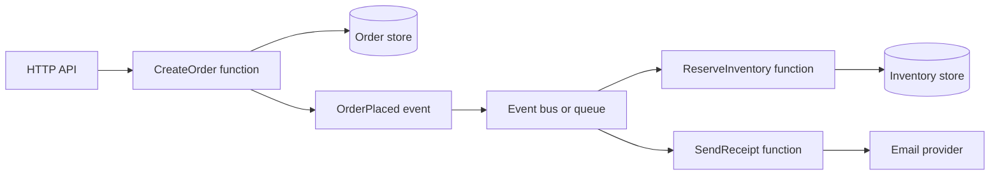

# Designing Single-Responsibility Functions and Limiting Cross-Dependencies

In serverless architecture, a function is typically the unit of deployment, authorization, scaling, and fault isolation. How functions are partitioned therefore directly affects system evolvability, reliability, and operational cost. A well-designed function has a clear business purpose, owns a well-understood input and output contract, and can be deployed and scaled without forcing unrelated parts to change together.

Single responsibility does not mean each function may execute only one statement or call only one service. A function can perform multiple steps if those steps serve a single business outcome and share a consistency boundary, access permissions, retry policy, or load profile. The goal is to keep parts with different reasons to change within independent boundaries, while avoiding splitting so finely that a simple operation traverses excessive network calls.

## 1. Defining the Right Function Responsibility

Start from the business outcome an invocation needs to produce, then determine the trigger and processing contract. In Java serverless systems, triggers are commonly HTTP requests, queue messages, or events emitted by another service. Each trigger type has distinct delivery semantics, execution deadlines, and error mechanisms; they should not be hidden inside one combined function if their operational policies differ.

A function with a clear responsibility can typically answer the following questions:

- Which business capability does it serve, such as creating an order, recording a payment, or sending a notification?
- What data type does it accept, and how is that contract versioned?
- What does success mean in terms of what has been completed or recorded?
- Which errors can be retried, and which should be returned to the caller or sent to a dead-letter queue (DLQ)?
- Which resources does the function need permission to access?
- Do its load, latency, and availability requirements differ from neighboring functions?

If a single function handles HTTP requests, consumes a queue, and runs on a schedule using one large conditional branch to dispatch work, that is usually a sign of mixed responsibilities. These triggers may require different timeouts, retries, authentication, concurrency limits, and response mechanisms. Separating adapters by trigger makes each contract explicit and keeps failures in one flow from impacting others.

### Boundaries by Reason to Change

Consider splitting a function when a part can change independently, has a different owner, needs different access permissions, exhibits a different load profile, or requires a different retry and timeout policy. For example, handling an order-creation request requires a fast HTTP response, whereas sending an email can run asynchronously and retry over a longer period. These two tasks have different lifecycles and failure handling, making them well suited to two separate functions.

Conversely, do not split simply because a function contains multiple internal steps. If validating order rules, calculating totals, and persisting the order belong to one use case requiring the same business decision, they can remain in the same application flow. Splitting them into multiple functions just so each function performs one tiny operation introduces extra network communication, latency, failure points, and coordination overhead.

| Criterion | Keep in the Same Function | Consider Splitting Functions |
|---|---|---|
| Business objective | Steps jointly produce one business outcome | Steps serve independent outcomes or capabilities |
| Consistency | Require the same commit or decision boundary | Can communicate via durable, asynchronous contracts |
| Trigger and response | Same trigger type, timeout, and response semantics | HTTP, queue, schedule, or event with different policies |
| Retries and errors | Must be retried as a single unit | Can succeed/fail independently |
| Access permissions | Same minimum permission set | Require separate permissions or security boundaries |
| Load and performance | Similar load characteristics and latency requirements | Need independent scaling, concurrency limits, or tuning |
| Operations and ownership | Same owning team and lifecycle | Can be deployed, monitored, or released independently |

## 2. Separating Adapters from Business Logic

A function typically receives data from the platform, translates it into a business command, invokes application logic, and maps the result into a response or processing status. If all HTTP parsing, message reading, rule validation, database access, and external service calls live inside one large handler, the business logic becomes directly coupled to the trigger technology.

Java code can be organized into the following responsibility layers:

1. **Inbound adapter** reads trigger-specific structures, validates boundary data, and maps it to internal commands or events.
2. **Application use case** orchestrates a business action, defining step order and communication boundaries with dependency ports.
3. **Business domain** holds core rules, states, and invariants; this layer has no knowledge of HTTP, queues, or cloud providers.
4. **Outbound adapter** implements ports to access databases, call APIs, publish events, or write logs using specific technologies.

The example below illustrates an order-creation use case. Interfaces serve as internal contracts so the use case does not depend directly on HTTP libraries or cloud provider SDKs.

```java
import java.math.BigDecimal;
import java.util.List;
import java.util.Optional;

public record OrderLine(String productId, int quantity, BigDecimal unitPrice) {}

public record PlaceOrderCommand(
        String customerId,
        List<OrderLine> lines,
        String idempotencyKey
) {}

public record PlaceOrderResult(String orderId, BigDecimal total) {}

public interface OrderRepository {
    Optional<PlaceOrderResult> findResultByIdempotencyKey(String key);
    PlaceOrderResult saveIfAbsent(Order order);
}

public final class PlaceOrder {
    private final OrderRepository orders;

    public PlaceOrder(OrderRepository orders) {
        this.orders = orders;
    }

    public PlaceOrderResult execute(PlaceOrderCommand command) {
        if (command.idempotencyKey() == null || command.idempotencyKey().isBlank()) {
            throw new IllegalArgumentException("idempotencyKey is required");
        }
        Optional<PlaceOrderResult> previous =
                orders.findResultByIdempotencyKey(command.idempotencyKey());
        if (previous.isPresent()) {
            return previous.get();
        }

        Order order = Order.create(command.customerId(), command.lines(), command.idempotencyKey());
        return orders.saveIfAbsent(order);
    }
}
```

`Order` and concrete adapter classes are omitted to focus on dependency boundaries. `saveIfAbsent` must be implemented using a unique constraint or conditional write, returning the previously stored result if another invocation won a race on the same key. This ensures repeated requests receive the same result without creating duplicate orders. Side effects such as payment authorization should have their own idempotency key on the target system or be coordinated via a workflow/outbox; the example above only illustrates order creation within a single storage boundary.

The HTTP handler simply converts the request into a `PlaceOrderCommand`, invokes the use case, and maps the result to an HTTP status code. A queue or event consumer can invoke a different use case suited to its responsibility. Both adapters can share a stable domain or application library if they genuinely share rules; they should not depend on each other's handler classes.

## 3. Limiting Cross-Dependencies Between Functions

Cross-dependency arises when one function must know another function's implementation details, internal data structures, or deployment lifecycle. For instance, function A calls a private endpoint of function B directly and must know B's exact payload, error codes, timeouts, and authentication mechanism. Whenever B changes its contract, A must also be modified and re-released. Long synchronous call chains also propagate latency and failures from downstream services back to the caller.

### Communicating Through Explicit Contracts

Functions should interact through published, versioned contracts. Depending on requirements, a contract can be:

- A synchronous API when the caller needs an immediate result, requires authorization checks, and can handle timeouts or errors from the target service.
- An asynchronous message or event when the caller only needs to announce an occurrence or request work, while the receiver can process independently.
- A workflow/orchestrator when coordinating multiple steps, waiting for results, branching, handling timeouts, or performing stateful compensation.

Events should describe what happened, such as `OrderPlaced`, whereas commands describe requested work, such as `SendOrderReceipt`. Clear names and semantics prevent consumers from guessing intent from a generic payload. Schemas need versioning or compatibility rules; when adding a field, older consumers should continue working if the new field is optional. When changing field semantics or removing data, plan a phased migration and rollout.



In this example, the order-creation function owns recording the order and publishing the `OrderPlaced` event. The inventory-reservation function and the receipt-sending function consume the event according to their own needs. If email delivery temporarily fails, inventory reservation can still proceed. Each consumer can scale, retry, and receive permissions independently. The system must still define clear business states when a consumer fails—for instance, an order awaiting inventory reservation or requiring a compensating workflow.

### Avoiding Unnecessary Synchronous Call Chains

A chain where A calls B, B calls C, and C calls D increases total response time and the number of failure points. A timeout at one layer can cause an upstream layer to time out even while downstream work continues. If the caller retries while the previous attempt's outcome is unknown, the task may be executed twice.

Use synchronous calls when an immediate response is required and the dependency chain is short with clear timeouts. Use queues or events when work can be decoupled from the initial request. Use workflows when tracking multi-step progress is needed. Do not convert every call to asynchronous mechanically: if the caller needs to decide immediately based on the outcome, hiding the result behind an event makes the contract harder to reason about.

### Using Shared Libraries Selectively

Shared Java libraries are useful for stable code such as contract data types, formatting rules, or controlled technical utilities. However, a library packed with business rules and imported by many functions can force all of them to upgrade versions together. A minor change in the library can trigger packaging and re-releasing dozens of functions.

Before moving code into a shared library, verify whether all parties truly need the exact same rule and can accept the same release cadence. Keep the dependency graph lean, pin library versions, monitor dependency vulnerabilities, and prevent a utility module from becoming a dumping ground for all logic. Integration contracts should be managed independently of each consumer's implementation details.

## 4. Designing State, Retries, and Idempotency by Processing Boundary

Serverless functions may be re-invoked due to timeouts, transient errors, platform message delivery, or callers not receiving a response. With many event and queue systems, delivery typically provides at-least-once semantics. Therefore, the same message may arrive multiple times. Never assume an event is processed exactly once.

Idempotency means that when the same request is processed repeatedly, the resulting business state remains equivalent to processing it once. To achieve this:

1. Identify a stable idempotency key from the request or event, such as `eventId`, a transaction ID, or a client-supplied key.
2. Persist the processed marker alongside the result or processing status in a durable data store.
3. Use conditional writes, unique constraints, or transactions to prevent two concurrent invocations from processing the same key.
4. When calling external systems, pass the idempotency key if the system supports it; otherwise, design reconciliation or compensation steps.
5. Define the retention period for processed markers based on the retry window and how long an event may be replayed.

Global variables or memory inside an execution environment are not places to store idempotency state. The platform can reuse an instance, spin up a new one, or run multiple instances concurrently. In-memory data should only serve as optional caching or thread-safe shared objects across invocations.

Retries need limits, exponential backoff, and jitter where appropriate to prevent many instances from retrying simultaneously. Distinguish transient errors such as brief connection drops from data errors that cannot be resolved by retrying. Persistently failing messages should be routed to a DLQ or archive for investigation and controlled replay. With batches, define per-record error reporting if the platform supports partial batch responses; if only the entire batch can be failed, already succeeded records may be redelivered.

Function boundaries define the unit of retry. If a function performs three side effects and fails on the last step, a retry may repeat the first two side effects. You can reduce this risk by splitting independently failable steps into separate messages, tracking progress in a workflow, or using an outbox to persist data changes and events in the same local transaction. Splitting must be accompanied by state and compensation design so the system does not fall into ambiguous business states.

## 5. Managing State and Access Permissions Independently

Functions should be designed close to a stateless model: each invocation receives all necessary data from the request, event, or durable state store. Do not rely on the ordering of two invocations running on the same instance, and do not use static variables to hold user information, shopping carts, or business progress. Connection clients, immutable configuration adapters, or bounded caches may be reused if they are safe for concurrent or sequential sharing across invocations.

In Java, initializing clients and shared dependencies outside the handler method can reduce repeated work per invocation. Those objects must be thread-safe and must not retain request-specific data. User-sensitive data must be obtained from authenticated identities and appropriate stores, never stored in static fields or logs.

Each function should have an execution identity and minimum permissions aligned with its task. A function that only sends emails does not need write access to the order store; an inventory-reservation function does not need read access to payment secrets if it does not use them. Splitting functions along permission boundaries reduces the blast radius if a function is compromised or misconfigured. Secrets should be managed through a secret manager or secure platform configuration mechanism with read access granted individually.

Do not use one overly broad execution role for all functions merely to simplify deployment. When multiple functions share a role, auditing permissions and attributing the origin of an action becomes harder. Grant permissions by resource, action, and environment; review permissions whenever function responsibilities change.

## 6. Impact on Cold Start, Scaling, and Cost

Splitting functions enables independent scaling. For example, inventory-reservation events may surge while receipt-sending requests stay low. Two separate consumers allow setting concurrency limits and allocating resources according to actual load. Yet each new boundary can also add invocations, messages, data writes, configurations, logs, and deployment effort.

For Java, cold start can be influenced by artifact size, dependency count, static initialization work, frameworks, and runtime. Keeping dependencies lean, avoiding unnecessary classpath scanning or eager connection setup, and initializing reusable clients in the right lifecycle phase are ways to reduce startup time. Measure on the actual runtime and deployment configuration, since results depend on the platform, resource tier, and application profile. Techniques such as provisioned concurrency or native compilation should only be chosen after measuring latency and cost.

FaaS cost is typically driven by request count, execution duration, memory or CPU configuration, message transfers, integration services, storage, and observability. Over-splitting can increase invocation counts and inter-function communication. An oversized function can hold resources too long, scale unnecessarily with one portion of load, or force all flows onto the same resource configuration.

When splitting functions, evaluate total end-to-end flow cost: execution time of each function, message count, API calls, network traffic, retries, logs, and orchestration service fees. Set concurrency limits to protect downstream databases and APIs. Queues can absorb traffic spikes, but consumption rates must be controlled so downstream systems are not overwhelmed. Monitor queue depth, oldest message age, error rates, processing duration, and retry counts to detect bottlenecks.

## 7. Observability and Independent Releases Along Boundaries

Every function needs structured logs, metrics, and traces sufficient to answer: where did the invocation originate, which business request is it handling, what was the outcome, and at which step did a failure occur. Propagate correlation IDs or trace context across APIs, messages, and events to connect steps in a flow. Never log tokens, secrets, payment details, or unnecessary personal data.

Track both technical and business metrics. Technical metrics include invocations, duration, errors, throttling, concurrency, cold starts if exposed by the platform, and DLQ depth. Business metrics might include orders created successfully, rejected payments, or overdue events. When a function has a narrow responsibility, these metrics map more cleanly to a single outcome and owning team.

Contracts between functions must remain compatible during releases. A safe deployment approach is expanding the schema first, deploying consumers capable of reading both old and new data, and only then releasing producers emitting the new field or version. Remove the old field only after every consumer has migrated. When breaking changes are unavoidable, use contract versioning or time-bounded transition flows alongside a clear rollback plan.

## 8. Problematic Design Patterns

| Design Pattern | Consequence | Corrective Direction |
|---|---|---|
| One function handling all triggers and business logic | Branch-heavy handler, broad permissions, hard to unify timeouts and retries | Split by responsibility and trigger contract |
| One function per tiny operation | Excessive network calls, increased latency and coordination cost | Keep steps within the same use case and consistency boundary |
| Deep direct call chains across many functions | Errors and latency propagate, hard to retry safely | Use bounded APIs or appropriate messages/events/workflows |
| Sharing an internal database without a contract | Consumers couple to producer's schema and write patterns | Publish data contracts, enforce permissions and schema evolution |
| Using static variables for business state | Data lost on instance recycling and may leak across invocations | Persist state durably with concurrency-safe operations |
| Retrying all side effects without idempotency | Can duplicate orders, charges, or notifications | Use idempotency keys, conditional writes, and compensation |
| Overly broad shared roles and libraries | Increases deployment coupling and permission blast radius | Narrow permissions, modularize, and version dependencies clearly |

## 9. Workflow for Designing a Serverless Flow

When starting a design, follow this sequence:

1. **Describe the business outcome.** State clearly what must hold true after a successful invocation.
2. **Select trigger and contract.** Choose HTTP, queue, event, or schedule; define payload, authentication, and versioning.
3. **Define consistency boundaries.** Specify which data must update together, which side effects can be separated, and which steps need compensation.
4. **Choose function boundaries.** Base decisions on reasons to change, permissions, retries, timeouts, load, ownership, and deployment needs.
5. **Define communication.** Select APIs, messages, events, or workflows; avoid depending on another function's internal structure.
6. **Design duplicate and failure handling.** Choose idempotency keys, state storage, retries, DLQs, timeouts, and replay procedures.
7. **Define permissions and observability.** Grant least privilege; add correlation IDs, logs, metrics, and alerts tied to business goals.
8. **Measure performance and cost.** Verify cold start, concurrency, downstream load, invocation counts, and total flow cost.

Before finalizing a design, walk through a concrete failure scenario: the order-creation request wrote data, but the HTTP response timed out; the caller resends the request. Does the system recognize the duplicate request? If the `OrderPlaced` event is delivered twice, does the inventory consumer reserve stock twice? If the email-sending consumer fails, is the order recreated? If these cannot be answered clearly, processing boundaries or state mechanisms still need refinement.

## 10. Boundary Decision Example

Suppose a retail application includes creating an order, reserving inventory, confirming payment, and sending a receipt. The flow can be designed as follows:

- The HTTP order-creation function validates the request, applies order-creation rules, and saves the initial state. It returns the order ID along with the accepted status.
- The `OrderPlaced` event is published after the order is recorded. An outbox or equivalent mechanism prevents cases where data commits without emitting the event.
- The inventory-reservation function consumes the event, uses `eventId` or a business key to guard against duplicate processing, and records the reservation outcome.
- A workflow or subsequent status events coordinate the payment step and handle success/failure outcomes. If inventory reservation must be undone, that is a compensating action with its own state.
- The receipt-sending function consumes the appropriate confirmation event. Email delivery failures are retried independently and do not recreate the order.

In this design, each function has a distinct responsibility and its own access permissions. Steps are linked via contracts and observable business states. Splitting functions only makes sense when those boundaries align with independence in retries, load, permissions, or lifecycle; if scale is small and steps require a single transaction, keeping them in one use case can be simpler and more reliable.

## Conclusion

Designing single-responsibility functions is about finding the right balance between cohesion and independence. Group steps that serve the same business outcome, share a consistency boundary, and have the same operational policy. Separate responsibilities with different triggers, permissions, loads, retries, or lifecycles. Across functions, rely on explicit contracts, versioning, and idempotent handling for duplicate deliveries. When boundaries are chosen well, Java serverless systems become easier to scale, control for failures, secure, and reason about in terms of cost.
