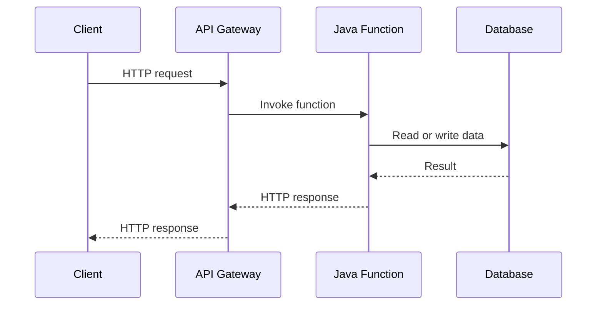
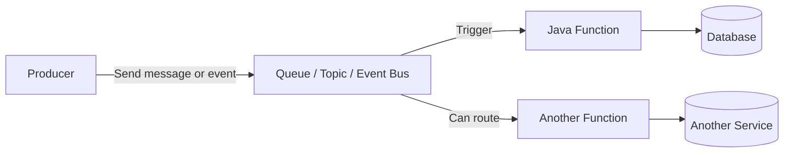
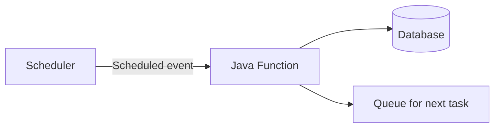
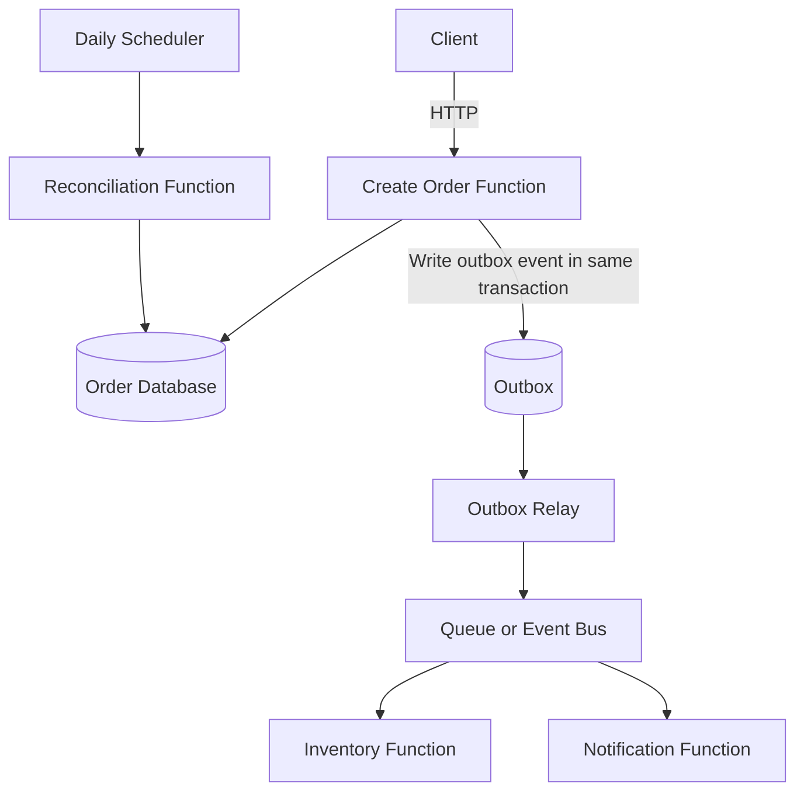

# Synchronous, Asynchronous, and Scheduled Architectures

In a serverless application, a function is typically executed when an HTTP request arrives, when a message or event appears, or when a scheduled time is reached. The invocation model determines how components communicate, how errors propagate, how the system scales, and how costs are incurred.

When developing and deploying Java functions under the FaaS model, choose the architecture style according to business requirements. A request needing an immediate result usually fits synchronous processing. Work that can finish later, needs to be decoupled from the user flow, or must fan out to multiple processors usually fits asynchronous processing. Tasks repeating hourly or daily fit a scheduler. A real-world system often combines all three styles.

## 1. Three Ways to Trigger a Function

### 1.1. Synchronous Architecture: Request and Response

In a synchronous architecture, the caller sends a request and waits for the function to finish processing to receive a response. Over HTTP, the flow typically passes through an API Gateway or the platform's HTTP endpoint, then to the function and the services the function depends on.



This model fits when the caller needs the result to proceed: reading data, validating input, creating a simple record, or confirming an operation. The HTTP contract should clearly specify status codes, response payloads, and possible errors.

For example, an order-creation API can validate input, persist the order, and return the order ID. If follow-up tasks such as sending emails, generating shipping labels, or syncing with an accounting system take a long time, the API should not hold the connection open waiting for all of them. The API can return `201 Created` once the resource is persisted, then emit an event so secondary steps run asynchronously. For a long-running task that cannot finish immediately, the API can return `202 Accepted` with a `jobId`; the client then uses a status endpoint to check progress.

The advantage of synchronous processing is a straightforward flow with the result returned directly in the response. In return, processing time sits on the request critical path. Clients may hit timeouts when functions cold start slowly, external dependencies respond slowly, or execution exceeds platform time limits. Function failures also propagate directly to the caller, tightly coupling both sides in availability.

Therefore, the synchronous processing path should stay short, enforce explicit timeouts, and call only the dependencies necessary to answer the request. Avoid chaining too many synchronous functions together if independent work can be offloaded to a queue or event.

### 1.2. Asynchronous Architecture: Sending Messages or Publishing Events

In an asynchronous architecture, the sender hands off a message or event to an intermediary service and continues its own work. The consuming function is triggered afterward. The sender does not keep a connection open until the entire process finishes.



Intermediary services play different roles:

- **Queues** hold messages until a consumer processes and acknowledges them. Multiple instances of the same consumer can share the workload to increase throughput. Queues are useful when load buffering and processing rate regulation are needed.
- **Topics or pub/sub mechanisms** distribute one event to multiple independent subscriber groups. For example, an `OrderCreated` event can be delivered to the inventory processor, notification service, and analytics system.
- **Event buses** typically route events by event type, source, or payload attributes. They fit when multiple services exchange events according to routing rules.

Asynchronous architecture reduces temporal coupling between producer and consumer. If a consumer is temporarily slow or unavailable, a queue can retain messages for later processing, subject to service configuration and retention limits. However, completion is no longer part of the initial response. The system must accept latency, track processing status, and handle failed messages.

One aspect that must be explicitly designed is **delivery semantics**. Many common event sources and queues deliver messages with *at-least-once* semantics: a message can be redelivered if the consumer finishes processing without acknowledging successfully, or if the platform does not receive the acknowledgment. Consequently, consumers must tolerate receiving the same event multiple times. Never assume an event executes only once.

### 1.3. Scheduled Architecture: Time-Based Invocation

With scheduled processing, a scheduler service emits an event at a configured time or interval. The function is invoked on that schedule—for example, every five minutes, at midnight, or on the first day of each month.



Common use cases include daily report aggregation, expiring stale data, transaction reconciliation, periodic data synchronization, and sweeping pending records. The scheduler is only responsible for determining when to trigger; the business logic remains inside the function or the service it invokes.

Do not keep a function running continuously just waiting for the scheduled time to perform work. Doing so wastes resources during idle time and fails to leverage the event-driven model. Use the platform's scheduling service to invoke the function when due.

When designing schedules, account for time zones, daylight saving rules if applicable, behavior when a run is delayed or missed, and the possibility of overlapping runs. Scheduled events can also be redelivered or triggered twice depending on the service and configuration, so tasks still require idempotency. If a task may run only once per business date, use a unique key per date or a time-bounded lease/lock mechanism to prevent concurrent execution by two instances.

## 2. Comparing and Choosing an Architecture Style

| Criterion | Synchronous | Asynchronous | Scheduled |
|---|---|---|---|
| Trigger mechanism | Request, typically HTTP | Message or event | Timestamp or recurring interval |
| Does caller wait for result? | Yes | Usually no | No direct waiting client |
| Best suited for | APIs needing immediate response | Background work, distributed processing, fan-out | Reports, cleanup, periodic reconciliation |
| Component coupling | Tight along response latency | Looser via broker | Loose along execution schedule |
| Watch out for | Timeouts, cold starts, response errors | Duplicate delivery, retries, DLQ, ordering | Time zones, delayed runs, overlapping runs |
| Observability | Latency, error rate, timeouts | Queue depth, message age, retries, DLQ | Last run, schedule lag, per-run outcome |

You can use three quick questions to choose:

1. Does the caller need an immediate result to decide the next step? If yes, prefer synchronous processing and keep the request path short.
2. Can the work complete later, need load buffering, require independent retries, or trigger multiple consumers? If yes, use a queue, topic, or event bus.
3. Does the work depend on a fixed time or recurring interval? If yes, use a scheduler to trigger the function.

Not every background task needs an event bus. A simple queue can suffice if only one consumer group needs to handle it. Conversely, if multiple services must react independently to the same business event, pub/sub or an event bus is usually more appropriate. Choose the smallest mechanism that satisfies routing, retention, ordering, and scaling needs.

## 3. Combining All Three Styles in One System

Consider an order placement workflow. A client calls a synchronous API to create an order. The function validates the payload and records the order in `PENDING` status. Once the transaction is saved, tasks such as reserving inventory, sending emails, and updating analytics are processed asynchronously. A scheduled function can reconcile orders stuck in `PENDING` for too long.



In this diagram, the API responds right after the order is persisted. Consumers handle their own responsibilities. The scheduler checks cases where the normal event flow may not have completed. This combination keeps API responses fast, lets background steps scale independently, and provides a recovery mechanism for periodic checks.

If the application writes the order to the database and then sends a message directly, the database might commit while sending the message fails. Conversely, the message might be sent before the database transaction rolls back. The **transactional outbox** pattern closes this gap by writing both the business record and the outbox event record in the same database transaction. A separate relay reads the outbox and forwards events to the broker; the relay may retry on error. Consumers must still be idempotent because the relay or broker can deliver duplicates.

## 4. Designing Java Functions for Each Trigger Type

Platform event translation should be separated from business logic. Adapters for AWS Lambda, Azure Functions, or Google Cloud Functions accept platform-specific event types, validate inputs, and map them to application commands or events. The Java business core can then be tested independently without tying it to a specific HTTP or message format.

### 4.1. Synchronous Processing over HTTP

The example below illustrates the business core of an order-creation function. The HTTP adapter is responsible for converting the request into a `CreateOrderCommand` and mapping the result into a response suited to the runtime in use.

```java
public record CreateOrderCommand(String customerId, List<String> productIds) {}

public record OrderResult(String orderId, String status) {}

public final class CreateOrderService {
    private final OrderRepository orders;

    public CreateOrderService(OrderRepository orders) {
        this.orders = orders;
    }

    public OrderResult create(CreateOrderCommand command) {
        // Validate business rules and persist order in one transaction.
        Order order = orders.create(command.customerId(), command.productIds());
        return new OrderResult(order.id(), order.status());
    }
}
```

At the HTTP layer, validate input, authenticate the caller, map business errors to consistent HTTP status codes, and avoid leaking sensitive details in error messages. If a request may be retried due to client timeouts, consider accepting an `Idempotency-Key` so retries do not create unintended duplicate orders.

### 4.2. Asynchronous Event Processing with Idempotency

Consumers should use a stable event identifier, such as `eventId`, to detect redeliveries. The example below demonstrates handling within a single transaction: checking whether the event was already processed, applying the business change, and recording `eventId`.

```java
public record OrderCreated(
        String eventId,
        String orderId,
        Instant occurredAt
) {}

public final class OrderCreatedHandler {
    private final TransactionRunner transactions;
    private final ProcessedEventRepository processedEvents;
    private final FulfillmentService fulfillment;

    public OrderCreatedHandler(
            TransactionRunner transactions,
            ProcessedEventRepository processedEvents,
            FulfillmentService fulfillment) {
        this.transactions = transactions;
        this.processedEvents = processedEvents;
        this.fulfillment = fulfillment;
    }

    public void handle(OrderCreated event) {
        transactions.run(() -> {
            if (processedEvents.exists(event.eventId())) {
                return;
            }

            fulfillment.prepare(event.orderId());
            processedEvents.insert(event.eventId());
        });
    }
}
```

`TransactionRunner` and the repositories here are illustrative application interfaces. In a real implementation, checking, updating business data, and recording the processed event must be atomic—typically via a database transaction and a unique constraint on `eventId`. If the task calls an external service, a database transaction cannot automatically roll back external side effects; use an idempotency key supported by that service, an outbox/inbox pattern, or an appropriate compensating workflow.

For message batches, understand how the runtime acknowledges success. If one message in a batch fails, some platforms redeliver the entire batch unless per-record failure reporting is configured. Choose appropriate batch sizes, timeouts, and retry policies; prevent one persistently failing message from blocking other messages.

### 4.3. Scheduled Tasks with a Business Key

A daily reconciliation job can receive the business date from the scheduler event or compute the date in a configured time zone. Using the business date as a key identifies the run and avoids duplicate outputs if the scheduler redelivers the event.

```java
public final class DailyReconciliationHandler {
    private final ReconciliationRepository reconciliations;
    private final ReconciliationService service;

    public DailyReconciliationHandler(
            ReconciliationRepository reconciliations,
            ReconciliationService service) {
        this.reconciliations = reconciliations;
        this.service = service;
    }

    public void handle(LocalDate businessDate) {
        if (reconciliations.isCompleted(businessDate)) {
            return;
        }

        service.reconcile(businessDate);
        reconciliations.markCompleted(businessDate);
    }
}
```

This snippet only illustrates the concept. In systems where multiple instances can run concurrently, checking and marking completion must be protected by a transaction, unique constraint, or appropriate lease/lock. If a task runs longer than a single function invocation's maximum execution time, break the work into smaller units and enqueue each piece rather than trying to sustain one long execution.

## 5. Retries, Errors, and Resilience

Retries help handle transient failures such as brief network drops or overloaded dependencies. However, retries do not make an unsafe operation safe. Before enabling retries, determine whether the operation can be executed repeatedly and how to detect an already completed outcome.

- **Synchronous:** return appropriate status codes so the client can decide whether to retry. For write operations, use an idempotency key or stable resource identifier so repeated requests do not create duplicate side effects. Do not blindly retry business errors such as invalid input.
- **Asynchronous:** configure maximum retry counts, exponential backoff, and message retention limits. After exceeding the threshold, route failed messages to a dead-letter queue (DLQ) or equivalent error store for investigation and controlled replay. Monitor oldest message age and DLQ depth.
- **Scheduled:** log scheduled time, actual start time, outcome, and attempt count. Define a catch-up policy when a run is missed. For critical jobs, ensure a specific business date can be safely re-run.

Distinguish transient failures from unrecoverable errors. Timeouts, throttling, or network glitches may warrant bounded retries. Malformed payloads, missing required fields, or business rule violations generally belong in an error-handling path for human or data-remediation intervention. Unbounded retries increase cost, clog queues, and add load to an already struggling dependency.

## 6. State, Security, and Operational Observability

Functions should follow a stateless design: each invocation gets all required inputs from the event/request and persists business state in a database, object storage, or an appropriate service. Global variables or instance memory may be used to reuse connections or performance caches, but must never be treated as durable state storage because instances can be stopped, replaced, or run concurrently.

Each function should hold only the minimum permissions needed to read queues, write databases, or call services it actually uses. Authenticate callers at the HTTP boundary; validate event sources and access permissions when consuming events; manage secrets via the platform's secret manager. Never place access keys in payloads, logs, or source code.

To trace a workflow spanning multiple functions, propagate `correlationId` or trace context across requests, messages, and scheduled runs. Logs should include event or job identifiers while omitting personal data and secrets. Useful metrics include:

- For HTTP: request count, p50/p95/p99 latency, error rate, timeouts, throttling, and cold start counts if exposed by the platform.
- For messages: queued message count, oldest message age, consumption rate, retry count, DLQ count, and processing duration per message.
- For schedulers: last run, next run, schedule lag, duration, success/failure status, and overlapping run count.

Cold starts can increase first-invocation latency when the platform prepares a new execution environment. For latency-sensitive HTTP endpoints, measure under realistic load and optimize artifact size, initialization time, and dependency count. Some platforms offer warm-instance or provisioned concurrency settings; use them only when the latency benefit justifies the added cost.

## 7. Time Limits, Scaling, and Cost

FaaS platforms generally scale instance counts based on requests or messages, though scaling speed and concurrency limits depend on the platform. Increasing concurrency does not mean downstream databases or external APIs can absorb matching load. Configure concurrency limits, connection pools, and batch sizes to avoid overwhelming shared dependencies.

Each architecture style incurs a distinct cost profile:

- Synchronous processing incurs costs per invocation, execution duration, resource configuration, and downstream services called on the request path.
- Asynchronous processing adds message storage and delivery, event routing, retries, and consumer execution time. Long backlogs can increase storage costs and business latency.
- Scheduled processing may involve fewer invocations, yet still incurs costs for the function, scheduler, and accessed services. Overly frequent schedules or full-data scans on every run can generate significant expense.

Estimate costs based on invocation count, average and peak duration, memory or CPU, message volume, payload size, retries, and inter-service traffic. Also set finite timeouts, retry limits, and alerts when concurrency, queue depth, or spend exceeds expected thresholds.

## 8. Design Checklist

Before deploying Java functions, answer the following questions:

1. Is the trigger HTTP, message/event, or scheduled? Which component handles trigger authentication and routing?
2. Does the caller need an immediate result? If not, can the API return `202 Accepted` with a job tracking ID?
3. Where is business state stored? Does the system rely on single-instance memory?
4. Can messages or scheduled triggers be delivered or executed multiple times? Which idempotency key protects business side effects?
5. What is the maximum retry count, backoff schedule, and final error destination? Who or what process handles the DLQ?
6. Can concurrent or out-of-order execution occur? If ordering matters, what mechanism enforces or detects out-of-order arrivals?
7. Do access permissions follow least privilege? Do logs or payloads contain sensitive data?
8. Are metrics, logs, traces, and alerts in place to detect timeouts, throttling, message backlogs, delayed schedules, and rising costs?

## Conclusion

Synchronous processing fits operations needing immediate responses and short execution times. Asynchronous processing fits background work, distributed processing, load buffering, and multi-consumer event fan-out. Scheduled processing fits time-dependent workloads. When combining them, clearly design transaction boundaries, state, idempotency, retries, access permissions, and observability. Those factors determine whether a serverless architecture can scale and recover reliably.
