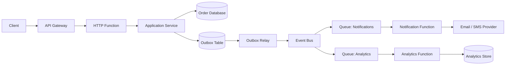

# Combining API Gateway, Functions, Data Stores, and an Event Bus

A complete serverless application is typically composed of multiple services with distinct responsibilities: an API gateway accepts requests, functions execute business logic, data stores persist durable state, and an event bus distributes events to downstream processors. The value of this architecture comes from how these components coordinate—especially across synchronous and asynchronous boundaries, data access permissions, error handling, and scalability.

In the Cloud Serverless model, a function can be triggered by HTTP, queue messages, or events from another service. Functions usually exist only for the duration of a single invocation; therefore, business state must be persisted in a durable service. The architecture must account for functions running concurrently across multiple instances, events being redelivered, and an invocation ending before an entire workflow finishes.

## 1. Architectural Overview

Components are typically combined into two main flows:

- **Synchronous request flow:** the client calls the API gateway; the gateway authenticates and routes the request to an HTTP function; the function enforces business rules, reads from or writes to a data store, and returns a response.
- **Asynchronous event flow:** after a business change is persisted, the system publishes an event to the event bus; the bus routes the event to one or more queues or consuming functions; consumers continue processing independently.

The diagram below illustrates an ordering service. Service names represent logical roles; when deployed on a specific platform, they map to the corresponding cloud provider services.



The API gateway and function handle the request path. The database holds order state. The outbox relay forwards events written in the same transaction to the event bus. The event bus distributes events to the appropriate consumers. Queues between the bus and consumers absorb traffic spikes, throttle processing rates, and retain messages when a consumer is temporarily unavailable.

Not every system needs every component. A small API may only need a gateway, a function, and a database. An event bus becomes valuable when a single change needs to trigger multiple independent actions or when service groups need to reduce direct coupling to one another.

## 2. Responsibility Boundaries of Each Component

| Component | Primary Responsibility | Should Not Handle |
|---|---|---|
| API gateway | HTTP entry point, routing, edge authentication, rate limiting, basic format validation, API versioning | Multi-step business rules, direct database access bypassing the business layer |
| Function | Running processing code per invocation, orchestrating business logic, transforming inputs/outputs, calling integration ports | Holding business state in memory between invocations |
| Data store | Storing durable state, enforcing constraints and transactions within supported scope | Acting as the broadcast channel for all changes to every other service |
| Event bus | Receiving, filtering, and routing events to subscribers | Replacing a database or guaranteeing that a multi-step business workflow completes |
| Queue | Holding messages awaiting processing, smoothing load, supporting retries and dead-letter queues | Deciding the business meaning of messages on its own |

The gateway should keep processing at the edge. For instance, the gateway can verify tokens and enforce rate limits, yet the function still needs to check whether the user is authorized to view or modify the exact target resource. Identity authentication and per-object authorization are two distinct checks.

Functions should contain or invoke independently testable business logic. Parsing cloud provider events, decoding payloads, and constructing HTTP responses belong to the adapter layer. Keeping adapters thin minimizes coupling between business logic and trigger formats and makes unit testing straightforward.

Data stores should have clear ownership. A function in the order domain may own order data; the notification domain should not arbitrarily update order tables. Other domains needing that data use published APIs or events. Ownership boundaries allow controlled schema evolution and reduce cross-coupling.

An event bus fits **events that already occurred**, such as `OrderCreated` or `PaymentCaptured`. A command such as `CreateOrder` expresses what the caller wants the system to do. Distinguishing commands from events helps consumers understand that an event is a historical fact rather than a request that can be reinterpreted differently.

## 3. Synchronous HTTP Flow Through an API Gateway

A resource creation flow typically unfolds as follows:

1. The client sends `POST /orders` to the API gateway with authentication credentials and an idempotency key.
2. The gateway validates the token, enforces rate limits and request size limits, and routes to the target function.
3. The function translates the request into an application command and validates inputs and user-level authorization.
4. The application service writes business data within a transaction; if an event must be emitted, the service writes an outbox record in the same transaction.
5. The function returns a response to the client. A relay process reads committed outbox records and publishes events onto the event bus.

Example request:

```http
POST /orders HTTP/1.1
Authorization: Bearer <access-token>
Idempotency-Key: 4b1f2f1a-9c9d-4e3c-a3d3-9b4d9d8d4a21
Content-Type: application/json

{
  "customerId": "customer-42",
  "items": [
    { "productId": "book-17", "quantity": 2 }
  ]
}
```

If the order has been created and the resource is immediately accessible, the API can return `201 Created` along with the order ID. If the API only accepts a long-running workflow whose business result will arrive later, `202 Accepted` is more appropriate; the response should provide a tracking ID or status URL so the client knows how to check progress. Do not hold an HTTP request open while waiting for lengthy asynchronous steps.

Gateways typically impose timeout and payload size limits. For large-file workflows, a common pattern is having the gateway/function issue a time-limited upload URL so the client uploads the file directly to object storage. An object-created event then triggers a file-processing function. This avoids passing the entire file body through the gateway and function memory.

## 4. Asynchronous Event Flow Through an Event Bus

Once an event is emitted, the event bus applies routing rules to forward it to subscribers. For example, `OrderCreated` may be routed to a notification queue, an analytics queue, and a search-index updater function. Each consumer can be deployed, scaled, and versioned independently.

```json
{
  "eventId": "evt-01J9Q7M2",
  "eventType": "OrderCreated",
  "schemaVersion": 1,
  "occurredAt": "2026-11-17T12:00:00Z",
  "aggregateId": "order-1052",
  "correlationId": "req-8f2c",
  "data": {
    "orderId": "order-1052",
    "customerId": "customer-42",
    "total": 125000
  }
}
```

An event envelope should include a unique identifier, event type, schema version, emission timestamp, and business entity identifier. `correlationId` links logs across a workflow; `eventId` supports duplicate delivery detection. Payloads should contain only the fields consumers genuinely need, avoiding secrets or unnecessary personal data.

An event bus and a queue solve two distinct problems. The bus decides **where events go**; the queue decides **how work is buffered and consumed**. When multiple consumers need the same event, the bus can route it to multiple independent queues. When a pool of workers shares one type of work, workers can consume from a single queue to distribute load.

For consumers reading directly from an event bus, verify service-specific retry limits, retention duration, and replay capabilities. For spiky workloads or consumers depending on slow downstream systems, queues generally provide a better throttling boundary. Set consumer concurrency limits so processing speed does not exceed database or external API capacity.

## 5. Keeping Database and Event Bus Consistent with an Outbox

A common failure occurs when a function writes to the database and publishes an event as two independent operations. If the database write succeeds but the function stops before publishing, business state changed while consumers never received the event. If publishing succeeds and the database write subsequently fails, consumers may process an event describing a change that never committed.

The transactional outbox narrows this gap by writing business state and the event record in the same database transaction:

1. The transaction creates the order and inserts `OrderCreated` into the outbox table.
2. The database commits both changes or rolls back both.
3. A scheduled relay, worker, or CDC process reads unpublished outbox records and publishes them to the event bus.
4. After publishing, the relay marks the record as sent or advances a corresponding checkpoint.

An outbox does not automatically guarantee exactly-once delivery. If the relay publishes successfully but fails before marking the record, it may republish the same event. Consequently, event IDs must be stable and consumers must still be idempotent. Outbox records also require a cleanup policy once published and past the required retention window.

Even if a database and event bus support distributed transactions, consider the complexity, limits, and cost. In many serverless architectures, an outbox paired with idempotent consumers is a more practical way to achieve eventual consistency without forcing multiple services into a long-lived distributed transaction.

## 6. Java Example: Writing Business Data and Outbox in One Transaction

The following code illustrates the application boundary. Repository and transaction interfaces are implemented with a concrete database or framework; the platform's HTTP handler simply converts the request into a `CreateOrderCommand` and calls this service.

```java
import java.util.List;
import java.util.Optional;

public record CreateOrderCommand(String customerId, List<OrderItem> items) {}
public record OrderItem(String productId, int quantity) {}
public record CreateOrderResult(String orderId, String status) {}

public interface TransactionRunner {
    <T> T execute(java.util.function.Supplier<T> work);
}

public interface OrderRepository {
    void insert(Order order);
}

public interface IdempotencyRepository {
    Optional<StoredResult> find(String key);
    void insert(String key, String requestFingerprint, CreateOrderResult result);
}

public interface OutboxRepository {
    void append(DomainEvent event);
}

public final class CreateOrderService {
    private final TransactionRunner transactions;
    private final OrderRepository orders;
    private final IdempotencyRepository idempotency;
    private final OutboxRepository outbox;

    public CreateOrderService(
            TransactionRunner transactions,
            OrderRepository orders,
            IdempotencyRepository idempotency,
            OutboxRepository outbox) {
        this.transactions = transactions;
        this.orders = orders;
        this.idempotency = idempotency;
        this.outbox = outbox;
    }

    public CreateOrderResult create(String key, CreateOrderCommand command) {
        if (key == null || key.isBlank()) {
            throw new IllegalArgumentException("Idempotency-Key is required");
        }

        String fingerprint = RequestFingerprint.of(command);
        return transactions.execute(() -> {
            Optional<StoredResult> previous = idempotency.find(key);
            if (previous.isPresent()) {
                previous.get().assertSameRequest(fingerprint);
                return previous.get().result();
            }

            Order order = Order.create(command);
            orders.insert(order);

            CreateOrderResult result =
                    new CreateOrderResult(order.id(), "CREATED");
            outbox.append(OrderCreated.from(order));
            idempotency.insert(key, fingerprint, result);
            return result;
        });
    }
}
```

The repositories in this example must participate in the **same transaction context**. The idempotency key column needs a unique constraint or equivalent locking mechanism so two concurrent requests cannot create two orders. On a unique conflict, the adapter should read the stored result and return it if the fingerprint matches; reusing the same key with a different payload must be rejected. `RequestFingerprint`, `StoredResult`, `Order`, and `DomainEvent` are simplified domain types to focus on the transaction flow.

The relay can run on a schedule or be triggered when new outbox rows appear. The relay publishes only committed records. If the relay crashes between sending and marking as sent, the event may be sent again; consumers must handle that scenario.

## 7. Idempotency, Retries, and Dead-Letter Queues

In distributed environments, a timeout does not tell you reliably whether the server-side operation failed. Clients may resend requests after receiving no response, queues may redeliver messages when a consumer fails to acknowledge completion, and event buses may retry when an endpoint temporarily errors. Designs should assume a message can be processed more than once.

**Idempotency for HTTP:** the client sends an `Idempotency-Key` per logical operation. The server stores the key, a request fingerprint, and the generated result. Upon receiving the same key and identical payload, the server returns the stored result. When the same key arrives with a different payload, the server returns a conflict error. Key records need a retention window suited to client retry windows and business requirements.

**Idempotency for event consumers:** consumers persist processed `eventId` values, typically alongside the consumer name. Recording the processed marker and updating business state should happen in the same database transaction. If the marker is recorded first and the function crashes before updating business state, redeliveries will be skipped even though the work never completed. If side effects occur in an external system, pass that system's idempotency key when supported or design a safely repeatable compensation workflow.

**Controlled retries:**

- Retry transient errors such as timeouts, throttling, or 5xx service errors; use exponential backoff and jitter to avoid thundering herds.
- Do not infinitely retry data errors or unrecoverable business errors, such as malformed payloads or invalid accounts.
- Configure maximum delivery attempts or retry age limits. Once exceeded, move messages to a dead-letter queue (DLQ) or equivalent error store.
- Monitor oldest message age, DLQ depth, and failure rates. Establish a workflow to inspect root causes and fix data or code before redriving.
- Set queue visibility timeouts or lease durations longer than the expected maximum processing time plus a safety buffer. If a lease expires while a function is still running, the message may be delivered to another worker.

Never claim a system is exactly-once simply because a queue or event bus offers deduplication within a bounded window. End-to-end uniqueness must be evaluated across client submission, database commit, relay publishing, and consumer side effects. A practical target is usually at-least-once delivery combined with idempotent processing.

Event ordering must also be explicitly addressed. If business logic requires per-order sequencing, use a partition key or message group based on `aggregateId`, paired with an aggregate version sequence number. Do not assume every event bus guarantees global ordering; ordering scope depends on the service and its configuration.

## 8. Managing State and Data

Functions should be designed as stateless execution units: each invocation receives all necessary data via the request, event, or queries to durable services. Static variables, heap memory, and temporary directories may be reused in some environments, but they are not places for business state because the runtime can be reclaimed or reinitialized at any time.

Choose data stores based on access patterns and consistency constraints:

- Relational databases fit multi-record transactions, integrity constraints, joins, and flexible queries.
- NoSQL stores fit well-defined access patterns, high throughput, and predictable partition keys, sort keys, or indexes.
- Object storage fits files, images, data exports, and large blobs; business metadata can live in a database.
- Caches reduce read latency and load, though cached entries can go stale; define TTLs and invalidation strategies.

Serverless functions can scale concurrency faster than a database can open connections. If each instance maintains its own connection pool, total connections can grow with instance count. Limit concurrency, reuse clients across warm invocations, use an appropriate connection proxy/pooler, and monitor open connections, query latency, and database limits. For bursty workloads, queues can smooth write rates so the database is not overwhelmed.

Do not share direct write access to the same table across multiple business domains without an explicit ownership contract. When a consumer needs fast query access to data, build a dedicated read model or projection from events. This introduces eventual consistency: the read model may lag behind the source database. APIs should reflect this in user experience—for example, returning a `PROCESSING` status, offering a polling endpoint, or updating the UI when results are ready.

When a workflow spans multiple databases or independent services, avoid trying to emulate a single ACID transaction across them. Use a saga or workflow orchestration to model steps, states, and compensating actions. For example, if inventory reservation succeeds but payment fails, the workflow can issue an inventory-release command. A compensating action is a separate business operation that also requires idempotency and observability.

## 9. Security at the Boundaries

Every link between gateway, function, database, event bus, and consumer is a security boundary:

1. **Caller identity:** the gateway verifies tokens, certificates, or appropriate authentication mechanisms. The function checks authorization for the specific resource, tenant, and requested action.
2. **Function permissions:** grant least-privilege permissions per function. An order-creation function needs write permissions only on order/outbox tables and read access to required inputs; never grant account-wide admin permissions.
3. **Publish and subscribe permissions:** restrict which principals may publish to the bus, register rules, or consume queues. Verify event source and schema before processing.
4. **Secrets and data:** retrieve secrets from a secret manager or secure platform configuration mechanism; encrypt data in transit and at rest; avoid logging tokens, secrets, or sensitive payloads.
5. **Network and tenant isolation:** use private endpoints or network policies where appropriate; enforce tenant checks in the business layer and apply tenant scoping predicates on every read/write path.

Never treat the fact that a function is only invoked through an API gateway as proof that all inputs are trustworthy. Events may come from a different publisher, stale records may be replayed, or payloads may be malformed due to an incompatible producer version. Every consumer must still validate sources, schemas, and required business preconditions.

## 10. Cold Starts, Scaling, and Load Limits

When a function is invoked after an idle period or needs additional instances for rising traffic, the platform may have to initialize the runtime, load code, and wire dependencies before running the handler. This extra latency is commonly called a cold start. Its impact depends on runtime, package size, libraries, network configuration, deployment region, and platform.

Ways to reduce cold start impact:

- Shrink artifact size and dependency count; avoid initializing unneeded clients or loading unused configuration.
- Initialize shared clients at instance scope when safe, without storing mutable business state in shared variables.
- Choose appropriate memory/CPU settings and measure initialization time in a production-like environment.
- For latency-sensitive endpoints, consider provisioned concurrency, runtime snapshots, or equivalent platform features; these options carry ongoing cost.
- Offload work that does not need an immediate response to queues or events so clients do not wait through long processing times.

Automatic scaling does not mean every downstream component scales infinitely. If the gateway accepts 5,000 requests per second and functions scale concurrency to match, databases, payment services, or partner APIs can become bottlenecks. Set concurrency limits aligned with dependency capacity, use queues to absorb bursts, batch when appropriate, and apply rate limiters or circuit breakers for external systems.

## 11. Observability and Operations

A single request may traverse a gateway, function, database, outbox relay, event bus, queue, and multiple consumers. If each component logs only its own local request ID, root-cause analysis becomes difficult. Propagate `correlationId` across the workflow, keep `eventId` stable across retries, and use distributed tracing if supported by the platform.

Key metrics to track include:

- **Gateway:** request count, p50/p95/p99 latency, 4xx/5xx rates, throttling, and rejected requests.
- **Function:** invocations, duration, errors, timeouts, throttling, concurrency, and cold starts where exposed.
- **Database:** active connections, query latency, deadlocks, throttling, storage capacity, and I/O utilization.
- **Outbox and event bus:** pending row count, oldest pending row age, publish failures, retries, and delivery latency.
- **Queue/consumer:** queue depth, oldest message age, processing duration, error rate, redeliveries, and DLQ depth.
- **Business:** successfully created orders, time from creation to completion, compensation rate, and blocked duplicate operations.

Logs should be structured and carry correlation identifiers alongside sufficient diagnostic context. Avoid logging full request bodies by default because payloads may contain personal data or secrets. Configure actionable alerts, such as rising DLQ depth, message age exceeding thresholds, backed-up outbox rows, or sustained spikes in gateway error rates.

## 12. Cost and Deployment

Architecture cost is not limited to function execution counts. Account for gateway requests, function execution duration and resource configuration, database reads/writes and storage, events traversing the bus, queue storage duration, logs/traces, cross-region data transfer, and networking charges. Fanning an event out to many consumers multiplies processing runs and log volume. Excessive retries also raise cost without improving recovery.

To control costs, filter events directly at the bus, send only necessary fields, batch messages where business logic allows, set TTL/lifecycle rules for transient data, enforce log retention policies, and measure cost per feature or business domain. Tracking unit economics—such as cost per completed order—is more informative than looking solely at the total cloud bill.

Manage gateway routes, functions, IAM permissions, databases, event buses, queues, DLQs, and alerts using Infrastructure as Code. Maintain separate development, staging, and production environments; configure secrets per environment; release functions using versions/aliases or equivalents to support canary rollouts and rollbacks. When evolving event schemas, prefer backward-compatible changes: new consumers read old events during transition, and producers do not drop fields while old consumers remain active.

Before promoting a flow to production, test both happy paths and failure paths: duplicate requests, duplicate events, database timeouts, consumer crashes after writing data, poison messages, DLQ redrives, legacy event schemas, traffic spikes, and version rollbacks. These tests verify that the system recovers cleanly when an individual component fails.

## 13. When to Use This Combination

| Workload Characteristic | Suitable Combination | Reason |
|---|---|---|
| API with variable traffic and short execution time | API gateway + HTTP function + database | Gateway manages entry points; functions run only when requests arrive |
| One change triggering multiple independent tasks | Function + outbox + event bus + consumers | Producer does not need to invoke each consumer directly |
| Spiky loads or slow consumers | Event bus + queue + concurrency-capped consumer function | Queue absorbs bursts and regulates processing rate |
| Updating separate read stores or search indexes | Event bus + projection-building consumer | Read models can be built independently from the source database |
| Long tasks requiring multiple steps and compensation | Queue/workflow orchestration + step functions | Progress state is managed durably instead of holding one long invocation |

FaaS is not the default choice for every workload. A steadily loaded long-running service, lengthy jobs, long-lived connections, or ultra-low-latency requirements may fit always-on containers or services better. Base the decision on traffic patterns, execution time limits, cold start latency, cost at expected concurrency, operational capability, and cloud service coupling.

## 14. Design Checklist

- [ ] Each component has a clear responsibility and data owner.
- [ ] The gateway authenticates at the edge; the function still enforces resource- and tenant-level authorization.
- [ ] Functions do not rely on instance memory to hold business state.
- [ ] Database and outbox are written in the same transaction when a change must emit an event.
- [ ] HTTP requests include an idempotency key for operations clients may retry.
- [ ] Consumers guard against duplicate processing and update processed markers in the business transaction when possible.
- [ ] Retries have limits, backoff, jitter, a DLQ, and a redrive procedure.
- [ ] Queues and concurrency are configured within the capacity of databases and downstream dependencies.
- [ ] Events include an event ID, schema version, correlation ID, and minimal payload.
- [ ] Metrics, logs, traces, and alerts cover the gateway, functions, database, bus, queues, and DLQ.
- [ ] Cost is measured across compute, data, events, networking, and observability.
- [ ] Infrastructure is managed as code; event schemas and APIs evolve compatibly during rollout.

Serverless architectures work well when components coordinate through clear contracts. An API gateway manages HTTP traffic, functions execute discrete units of work, databases hold durable state, and an event bus announces events that have occurred. Combining these with an outbox, idempotency, bounded retries, least privilege, and end-to-end observability enables systems to scale on demand while keeping errors, state, and costs under control.
