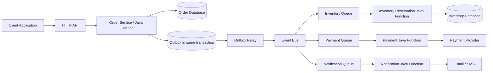

# Applying Event-Driven Architecture to Business Workflows

## 1. Why Business Workflows Need Event-Driven Architecture

In a business application, a single action often triggers several follow-up tasks. When a customer places an order, the system may need to record the order, reserve inventory, capture payment, send a confirmation email, update loyalty points, and notify a shipping carrier. If one service synchronously calls all the others, the ordering flow becomes dependent on every component's availability and latency. Even a slow email-sending service can leave the user waiting or cause the entire request to fail.

Event-Driven Architecture (EDA) organizes components around business events that have occurred. The emitting component publishes a fact, such as `OrderCreated`; interested components subscribe to that event and carry out their own work. The order service does not need to know how many services are processing that event.

In a serverless model, EDA pairs naturally with Function-as-a-Service (FaaS). A queue, event bus, or event platform invokes a Java function when a new message arrives. The function performs a short unit of work, persists the result in durable storage, and exits. The platform scales function instances up or down with incoming event volume. This organization decouples business domains, absorbs traffic spikes, and consumes compute capacity only when work exists.

EDA does not automatically make a system more reliable or simpler. It shifts part of the complexity from synchronous calls to asynchronous communication: messages can arrive late, multiple times, or out of order; a consumer may be temporarily down; workflows can span minutes or days. Consequently, business flows, state, access permissions, and recovery mechanisms must be designed upfront.

## 2. Distinguishing Events, Commands, and Notifications

These three concepts frequently appear together but carry distinct meanings:

| Concept | Meaning | Example | What Should the Receiver Do? |
|---|---|---|---|
| Event | Something that happened in the business; usually named in the past tense | `OrderCreated`, `PaymentAuthorized` | Decide independently whether to care and react |
| Command | A request for a component to perform an action | `ReserveInventory`, `AuthorizePayment` | Execute or reject the requested action |
| Notification | Information sent to inform a party of a status or outcome | Order confirmation email | Display or deliver the information to the recipient |

For example, `ReserveInventory` is a command sent to the inventory service. Once inventory successfully reserves items, it emits the `InventoryReserved` event. If stock is insufficient, it may emit `InventoryReservationRejected`. An event describes an outcome that occurred; it must not be used as a disguised command forcing every consumer to perform the same action.

A domain event describes something meaningful within a business model, such as `SubscriptionRenewed`. An integration event is a contract published outside a service's boundary for consumption by other systems. The two may be related, though not necessarily identical. Avoid publishing raw internal application objects or database table schemas as integration contracts, since internal changes would then inadvertently break consumers.

A well-designed event typically has these characteristics:

- Describes a fact that occurred, with a clear and stable name.
- Carries a unique identifier to distinguish events even when payloads match.
- Includes a timestamp of occurrence and the identifier of the relevant business entity.
- Contains enough data for consumers to act, or a stable reference to fetch required details.
- Remains immutable after publication. If business data must be corrected, emit a new event describing that change.
- Defines a contract version and compatibility rules so older consumers do not break as producers evolve.

Avoid emitting events for every minor technical change. Choose milestones meaningful to the business or integration boundaries. `OrderCreated` is usually meaningful; `OrderRowInsertedIntoTable` exposes storage details and makes a poor business contract.

## 3. Choosing Synchronous vs. Asynchronous Communication

Not every interaction requires an event bus. Choose the communication style based on business needs:

| Scenario | Suitable Approach | Reason |
|---|---|---|
| User needs an immediate result to continue | Synchronous HTTP | Can return the result or error within the same request |
| Task can finish after responding to the user | Asynchronous queue or event | Decouples processing duration from response latency |
| Multiple independent systems need the same event | Event bus with multiple subscriptions | Distributes one event to many consumers |
| One consumer needs per-message throttling and isolated retries | Dedicated queue per consumer | Isolates faults, load, and consumption rate |
| Multi-step workflow awaiting responses or requiring compensation | Workflow or saga | Tracks long-lived state and coordinates subsequent steps |

For instance, an order-creation API can return `202 Accepted` with the order ID and `PENDING` status after durably recording the request. Inventory reservation, payment capture, and email delivery proceed in the background. The UI can poll status or receive a notification when the order moves to `CONFIRMED`. If the user needs immediate feedback that a product SKU does not exist, the API should still validate and return a synchronous error at the appropriate boundary.

A practical rule is to keep the synchronous portion short enough to confirm the request was validly accepted, while moving independent, time-consuming, or retryable work to asynchronous processing. Never return `202 Accepted` before the request has been durably persisted or safely handed off to a component responsible for persistence.

## 4. Serverless EDA Deployment Model

A common flow can be structured as follows:



Each component has a distinct responsibility:

1. **HTTP API** authenticates callers, validates input payloads, and accepts order-creation requests.
2. **Order Service** enforces order-creation rules and persists the initial state.
3. **Outbox** writes the event to be published within the same database transaction as the order change.
4. **Outbox Relay** reads unpublished records and forwards them to the event bus. The relay can replay if interrupted.
5. **Event Bus** routes events by type, source, or business attributes to matching subscriptions.
6. **Dedicated Queue per Consumer** buffers messages while a consumer is busy or temporarily down, providing isolated retry and dead-letter policies.
7. **Java Function** processes a message or batch, persists the result durably, and acknowledges the message once processing is safe.

An event bus and a queue address two different needs. An event bus excels at routing and fanning out one event to multiple interested groups. A queue excels at buffering work for one consumer group, throttling throughput, and managing retries. In many systems, the event bus delivers events into per-consumer queues so each group scales and recovers independently.

If there is only one consumer requiring sequential processing, a single queue may suffice. If a workflow has multiple independent branches, an event bus enables adding consumers without modifying the producer. Avoid adding brokers, topics, or queues unless they solve a concrete requirement; every additional component introduces configuration, permissions, cost, and monitoring overhead.

## 5. Designing Event Contracts

An event contract is the interface between producer and consumer. Define event names, schemas, versions, field semantics, nullability rules, units of measurement, time zones, and retention policies before multiple consumers depend on it.

Example of an `OrderCreated` event structured with CloudEvents:

```json
{
  "specversion": "1.0",
  "id": "evt-01J9M8K3Q6",
  "source": "/commerce/orders",
  "type": "com.example.order.created.v1",
  "subject": "orders/ORD-2048",
  "time": "2026-11-17T10:15:30Z",
  "datacontenttype": "application/json",
  "data": {
    "orderId": "ORD-2048",
    "customerId": "CUS-81",
    "currency": "VND",
    "totalAmount": 450000,
    "lines": [
      { "sku": "BOOK-01", "quantity": 2 }
    ]
  }
}
```

Outer envelope attributes allow consumers to identify the event without parsing the entire business payload. `id` uniquely identifies an event emission; `source` indicates the producer; `type` identifies the event kind and can carry a version; `subject` binds the event to a business entity; `time` records when it occurred. The `data` field holds the business-specific payload.

In real systems, consider adding `correlationId`, `causationId`, tenant ID, or `traceparent` when tracing workflows across multiple services. Follow consistent conventions for these fields. Never generate a new HTTP request ID as the `eventId` across redeliveries; the event identifier must remain unchanged when the same event is redelivered.

There are two common ways to supply data to consumers:

- **Event-carried state transfer:** consumers process directly from the payload. This avoids callbacks to the producer and preserves data as of event occurrence, though payloads are larger and may carry sensitive data.
- **Event notification:** the payload carries an entity ID or logical URI so consumers fetch the latest data from the producer's API. This reduces data flowing through the broker, but creates an API dependency and can expose state that changed after the event was emitted.

Choose based on consistency requirements and data ownership. If a consumer needs exact state at the moment of `OrderCreated`, the payload must carry sufficient data or reference an immutable snapshot. If only current state is needed, an API lookup may be appropriate. Never include passwords, tokens, payment card data, or unnecessary personal information in messages.

### Schema Versioning

Prefer backward-compatible changes: add optional fields with defaults, preserve existing field meanings, and configure consumers to ignore unknown fields. Do not change field types, delete fields, or alter field semantics within the same version. For breaking changes, publish a new event type version such as `order.created.v2` and migrate consumers incrementally. A schema registry or CI schema checks can catch incompatible changes before deployment.

Consumers must tolerate unknown fields and missing optional data per the contract. Producers must publish examples, unit definitions, and timestamp conventions. An `amount` field ambiguous between VND and cents can cause serious business bugs even when JSON syntax is valid.

## 6. Processing Events with Java Functions

A Java function typically has three layers: an adapter receiving the platform event, an application layer enforcing business rules, and an infrastructure layer persisting state or calling external services. Keeping business rules independent of the trigger type makes them unit-testable and lets you swap event platforms without rewriting core logic.

The example below illustrates a function handling `OrderCreated` to reserve stock. The cloud provider adapter converts the payload into a Java object and calls `accept`:

```java
import java.util.List;

public record OrderLine(String sku, int quantity) {}

public record OrderCreated(
        String eventId,
        String orderId,
        List<OrderLine> lines) {}

public interface InventoryApplicationService {
    /**
     * Performs inventory reservation idempotently.
     * eventId has a unique constraint in the same transaction as the inventory update.
     */
    void reserveOnce(String eventId, String orderId, List<OrderLine> lines);
}

public final class ReserveInventoryFunction {
    private final InventoryApplicationService inventory;

    public ReserveInventoryFunction(InventoryApplicationService inventory) {
        this.inventory = inventory;
    }

    public void accept(OrderCreated event) {
        if (event == null || event.eventId() == null || event.orderId() == null) {
            throw new IllegalArgumentException("Invalid OrderCreated event");
        }

        inventory.reserveOnce(
                event.eventId(),
                event.orderId(),
                event.lines());
    }
}
```

The key guarantee lies in the contract of `reserveOnce`: recording the processed `eventId` and updating stock must occur within the same database transaction. The `event_id` column enforces a unique constraint. If the same message is redelivered, the duplicate insert causes the subsequent run to return the previously applied outcome without deducting stock again. If updating inventory fails midway, the transaction rolls back the idempotency record too so a retry can re-execute cleanly.

Running out of stock is a valid business outcome, not an infrastructure error. The inventory service should persist the rejection durably and emit `InventoryReservationRejected` via the outbox. Do not throw exceptions for infinite retries on an order that definitively cannot be fulfilled. Conversely, transient database connection errors can be thrown so the platform retries.

This snippet illustrates only the application layer and idempotency contract. A real adapter must also handle event formats, source verification, batch limits, timeouts, acknowledgment semantics, and response types required by the serverless platform in use. Avoid heavy connection setup or remote config loading on every invocation when the runtime supports safe object reuse across calls; equally, never keep business state solely in static fields or function memory.

## 7. Preventing Duplicate Processing: Idempotency

Many messaging platforms provide **at-least-once** delivery semantics: a message can be redelivered when a consumer times out, loses connection before acknowledgment, or when the platform cannot confirm the prior attempt completed. Therefore, design consumers so processing the same event multiple times yields the same correct business outcome.

An idempotent operation can be invoked repeatedly with the same key without producing additional business side effects. Common implementation techniques:

- Store `eventId` or a business key in a processed-events table protected by a unique constraint.
- Write the processed marker and update business data in the same transaction.
- Pass an idempotency key from the consumer to external APIs whenever the provider supports it.
- For operations that cannot fit in a single transaction, persist durable progress state and implement reconciliation or compensation.

Never mark an event complete before its business effect is safely persisted. If the function writes the marker first and crashes before deducting inventory, redeliveries will be skipped and the order will go unprocessed. If it deducts inventory first and crashes before writing the marker, a redelivery may deduct stock twice. A unique constraint combined with a shared transaction eliminates this gap when changes reside in the same database.

For external system calls, a local database transaction cannot span the network operation. Pass a deterministic idempotency key—such as `payment:{orderId}:v1`—if the payment gateway supports it. If unsupported, record request state, query outcomes before resending, and establish reconciliation workflows. Never assume “the function ran once” equals “the business effect happened once.”

Retention of idempotency keys must exceed the maximum duration a message can retry, sit in a DLQ, and be replayed. Deleting keys too early lets an older replayed message trigger duplicate side effects. Also distinguish `eventId` from an operation's business idempotency key: two distinct events can sometimes represent the same business request that must be deduplicated by business key.

## 8. Retries, Dead-Letter Queues, and Business Errors

Retries allow systems to self-heal from transient failures, but unconfigured retries can create costly loops and saturate services. Classify errors clearly:

| Error Type | Example | Typically Appropriate Handling |
|---|---|---|
| Transient | Timeouts, rate limits, brief dependency outage | Retry with backoff and jitter; bound attempt count or age |
| Invalid data | Missing `orderId`, schema mismatch, wrong type for required field | Route to quarantine or DLQ, alert, and fix data |
| Business rejection | Insufficient inventory, locked account | Persist business outcome and emit result event; do not retry as infra failure |
| Programming bug | Unexpected null, conversion error, invariant violation | Cap retries, move message to DLQ, and fix code before replay |

Exponential backoff increases wait times after each failure; jitter adds randomness so multiple consumers do not retry simultaneously. Set downstream dependency timeouts shorter than the overall function timeout so enough time remains to log, persist state, or exit cleanly. Choose a visibility timeout or message lock duration long enough for normal processing; if processing can run longer, renew the lock via the platform's supported mechanism.

After exceeding the configured retry count or age limit, move the message to a dead-letter queue (DLQ). A DLQ holds messages that cannot be automatically processed for investigation and recovery. Monitor DLQ depth, oldest message age, and inflow rate; maintain a procedure to diagnose root causes, fix data or code, and perform controlled replays. Before replaying, verify that consumers are idempotent and schemas are compatible. Never purge a DLQ just to make dashboards look clean.

With batch queues, a single failing record can cause the entire batch to be redelivered depending on configuration. Enable partial batch responses if supported by the platform so only failed records are retried. Acknowledge each message only after its outcome is durably persisted. Never acknowledge upfront before running background work, because an abrupt function crash will lose the message from the pipeline.

## 9. Event Ordering and Workflow State

Not every event bus guarantees global ordering. Many systems guarantee order only within a partition or message group. When ordering matters, define the exact scope requiring ordering—commonly by `aggregateId` such as `orderId`. Use message groups keyed by order ID, monotonically increasing version numbers, or optimistic locking when updating state.

For example, `OrderShipped` must not overwrite an order already marked `CANCELLED`. Consumers should inspect current state and order version before applying an event. An event carrying an older version than stored state can be ignored or routed to reconciliation per business rules. Never rely on message arrival time to infer the order in which events occurred.

Serverless functions must be treated as stateless across invocations. State spanning multiple steps must live in a database, state store, or workflow service. Never rely on process memory, temporary files, or static variables to remember which step an order reached; the platform can spin up new instances, reuse different ones, or run multiple instances concurrently.

For workflows spanning multiple services, use a saga. A saga breaks the workflow into local transactions; each step emits an outcome event or requests the next step. If a later step fails, the system executes predefined compensating actions, such as releasing reserved stock or issuing a refund. Compensation is a new business action, not a distributed database rollback across services. Persist saga state, timeouts, attempt counts, and step outcomes so execution can resume after a function stops.

Two common coordination styles exist:

- **Choreography:** each service reacts to events and emits subsequent events. This eliminates a central coordinator and suits independent branches with few steps. As chained events grow numerous, the end-to-end flow becomes difficult to trace.
- **Orchestration:** a workflow or saga coordinator persists state and decides the next step. This makes progress, timeouts, and compensation explicit, fitting long workflows or complex conditional branching. The coordinator must be deployed durably and must not absorb all business logic from participating services.

Do not adopt event sourcing solely because the system uses EDA. EDA transports events between services; event sourcing stores an append-only event log as the primary source of truth for reconstructing state. Event sourcing helps when a complete change history or state reconstruction is required, but raises complexity around schema evolution, replays, snapshots, and sensitive data handling. For many business systems, a current-state database plus integration events is sufficient.

## 10. Transactional Outbox: Avoiding Lost Events on Data Writes

A frequent bug occurs when updating the database and publishing an event are separate operations. If saving the order succeeds while publishing fails, consumers never learn the order was created. If publishing succeeds and the database transaction rolls back, consumers receive an event describing uncommitted state.

The transactional outbox eliminates this problem by writing business changes and the event record inside the same transaction:

1. Start a database transaction.
2. Insert the new order.
3. Insert an outbox row containing `eventId`, event type, payload, and creation timestamp.
4. Commit the transaction.
5. A relay reads unpublished outbox rows, sends them to the broker, and marks them as published.

If the transaction rolls back, neither the order nor the outbox record exists. If the relay publishes successfully but crashes before marking the row sent, it may send it again; consumers must remain idempotent. An outbox prevents lost events between two systems, though it does not create end-to-end exactly-once delivery on its own.

The relay can run on a schedule, via polling, or via change-data-capture (CDC) logs. Handle stale records, broker publish retries, locking or partitioning so multiple relays do not compete for the same row, and cleanup policies after publication. For low volume, simple polling is often sufficient; for high throughput, CDC reduces repeated queries at the cost of higher operational complexity.

## 11. Security and Access Control

Each function should hold only the minimum permissions needed for its job. An inventory-reservation function may need to read and update inventory plus read the inventory queue; it does not need access to read all customer records or send emails. Scope permissions separately for producers, event buses, queues, and consumers so a compromised component cannot freely publish or read every event.

For HTTP triggers, authenticate callers, enforce authorization on resources, and apply rate limits before accepting requests. For queue or event bus triggers, verify source policies, publish/subscribe permissions, and encryption both in transit and at rest. Validate schemas and enforce payload size limits to mitigate malicious or malformed messages.

Never place secrets in event payloads or logs. Minimize personal data in events; if a consumer requires additional details, consider granting controlled API read access. Design DLQ retention and access control carefully because failed messages may contain sensitive payloads. Log identifiers and processing outcomes instead of full payloads unless genuinely necessary.

## 12. Scaling, Cold Starts, and Cost

FaaS platforms can spin up instances as event volume grows, but rapid scaling does not mean infinite downstream capacity. If a consumer scales faster than a database or dependent API, the system can generate a burst of load that overwhelms downstream services. Set concurrency limits, batch sizes, and consumption rates aligned with dependency capacity. Queues act as buffers so consumers process at a pace downstream systems can sustain.

For Java, cold starts can increase first-invocation latency due to JVM startup, class loading, dependency injection, and connection initialization. To reduce impact:

- Keep dependencies lean and avoid unnecessary initialization.
- Reuse clients or connection pools safely across invocations when supported by the runtime.
- Cap connections so scaling instances do not exhaust database connection limits.
- Measure actual cold starts and latency before adopting provisioned concurrency, runtime snapshots, or native/AOT compilation.
- Tune timeouts, memory, and CPU using measured metrics; increasing memory also increases CPU on several platforms.

Serverless cost extends beyond function execution time. Include invocation counts, duration and resource sizing, message counts, publish/consume operations, queue and DLQ storage, data transfer, logs/traces, databases, and external services. One event fanning out to multiple consumers multiplies executions. Excessive retries, overly frequent polling, or logging large payloads inflates costs without delivering business value.

Measure normal and peak traffic, p95/p99 processing latency, retry rates, queue backlogs, and cost per business transaction. Batching small messages can reduce invocations, provided latency, payload limits, and per-record failure handling remain acceptable. Never adopt a complex architecture merely to optimize an unmeasured cost.

## 13. Observing and Operating Event Flows

A single business request may cross an API, outbox relay, event bus, multiple queues, and multiple functions. If each component logs only local IDs, diagnosing a stuck order becomes arduous. Propagate `correlationId` throughout the workflow and use `traceparent` or equivalent tracing headers to link spans where supported by the platform.

Structured logs should record fields such as `eventId`, `eventType`, `aggregateId`, `correlationId`, consumer name, processing outcome, duration, and attempt count. Avoid logging secrets or full payloads. Key metrics include:

- Events published and processed by type.
- End-to-end latency from event occurrence to consumer completion.
- Queued message count and oldest message age.
- Error rate, retry rate, discarded messages, and DLQ depth.
- Duplicate rate caught by idempotency checks.
- Function duration, cold starts, concurrency, and downstream dependency errors.

Configure alerts against business-meaningful thresholds. For instance, an aged message in a payment queue may warrant immediate alerting, whereas an email queue may tolerate longer delays. Every DLQ needs an assigned owner or team, a triage runbook, and a replay procedure. A system can report zero function errors yet still fail at the business level if orders remain stuck in `PENDING`; therefore, monitor workflow states as well.

## 14. Process for Designing an Event-Driven Business Flow

When moving a business workflow to EDA, follow these steps:

1. **Define business outcomes:** describe what the user or organization must achieve, valid states, and completion conditions.
2. **Draw service boundaries:** identify which service owns each piece of data and rule. Consumers must not write directly to databases owned by other services.
3. **Choose emission points:** emit events only after business changes commit. Clarify whether a message is a fact that occurred or a command requesting action.
4. **Define contracts:** agree on names, payloads, identifiers, versions, sensitive data rules, and compatibility policies.
5. **Choose transport mechanisms:** decide between HTTP, queues, event buses, or workflows based on consumer count, ordering needs, retries, execution time, and load.
6. **Design failures upfront:** classify transient errors, data errors, and business outcomes; specify retries, timeouts, DLQs, and replay procedures.
7. **Design idempotency and state:** select deduplication keys, durable state stores, transaction boundaries, and external side-effect handling.
8. **Design security and observability:** grant least privilege, propagate correlation IDs, emit structured logs, and configure business-aligned alerts.
9. **Test distributed scenarios:** simulate duplicate deliveries, out-of-order arrivals, mid-flight consumer crashes, broker outages, new schemas, and traffic spikes.
10. **Roll out incrementally:** deploy compatible consumers first, then release updated producers or new schema versions; monitor DLQs and business states after shifting traffic.

### Example: Order Confirmation Flow

Suppose the business needs to confirm an order once inventory is reserved and payment is approved. A design could look like this:

1. The API accepts the order, persists `PENDING` along with the `OrderCreated` outbox event, and returns the order ID to the user.
2. The inventory consumer receives `OrderCreated`, reserves stock idempotently, and emits `InventoryReserved` or `InventoryReservationRejected`.
3. The payment consumer starts only when the order meets business preconditions; payment requests use an order-scoped idempotency key.
4. A workflow or saga tracks both outcomes. When both inventory and payment succeed, it updates the order to `CONFIRMED` and emits `OrderConfirmed`.
5. If payment is declined after stock was reserved, the saga triggers stock release. If releasing stock fails temporarily, saga state remains persisted and the compensating step retries.
6. The notification consumer receives `OrderConfirmed` to send email or SMS. Failures at the notification provider do not re-execute the payment transaction.

States must be clearly defined—for example, `PENDING`, `RESERVING`, `AWAITING_PAYMENT`, `CONFIRMED`, `REJECTED`, `COMPENSATING`, and `CANCELLED`. State transitions must enforce valid preconditions. A late-arriving event must never revert an order from `CONFIRMED` back to `PENDING`.

## 15. When to Use and When to Avoid EDA

EDA works well when multiple business capabilities must react independently to a change, when work can run asynchronously, when traffic arrives unevenly, or when fault isolation between consumers is required. It is particularly effective for notifications, order processing, data synchronization, file processing, auditing, search index updates, and system integration.

A direct HTTP call is often simpler to understand and operate when there is only one receiver, an immediate answer is required, the workflow is short, and load decoupling is unnecessary. EDA may be ill-suited if the team lacks capabilities to monitor message flows, manage schemas, handle DLQs, and operate asynchronous workflows. Using an event bus for every call adds latency and tracing overhead without commensurate benefit.

Before adopting EDA, answer: who owns the data; which event marks the business change; which consumers must receive it; what happens if a message is duplicated, delayed, or out of order; what state must be persisted; who handles the DLQ; and how users observe intermediate states. If these questions cannot be answered clearly, clarify the business workflow before adding brokers or functions.

## 16. Design Review Checklist

- [ ] Event names describe business facts that have occurred.
- [ ] Producers emit events only after business data commits; an outbox or equivalent ensures events are not lost.
- [ ] Contracts explicitly specify identifiers, timestamps, types, versions, and data rules.
- [ ] Consumers handle duplicate messages without producing repeated business side effects.
- [ ] Retries define backoff, attempt limits, timeouts, and error classification.
- [ ] DLQs, alerts, ownership, and replay procedures are in place.
- [ ] Ordering is enforced at the required scope; consumers validate versions or state before updating.
- [ ] Long-lived state is stored durably; sagas define timeouts and compensating actions where needed.
- [ ] Functions follow least privilege; payloads omit secrets and unnecessary personal data.
- [ ] Correlation IDs, structured logs, latency metrics, and business-state monitoring are active.
- [ ] Concurrency, batch sizes, and connections are bounded by dependency capacity.
- [ ] Cost is evaluated end-to-end across brokers, retries, storage, observability, and external services.

## Conclusion

Event-driven architecture enables business components to react independently to changes that have occurred. Combined with serverless, queues and event buses invoke Java functions on demand, absorbing load spikes and isolating failures. To make the model reliable, treat duplicate delivery as normal, persist state durably, design idempotency, retries, and DLQs, manage ordering and schema versions, and observe the full workflow. Choose EDA based on business needs for independence, latency, and resilience—not simply because an event bus or FaaS runtime is available.
